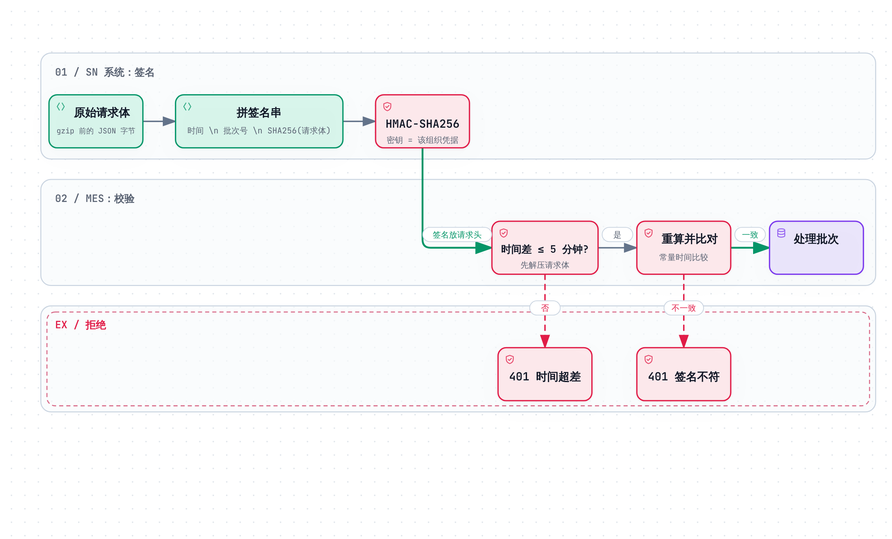
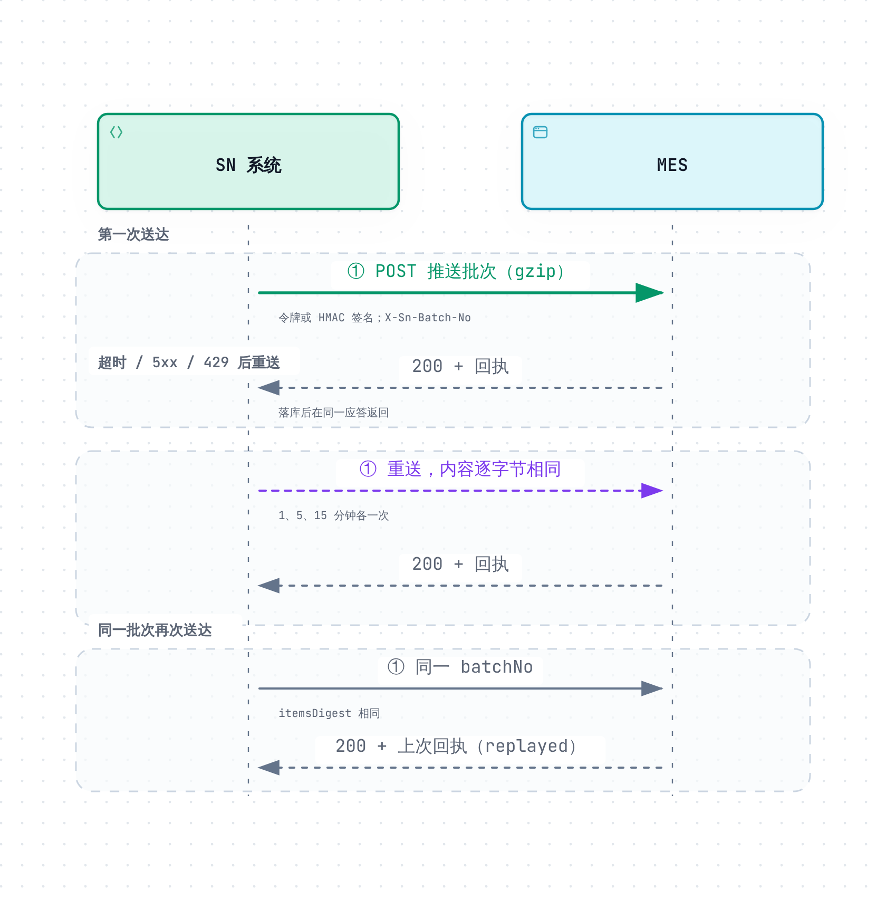
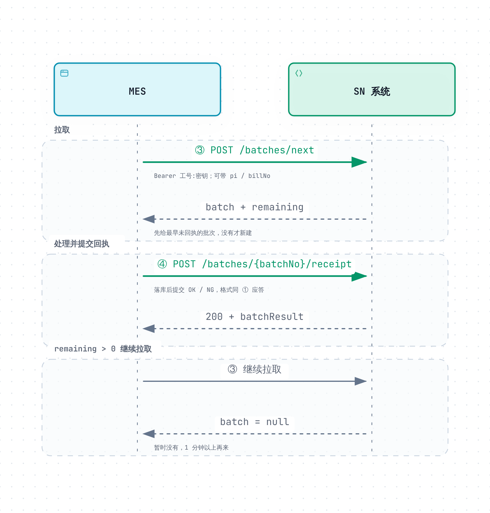

# SN 防重管控 · MES 对接说明

## 目录

- [第一部分　业务概述](#第一部分业务概述)
  - [1. 业务全景](#1-业务全景)
    - [1.1 端到端业务时序](#11-端到端业务时序)
  - [2. SN 生命周期与版本控制](#2-sn-生命周期与版本控制)
    - [2.1 SN 状态模型](#21-sn-状态模型)
    - [2.2 挂靠版本（rev）变更规则与对应批次类型](#22-挂靠版本rev变更规则与对应批次类型)
- [第二部分　对接规范](#第二部分对接规范)
  - [3. 接口总览](#3-接口总览)
    - [3.1 接口清单](#31-接口清单)
    - [3.2 接口交互时序](#32-接口交互时序)
  - [4. 批次处理规范（MES 侧）](#4-批次处理规范mes-侧)
    - [4.1 批次类型与关键判定字段](#41-批次类型与关键判定字段)
    - [4.2 处理流程](#42-处理流程)
  - [5. 转移业务规范](#5-转移业务规范)
    - [5.1 转移交互时序](#51-转移交互时序)
    - [5.2 SN 系统侧处理规则](#52-sn-系统侧处理规则)
    - [5.3 MES 侧处理规则](#53-mes-侧处理规则)
  - [6. 异常处理机制](#6-异常处理机制)
    - [6.1 推送失败与重试](#61-推送失败与重试)
    - [6.2 整批退回与重处理](#62-整批退回与重处理)
    - [6.3 批次作废](#63-批次作废)
    - [6.4 版本较旧的 SN](#64-版本较旧的-sn)
    - [6.5 回执长期缺失](#65-回执长期缺失)
- [第三部分　接口参考](#第三部分接口参考)
  - [7. 通用约定](#7-通用约定)
    - [7.1 传输与编码](#71-传输与编码)
    - [7.2 字段与数据格式](#72-字段与数据格式)
    - [7.3 认证与签名](#73-认证与签名)
    - [7.4 响应判定与限流](#74-响应判定与限流)
    - [7.5 错误响应格式与通用错误码](#75-错误响应格式与通用错误码)
  - [8. 接口定义](#8-接口定义)
    - [8.1 ① 接收批次](#81--接收批次)
    - [8.2 ③ 拉取批次](#82--拉取批次)
    - [8.3 ④ 提交回执](#83--提交回执)
    - [8.4 ⑤ 查询已下发 SN](#84--查询已下发-sn)
    - [8.5 ⑥ 查询批次明细](#85--查询批次明细)
  - [附录 A　错误码汇总](#附录-a错误码汇总)

---

# 第一部分　业务概述

## 1. 业务全景

### 1.1 端到端业务时序


| 阶段 | 参与方 | 说明 |
| --- | --- | --- |
| 订单与生成 | 金蝶 → SN 系统；总部 → SN 系统 | SN 系统定时同步金蝶已审核的生产订单；总部按 PI 预演后生成 SN，号池全局不重复 |
| 分配与下发 | 总部 → SN 系统 → MES | 总部把 SN 分配到订单的生产组织；SN 系统分批推送给该组织的 MES，MES 回执确认；推送失败时 MES 主动拉取 |
| 生产打标 | MES → 现场 | MES 下发 SN，现场打标、过站、LINK（MES 内部流程，不涉及本接口） |
| 转移 | 总部 / 生产组织 → SN 系统 → MES | 订单作废、拆单时总部转单；组织间调拨时生产组织申请、总部确认转组织；SN 系统改挂后给转入方发推送批次、给原组织发转移批次；原组织 MES 停止打标已转走的 SN，旧标签按「转出号清单」作废 |

## 2. SN 生命周期与版本控制

### 2.1 SN 状态模型


| SN 状态 | 含义 | 与 MES 的关系 |
| --- | --- | --- |
| 待分配 | 已生成，尚未分到生产组织 | MES 不可见 |
| 待推送（未入批） | 已分到对接 MES 的组织，尚未组批 | 等待推送或拉取 |
| 待推送（批次未确认） | 已组批，MES 尚未回执 | MES 已收到或正在接收 `DELIVERY` |
| 待推送（批次失败） | MES 整批退回，或回执与批次不符 | MES 修正后拉取重处理，或总部续推 |
| 已推送 | MES 已确认（推送应答、拉取回执或总部人工确认） | MES 已持有该 SN |
| 已分配 | 分到未对接 MES 的组织 | 不经过 MES |
| 申请中 | 已提交转组织申请，等待总部处理 | 仅在对账接口中作提醒（`APPLYING`） |

- 总部作废未确认的批次后，SN 回到「待推送（未入批）」，重新组批送达
- 单据反审核或订单变更待确认时，未下发的 SN **暂停下发**（页面标记「暂停交付」）：状态不变，不组批；拉取应答中的 `paused` 为暂停枚数

### 2.2 挂靠版本（rev）变更规则与对应批次类型

- **SN 字符串永不改变**，改变的只是挂靠关系（生产组织、PI、单据行、物料、客户）
- 生成时 `rev = 1`；每次转单、转组织（含订单变更「确认对应」）`rev` 加 1，**越大越新**；MES 原样保存，不得自行加减
- **`rev` 相同则挂靠相同**：挂靠一变 `rev` 必加 1，所以同一 `rev` 重复送达只会是相同内容，覆盖一次结果不变
- MES 收到 SN 只看三件事：批次类型、本地有没有这枚 SN、`rev` 大小（4.2 步骤 4）；不需要区分新增还是改挂、转单还是转组织

| 触发事件 | `rev` | MES 收到的批次 | MES 处理 |
| --- | --- | --- | --- |
| 首次分配后下发 | 不变 | 推送 / 拉取批次 | 本地没有，新增 |
| 同组织转移（MES 已持有） | +1 | 推送 / 拉取批次 | `rev` 更大，覆盖挂靠 |
| 同组织转移（MES 未持有） | +1 | 推送 / 拉取批次 | 本地没有，新增 |
| 跨组织转移 · 转入组织 | +1 | 推送 / 拉取批次 | 本地没有，新增；转回原组织时 `rev` 更大，覆盖并清除「已转走」 |
| 跨组织转移 · 原组织（曾持有） | +1 | 转移批次（`TRANSFER_OUT`） | 标记「已转走」，停止打标 |
| 批次重送、重新拉取 | 不变 | 同一批次，内容逐字节相同 | 按批次号幂等（4.2 步骤 3） |

---

# 第二部分　对接规范

## 3. 接口总览

### 3.1 接口清单

| 类别 | # | 接口名称 | 方向 | 提供方 | 请求方式与路径 | 认证方式 | 调用时机 |
| --- | --- | --- | --- | --- | --- | --- | --- |
| 推送 | ① | 接收批次 | SN → MES | **MES** | `POST {MES 地址}` | **待定**（建议固定令牌 + IP 白名单，或 HMAC 签名，见 7.3） | 分配后、转移后、续推时；连接测试 |
| 拉取 | ③ | 拉取批次 | MES → SN | SN 系统 | `POST /api/mes/v1/batches/next` | `Bearer <工号>:<密钥>` | 推送失败后、本地 SN 不足、每 5 分钟兜底 |
| 回执 | ④ | 提交回执 | MES → SN | SN 系统 | `POST /api/mes/v1/batches/{batchNo}/receipt` | 同上 | ③ 拉取的批次落库后 |
| 对账 | ⑤ | 查询已下发 SN | MES → SN | SN 系统 | `GET /api/mes/v1/sn/delivered` | 同上 | 可选，按需对账 |
| 对账 | ⑥ | 查询批次明细 | MES → SN | SN 系统 | `GET /api/mes/v1/batches/{batchNo}/items` | 同上 | 可选，按需对账 |

- 推送 ① 的回执随**同一应答**返回，无需再调 ④；④ 仅用于 ③ 拉取的批次
- 回执只有整批结果（`code = OK / NG`）：MES 逐枚处理的细节 SN 系统不需要知道，出问题整批退回
- 编号沿用历史编号，② 换令牌接口已移除

### 3.2 接口交互时序


| 通道 | 说明 |
| --- | --- |
| 推送主通道 | 分配、转移后 SN 系统主动推送 ①，MES 处理后在同一应答中回执；失败按 1、5、15 分钟重送 |
| 转移通知 | 跨组织转移时，给转入组织发推送批次的同时，给原组织发转移批次（`TRANSFER_OUT`），两者互不等待 |
| 拉取补偿通道 | 推送失败后、本地 SN 不足、每 5 分钟兜底：MES 调 ③ 拉取，落库后调 ④ 提交回执；可收回未送达的推送批次和转移批次 |
| 对账 | ⑤⑥ 只读，仅用于核对，不得据此入库、打标或删除 |

推送与拉取的**批次格式完全相同**，MES 只需实现一套处理逻辑（第 4 章）；同一批次可能经两条通道到达，按 `batchNo` 只处理一次。

## 4. 批次处理规范（MES 侧）

### 4.1 批次类型与关键判定字段

MES 收到的批次按 `batchType` 分为三类；推送批次和拉取批次的 `batchType` 相同，只是 `batchNo` 前缀和送达方式不同，MES 按同一逻辑处理即可。

| 批次 | `batchType` | `batchNo` 前缀 | 送达方式 | 用途 |
| --- | --- | --- | --- | --- |
| 推送批次 | `DELIVERY` | `PS` | ① 推送 | 分配、转移后 SN 系统主动下发 SN |
| 拉取批次 | `DELIVERY` | `PL` | ③ 拉取 | MES 拉取时新建，结构与推送批次相同 |
| 转移批次 | `TRANSFER_OUT` | `XO` | ① 推送，或 ③ 拉取 | 跨组织转移后通知原组织：这些 SN 已转走 |
| 测试批次 | `PING` | `PING` | ① 推送 | 连接测试，不含 SN |

转移后发给转入组织的 SN 仍放在推送批次或拉取批次里，MES 按 `rev` 新增或覆盖即可（见 5.3）。

> 以下为**报文节选**，只保留 MES 做判断要用的字段；完整报文见第 8 章，未列出的字段原样保存即可。

#### 推送批次（`batchType = DELIVERY`）

```jsonc
{
  "batchNo": "PS-110-20261019-000123", // 幂等键：PS 开头；收过则不再处理
  "batchType": "DELIVERY",             // 分流：DELIVERY / TRANSFER_OUT / PING
  "orgCode": "110",                    // 整批校验：必须是本组织
  "pi": "000001",                      // 整批校验：每枚 SN 的 pi 必须等于它
  "count": 1,                          // 整批校验：必须等于 items 条数
  "itemsDigest": "sha256:9f2c4e…",     // 幂等校验：同一 batchNo 再来时比对字符串
  "items": [
    {
      "sn": "HX100000001A",            // 唯一标识（多组织共用 MES 时为「组织 + SN」）
      "rev": 2,                        // 逐枚处理：不小于本地才新增或覆盖，小于则跳过
      "pi": "000001"                   // 须等于批次 pi
    }
  ]
}
```

#### 拉取批次（`batchType = DELIVERY`）

```jsonc
{
  "batchNo": "PL-110-20261019-000046", // 幂等键：PL 开头，MES 拉取时新建
  "batchType": "DELIVERY",             // 与推送批次相同，按同一逻辑处理
  "orgCode": "110",                    // 以下判定字段与推送批次相同
  "pi": "000001",
  "count": 1,
  "itemsDigest": "sha256:7d10aa…",
  "items": [
    {"sn": "HX100000005A", "rev": 1, "pi": "000001"}
  ]
}
```

拉取到的也可能是推送时建的批次（`PS` 开头，推送没送达），处理方式不变；处理完用 ④ 提交回执。

#### 转移批次（`batchType = TRANSFER_OUT`）

```jsonc
{
  "batchNo": "XO-110-20261019-000007", // 幂等键：XO 开头
  "batchType": "TRANSFER_OUT",         // 分流：明细只有 sn、rev、toOrgCode
  "orgCode": "110",                    // 整批校验：原组织（本组织）
  "count": 1,                          // 整批校验
  "itemsDigest": "sha256:51ab07…",     // 幂等校验
  "items": [
    {"sn": "HX100000003A", "rev": 3, "toOrgCode": "120"} // 标记已转走；本地没有时按 sn、rev 建一条已转走记录
  ]
}
```

#### 回执

```jsonc
{
  "batchNo": "PS-110-20261019-000123", // 照抄批次号
  "code": "OK",                        // OK 整批已处理 / NG 整批退回
  "message": null                      // NG 时必填：退回原因
}
```

### 4.2 处理流程


**步骤 1：分流**

| `batchType` | 含义 | MES 动作 |
| --- | --- | --- |
| `DELIVERY` | 推送批次、拉取批次：新下发或挂靠变更 | 逐枚新增或覆盖（步骤 4） |
| `TRANSFER_OUT` | 转移批次：SN 已转至其他组织 | 逐枚标记「已转走」，停止打标，不删除（步骤 4） |
| `PING` | 测试批次：连接测试，不含 SN | 只校验身份和 `orgCode`，回 `OK`；不存储、不记录批次号 |

**步骤 2：整批校验**　任一项不通过即回执 `NG`（HTTP 200，`message` 写明原因），**不写入任何数据**，也不记录该 `batchNo`：

- `orgCode` 为本组织；`count` 等于 `items` 条数；批内 SN 不重复
- 推送 / 拉取批次每枚 SN 的 `pi` 等于批次 `pi`
- 必填字段齐全、长度在本侧允许范围内

**步骤 3：幂等去重**　`batchNo` 已处理过时：`itemsDigest` 相同 → 直接回 `OK`；不同 → 409 `BATCH_CONTENT_MISMATCH`。

**步骤 4：逐枚处理**（依据：批次 `rev`、本地 `rev`）

| 比对结果 | 推送 / 拉取批次的 SN | 转移批次的 SN |
| --- | --- | --- |
| 本地不存在 | 按批次信息新增 | 建一条只有 `sn`、`rev` 的「已转走」记录 |
| 批次 `rev` ≥ 本地 `rev` | 覆盖挂靠，清除「已转走」 | 更新 `rev`，标记「已转走」，停止打标 |
| 批次 `rev` < 本地 `rev` | 跳过，不覆盖 | 跳过 |

- 跳过不算失败，整批仍回 `OK`；SN 系统不需要知道每枚的处理结果
- `rev` 相等时挂靠必然相同（2.2），覆盖一次结果不变
- 转移批次在本地没有该 SN 时也要建档：万一同一 SN 的旧推送批次迟到（`rev` 更小），会被跳过，不会被当成本组织持有而继续打标
- **不得**因为「批次里没有某枚 SN」就作废本地数据：批次是增量的，单个批次从不是全量

**步骤 5：落库与回执**

- 按 `batchNo` 加锁，同一批次不得并发处理
- 批次号、`itemsDigest` 与 SN 数据**在同一事务中落库**，成功后回 `OK`；任何一步出错整批回滚，回 `NG`
- 5000 枚建议 10 秒内处理完（推送应答超时为 60 秒）

## 5. 转移业务规范

### 5.1 转移交互时序


### 5.2 SN 系统侧处理规则


1. **发起**：转单由总部发起；转组织由生产组织申请、总部确认，或由总部直接转移；单次转移范围最大为一整张单据，不支持整张 PI 转移
2. **可转校验**：SN 所在的转移批次尚未确认时不可再转，提示先在原转组织单上继续推送，确保原组织 MES 先收到转移批次、后收到转回的 SN
3. **改挂**：清除 SN 原有批次，`rev` 加 1
4. **推送**：
   - **同组织**：MES 已持有的 SN 重新推送（新挂靠、新 `rev`）；尚未下发的照常等待下发
   - **跨组织**：向转入组织 MES 发推送批次；同时向曾持有该 SN 的原组织 MES 发转移批次（`TRANSFER_OUT`），两者互不等待
5. **不等待 MES**：SN 系统不发撤回指令、不等待 MES 同意；推送失败按普通批次重试、续推，MES 也可拉取

### 5.3 MES 侧处理规则

**转移类型无需识别**

MES 不需要知道是转单还是转组织、SN 从哪个组织转来：转单也可能转到其他组织的订单，SN 系统只按转移后组织是否变化决定发什么批次。MES 按 4.2 步骤 4 逐枚处理即可：

| 场景 | MES 收到的批次 | MES 处理 |
| --- | --- | --- |
| 普通下发 | 推送 / 拉取批次 | 本地没有，新增 |
| 同组织转移（转单到本组织其他单据，或转组织目标为原组织） | 推送 / 拉取批次 | 已持有：`rev` 更大，覆盖挂靠；未持有：新增 |
| 跨组织转移 · 转入组织 | 推送 / 拉取批次 | 本地没有，新增 |
| 跨组织转移 · 原组织 | 转移批次（`TRANSFER_OUT`），仅发给曾持有该 SN 的原组织 MES | 标记「已转走」，停止打标 |
| 转回原组织（A → B → A） | A 收推送批次，B 收转移批次 | A：`rev` 更大，覆盖并清除「已转走」；B：标记「已转走」 |

SN 系统保证同一 SN 的批次按顺序到达：SN 所在批次（含转移批次）未确认或失败时不允许再转，因此 MES 不会先收到新版本、后收到旧版本；极少数迟到的旧请求由 `rev` 比对跳过。

**同组织转移**


SN 系统可以自由发起同组织转移，**无需现场或 MES 事先确认能否转移**；转移在 SN 系统中立即生效，SN 改挂到新订单。MES 收到推送批次后按 `rev` 覆盖挂靠，回 `OK`；回执中没有「拒绝转移」选项。

MES 因过站方式、LINK 状态等原因无法在本侧完成转移时，**由 MES 自行处理，不影响 SN 系统**：SN 系统不感知、不校验、不等待，也不回滚已生效的转移。MES 侧可参考以下规则（MES 内部规则，与 SN 系统无关）：

1. **客户 SN 过站**：MES 将该 SN 整条数据链的订单关联切换到新订单；存在数据混乱风险，由 MES 自行控制
2. **内部 SN 过站**：客户 SN 已 LINK 的，MES 侧不能转移，由 MES 自行处理；未 LINK 的直接转移

**跨组织转移**

直接同步到新组织订单，**不考虑原组织 MES 的 SN 数据**：

- **转入建档**：新组织 MES 本地无此 SN，按收到的挂靠新增，无需与原组织核对
- **原组织停用**：原组织 MES 无需同步、回滚或清理原数据链，只按转移批次标记「已转走」并停止打标，防止两个工厂使用同一 SN
- 已打出的旧标签由原组织现场按「转出号清单」作废

## 6. 异常处理机制

### 6.1 推送失败与重试

- 推送超时、MES 宕机、5xx、429、503：SN 系统按 1、5、15 分钟重送同一批次，**内容逐字节相同**
- 重试用尽仍未确认时停止推送，在页面显示「继续推送」；MES 恢复后也可直接拉取该批次
- MES 无需特殊处理，按幂等去重（4.2 步骤 3）即可

### 6.2 整批退回与重处理

- MES 无法处理时回执 `NG`，在 `message` 写明原因（显示在总部页面上）；同一 PI 的后续推送随即暂停
- MES 修正后：调 ③ 带 `batchNo` 拉取该批次 → 重新处理 → 调 ④ 提交回执 → 请总部「继续推送」

### 6.3 批次作废

- 总部作废批次后，③ ④ 对该批次返回 409 `BATCH_VOIDED`
- MES 丢弃该批次，**不得**用本地缓存继续处理；其中的 SN 会重新组批送达

### 6.4 版本较旧的 SN

- 批次中某枚 SN 的 `rev` 小于本地时，MES 跳过该枚、保留本地数据，整批照常回 `OK`，无需告知 SN 系统
- 正常情况下不会出现（5.3）；MES 侧如需排查，可用 ⑤ 查询 SN 系统当前的 `rev` 与挂靠

### 6.5 回执长期缺失

- 批次长期无法回执时，MES 书面告知总部是否已入库
- 已入库：总部「人工确认」，SN 变为已推送；未处理：总部「作废」，SN 重新组批
- 回执与批次不符（批次号不一致，或 `code` 不是 `OK` / `NG`，422 `RECEIPT_MISMATCH`）时按 `details` 改正后重交

---

# 第三部分　接口参考

## 7. 通用约定

### 7.1 传输与编码

| 项目 | 约定 |
| --- | --- |
| 协议 | HTTPS，不跟随 3xx 跳转 |
| 传输格式 | 默认 JSON（UTF-8），支持 gzip 压缩 |
| 请求 | 带 `Content-Encoding: gzip` 时请求体为 gzip，先解压再按 JSON 解析；不带时为原始 JSON |
| 应答 | 请求带 `Accept-Encoding: gzip` 时可返回 gzip 应答（应答头 `Content-Encoding: gzip`）；SN 系统（③～⑥）对 1 KB 以上的应答压缩 |
| ① 推送 | 默认发原始 JSON；生产组织开启「gzip 压缩」时请求体 gzip 并带 `Content-Encoding: gzip`，开启前须确认 MES 支持解压 |
| 协议版本 | 每个报文带 `schemaVersion`，现为 `1.0` |

### 7.2 字段与数据格式

| 项目 | 约定 |
| --- | --- |
| 命名 | 英文小驼峰 |
| 兼容性 | 后续只增加字段、不修改已有字段；**不认识的字段直接忽略** |
| 时间 | UTC，ISO 8601，如 `2026-10-19T02:37:00Z` |
| SN | ≤ 64 位，仅字母、数字、`-`、`.`、`_`；**区分大小写** |
| 字符串型数字 | `serialDec`、`length` 按字符串保存，不得转数字（防止丢失前导 0 或溢出） |
| 多组织 | 一套 MES 服务多个组织时，以「组织 + SN」为唯一标识，数据按组织隔离 |

### 7.3 认证与签名

**① SN 系统 → MES（待定）**

> **待定**：接口 ① 由 MES 方提供，MES 方目前尚未提供该接口及其认证要求。下面是 SN 系统已实现的两种方式，作为建议方案供 MES 方选择；最终的认证与签名规范以 MES 方提供的接口文档为准，双方书面确认后更新本节及 8.1 的请求头。

建议方案（每个组织二选一，总部在「MES 配置」中设定）：

| 方式 | 适用场景 | 请求头 | MES 校验 |
| --- | --- | --- | --- |
| A 固定令牌 | 内网 | `Authorization: Bearer <令牌>` | 核对令牌，并限制来源为 SN 系统服务器 IP |
| B HMAC 签名 | 公网（推荐） | `X-Sn-Timestamp`、`X-Sn-Signature` | 按下图重算签名比对，并校验时间差 |



```text
签名串  = X-Sn-Timestamp + "\n" + batchNo + "\n" + hex(SHA256(解压后的请求体字节))
签名    = hex(HMAC-SHA256(密钥, 签名串))          // 均为小写十六进制，UTF-8 编码
```

- 摘要按**解压后的原始字节**计算，不得先解析 JSON 再序列化（字段顺序、空白会变化）
- 时间差超过 5 分钟拒绝；签名比较使用常量时间比较
- 密钥由总部在「MES 配置」中设定，线下提供给 MES 方

**③～⑥ MES → SN 系统**

- 每次请求带 `Authorization: Bearer <工号>:<密钥>`，无需换取令牌；工号、密钥由总部在「账户 → MES 接口账户」创建后提供给 MES 方
- 账户仅能访问所绑定的生产组织；可设置来源 IP 白名单
- 连续认证失败 10 次锁定 15 分钟

### 7.4 响应判定与限流

| 项目 | 约定 |
| --- | --- |
| 成功判定（③～⑥） | HTTP 200 且 `code = OK`；出错时 HTTP 状态码一定不是 200，程序按 `code` 处理，`message` 仅供阅读 |
| 成功判定（①） | MES 能拆包处理即返回 HTTP 200 + 回执（含整批退回），见 8.1 |
| 限流 | ③～⑥ 每个组织每分钟 60 次；超出返回 429 `RATE_LIMITED`，按应答头 `Retry-After` 秒数等待 |

### 7.5 错误响应格式与通用错误码

**错误响应格式**（③～⑥）

```jsonc
{
  "schemaVersion": "1.0",              // String，协议版本
  "code": "RECEIPT_MISMATCH",          // String ★ 错误码，程序按它处理
  "message": "回执与批次不符",           // String，中文说明，仅供阅读
  "batchNo": "PL-110-20261019-000045", // String | null，相关批次号
  "details": [                         // Array，错误明细，可能为空数组
    {
      "field": "code",                 // String，出错字段
      "reason": "只能是 OK / NG，收到 DONE" // String，原因
    }
  ]
}
```

**通用错误码**（③～⑥）

| HTTP | `code` | 含义 | 处理建议 |
| --- | --- | --- | --- |
| 400 | `INVALID_REQUEST` | 请求体不是合法 gzip / JSON，或参数不合法 | 修正请求 |
| 401 | `INVALID_CREDENTIALS` | 缺少认证头，或工号、密钥错误（含密钥已重置） | 核对后重试 |
| 423 | `ACCOUNT_LOCKED` | 连续认证失败已锁定，锁定期间密钥正确也拒绝 | 等待解锁 |
| 403 | `IP_NOT_ALLOWED` | 来源 IP 不在白名单 | 联系总部调整白名单 |
| 403 | `ACCOUNT_DISABLED` | 账户已停用 | 联系总部 |
| 403 | `FORBIDDEN` | 非 MES 接口账户调用 ③④ | 改用 MES 接口账户 |
| 429 | `RATE_LIMITED` | 调用过于频繁 | 按 `Retry-After` 等待 |

## 8. 接口定义

> 报文以带注释的 JSON 展示，**注释仅为说明，实际报文不含注释**。
> 注释格式：`必填 / 选填，类型，含义`；**★** 标出 MES 用于判断的字段。

### 8.1 ① 接收批次

#### 1. 基本信息

| 项目 | 内容 |
| --- | --- |
| 接口名称 | 接收批次 |
| 接口描述 | SN 系统向 MES 推送批次（推送批次、转移批次、测试批次）；MES 按第 4 章处理并落库后，在**同一应答**中返回整批回执（`OK` / `NG`） |
| 方向 / 提供方 | SN → MES；**由 MES 提供** |
| 请求方式 | `POST` |
| 请求 URL | `{MES 地址}`，由 MES 方提供，总部在「生产组织 → MES 配置」中填写 |
| 调用时机 | 分配后、转移后、续推时；总部点「连接测试」时发送 `PING` |
| 负责人 | 接口实现：MES 方（待填写）；调用方：SN 系统  |
| 当前状态 | **待定**：MES 方尚未提供接口；URL、认证与签名方式待 MES 方提供后书面确认（见 7.3） |



#### 2. 请求参数

**Header**

| 参数名 | 类型 | 必填 | 示例值 | 描述 |
| --- | --- | --- | --- | --- |
| `Content-Type` | String | 是 | `application/json; charset=utf-8` | 固定 |
| `Content-Encoding` | String | 否 | `gzip` | 生产组织开启「gzip 压缩」时才带，请求体为 gzip，先解压；默认不带，请求体为原始 JSON |
| `Accept-Encoding` | String | 是 | `gzip` | MES 应答可用 gzip 压缩，也可返回原始 JSON |
| `Authorization` | String | 方式 A 必填 | `Bearer 7f3c…` | 固定令牌（7.3，**待定**） |
| `X-Sn-Timestamp` | String | 方式 B 必填 | `2026-10-19T02:37:00Z` | 签名时间（UTC）（7.3，**待定**） |
| `X-Sn-Signature` | String | 方式 B 必填 | `a3f9…`（64 位小写十六进制） | HMAC 签名（7.3，**待定**） |
| `X-Sn-Batch-No` | String | 是 | `PS-110-20261019-000123` | ★ 批次号，与报文 `batchNo` 相同；可在解析报文前按它加锁 |
| `X-Sn-Attempt` | String | 是 | `1` | 第几次送达，仅记日志 |
| `X-Request-Id` | String | 是 | UUID | 请求编号，仅用于查日志；**不得用于去重** |

**Body A：推送批次（`DELIVERY`）**　新 SN、挂靠变更均使用此结构；拉取批次结构相同

```jsonc
{
  "schemaVersion": "1.0",              // 必填，String，协议版本
  "batchNo": "PS-110-20261019-000123", // 必填，String，批次号，全局唯一（PS 推送建批 / PL 拉取建批）★ 幂等键
  "batchType": "DELIVERY",             // 必填，String，DELIVERY / TRANSFER_OUT / PING ★ 分流
  "orgCode": "110",                    // 必填，String，收件组织 ★ 非本组织 → 整批退回
  "pi": "000001",                      // 必填，String，推送 / 拉取批次只含这一张 PI 的 SN ★ 每枚 SN 的 pi 必须等于它
  "count": 1,                          // 必填，Number，枚数，≤ 5000 ★ 必须等于 items 条数
  "createdAt": "2026-10-19T02:37:00Z", // 必填，String，建批时间（UTC）
  "itemsDigest": "sha256:9f2c4e…",     // 必填，String，内容指纹，MES 存储后直接比对字符串，无需自行计算；相同即两次送达的数据相同，不同返回 409 BATCH_CONTENT_MISMATCH ★ 幂等校验
  "items": [                           // 必填，Array，SN 明细
    {
      "sn": "HX100000001A",            // 必填，String，完整 SN
      "rev": 2,                        // 必填，Number，挂靠版本，越大越新 ★ 不小于本地才新增或覆盖（4.2 步骤 4）
      "serial": "000001",              // 必填，String，流水号（可能为 36 进制写法）
      "serialDec": "1",                // 必填，String，十进制流水，按字符串保存
      "serialPi": "000001",            // 必填，String，流水最初所属 PI；转入 SN 可能 ≠ pi，不要互相校验
      "pi": "000001",                  // 必填，String，当前所属 PI
      "billNo": "VT2026090001",        // 必填，String，单据号（EEP 生产订单号）
      "billSeq": 1,                    // 必填，Number，单据行号（EEP 单据明细项次；同一单据可能有相同物料，以项次区分）
      "materialCode": "9148363",       // 选填，String | null，物料编码
      "length": "0100",                // 选填，String | null，米标，原样保存（不得变为 100）
      "customerCode": "0001"           // 必填，String，客户编码
    }
  ]
}
```

**Body B：转移批次（`TRANSFER_OUT`）**　跨组织转移后通知原组织「这些 SN 已转走」

```jsonc
{
  "schemaVersion": "1.0",              // 必填，String，协议版本
  "batchNo": "XO-110-20261019-000007", // 必填，String，XO 开头 ★ 幂等键
  "batchType": "TRANSFER_OUT",         // 必填，String ★ 分流
  "orgCode": "110",                    // 必填，String，原组织（收件方）★ 非本组织 → 整批退回
  "pi": "000001",                      // 必填，String | null，SN 来自多张 PI 时为 null
  "count": 1,                          // 必填，Number ★ 等于 items 条数
  "createdAt": "2026-10-19T02:50:00Z", // 必填，String，建批时间（UTC）
  "itemsDigest": "sha256:51ab07…",     // 必填，String ★ 幂等校验
  "items": [                           // 必填，Array，SN 明细
    {
      "sn": "HX100000003A",            // 必填，String，完整 SN
      "rev": 3,                        // 必填，Number ★ 不小于本地才标记（4.2 步骤 4）；本地没有时按 sn、rev 建一条已转走记录
      "toOrgCode": "120"               // 必填，String，转入组织，记录备查
    }
  ]
}
```

已打出的旧标签由原组织现场按 SN 系统页面导出的「转出号清单」作废，报文不带转移单号。

**Body C：测试批次（`PING`）**　总部点「连接测试」时发送

```jsonc
{
  "schemaVersion": "1.0",                // 必填，String，协议版本
  "batchNo": "PING-202610190237001234",  // 必填，String，无需记录，无需去重
  "batchType": "PING",                   // 必填，String ★ 只校验身份和 orgCode，不存储任何数据
  "orgCode": "110",                      // 必填，String ★ 非本组织 → 退回
  "pi": null,                            // 必填，固定 null
  "count": 0,                            // 必填，Number，固定 0
  "createdAt": "2026-10-19T02:37:00Z",   // 必填，String，建批时间（UTC）
  "itemsDigest": "sha256:…",             // 必填，String
  "items": []                            // 必填，固定空数组
}
```

#### 3. 响应参数（回执）

推送时随 ① 的应答返回；拉取时通过 ④ 提交，格式相同。回执只有整批结果，MES 逐枚的处理细节（新增、覆盖、跳过）不需要回传。

```jsonc
// 整批已处理（含逐枚跳过的旧版本）—— HTTP 200
{
  "schemaVersion": "1.0",              // 必填，String，协议版本
  "batchNo": "PS-110-20261019-000123", // 必填，String，照抄批次号
  "code": "OK",                        // 必填，String，OK 整批已处理 / NG 整批退回
  "message": null                      // 选填，String | null，OK 时为 null
}

// 整批退回 —— 同样 HTTP 200；退回时不写入任何数据，也不记录该 batchNo
{
  "schemaVersion": "1.0",
  "batchNo": "PL-110-20261019-000046",
  "code": "NG",
  "message": "materialCode 超过本侧字段长度 20" // NG 时必填，String，退回原因，显示在总部页面
}

// 连接测试 —— HTTP 200
{"schemaVersion": "1.0", "batchNo": "PING-202610190237001234", "code": "OK", "message": null}
```

#### 4. 错误码（MES 返回的 HTTP 状态码）

| 场景 | MES 返回 | SN 系统处理 |
| --- | --- | --- |
| 处理完成（`OK`），或整批退回（`NG`） | **200** + 回执 | `OK` 确认批次，SN 变为已推送；`NG` 冻结该批次并显示原因 |
| 同一批次正在处理 | 处理完后返回同一回执，或 409 `BATCH_IN_PROGRESS` | 409 时稍后重送 |
| 批次号相同、内容不同（`itemsDigest` 不同） | 409 `BATCH_CONTENT_MISMATCH` | 不重送，告警 |
| 认证失败（令牌错误、签名错误、时间超差） | 401 / 403 | 不重送 |
| 地址错误 | 404 | 不重送 |
| 报文过大 | 413 | 不重送；总部作废后拆小重发 |
| 报文无法解析（gzip / JSON） | 400 | 不重送 |
| 超时、5xx、网络中断、429、503 | — | 1、5、15 分钟后重送 |

**原则**：只要能拆包处理，就返回 200 + 回执；4xx 仅用于「完全无法处理」。缺字段、`orgCode` 不符等业务问题返回 200 + `NG`，不返回 4xx。HTTP 200 但 `code` 不是 `OK` / `NG` 时，SN 系统记为应答无效，不重送。

#### 5. 补充说明

- 重送内容逐字节相同（`batchNo`、`itemsDigest` 不变），MES 按幂等去重处理（4.2 步骤 3）
- 认证与签名见 7.3

---

### 8.2 ③ 拉取批次

#### 1. 基本信息

| 项目 | 内容 |
| --- | --- |
| 接口名称 | 拉取批次 |
| 接口描述 | MES 主动拉取批次。优先返回范围内**最早的未回执批次**（推送未送达的、上次拉取后未回执的、转移批次），没有时才新建；已退回、已作废的批次不会自动返回 |
| 方向 / 提供方 | MES → SN；SN 系统提供 |
| 请求方式 | `POST` |
| 请求 URL | `/api/mes/v1/batches/next` |
| 调用时机 | 推送失败后、本地 SN 不足、每 5 分钟不带条件兜底一次 |
| 负责人 | SN 系统  |



#### 2. 请求参数

**Header**

| 参数名 | 类型 | 必填 | 示例值 | 描述 |
| --- | --- | --- | --- | --- |
| `Authorization` | String | 是 | `Bearer M110001:xxxxxxxx` | MES 接口账户的工号与密钥，以冒号连接 |
| `Content-Type` | String | 否 | `application/json` | — |
| `Content-Encoding` | String | 否 | `gzip` | 默认原始 JSON；请求体 gzip 压缩时填写 |

**Body**

```jsonc
{
  "schemaVersion": "1.0", // 必填，String，协议版本
  "pi": "000001",         // 选填，String | null，限定 PI；null = 不限
  "billNo": null,         // 选填，String | null，限定单据；可与 pi 同时使用
  "batchNo": null         // 选填，String | null，取回指定的旧批次（如修正后重处理被退回的批次）；填写后 pi、billNo 不生效，且不会新建批次
}
```

转移批次按其中 SN 转出前的 PI、单据判断是否在范围内。

#### 3. 响应参数

```jsonc
{
  "schemaVersion": "1.0",      // String，协议版本
  "code": "OK",                // String，成功固定为 OK
  "batch": { /* 批次，结构同 8.1 Body A / B */ }, // Object | null ★ null = 暂无可拉取批次，1 分钟以上再试
  "batchSource": "PULL",       // String，PUSH 推送时建批 / PULL 拉取时建批；处理方式相同
  "newlyCreated": true,        // Boolean，是否本次新建
  "batchResult": "UNCONFIRMED",// String，UNCONFIRMED 未回执；按 batchNo 取回被退回的批次时为 FAILED
  "remaining": 1200,           // Number ★ 范围内剩余可拉取枚数，> 0 时继续拉取
  "paused": 0                  // Number，被暂停下发的枚数，等待总部处理，无需反复拉取
}
```

拉取到批次后，处理完成须**立即调 ④ 提交回执**；未提交时下次拉取仍返回同一批次。

#### 4. 错误码

除 7.5 通用错误码外：

| HTTP | `code` | 含义 | 处理建议 |
| --- | --- | --- | --- |
| 403 | `ORG_NOT_ALLOWED` | 该 PI 下没有分到本组织的 SN，也没有本组织的转移批次 | 检查 `pi` |
| 404 | `BATCH_NOT_FOUND` | 批次号不存在，或不属于本组织 | 检查 `batchNo` |
| 409 | `BATCH_CONFIRMED` | 该批次已回执 | 无需再处理 |
| 409 | `BATCH_VOIDED` | 该批次已作废 | 丢弃，不得用本地缓存处理 |
| 5xx / 超时 | — | — | 直接重试，返回的仍是同一批次 |

#### 5. 补充说明

- 回执前重复拉取，返回同一批次（`batchNo`、`itemsDigest` 相同）
- 同一批次经推送和拉取都到达时，按 `batchNo` 只处理一次

---

### 8.3 ④ 提交回执

#### 1. 基本信息

| 项目 | 内容 |
| --- | --- |
| 接口名称 | 提交回执 |
| 接口描述 | 对 ③ 拉取的批次提交回执（含整批退回）；推送的批次已随 ① 应答回执，无需再提交。按批次号幂等 |
| 方向 / 提供方 | MES → SN；SN 系统提供 |
| 请求方式 | `POST` |
| 请求 URL | `/api/mes/v1/batches/{batchNo}/receipt` |
| 调用时机 | ③ 拉取的批次落库后立即提交 |
| 负责人 | SN 系统  |

#### 2. 请求参数

**Header**：同 8.2。

**Path**

| 参数名 | 类型 | 必填 | 示例值 | 描述 |
| --- | --- | --- | --- | --- |
| `batchNo` | String | 是 | `PL-110-20261019-000046` | 批次号，须与请求体 `batchNo` 一致 |

**Body**：即 8.1「3. 响应参数」中的回执，字段注释见该节。

SN 系统校验：请求体 `batchNo` 与路径一致；`code` 为 `OK` 或 `NG`。

#### 3. 响应参数

```jsonc
{
  "schemaVersion": "1.0",              // String，协议版本
  "code": "OK",                        // String，成功固定为 OK
  "batchNo": "PL-110-20261019-000046", // String，批次号
  "batchResult": "SUCCESS",            // String，SUCCESS 成功（回执 OK）/ FAILED 整批退回已登记（回执 NG）
  "firstConfirmation": true            // Boolean，true 本次首次确认；false 此前已确认，本次仅存档
}
```

#### 4. 错误码

除 7.5 通用错误码外：

| HTTP | `code` | 含义 | 处理建议 |
| --- | --- | --- | --- |
| 422 | `RECEIPT_MISMATCH` | 回执与批次不符 | 按 `details` 改正后重新提交 |
| 409 | `BATCH_VOIDED` | 该批次已作废 | 丢弃 |
| 404 | `BATCH_NOT_FOUND` | 批次号不存在，或不属于本组织 | 检查 `batchNo` |
| 5xx / 超时 | — | — | 以同一回执重试 |

#### 5. 补充说明

- 重复提交同一回执不会报错，第二次起 `firstConfirmation = false`
- 整批退回后的重处理流程见 6.2

---

### 8.4 ⑤ 查询已下发 SN

#### 1. 基本信息

| 项目 | 内容 |
| --- | --- |
| 接口名称 | 查询已下发 SN |
| 接口描述 | 返回 SN 系统认定已下发给本组织 MES 的 SN（含推送和拉取）；已转至其他组织的不返回。**仅用于对账**，不得据此入库、打标或删除 |
| 方向 / 提供方 | MES → SN；SN 系统提供 |
| 请求方式 | `GET` |
| 请求 URL | `/api/mes/v1/sn/delivered` |
| 调用时机 | 可选，按需对账 |
| 负责人 | SN 系统  |

#### 2. 请求参数

**Header**：`Authorization: Bearer <工号>:<密钥>`。

**Query**

| 参数名 | 类型 | 必填 | 默认值 | 示例值 | 描述 |
| --- | --- | --- | --- | --- | --- |
| `pi` | String | 否 | 不限 | `000001` | 限定 PI |
| `cursor` | String | 否 | 空 | `10086` | 分页游标：首页留空，之后填上一页的 `nextCursor` |
| `pageSize` | Number | 否 | `1000` | `2000` | 每页条数，最大 5000 |

#### 3. 响应参数

```jsonc
{
  "schemaVersion": "1.0",              // String，协议版本
  "code": "OK",                        // String，成功固定为 OK
  "items": [                           // Array，SN 列表
    {
      "sn": "HX100000001A",            // String，完整 SN
      "rev": 2,                        // Number，挂靠版本
      "serial": "000001",              // String，流水号
      "serialDec": "1",                // String，十进制流水
      "serialPi": "000001",            // String，流水最初所属 PI
      "pi": "000001",                  // String，当前所属 PI
      "billNo": "VT2026090001",        // String，单据号
      "billSeq": 1,                    // Number，单据行号
      "materialCode": "9148363",       // String | null，物料编码
      "length": "0100",                // String | null，米标
      "customerCode": "0001",          // String，客户编码
      "orgCode": "110",                // String，当前所属组织
      "status": "PUSHED",              // String，SN 系统中的状态：PUSHED 已推送 / TO_PUSH 改挂待推送 / APPLYING 转组织申请中（仅提醒）
      "batchNo": "PS-110-20261019-000123" // String | null，当前所在批次
    }
  ],
  "nextCursor": "10086"                // String | null ★ 下一页游标；null = 最后一页
}
```

#### 4. 错误码

仅 7.5 通用错误码。

---

### 8.5 ⑥ 查询批次明细

#### 1. 基本信息

| 项目 | 内容 |
| --- | --- |
| 接口名称 | 查询批次明细 |
| 接口描述 | 返回指定批次中**仍属于该批次**的 SN（已转至其他组织的不返回，整批移出时为 0 枚）。仅用于对账 |
| 方向 / 提供方 | MES → SN；SN 系统提供 |
| 请求方式 | `GET` |
| 请求 URL | `/api/mes/v1/batches/{batchNo}/items` |
| 调用时机 | 可选，按需对账 |
| 负责人 | SN 系统  |

#### 2. 请求参数

**Header**：`Authorization: Bearer <工号>:<密钥>`。

**Path / Query**

| 参数名 | 位置 | 类型 | 必填 | 默认值 | 描述 |
| --- | --- | --- | --- | --- | --- |
| `batchNo` | Path | String | 是 | — | 批次号 |
| `cursor` | Query | String | 否 | 空 | 同 8.4 |
| `pageSize` | Query | Number | 否 | `1000` | 同 8.4，最大 5000 |

#### 3. 响应参数

```jsonc
{
  "schemaVersion": "1.0",              // String，协议版本
  "code": "OK",                        // String，成功固定为 OK
  "batchNo": "PS-110-20261019-000123", // String，查询的批次号
  "items": [ /* 结构同 8.4 items */ ],  // Array，仍属于该批次的 SN
  "nextCursor": null                   // String | null，下一页游标；null = 最后一页
}
```

#### 4. 错误码

除 7.5 通用错误码外：404 `BATCH_NOT_FOUND`（批次号不存在，或不属于本组织）。

---

## 附录 A　错误码汇总

| `code` | HTTP | 适用接口 | 含义 |
| --- | --- | --- | --- |
| `INVALID_REQUEST` | 400 | ③～⑥ | 请求体不是合法 gzip / JSON，或参数不合法 |
| `INVALID_CREDENTIALS` | 401 | ③～⑥ | 缺少认证头，或工号、密钥错误 |
| `ACCOUNT_LOCKED` | 423 | ③～⑥ | 连续认证失败已锁定 |
| `IP_NOT_ALLOWED` | 403 | ③～⑥ | 来源 IP 不在白名单 |
| `ACCOUNT_DISABLED` | 403 | ③～⑥ | 账户已停用 |
| `FORBIDDEN` | 403 | ③④ | 非 MES 接口账户 |
| `RATE_LIMITED` | 429 | ③～⑥ | 调用过于频繁 |
| `ORG_NOT_ALLOWED` | 403 | ③ | PI 与本组织无关 |
| `BATCH_NOT_FOUND` | 404 | ③④⑥ | 批次号不存在，或不属于本组织 |
| `BATCH_CONFIRMED` | 409 | ③ | 批次已回执 |
| `BATCH_VOIDED` | 409 | ③④ | 批次已作废 |
| `RECEIPT_MISMATCH` | 422 | ④ | 回执与批次不符 |
| `BATCH_IN_PROGRESS` | 409 | ①（MES 返回） | 同一批次正在处理 |
| `BATCH_CONTENT_MISMATCH` | 409 | ①（MES 返回） | 批次号相同但内容不同 |
