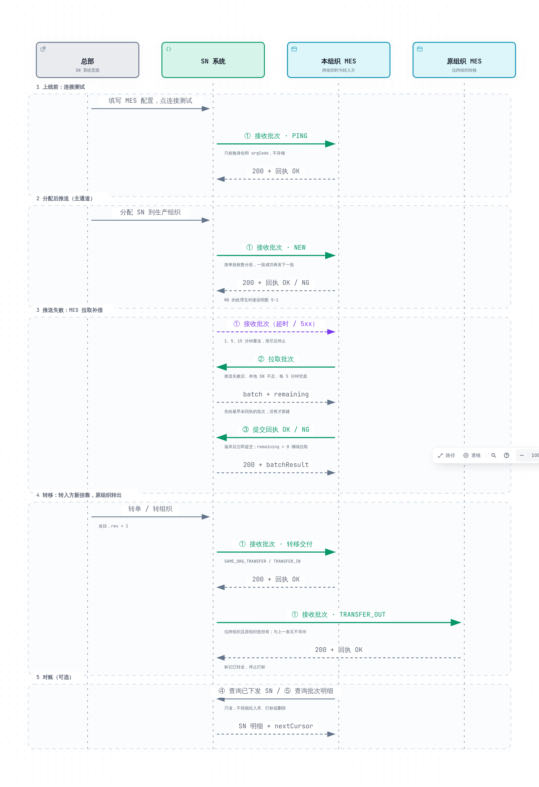

# SN 防重管控系统 · MES 对接接口规范 V1.0

| 项目 | 内容 |
| --- | --- |
| 文档版本 | V1.0 |
| 协议版本 | `schemaVersion = 1.0` |
| 更新日期 | 2026-10-26 |
| 适用对象 | MES 方开发人员、SN 系统对接人员 |
| MES 接口负责人 | MES 侧填写：姓名、联系方式 |
|                |                                 |

## 目录

- [1. 概述](#1-概述)
  - [1.1 接口清单](#11-接口清单)
  - [1.2 调用时序](#12-调用时序)
- [2. 接入规范](#2-接入规范)
  - [2.1 通信协议（含认证）](#21-通信协议含认证)
  - [2.2 数据格式](#22-数据格式)
  - [2.3 幂等与重试](#23-幂等与重试)
  - [2.4 限流](#24-限流)
- [3. 接口说明](#3-接口说明)
  - [3.1 ① 推送批次](#31--推送批次)
  - [3.2 ② 拉取批次](#32--拉取批次)
  - [3.3 ③ 提交回执](#33--提交回执)
  - [3.4 ④ 查询已下发 SN](#34--查询已下发-sn)
  - [3.5 ⑤ 查询批次明细](#35--查询批次明细)
- [附录 A 数据字典](#附录-a-数据字典)
- [附录 B 错误码](#附录-b-错误码)

---

## 1. 概述

### 1.1 接口清单

| 编号 | 接口名称 | 调用方向 | 方法 | 地址 | 调用时机 |
| --- | --- | --- | --- | --- | --- |
| ① | 推送批次 | SN 系统 → **MES** | `POST` | `{MES 地址}`（MES 提供） | 分配、转移、续推后；连接测试 |
| ② | 拉取批次 | MES → SN 系统 | `POST` | `/api/mes/v1/batches/next` | 推送失败后、本地 SN 不足、每 5 分钟兜底 |
| ③ | 提交回执 | MES → SN 系统 | `POST` | `/api/mes/v1/batches/{batchNo}/receipt` | ② 拉取的批次落库后 |
| ④ | 查询已下发 SN | MES → SN 系统 | `GET` | `/api/mes/v1/sn/delivered` | 可选，对账 |
| ⑤ | 查询批次明细 | MES → SN 系统 | `GET` | `/api/mes/v1/batches/{batchNo}/items` | 可选，对账 |

### 1.2 调用时序



---

## 2. 接入规范

表中「MES 侧」列为待 MES 方书面确认的事项，确认后以回复为准；`—` 表示无需填写。

### 2.1 通信协议（含认证）

| 序号 | 事项 | SN 系统 | MES 侧 |
| --- | --- | --- | --- |
| 1 | ① 地址（测试环境） | 完整 URL，须 HTTPS | |
| 2 | ① 地址（正式环境） | 同上 | |
| 3 | ① 多组织地址 | 多个生产组织可共用一个地址，按请求体 `orgCode` 区分 | |
| 4 | 协议 | HTTPS；不跟随 3xx 跳转 |  |
| 5 | ① HTTPS 证书 |  | |
| 6 | 字符集 | UTF-8 |  |
| 7 | 数据格式 | JSON，`Content-Type: application/json` |  |
| 8 | 请求压缩 | 带 `Content-Encoding: gzip` 的请求体为 gzip，先解压再解析。① 默认发原始 JSON，生产组织开启「gzip 压缩」后才发 gzip | ① ☐ 支持 ☐ 不支持 |
| 9 | 响应压缩 | 请求带 `Accept-Encoding: gzip` 时，SN 系统对 1 KB 以上的响应做 gzip |  |
| 10 | ① 单批大小 | 默认 ≤ 5000 枚 | 枚数、报文大小上限： |
| 11 | ① 超时 | SN 系统等待 60 秒；建议 5000 枚 10 秒内处理完并响应 | 处理时长： |
| 12 | 认证方式 | 工号 + 密钥 |  |
| 13 | 认证请求头 | `Authorization: Bearer <工号>:<密钥>`，如 `Bearer SN110:7f3c9a1e5b2d4f60` |  |
| 14 | 认证校验 | 核对工号、密钥 |  |
| 15 | 来源 IP |  |  |
| 16 | 凭证交付 | 线下交付 |  |
| 17 | 认证失败 | 401：缺少请求头，或工号、密钥错误<br />403：账户已停用<br />其他 |  |

### 2.2 数据格式

| 项目 | 约定 |
| --- | --- |
| 字段命名 | 英文小驼峰，如 `batchNo` |
| 时间 | **UTC+8**，格式 `yyyy-MM-dd HH:mm:ss.SSS`，如 `2026-10-26 11:47:05.303`；批次号中的日期同样按 UTC+8 |
| SN | ≤ 64 位，仅字母、数字、`-`、`.`、`_`；区分大小写 |
| 字符串型数字 | `serialDec`、`length` 按字符串保存，不得转数字（防止丢失前导 0 或溢出） |
| 类型标注 | `String(n)` 最长 n 个字符；`Number` 为 JSON 整数；`\| null` 表示可为 `null` |
| 兼容性 | 后续只增加字段、不修改已有字段；**不认识的字段直接忽略** |
| 协议版本 | SN 系统发出的批次和响应带 `schemaVersion`；MES 发出的请求、回执无需携带 |

### 2.3 幂等与重试

- **幂等键 `batchNo`**
  - 同一批次可能重复送达，也可能分别经 ① 和 ② 到达，MES 只处理一次
  - 重复到达时，`itemsDigest` 相同返回首次回执；不同返回 409 `BATCH_CONTENT_MISMATCH`
  - `X-Request-Id`、`X-Sn-Attempt` 每次送达都会变，只供日志，**不得用于去重**
- **SN 系统重送 ①**
  - 触发：超时、网络中断、5xx、429、409 `BATCH_IN_PROGRESS`
  - 间隔：1、5、15 分钟后以**相同内容**重送；MES 响应带 `Retry-After`（秒）时取两者中较大值
  - 不重送：400 / 401 / 403 / 404 / 413、409 `BATCH_CONTENT_MISMATCH`、HTTP 200 但 `code` 不是 `OK` / `NG`
  - 3 次重送仍失败：停止推送，批次留待 MES 经 ② 拉取
- **MES 重试 ②～⑤**
  - 超时、5xx：直接重试；② 在回执前返回同一批次，③ 以同一回执重交，④⑤ 以同一 `cursor` 重查
  - 429：按 `Retry-After` 等待后重试
  - 其他 4xx：按错误码处理，不要原样重试

### 2.4 限流

②～⑤ 合计，每个生产组织每分钟 60 次（④⑤ 每页算一次）。超出返回 429 `RATE_LIMITED`，响应头 `Retry-After` 为需等待的秒数：

```http
HTTP/1.1 429 Too Many Requests
Content-Type: application/json
Retry-After: 18

{"schemaVersion": "1.0", "code": "RATE_LIMITED", "message": "请求过于频繁", "batchNo": null, "timestamp": "2026-10-26 11:48:42.006", "details": []}
```

---

## 3. 接口说明

每个接口按同一顺序说明：基本信息（接口完整地址、请求头、请求参数、响应体结构）→ 请求示例 → 成功示例 → 失败示例 → 错误码。各接口的错误码只列重点；认证、限流、参数不合法等通用错误码见附录 B。

### 3.1 ① 推送批次

SN 系统向 MES 推送一个批次，MES 处理并落库后，在**同一响应**中返回回执。

#### 3.1.1 基本信息

| 接口完整地址 |
| --- |
|  |

**请求头**

| 参数 | 必填 | 示例 | 说明 |
| --- | --- | --- | --- |
| `Content-Type` | 是 | `application/json; charset=utf-8` | 固定 |
| `Accept` | 是 | `application/json` | 固定 |
| `Accept-Encoding` | 是 | `gzip` | 响应可为 gzip |
| `Content-Encoding` | 否 | `gzip` | 开启「gzip 压缩」时才带 |
| `Authorization` | 是 | `Bearer SN110:7f3c9a1e5b2d4f60` | 工号 + 密钥（2.1） |
| `X-Sn-Attempt` | 是 | `1` | 第几次送达，仅供日志 |
| `X-Request-Id` | 是 | UUID | 每次送达都不同，仅供日志，**不得用于去重** |

**请求体结构**

各类批次（`batchType`，附录 A）共用同一个请求体，`items[]` 每条都带下列 13 个字段：

- 测试批次（`PING`，连接测试时发送）：不带 `pi`，`items` 为 `[]`

```jsonc
{
  "schemaVersion": "1.0",                    // String           必填  协议版本，固定 1.0
  "batchNo": "PS-110-20261026-000123",       // String(40)       必填  批次号，全局唯一；MES 幂等键
  "batchType": "NEW",                        // String           必填  批次类型（附录 A），决定 MES 怎样处理
  "orgCode": "110",                          // String(64)       必填  收件生产组织编码；转移批次为原组织
  "pi": "000001",                            // String(64)       必填  本批的 PI，一批只含一张 PI；转移批次为转出前的 PI
  "createdAt": "2026-10-26 11:47:05.000",    // String           必填  建批时间
  "itemsDigest": "sha256:9f2c4e…",           // String(71)       必填  明细指纹（sha256: + 64 位十六进制）；同一 batchNo 再次到达时按字符串比对，不必重算
  "items": [                                 // Array            必填  SN 明细，≤ 5000 条
    {
      "sn": "HX100000001A",                  // String(64)       必填  完整 SN
      "rev": 1,                              // Number           必填  挂靠版本，正整数，越大越新
      "serial": "000001",                    // String(12)       必填  流水号（可能为 36 进制写法）
      "serialDec": "1",                      // String(20)       必填  十进制流水，按字符串保存
      "serialPi": "000001",                  // String(64)       必填  流水所属 PI；转入的 SN 可能与 pi 不同
      "pi": "000001",                        // String(64)       必填  当前所属 PI，与批次头 pi 相同
      "billNo": "VT2026090001",              // String(64)       必填  单据号（EEP 生产订单号）
      "billSeq": 1,                          // Number           必填  单据行号
      "attachNo": "A01",                     // String(64)|null  必填  附件项次，生成时写定，转单、转组织不变
      "materialCode": "9148363",             // String(64)|null  必填  物料编码
      "length": "0100",                      // String(32)|null  必填  米标，原样保存
      "customerCode": "0001",                // String(64)       必填  客户编码
      "toOrgCode": "120"                     // String(64)       选填  转入生产组织编码
    }
  ]
}
```

**响应体结构**

MES 处理完批次后，在同一响应中返回回执：

```jsonc
{
  "batchNo": "PS-110-20261026-000123",       // String(40)       必填  照抄请求体的批次号
  "code": "OK",                              // String           必填  OK 已处理 / NG 整批退回；HTTP 非 200 时填错误码（3.1.5）
  "message": "已处理",                       // String           必填  处理说明；NG 时为退回原因，显示在总部页面
  "processedAt": "2026-10-26 11:47:07.215"   // String           必填  MES 处理完成时间；重复送达时返回首次回执，含首次的时间
}
```

#### 3.1.2 请求示例

```http
POST /sn/receive HTTP/1.1
Host: mes-test.example.com
Content-Type: application/json; charset=utf-8
Accept: application/json
Accept-Encoding: gzip
Authorization: Bearer SN110:7f3c9a1e5b2d4f60
X-Sn-Attempt: 1
X-Request-Id: 1b9d6bcd-bbfd-4b2d-9b5d-ab8dfbbd4bed

{
  "schemaVersion": "1.0",
  "batchNo": "PS-110-20261026-000123",
  "batchType": "NEW",
  "orgCode": "110",
  "pi": "000001",
  "createdAt": "2026-10-26 11:47:05.000",
  "itemsDigest": "sha256:9f2c4e…（64 位十六进制）",
  "items": [
    {
      "sn": "HX100000001A", "rev": 1, "serial": "000001", "serialDec": "1", "serialPi": "000001",
      "pi": "000001", "billNo": "VT2026090001", "billSeq": 1, "attachNo": "A01", "materialCode": "9148363",
      "length": "0100", "customerCode": "0001", "toOrgCode": null
    }
  ]
}
```

同一批次每次送达，请求体逐字节相同，只有 `X-Sn-Attempt`、`X-Request-Id` 会变。

#### 3.1.3 成功示例

```http
HTTP/1.1 200 OK
Content-Type: application/json; charset=utf-8

{"batchNo": "PS-110-20261026-000123", "code": "OK", "message": "已处理", "processedAt": "2026-10-26 11:47:07.215"}
```

#### 3.1.4 失败示例

**整批退回**（HTTP 200，`code = NG`）

```http
HTTP/1.1 200 OK
Content-Type: application/json; charset=utf-8

{"batchNo": "PS-110-20261026-000123", "code": "NG", "message": "本组织 110 没有 PI 000001", "processedAt": "2026-10-26 11:47:06.008"}
```

**同一批次正在处理**（HTTP 409，SN 系统稍后重送）

```http
HTTP/1.1 409 Conflict
Content-Type: application/json; charset=utf-8
Retry-After: 60

{"batchNo": "PS-110-20261026-000123", "code": "BATCH_IN_PROGRESS", "message": "批次正在处理", "processedAt": "2026-10-26 11:47:05.900"}
```

#### 3.1.5 错误码

| HTTP | `code` | 场景 | SN 系统处理 |
| --- | --- | --- | --- |
| 200 | `OK` / `NG` | 已处理 / 整批退回 | `OK` 批次确认；`NG` 批次记失败并显示原因 |
| 409 | `BATCH_IN_PROGRESS` | 同一批次正在处理 | 稍后重送 |
| 409 | `BATCH_CONTENT_MISMATCH` | 批次号相同、`itemsDigest` 不同 | 不重送，告警 |
| 429 / 5xx / 超时 | 由 MES 方定义 | MES 繁忙、故障或网络中断 | 1、5、15 分钟后以相同内容重送 |
| 其他 4xx | 由 MES 方定义 | 报文、认证或地址有误，完全无法处理 | 不重送 |

业务问题（缺字段、`orgCode` 不符、本组织没有该 PI 等）一律返回 200 + `NG`，不要用 4xx。

---

### 3.2 ② 拉取批次

MES 主动拉取一个批次：优先返回范围内最早的未回执批次（推送未送达的、拉取后未回执的、转移批次），没有时才新建。

#### 3.2.1 基本信息

| 接口完整地址 |
| --- |
| `POST {SN 系统地址}/api/mes/v1/batches/next` |

**请求头**

| 参数 | 必填 | 示例 | 说明 |
| --- | --- | --- | --- |
| `Authorization` | 是 | `Bearer M110001:Xk9pQ2vL7sRtY3wZ8aBcD4eF` | 工号 + 密钥（2.1） |
| `Content-Type` | 否 | `application/json` | 有请求体时填写 |
| `Content-Encoding` | 否 | `gzip` | 请求体为 gzip 时填写 |
| `Accept-Encoding` | 否 | `gzip` | 响应可为 gzip |
| `X-Request-ID` | 否 | UUID | 请求号，SN 系统在响应头原样返回；不带时由 SN 系统生成 |

**请求体结构**

筛选条件均为选填，不限范围时发 `{}` 或空请求体。

```jsonc
{
  "pi": "000001",                            // String(64)       选填  限定 PI
  "billNo": "VT2026090001",                  // String(64)       选填  限定单据；可与 pi 同时使用
  "batchNo": null                            // String(40)       选填  取回指定批次（如整批退回后修正重处理）；填写后 pi、billNo 不生效，不新建批次
}
```

**响应体结构**

```jsonc
{
  "schemaVersion": "1.0",                    // String           总是    协议版本
  "code": "OK",                              // String           总是    成功为 OK，出错为错误码
  "message": "成功",                          // String           总是    说明；无批次时为「暂无可拉取批次」，有暂停时注明枚数
  "batchNo": "PL-110-20261026-000046",       // String|null      总是    本次返回的批次号；无批次时为 null
  "timestamp": "2026-10-26 11:48:15.442",    // String           总是    响应时间
  "batch": {                                 // Object|null      仅成功  批次，结构与 ① 请求体相同（3.1.1）；null 表示暂无可拉取批次
    "schemaVersion": "1.0",
    "batchNo": "PL-110-20261026-000046",
    "batchType": "NEW",
    "orgCode": "110",
    "pi": "000001",                          //                          交付批次校验同 ①；转移批次为转出前的 PI
    "createdAt": "2026-10-26 11:48:15.400",
    "itemsDigest": "sha256:c07e3a…",
    "items": [ … ]                           //                          批次明细，同 ①，≤ 5000 条
  },
  "remaining": 1200,                         // Number           仅成功  范围内剩余可拉取枚数；> 0 时继续拉取
  "paused": 0,                               // Number           仅成功  范围内暂停下发的枚数
  "details": []                              // Array            仅出错  错误明细 [{field, reason}]
}
```

#### 3.2.2 请求示例

```http
POST /api/mes/v1/batches/next HTTP/1.1
Host: sn.example.com
Authorization: Bearer M110001:Xk9pQ2vL7sRtY3wZ8aBcD4eF
Content-Type: application/json
Accept-Encoding: gzip
X-Request-ID: 7d3e9a10-5c2b-4f8e-b1a4-0c6d2e8f9b57

{"pi": "000001", "billNo": null, "batchNo": null}
```

#### 3.2.3 成功示例

**有批次**

```http
HTTP/1.1 200 OK
Content-Type: application/json
X-Request-ID: 7d3e9a10-5c2b-4f8e-b1a4-0c6d2e8f9b57

{
  "schemaVersion": "1.0",
  "code": "OK",
  "message": "成功",
  "batchNo": "PL-110-20261026-000046",
  "timestamp": "2026-10-26 11:48:15.442",
  "batch": {
    "schemaVersion": "1.0",
    "batchNo": "PL-110-20261026-000046",
    "batchType": "NEW",
    "orgCode": "110",
    "pi": "000001",
    "createdAt": "2026-10-26 11:48:15.400",
    "itemsDigest": "sha256:c07e3a…",
    "items": [
      {
        "sn": "HX100005001A", "rev": 1, "serial": "005001", "serialDec": "5001", "serialPi": "000001",
        "pi": "000001", "billNo": "VT2026090001", "billSeq": 1, "attachNo": "A01", "materialCode": "9148363",
        "length": "0100", "customerCode": "0001", "toOrgCode": null
      }
    ]
  },
  "remaining": 1200,
  "paused": 0
}
```

**暂无可拉取批次**

```http
HTTP/1.1 200 OK
Content-Type: application/json
X-Request-ID: 0c4f6a2e-8b1d-4e3a-9f57-6d2c1b0a9e84

{"schemaVersion": "1.0", "code": "OK", "message": "暂无可拉取批次，30 枚暂停下发", "batchNo": null, "timestamp": "2026-10-26 11:53:00.118", "batch": null, "remaining": 0, "paused": 30}
```

#### 3.2.4 失败示例

**指定的批次不存在**（HTTP 404）

```http
HTTP/1.1 404 Not Found
Content-Type: application/json
X-Request-ID: 3e8a1f5c-2d7b-4c96-a0e4-9b6f2c1d8a73

{"schemaVersion": "1.0", "code": "BATCH_NOT_FOUND", "message": "批次号不存在，或不属于本组织", "batchNo": "PL-110-20261026-000099", "timestamp": "2026-10-26 11:48:15.442", "details": []}
```

**指定的批次已回执**（HTTP 409）

```http
HTTP/1.1 409 Conflict
Content-Type: application/json
X-Request-ID: 5b2d9c7e-1a4f-4e8b-b3c6-0f9a8d7e6c51

{"schemaVersion": "1.0", "code": "BATCH_CONFIRMED", "message": "该批已确认，不用再处理", "batchNo": "PL-110-20261026-000046", "timestamp": "2026-10-26 11:48:16.020", "details": []}
```

#### 3.2.5 错误码

| HTTP | `code` | 场景 | 处理 |
| --- | --- | --- | --- |
| 403 | `ORG_NOT_ALLOWED` | 该 PI 下没有分到本组织的 SN，也没有本组织的转移批次 | 检查 `pi` |
| 404 | `BATCH_NOT_FOUND` | 指定的批次号不存在，或不属于本组织 | 检查 `batchNo` |
| 409 | `BATCH_CONFIRMED` | 指定的批次已回执 | 无需再处理 |
| 409 | `BATCH_VOIDED` | 指定的批次已作废 | 丢弃，不得用本地缓存处理 |

---

### 3.3 ③ 提交回执

对 ② 拉取的批次提交处理结果（含整批退回）。经 ① 推送的批次已在 ① 的响应中回执，无需再提交。

#### 3.3.1 基本信息

| 接口完整地址 |
| --- |
| `POST {SN 系统地址}/api/mes/v1/batches/{batchNo}/receipt` |

**请求头**

| 参数 | 必填 | 示例 | 说明 |
| --- | --- | --- | --- |
| `Authorization` | 是 | `Bearer M110001:Xk9pQ2vL7sRtY3wZ8aBcD4eF` | 工号 + 密钥（2.1） |
| `Content-Type` | 是 | `application/json` | 固定 |
| `Content-Encoding` | 否 | `gzip` | 请求体为 gzip 时填写 |
| `Accept-Encoding` | 否 | `gzip` | 响应可为 gzip |
| `X-Request-ID` | 否 | UUID | 请求号，SN 系统在响应头原样返回；不带时由 SN 系统生成 |

**Path 参数**

| 参数 | 类型 | 必填 | 说明 |
| --- | --- | --- | --- |
| `batchNo` | String(40) | 是 | 批次号，须与请求体 `batchNo` 一致 |

**请求体结构**

MES 的回执，结构同 ① 的响应体（3.1.1）：

```jsonc
{
  "batchNo": "PL-110-20261026-000046",       // String(40)       必填  批次号，须与 Path 中的 batchNo 一致
  "code": "OK",                              // String           必填  OK 已处理 / NG 整批退回，只能为这两个值
  "message": "已处理",                       // String           必填  处理说明；NG 时为退回原因，显示在总部页面
  "processedAt": "2026-10-26 11:48:20.117"   // String           必填  MES 处理完成时间
}
```

**响应体结构**

```jsonc
{
  "schemaVersion": "1.0",                    // String           总是    协议版本
  "code": "OK",                              // String           总是    成功为 OK，出错为错误码
  "message": "回执已确认，批次成功",           // String           总是    受理结果说明（见下表）
  "batchNo": "PL-110-20261026-000046",       // String           总是    所回执的批次号
  "timestamp": "2026-10-26 11:48:20.305",    // String           总是    响应时间
  "batchResult": "SUCCESS",                  // String           仅成功  SN 系统中该批次的结果：SUCCESS / FAILED
  "firstConfirmation": true,                 // Boolean          仅成功  true 本次首次确认；false 此前已确认，本次只存档
  "details": []                              // Array            仅出错  错误明细 [{field, reason}]
}
```

| 情形 | `message` | `batchResult` | `firstConfirmation` |
| --- | --- | --- | --- |
| 首次提交 `OK` | 回执已确认，批次成功 | `SUCCESS` | `true` |
| 首次提交 `NG` | 整批退回已登记，批次失败 | `FAILED` | `true` |
| 已确认后再次提交 | 批次此前已确认，本次回执只存档 | 首次确认的结果 | `false` |

#### 3.3.2 请求示例

```http
POST /api/mes/v1/batches/PL-110-20261026-000046/receipt HTTP/1.1
Host: sn.example.com
Authorization: Bearer M110001:Xk9pQ2vL7sRtY3wZ8aBcD4eF
Content-Type: application/json

{"batchNo": "PL-110-20261026-000046", "code": "OK", "message": "已处理", "processedAt": "2026-10-26 11:48:20.117"}
```

#### 3.3.3 成功示例

**首次确认**

```http
HTTP/1.1 200 OK
Content-Type: application/json
X-Request-ID: 4d1e8b2a-6c3f-4a97-b5e0-8f2d1c0b9a63

{"schemaVersion": "1.0", "code": "OK", "message": "回执已确认，批次成功", "batchNo": "PL-110-20261026-000046", "timestamp": "2026-10-26 11:48:20.305", "batchResult": "SUCCESS", "firstConfirmation": true}
```

**重复提交**

```http
HTTP/1.1 200 OK
Content-Type: application/json
X-Request-ID: 8b5f2c9d-3e1a-4d76-a4c8-1e0f9d8c7b52

{"schemaVersion": "1.0", "code": "OK", "message": "批次此前已确认，本次回执只存档", "batchNo": "PL-110-20261026-000046", "timestamp": "2026-10-26 11:49:02.771", "batchResult": "SUCCESS", "firstConfirmation": false}
```

#### 3.3.4 失败示例

**回执与批次不符**（HTTP 422）

```http
HTTP/1.1 422 Unprocessable Entity
Content-Type: application/json
X-Request-ID: 6f1c2a9e-3b7d-4c55-9a0e-2d4f8b1e7c33

{"schemaVersion": "1.0", "code": "RECEIPT_MISMATCH", "message": "回执与批次不符", "batchNo": "PL-110-20261026-000046", "timestamp": "2026-10-26 11:48:20.305", "details": [{"field": "batchNo", "reason": "期望 PL-110-20261026-000046，收到 PL-110-20261026-000045"}]}
```

**批次已作废**（HTTP 409）

```http
HTTP/1.1 409 Conflict
Content-Type: application/json
X-Request-ID: 1c7e4a9b-5d2f-4b68-9e03-7a6b5c4d3e21

{"schemaVersion": "1.0", "code": "BATCH_VOIDED", "message": "批次已作废，不得再处理这批内容", "batchNo": "PL-110-20261026-000046", "timestamp": "2026-10-26 11:48:20.305", "details": []}
```

#### 3.3.5 错误码

| HTTP | `code` | 场景 | 处理 |
| --- | --- | --- | --- |
| 409 | `BATCH_VOIDED` | 批次已作废 | 丢弃，不得用本地缓存处理 |
| 422 | `RECEIPT_MISMATCH` | 请求体 `batchNo` 与路径不一致，或 `code` 不是 `OK` / `NG` | 按 `details` 改正后重交 |

---

### 3.4 ④ 查询已下发 SN

返回 SN 系统认定已下发给本组织 MES 的 SN（含推送和拉取），已转至其他组织的不返回。仅用于对账，**不得据此入库、打标或删除**。

#### 3.4.1 基本信息

| 接口完整地址 |
| --- |
| `GET {SN 系统地址}/api/mes/v1/sn/delivered` |

**请求头**

| 参数 | 必填 | 示例 | 说明 |
| --- | --- | --- | --- |
| `Authorization` | 是 | `Bearer M110001:Xk9pQ2vL7sRtY3wZ8aBcD4eF` | 工号 + 密钥（2.1） |
| `Accept-Encoding` | 否 | `gzip` | 响应可为 gzip，建议填写 |
| `X-Request-ID` | 否 | UUID | 请求号，SN 系统在响应头原样返回；不带时由 SN 系统生成 |

**Query 参数**（无请求体）

| 参数 | 类型 | 必填 | 默认 | 说明 |
| --- | --- | --- | --- | --- |
| `pi` | String(64) | 否 | 不限 | 限定 PI |
| `cursor` | String | 否 | 空 | 分页游标：首页留空，之后填上一页的 `nextCursor`，直到 `nextCursor = null` |
| `pageSize` | Number | 否 | 1000 | 每页条数，最大 5000 |

**响应体结构**

```jsonc
{
  "schemaVersion": "1.0",                    // String           总是    协议版本
  "code": "OK",                              // String           总是    成功为 OK，出错为错误码
  "message": "成功",                          // String           总是    说明
  "batchNo": null,                           // null             总是    本接口不涉及单个批次，固定为 null
  "timestamp": "2026-10-26 12:00:00.512",    // String           总是    响应时间
  "items": [                                 // Array            仅成功  本页 SN；无数据时为 []
    {
      "sn": "HX100000001A",                  // …                必有    批次明细中除 toOrgCode 外的 12 个字段（3.1.1），此处从略
      "status": "PUSHED",                    // String           必有    SN 状态（附录 A）
      "batchNo": "PS-110-20261026-000123",   // String|null      必有    当前所在批次
      "deliveredAt": "2026-10-26 11:47:07.000" // String|null    必有    确认已下发的时间
    }
  ],
  "nextCursor": "10086",                     // String|null      仅成功  下一页游标；null 表示最后一页
  "details": []                              // Array            仅出错  错误明细 [{field, reason}]
}
```

#### 3.4.2 请求示例

```http
GET /api/mes/v1/sn/delivered?pi=000001&pageSize=1000 HTTP/1.1
Host: sn.example.com
Authorization: Bearer M110001:Xk9pQ2vL7sRtY3wZ8aBcD4eF
Accept-Encoding: gzip
```

下一页在 Query 中加上一页的 `nextCursor`，如 `?pi=000001&pageSize=1000&cursor=10086`。

#### 3.4.3 成功示例

**有下一页**

```http
HTTP/1.1 200 OK
Content-Type: application/json
X-Request-ID: 2e9b6d3a-8c1f-4a75-b0e6-4d3c2b1a0f98

{
  "schemaVersion": "1.0",
  "code": "OK",
  "message": "成功",
  "batchNo": null,
  "timestamp": "2026-10-26 12:00:00.512",
  "items": [
    {
      "sn": "HX100000001A", "rev": 2, "serial": "000001", "serialDec": "1", "serialPi": "000001",
      "pi": "000001", "billNo": "VT2026090001", "billSeq": 1, "attachNo": "A01", "materialCode": "9148363",
      "length": "0100", "customerCode": "0001",
      "status": "PUSHED", "batchNo": "PS-110-20261026-000123", "deliveredAt": "2026-10-26 11:47:07.000"
    }
  ],
  "nextCursor": "10086"
}
```

**最后一页**

```http
HTTP/1.1 200 OK
Content-Type: application/json
X-Request-ID: 7a4c1e8b-2d6f-4b93-a5e7-0c9b8a7d6e45

{"schemaVersion": "1.0", "code": "OK", "message": "成功", "batchNo": null, "timestamp": "2026-10-26 12:00:01.204", "items": [], "nextCursor": null}
```

#### 3.4.4 失败示例

**参数不合法**（HTTP 400）

```http
HTTP/1.1 400 Bad Request
Content-Type: application/json
X-Request-ID: 5e2a9c6d-1b8f-4d37-9a40-3f2e1d0c9b86

{"schemaVersion": "1.0", "code": "INVALID_REQUEST", "message": "参数不合法：pageSize", "batchNo": null, "timestamp": "2026-10-26 12:00:00.512", "details": []}
```

#### 3.4.5 错误码

无专有错误码，只返回通用错误码（附录 B）。

---

### 3.5 ⑤ 查询批次明细

返回指定批次中仍属于该批次的 SN（已转至其他组织的不返回）。仅用于对账。

#### 3.5.1 基本信息

| 接口完整地址 |
| --- |
| `GET {SN 系统地址}/api/mes/v1/batches/{batchNo}/items` |

**请求头**

| 参数 | 必填 | 示例 | 说明 |
| --- | --- | --- | --- |
| `Authorization` | 是 | `Bearer M110001:Xk9pQ2vL7sRtY3wZ8aBcD4eF` | 工号 + 密钥（2.1） |
| `Accept-Encoding` | 否 | `gzip` | 响应可为 gzip，建议填写 |
| `X-Request-ID` | 否 | UUID | 请求号，SN 系统在响应头原样返回；不带时由 SN 系统生成 |

**Path / Query 参数**（无请求体）

| 参数 | 位置 | 类型 | 必填 | 默认 | 说明 |
| --- | --- | --- | --- | --- | --- |
| `batchNo` | Path | String(40) | 是 | — | 批次号 |
| `cursor` | Query | String | 否 | 空 | 分页游标：首页留空，之后填上一页的 `nextCursor`，直到 `nextCursor = null` |
| `pageSize` | Query | Number | 否 | 1000 | 每页条数，最大 5000 |

**响应体结构**：同 ④（3.4.1），区别仅在 `batchNo` 为所查批次号。

#### 3.5.2 请求示例

```http
GET /api/mes/v1/batches/PS-110-20261026-000123/items?pageSize=1000 HTTP/1.1
Host: sn.example.com
Authorization: Bearer M110001:Xk9pQ2vL7sRtY3wZ8aBcD4eF
Accept-Encoding: gzip
```

#### 3.5.3 成功示例

```http
HTTP/1.1 200 OK
Content-Type: application/json
X-Request-ID: 3b8e5a2c-9d1f-4c64-a7b3-6e5d4c3b2a19

{
  "schemaVersion": "1.0",
  "code": "OK",
  "message": "成功",
  "batchNo": "PS-110-20261026-000123",
  "timestamp": "2026-10-26 12:01:10.031",
  "items": [
    {
      "sn": "HX100000001A", "rev": 2, "serial": "000001", "serialDec": "1", "serialPi": "000001",
      "pi": "000001", "billNo": "VT2026090001", "billSeq": 1, "attachNo": "A01", "materialCode": "9148363",
      "length": "0100", "customerCode": "0001",
      "status": "PUSHED", "batchNo": "PS-110-20261026-000123", "deliveredAt": "2026-10-26 11:47:07.000"
    }
  ],
  "nextCursor": null
}
```

#### 3.5.4 失败示例

**批次不存在**（HTTP 404）

```http
HTTP/1.1 404 Not Found
Content-Type: application/json
X-Request-ID: 6d3a0f8c-2e5b-4a71-9c46-1b0a9f8e7d52

{"schemaVersion": "1.0", "code": "BATCH_NOT_FOUND", "message": "批次号不存在，或不属于本组织", "batchNo": "PS-110-20261026-000999", "timestamp": "2026-10-26 12:01:10.031", "details": []}
```

#### 3.5.5 错误码

| HTTP | `code` | 场景 | 处理 |
| --- | --- | --- | --- |
| 404 | `BATCH_NOT_FOUND` | 批次号不存在，或不属于本组织 | 检查 `batchNo` |

---

## 附录 A 数据字典

**batchType 批次类型**（一批只有一种；业务含义见《MES 对接说明》1.3、3.3）

| 取值 | 说明 | 批次号前缀 | 明细的 `toOrgCode` |
| --- | --- | --- | --- |
| `NEW` | 首次下发 | `PS`（推送时建）/ `PL`（拉取时建） | `null` |
| `SAME_ORG_TRANSFER` | 同组织转移 | 同上 | `null` |
| `TRANSFER_IN` | 跨组织转入 | 同上 | `null` |
| `REMAP` | 订单变更改挂、告警重推 | 同上 | `null` |
| `TRANSFER_OUT` | 跨组织转出（发给原组织） | `XO` | 转入组织 |
| `PING` | 连接测试 | `PING` | —（`items` 为 `[]`） |

**回执 code**（① 响应体、③ 请求体）

| 取值 | 说明 |
| --- | --- |
| `OK` | 整批已处理（含逐枚跳过的旧版本） |
| `NG` | 整批退回，未写入任何数据 |

**batchResult 批次结果**（③ 响应）

| 取值 | 说明 |
| --- | --- |
| `SUCCESS` | 成功（回执 `OK`） |
| `FAILED` | 失败（回执 `NG`） |

**status SN 状态**（④⑤ 响应）

| 取值 | 说明 |
| --- | --- |
| `PUSHED` | 已推送（MES 已确认） |
| `TO_PUSH` | 改挂后待推送 |
| `APPLYING` | 转组织申请中，仅提醒 |

---

## 附录 B 错误码

SN 系统返回（②～⑤）的全部错误码如下；MES 在 ① 中的响应码见 3.1.5。

| HTTP | `code` | 接口 | 说明 | 处理 |
| --- | --- | --- | --- | --- |
| 400 | `INVALID_REQUEST` | ②～⑤ | 请求体不是合法 gzip / JSON，或参数不合法 | 修正请求 |
| 401 | `INVALID_CREDENTIALS` | ②～⑤ | 缺少认证头，或工号、密钥错误 | 核对后重试 |
| 403 | `IP_NOT_ALLOWED` | ②～⑤ | 来源 IP 不在白名单 | 联系总部 |
| 403 | `ACCOUNT_DISABLED` | ②～⑤ | 账户已停用 | 联系总部 |
| 403 | `FORBIDDEN` | ②③ | 非 MES 接口账户 | 改用 MES 接口账户 |
| 403 | `ORG_NOT_ALLOWED` | ② | 该 PI 下没有分到本组织的 SN，也没有本组织的转移批次 | 检查 `pi` |
| 404 | `BATCH_NOT_FOUND` | ②③⑤ | 批次号不存在，或不属于本组织 | 检查 `batchNo` |
| 409 | `BATCH_CONFIRMED` | ② | 批次已回执 | 无需再处理 |
| 409 | `BATCH_VOIDED` | ②③ | 批次已作废 | 丢弃，不得用本地缓存处理 |
| 422 | `RECEIPT_MISMATCH` | ③ | 回执与批次不符 | 按 `details` 改正后重交 |
| 423 | `ACCOUNT_LOCKED` | ②～⑤ | 连续认证失败已锁定 | 15 分钟后再试 |
| 429 | `RATE_LIMITED` | ②～⑤ | 调用过于频繁 | 按 `Retry-After` 等待 |
| 5xx / 超时 | — | ②～⑤ | SN 系统故障或网络中断 | 直接重试（2.3） |
