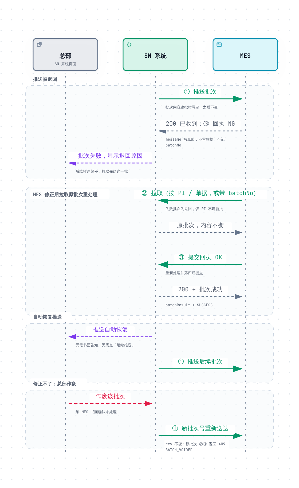

# SN 防重管控 · MES 对接说明

> 本文讲 MES 对接的业务处理规则：SN 状态、rev 与批次类型、MES 收到批次怎么处理、转移、异常处理。接口地址、请求 / 响应字段、错误码见 [MES 对接接口文档](MES对接接口文档.md)（下文简称「接口文档」）。

## 目录

- [1. 业务概述](#1-业务概述)
  - [1.1 业务流程](#11-业务流程)
  - [1.2 SN 状态](#12-sn-状态)
  - [1.3 挂靠版本 rev 与批次类型](#13-挂靠版本-rev-与批次类型)
- [2. 交互通道](#2-交互通道)
- [3. MES 批次处理规范](#3-mes-批次处理规范)
  - [3.1 批次类别](#31-批次类别)
  - [3.2 处理步骤](#32-处理步骤)
  - [3.3 交付类批次类型](#33-交付类批次类型)
  - [3.4 应答与回执](#34-应答与回执)
- [4. 转移](#4-转移)
  - [4.1 SN 系统侧规则](#41-sn-系统侧规则)
  - [4.2 MES 侧规则](#42-mes-侧规则)
- [5. 异常处理](#5-异常处理)

---

## 1. 业务概述

### 1.1 业务流程

| 阶段 | 说明 |
| --- | --- |
| 订单与生成 | SN 系统定时同步金蝶已审核的生产订单；总部按 PI 生成 SN，号池全局不重复 |
| 分配与下发 | 总部把 SN 分配到生产组织；SN 系统分批推送给该组织的 MES，MES 回执确认；推送失败时 MES 主动拉取 |
| 生产打标 | MES 下发 SN，现场打标、过站、LINK（MES 内部流程，不涉及本接口） |
| 转移 | 转单、转组织后 SN 系统改挂，给转入方下发新挂靠，给原组织发转移批次；原组织停止打标已转走的 SN，旧标签按「转出号清单」作废 |

### 1.2 SN 状态

| SN 状态 | 含义 | 与 MES 的关系 |
| --- | --- | --- |
| 待分配 | 已生成，尚未分到生产组织 | 不可见 |
| 待推送（未入批） | 已分到对接 MES 的组织，尚未组批 | 等待推送或拉取 |
| 待推送（批次未确认） | 已组批，MES 尚未回执 | 正在推送，或可拉取 |
| 待推送（批次失败） | MES 整批退回（③ 回执 `NG`），或 ① 应答无效、与批次不符 | MES 修正后拉取重处理，或总部续推 |
| 已推送 | MES 已确认（③ 回执 `OK`，或总部人工确认） | MES 已持有 |
| 已分配 | 分到未对接 MES 的组织 | 不经过 MES |

- 总部作废未确认的批次后，SN 回到「待推送（未入批）」，重新组批送达
- 单据反审核、订单变更待确认时，未下发的 SN **暂停下发**：不组批，② 响应的 `paused` 为暂停枚数

### 1.3 挂靠版本 rev 与批次类型

- **SN 字符串永不改变**，变的只是挂靠（生产组织、PI、单据行、物料、客户）
- 生成时 `rev = 1`；每次转单、转组织、订单变更改挂 `rev` 加 1，**越大越新**；MES 原样保存，不得自行加减
- **`rev` 相同则挂靠相同**，同一 `rev` 重复送达覆盖一次结果不变
- `batchType` 说明这批 SN 从哪来，**一批只有一种**；按 **MES 已有的数据** 判断：SN 系统收到 `OK` 回执（或总部人工确认）后才认定 MES 已持有，未持有时被转移的 SN 对 MES 仍是 `NEW`

| 触发事件 | `rev` | 收件 MES | `batchType` | MES 处理 |
| --- | --- | --- | --- | --- |
| 首次下发 | 不变 | 本组织 | `NEW` | 新增 |
| 同组织转移 | +1 | 本组织 | 已持有：`SAME_ORG_TRANSFER`；未持有：`NEW` | 覆盖挂靠 / 新增 |
| 跨组织转移 | +1 | 转入组织 | 原组织已持有：`TRANSFER_IN`；未持有：`NEW` | 新增 |
| 跨组织转移 | +1 | 原组织（仅曾持有时发） | `TRANSFER_OUT` | 标记「已转走」，停止打标 |
| 转回原组织（A → B → A） | +1 | A 收交付、B 收转出 | A：`TRANSFER_IN`；B：`TRANSFER_OUT` | A 覆盖并清除「已转走」；B 标记「已转走」 |
| 订单变更「确认对应」、告警重推 | +1 | 本组织（已持有） | `REMAP` | 覆盖挂靠 |
| 批次重送、重新拉取 | 不变 | — | 同一批次，内容逐字节相同 | 按 `batchNo` 幂等 |

MES 已持有的 SN 在转移、改挂当时单独建批（`SAME_ORG_TRANSFER` / `TRANSFER_IN` / `REMAP`）；其余 SN 从号池按流水顺序认领，绝大多数为 `NEW`。

---

## 2. 交互通道

接口清单与调用方式见接口文档第 1 章。

| 通道 | 说明 |
| --- | --- |
| 推送（主通道） | SN 系统调 ①，MES 收到即应答「已收到」（`OK`，只表示收到），落库后调 ③ 回执，并以 ③ 的响应（HTTP 200 + `code = OK`）确认回执已送达，没送达用同一份回执重交；SN 系统收到回执 `OK` 才推下一批（串行）。没送达按 1、5、15 分钟重送；已收到但 1、5、10 分钟没有回执，以原内容重送（最多 3 次） |
| 转移通知 | 跨组织转移时，给转入组织发交付批次的同时给原组织发 `TRANSFER_OUT`，互不等待 |
| 拉取（补偿） | MES 调 ② 取批，落库后调 ③ 回执；可取回未送达、未回执的推送批次和转移批次 |
| 对账 | ④⑤ 只读，**不得**据此入库、打标或删除 |

推送与拉取的批次**格式完全相同**，MES 只需实现一套处理逻辑（第 3 章）；同一批次可能经两条通道到达，按 `batchNo` 只处理一次。

---

## 3. MES 批次处理规范

### 3.1 批次类别

所有批次用同一个请求体（字段见接口文档 3.1.1），明细字段也相同，按 `batchType` 区分怎样处理：

| 批次 | `batchType` | `batchNo` 前缀 | 送达 | 明细、批次头 `toOrgCode` |
| --- | --- | --- | --- | --- |
| 交付批次 | `NEW` / `SAME_ORG_TRANSFER` / `TRANSFER_IN` / `REMAP` | `PS`（推送时建）/ `PL`（拉取时建） | ① 或 ② | ≤ 5000 枚，`toOrgCode` 为 `null` |
| 转移批次 | `TRANSFER_OUT` | `XO` | ① 或 ② | ≤ 5000 枚，挂靠为转出前的值，`toOrgCode` 为转入组织 |
| 测试批次 | `PING` | `PING` | ① | 空数组，`toOrgCode` 为 `null` |

批次号中的日期为国内日期（UTC+8）。

MES 判断要用的字段：`batchNo`（幂等键）、`batchType`（分流）、`orgCode`（收件组织）、`pi`（本批的 PI；交付批次校验本组织有这张 PI，转移批次为转出前的 PI）、`count`（明细条数）、`itemsDigest`（同一批次号再次到达时比对），明细的 `sn`、`rev`，转移批次另看批次头的 `toOrgCode`（转入组织，一批只有一个）。测试批次的批次头不带 `pi`。

### 3.2 处理步骤

| 步骤 | 规则 | 结果 |
| --- | --- | --- |
| 1 分流 | 交付类 4 种、`TRANSFER_OUT` 继续；`PING` 只校验身份和 `orgCode`，不存储、不记批次号、不调 ③；其他取值整批退回 | `PING`：应答 `OK` / `NG` |
| 2 整批校验 | `orgCode` 为本组织；交付批次带 `pi`，本组织有这张 PI，且每条明细的 `pi` 与批次头相同；转移批次带 `toOrgCode`；`count` 等于 `items` 条数；批内 SN 不重复；必填字段齐全、长度在本侧允许范围内 | 不通过：`NG` + 原因，**不写任何数据、不记 `batchNo`** |
| 3 幂等 | `batchNo` 已处理过：`itemsDigest` 相同不再处理，直接重新提交首次的回执（`OK`）；不同返回 409 `BATCH_CONTENT_MISMATCH` | — |
| 4 逐枚处理 | 见下表 | — |
| 5 落库 | 按 `batchNo` 加锁，同一批次不得并发处理；批次号、`itemsDigest`、SN 数据同一事务落库；5000 枚建议 10 秒内（SN 系统等回执先等 1 分钟） | 成功 `OK`；出错整批回滚 `NG` |

**逐枚处理**（只看批次类别、本地有无该 SN、`rev`）

| 批次 | 本地没有 | 批次 `rev` ≥ 本地 | 批次 `rev` < 本地 |
| --- | --- | --- | --- |
| 交付批次 | 按报文新增，可打标 | 覆盖挂靠（PI、单据、行号、物料、米数、客户），清除「已转走」，保留打标状态 | 跳过 |
| 转移批次 | 建一条只有 `sn`、`rev` 的「已转走」记录 | 更新 `rev`，标记「已转走」、记批次头的 `toOrgCode`，停止打标 | 跳过 |

- 跳过不算失败，整批仍回 `OK`；SN 系统不需要逐枚结果
- 转移批次本地没有也要建档：同一 SN 迟到的旧交付（`rev` 更小）会被跳过，不会被当作本组织持有而继续打标
- **不得**因「批次里没有某枚 SN」作废本地数据：批次是增量的
- 已转走的 SN 不删除；已打出的旧标签由现场按「转出号清单」作废

### 3.3 交付类批次类型

| `batchType` | 含义 | MES 本地通常 | MES 可选的内部处理 |
| --- | --- | --- | --- |
| `NEW` | 首次交给本 MES（含：未下发时被转移） | 没有 | — |
| `SAME_ORG_TRANSFER` | 本 MES 已持有的号转到本组织另一订单 | 有 | 切换数据链的订单关联（见 4.2） |
| `TRANSFER_IN` | 原组织 MES 已持有的号转入本组织（与原组织的 `TRANSFER_OUT` 成对） | 没有（转回时有「已转走」记录） | 提示从原组织调拨实物、补打标签 |
| `REMAP` | 本 MES 已持有的号因订单变更改挂，或总部以 SN 系统为准重推 | 有 | 同 `SAME_ORG_TRANSFER` |

- 4 种处理完全相同，是否接收、是否覆盖**只按 3.2 逐枚处理**，不得因具体类型拒收、跳过或回 `NG`
- 本地情况与「通常」不符时（如 `SAME_ORG_TRANSFER` 但本地没有）仍按 3.2 处理，可记日志备查
- SN 系统增加 `batchType` 取值前先与 MES 书面确认

### 3.4 应答与回执

推送时，① 的应答**只表示已收到**；处理结果一律在落库后调 **③ 提交回执**（推送与拉取的批次都一样），结构见接口文档 3.3。SN 系统收到回执 `OK` 才确认这一批、推送下一批，所以**每一批都要回执**，否则同一 PI 的推送停在这一批：

| 情况 | ① 应答 | ③ 回执 |
| --- | --- | --- |
| 收到、写入成功（含逐枚跳过） | HTTP 200，`code = OK` | `code = OK` |
| 收到、整批校验不通过或写入出错 | HTTP 200，`code = OK` | `code = NG`，`message` 写原因 |
| 同一批次再次送达（已处理过） | HTTP 200，`code = OK` | 重新提交首次的回执 |
| 同一批次正在处理 | 409，`code = BATCH_IN_PROGRESS`（或处理完再应答已收到） | 处理完提交 |
| 同一批次号内容不同 | 409，`code = BATCH_CONTENT_MISMATCH` | 不提交 |
| 认证失败 / 报文无法解析 / 报文过大 | 401、403 / 400 / 413，`code`、`message` 写明原因 | 不提交 |
| 测试批次 `PING` | HTTP 200，`code = OK`（`orgCode` 不符时 `NG`） | 不提交 |

`OK` 必须在 SN 数据写入成功后才提交：SN 系统据此认定 MES 已持有这些 SN。应答已收到后 SN 系统等回执 1 分钟，没有就以原内容重送①、再等 5 分钟，依次 10、10 分钟（共重送 3 次），仍没有即停止推送，页面显示推送中断。

---

## 4. 转移

### 4.1 SN 系统侧规则

1. **发起**：转单、转组织都由总部或生产组织操作员直接发起（须填转移原因，立即生效，没有申请、审批）；单次最大一整张单据，不支持整张 PI
2. **可转校验**：SN 所在批次（含转移批次）未确认或失败时不可再转，确保同一 SN 的批次按顺序到达；迟到的旧请求由 `rev` 比对跳过
3. **改挂**：清除 SN 原批次，`rev` 加 1
4. **下发**：MES 已持有的当场建批（同组织 `SAME_ORG_TRANSFER`；跨组织给转入方 `TRANSFER_IN`、同时给原组织 `TRANSFER_OUT`），按转入组织的单批枚数拆分；未持有的回号池，作为 `NEW` 下发；目标单据暂停交付时不建批，解除后照常下发
5. **不等待 MES**：不发撤回指令、不等 MES 同意；推送失败按普通批次重试、续推，MES 也可拉取

### 4.2 MES 侧规则

**同组织转移**

转移在 SN 系统中立即生效，**无需现场或 MES 事先确认**；MES 按 `rev` 覆盖挂靠、回 `OK`，回执没有「拒绝转移」选项。MES 因过站方式、LINK 状态等无法在本侧完成转移时**自行处理**，SN 系统不感知、不等待、不回滚。MES 内部可参考：

1. **客户 SN 过站**：将该 SN 整条数据链的订单关联切换到新订单（数据混乱风险由 MES 控制）
2. **内部 SN 过站**：客户 SN 已 LINK 的不能转移，由 MES 自行处理；未 LINK 的直接转移

**跨组织转移**　直接同步到新组织，不考虑原组织 MES 的数据：

- **转入组织**：本地无此 SN，按报文新增，无需与原组织核对
- **原组织**：无需同步、回滚或清理原数据链，只按转移批次标记「已转走」并停止打标，防止两个工厂使用同一 SN；旧标签由现场按「转出号清单」作废（报文不带转移单号）

---

## 5. 异常处理

| 场景 | SN 系统 | MES |
| --- | --- | --- |
| 推送超时、宕机、5xx、429、503 | 按 1、5、15 分钟重送，内容逐字节相同；用尽后停止，页面显示「继续推送」；MES 拉取该批次回执 `OK` 后自动接着推 | 按 `batchNo` 幂等；恢复后也可直接拉取该批次 |
| 应答已收到，但没有 ③ 回执 | 等 1、5、10、10 分钟，每次超时以原内容重送 ①（共 3 次）；仍没有即停止，页面显示推送中断；期间收到回执立即确认并推下一批 | 落库后调 ③；重送到达时重新提交首次的回执 |
| MES 整批退回（`NG`） | 批次记失败，显示 `message`；同一 PI 后续推送暂停，② 取批先返回该批次、该 PI 不建新批；回执 `OK` 后自动接着推 | 修正后：② 取批（或带 `batchNo` 取回）拿到原批次 → 重新处理 → ③ 提交回执 |
| 总部作废批次 | ②③ 对该批次返回 409 `BATCH_VOIDED`；SN 以新批次号重新送达，`rev` 不变：`NEW` 回号池重新组批，其余类型按原 SN 当场重建同类型批次并推送 | 丢弃该批次，**不得**用本地缓存继续处理 |
| 某枚 SN `rev` 小于本地 | — | 跳过该枚、保留本地，整批照常 `OK`；如需排查用 ④ 查当前 `rev` 与挂靠 |
| 回执长期缺失 | 总部按 MES 书面答复处理：已入库 →「人工确认」，SN 变为已推送；未处理 →「作废」，重新组批 | 书面告知总部是否已入库 |
| ① 应答无效（HTTP 200 但 `code` 不是 `OK`，如在应答里直接回 `NG`）或批次号不一致 | 批次记失败、推送停止；② 取批先返回该批次，回执 `OK` 后自动接着推 | 改为应答已收到；已处理的批次用 ③ 补交回执，或 ② 带 `batchNo` 取回后提交 |
| ③ 回执参数不合法（400 `INVALID_REQUEST`：缺 `batchNo`、`code` 不是 `OK` / `NG`、请求体为 gzip） | 只拒收，批次不变 | 按 `details` 改正后重交 |

**整批退回后的重处理**

1. MES ③ 回执 `NG` 时不写任何数据、不记 `batchNo`，否则修正后同一批次再到达会被当成已处理
2. 修正后用 ② 取批拿到原批次（失败批次挡住所在 PI，取批先返回它；也可带 `batchNo` 取回），内容不变、不会新建批次，重新处理后用 ③ 提交 `OK`
3. 批次成功后，SN 系统自动恢复该 PI 的后续推送，无需书面告知总部、无需总部「继续推送」
4. 修正不了时，经 MES 书面确认未处理，总部作废该批次；其中的 SN 以新批次号重新送达，`rev` 不变，原批次号此后在 ②③ 返回 409 `BATCH_VOIDED`
