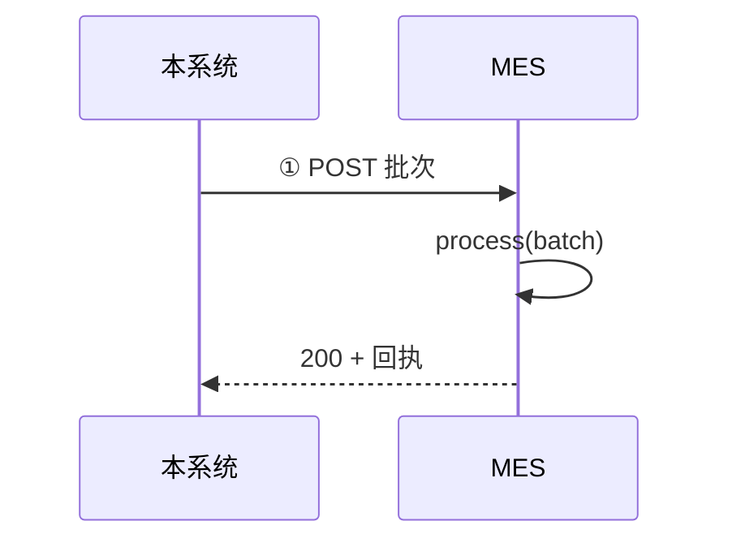
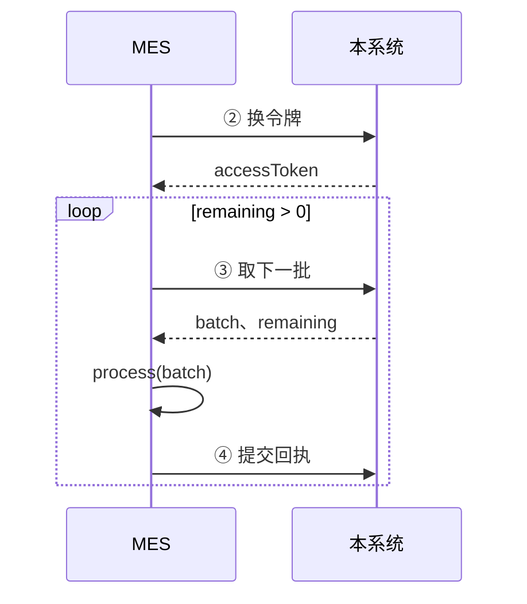

# SN 防重管控 · MES 对接说明（精简版）

Oct 22, 2026 · @magic　|　规则以《MES 接口规格》（PRD V30）为准

---

## 1. 接口的业务场景

本系统以**批次**（一包号，最多 5000 枚）为单位把号送给 MES，MES 处理后逐枚**回执**。MES 会收到以下 4 种批次：

| 场景 | 什么时候发生 | 报文标识 | MES 怎么做 |
| --- | --- | --- | --- |
| **新号交付** | 总部把新号分给本组织 | `batchType = DELIVERY`，`pushType = NEW` | 入库，可以打标 |
| **挂靠变更** | 号的单据、PI、物料、客户变了（转单）；号从别的组织转入或转回本组织 | `batchType = DELIVERY`，`pushType = REASSIGN` | 用新挂靠覆盖；本地没有就入库；清除「已转出」 |
| **号转出** | 号转到别的组织 | `batchType = TRANSFER_OUT` | 标「已转出」，**禁止打标**，不删号 |
| **连接测试** | 总部点「连接测试」 | `batchType = PING`，`items = []` | 只校验认证和组织，不写数据 |

> 「挂靠」= 号当前属于哪个组织、哪张 PI、哪张单据的第几行、什么物料、哪个客户。SN 字符串永远不变，变的只是挂靠。

每枚号带一个版本号 **rev**，挂靠每变一次加 1。MES **只用 rev 判断收不收**，`pushType` 只说明原因。以 `HX100000001A` 为例：

| 本系统操作 | rev | 组织 110 的 MES 收到 | 组织 120 的 MES 收到 |
| --- | --- | --- | --- |
| 分配给 110 | 1 | 新号交付：入库 | — |
| 在 110 内转单 | 2 | 挂靠变更：覆盖 | — |
| 转组织到 120 | 3 | 号转出：禁止打标 | 挂靠变更：入库 |
| 转回 110 | 4 | 挂靠变更：覆盖并恢复可用 | 号转出：禁止打标 |

**MES 必须遵守的 5 条规则**

1. **同一批只处理一次**：同一批可能送到多次，按批次号去重，再收到就返回第一次的回执。
2. **只收本组织的号**：`orgCode` 不是本组织就整批拒收。
3. **按 rev 决定收不收**：rev 大就收，rev 小不收；rev 相同看批次号，同一批是重复，不同批是冲突。
4. **先落库，再回执**：回执表示「已经收好」，落库失败不能回执。
5. **作废的批次直接丢弃**：收到 409 `BATCH_VOIDED` 就丢掉，号会换新批次重新送来。

---

## 2. 接口清单

| # | 接口 | 方向 | 作用 | 必做 |
| --- | --- | --- | --- | --- |
| ① | `POST {MES 地址}` | 本系统 → MES | 推送批次，MES 在应答里返回回执 | 是，**MES 提供** |
| ② | `POST /api/mes/v1/auth/token` | MES → 本系统 | 换令牌（12 小时有效） | 是 |
| ③ | `POST /api/mes/v1/batches/next` | MES → 本系统 | 取下一批；带 `batchNo` 时取回指定批次 | 是 |
| ④ | `POST /api/mes/v1/batches/{batchNo}/receipt` | MES → 本系统 | 提交回执，或整批拒收 | 是 |
| ⑤ | `GET /api/mes/v1/sn/delivered` | MES → 本系统 | 查已交付给本组织的号 | 否，仅核对 |
| ⑥ | `GET /api/mes/v1/batches/{batchNo}/items` | MES → 本系统 | 查某批次里的号 | 否，仅核对 |

号有两条路到达 MES：① 本系统推送（主路），③ MES 主动取（备用路）。两条路送的是同一批，MES 用同一个 `process(batch)` 处理（3.5）。

---

## 3. 调用流程

### 3.1 推送（主路）



本系统推送失败（超时、5xx、断连等）时，在 1、5、15 分钟后各重试一次。

### 3.2 取批（备用路）

本地号不够时取；另外每 5 分钟不带范围取一次，收回推送中断的批次和转出批次。



1. ② 换令牌，用掉 80% 时长后换新
2. ③ 取批；`batch = null` 时隔 1 分钟以上再取
3. `process(batch)`，然后立即 ④ 提交回执（不回执，下次还会拿到同一批）
4. `remaining > 0` 就继续取

### 3.3 处理不了的批次

1. 回执整批拒收（`outcome = REJECTED`，写明原因）。这批冻结，后面的批次照常
2. 修好后 ③ 带 `batchNo` 取回这批，处理后 ④ 提交
3. 返回 409 `BATCH_VOIDED` 说明总部已作废，丢弃

### 3.4 两条路撞车

推送重试的同时 MES 也可能取到同一批。按批次号只处理一次，两边拿到同一份回执。

### 3.5 处理逻辑 `process(batch)`

推送和取批共用这个函数，按批次号加锁。

**第 1 步　校验**，不通过就整批拒收，且**不登记批次号**（否则修好后重送只会拿到旧的拒收）：

- `orgCode` 等于本组织
- `count` 等于 `items` 条数，且不超过单批上限
- 批内 SN 不重复，必填字段齐全
- 交付批次：每枚 `pi` 等于批次头 `pi`，不含转出项；转出批次只含转出项

**第 2 步　查重**：批次号处理过且 `itemsDigest` 相同 → 返回存下的回执（`replayed = true`）；`itemsDigest` 不同 → 409 `BATCH_CONTENT_MISMATCH`。

**第 3 步　逐枚比对 rev**（整批一个事务）：

| 情况 | 本地怎么改 | 回执 |
| --- | --- | --- |
| 本地没有此 SN | 交付项按收到的挂靠入库；转出项按 `from` 入库并标「已转出」 | `ACCEPTED` |
| 收到的 rev 更大 | 交付项覆盖挂靠并清除「已转出」；转出项用 `from` 覆盖并标「已转出」 | `ACCEPTED` |
| rev 相同，`lastBatchNo` 是本批 | 不改 | `DUPLICATE` |
| rev 相同，`lastBatchNo` 是别的批 | 不改，该号挂起、禁止打标 | `CONFLICT` |
| 收到的 rev 更小 | 不改 | `STALE` |

- `ACCEPTED` 时保存 rev，`lastBatchNo` 记为本批，保留打标状态，解除冲突挂起
- `CONFLICT`、`STALE` 带回本地的 `existingRev`、`existingBatchNo`
- rev 原样存，不自行加减；转出项记下 `toOrgCode`

**第 4 步　先落库，再回执**：保存批次号、`itemsDigest`、整份回执，提交事务后返回。5000 枚建议 10 秒内完成（推送超时 60 秒）。

### 3.6 异常处理

| 情况 | MES 要做什么 |
| --- | --- |
| 推送超时、取批后宕机、回执丢失 | 不用特殊处理：重试或再取拿到的是同一批，回执用同一份重交 |
| 回执被拒 422 `RECEIPT_MISMATCH` | 按 `details` 修正后重交 |
| 报文太大 413 | 放宽限制等续推；放不宽由总部作废后按更小批次重送 |
| 地址配错，收到别的组织的号 | `orgCode` 校验不过，整批拒收 |
| 回执了 `CONFLICT` / `STALE` | 号挂起等总部处理：总部用更大的 rev 重推，收下即解除；或总部关闭告警，现场人工放行 |
| 一批长期交不上回执（停机、修不好） | 总部凭 MES 方书面确认处理：已入库的「人工确认」，之后再交回执只存档；没处理过的「作废」，之后返回 409 `BATCH_VOIDED`，**必须丢弃，不得用本地缓存处理** |

### 3.7 转单、转组织：MES 侧须知

- 转移只在本系统操作，结果以上面的交付批次、转出批次送达，没有新接口
- 号段转移也展开为逐枚明细；转出批次头 `pi` 可能为 `null`（涉及多张 PI），按每枚 `from.pi` 归档
- 号转走前，转出一定先送达并确认；转入方的交付和来源方的转出先后不定
- 转出前（含转组织申请期间）来源 MES 仍可打标，由现场按总部通知自行停用；⑤ 查到 `status = APPLYING` 只用于提示
- 已打标的号被转出：保留记录，旧标签按总部的「转出号清单」线下作废
- 转入号带 `transferKind`、`transferDocNo`、`fromOrgCode`，只用于提示和追溯；`pi` 可能不等于 `serialPi`，不要互相校验
- 一个 MES 实例服务多个组织时，必须按 `orgCode` 隔离数据（键为 `orgCode + SN`）
- 组织关闭「对接 MES」后，转出照常推送，也可以取批取回

---

## 4. 接口与参数

### 4.1 通用约定

| 项 | 约定 |
| --- | --- |
| 传输 | HTTPS（TLS 1.2+）、JSON（UTF-8），支持 gzip；不跟随 3xx |
| 字段 | 英文小驼峰；都带 `schemaVersion`（`1.0`）；新增字段只加不改，**不认识的字段忽略** |
| 时间 | ISO 8601 UTC，如 `2026-10-19T02:37:00Z` |
| SN | ≤ 64 位，**区分大小写**，只含字母、数字、`-`、`.`、`_` |
| `length`、`serialDec` | 按字符串传，不要转数字 |
| 批次号 | ≤ 40 位，全局唯一 |
| 成功 | HTTP 200 且 `code = OK`；出错不返回 200；程序按 `code` 判断 |
| 限流 | ③～⑥ 每组织每分钟 60 次，超出 429 `RATE_LIMITED`，按 `Retry-After` 等待 |

**认证**

- **① 本系统调 MES**（每个组织二选一）
  - A：`Authorization: Bearer <固定令牌>` + 来源 IP 白名单
  - B：HMAC-SHA256 签名，放在 `X-Sn-Timestamp`、`X-Sn-Signature`。签名串 = `timestamp + "\n" + batchNo + "\n" + hex(SHA256(解压后的原始请求体))`；不要解析后重新序列化再算；时间偏差超过 5 分钟拒绝，双方 NTP 校时
- **②～⑥ MES 调本系统**：② 换令牌，之后带 `Authorization: Bearer <token>`

**错误应答**

```json
{"schemaVersion": "1.0", "code": "RECEIPT_MISMATCH", "message": "回执枚数与批次不符",
 "batchNo": "PL-110-20261019-000045", "details": [{"field": "results", "reason": "期望 5000 枚，收到 4999 枚"}]}
```

`code` 给程序判断，`message` 给人看，`details` 写明具体差异。

### 4.2 ① 接收推送（MES 提供）

地址由 MES 提供，总部在对接设置中填写。

| 请求头 | 作用 |
| --- | --- |
| 认证头 | 见 4.1 |
| `X-Sn-Batch-No` | 批次号，同请求体 `batchNo`，可先据此加锁 |
| `X-Sn-Attempt` | 第几次发送，仅记日志 |
| `X-Request-Id` | 请求编号，仅排查用，**不是去重依据** |
| `Content-Encoding: gzip` | 请求体已 gzip 压缩 |

请求体是一个批次（4.7、4.8），同一批重发时逐字节相同。

| 情况 | 应答 |
| --- | --- |
| 处理完，或整批拒收 | **都是 200** + 回执 |
| 同一批正在处理 | 等处理完返回同一回执，或 409 `BATCH_IN_PROGRESS` |
| 批次号相同内容不同 | 409 `BATCH_CONTENT_MISMATCH` |
| 认证失败 / 地址错 / 报文过大 / 无法解析 | 401 或 403 / 404 / 413 / 400 |

4xx 只用于请求没进入处理逻辑的情况。本系统对超时、5xx、断连、409 `BATCH_IN_PROGRESS`、429、503 重试，其他不重试。

**连接测试**：收到 `batchType = PING` 时只校验认证和 `orgCode`，通过返回 `outcome = PROCESSED`、`summary` 全 0，不登记、不写数据。

### 4.3 ② 换令牌

| 请求参数 | 作用 |
| --- | --- |
| `empNo` | MES 接口账户工号（如 `MES110`），账户绑定一个组织 |
| `secret` | 账户密钥 |

| 应答字段 | 作用 |
| --- | --- |
| `accessToken` | 访问令牌 |
| `tokenType` | 固定 `Bearer` |
| `expiresIn` | 有效秒数，`43200` |
| `expiresAt` | 过期时间（UTC） |

换新不会使旧令牌失效；重置密钥后旧令牌全部失效。错误：401 `INVALID_CREDENTIALS`；连错 10 次锁 15 分钟，423 `ACCOUNT_LOCKED`；403 `IP_NOT_ALLOWED` / `ACCOUNT_DISABLED`。

### 4.4 ③ 取下一批

| 请求参数 | 作用 |
| --- | --- |
| `schemaVersion` | `1.0` |
| `pi` | 只取这张 PI 的号，不填不限 |
| `billNo` | 只取这张单据的号，不填不限；可与 `pi` 同填 |
| `batchNo` | 只读取回这一批（补处理失败批次用），不新建、不改状态 |

```json
{"schemaVersion": "1.0", "pi": "000001", "billNo": null, "batchNo": null}
```

**给哪一批**：先给范围内最早的未签收批次（推送卡住的、取走没回执的、转出批次），没有才新建。失败、作废的批次不再自动给。按单据取可能拿到含其他单据的整批，照常收下；转出批次按每枚 `from.pi`、`from.billNo` 匹配范围。

| 应答字段 | 作用 |
| --- | --- |
| `batch` | 批次，同推送请求体；没有可给的为 `null` |
| `batchSource` | `PUSH` 推送时建的 / `PULL` 取批时建的，处理方式相同 |
| `newlyCreated` | 是否本次新建 |
| `batchResult` | 一般 `UNCONFIRMED`；取回失败批次时为 `FAILED` |
| `remaining` | 范围内还能取的枚数，大于 0 就继续取 |
| `paused` | 暂停交付的枚数，等总部处理，不必反复取 |

| 错误 | MES 怎么做 |
| --- | --- |
| 401 `TOKEN_EXPIRED` / `TOKEN_INVALID` | 重新换令牌 |
| 403 `ORG_NOT_ALLOWED` | 该 PI 与本组织无关，核对 PI |
| 404 `BATCH_NOT_FOUND` | 批次不存在或不属于本组织 |
| 409 `BATCH_CONFIRMED` | 该批已确认，不用处理 |
| 409 `BATCH_VOIDED` | 该批已作废，丢弃 |
| 429 `RATE_LIMITED` | 按 `Retry-After` 等待 |
| 5xx / 超时 | 直接再取，拿到的仍是同一批 |

### 4.5 ④ 提交回执

路径带 `batchNo`，请求体为回执（4.9）。本系统核对：批次号一致、条数等于 `count`、每枚 SN 恰好一次且属于本批、`rev` 一致、`summary` 与明细一致。

| 应答 | 含义 |
| --- | --- |
| 200，`firstConfirmation = true` | 确认成功 |
| 200，`firstConfirmation = false` | 早已确认，本次只存档 |
| 200，`batchResult = FAILED` | 已记录整批拒收 |
| 422 `RECEIPT_MISMATCH` | 回执对不上，按 `details` 修正后重交 |
| 409 `BATCH_VOIDED` | 已作废，丢弃 |
| 404 `BATCH_NOT_FOUND` | 批次不存在或不属于本组织 |

`batchResult` 取值：`SUCCESS` / `SUCCESS_CONFLICT`（有冲突）/ `FAILED`。超时或 5xx 用同一份回执重试。

### 4.6 ⑤⑥ 只读核对（可选）

- ⑤ `GET /api/mes/v1/sn/delivered?pi=&cursor=&pageSize=`：已交付给本组织的号，`pi` 可选
- ⑥ `GET /api/mes/v1/batches/{batchNo}/items?cursor=&pageSize=`：某批次里的号

`cursor` 第一页留空、之后填 `nextCursor`（为 `null` 即末页）；`pageSize` 默认 1000，最大 5000。返回字段同交付项，另有 `orgCode`、`status`、`batchNo`。**只用于核对，不能据此入库、打标或删除。**

### 4.7 交付批次（`DELIVERY`）

```json
{
  "schemaVersion": "1.0",
  "batchNo": "PS-110-20261019-000123",
  "batchType": "DELIVERY",
  "orgCode": "110",
  "pi": "000001",
  "count": 1,
  "createdAt": "2026-10-19T02:37:00Z",
  "itemsDigest": "sha256:9f2c4e…",
  "items": [
    {
      "pushType": "NEW",
      "sn": "HX100000001A",
      "rev": 1,
      "serial": "000001",
      "serialDec": "1",
      "serialPi": "000001",
      "pi": "000001",
      "billNo": "VT2026090001",
      "billSeq": 1,
      "materialCode": "9148363",
      "length": "100",
      "customerCode": "0001"
    }
  ]
}
```

**批次头**

| 字段 | 作用 |
| --- | --- |
| `batchNo` | 批次号，**去重依据** |
| `batchType` | `DELIVERY` / `TRANSFER_OUT` / `PING` |
| `orgCode` | 接收方组织，须等于本组织 |
| `pi` | 交付批次所属 PI；转出批次涉及多张 PI 时为 `null` |
| `count` | 枚数，等于 `items` 条数，≤ 5000 |
| `createdAt` | 建批时间 |
| `itemsDigest` | 内容摘要，查重时按字符串比对，**不自行计算** |

**交付项**

| 字段 | 必填 | 作用 |
| --- | --- | --- |
| `pushType` | 是 | `NEW` / `REASSIGN`，只说明原因 |
| `sn` | 是 | 完整 SN |
| `rev` | 是 | 版本号，决定收不收 |
| `serial` / `serialDec` / `serialPi` | 是 | 流水号 / 十进制流水 / 流水所属 PI（字符串） |
| `pi` | 是 | 当前 PI，等于批次头 `pi` |
| `billNo` / `billSeq` | 是 | 单据编号 / 单据行号 |
| `materialCode` | 否 | 物料编码 |
| `length` | 否 | 米标（字符串原样） |
| `customerCode` | 是 | 客户编码 |
| `transferKind` / `transferDocNo` / `fromOrgCode` | 否 | 转入号的转移类型 / 转移单号 / 来源组织，仅追溯 |

### 4.8 转出批次（`TRANSFER_OUT`）

```json
{
  "schemaVersion": "1.0",
  "batchNo": "XO-110-20261019-000007",
  "batchType": "TRANSFER_OUT",
  "orgCode": "110",
  "pi": "000001",
  "count": 1,
  "createdAt": "2026-10-19T02:50:00Z",
  "itemsDigest": "sha256:51ab07…",
  "items": [
    {
      "pushType": "TRANSFER_OUT",
      "sn": "HX100000003A",
      "rev": 3,
      "serial": "000003",
      "serialDec": "3",
      "serialPi": "000001",
      "from": {"pi": "000001", "billNo": "VT2026090001", "billSeq": 1, "materialCode": "9148363", "customerCode": "0001"},
      "toOrgCode": "120",
      "transferKind": "ORG_TRANSFER",
      "transferDocNo": "TO-20261019-0007"
    }
  ]
}
```

| 字段 | 作用 |
| --- | --- |
| `sn`、`rev`、`serial`、`serialDec`、`serialPi` | 同交付项 |
| `from` | 转出前的挂靠，MES 用它写入本地挂靠 |
| `toOrgCode` | 转去的组织 |
| `transferKind` | `BILL_TRANSFER` 转单 / `ORG_TRANSFER` 转组织 |
| `transferDocNo` | 转移单号 |

### 4.9 回执

推送时放在 ① 应答里，取批后通过 ④ 提交，格式相同。

```json
{
  "schemaVersion": "1.0",
  "batchNo": "PS-110-20261019-000123",
  "outcome": "PROCESSED",
  "receivedAt": "2026-10-19T02:37:03Z",
  "summary": {"total": 3, "accepted": 1, "duplicate": 0, "conflict": 1, "stale": 1},
  "results": [
    {"sn": "HX100000005A", "rev": 1, "result": "ACCEPTED"},
    {"sn": "HX100000001A", "rev": 2, "result": "CONFLICT", "existingRev": 2, "existingBatchNo": "PS-110-20261019-000100"},
    {"sn": "HX100000002A", "rev": 1, "result": "STALE", "existingRev": 2, "existingBatchNo": "PS-110-20261019-000100"}
  ]
}
```

整批拒收：

```json
{"schemaVersion": "1.0", "batchNo": "PL-110-20261019-000046", "outcome": "REJECTED",
 "rejectCode": "FIELD_TOO_LONG", "rejectMessage": "materialCode 超过本侧字段长度 20"}
```

| 字段 | 作用 |
| --- | --- |
| `outcome` | `PROCESSED` 已处理 / `REJECTED` 整批拒收 |
| `replayed` | `true` 表示返回的是存下的旧回执 |
| `receivedAt` | 首次处理时间 |
| `summary` | 各结果枚数，须与 `results` 一致 |
| `results` | 每枚一条，条数等于 `count`；`result` 为 `ACCEPTED` / `DUPLICATE` / `CONFLICT` / `STALE` |
| `existingRev`、`existingBatchNo` | `CONFLICT`、`STALE` 必带，用于定位哪两批交出了同一枚号 |
| `rejectCode`、`rejectMessage` | 拒收原因 |

---

## 5. 实现清单与联调

### 5.1 实现清单（请书面确认）

- [ ] 批次报文结构与字段，含 `serialPi`、`pi`、字符串型流水（Q29、Q31）
- [ ] 认证方式 A 或 B；服务器 NTP 校时
- [ ] 推送和取批共用 `process`，按批次号加锁去重；重复送达返回存下的回执；同批次号不同内容报 409
- [ ] 校验 `orgCode`；整批拒收不登记批次号，用 HTTP 200 + 拒收回执
- [ ] 按 rev 逐枚回执四种结果；冲突、过期带回已存的 rev 和批次号
- [ ] 转出项用 `from` 写入挂靠，标「已转出」、禁止打标、不删号，能按转移单号、PI 查到
- [ ] 收到 `REASSIGN` 但本地没有该号时按新增入库
- [ ] 按 PI 或单据取批也能取到本组织的转出批次
- [ ] `itemsDigest` 按字符串比对，不自行计算
- [ ] 整批一个事务，先提交后回执，5000 枚 ≤ 10 秒
- [ ] 取批后立即回执；处理不了就整批拒收，修好后取回补交
- [ ] 支持 `PING`；正确处理 422、409 `BATCH_VOIDED`；401 时自动重新换令牌
- [ ] 多组织共用 MES 实例时按 `orgCode` 隔离
- [ ] 通过 5.2 联调用例

接收推送接口 ① 可先用契约测试脚本 `devtools/mes_conformance.py` 自测（Python 3.11+ 和 httpx，只对 MES 测试环境运行），用法见《MES 联调指南》第 3 节。

### 5.2 联调用例（转移相关）

总部在本系统操作，MES 方核对。组织 110、120 都对接 MES；「PRD 9.2」为对应的上线准入场景。

| # | 本系统操作 | MES 期望结果 | PRD 9.2 |
| --- | --- | --- | --- |
| 1 | 已送达 110 的号在 110 内转单 | MES-110 收到 `REASSIGN`，rev + 1，`ACCEPTED`，挂靠改为新单据 | 6 |
| 2 | 已送达 110 的 500 枚转组织到 120 | MES-120 收到 500 枚交付项并入库；MES-110 收到 500 枚转出项，标「已转出」；MES-110 用 ⑤ 查不到这 500 枚 | 6、7 |
| 3 | 把第 2 步的号转回 110 | MES-110 收到 rev 更大的 `REASSIGN`，恢复可用；MES-120 收到转出 | 6 |
| 4 | 110 尚未送达的号转到 120 | MES-120 收到 `NEW`；MES-110 收不到任何内容 | — |
| 5 | MES-110 停机期间做第 2 步，恢复后取批 | 不带范围、按原 PI 或原单据都能取到转出批次 | 7、19 |
| 6 | 一次转移涉及两张 PI | MES-110 收到的转出批次头 `pi = null`，按 `from.pi` 归档 | — |
| 7 | 转组织时改了 PI | MES-120 收到的 `pi` 为新 PI、`serialPi` 为原 PI，正常入库 | — |
| 8 | 110 关闭「对接 MES」后，把曾送达的号转到 120 | MES-110 仍收到转出，照常回执 | 17 |
| 9 | MES-110 回执转出前，总部再次转移这批号 | 本系统拒绝转移 | 8 |
