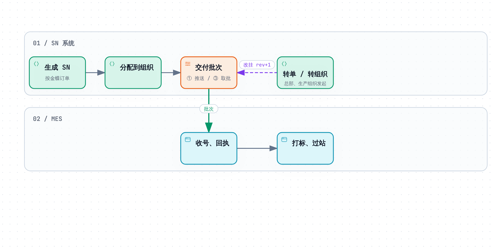
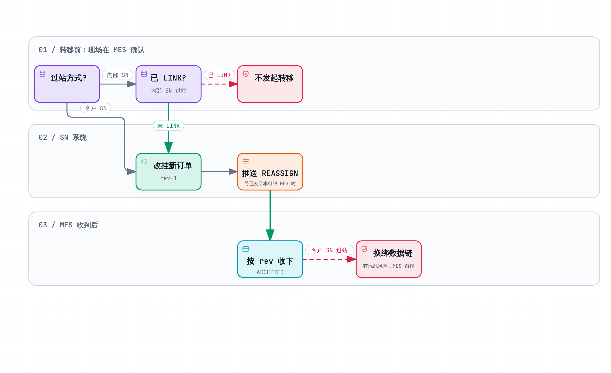
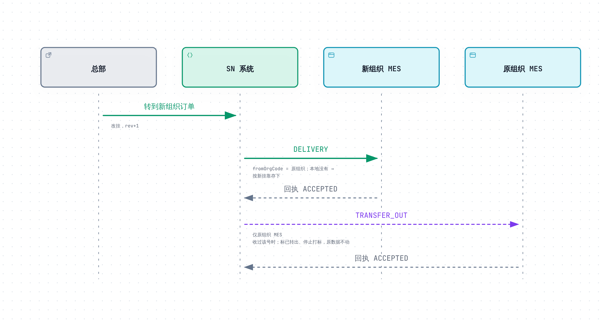

# SN 防重管控 · MES 对接说明（精简版）

Oct 23, 2026 · @magic　|　依据：PRD V30 + 10 月 MES 对接会议决策

> **分工**：SN 系统负责 **推送、取批、转移通知**；过站、LINK、MES 内部数据链由 **MES 自行处理**。

---

## 1. 业务流程



- **SN 号永不变**，变的只是挂靠（组织、PI、单据行、物料、客户）
- 挂靠每变一次 `rev` 加 1，**越大越新**
- 转单、转组织由总部或生产组织在 SN 系统发起，MES 只接收结果

---

## 2. 接口与调用


| # | 接口 | 方向 | 认证 |
| --- | --- | --- | --- |
| ① | `POST {MES 地址}` | SN → MES（**MES 提供**） | 固定令牌 + IP 白名单，或 HMAC 签名（每个组织选一种） |
| ③ | `POST /api/mes/v1/batches/next` | MES → SN | `Authorization: Bearer <工号>:<密钥>` |
| ④ | `POST /api/mes/v1/batches/{batchNo}/receipt` | MES → SN | 同上 |
| ⑤⑥ | `GET /api/mes/v1/sn/delivered`、`GET /api/mes/v1/batches/{batchNo}/items` | MES → SN，对账用，可选 | 同上 |

- 推送和取批的**批次格式完全相同**，MES 只写一套处理逻辑；同一个批次可能两条路都到，按 `batchNo` 只处理一次
- 取批时机：本地号不够用、推送失败后、每 5 分钟兜底一次（收回推送没送到的批次和 `TRANSFER_OUT`）

---

## 3. MES 收到批次怎么判断


**按 `batchType` 分流**

| `batchType` | 含义 | MES 动作 |
| --- | --- | --- |
| `DELIVERY` | 新号（`pushType=NEW`）或挂靠变了（`REASSIGN`） | 存入或覆盖；本地没有的 `REASSIGN` 当新号存 |
| `TRANSFER_OUT` | 号已转到别的组织 | 标「已转出」，停止打标，不删 |
| `PING` | 连接测试，没有号 | 只校验身份和 `orgCode`，回 `PROCESSED`，不存、不记批次号 |

**逐枚比 `rev`**（依据：批次里的 `rev` 与本地 `rev`、本地 `lastBatchNo`）

| 比较结果 | 回执 `result` | `DELIVERY` 的号 | `TRANSFER_OUT` 的号 |
| --- | --- | --- | --- |
| 本地没有 | `ACCEPTED` | 按批次信息存 | 按 `from` 存，标「已转出」 |
| 批次更大 | `ACCEPTED` | 新信息覆盖，去掉「已转出」 | 标「已转出」 |
| 相等，`lastBatchNo` 是本批次 | `DUPLICATE` | 不动 | 不动 |
| 相等，`lastBatchNo` 是别的批次 | `CONFLICT` | 锁号不许打标，等总部处理 | 同左 |
| 批次更小 | `STALE` | 不动 | 不动 |

`CONFLICT`、`STALE` 回执要带本地的 `existingRev`、`existingBatchNo`。

**处理要求**

- 按 `batchNo` 加锁，同一批次不会被两个线程同时处理
- 批次号、`itemsDigest`、整张回执和号的数据**在一个事务里落库**，存成功后再回执；5000 枚建议 10 秒内处理完（推送最多等 60 秒）
- `rev` 原样保存，MES 不要自己加减
- 一套 MES 服务多个组织时，以「组织 + SN」作唯一标识，数据按组织分开存

---

## 4. 转移（会议决策）

### 4.1 MES 怎么分辨收到的是哪种转移

依据：号上的 `fromOrgCode`（最近一次转移前的组织）与批次 `orgCode`（本组织）；`pushType` 说明本 MES 之前有没有这个号。**不要用 `transferKind` 判断**：转单也可能转到别的组织的订单。

| 判断 | 含义 | MES 会收到 |
| --- | --- | --- |
| 没有 `fromOrgCode` | 普通交付，不是转移 | `DELIVERY` / `NEW` |
| `fromOrgCode` = `orgCode` | 同组织转移 | 号已交给本 MES：`REASSIGN`；还没交：照常 `NEW` |
| `fromOrgCode` ≠ `orgCode` | 跨组织转入 | 原组织 MES 收过这个号：`REASSIGN`；没收过：`NEW`。本地都没有，按新号存 |
| 批次类型 `TRANSFER_OUT` | 跨组织转出 | 只发给收过这个号的原组织 MES |

### 4.2 同组织转移



会议决策：

1. **客户 SN 过站**：可以转。MES 收下 `REASSIGN` 后，要把这个号整条数据链的订单关联换到新订单；有数据混乱风险，由 MES 自行控制
2. **内部 SN 过站**：客户 SN **已 LINK 的不允许转移**，未 LINK 的直接转移

SN 系统不知道过站方式和 LINK 状态，所以「已 LINK 不转」由**现场发起转移前在 MES 确认**。号一旦转了，MES 收到的 `REASSIGN` 按 `rev` 照常收下（`ACCEPTED`），回执里没有「拒绝转移」这一项。

### 4.3 跨组织转移



会议决策：直接同步到新组织订单，**不考虑原组织 MES 的 SN 数据**。

- 新组织 MES：本地没有这个号，按收到的挂靠存下，不用和原组织核对
- 原组织 MES：不用同步、回滚或清理原有数据链；只按 `TRANSFER_OUT` 把号标「已转出」、停止打标，防止两个工厂用同一个号
- 已打出的旧标签由原组织现场按「转出号清单」作废

---


## 5. 接口与报文

> 报文用带注释的 JSON 展示，**注释只用于说明，实际报文里没有注释**。
> 注释格式：`必填 / 选填，含义`；**★** 标出 MES 要拿它做判断的字段。

### 5.0 通用规则

| 项目 | 规则 |
| --- | --- |
| 传输 | HTTPS + JSON（UTF-8），可 gzip；不跟随 3xx 跳转 |
| 字段 | 英文小驼峰；每个报文带 `schemaVersion`（现为 `1.0`）；以后只加字段不改字段，**看不懂的字段直接忽略** |
| 时间 | 一律 UTC，如 `2026-10-19T02:37:00Z` |
| SN | ≤ 64 位，只有字母、数字、`-`、`.`、`_`；**大小写算不同的号** |
| 字符串型数字 | `serialDec`、`length` 按字符串存，不要转数字（会丢前导 0 或溢出） |
| 成功判定 | HTTP 200 且 `code = OK`；出错一定不是 200，程序按 `code` 判断，`message` 给人看 |
| 限流 | ③～⑥ 每个组织每分钟 60 次，超出 429 `RATE_LIMITED`，按应答头 `Retry-After` 秒数等待 |

**出错时 SN 系统返回**（③～⑥ 通用）：

```jsonc
{
  "schemaVersion": "1.0",
  "code": "RECEIPT_MISMATCH",          // ★ 错误码，程序按它处理
  "message": "回执枚数与批次不符",       // 中文说明，给人看
  "batchNo": "PL-110-20261019-000045", // 出问题的批次号，没有时为 null
  "details": [                         // 具体哪里不对，可能为空
    {"field": "results", "reason": "期望 5000 枚，收到 4999 枚"}
  ]
}
```

**MES 调 SN 系统的认证错误**（③～⑥ 通用）：

| HTTP | `code` | 含义 / MES 怎么做 |
| --- | --- | --- |
| 401 | `INVALID_CREDENTIALS` | 缺少认证头，或工号、密钥不对（含密钥已被重置）→ 核对后重试 |
| 423 | `ACCOUNT_LOCKED` | 连续错 10 次锁 15 分钟，期间密钥正确也拒绝 → 等解锁 |
| 403 | `IP_NOT_ALLOWED` | 来源 IP 不在白名单 → 联系总部改白名单 |
| 403 | `ACCOUNT_DISABLED` | 账号已停用 → 联系总部 |
| 429 | `RATE_LIMITED` | 调得太频繁 → 按 `Retry-After` 等待 |

---

### 5.1 ① 接收批次（MES 提供，SN → MES）

**用途**：SN 系统把批次推给 MES，MES 处理完在**同一个应答**里返回回执。
**调用时机**：分配后、转移后、续推时；失败按 1、5、15 分钟各重送一次，**重送内容一个字节都不变**。

**请求头**

| 请求头 | 含义 |
| --- | --- |
| `Authorization: Bearer <令牌>` | 方式 A 固定令牌：MES 核对令牌，并只允许 SN 系统服务器 IP |
| `X-Sn-Timestamp` + `X-Sn-Signature` | 方式 B 签名（走公网推荐）：`HMAC-SHA256(密钥, 时间 + "\n" + 批次号 + "\n" + SHA256(解压后的请求体))`，时间差 > 5 分钟拒绝 |
| `X-Sn-Batch-No` | ★ 批次号，与报文 `batchNo` 相同；可不解析报文先按它加锁 |
| `X-Sn-Attempt` | 第几次送，只记日志 |
| `X-Request-Id` | 请求编号，只查日志；**不能用它去重** |
| `Content-Encoding: gzip` | 报文已压缩，先解压 |

**请求体 A：交付批次（`DELIVERY`）** —— 新号、挂靠变了都用它，③ 取批拿到的也是同一结构

```jsonc
{
  "schemaVersion": "1.0",              // 必填，协议版本
  "batchNo": "PS-110-20261019-000123", // 必填，批次号，全局唯一（PS 推送建批 / PL 取批建批）★ 判断是否收过
  "batchType": "DELIVERY",             // 必填，DELIVERY / TRANSFER_OUT / PING ★ 决定走哪种处理
  "orgCode": "110",                    // 必填，收件组织 ★ 不是本组织 → 整批退回
  "pi": "000001",                      // 必填，交付批次只装这一张 PI 的号 ★ 每枚号的 pi 必须等于它
  "count": 1,                          // 必填，枚数 ≤ 5000 ★ 必须等于 items 条数
  "createdAt": "2026-10-19T02:37:00Z", // 必填，建批时间（UTC）
  "itemsDigest": "sha256:9f2c4e…",     // 必填，内容指纹，MES 存下直接比字符串，不用自己算 ★ 同一 batchNo 再来时比它
  "items": [
    {
      "pushType": "REASSIGN",          // 必填，NEW 新号 / REASSIGN 挂靠变了；只说明原因，收不收看 rev
      "sn": "HX100000001A",            // 必填，完整 SN
      "rev": 2,                        // 必填，挂靠版本，越大越新 ★ 与本地比（第 3 章）
      "serial": "000001",              // 必填，流水号（可能是 36 进制写法）
      "serialDec": "1",                // 必填，十进制流水，字符串
      "serialPi": "000001",            // 必填，流水最初所属 PI；转入号可能 ≠ pi，不要互相校验
      "pi": "000001",                  // 必填，当前所属 PI
      "billNo": "VT2026090001",        // 必填，单据号
      "billSeq": 1,                    // 必填，单据行号（同一单据可能有相同物料，靠行号区分）
      "materialCode": "9148363",       // 选填，物料编码，没有时为 null
      "length": "0100",                // 选填，米标，原样保存（不要变成 100）
      "customerCode": "0001",          // 必填，客户编码
      "transferKind": "BILL_TRANSFER", // 选填，转移来的号才有：BILL_TRANSFER 转单 / ORG_TRANSFER 转组织；只供核对
      "transferDocNo": "TB202610190236001234", // 选填，转移单号（TB 转单 / TO 转组织）；只供核对
      "fromOrgCode": "110"             // 选填，最近一次转移前的组织 ★ = orgCode 同组织转移；≠ orgCode 跨组织转入
    }
  ]
}
```

**请求体 B：转出批次（`TRANSFER_OUT`）** —— 告诉原组织「这些号不归你了」

```jsonc
{
  "schemaVersion": "1.0",
  "batchNo": "XO-110-20261019-000007", // 必填，XO 开头 ★ 判断是否收过
  "batchType": "TRANSFER_OUT",         // 必填 ★ 只能装转出项
  "orgCode": "110",                    // 必填，原组织（收件方）★ 不是本组织 → 整批退回
  "pi": "000001",                      // 必填，号来自多张 PI 时为 null，按每枚的 from.pi 归档
  "count": 1,                          // 必填 ★ 等于 items 条数
  "createdAt": "2026-10-19T02:50:00Z",
  "itemsDigest": "sha256:51ab07…",     // 必填 ★ 同上
  "items": [
    {
      "pushType": "TRANSFER_OUT",      // 必填，固定值
      "sn": "HX100000003A",            // 必填
      "rev": 3,                        // 必填 ★ 与本地比（第 3 章）
      "serial": "000003",              // 必填
      "serialDec": "3",                // 必填，字符串
      "serialPi": "000001",            // 必填
      "from": {                        // 必填，转走之前的挂靠 ★ 本地没有这个号时按它入库；不要猜转走后的信息
        "pi": "000001",
        "billNo": "VT2026090001",
        "billSeq": 1,
        "materialCode": "9148363",     // 可能为 null
        "customerCode": "0001"
      },
      "toOrgCode": "120",              // 必填，转去哪个组织，记下来
      "transferKind": "ORG_TRANSFER",  // 必填，BILL_TRANSFER 转单 / ORG_TRANSFER 转组织
      "transferDocNo": "TO202610190250004321" // 必填，转移单号，现场按它查找
    }
  ]
}
```

**请求体 C：连接测试（`PING`）** —— 总部点「连接测试」时发

```jsonc
{
  "schemaVersion": "1.0",
  "batchNo": "PING-202610190237001234", // 不用记下，也不用去重
  "batchType": "PING",                  // ★ 只校验身份和 orgCode，什么都不存
  "orgCode": "110",                     // ★ 不是本组织 → 退回
  "pi": null,
  "count": 0,
  "createdAt": "2026-10-19T02:37:00Z",
  "itemsDigest": "sha256:…",
  "items": []
}
```

**应答：回执**（推送时放在 ① 的应答里；取批时用 ④ 提交，格式相同）

```jsonc
// 正常处理（含部分号冲突、过期）—— HTTP 200
{
  "schemaVersion": "1.0",
  "batchNo": "PS-110-20261019-000123", // 必填，照抄批次号
  "outcome": "PROCESSED",              // 必填，PROCESSED 已处理 / REJECTED 整批退回
  "replayed": false,                   // 选填，true = 收过的批次，原样交回上次的回执
  "receivedAt": "2026-10-19T02:37:03Z",// 必填，第一次处理的时间
  "summary": {                         // 必填，各结果枚数，必须与 results 对得上
    "total": 3, "accepted": 1, "duplicate": 0, "conflict": 1, "stale": 1
  },
  "results": [                         // 必填，每枚号一条，条数 = 批次 count
    {"sn": "HX100000005A", "rev": 1, "result": "ACCEPTED"},  // sn、rev 照抄批次
    {"sn": "HX100000001A", "rev": 2, "result": "CONFLICT",
     "existingRev": 2, "existingBatchNo": "PS-110-20261019-000100"}, // CONFLICT / STALE 必填：本地的 rev 和来源批次
    {"sn": "HX100000002A", "rev": 1, "result": "STALE",
     "existingRev": 2, "existingBatchNo": "PS-110-20261019-000100"}
  ]
}

// 整批退回 —— 也是 HTTP 200；退回时不要记下这个 batchNo
{
  "schemaVersion": "1.0",
  "batchNo": "PL-110-20261019-000046",
  "outcome": "REJECTED",
  "rejectCode": "FIELD_TOO_LONG",      // 必填，退回原因代码，MES 自定
  "rejectMessage": "materialCode 超过本侧字段长度 20" // 必填，退回原因说明
}

// 连接测试 —— HTTP 200
{"schemaVersion": "1.0", "batchNo": "PING-202610190237001234", "outcome": "PROCESSED",
 "summary": {"total": 0, "accepted": 0, "duplicate": 0, "conflict": 0, "stale": 0}, "results": []}
```

**MES 返回什么 HTTP 码**

| 情况 | MES 返回 | SN 系统怎么做 |
| --- | --- | --- |
| 处理完，或整批退回 | **200** + 回执 | 按回执确认或冻结该批 |
| 同一批正在处理中 | 等处理完返回同一张回执，或 409 `BATCH_IN_PROGRESS` | 409 时稍后重送 |
| 批次号相同但内容不同 | 409 `BATCH_CONTENT_MISMATCH` | 不重送，告警 |
| 认证失败 / 地址不对 / 太大 / 报文看不懂 | 401 或 403 / 404 / 413 / 400 | 不重送（413 请总部作废后拆小重发） |
| 超时、5xx、断网、429、503 | — | 1、5、15 分钟后重送 |

记住：**只要能拆包处理，就返回 200 + 回执**；4xx 只用于「根本没法处理」。

---

### 5.2 ③ 取批（MES → SN）

**用途**：MES 主动来拿批次。**调用时机**：本地号不够用、推送失败后、每 5 分钟不带条件兜底一次。
`POST /api/mes/v1/batches/next`，请求头 `Authorization: Bearer <工号>:<密钥>`

**请求**

```jsonc
{
  "schemaVersion": "1.0", // 必填
  "pi": "000001",         // 选填，只要这张 PI 的号；null = 不限
  "billNo": null,         // 选填，只要这张单据的号；可与 pi 一起填
  "batchNo": null         // 选填，只取回某个旧批次（如修好后重做退回的那批）；填了它 pi、billNo 不生效，也不会新建批次
}
```

SN 系统给哪个批次：先给范围内**最早的、还没回执的批次**（推送没送到的、上次取走没回执的、转出批次），都没有才新建；被退回、已作废的批次不会自动再给。转出批次按每枚号的 `from.pi`、`from.billNo` 判断在不在范围内。

**应答**

```jsonc
{
  "schemaVersion": "1.0",
  "code": "OK",
  "batch": { /* 批次，结构同 5.1 请求体 A / B */ }, // ★ null = 现在没有可给的，1 分钟以上再来
  "batchSource": "PULL",       // PUSH 推送时建的 / PULL 取批时建的；处理方法一样
  "newlyCreated": true,        // 是不是这次新建的
  "batchResult": "UNCONFIRMED",// UNCONFIRMED 还没回执；用 batchNo 取回退回的批次时为 FAILED
  "remaining": 1200,           // ★ 范围内还剩多少枚可取，> 0 就接着取
  "paused": 0                  // 被总部暂停交付的枚数，等总部处理，不用一直来取
}
```

拿到批次后处理完**马上用 ④ 交回执**，不交的话下次来取还是这一批。

**错误**

| HTTP | `code` | 含义 / MES 怎么做 |
| --- | --- | --- |
| 403 | `ORG_NOT_ALLOWED` | 这张 PI 跟本组织没关系 → 检查 pi |
| 404 | `BATCH_NOT_FOUND` | 没有这个批次号，或不是本组织的 |
| 409 | `BATCH_CONFIRMED` | 这批已经回执过，不用再处理 |
| 409 | `BATCH_VOIDED` | 这批已作废 → 丢弃，不能用本地缓存处理 |
| 5xx / 超时 | — | 直接再取，拿到的还是同一批 |

---

### 5.3 ④ 提交回执（MES → SN）

**用途**：通过 ③ 拿到的批次，处理完用它交回执（推送来的批次已在 ① 应答里回执，不用再交）。
`POST /api/mes/v1/batches/{batchNo}/receipt`，路径里带批次号，请求体就是 5.1 的回执。

SN 系统会核对：批次号一致；`results` 条数 = 批次枚数；每枚号恰好出现一次且都属于这一批；`rev` 一致；`summary` 与明细一致。

**应答**

```jsonc
{
  "schemaVersion": "1.0",
  "code": "OK",
  "batchNo": "PL-110-20261019-000046",
  "batchResult": "SUCCESS",     // SUCCESS 成功 / SUCCESS_CONFLICT 成功但有冲突的号 / FAILED 整批退回已登记
  "firstConfirmation": true     // true 这次确认成功；false 之前已确认过，这次只存档
}
```

**错误**

| HTTP | `code` | 含义 / MES 怎么做 |
| --- | --- | --- |
| 422 | `RECEIPT_MISMATCH` | 回执和批次对不上 → 按 `details` 改正后重交 |
| 409 | `BATCH_VOIDED` | 这批已作废 → 丢弃 |
| 404 | `BATCH_NOT_FOUND` | 没有这个批次号，或不是本组织的 |
| 5xx / 超时 | — | 拿同一张回执再交 |

---

### 5.4 ⑤⑥ 对账查询（MES → SN，可选）

**只用来对账**，不能据此存号、打标或删号，这些一律以批次为准。

- ⑤ `GET /api/mes/v1/sn/delivered?pi=&cursor=&pageSize=`：SN 系统认为已经交给本组织 MES 的号，`pi` 选填；已转到别的组织的不返回
- ⑥ `GET /api/mes/v1/batches/{batchNo}/items?cursor=&pageSize=`：某个批次里仍在这一批的号

翻页：第一页 `cursor` 留空，之后填上一页的 `nextCursor`；`pageSize` 默认 1000，最多 5000。

**应答**

```jsonc
{
  "schemaVersion": "1.0",
  "code": "OK",
  "batchNo": "PS-110-20261019-000123", // 只有 ⑥ 有
  "items": [
    {
      "sn": "HX100000001A",            // 以下字段同交付项
      "rev": 2,
      "serial": "000001",
      "serialDec": "1",
      "serialPi": "000001",
      "pi": "000001",
      "billNo": "VT2026090001",
      "billSeq": 1,
      "materialCode": "9148363",
      "length": "0100",
      "customerCode": "0001",
      "orgCode": "110",                // 当前所属组织
      "status": "PUSHED",              // SN 系统里的状态，如 PUSHED 已推送 / TO_PUSH 改挂待推送 / APPLYING 正在申请转走（只作提醒）
      "batchNo": "PS-110-20261019-000123" // 当前所在批次，可能为 null
    }
  ],
  "nextCursor": "10086"                // ★ null = 最后一页
}
```

---

## 6. 异常处理

| 情况 | MES 动作 |
| --- | --- |
| 推送超时、MES 宕机 | 不用特别处理：SN 系统 1、5、15 分钟后重送同一批；或 MES 恢复后取批 |
| 批次处理不了 | 回执 `REJECTED` 写明原因（同一张 PI 后续推送暂停）；修好后用 ③ 带 `batchNo` 取回重做、④ 交回执，再请总部「继续推送」 |
| 409 `BATCH_VOIDED` | 丢弃该批次，不用本地缓存处理；号会重新组批送来 |
| 422 `RECEIPT_MISMATCH` | 按 `details` 改正后重交回执 |
| 回执里有 `CONFLICT` / `STALE` | 这些号先锁住；总部用更大的 `rev` 重送后自动解锁，或由现场人工放行 |
| 长期交不上回执 | 书面告知总部是否已入库：已入库由总部「人工确认」，没处理由总部「作废」 |
