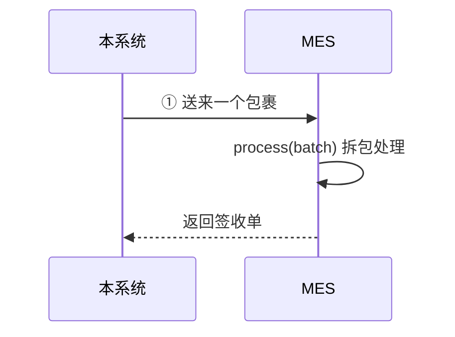
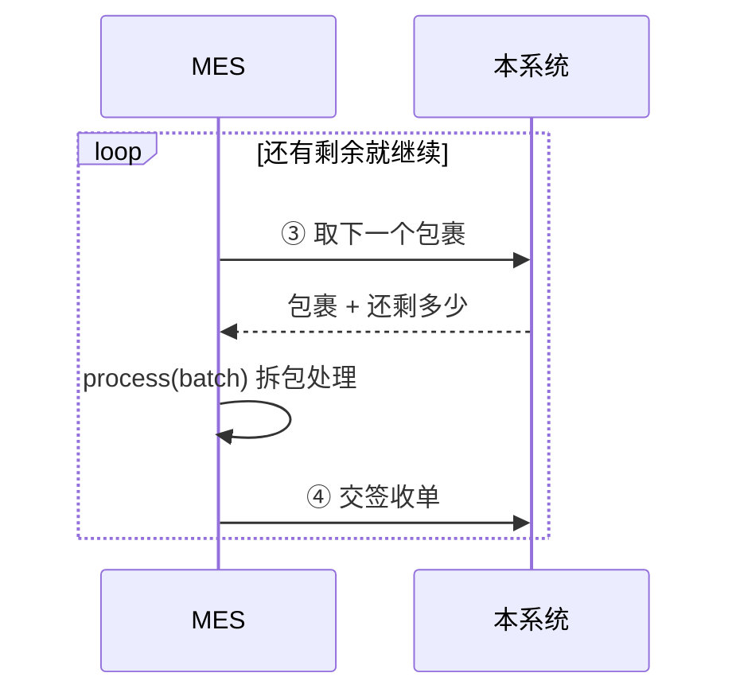

# SN 防重管控 · MES 对接说明（精简版）

Oct 22, 2026 · @magic　|　规则以《MES 接口规格》（PRD V30）为准

---

## 目录

- [1. 接口的业务场景](#1-接口的业务场景)
  - [1.1 先用「寄快递」理解整个对接](#11-先用寄快递理解整个对接)
  - [1.2 MES 会收到的 4 种包裹](#12-mes-会收到的-4-种包裹)
  - [1.3 MES 必须做到的 5 件事](#13-mes-必须做到的-5-件事)
- [2. 接口清单](#2-接口清单)
- [3. 调用流程](#3-调用流程)
  - [3.1 送货上门（推送，主要方式）](#31-送货上门推送主要方式)
  - [3.2 自己来取（取批，备用方式）](#32-自己来取取批备用方式)
  - [3.3 某个包裹处理不了怎么办](#33-某个包裹处理不了怎么办)
  - [3.4 同一个包裹两条路都到了](#34-同一个包裹两条路都到了)
  - [3.5 拆包处理 `process(batch)`：分 4 步](#35-拆包处理-processbatch分-4-步)
    - [3.5.1 第 1 步　先检查包裹对不对](#351-第-1-步先检查包裹对不对)
    - [3.5.2 第 2 步　看看是不是收过的包裹](#352-第-2-步看看是不是收过的包裹)
    - [3.5.3 第 3 步　一枚一枚比 rev](#353-第-3-步一枚一枚比-rev)
    - [3.5.4 第 4 步　先存好，再签收](#354-第-4-步先存好再签收)
  - [3.6 出了问题怎么办](#36-出了问题怎么办)
  - [3.7 转单、转组织：MES 要注意的事](#37-转单转组织mes-要注意的事)
- [4. 接口与参数](#4-接口与参数)
  - [4.1 通用规则](#41-通用规则)
    - [4.1.1 身份验证](#411-身份验证)
    - [4.1.2 出错时本系统返回什么](#412-出错时本系统返回什么)
  - [4.2 ① 接收包裹（MES 提供）](#42--接收包裹mes-提供)
    - [4.2.1 本系统会带的请求头](#421-本系统会带的请求头)
    - [4.2.2 MES 怎么应答](#422-mes-怎么应答)
  - [4.3 ③ 取下一个包裹](#43--取下一个包裹)
    - [4.3.1 本系统给哪个包裹？](#431-本系统给哪个包裹)
  - [4.4 ④ 交签收单](#44--交签收单)
  - [4.5 ⑤⑥ 对账查询（可选）](#45--对账查询可选)
  - [4.6 交付包裹（`DELIVERY`）](#46-交付包裹delivery)
    - [4.6.1 包裹上写的（批次头）](#461-包裹上写的批次头)
    - [4.6.2 每枚号（交付项）](#462-每枚号交付项)
  - [4.7 「被转走」包裹（`TRANSFER_OUT`）](#47-被转走包裹transfer_out)
  - [4.8 签收单（回执）](#48-签收单回执)
- [5. 实现清单与联调](#5-实现清单与联调)
  - [5.1 实现清单（请书面确认）](#51-实现清单请书面确认)
  - [5.2 联调用例（转单、转组织相关）](#52-联调用例转单转组织相关)

---

## 1. 接口的业务场景

### 1.1 先用「寄快递」理解整个对接

本系统给 MES 送号，就像寄快递：

| 对接里的词 | 相当于 | 说明 |
| --- | --- | --- |
| **批次** | 一个包裹 | 一次送过去的一包号，最多 5000 枚 |
| **批次号** `batchNo` | 快递单号 | 每个包裹一个，全局不重复；包裹封好后里面的东西不会再变 |
| **推送** | 送货上门 | 本系统主动把包裹送到 MES |
| **取批** | 自己去网点取件 | 送货失败或 MES 急着要号时，MES 自己来拿 |
| **回执** | 签收单 | MES 拆包后逐枚写明：这个号收下了没有、为什么 |

还有两个词要先知道：

- **挂靠**：一个号「属于谁」，包括哪个组织、哪张 PI、哪张单据的第几行、什么物料、哪个客户。**号本身（SN 字符串）永远不变，变的只是挂靠。**
- **rev（版本号）**：号的信息每改一次，rev 就加 1，**数字越大越新**。MES 收到一个号时，比一比 rev 就知道这条信息是新的还是旧的。

### 1.2 MES 会收到的 4 种包裹

| 场景 | 什么时候会发生 | 怎么认出来 | MES 要做什么 |
| --- | --- | --- | --- |
| **新号交付** | 总部把新号分给本组织 | `batchType = DELIVERY`，`pushType = NEW` | 存进本地号库，可以打标 |
| **号的信息变了** | 号换了单据（转单）；或者号从别的组织转过来、转回来 | `batchType = DELIVERY`，`pushType = REASSIGN` | 用新信息覆盖旧信息；本地没有这个号就当新号存下 |
| **号被转走了** | 号转给了别的组织 | `batchType = TRANSFER_OUT` | 把号标成「已转出」，**不许再打标**，但不要删 |
| **连接测试** | 总部在页面上点「连接测试」 | `batchType = PING`，没有号 | 只检查密码和组织对不对，什么都不存 |

一个号的完整经历举例（`HX100000001A`）：

| 总部做了什么 | rev | 组织 110 的 MES 收到 | 组织 120 的 MES 收到 |
| --- | --- | --- | --- |
| 分给 110 | 1 | 新号交付 → 存下 | — |
| 在 110 内换了单据 | 2 | 信息变了 → 覆盖 | — |
| 转给 120 | 3 | 被转走 → 不许打标 | 信息变了 → 存下 |
| 又转回 110 | 4 | 信息变了 → 覆盖，恢复可用 | 被转走 → 不许打标 |

规律很简单：**号离开谁，谁收到「转走」；号到了谁那里，谁收到「交付」。**

### 1.3 MES 必须做到的 5 件事

| # | 要做到 | 为什么 |
| --- | --- | --- |
| 1 | **同一个包裹只处理一次**：按批次号判断，收过的再来就把上次的签收单原样交回 | 网络超时会重送、MES 也可能自己来取，同一个包裹可能到好几次 |
| 2 | **只收自己组织的号**：`orgCode` 不是本组织，整包退回 | 防止地址配错，把号送到别的工厂 |
| 3 | **看 rev 决定收不收**：比本地新就收，比本地旧就不收；一样新时，同一个包裹算「重复」，不同包裹算「冲突」 | 旧消息晚到也不会盖掉新信息；同一个号被送出两次能当场发现 |
| 4 | **先存好，再签收** | 签收单的意思是「我已经收好了」。没存好就签收，存失败了号就丢了 |
| 5 | **作废的包裹直接扔掉**：收到 409 `BATCH_VOIDED` 就不处理 | 总部已经把这包号拆开重新打包，会用新包裹再送一次 |

---

## 2. 接口清单

| # | 接口 | 谁调谁 | 用来干什么 | 必须做吗 |
| --- | --- | --- | --- | --- |
| ① | `POST {MES 地址}` | 本系统 → MES | 送包裹；MES 处理完在同一个应答里交回签收单 | 是，**这个接口由 MES 提供** |
| ③ | `POST /api/mes/v1/batches/next` | MES → 本系统 | 来取下一个包裹；也可以按批次号取回某个旧包裹 | 是 |
| ④ | `POST /api/mes/v1/batches/{batchNo}/receipt` | MES → 本系统 | 交签收单（或者整包退回） | 是 |
| ⑤ | `GET /api/mes/v1/sn/delivered` | MES → 本系统 | 查一查本系统认为已经交给我的号 | 否，对账用 |
| ⑥ | `GET /api/mes/v1/batches/{batchNo}/items` | MES → 本系统 | 查一查某个包裹里有哪些号 | 否，对账用 |

号有两条路到 MES：本系统送上门（①），或 MES 自己来取（③）。**两条路拿到的是同一个包裹**，所以 MES 只需要写一套处理逻辑 `process(batch)`（见 3.5），两边都调用它。

---

## 3. 调用流程

### 3.1 送货上门（推送，主要方式）



MES 只需要被动接收。如果送货失败（超时、对方报错、网络断了），本系统会在 1、5、15 分钟后各再送一次。

### 3.2 自己来取（取批，备用方式）

什么时候来取：**本地号不够用了**就来取；另外**每 5 分钟不带条件取一次**，把送货失败的包裹和「号被转走」的通知收回来。



1. 每次请求都带 `Authorization: Bearer <工号>:<密钥>`（见 4.1.1），不用换令牌
2. 用 ③ 取包裹。返回 `batch = null` 表示现在没有，过 1 分钟以上再来
3. 拆包处理，**处理完马上用 ④ 交签收单**。不交的话，下次来取还是给你这一包
4. 应答里 `remaining` 大于 0，说明还有，接着取

### 3.3 某个包裹处理不了怎么办

比如某个字段太长，MES 本地存不下：

1. 整包退回：签收单写 `outcome = REJECTED` 并说明原因。这一包先冻结；**同一张 PI 后面的包裹暂停送货**（别的 PI 照常送），MES 来取批时会跳过这一包，照常拿到后面的
2. MES 改好后，用 ③ 带上这个批次号把它取回来，重新处理，再用 ④ 交签收单；之后请通知总部「继续推送」，这张 PI 才恢复送货（在此之前 MES 也可以继续取批）
3. 如果取回或交签收单时返回 409 `BATCH_VOIDED`，说明总部已经作废了这一包，扔掉即可

### 3.4 同一个包裹两条路都到了

本系统重送的同时，MES 也可能自己取到同一包。不用担心：按批次号只处理一次（第 1 件事），两边交回的是同一张签收单。

### 3.5 拆包处理 `process(batch)`：分 4 步

送货和取件都调用这个函数。处理时**按批次号加锁**，保证同一个包裹不会被两个线程同时处理。

#### 3.5.1 第 1 步　先检查包裹对不对

有任何一项不对，就整包退回：

- `orgCode` 是不是本组织
- 包裹上写的枚数 `count`，和里面实际的条数是否一致，有没有超过 5000
- 里面有没有重复的号、必填项有没有缺
- 交付包裹里每枚号的 `pi` 都和包裹上写的一致，而且没有混进「转走」的号；「转走」包裹里只能有「转走」的号

注意：**退回时不要记下这个批次号**。否则总部修好后再送同一包，MES 会以为处理过了，又原样退回。

#### 3.5.2 第 2 步　看看是不是收过的包裹

- 收过，而且内容指纹 `itemsDigest` 一样：直接把上次的签收单交回（标上 `replayed = true`），结束
- 收过，但指纹不一样：返回 409 `BATCH_CONTENT_MISMATCH`。正常不会发生，出现说明本系统出了问题
- 没收过：进入第 3 步

#### 3.5.3 第 3 步　一枚一枚比 rev

拿包裹里每枚号的 rev，和 MES 本地存的 rev 比：

| 比较结果 | 什么意思 | MES 怎么做 | 签收单写 |
| --- | --- | --- | --- |
| 本地没有这个号 | 第一次见到 | 交付的号：按包裹里的信息存下；转走的号：按 `from` 里的旧信息存下，并标「已转出」 | `ACCEPTED` 收下 |
| 包裹里的更新 | 信息变了 | 交付的号：用新信息覆盖，去掉「已转出」；转走的号：标「已转出」 | `ACCEPTED` 收下 |
| 一样新，本地记录就来自这个包裹 | 同一包又送了一次 | 不动 | `DUPLICATE` 重复（正常） |
| 一样新，本地记录来自别的包裹 | **同一个号被送了两次**，有问题 | 不动，这个号先锁住、不许打标，等总部处理 | `CONFLICT` 冲突 |
| 包裹里的更旧 | 过时的消息晚到了 | 不动 | `STALE` 过期 |

补充说明：

- 收下（`ACCEPTED`）时：把新的 rev 存起来，并记下「这个号最后来自哪个包裹」（`lastBatchNo`）；之前已经打过标的不受影响；之前因冲突被锁住的号解锁
- 冲突、过期时：签收单里要带上 MES 本地存的 rev 和批次号（`existingRev`、`existingBatchNo`），总部靠它查是哪两个包裹出了问题
- rev 只能原样存，MES 不要自己加减

#### 3.5.4 第 4 步　先存好，再签收

把批次号、指纹、整张签收单和号的数据**一起存进数据库**（要么全部存成功，要么全部不存），存成功后再交回签收单。5000 枚的包裹最好 10 秒内处理完（送货最多等 60 秒）。

### 3.6 出了问题怎么办

| 遇到什么 | MES 要做什么 |
| --- | --- |
| 送货超时、取完包裹 MES 宕机了、签收单没交上去 | 什么都不用特别做。重送或再取拿到的还是同一包，签收单原样再交一次就行 |
| 交签收单被退回（422 `RECEIPT_MISMATCH`） | 按 `details` 里写的差异改正，再交 |
| 送货重试 3 次（1、5、15 分钟）仍没送到，或被 MES 明确拒绝（4xx、整包退回、签收单不符） | 本系统不再自动送这一包，同一张 PI 后面的包裹也暂停，等总部「继续推送」。MES 恢复后可以直接来取批，或通知总部续推 |
| 包裹太大，MES 收不下（413） | 能调大限制就调大，等本系统继续送；调不了就请总部作废，号会拆成小包重新送 |
| 地址配错，收到别的组织的号 | 第 1 步检查 `orgCode` 就会发现，整包退回 |
| 签收单里有冲突、过期的号 | 这些号先锁住，等总部查清楚：总部会用更大的 rev 重送，MES 收下后自动解锁；或者总部关掉告警，由现场人工放行 |
| 某一包一直交不上签收单（MES 长期停机、问题修不好） | 总部拿到 MES 方的书面确认后处理：MES 其实已经存好了的，总部「人工确认」，之后再交签收单只做存档；MES 确实没处理的，总部「作废」，之后会返回 409 `BATCH_VOIDED`，**MES 必须扔掉这一包，不能拿本地缓存再处理** |

### 3.7 转单、转组织：MES 要注意的事

- 转单、转组织都在本系统里操作，**不需要 MES 对接新接口**。结果就是第 1 章说的「信息变了」和「被转走」两种包裹
- 一次转移能转多少号：先选 PI，再选一张单据，然后在下面三种范围里选一种。**最大就是一整张单据，不能一次把整个 PI 转走**（整个 PI 要转，就按单据分几次转）。转组织只能转本组织的号，其余规则和转单一样

  | 范围 | 转哪些号 |
  | --- | --- |
  | 整张单据 | 这张单据下的全部号 |
  | 单据 + 物料 | 这张单据下某个物料编码的全部号 |
  | 单据 + 物料 + 号段 | 这个物料下的一枚号，或连续的一段号（中间已经转走的号会自动跳过） |

- 不管选哪种范围，到了 MES 都是一枚一枚的明细。MES **不用关心是按哪种范围转的**，按每枚号的信息处理就行
- 「被转走」包裹如果涉及多张 PI，包裹上的 `pi` 是空的（`null`），按每枚号的 `from.pi` 归档就行
- 「转走」通知送到之前（包括转组织申请还在审批的时候），原来的 MES 仍然能打标，需要现场按总部通知自己先停用。用 ⑤ 查到 `status = APPLYING` 的号就是正在申请转走的，只做提醒用
- 已经打过标的号被转走：打标记录保留，旧标签由现场按总部给的「转出号清单」线下作废
- 转进来的号会带 `transferKind`（转单还是转组织）、`transferDocNo`（转移单号）、`fromOrgCode`（从哪个组织来），只是方便现场核对，不影响收不收
- 转进来的号，当前 PI（`pi`）可能和流水号所属 PI（`serialPi`）不一样，这是正常的，不要拿它们互相校验
- 如果一套 MES 同时服务好几个组织，**数据必须按组织分开存**（用「组织 + SN」作为唯一标识），否则转进转出会搅在一起
- 组织关掉了「对接 MES」后，「被转走」通知照样会送过去，也可以自己来取

---

## 4. 接口与参数

### 4.1 通用规则

| 项目 | 规则 |
| --- | --- |
| 怎么传 | HTTPS + JSON（UTF-8），可以 gzip 压缩；遇到 3xx 跳转不跟随 |
| 字段名 | 英文小驼峰。每个请求和应答都带 `schemaVersion`（现在是 `1.0`）。以后只会加字段，不会改字段，**看不懂的字段直接忽略** |
| 时间 | 一律 UTC 时间，格式如 `2026-10-19T02:37:00Z` |
| SN | 最长 64 位，**大小写算不同的号**（`AX` 和 `ax` 是两个号），只有字母、数字、`-`、`.`、`_` |
| `length`、`serialDec` | 当字符串处理，不要转成数字（会丢前导 0，或者数字太大溢出） |
| 批次号 | 最长 40 位，全局唯一 |
| 怎么算成功 | HTTP 200 且 `code = OK` 才算成功；出错一定不是 200。程序按 `code` 判断，`message` 是给人看的 |
| 调用频率 | ③～⑥ 每个组织每分钟最多 60 次，超了返回 429 `RATE_LIMITED`，按应答头 `Retry-After` 写的秒数等一会儿再调 |

#### 4.1.1 身份验证

- **本系统调 MES（①）**，每个组织选一种：
  - **方式 A：固定令牌**。本系统每次带 `Authorization: Bearer <令牌>`，MES 核对令牌，并只允许本系统的服务器 IP 访问
  - **方式 B：签名**（走公网时推荐，比如越南工厂）。本系统用双方约定的密钥算一个签名，放在 `X-Sn-Timestamp`（时间）和 `X-Sn-Signature`（签名）里。MES 用同样方法算一遍，一致才放行。
    签名怎么算：把 `时间 + 换行 + 批次号 + 换行 + 请求体的 SHA256` 拼起来，用密钥做 HMAC-SHA256。请求体要用**解压后的原始内容**，不要先转成对象再转回字符串（顺序和空格会变）。时间和本地相差超过 5 分钟的拒绝，所以双方服务器都要同步时间（NTP）
- **MES 调本系统（③～⑥）**：不换令牌，每次请求带 `Authorization: Bearer <工号>:<密钥>`，例如 `Authorization: Bearer MES110:9f2c…`。账号（工号）和密钥由本系统管理员开好后交给 MES 方，一个账号只对应一个组织

  | 认证出错 | 什么意思 |
  | --- | --- |
  | 401 `INVALID_CREDENTIALS` | 缺少认证信息，或工号、密钥不对（含密钥已被重置） |
  | 423 `ACCOUNT_LOCKED` | 连续错了 10 次，锁 15 分钟，这期间密钥对了也不行 |
  | 403 `IP_NOT_ALLOWED` | 发请求的服务器 IP 不在允许名单里 |
  | 403 `ACCOUNT_DISABLED` | 账号被停用了，联系总部 |

  管理员重置密钥后旧密钥立即失效，MES 要换用新密钥

#### 4.1.2 出错时本系统返回什么

```json
{"schemaVersion": "1.0", "code": "RECEIPT_MISMATCH", "message": "回执枚数与批次不符",
 "batchNo": "PL-110-20261019-000045", "details": [{"field": "results", "reason": "期望 5000 枚，收到 4999 枚"}]}
```

| 字段 | 是什么 |
| --- | --- |
| `code` | 错误代码，程序根据它决定怎么处理 |
| `message` | 中文说明，给人看的 |
| `batchNo` | 出问题的批次号 |
| `details` | 具体哪里不对 |

### 4.2 ① 接收包裹（MES 提供）

MES 提供一个地址，总部填到本系统的「对接设置」里。本系统往这个地址 POST 包裹。

#### 4.2.1 本系统会带的请求头

| 请求头 | 是什么 |
| --- | --- |
| 身份验证 | 方式 A 或 B，见 4.1 |
| `X-Sn-Batch-No` | 批次号，和包裹里的 `batchNo` 一样。可以不解析包裹就先用它加锁 |
| `X-Sn-Attempt` | 这是第几次送，只用来记日志 |
| `X-Request-Id` | 这次请求的编号，查日志用。**不能用它判断是否重复**，判断重复只看批次号 |
| `Content-Encoding: gzip` | 包裹是压缩过的，先解压 |

**请求体**：就是一个包裹，格式见 4.6、4.7。同一个包裹重送时内容一个字节都不会变。

#### 4.2.2 MES 怎么应答

| 情况 | 应答 |
| --- | --- |
| 处理完了，或者整包退回 | **都返回 200**，内容是签收单 |
| 同一包正在处理中 | 等处理完返回同一张签收单；或者返回 409 `BATCH_IN_PROGRESS` 让本系统稍后再送 |
| 批次号一样但内容不一样 | 409 `BATCH_CONTENT_MISMATCH` |
| 验证失败 / 地址不对 / 包裹太大 / 内容看不懂 | 401 或 403 / 404 / 413 / 400 |

记住：**只要能拆包处理，就返回 200 + 签收单**（哪怕是整包退回）。4xx 只用于「根本没法处理」的情况。
本系统遇到超时、5xx、断网、409 `BATCH_IN_PROGRESS`、429、503 会稍后重送，遇到其他错误不重送。

**连接测试**：收到 `batchType = PING` 的空包裹时，只检查身份和 `orgCode`，通过就返回 `outcome = PROCESSED`、`summary` 全为 0。不用记批次号，也不存任何数据。

### 4.3 ③ 取下一个包裹

| 请求参数 | 是什么 |
| --- | --- |
| `schemaVersion` | 填 `1.0` |
| `pi` | 只要这张 PI 的号。不填就是都要 |
| `billNo` | 只要这张单据的号。不填就是都要。可以和 `pi` 一起填 |
| `batchNo` | 只想拿回某个旧包裹时填（比如修好后重新处理退回的那包）。填了它，`pi`、`billNo` 就不管用了，也不会新打包 |

```json
{"schemaVersion": "1.0", "pi": "000001", "billNo": null, "batchNo": null}
```

#### 4.3.1 本系统给哪个包裹？

1. 先给范围内**最早的、还没签收的包裹**：送货失败的、上次取走没交签收单的、「被转走」通知。所以 MES 中途宕机再来取，拿到的还是原来那包，不会多拿
2. 都没有，才新打一个包
3. 被退回、被作废的包不会自动再给，不会堵住后面的号（要拿退回的包，用 `batchNo` 指定）

另外两点：按单据取时，可能拿到一个也装着别的单据的号的包裹（这张单据的号正好在里面），照常收下就行；「被转走」通知是按每枚号原来的 `from.pi`、`from.billNo` 判断在不在范围内的。

| 应答字段 | 是什么 |
| --- | --- |
| `batch` | 包裹，格式和送货上门的一模一样；没有可给的就是 `null` |
| `batchSource` | 这包是送货时打的（`PUSH`）还是取件时打的（`PULL`），处理方法一样，看看就行 |
| `newlyCreated` | 是不是这次新打的包 |
| `batchResult` | 包裹的状态，一般是 `UNCONFIRMED`（还没签收）；拿回被退回的包时是 `FAILED` |
| `remaining` | 范围内还剩多少枚号可以取。**大于 0 就接着取** |
| `paused` | 有多少枚号被总部暂停了，在等总部处理，不用一直来取 |

| 出错 | 什么意思 / 怎么办 |
| --- | --- |
| 401 `INVALID_CREDENTIALS` / 423 / 403 | 认证出错，见 4.1.1 |
| 403 `ORG_NOT_ALLOWED` | 这张 PI 跟本组织没关系，检查 PI 填对没有 |
| 404 `BATCH_NOT_FOUND` | 没有这个批次号，或者不是本组织的 |
| 409 `BATCH_CONFIRMED` | 这包已经签收过了，不用再处理 |
| 409 `BATCH_VOIDED` | 这包已作废，扔掉 |
| 429 `RATE_LIMITED` | 调得太频繁，按 `Retry-After` 等一会儿 |
| 5xx / 超时 | 直接再取，拿到的还是同一包 |

### 4.4 ④ 交签收单

地址里带上批次号，请求体就是签收单（格式见 4.8）。本系统会核对签收单和包裹对不对得上：批次号一样；条数等于枚数；每枚号刚好出现一次，而且都是这个包里的；rev 一致；汇总数和明细一致。

| 应答 | 什么意思 |
| --- | --- |
| 200，`firstConfirmation = true` | 签收成功 |
| 200，`firstConfirmation = false` | 这包之前已经签收过了，这次只存个档 |
| 200，`batchResult = FAILED` | 整包退回已登记，这包先冻结 |
| 422 `RECEIPT_MISMATCH` | 签收单和包裹对不上，按 `details` 改好再交 |
| 409 `BATCH_VOIDED` | 这包已作废，扔掉 |
| 404 `BATCH_NOT_FOUND` | 没有这个批次号，或者不是本组织的 |

`batchResult` 的几种值：`SUCCESS` 签收成功、`SUCCESS_CONFLICT` 签收成功但有冲突的号、`FAILED` 整包退回。交的时候超时或报 5xx，拿同一张签收单再交一次就行。

### 4.5 ⑤⑥ 对账查询（可选）

- ⑤ `GET /api/mes/v1/sn/delivered?pi=&cursor=&pageSize=`：本系统认为已经交给我的号，`pi` 可以不填
- ⑥ `GET /api/mes/v1/batches/{batchNo}/items?cursor=&pageSize=`：某个包裹里有哪些号

**翻页**：第一页 `cursor` 留空，之后填上一页返回的 `nextCursor`，`nextCursor` 为 `null` 就是最后一页。`pageSize` 是每页条数，默认 1000，最多 5000。

返回的每枚号字段和交付包裹一样，另外多了 `orgCode`（所属组织）、`status`（号在本系统的状态）、`batchNo`（在哪个包裹里）。

**只用来对账**，不能根据查询结果存号、打标或删号，这些都以包裹为准。

### 4.6 交付包裹（`DELIVERY`）

「新号交付」和「号的信息变了」都用这种包裹，两种号可以混在同一包里。

```json
{
  "schemaVersion": "1.0",
  "batchNo": "PS-110-20261019-000123",
  "batchType": "DELIVERY",
  "orgCode": "110",
  "pi": "000001",
  "count": 1,
  "createdAt": "2026-10-19T02:37:00Z",
  "itemsDigest": "sha256:9f2c4e…",
  "items": [
    {
      "pushType": "NEW",
      "sn": "HX100000001A",
      "rev": 1,
      "serial": "000001",
      "serialDec": "1",
      "serialPi": "000001",
      "pi": "000001",
      "billNo": "VT2026090001",
      "billSeq": 1,
      "materialCode": "9148363",
      "length": "100",
      "customerCode": "0001"
    }
  ]
}
```

#### 4.6.1 包裹上写的（批次头）

| 字段 | 是什么 |
| --- | --- |
| `batchNo` | 批次号（快递单号），**判断是否收过就看它** |
| `batchType` | 包裹类型：`DELIVERY` 交付 / `TRANSFER_OUT` 被转走 / `PING` 连接测试 |
| `orgCode` | 收件组织，必须是本组织 |
| `pi` | 这包号属于哪张 PI（交付包裹只装一张 PI 的号） |
| `count` | 里面有几枚号，最多 5000 |
| `createdAt` | 打包时间 |
| `itemsDigest` | 内容的「指纹」。同一个批次号，指纹一样说明内容没变。MES 存下来，下次直接比字符串，**不用自己算** |

#### 4.6.2 每枚号（交付项）

| 字段 | 必填 | 是什么 |
| --- | --- | --- |
| `pushType` | 是 | 为什么送来：`NEW` 新号 / `REASSIGN` 信息变了。只是说明原因，收不收看 rev |
| `sn` | 是 | 完整的号 |
| `rev` | 是 | 版本号，越大越新 |
| `serial` | 是 | 流水号，可能是 36 进制等写法 |
| `serialDec` | 是 | 流水号换算成十进制（字符串） |
| `serialPi` | 是 | 流水号最初属于哪张 PI。号从别的 PI 转来时会和 `pi` 不一样 |
| `pi` | 是 | 号现在属于哪张 PI |
| `billNo` | 是 | 单据号 |
| `billSeq` | 是 | 单据第几行（同一单据可能有相同物料，靠行号区分） |
| `materialCode` | 否 | 物料编码 |
| `length` | 否 | 米标，原样保存（`0100` 不要变成 `100`） |
| `customerCode` | 是 | 客户编码 |
| `transferKind` / `transferDocNo` / `fromOrgCode` | 否 | 转进来的号才有：转单还是转组织 / 转移单号 / 从哪个组织来。方便现场核对，不影响收不收 |

### 4.7 「被转走」包裹（`TRANSFER_OUT`）

告诉原来的组织「这些号不归你了」。包裹上的字段同 4.6，`orgCode` 是原来的组织。

```json
{
  "schemaVersion": "1.0",
  "batchNo": "XO-110-20261019-000007",
  "batchType": "TRANSFER_OUT",
  "orgCode": "110",
  "pi": "000001",
  "count": 1,
  "createdAt": "2026-10-19T02:50:00Z",
  "itemsDigest": "sha256:51ab07…",
  "items": [
    {
      "pushType": "TRANSFER_OUT",
      "sn": "HX100000003A",
      "rev": 3,
      "serial": "000003",
      "serialDec": "3",
      "serialPi": "000001",
      "from": {"pi": "000001", "billNo": "VT2026090001", "billSeq": 1, "materialCode": "9148363", "customerCode": "0001"},
      "toOrgCode": "120",
      "transferKind": "ORG_TRANSFER",
      "transferDocNo": "TO-20261019-0007"
    }
  ]
}
```

| 字段 | 是什么 |
| --- | --- |
| `sn`、`rev`、`serial`、`serialDec`、`serialPi` | 同交付项 |
| `from` | 号转走**之前**的信息（PI、单据、行号、物料、客户）。MES 用它来存，不要留空，也不要猜转走后的信息 |
| `toOrgCode` | 转去了哪个组织 |
| `transferKind` | `BILL_TRANSFER` 转单 / `ORG_TRANSFER` 转组织 |
| `transferDocNo` | 转移单号，方便现场查找 |

### 4.8 签收单（回执）

送货上门时放在 ① 的应答里，自己来取时用 ④ 交，格式一样。

**正常签收**：

```json
{
  "schemaVersion": "1.0",
  "batchNo": "PS-110-20261019-000123",
  "outcome": "PROCESSED",
  "receivedAt": "2026-10-19T02:37:03Z",
  "summary": {"total": 3, "accepted": 1, "duplicate": 0, "conflict": 1, "stale": 1},
  "results": [
    {"sn": "HX100000005A", "rev": 1, "result": "ACCEPTED"},
    {"sn": "HX100000001A", "rev": 2, "result": "CONFLICT", "existingRev": 2, "existingBatchNo": "PS-110-20261019-000100"},
    {"sn": "HX100000002A", "rev": 1, "result": "STALE", "existingRev": 2, "existingBatchNo": "PS-110-20261019-000100"}
  ]
}
```

**整包退回**：

```json
{"schemaVersion": "1.0", "batchNo": "PL-110-20261019-000046", "outcome": "REJECTED",
 "rejectCode": "FIELD_TOO_LONG", "rejectMessage": "materialCode 超过本侧字段长度 20"}
```

| 字段 | 是什么 |
| --- | --- |
| `outcome` | `PROCESSED` 已处理 / `REJECTED` 整包退回 |
| `replayed` | `true` 表示这是之前存下的签收单，原样交回 |
| `receivedAt` | 第一次处理的时间 |
| `summary` | 各种结果分别多少枚，要和 `results` 对得上 |
| `results` | 每枚号一条，条数等于包裹的枚数。`sn`、`rev` 照抄包裹里的，`result` 填 3.5 第 3 步的结果 |
| `existingRev`、`existingBatchNo` | 冲突、过期时必填：MES 本地存的 rev 和它来自哪个包裹 |
| `rejectCode`、`rejectMessage` | 整包退回时必填：退回原因 |

本系统收到签收单后：全部「收下」或「重复」→ 签收成功；有「冲突」→ 签收成功，但首页告警「疑似重复交付」；有「过期」→ 签收成功，首页告警「版本过期」；整包退回 → 这包冻结并告警。

---

## 5. 实现清单与联调

### 5.1 实现清单（请书面确认）

- [ ] 包裹格式和字段按第 4 章实现，包括 `serialPi`、`pi`，流水号按字符串存（Q29、Q31）
- [ ] 身份验证选定方式 A 或 B；服务器同步时间（NTP）
- [ ] 送货和取件共用一个 `process`，按批次号加锁；同一包再来就交回上次的签收单；批次号相同内容不同返回 409
- [ ] 检查 `orgCode`；整包退回时不记批次号，并且用 HTTP 200 + 退回签收单
- [ ] 每枚号按 rev 给出四种结果之一；冲突、过期时带回本地的 rev 和批次号
- [ ] 「被转走」的号用 `from` 存，标「已转出」、不许打标、不删除，能按转移单号、PI 查到
- [ ] 收到「信息变了」但本地没有这个号时，当新号存下
- [ ] 按 PI 或单据取件时，也能取到本组织的「被转走」通知
- [ ] `itemsDigest` 直接比字符串，不自己算
- [ ] 一包号要么全部存成功、要么都不存，存好后再签收；5000 枚 10 秒内
- [ ] 取到包裹后马上交签收单；处理不了就整包退回，修好后取回再交
- [ ] 支持连接测试 `PING`；能正确处理 422、409 `BATCH_VOIDED`；每次请求带工号:密钥，密钥重置后及时换用新密钥
- [ ] 一套 MES 服务多个组织时，按组织分开存数据
- [ ] 通过 5.2 的联调用例

接收包裹的接口 ① 写好后，可以先用本系统提供的测试脚本 `devtools/mes_conformance.py` 自己测一遍（需要 Python 3.11+ 和 httpx，只能对 MES 测试环境跑），它会逐项告诉你过没过。用法见《MES 联调指南》第 3 节。

### 5.2 联调用例（转单、转组织相关）

总部在本系统里操作，MES 方看结果对不对。假设组织 110、120 都对接了 MES。最后一列是对应的 PRD 9.2 上线验收场景编号。

| # | 总部做了什么 | MES 应该看到什么 | PRD 9.2 |
| --- | --- | --- | --- |
| 1 | 110 已经收到的号，在 110 内换了单据 | MES-110 收到「信息变了」，rev 加 1，签收 `ACCEPTED`，号挂到了新单据上 | 6 |
| 2 | 110 已经收到的 500 枚号转给 120 | MES-120 收到 500 枚交付并存下；MES-110 收到 500 枚「被转走」，标「已转出」；MES-110 用 ⑤ 查不到这 500 枚了 | 6、7 |
| 3 | 把第 2 步的号再转回 110 | MES-110 收到 rev 更大的「信息变了」，号恢复可用；MES-120 收到「被转走」 | 6 |
| 4 | 还没送到 110 的号转给 120 | MES-120 收到新号交付；MES-110 什么都收不到 | — |
| 5 | MES-110 停机时做第 2 步，恢复后来取件 | 不带条件、按原来的 PI 或单据取，都能拿到「被转走」包裹 | 7、19 |
| 6 | 一次转走的号来自两张 PI | MES-110 收到的「被转走」包裹 `pi` 为空，按每枚的 `from.pi` 归档 | — |
| 7 | 转组织时顺便改了 PI | MES-120 收到的号 `pi` 是新 PI、`serialPi` 是原 PI，正常存下 | — |
| 8 | 110 关掉「对接 MES」后，把以前送过的号转给 120 | MES-110 照样收到「被转走」，正常签收 | 17 |
| 9 | MES-110 还没签收「被转走」时，总部又想把这批号再转一次 | 本系统不允许 | 8 |
