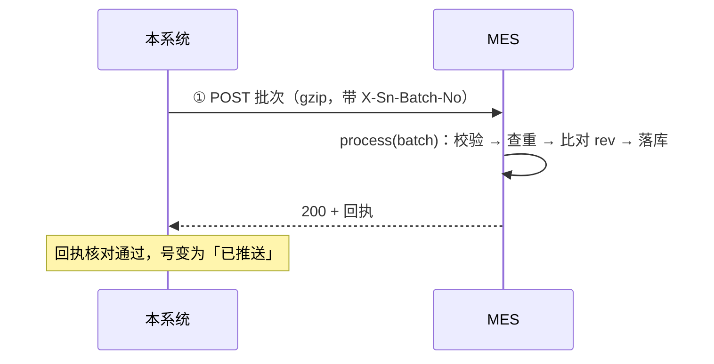
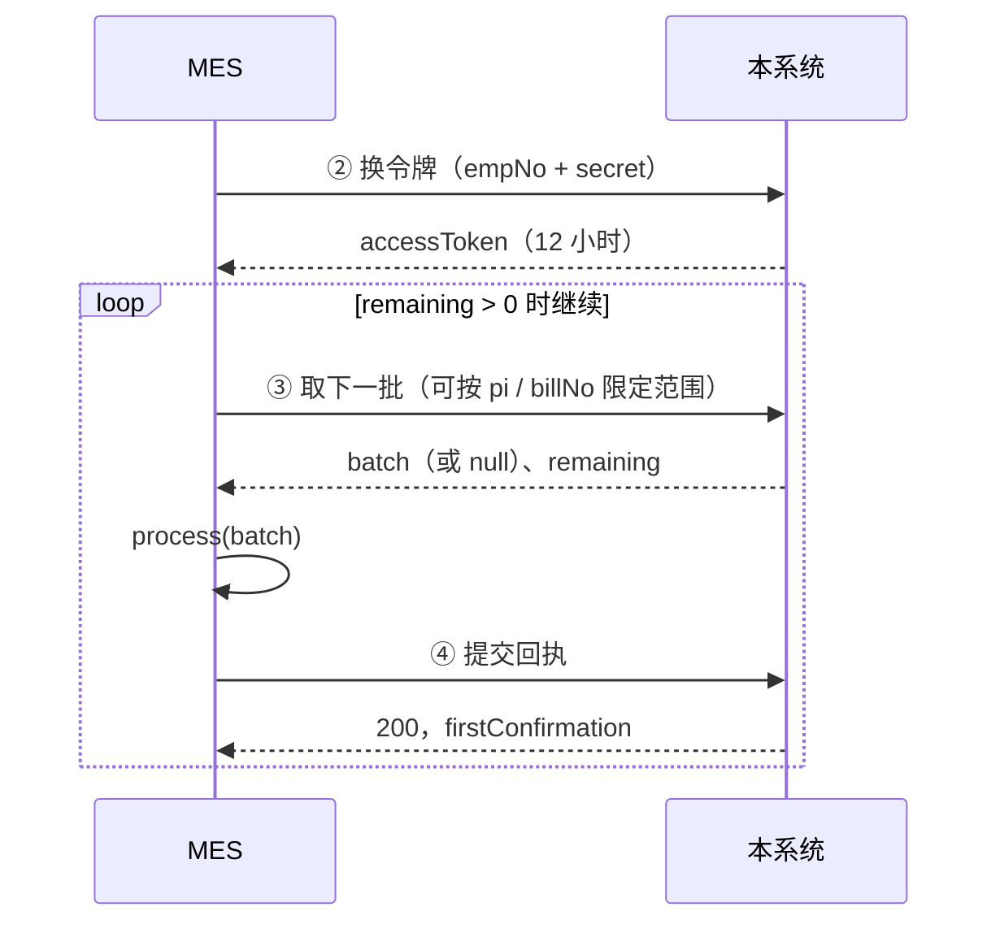
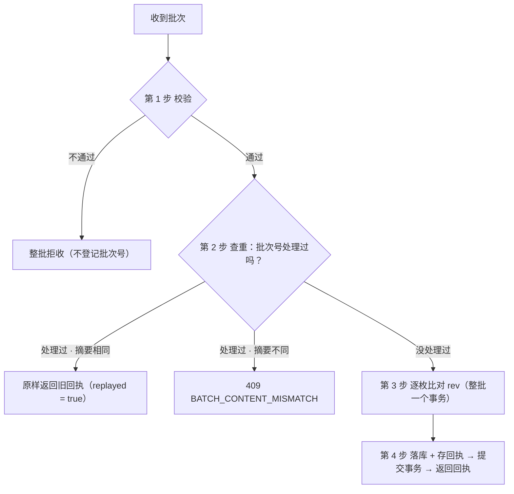

# SN 防重管控 · MES 对接说明（精简版）

Oct 22, 2026 · @magic　|　规则以《MES 接口规格》（PRD V30）为准

**怎么读这份文档**

| 想了解 | 看哪里 |
| --- | --- |
| 号是怎么来的、MES 要做什么、为什么这样设计 | 第 1 章 业务逻辑（转单、转组织见 1.5） |
| 一共有几个接口、谁调谁 | 第 2 章 接口清单 |
| 接口按什么顺序调、出错了怎么办 | 第 3 章 调用流程 |
| 每个接口、每个字段是干什么的 | 第 4 章 接口与参数详解 |
| 开发完要确认哪些点、怎么联调 | 第 5 章 实现清单与联调 |

只想快速上手：先读 1.4「MES 必须遵守的 5 条规则」和第 3 章。

---

## 1. 业务逻辑：MES 侧需要知道的

### 1.1 本系统和 MES 各做什么

本系统是总部的 **SN（序列号）中心**。号由总部统一生成、统一分给各生产组织，保证同一个号全公司只交出一次。MES 是各生产组织自己的生产系统，负责拿号去打标。


| 谁 | 做什么 |
| --- | --- |
| 本系统（总部） | 生成号、分配号、打包成批次送给 MES；号的挂靠变了（转单、转组织）就再送一次新版本 |
| MES（生产组织） | 收下批次、存进本地号池、逐枚回报收到了没有；按收到的信息打标 |

**MES 只负责「收号 + 回报」**，不需要给本系统提供查询接口，也不用在打标后回报。

### 1.2 几个关键概念（大白话版）

| 概念 | 一句话解释 | 举例 |
| --- | --- | --- |
| **SN（号）** | 贴在产品上的序列号，生成后字符串永远不变 | `HX100000001A` |
| **挂靠** | 这个号当前属于哪张 PI、哪张生产订单（单据）的第几行、什么物料、哪个客户、哪个生产组织。号不变，挂靠会变 | PI `000001`、单据 `VT2026090001` 第 1 行 |
| **批次** | 本系统送给 MES 的一包号，最多 5000 枚。**批次号全局唯一，建好后内容永远不变** | `PS-110-20261019-000123` |
| **回执** | MES 处理完一批后的答复：逐枚说明收下没有 | `ACCEPTED`、`CONFLICT` … |
| **rev（版本号）** | 号的版本，号的挂靠每变一次就加 1。MES 靠它判断「这条信息是新是旧」 | 首次分配 rev = 1，转单后 rev = 2 |
| **交付批次** `DELIVERY` | 「这些号现在归你，请入库或更新」 | 新分配的号、转单后的号 |
| **转出批次** `TRANSFER_OUT` | 「这些号已经转到别的组织，不归你了，别再打标」 | 号从组织 110 转到 120，110 的 MES 会收到 |

批次号前缀：`PS` 推送时建的、`PL` MES 取批时建的、`XO` 转出批次。MES 不需要按前缀区分处理，只是方便排查。

### 1.3 号的一生：MES 会在什么时候收到什么

**① 正常分配**：总部把号分给组织 110 → 本系统打包成交付批次（`pushType = NEW`）→ 推送给 110 的 MES → MES 入库并回执 → 号变为「已推送」，交付完成。

**② 号的挂靠变了**：总部做了转单、转组织，或确认了物料对应关系 → 号的 rev 加 1 → 本系统再送一次：

| 变化 | 号离开的组织的 MES 收到 | 号到达（或留在）的组织的 MES 收到 |
| --- | --- | --- |
| 同组织内转单 | — | 交付批次 `REASSIGN`：用新挂靠覆盖 |
| 转组织 A → B | 转出批次 `TRANSFER_OUT`：标「已转出」，禁止打标 | 交付批次：入库 |
| 后来又从 B 转回 A | 转出批次（B 收到） | 交付批次 `REASSIGN`（A 收到）：覆盖挂靠并解除「已转出」 |

**规律：号离开的组织收到「转出」，号到达或留在的组织收到「交付」。**

以 `HX100000001A` 为例完整走一遍：

| 步骤 | rev | 组织 110 的 MES 收到 | 组织 120 的 MES 收到 |
| --- | --- | --- | --- |
| 分配给 110 | 1 | 交付 `NEW`：入库 | — |
| 在 110 内转单 | 2 | 交付 `REASSIGN`：覆盖挂靠 | — |
| 转组织到 120 | 3 | 转出 `TRANSFER_OUT`：标「已转出」，禁止打标 | 交付：入库 |
| 转回 110 | 4 | 交付 `REASSIGN`：覆盖挂靠并清除「已转出」 | 转出 `TRANSFER_OUT`：标「已转出」 |

**③ 号在本系统里的状态**：MES 只接触「待推送 → 已推送」这一段。批次推来或被取走时号是「待推送」，本系统收到 MES 的有效回执后变为「已推送」。**没收到回执，就不算交出**。「暂停交付」不是单独状态：期间号保持原状态，只是暂时不分配、不推送、取批也取不到。

### 1.4 MES 必须遵守的 5 条规则

这 5 条是防重的关键，后面所有流程和字段都是为它们服务的。

1. **同一批只处理一次**：同一批可能被推送多次、也可能被 MES 取走多次（重试、两条路撞车都会造成）。MES 按批次号去重，再次收到时原样返回第一次的回执。
2. **只收本组织的号**：批次头的 `orgCode` 不是本组织就整批拒收，防止地址配错把号送到别的现场。
3. **按 rev 决定收不收**：rev 比本地大才覆盖；rev 一样看是不是同一批；rev 小就不收。这样旧数据晚到也盖不掉新数据，同一个号被交出两次也能当场发现（见 3.5 第 3 步）。
4. **先落库，再回执**：回执代表「我已经收好了」。先回执后落库，落库失败时本系统以为 MES 收了，这批号就丢了。
5. **作废的批次直接丢弃**：收到 409 `BATCH_VOIDED` 就丢掉这批内容，不要用本地缓存处理，号会换新批次重新送来。

### 1.5 转单与转组织：MES 会收到什么

转单（订单作废、拆单）和转组织（号换生产组织，可同时换 PI、单据、物料）**只在本系统操作**。MES 不用调用新接口，也不会收到「转移单」报文：转移的结果仍然以交付批次（4.7）和转出批次（4.8）送达，按 3.5 的 `process(batch)` 和 rev 规则处理即可。MES 侧要做的具体事项见 3.8。

**转移时本系统做什么**

- SN 字符串不变，只改挂靠（组织、PI、单据、序号、物料、客户），`rev` 加 1。
- 一次转移的来源是一张单据下的：整张单据、某个物料编码的全部号，或该物料编码下的一枚 / 一段连续号；目标是另一张单据（或同一单据）的某个物料行。到 MES 侧**一律展开为逐枚明细**，按单批上限拆成多批；报文里没有「号段」或「转移单」对象。
- 本系统不等 MES 确认就完成转移，需要通知的 MES 由系统自动推送；推送中断时，MES 也可以通过取批拿到这些批次。

**各场景下 MES 收到什么**（「持有」指该组织的 MES 已经收下这枚号，即交付批次已确认）

| 场景 | 来源组织的 MES | 转入组织的 MES |
| --- | --- | --- |
| 同一组织内转单，或改 PI、客户、物料；本组织 MES 已持有 | 交付批次，`REASSIGN`，按 rev 覆盖挂靠 | （与来源是同一个 MES） |
| 同一组织内转移；本组织 MES 未持有（尚未送达，或历史上页面领取的号） | 不单独通知；尚未送达的号之后按新挂靠正常送达 | （与来源是同一个 MES） |
| 跨组织；来源 MES 已持有；转入方对接 MES | 转出批次 `TRANSFER_OUT`，标「已转出」 | 交付批次 `REASSIGN`，本侧没有该号就按新增入库 |
| 跨组织；来源 MES 已持有；转入方未对接 MES | 转出批次 | 不推送（号为已分配，转入方从 SN 导出页下载） |
| 跨组织；来源 MES 未持有 | 不推送 | 交付批次 `NEW` |
| 号转回曾持有它的组织 | 号此刻所在的组织（上一次的转入方）的 MES 持有它时，收到转出 | 曾持有它的组织收到交付批次，rev 更大，覆盖挂靠并清除「已转出」 |
| 来源组织已关闭「对接 MES」 | 转出照常推送到原接口地址，也可以取批取回 | 与上面各行相同 |

转单的目标单据如果属于别的组织，就按跨组织处理。号段和整行转移只是枚数不同，各 MES 收到的内容与上表一致。单枚 rev 的变化见 1.3 示例。

**MES 可以依赖的顺序**

1. 同一枚号送到同一个 MES 的多批中，rev 递增；同一批重发不受影响。作废后重建的批次 rev 不变，但被作废的那一批 MES 应当从未处理过（3.7）。万一出现回退，就是 3.5 的 `CONFLICT` 或 `STALE`，照常回执即可。
2. 号离开某组织时，如果该组织的 MES 持有它，**转出一定先送达并确认，号才能再次转移**。因此来源 MES 不会被晚到的旧数据覆盖。
3. 转入方的交付批次和来源方的转出批次**互不等待，先后不定**。在转出送达之前，来源 MES 仍然认为这枚号可用，现场要求见 3.8 第 7 条。

---

## 2. 接口清单

| # | 接口 | 方向 | 一句话作用 | 什么时候调 | 必做 |
| --- | --- | --- | --- | --- | --- |
| ① | `POST {MES 地址}` | 本系统 → MES | 推送一个批次，MES 在应答里直接返回回执 | 本系统分完号、号有变化时自动调 | 是，**由 MES 提供** |
| ② | `POST /api/mes/v1/auth/token` | MES → 本系统 | 用工号和密钥换访问令牌（12 小时有效） | 调 ③④⑤⑥ 之前；令牌快过期时 | 是 |
| ③ | `POST /api/mes/v1/batches/next` | MES → 本系统 | 取下一批；带 `batchNo` 时取回指定批次 | 本地号不够时；每 5 分钟兜底一次；修好后取回失败批次 | 是 |
| ④ | `POST /api/mes/v1/batches/{batchNo}/receipt` | MES → 本系统 | 提交回执，或整批拒收 | 每处理完一批通过 ③ 取来的批次 | 是 |
| ⑤ | `GET /api/mes/v1/sn/delivered` | MES → 本系统 | 查询已交付给本组织的号 | 对账核对时 | 否 |
| ⑥ | `GET /api/mes/v1/batches/{batchNo}/items` | MES → 本系统 | 查询某个批次里的号 | 对账核对时 | 否 |

**两条送达路**：号到达 MES 有两条路——① 本系统推过来，或 ③ MES 自己来取。两条路送的是**同一批、同样的内容**，MES 用**同一个处理函数** `process(batch)` 处理（见 3.5），处理完都要回执：推送的在 ① 应答里回，取来的通过 ④ 提交。

**认证一览**：

| 方向 | 方式 |
| --- | --- |
| 本系统 → MES（①） | 每个组织二选一：A 固定 Bearer 令牌 + 来源 IP 白名单；B HMAC-SHA256 签名（跨境公网推荐）。详见 4.1 |
| MES → 本系统（②～⑥） | 先用 ② 换令牌，之后每次请求头带 `Authorization: Bearer <token>` |

---

## 3. 调用流程

### 3.1 推送（主路）

总部分配后本系统自动推送，MES 被动接收即可。



1. 本系统调 ① 推送一批
2. MES 执行 `process(batch)`
3. MES 在 ① 的应答里返回回执

推送超时、5xx、断连等情况下，本系统在 1、5、15 分钟后各重试一次；三次都不成功就停下，等总部点「继续推送」，或等 MES 自己来取（3.2）。

### 3.2 取批（备用路）

什么时候取：**本地号不够用时**取；另外**每 5 分钟不带范围取一次**，用来收回推送中断的批次和转出批次。



1. 调 ② 换令牌。令牌用掉 80% 时长后提前换新
2. 调 ③ 取批；返回 `batch = null` 表示暂时没有可取的，间隔 1 分钟以上再取
3. 执行 `process(batch)`
4. 调 ④ 提交回执。**取到后要尽快回执**：没回执的批次，下次取还会再给你同一批
5. 应答里 `remaining > 0` 时回到第 2 步继续取

### 3.3 某一批处理不了

例如某字段超过 MES 本地字段长度。

1. 返回整批拒收回执（`outcome = REJECTED`，写明原因）：推送来的在 ① 应答里返回，取来的通过 ④ 提交。这一批在本系统记为失败、号冻结、首页告警；**后面的批次照常送，不会被卡住**
2. MES 修好后调 ③ 并带上 `batchNo`，把这一批取回来，重新处理后用 ④ 提交回执
3. 如果 ③ 或 ④ 返回 409 `BATCH_VOIDED`，说明总部已作废这一批，直接丢弃。这些号会换新批次重新送来

### 3.4 两条路撞车

推送超时后本系统会重试，同时 MES 也可能把同一批取走。没关系：MES 按批次号只处理一次（规则 1），两边拿到的是同一份回执。

### 3.5 核心处理逻辑 `process(batch)`

推送和取批调用同一个函数，并共用一把**按批次号加的锁**。处理分四步：



**第 1 步：校验（不通过就整批拒收）**

| 检查项 | 为什么 |
| --- | --- |
| `orgCode` 等于本组织 | 防止号被送错现场 |
| `count` 等于 `items` 条数，且不超过单批上限 | 防止报文残缺 |
| 批内 SN 不重复，必填字段齐全 | 防止脏数据入库 |
| 交付批次：每枚的 `pi` 等于批次头 `pi`，且不含转出项；转出批次：只含转出项 | 两类批次的处理方式不同，不能混 |

整批拒收时**不登记批次号**。否则修好后再收到同一批，只会返回旧的拒收结果。

**第 2 步：查重（加锁后查本地批次表）**

- 已处理过，且 `itemsDigest` 相同：原样返回存下的回执（`replayed = true`），结束
- 已处理过，但 `itemsDigest` 不同：返回 409 `BATCH_CONTENT_MISMATCH`（说明本系统有缺陷，正常不会出现），结束
- 没处理过：进入第 3 步

**第 3 步：逐枚比对 rev（整批一个事务）**

每一枚号，拿收到的 `rev` 和本地已存的 rev 比：

| 情况 | 本地怎么改 | 回执结果 |
| --- | --- | --- |
| 本地没有这个 SN | 交付项：按收到的挂靠入库。转出项：按 `from` 入库，标「已转出」，记录 `toOrgCode` | `ACCEPTED` 收下 |
| 收到的 rev 更大 | 交付项：用收到的挂靠覆盖（单据、序号、物料、客户、PI、组织），清除「已转出」。转出项：用 `from` 覆盖挂靠，标「已转出」，记录 `toOrgCode` | `ACCEPTED` 收下 |
| rev 相同，本地 `lastBatchNo` 就是本批 | 不改 | `DUPLICATE` 重复（正常） |
| rev 相同，本地 `lastBatchNo` 是别的批 | 不改；该号**挂起，禁止打标** | `CONFLICT` 冲突，带回 `existingRev`、`existingBatchNo` |
| 收到的 rev 更小 | 不改 | `STALE` 过期，带回 `existingRev`、`existingBatchNo` |

`ACCEPTED` 的两种情况都要：保存新 rev，`lastBatchNo` 记为本批；保留打标状态，解除冲突挂起。

> **口诀：rev 大就收，rev 小不收；rev 相同看批次号，同一批是重复，不同批是冲突。** 只有 `ACCEPTED` 会修改本地数据。

- 转出项不带新的挂靠，只有转出前的挂靠 `from` 和去向 `toOrgCode`，所以用 `from` 写入挂靠，不要留空或猜测新挂靠
- rev 只由本系统生成。MES 原样存下收到的值，不自行加减

**第 4 步：先落库，再回执**

保存批次号、来源（推送或取批）、`itemsDigest` 和整份回执，**提交事务后再返回回执**（规则 4）。

性能要求：5000 枚一批建议在 10 秒内处理完（推送超时为 60 秒）。

### 3.6 异常处理速查

| 情况 | MES 要做什么 |
| --- | --- |
| 推送超时、取批后宕机、回执提交丢失 | 无需特殊处理：重试或再取拿到的仍是同一批，按批次号去重；回执用同一份重新提交 |
| 某一批处理不了（如字段超长） | 返回拒收回执并写明原因 → 修好后按批次号取回 → 补交回执（3.3） |
| 回执被拒（422 `RECEIPT_MISMATCH`） | 按 `details` 排查修正后重新提交 |
| 报文太大（413） | 能放宽就放宽，等待续推；放不宽就由总部作废，号重新组批（之后的新批按调小的枚数组包） |
| 地址配错，A 的号推到了 B | B 校验 `orgCode` 不符，整批拒收 |
| 同一号被送进两批，或本系统从备份恢复导致数据回退 | 照常回执 `CONFLICT` / `STALE`，冲突的号挂起；等总部用更大的 rev 重推，收下即解除挂起 |
| 号转出后又转回来源组织 | 收到 rev 更大的交付项就改挂，清除「已转出」，号恢复可用 |
| 组织关闭「对接 MES」后，曾推送的号被转走 | 保留接收接口，照常处理转出批次（也可以取批取回） |

### 3.7 总部的兜底处理（MES 了解即可）

**每一批都有出口。** 一批长期等不到有效回执时（MES 长期停机、已停用、修不好），总部在拿到 MES 方**书面确认**后二选一：

- **人工确认**：MES 实际已入库，只是回执交不上来。批次算成功（确认方式 `MANUAL`），之后 MES 再交回执只存档
- **作废**：MES 确实没处理过（整批拒收、413、认证或地址错误，或书面确认未处理）
  - 交付批次：号退回，rev 不变，之后进新批次重新送达
  - 转出批次：按原内容重建新批次再推，来源 MES 照样会收到转出

作废后，MES 取回或提交这一批会得到 409 `BATCH_VOIDED`。此时**必须丢弃这批内容，不得用本地缓存处理**；否则其中的号在新批次中会回执「冲突」并触发告警。回执对不上、内容不符的批次，说明 MES 已经处理过，不能作废。

**冲突、过期告警**：总部核查后二选一——

- 以本系统为准重推：把该号的 rev 调到大于 `existingRev`，以 `REASSIGN` 重推，MES 收下后自动解除挂起
- 直接关闭告警：MES 侧的挂起由现场按总部结论人工放行

### 3.8 转单、转组织：MES 侧要做的

1. **收到转出项**：标「已转出」，记下 `toOrgCode` 和 `transferDocNo`，**禁止再打标**，但不删号。界面要能按转移单号、按 PI 查到已转出的号，方便现场作废旧标签。
2. **已经打过标的号被转出**：保留打标记录，旧标签由来源现场按总部提供的「转出号清单」（从转组织单导出，含完整 SN、流水、原批次）线下作废。清单包含所有转到别的组织的号，也包括 MES 没有持有、因而收不到转出的号（例如现场按 SN 导出文件打的标、历史上页面领取的号）。本期 MES 不需要回报作废结果。
3. **收到 `REASSIGN` 但本侧没有该号**：按新增入库，回执 `ACCEPTED`，这不是错误。`pushType` 只说明送达原因，不影响接收规则。
4. **转入号**：交付项带 `transferKind`、`transferDocNo`、`fromOrgCode` 时，可以在界面上提示「转入号」及其来源组织，供转入现场核对实物和旧标签。这三个字段只用于追溯，内容可能是该号最近一次转移的信息，不参与接收判断。转入号的当前 `pi` 可能不等于 `serialPi`，不要拿这两个字段互相校验。
5. **跨 PI 的转出批次**：转出批次的批次头 `pi` 可能为 `null`，此时按每枚的 `from.pi` 归档。按 PI 取批时会拿到整批，其中可能含其他 PI 的转出项，照常处理。
6. **一个组织一套数据**：每个生产组织各自对接一套 MES。如果 MES 厂商用一个实例服务多个组织，必须按 `orgCode` 隔离：每个组织有独立的接收地址、凭证，数据以 `orgCode + SN` 为键。否则同一枚号的转出和转入会落到同一份数据上，回执就会出现冲突。
7. **转组织申请期间**：从申请提交到转出送达这段时间，本系统不通知 MES，这些号在来源 MES 中仍可打标，须由来源现场按总部通知自行停用。这段时间用 ⑤ 查询，这些号的 `status` 为 `APPLYING`，只能用来提示现场，不能据此删号或改挂靠，一律以转出批次为准。
8. **转出推送中断**：按 3.2，每 5 分钟不带范围取一次批，就能收回转出批次；按转出前的 PI 或单据取批也能取到。

---

## 4. 接口与参数详解

### 4.1 通用约定

| 项 | 约定 |
| --- | --- |
| 传输 | HTTPS（TLS 1.2+）、JSON（UTF-8），请求和应答都支持 gzip；不跟随 3xx 跳转 |
| 字段名 | 英文小驼峰；请求和应答都带 `schemaVersion`（首版 `1.0`）；新增字段只加不改，**不认识的字段忽略** |
| 时间 | ISO 8601，一律 UTC，如 `2026-10-19T02:37:00Z` |
| SN | 不超过 64 位，**区分大小写**（`AX` 与 `ax` 是两个号），只含字母、数字、`-`、`.`、`_`（前缀为大写字母、数字、`-`、`_`；米标可含 `.`） |
| `length`、`serialDec` | 都按字符串原样传，不要转成数字。`serialDec` 由 36 进制 12 位流水换算后可能超出 JavaScript 安全整数 |
| `rev` | 整数，从 1 起，同一 SN 只增不减 |
| 批次号 | 不超过 40 位，全局唯一 |
| `X-Request-Id` | 每次请求都带（UUID），双方记日志用于排查；**它不是去重依据**，去重看批次号 |
| 成功判断 | HTTP 200 且 `code = OK` 为成功，出错不得返回 200；程序只按 `code` 判断，`message` 给人看 |
| 限流 | MES 调 ③～⑥：同一组织每分钟 60 次，超出返回 429 `RATE_LIMITED`，按 `Retry-After` 等待 |

**本系统调 MES 的认证（①，按组织二选一）**

| 方式 | 本系统怎么带 | MES 怎么验 |
| --- | --- | --- |
| A 固定令牌 | `Authorization: Bearer <令牌>`，从固定 IP 发出 | 比对令牌 + 校验来源 IP 白名单 |
| B HMAC 签名 | `X-Sn-Timestamp`（UTC 时间）、`X-Sn-Signature`（小写十六进制） | 签名串 = `timestamp + "\n" + batchNo + "\n" + hex(SHA256(解压后的原始请求体字节))`，用双方约定的密钥做 HMAC-SHA256 后比对；与本地时间相差超过 5 分钟的拒绝 |

HMAC 注意：要对**解压后的原始字节**计算，不要解析成对象再序列化后计算（字段顺序、空格会变）；双方服务器用 NTP 校时。

**错误结构（MES 调本系统出错时的应答）**

```json
{
  "schemaVersion": "1.0",
  "code": "RECEIPT_MISMATCH",
  "message": "回执枚数与批次不符",
  "batchNo": "PL-110-20261019-000045",
  "details": [{"field": "results", "reason": "期望 5000 枚，收到 4999 枚"}]
}
```

| 字段 | 作用 |
| --- | --- |
| `code` | 错误码，程序据此判断怎么处理 |
| `message` | 中文说明，给人看，不要用来做判断 |
| `batchNo` | 涉及的批次号（有的话） |
| `details` | 具体差异，排查用 |

### 4.2 ① 接收推送（MES 提供）

**作用**：本系统把一批号推给 MES，MES 处理完在同一个应答里返回回执。

**地址**：由 MES 提供，总部在本系统「对接设置」中填写。

**请求头**

| 请求头 | 作用 |
| --- | --- |
| 认证头 | 见 4.1（方式 A 或 B） |
| `X-Sn-Batch-No` | 批次号，与请求体里的 `batchNo` 相同；MES 可以不解析请求体就先按它加锁 |
| `X-Sn-Attempt` | 第几次发送（1 起）。只用于日志，不影响处理 |
| `X-Request-Id` | 本次请求的唯一编号，排查用 |
| `Content-Encoding: gzip` | 请求体是 gzip 压缩的，先解压再解析 |

**请求体**：一个批次对象，字段见 4.7（交付批次）、4.8（转出批次）。同一批重发时，请求体**逐字节相同**。

**应答**

| 情况 | 应答 |
| --- | --- |
| 处理完，或整批拒收 | **都返回 200** + 回执（拒收时 `outcome = REJECTED`）；返回存下的旧回执时 `replayed = true` |
| 同一批正在处理 | 等处理完返回同一份回执，或返回 409 `BATCH_IN_PROGRESS` |
| 批次号相同但内容不同 | 409 `BATCH_CONTENT_MISMATCH` |
| 认证失败 / 地址错 / 报文过大 / 无法解析 | 401 或 403 / 404 / 413 / 400 |

- 4xx 只表示「请求没有进入处理逻辑」；能处理的一律返回 200 + 回执
- 本系统遇到超时（60 秒）、5xx、断连、409 `BATCH_IN_PROGRESS`、429、503 会在 1、5、15 分钟后各重试一次；其他情况不重试

**连接测试**：总部在对接设置里点「连接测试」时，本系统会推一个 `batchType = PING`、`items = []` 的批次。MES 只校验认证和 `orgCode`，通过就返回 `outcome = PROCESSED`、`summary` 全为 0。**不登记批次号，也不写数据**。

### 4.3 ② 换令牌

**作用**：MES 用接口账户的工号和密钥换一个访问令牌，之后调 ③～⑥ 都带上它。工号和密钥由本系统账户管理员开通并交给 MES 方。

**请求参数**

| 参数 | 必填 | 作用 |
| --- | --- | --- |
| `empNo` | 是 | MES 接口账户的工号，如 `MES110`。账户绑定一个生产组织，令牌只能操作该组织的数据 |
| `secret` | 是 | 该账户的密钥 |

```json
{"empNo": "MES110", "secret": "<密钥>"}
```

**应答字段**

| 字段 | 作用 |
| --- | --- |
| `accessToken` | 访问令牌，之后请求头带 `Authorization: Bearer <accessToken>` |
| `tokenType` | 固定 `Bearer` |
| `expiresIn` | 有效秒数，`43200`（12 小时） |
| `expiresAt` | 过期时间（UTC）。建议用掉 80% 时长后提前换新 |

- 换新令牌不会使旧令牌失效，多台服务器可以各持一个。密钥重置后，旧令牌全部失效

| 错误 | 含义 / MES 怎么做 |
| --- | --- |
| 401 `INVALID_CREDENTIALS` | 工号或密钥错误，核对配置 |
| 423 `ACCOUNT_LOCKED` | 连续错 10 次，锁定 15 分钟，期间密钥正确也拒绝 |
| 403 `IP_NOT_ALLOWED` | 来源 IP 不在该账户白名单内 |
| 403 `ACCOUNT_DISABLED` | 账户已停用，联系总部 |

### 4.4 ③ 取下一批

**作用**：MES 主动来要号。本系统先给范围内最早的未签收批次，没有才新建一批。

**请求参数**

| 参数 | 必填 | 作用 |
| --- | --- | --- |
| `schemaVersion` | 是 | 固定 `1.0` |
| `pi` | 否 | 只取这张 PI 的号。不填 = 不限 PI |
| `billNo` | 否 | 只取这张生产订单（单据）的号。不填 = 不限单据。可与 `pi` 同时填 |
| `batchNo` | 否 | 填了就**只读取回这一批**（用于修好后补处理失败批次），此时 `pi`、`billNo` 不起作用，不新建批次，也不改状态 |

```json
{"schemaVersion": "1.0", "pi": "000001", "billNo": null, "batchNo": null}
```

**本系统怎么决定给哪一批**

1. 先给范围内**最早的未签收批次**：推送卡住的、取走后没回执的、转出批次。所以宕机后再来取，拿到的还是原来那批，不会多拿
2. 没有才**新建一批**
3. 失败和已作废的批次不再自动给，不会卡住后面的号（失败批次要用 `batchNo` 主动取回）

范围匹配的细节：

- 按单据取时，可能拿到包含其他单据的整批（这张单的号正卡在一批推送里），照常收下
- 转出批次按每枚的 `from.pi`、`from.billNo` 判断：按 PI 取时，批内任一枚 `from.pi` 等于该 PI 即在范围内；按单据取时看 `from.billNo`；两者都填时都要满足。整批返回，不拆开

**应答字段**

| 字段 | 作用 |
| --- | --- |
| `batch` | 批次对象，与推送请求体完全相同（见 4.7、4.8）；没有可给的批次时为 `null`，1 分钟后再取 |
| `batchSource` | 这批是怎么建的：`PUSH` 推送时建的，`PULL` 取批时建的。仅供参考，处理方式相同 |
| `newlyCreated` | 是否本次新建。`false` 表示拿到的是之前的未签收批次 |
| `batchResult` | 批次当前结果。一般为 `UNCONFIRMED`；按批次号取回失败批次时为 `FAILED` |
| `remaining` | 范围内还能取的枚数（含其余未签收的批次，包括转出批次）。**大于 0 就继续取** |
| `paused` | 暂停交付的枚数，在等总部处理，不必反复取 |

| 错误 | MES 怎么做 |
| --- | --- |
| 401 `TOKEN_EXPIRED` / `TOKEN_INVALID` | 重新换令牌再取 |
| 403 `ORG_NOT_ALLOWED` | 该 PI 下既没有号分到本组织，也没有本组织的转出批次，核对 PI |
| 404 `BATCH_NOT_FOUND` | 批次号不存在，或不属于本组织 |
| 409 `BATCH_CONFIRMED`（按批次号取回时） | 该批已确认，不用再处理 |
| 409 `BATCH_VOIDED`（按批次号取回时） | 该批已作废，丢弃 |
| 429 `RATE_LIMITED` | 每分钟超过 60 次，按 `Retry-After` 等待 |
| 5xx / 超时 | 直接再取，拿到的仍是同一批 |

### 4.5 ④ 提交回执

**作用**：MES 处理完通过 ③ 取来的批次后，告诉本系统收到了哪些号。本系统收到有效回执，这批号才算交出。

**请求参数**

| 参数 | 位置 | 作用 |
| --- | --- | --- |
| `batchNo` | 路径 | 回执对应的批次号 |
| 回执对象 | 请求体 | 即 `process(batch)` 产出的回执，字段见 4.9 |

**本系统会核对**：批次号一致；结果条数等于 `count`；每枚 SN 恰好出现一次且都属于本批；每枚的 `rev` 与批次一致；`summary` 与明细一致。

**应答字段**

| 字段 | 作用 |
| --- | --- |
| `batchNo` | 批次号 |
| `batchResult` | 批次结果：`SUCCESS` 成功 / `SUCCESS_CONFLICT` 成功但有冲突 / `FAILED` 整批拒收 |
| `firstConfirmation` | `true` = 本次确认了这批；`false` = 该批早已确认，本次只存档 |

| 应答 | 含义 |
| --- | --- |
| 200，`firstConfirmation = true` | 核对通过，批次成功 |
| 200，`firstConfirmation = false` | 该批早已确认，本次只存档 |
| 200，`batchResult = FAILED` | 整批拒收已记录：号冻结，首页告警 |
| 422 `RECEIPT_MISMATCH` | 回执与批次对不上，`details` 写明差异；批次记为失败，修正后重新提交 |
| 409 `BATCH_VOIDED` | 批次已作废，丢弃这批内容 |
| 404 `BATCH_NOT_FOUND` | 批次号不存在，或不属于本组织 |

遇到超时或 5xx 时，用同一份回执重试即可（按批次号幂等）。

### 4.6 ⑤⑥ 只读核对（可选）

**作用**：MES 对账时核对本地数据和本系统是否一致。**只用于核对，不能据此入库、打标或删除**。

| 接口 | 查什么 |
| --- | --- |
| ⑤ `GET /api/mes/v1/sn/delivered?pi=000001&cursor=&pageSize=1000` | 已交付给本组织 MES 的号（已转到别的组织的不返回） |
| ⑥ `GET /api/mes/v1/batches/{batchNo}/items?cursor=&pageSize=1000` | 某个批次里仍在该批次中的号 |

**查询参数**

| 参数 | 作用 |
| --- | --- |
| `pi` | 仅 ⑤：只查这张 PI，不填查全部 |
| `cursor` | 翻页游标，第一页留空，之后填上一页返回的 `nextCursor` |
| `pageSize` | 每页条数，默认 1000，最多 5000 |

**应答**：`items` 为号的列表，字段与交付项相同（`sn`、`rev`、`serial`、`serialDec`、`serialPi`、`pi`、`billNo`、`billSeq`、`materialCode`、`length`、`customerCode`），另有 `orgCode`、`status`（号在本系统的状态，如转组织申请中为 `APPLYING`）、`batchNo`（所在批次）；`nextCursor` 为 `null` 时是末页。

### 4.7 批次报文：交付批次（`DELIVERY`）

推送的请求体和 ③ 应答里的 `batch` 是同一个对象。新增（`NEW`）和改挂（`REASSIGN`）可以混在一批，字段相同。

```json
{
  "schemaVersion": "1.0",
  "batchNo": "PS-110-20261019-000123",
  "batchType": "DELIVERY",
  "orgCode": "110",
  "pi": "000001",
  "count": 1,
  "createdAt": "2026-10-19T02:37:00Z",
  "itemsDigest": "sha256:9f2c4e…",
  "items": [
    {
      "pushType": "NEW",
      "sn": "HX100000001A",
      "rev": 1,
      "serial": "000001",
      "serialDec": "1",
      "serialPi": "000001",
      "pi": "000001",
      "billNo": "VT2026090001",
      "billSeq": 1,
      "materialCode": "9148363",
      "length": "100",
      "customerCode": "0001"
    }
  ]
}
```

**批次头**（均必填，`pi` 例外见说明）

| 字段 | 作用 |
| --- | --- |
| `batchNo` | 批次号，**MES 去重的依据**；推送时与请求头 `X-Sn-Batch-No` 相同 |
| `batchType` | 批次类型，决定怎么处理：`DELIVERY` 交付 / `TRANSFER_OUT` 转出 / `PING` 连接测试 |
| `orgCode` | 接收方组织：交付批次为号当前所属组织，转出批次为来源组织。**MES 校验必须等于本组织** |
| `pi` | 交付批次必填，一批只属一张 PI。转出批次为来源 PI；涉及多张 PI 时为 `null`，以每枚的 `from.pi` 为准 |
| `count` | 号的枚数，等于 `items` 条数，不超过单批上限（默认 5000）。用于校验报文完整 |
| `createdAt` | 建批时间，之后不变 |
| `itemsDigest` | 内容摘要，`sha256:` + 64 位小写十六进制。用于第 2 步查重时判断「同一批次号内容是否相同」。MES 存下后按字符串比对，**不自行计算** |

**交付项**（`items` 里每一枚）

| 字段 | 必填 | 作用 |
| --- | --- | --- |
| `pushType` | 是 | 为什么送来：`NEW` 首次分配 / `REASSIGN` 挂靠变了重送。只是说明原因，接收规则都按 rev |
| `sn` | 是 | 完整 SN，区分大小写，批内不重复 |
| `rev` | 是 | 版本号，**MES 据此决定收不收、覆盖不覆盖** |
| `serial` | 是 | 流水号（按规则的进制写出，如 36 进制），字符串 |
| `serialDec` | 是 | 流水号的十进制写法，字符串（可能超出 JS 安全整数） |
| `serialPi` | 是 | 流水号所属 PI。从别的 PI 转来的号保留原流水，所以可能不等于 `pi` |
| `pi` | 是 | 当前所属 PI，须等于批次头 `pi` |
| `billNo` | 是 | 生产订单（单据）编号 |
| `billSeq` | 是 | 单据行号。同一单据里物料可能重复，靠行号区分 |
| `materialCode` | 否 | 物料编码，为空时传 `null` |
| `length` | 否 | 米标，按字符串原样（`0100`、`10.50` 不改写法）；规则不带米标时为 `null` |
| `customerCode` | 是 | 客户编码 |
| `transferKind` | 否 | 因转移送达时为 `BILL_TRANSFER` 转单 / `ORG_TRANSFER` 转组织，否则为 `null` |
| `transferDocNo` | 否 | 转单单号或转组织单号，否则为 `null` |
| `fromOrgCode` | 否 | 转移前的生产组织编码，否则为 `null` |

- 附件项次不进报文
- `transferKind`、`transferDocNo`、`fromOrgCode` 只用于追溯（例如转入现场核对实物和旧标签），不影响接收规则，MES 可以忽略。按「新增字段只加不改」，`schemaVersion` 仍为 `1.0`

**SN 的组成**（帮助理解 `serial` 等字段，MES 不需要拆解 SN）

**SN = 前缀 + 米标 + 流水号 + 后缀**，例：`HX100000001A` = `HX` + `100` + `000001` + `A`。

| 组成 | 规则 | 对应字段 |
| --- | --- | --- |
| 前缀 | 每张 PI 专属，前缀之间互不相同 | 含在 `sn` 中 |
| 米标 | 金蝶订单物料行的米标，按字符串原样写入（`0100`、`10.50`、`001` 不改写法）；为空时为 `000`；规则可设为不带米标 | `length`；不带米标时为 `null` |
| 流水号 | 按 PI 从 1 起连续编号，位数固定；可能用 32、36 等进制写出 | `serial`、`serialDec`、`serialPi` |
| 后缀 | 可选 | 含在 `sn` 中 |

### 4.8 批次报文：转出批次（`TRANSFER_OUT`）

**作用**：号转到别的组织后，通知来源组织的 MES「这些号已不归你」。转出批次只含转出项，`orgCode` 为来源组织。批次头字段同 4.7。

```json
{
  "schemaVersion": "1.0",
  "batchNo": "XO-110-20261019-000007",
  "batchType": "TRANSFER_OUT",
  "orgCode": "110",
  "pi": "000001",
  "count": 1,
  "createdAt": "2026-10-19T02:50:00Z",
  "itemsDigest": "sha256:51ab07…",
  "items": [
    {
      "pushType": "TRANSFER_OUT",
      "sn": "HX100000003A",
      "rev": 3,
      "serial": "000003",
      "serialDec": "3",
      "serialPi": "000001",
      "from": {"pi": "000001", "billNo": "VT2026090001", "billSeq": 1, "materialCode": "9148363", "customerCode": "0001"},
      "toOrgCode": "120",
      "transferKind": "ORG_TRANSFER",
      "transferDocNo": "TO-20261019-0007"
    }
  ]
}
```

**转出项**（均必填）

| 字段 | 作用 |
| --- | --- |
| `pushType` | 固定 `TRANSFER_OUT` |
| `sn`、`serial`、`serialDec`、`serialPi` | 同交付项 |
| `rev` | 转移后加 1 的新值，照样按 rev 规则比对 |
| `from` | 转出前的挂靠：`pi`、`billNo`、`billSeq`、`materialCode`（可为 `null`）、`customerCode`。MES 用它写入本地挂靠（本地没有这个号时也要入库并标「已转出」） |
| `toOrgCode` | 转去了哪个生产组织，MES 记下来便于追溯 |
| `transferKind` | `BILL_TRANSFER` 转单 / `ORG_TRANSFER` 转组织 |
| `transferDocNo` | 转单单号或转组织单号 |

### 4.9 回执

推送时放在 ① 的应答里，取批后通过 ④ 提交，两处字段相同。

**正常处理**：

```json
{
  "schemaVersion": "1.0",
  "batchNo": "PS-110-20261019-000123",
  "outcome": "PROCESSED",
  "receivedAt": "2026-10-19T02:37:03Z",
  "summary": {"total": 3, "accepted": 1, "duplicate": 0, "conflict": 1, "stale": 1},
  "results": [
    {"sn": "HX100000005A", "rev": 1, "result": "ACCEPTED"},
    {"sn": "HX100000001A", "rev": 2, "result": "CONFLICT", "existingRev": 2, "existingBatchNo": "PS-110-20261019-000100"},
    {"sn": "HX100000002A", "rev": 1, "result": "STALE", "existingRev": 2, "existingBatchNo": "PS-110-20261019-000100"}
  ]
}
```

**整批拒收**：

```json
{
  "schemaVersion": "1.0",
  "batchNo": "PL-110-20261019-000046",
  "outcome": "REJECTED",
  "rejectCode": "FIELD_TOO_LONG",
  "rejectMessage": "materialCode 超过本侧字段长度 20"
}
```

| 字段 | 作用 |
| --- | --- |
| `batchNo` | 回执对应的批次号 |
| `outcome` | `PROCESSED` 已处理（逐枚结果见 `results`）/ `REJECTED` 整批拒收 |
| `replayed` | 可选。`true` 表示这是之前存下的旧回执（重复送达时） |
| `receivedAt` | 首次处理的时间 |
| `summary` | 各结果的枚数统计：`total`、`accepted`、`duplicate`、`conflict`、`stale`，须与 `results` 一致 |
| `results` | 每枚一条，条数等于批次 `count`。`sn`、`rev` 原样回填，`result` 取 `ACCEPTED`、`DUPLICATE`、`CONFLICT`、`STALE` 之一 |
| `existingRev`、`existingBatchNo` | `CONFLICT`、`STALE` 必带：MES 本地已存的 rev 和批次号。本系统据此找出是哪两批交出了同一枚号 |
| `rejectCode`、`rejectMessage` | 整批拒收时必带：拒收原因代码和说明，总部据此排查 |

本系统按回执给批次定结果：

| 回执内容 | 批次结果 | 本系统的动作 |
| --- | --- | --- |
| 全部为 `ACCEPTED` 或 `DUPLICATE` | 成功 | 号变为「已推送」 |
| 含 `CONFLICT` | 成功（有冲突） | 首页告警「疑似重复交付」 |
| 含 `STALE` | 成功 | 首页告警「版本过期」 |
| `REJECTED` | 失败 | 号冻结，首页告警，等 MES 修好补交或总部处理 |

---

## 5. 实现清单与联调

### 5.1 MES 实现清单（请书面确认）

- [ ] 批次报文结构与字段，含 `serialPi`、`pi`、字符串型流水（Q29、Q31）
- [ ] 认证方式：A 固定令牌 + 白名单，或 B HMAC 签名；服务器 NTP 校时
- [ ] 推送和取批共用同一个 `process`，按批次号加锁去重；再次送达返回存下的回执；同批次号不同内容报 409
- [ ] 校验 `orgCode` 等于本组织；整批拒收时不登记批次号
- [ ] 整批拒收也用 HTTP 200 + 拒收回执；4xx 只用于认证、地址、报文过大、无法解析
- [ ] 按 rev 逐枚回执四种结果，条数等于批次枚数；冲突、过期带回已存的 rev 和批次号
- [ ] 转出项用 `from` 写入挂靠，标「已转出」，记录 `toOrgCode`
- [ ] 按 PI 或单据取批时，也能取到本组织的转出批次（按 `from.pi`、`from.billNo` 匹配）
- [ ] `itemsDigest` 按字符串比对，不自行计算
- [ ] 整批一个事务，先提交后回执，5000 枚不超过 10 秒（单批枚数和超时可按实测调整）
- [ ] 取批后立即提交回执；处理不了就整批拒收，修好后取回补交
- [ ] 支持连接测试（`PING`）
- [ ] 正确处理 422 回执被拒和 409 `BATCH_VOIDED`（作废批次不再处理）；遇 401 能自动重新换令牌
- [ ] 转出的号禁止打标、不删号，界面能按转移单号、PI 查到；收到改挂但本侧没有该号时按新增入库（3.8）
- [ ] 一套数据只对应一个 `orgCode`；多个组织共用 MES 实例时按 `orgCode` 隔离（3.8 第 6 条）
- [ ] 通过 5.2 转移相关联调用例

接收推送接口（①）可先用本系统提供的契约测试脚本 `devtools/mes_conformance.py` 自测（只依赖 Python 3.11+ 和 httpx，只能对 MES 测试环境运行），逐项输出通过 / 失败报告，用法见《MES 联调指南》第 3 节。

### 5.2 联调用例（转移相关）

由总部在本系统中操作，MES 方核对结果。组织 110、120 都对接 MES。「PRD 9.2」列为对应的上线准入场景，「—」为补充用例；工具与自动化测试对照见《MES 联调指南》。

| # | 本系统操作 | MES 期望结果 | PRD 9.2 |
| --- | --- | --- | --- |
| 1 | 已送达 110 的号在 110 内转单到另一张单据 | MES-110 收到 `REASSIGN`，rev + 1，回执 `ACCEPTED`，挂靠改为新单据 | 6 |
| 2 | 已送达 110 的 500 枚转组织到 120 | MES-120 收到 500 枚交付项，`ACCEPTED`，并入库；MES-110 收到 500 枚转出项，`ACCEPTED`，标「已转出」、禁止打标；MES-110 用 ⑤ 查不到这 500 枚 | 6、7 |
| 3 | 把第 2 步的号再转回 110 | MES-110 收到 rev 更大的 `REASSIGN`，清除「已转出」，可以打标；MES-120 收到转出 | 6 |
| 4 | 110 尚未送达的号转到 120 | MES-120 收到 `NEW`；MES-110 收不到任何内容 | — |
| 5 | MES-110 停机期间做第 2 步，恢复后取批 | 不带范围、按原 PI 或原单据取批都能取到转出批次，回执后批次成功 | 7、19 |
| 6 | 一次转移涉及两张 PI（如整单作废时，来源单据下有改过 PI 的号） | MES-110 收到的转出批次头 `pi = null`，按 `from.pi` 归档 | — |
| 7 | 转组织时改了 PI | MES-120 收到的交付项 `pi` 为新 PI、`serialPi` 为原 PI，正常入库 | — |
| 8 | 110 关闭「对接 MES」后，把曾送达的号转到 120 | MES-110 仍收到转出（推送或取批），照常回执 | 17 |
| 9 | MES-110 回执转出之前，总部再次转移这批号 | 本系统拒绝转移，MES 收不到新的批次 | 8 |
