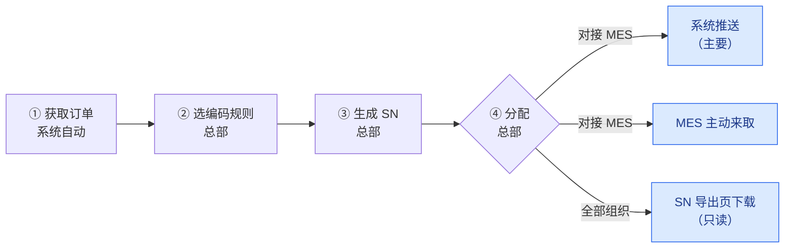

# SN 防重管控 · 业务流程说明

| 项目 | 内容 |
| --- | --- |
| 适用读者 | 总部计划与物控人员、各生产组织、质量与追溯人员、MES 对接方 |
| 负责人 | @magic |
| 日期 | 2026-10-20 |
| 对应需求版本 | PRD V30 |

本文独立说明系统做什么、谁来用、号怎样编、怎样从总部交到现场、出了变化怎样处理，以及需要业务方确认的事项。

## 一、系统做什么

**所有生产组织的 SN 由总部统一编号、统一发放：同一个号全公司只出现一次，也只交给一个地方使用。**

目前 SN 由各处分别发放，容易出现两张一模一样的标签。本系统解决四个问题：

| 问题 | 举例 | 解决办法 |
| --- | --- | --- |
| 编出相同的号 | 两个地方各自编号，编出了同一个 SN | 全公司统一编号，每张 PI 用自己专属的前缀（第三章） |
| 同一个号交了两次 | 一批号已推送给 MES，又被 MES 取走一次，或又在页面被领走一次 | 一个号只进一批；推送和 MES 来取送的是同一批号，MES 只收一次（第七章） |
| 号和订单对不上 | 订单作废、拆单或号调拨后，号还记在旧订单上 | 「转单」「转组织」，并通知相关 MES（第六章） |
| 订单变了没人知道 | 金蝶订单改了 PI、生产组织、客户、数量、物料，已出的号没人处理 | 发现订单变化，自动提醒总部（第六章） |

## 二、角色

总部负责出号，生产组织负责用号，查询员只看不改。

| 角色 | 是谁 | 能做什么 |
| --- | --- | --- |
| 系统管理员 | 系统初始账号，不能停用 | 唯一能开通、修改、停用账户和重置密码的人，也管理 MES 用来调用本系统的账户和密钥；同时拥有管理员的全部业务权限 |
| 管理员 | 总部计划、物控人员 | 管理编码规则、选规则、生成、分配、转单、转组织（处理申请或直接转）；维护各生产组织的 MES 对接设置；必要时替任一生产组织领号；不能管理账户 |
| 生产组织操作员 | 各生产组织现场人员，只管本组织 | 领取本组织的号；申请转组织（把号转到别的生产组织，或换 PI、订单、物料） |
| 查询员 | 质量、追溯、管理人员 | 只看：查号、核对、导出 |
| MES | 各生产组织自己的生产系统 | 接收推送的号；推送出问题时主动来取；每收到一批都回报收到了哪些号 |

## 三、SN 的组成与编号规则

### 组成

**SN = 前缀 + 米标 + 流水号 + 后缀**，号一旦生成不再改动。

例：前缀 HX、米标 100、流水号 6 位、后缀 A，这张 PI 的第 1 个号是 **HX100000001A**（HX + 100 + 000001 + A）。

| 组成 | 来源 | 规则 |
| --- | --- | --- |
| 前缀 | 编码规则 | 必填，只能用大写字母、数字、`-`、`_`；每张 PI 专属 |
| 米标 | 金蝶订单上该物料行的米标；金蝶为空时可在生成页填写 | 是一串文字，不是数值：000、001、002 或其他写法都可以，原样写进号里；为空时用默认米标 000；规则也可设为不带米标 |
| 流水号 | 系统按 PI 编 | 位数固定；从 1 开始依次往下编，不跳号 |
| 后缀 | 编码规则 | 可不填 |

**米标原样写入**：米标当作一串文字处理，不去掉 0，也不换写法。

| 金蝶里填的（或生成页填的） | 号里写的 |
| --- | --- |
| 0100 | 0100 |
| 10.50 | 10.50 |
| 001 | 001 |
| （空） | 000 |

### 编号规则（保证编不出相同的号）

1. **一张 PI 一套流水**：PI 下所有订单、所有物料行，不论用哪条规则，都在同一套流水上接着编；每次生成都接着这张 PI 已有的最大号往下编，不跳号。只有从最末撤销物料行的生成时，编号才退回（第四章第 3 步）。
2. **一个前缀只给一张 PI 用**：别的 PI 想用同一条规则，须换一个新前缀。
3. **前缀不能相同**：前缀之间不能完全相同；只是开头相同不算相同（如 SD 和 SDD 可以同时存在）。万一两条规则拼出了完全相同的号，系统会拦下、整次不生成。
4. **改格式换前缀**：规则用过后要改格式，须换新前缀；已出的号不变。
5. **最后核对**：生成时再与已有号核对一遍，一旦相同，这次整批不生成，并提示是哪个号。
6. **转入号不占流水**：从别的 PI 转过来的号保留原样，不占本 PI 的流水。

## 四、主流程

第 ① 至 ④ 步在总部完成；第 ⑤ 步（蓝色框）号交到现场，方式取决于生产组织是否对接 MES。

### 第 1 步　获取订单（系统自动）

1. 系统每 10 分钟自动与金蝶比对一次，获取**已审核**的生产订单（只看单据状态是否为已审核），只重新获取新出现或改动过的订单；生成号以此为准；已经生成的号在订单离开列表后仍可分配、领取（反审核等暂停情况见第六章）。
2. 获取内容：单据编号、PI、PO、客户、生产组织；每个物料行的序号、附件项次、物料、米标、数量。
3. 订单反审核、作废或删除后，不再出现在订单列表中；已生成的号不会作废，处理方式见第六章。
4. 物料行的**附件项次**在金蝶为空时，须由总部在生成页直接填写后才能生成号（必填）；**米标**在金蝶为空时可以填，也可以不填（不填用默认 000）。填写的值不写回金蝶，也不写进推送内容和号单文件。物料行生成过号后这两项置灰不能改：号还没分配时可以先撤销生成、改好再生成；分配后不能再改（不影响转单、拆单、转组织）。
5. 客户编码为空的订单照常显示、生成和流转；PI 为空的订单在订单页可见，但不能生成号。
6. 同步方式、每个字段的取值与校验、同步失败怎么办、同步后怎样比对订单变化，详见附录「生产订单同步规则」。

### 第 2 步　选编码规则（总部）

1. 为每个物料行选一条规则：从规则库选，或自设前缀；也可给整张 PI 指定默认规则，单行另选的优先。
2. 同一张 PI 的不同物料行可以用不同规则；物料编码相同的两行也可分别选。
3. 选规则须符合第三章编号规则（专属前缀、改格式换前缀）。

### 第 3 步　生成 SN（总部）

**操作**

1. 在「SN 生成」页打开某张 PI，勾选整张订单，或只勾选其中几个物料行；都不勾选就是整张 PI。
2. 生成的最小单位是物料行：每个选中的物料行一次生成它全部的可生成数量（物料行数量 − 该行自己生成过的枚数），不填数量、不拆成两次。单次默认最多 1 万枚，超过时确认放开或少选几行，单次最多 50 万枚。
3. 生成前先预览起止号和每个物料行的号段，确认后再生成。
4. 生成中可以取消，取消后不留任何号。
5. 撤销也按物料行：只能撤编号排在最后的那个物料行，撤完可以接着撤前一个（从后往前逐行），也可以把最近一次生成剩下的物料行一次撤完；在某一行上点「撤销」（或勾选几行批量撤销），就是从最末往前一直撤到这一行，编号排在它后面的行一并撤掉，撤之前会列出全部要撤的行；要撤的号须都还没分配、也没转过单。撤销后编号退回，不留空号，该行的附件项次和米标可以重新修改。

**编号顺序**

| 生成方式 | 号按什么顺序编 |
| --- | --- |
| 整单生成 | 按勾选订单的先后；同一订单内按序号从小到大 |
| 只选几个物料行 | 按点选的先后（勾选框旁标出 1、2、3…）；可跨订单点选，但只能在同一张 PI 内 |

可生成数量、排序、号段都按物料行算，不按物料编码算：同一订单中物料编码相同的多行不合并，各算各的数量，各分一段连续的号，各按自己的规则写出。

例：PI 已编到 1200 号。序号 1、序号 2 都是物料 9148363，分别要 100 枚、50 枚；序号 3 是物料 9150001，要 30 枚。

| 生成方式 | 序号 1（9148363） | 序号 2（9148363） | 序号 3（9150001） |
| --- | --- | --- | --- |
| 整单生成 | 1201–1300 | 1301–1350 | 1351–1380 |
| 先点序号 3、再点序号 1 | 1231–1330 | 不生成 | 1201–1230 |

**不能生成的情况**（系统列出原因，逐条见附录第 7 节）：订单不在订单列表中（未审核）；缺少 PI（客户编码为空不影响生成）；物料行未选规则，或规则须为本 PI 换新前缀；附件项次未填写（在生成页填写；米标可不填，为空用默认 000）；订单的 PI 变化或物料变化尚未处理（第六章）；可生成数量为 0。

### 第 4 步　分配（总部）

1. 在「SN 分配」页选 PI 分配。号只能分给**订单上的生产组织**；可按整张 PI 或勾选的物料行分配。订单已不在订单列表中时，分给生成号时订单上的生产组织；反审核中、PI 变化待处理的订单暂不能分配（第六章）。
2. 按钮上写明分配多少枚、分几次推送给 MES。
3. 分配后：对接 MES 的组织，号变为「待推送」，系统随即自动推送；未对接的组织，号变为「待领取」。

### 第 5 步　交付到现场

| 生产组织 | 方式 | 说明 |
| --- | --- | --- |
| 对接 MES | 系统推送（主要） | 分几次自动推送给 MES |
| 对接 MES | MES 主动来取 | 推送出问题时，MES 自己来取；可以按 PI、按订单或按 PI + 订单取。取到的和推送的是同一批号，MES 回报收到后才算交出 |
| 全部 | SN 导出 | 已分配的号按「生产组织 + PI + 单据」列出，直接下载 xlsx / csv（PI、单据、物料编码、SN）交打标岗位；只读，不改变号的状态，可反复下载；对接 MES 的号照常推送、拉取 |

对接 MES 的组织推送和 MES 来取可以同时用，**同一个号只会进一批、只交出一次**。MES 回报收到后，这批号就算交付完成，打标领用不用再回报。

**推送和 MES 来取是同一批号的两条送达路**：号由系统按批分好（每批最多 5000 枚），这一批号不会再改。系统把这批推过去，或 MES 自己把这批取回去，送到的都是同一批；MES 按批次只收一次，收到后回报。只有回报到了，这批号才算交出。

- MES 来取时，有还没回报的批次就先拿到那一批（包括推送卡住的那一批），回报之后才拿新的一批；所以 MES 中途宕机再来取，拿到的还是原来那一批，不会多拿。
- 按订单来取时，如果这张订单的号正卡在一批推送里，MES 会拿到整批，里面可能有别的订单的号，照常收下即可。
- 某一批 MES 收不了（例如字段超长），可以整批退回并说明原因。这批号先停住、首页告警，MES 改好后再补收；后面的号照常取，不会被它卡住。MES 实在改不了（例如一批太大收不下），总部可以把这一批「作废」，号退回去重新分批交付。
- MES 回报的内容和这一批对不上（枚数、号不符）时，同样先停住这一批、首页告警，后面的号照常取；MES 改好回报后这一批就算交出。

**推送中途失败**：某一次超时或网络中断时，系统先用同一批号自动重试 3 次（1、5、15 分钟后）；仍没收到回报或 MES 明确退回时才停下，已成功的不受影响。PI 上出现「继续推送」，总部点一下从断处接着推；MES 也可以随时把这一批取走并回报，回报到了系统就不再重推。这一批号 MES 可能已经收到，所以收到回报前，这些号**不能转走**（SN 导出页仍可看到、下载，现场打标前须确认 MES 是否已收到）。

**每一批都有出口**：MES 长期停机或已经停用、这一批始终等不到回报时，总部在 MES 方确认后处理：MES 已经收到的，点「人工确认」，这批算交出；MES 没收到的，点「作废」，号退回去重新分批（「已转走」通知作废后会自动重发）。作废前必须有 MES 方的书面确认，否则 MES 其实收到了、号又被页面领走，就会交出两次。

## 五、号的状态

每一枚号有自己的状态，看状态就知道它走到了哪一步。

| 状态 | 意思 | 下一步 |
| --- | --- | --- |
| 待分配 | 已生成，还没分给生产组织 | 总部分配 |
| 待推送 | 已分给对接 MES 的组织，MES 还没回报收到 | 系统推送或 MES 来取 |
| 已推送 | MES 已回报收到（推送时回报，或来取后回报） | 交付完成，MES 打标；必要时可转单、转组织 |
| 待领取 | 已分给未对接 MES 的组织 | 在 SN 导出页下载（只读，状态不变） |
| 已领取 | 原页面领取领走的号（页面领取已下线，只有历史数据） | 交付完成；必要时可转单、转组织 |
| 申请中 | 已申请转组织，等总部处理 | 总部同意或驳回；申请人可撤回 |

「暂停交付」不是单独的状态：号保持原状态，只是暂时不能分配和交付（第六章）。

## 六、出了变化怎么办

### 金蝶订单改了

系统每次同步都拿订单与出号时的记录比对，发现变化就提醒总部处理。

| 金蝶里改了什么 | 怎么处理 |
| --- | --- |
| PI | 暂停生成、分配和交付，总部确认后恢复；已出的号仍属原 PI，需要时总部先把号转组织到新 PI；恢复后该订单新生成的号排在新 PI 的流水上 |
| 生产组织 | 暂停交付，总部确认后恢复；之后还没分配的号分给新组织，已分配的不自动调动，由总部决定是否转组织 |
| 客户 | 暂停交付，总部确认后恢复；已出的号不变，之后生成的号用新客户 |
| 物料改了或被删除 | 暂停交付，新物料暂不能生成；总部确认新旧物料的对应关系（旧行的号和计数并到新行），或确认两者无关后恢复；确认对应时，已交给 MES 的号按新物料行重新推送一次 |
| 数量减到该行已生成过的枚数以下 | 不暂停；不能再生成，提示多出了几枚 |
| 附件项次（之前在页面填写过，金蝶后来有值） | 不暂停；提醒总部，之后生成以金蝶的值为准 |
| 订单反审核或作废 | 暂停交付，见下方「暂停交付」。系统只看单据状态是否为已审核，分不出反审核和作废，两者一样处理；订单确实作废时，由总部在提醒上点「确认已作废」解除暂停 |
| 订单删除 | 不暂停（已暂停的自动恢复）：还没分配的号照常分配（分给生成号时订单上的生产组织），已分配的号照常交付；也可以转单到新订单。总部确认作废后同样如此 |

反审核是金蝶里把已审核的订单退回去修改，改完要重新审核。订单如果在两次同步之间反审核、修改、又重新审核，系统看不到反审核这一步，但比对能发现改了什么，照样按上表处理。

### 暂停交付

1. **暂停什么**：这张订单还没交出去的号（待分配、待推送、待领取）全部暂停。不能分配，系统不推送，MES 来取取不到，页面也领不到。
2. **不受影响**：
   - 正在推送、还没收到回报的那一批照常补推完，MES 也照常可以来取并回报，因为 MES 可能已经收到。
   - 已推送、已领取的号已经在现场，系统收不回；提醒中会列出枚数，由总部决定是否通知现场暂停使用。
   - 号转走后通知来源方 MES「已转走」的推送照常进行。
3. **怎样恢复**：

   | 情况 | 恢复方式 |
   | --- | --- |
   | 反审核的订单重新审核，没改东西或只改了数量 | 自动恢复 |
   | 改了 PI、生产组织、客户或物料 | 总部处理后点确认才恢复 |
   | 订单已删除 | 自动恢复 |
   | 订单已作废 | 总部在提醒上点「确认已作废」后恢复 |

   恢复后系统自动接着推送。
4. **多久发现重新审核**：系统每 10 分钟与金蝶比对一次，最迟 10 分钟发现，不用等有人打开订单页；总部也可以在提醒上点「立即同步」。
5. **提前放行**：总部可以把号转单到另一张已审核、没有暂停的订单，转过去的号随即可以交付。转组织不改号的来源订单，转组织后的号仍暂停，直到原订单恢复。

### 转单与转组织

号本身（SN 字符串）在转移中不变，只改它挂在哪张订单、哪个组织下。

|  | 转单 | 转组织 |
| --- | --- | --- |
| 什么时候用 | 订单作废或拆单 | 号要换生产组织，或换 PI、订单、物料 |
| 谁来做 | 总部直接做 | 生产组织申请、总部同意或驳回；总部也可直接转 |
| 转哪些号 | 先选 PI，再选订单；然后三选一：整张订单的号 / 订单下某个物料编码的全部号 / 某个物料编码下的一枚号或连续一段号（填起止号，只填起始就是一枚） | 同左（只能选本组织的号） |
| 号转到哪（都必填） | 目标 PI、订单、生产组织、物料编码：另一张已审核订单里该物料的那一行；生产组织就是该订单的；不能转到同一订单的其他行 | 目标 PI、订单、生产组织、物料编码：生产组织可任选（可以是原组织），订单可以是原订单 |
| 订单数量怎么算 | 号从原订单的物料行移到目标物料行；两张订单的可生成数量都不变 | 同左；只换生产组织、物料行不变时不动 |
| 哪些号不能转 | 申请中的号；所在那一批还没收到 MES 回报的号；「已转走」通知还没收到回报的号 | 同左；另外还没分配的号也不能转 |

目标物料的米标须与号上的米标相同（米标已写在 SN 里），所以同一物料编码下米标不同的号要分次转。还没分配的号转单到别的组织的订单后，仍是「待分配」，分配时分给新订单的生产组织。

**申请期间要注意**：转组织申请提交后、总部确认前，这些号在系统里不能再推送、领取；但已经交给来源方 MES 的号，MES 里仍能打标，要等「已转走」通知送到才停止。这段时间由来源现场自行停止使用这些号（第八章第 11 项）。

**转移后怎样通知 MES**

1. 号已交给 MES、仍在同一组织：系统按新信息重新推送一次，MES 随之更新。
2. 号转到别的组织：转入方对接 MES 的，系统推送给转入方 MES，并注明转移单号和来源组织，方便转入现场核对；未对接的，号出现在转入方的领取页。
3. 号转走前来源方 MES 里有这个号的（包括同组织转移后还没重新推送、MES 里还是旧信息的），系统同时通知来源方 MES：这些号已经转走，不能再打标。来源组织后来关闭了 MES 对接也照常通知。通知没推过去时，来源方 MES 来取也会拿到它，按原来的 PI 或订单来取也能取到。来源方 MES 收到后，把号标为「已转走」并记下转去了哪个组织，号原来挂在哪张订单上的信息保留不动。号以后再转回来源组织，来源方 MES 会收到新版本，这些号恢复可用。
4. 系统记着每个号现在在哪个组织的 MES 里。号从 A 转到 B 后，A 和 B 谁先回报都可以：A 回报「已转走」时，只有记录还是 A 才清掉，不会把 B 的记录误清。这样号以后再从 B 转走，系统一定会通知到 B，B 不会继续用它打标。
5. 转组织可导出「转出号清单」，来源现场据此**作废已经打出的旧标签**。

## 七、怎样保证不重复

**编号不重复**：见第三章编号规则。

**交付不重复**

1. 一个号同一时间只在一批里：进了推送或 MES 来取的那一批，或在页面被领走后，其他方式都拿不到。
2. **推送和 MES 来取送的是同一批号**：一批号分好后不再改，不管推送几次、MES 来取几次、两边同时送到，MES 按批次只收一次，回报也一样。只有收到 MES 回报，这批号才算交出。
3. 因网络等原因重复操作时，只拿到原来那一批号，不会多给。
4. 还没收到回报的那一批号，不能再领取或转走（第四章第 5 步）。
5. 号转到别的组织后，「已转走」通知没收到回报前，这些号不能再转，保证来源方 MES 先收到「已转走」、再收到之后的变化。
6. **MES 按版本收号**：每个号带一个「版本」，号每转一次单或组织、或确认物料对应，版本加 1。MES 只接受版本更新的数据；同一版本的号从两个不同批次收到时，MES 不覆盖并回报「冲突」，系统随即告警「疑似重复交付」。这样即使系统出错交出两次也能被发现，晚到的旧数据也不会盖掉新数据。总部核查后，可以按系统里的信息给 MES 重推一个更新的版本，MES 收到后这个号恢复可用。
7. **MES 只负责接收**：MES 不需要提供查询；每一批（推送的和来取的）都有 MES 的回报，发现冲突当场告警；系统每天再按回报自检一次，枚数对不上、或有批次长时间没回报即告警。
8. **MES 核对组织**：MES 收到不是本组织的号会整批退回，系统配置出错也不会把号交到别的现场。
9. **每一批都有出口**：MES 回报、MES 退回后改好补报、总部人工确认、总部作废，总有一种能让这一批结束，号不会一直卡住（第四章第 5 步）。

每个号从生成、分配、交付到转移都有记录，能查到经手人和时间。

## 八、请业务方确认

以下问题请在需求定稿前答复；答复前按「暂定做法」执行。

| 编号 | 需要确认的问题 | 暂定做法 | 确认结果 |
| --- | --- | --- | --- |
| 1 | 金蝶订单的 PI 被修改，怎么处理 | 该订单暂停生成、分配和交付，总部确认后恢复 |  |
| 2 | 金蝶订单的生产组织、客户或物料被修改，怎么处理 | 还没交出去的号暂停交付，总部确认后恢复；之后还没分配的号分给新组织，已分配的不动 |  |
| 3 | 已出号的订单反审核期间，号怎么处理 | 这张订单还没交出去的号全部暂停分配和交付（推送、MES 来取都停）；重新审核后没改东西或只改了数量的自动恢复，系统每 10 分钟与金蝶比对一次 |  |
| 4 | 推送失败的那部分号，MES 能否自己来取 | 能。MES 来取的和推送的是同一批号，可按 PI、订单或 PI + 订单取；MES 回报收到后才算交出 | 已确认（2026-10-19） |
| 5 | 订单作废或删除后，已分配、还没交出去的号能否继续交付 | 删除的自动继续；作废的系统按反审核暂停，总部确认已作废后继续；也可以转单到新订单 | 已确认（2026-10-19） |
| 6 | 对接 MES 的组织在页面领走的号，要不要告诉 MES | 不告诉 |  |
| 7 | 订单作废或拆单后，新订单能否再按数量生成新号 | 能（号的总数可能超过订单数量） |  |
| 8 | 号转到别的组织后，来源现场旧标签怎么作废 | 待业务方给出流程；系统提供转出号清单 |  |
| 9 | 附件项次填成什么格式；金蝶后来有值时用哪个；填写的值是否写进推送内容和号单文件 | 以金蝶的值为准，并提醒总部；填写的值不写进推送内容和号单文件 |  |
| 10 | 物料行已经生成过号后，能否改选编码规则 | 能；已出的号不变，之后的号用新格式 |  |
| 11 | 转组织从提交申请到「已转走」通知送达来源方 MES 之前，来源现场的 MES 仍能用这些号打标，是否要求现场在提交申请时先自行停用 | 系统不通知 MES；提交申请的现场自行停止使用；「已转走」送达后 MES 禁止打标 |  |

## 九、术语

| 术语 | 意思 |
| --- | --- |
| SN | 贴在产品上的序列号，全公司唯一 |
| PI | 生产订单上的 PI 号；一张 PI 可含多张生产订单，号按 PI 编流水 |
| 物料行 | 生产订单中的一行物料，用「单据编号 + 序号」区分；同一订单中物料编码可能重复，重复的各行分开计数、分开编号 |
| 序号 | 物料在生产订单中的行号，取自金蝶 |
| 可生成数量 | 物料行数量 − 该行自己生成过的枚数；号转单转走或转入都不改变它，小于 0 按 0 算 |
| 对接 MES | 该生产组织有自己的 MES，系统可直接把号推送过去 |
| 转单 / 转组织 | 把号转到另一张订单 / 另一个生产组织或 PI（第六章） |
| 转出 | 号转走后，通知原生产组织的 MES「这些号已不归你」 |
| 一批 / 批次 | 系统分好的一组号，每批最多 5000 枚，分好后不再改；推送和 MES 来取送的都是整批 |
| 回报（回执） | MES 收到一批后告诉系统收到了哪些号、每枚是否正常；收到回报这批才算交出 |
| 人工确认 / 作废 | 一批号始终等不到 MES 回报时，总部在 MES 方确认后处理：MES 已收到就人工确认，MES 没收到就作废、号退回重新分批 |

## 附录　生产订单同步规则

本附录写明系统怎样从金蝶获取生产订单、每个字段怎样取值和校验、同步失败和订单变化怎样处理，与系统当前实现一致。系统对金蝶**只读不写**：不改金蝶里的任何数据，也不读写金蝶的序列号字段。

### 1. 同步哪些订单

1. 只同步金蝶生产订单中**单据状态为「已审核」**的单据；不看业务状态（计划、下达、结案等）和作废状态。
2. 一条物料行在系统里存一行，物料行用「单据编号 + 序号」区分；表头信息（PI、PO、客户、生产组织）写在每一行上。
3. 单据不再是已审核（反审核、作废）或在金蝶删除后，下次同步从订单列表移出；重新审核后回到列表。已生成的号不受影响，处理方式见第六章。
4. 已生成数、可生成数量、页面填写的附件项次和米标等记在订单列表之外，订单被替换、移出再回来都不会丢失。

### 2. 同步方式

同一时间只运行一个同步，避免互相覆盖。

| 方式 | 谁触发 | 做什么 | 正有同步在运行时 |
| --- | --- | --- | --- |
| 定时比对同步 | 系统，默认每 10 分钟 | 先只取金蝶已审核单据的单据编号和修改时间，与系统里的比对：新出现的、修改时间变了的（或金蝶没给修改时间的）整单重新获取并替换；系统里有、金蝶已审核列表里没有了的，移出订单列表 | 本次跳过，下个周期再来 |
| 进页同步 | 每次登录后首次打开订单页时自动触发 | 后台跑一次比对同步，页面先显示现有订单，不用等 | 跳过 |
| 立即比对同步 | 总部在订单页点「立即比对同步」 | 马上跑一次比对同步，完成后提示替换、移出了几张单据 | 跳过并提示「已有同步在运行，本次跳过」 |
| 按单据编号同步 | 总部输入单据编号；反审核提醒上的「立即同步」也是这种方式 | 不论单据状态查这一张：已审核 → 整单替换；不是已审核 → 移出（按反审核处理）；金蝶查无此单 → 移出（按删除处理） | 排队等候，最多 10 分钟，等不到提示「订单同步正在进行，请稍后再试」 |
| 全量重建 | 总部，用于首次上线导入、怀疑系统与金蝶不一致时 | 完整获取全部已审核单据，并顺带同步生产组织列表；全部成功后一次性替换整个订单列表；完成后对所有已出号的订单重新比对一遍 | 同上，排队等候 |

**整单替换**：一张单据有变动时，先删掉系统里这张单据的全部物料行，再写入金蝶的最新数据，所以金蝶里删掉的物料行在系统里也随之消失。

比对时有修改时间、但按单据编号取明细时已取不到的单据（两步之间被反审核），按移出处理。

### 3. 同步失败怎么办

1. 金蝶分页查询时，某一页失败会间隔 10 秒自动重试，最多 3 次。
2. 重试后仍失败，**本次同步整体放弃，订单列表保持上次的结果不动**，不会出现只同步了一半的情况；下个周期自动再试。
3. 全量重建失败时，原来的订单列表完整保留。
4. 订单页顶部显示最近一次同步的时间、是否成功和失败原因。常见原因：金蝶连接配置缺失、金蝶登录失败、金蝶查询失败（附金蝶返回的信息）。
5. 全量重建时生产组织列表同步失败，不影响订单的同步。

### 4. 字段取值与校验

**通用规则**

1. 文本一律去掉首尾空格；金蝶未填写的文本常返回一个空格，去掉后按空处理。
2. 基础资料（客户、生产组织、物料）在金蝶未选时按空处理；名称取简体中文名称。
3. 超过系统存储米标的部分截掉：客户、PI、生产组织编码、物料编码、附件项次、米标最多 64 字；PO、生产组织名称最多 128 字；物料名称最多 255 字。
4. 单据编号为空的行直接丢弃；同一张单据出现两行相同序号时，只保留第一行。

**各字段**

| 字段 | 金蝶取自 | 取值规则 | 为空或不合格时 |
| --- | --- | --- | --- |
| 单据编号 | 表头单据编号 | 去首尾空格 | 丢弃该行 |
| 单据状态 | 表头单据状态 | 只同步「已审核」 | 不是已审核的不进订单列表 |
| 客户 | 表头客户（编码） | 原样使用 | 照常显示、生成、分配、转单、转组织，号上的客户记为空；订单页顶部提示「其中 N 张单据无客户编码」 |
| PI | 表头 PI | 原样使用 | 订单页可见，不进入生成页，不能生成号 |
| PO | 表头 PO | 原样使用 | 可为空，只用于显示和查询 |
| 生产组织 | 表头生产组织（编码、名称） | 原样使用金蝶返回的编码和名称；号分配给它 | — |
| 序号 | 明细行号 | 取整数 | 取不到按 0 |
| 附件项次 | 明细附件项次 | 原样使用 | 为空时须由总部在生成页填写后才能生成（见第 5 节） |
| 物料 | 明细物料（编码、名称） | 原样使用；同一订单中物料编码相同的多行不合并，各算各的 | 物料编码为空的行照常计入，物料视为「空」 |
| 米标 | 明细米标 | 同步时原样保存（金蝶返回整数型数字时去掉「.0」）；生成时按文字原样写进号里（第三章「米标原样写入」） | 为空时订单页标红「缺失」；可在生成页逐行填写（选填，不填用默认 000），或用「统一设置米标」把范围内米标仍为默认、还没有号的行一次设为同一个值（已填写的不改）；规则不带米标时不写进号里 |
| 数量 | 明细数量 | 有小数时按整数部分计，小于 0 按 0 计 | 为空或不是数字按 0 计 |
| 修改时间 | 表头修改时间 | 只用于判断单据有没有改过 | 取不到时视为每次都改过，每次同步都重新获取这张单据 |

### 5. 附件项次与米标的填写

1. **谁能填**：只有总部，在生成页的物料行里直接填写（订单页只显示，不能填写）；只能填金蝶为空的物料行，金蝶有值的不能改。
2. **附件项次必填**：为空时输入框标红「必填」，不能生成；去掉首尾空格后不能为空，不超过 64 字，否则提示「附件项次不能为空，不超过 64 字」。
3. **米标选填**：不填就用默认米标 000；填的内容原样写进号里（000、001、002 等都可以），不超过 64 字。
4. **有号后置灰**：物料行生成过号后，这两项置灰不能改。号还没分配时，可以先撤销生成，改好后再生成；分配之后不能再改。转单、拆单、转组织不受影响。
5. **填写值跟物料走**：填写时记下当时的物料；之后金蝶把这一行的物料改了，填写值自动失效。
6. **生效值**：金蝶有值用金蝶的值；金蝶为空且填写过（物料没变）用填写的值；都没有时附件项次为「待填写」不能生成，米标用 000。
7. **金蝶后来有值**（附件项次）：以金蝶的值为准，页面填写的值保留备查；系统提醒总部（「知道了」即可关闭），两者不同时页面标出。
8. 填写的值不写回金蝶，也不写进推送内容和号单文件；每次填写都留痕（改前、改后的值）。
9. 订单页顶部显示「附件项次待填写」的物料行数。

### 6. 同步后比对订单变化

**订单台账**：一张订单第一次生成号时，系统记下当时的 PI、客户、生产组织和各物料行的物料、数量，作为比对基准。PI、客户、生产组织的基准只在总部「确认变更」时才改为新值，所以订单反审核、修改、再重新审核回来，系统照样能发现其间的变化。

每次同步替换了某张单据后，系统都做以下比对：

| 比对内容 | 适用范围 | 判断 | 结果 |
| --- | --- | --- | --- |
| 附件项次 | 在页面填写过附件项次的物料行（不论是否出过号） | 金蝶从空变为有值，或值变了 | 只提醒，不暂停 |
| PI、生产组织、客户 | 已出号的订单 | 与台账基准不同 | 提醒并暂停交付；PI 变化另冻结该单的生成和分配 |
| 物料 | 已出号订单中生成过号的物料行 | 这一序号在金蝶已不存在，或物料编码变了 | 提醒并暂停交付；该单不能生成，直到总部确认对应关系或确认无关 |
| 数量 | 已出号的订单 | 数量改了，且低于该行已生成过的枚数 | 只提醒「多出几枚」，不暂停 |

1. 同一张单据、同一类变化、同一物料行只保留一条未处理的提醒；变化再变时更新提醒上的新值。
2. 变化又改回原样（与基准一致）时，提醒自动关闭；没有其他未处理的变化时，暂停随之解除。
3. 已出号的订单离开订单列表时，系统按单据编号查一次：查到但不是已审核 → 反审核中，暂停交付，之后每个比对周期复查；查无此单 → 按删除处理，不暂停；**查询失败也按反审核中处理**，下个周期再查。各情况的恢复方式见第六章。
4. 暂停只作用于还没交出去的号（待分配、待推送且还没进批次、待领取）；已进批次、已推送、已领取的号不受影响。暂停解除后系统自动接着推送。
5. 提醒的处理方式：PI、生产组织、客户变化 → 「确认变更」；物料变化 → 「确认对应」或「确认无关」；反审核 → 「确认已作废」（须填原因，不超过 500 字）；数量、附件项次、删除 → 「知道了」。每次处理都留痕。

### 7. 生成前对订单数据的校验

生成号时以订单列表中的最新数据为准，逐行检查：

1. **整次拒绝**：所选物料行不在订单列表中（提示「物料行不在快照中」）；所选单据或物料行不属于同一张 PI（提示「生成范围须为同一张 PI 下的单据或物料行」）。
2. **逐行检查**：只检查还有可生成数量的物料行（可生成数量 = 数量整数部分 − 该行自己生成过的枚数，小于 0 按 0 算）；任一行不满足，整次不能生成，并逐行列出原因，可缩小范围后再生成。

| 原因 | 什么情况 | 怎样解决 |
| --- | --- | --- |
| PI 变更冻结 | 订单的 PI 变化还没确认 | 总部在提醒上确认变更 |
| 失去对应 | 生成过号的物料行被删除或换了物料，还没处理 | 总部确认新旧物料对应，或确认无关 |
| 需先选规则 | 物料行没选规则，PI 和客户也没有默认规则 | 为物料行或整张 PI 选规则 |
| 规则须换前缀 | 所选规则已被别的 PI 用过，须为本 PI 换新前缀 | 换一个新前缀 |
| 附件项次待填写 | 金蝶附件项次为空且没有填写（或填写后物料变了） | 总部在生成页填写附件项次 |

3. **预览后订单又变了**：确认生成时，系统按最新的订单数据再核对一次可生成数量和以上条件，与预览时不一致就不生成，提示「预演条件已改变，请重新预演」。
