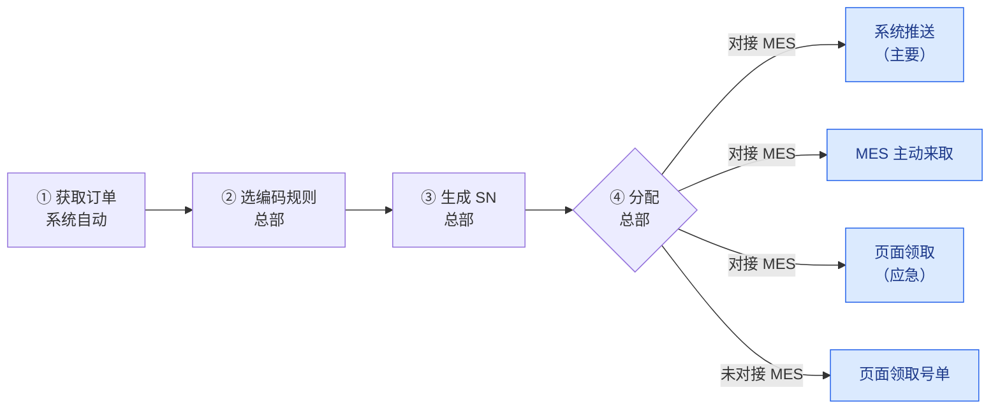

# SN 防重管控 · 业务流程说明

| 项目 | 内容 |
| --- | --- |
| 适用读者 | 总部计划与物控人员、各生产组织、质量与追溯人员、MES 对接方 |
| 负责人 | @magic |
| 日期 | 2026-10-19 |
| 对应需求版本 | PRD V30 |

本文独立说明系统做什么、谁来用、号怎样编、怎样从总部交到现场、出了变化怎样处理，以及需要业务方确认的事项。

## 一、系统做什么

**所有生产组织的 SN 由总部统一编号、统一发放：同一个号全公司只出现一次，也只交给一个地方使用。**

目前 SN 由各处分别发放，容易出现两张一模一样的标签。本系统解决四个问题：

| 问题 | 举例 | 解决办法 |
| --- | --- | --- |
| 编出相同的号 | 两个地方各自编号，编出了同一个 SN | 全公司统一编号，每张 PI 用自己专属的前缀（第三章） |
| 同一个号交了两次 | 一批号已推送给 MES，又被 MES 取走一次，或又在页面被领走一次 | 一个号只进一批；推送和 MES 来取送的是同一批号，MES 只收一次（第七章） |
| 号和订单对不上 | 订单作废、拆单或号调拨后，号还记在旧订单上 | 「转单」「转组织」，并通知相关 MES（第六章） |
| 订单变了没人知道 | 金蝶订单改了 PI、生产组织、客户、数量、物料，已出的号没人处理 | 发现订单变化，自动提醒总部（第六章） |

## 二、角色

总部负责出号，生产组织负责用号，查询员只看不改。

| 角色 | 是谁 | 能做什么 |
| --- | --- | --- |
| 账户管理员 | 系统初始账号，不能停用 | 唯一能开通、修改、停用账户和重置密码的人，也管理 MES 用来调用本系统的账户和密钥；同时拥有总部的全部业务权限 |
| 总部 | 总部计划、物控人员 | 管理编码规则、选规则、生成、分配、转单、转组织（处理申请或直接转）；维护各生产组织的 MES 对接设置；必要时替任一生产组织领号；不能管理账户 |
| 生产组织操作员 | 各生产组织现场人员，只管本组织 | 领取本组织的号；申请转组织（把号转到别的生产组织，或改 PI、客户、物料） |
| 查询员 | 质量、追溯、管理人员 | 只看：查号、核对、导出 |
| MES | 各生产组织自己的生产系统 | 接收推送的号；推送出问题时主动来取；每收到一批都回报收到了哪些号 |

## 三、SN 的组成与编号规则

### 组成

**SN = 前缀 + 长度 + 流水号 + 后缀**，号一旦生成不再改动。

例：前缀 HX、长度 100、流水号 6 位、后缀 A，这张 PI 的第 1 个号是 **HX100000001A**（HX + 100 + 000001 + A）。

| 组成 | 来源 | 规则 |
| --- | --- | --- |
| 前缀 | 编码规则 | 必填，字母或数字；每张 PI 专属 |
| 长度 | 金蝶订单上该物料行的长度 | 整数、小数、0 都可以；规则带长度时，为空或不是数字不能生成；规则也可设为不带长度 |
| 流水号 | 系统按 PI 编 | 位数固定；从 1 开始依次往下编，不跳号 |
| 后缀 | 编码规则 | 可不填 |

**长度写法统一**：多余的 0 自动去掉，同一个长度只有一种写法。

| 金蝶里填的 | 号里写的 |
| --- | --- |
| 0100 | 100 |
| 10.50 | 10.5 |
| 10.0 | 10 |
| 0 | 0 |

### 编号规则（保证编不出相同的号）

1. **一张 PI 一套流水**：PI 下所有订单、所有物料行，不论用哪条规则，都在同一套流水上接着编；每次生成都接着这张 PI 已有的最大号往下编，不跳号。只有撤销最近一次生成时，编号才退回（第四章第 3 步）。
2. **一个前缀只给一张 PI 用**：别的 PI 想用同一条规则，须换一个新前缀。
3. **前缀互不为开头**：前缀之间不能相同，也不能一个是另一个的开头（有了 A，就不能再有 AX）。
4. **改格式换前缀**：规则用过后要改格式，须换新前缀；已出的号不变。
5. **最后核对**：生成时再与已有号核对一遍，一旦相同，这次整批不生成，并提示是哪个号。
6. **转入号不占流水**：从别的 PI 转过来的号保留原样，不占本 PI 的流水。

## 四、主流程

第 ① 至 ④ 步在总部完成；第 ⑤ 步（蓝色框）号交到现场，方式取决于生产组织是否对接 MES。

### 第 1 步　获取订单（系统自动）

1. 系统每 10 分钟自动与金蝶比对一次，获取**已审核**的生产订单（只看单据状态是否为已审核），只重新获取新出现或改动过的订单；生成号以此为准；已经生成的号在订单离开列表后仍可分配、领取（反审核等暂停情况见第六章）。
2. 获取内容：单据编号、PI、PO、客户、生产组织；每个物料行的序号、附件项次、物料、长度、数量。
3. 订单反审核、作废或删除后，不再出现在订单列表中；已生成的号不会作废，处理方式见第六章。
4. 物料行的**附件项次**在金蝶为空时，须由总部在系统中补填后才能生成号；补填的值不写回金蝶，也不写进推送内容和号单文件。

### 第 2 步　选编码规则（总部）

1. 为每个物料行选一条规则：从规则库选，或自设前缀；也可给整张 PI 指定默认规则，单行另选的优先。
2. 同一张 PI 的不同物料行可以用不同规则；物料编码相同的两行也可分别选。
3. 选规则须符合第三章编号规则（专属前缀、改格式换前缀）。

### 第 3 步　生成 SN（总部）

**操作**

1. 打开某张 PI，选择整单生成，或只选其中几个物料行生成。
2. 数量默认为可生成数量（物料行数量 − 该行自己生成过的枚数），可以改小；改小时按编号顺序先占满排在前面的物料行。单次默认最多 1 万枚，确有需要可以放开，但单次最多 50 万枚。
3. 生成前先预览起止号和每个物料行的号段，确认后再生成。
4. 生成中可以取消，取消后不留任何号。
5. 最近一次生成的号如果都还没分配、也没转过单，可以整次撤销，编号退回，不留空号。

**编号顺序**

| 生成方式 | 号按什么顺序编 |
| --- | --- |
| 整单生成 | 按勾选订单的先后；同一订单内按序号从小到大 |
| 只选几个物料行 | 按点选的先后（勾选框旁标出 1、2、3…）；可跨订单点选，但只能在同一张 PI 内 |

可生成数量、排序、号段都按物料行算，不按物料编码算：同一订单中物料编码相同的多行不合并，各算各的数量，各分一段连续的号，各按自己的规则写出。

例：PI 已编到 1200 号。序号 1、序号 2 都是物料 9148363，分别要 100 枚、50 枚；序号 3 是物料 9150001，要 30 枚。

| 生成方式 | 序号 1（9148363） | 序号 2（9148363） | 序号 3（9150001） |
| --- | --- | --- | --- |
| 整单生成 | 1201–1300 | 1301–1350 | 1351–1380 |
| 先点序号 3、再点序号 1 | 1231–1330 | 不生成 | 1201–1230 |

**不能生成的情况**（系统列出原因）：订单不在订单列表中（未审核）；缺少客户或 PI；物料行未选规则；规则带长度而长度为空或不是数字；附件项次未填写；订单的 PI 变化或物料变化尚未处理（第六章）；可生成数量为 0。

### 第 4 步　分配（总部）

1. 号只能分给**订单上的生产组织**；可按整张 PI、整张订单或单个物料行分配。订单已不在订单列表中时，分给生成号时订单上的生产组织；反审核中、PI 变化待处理的订单暂不能分配（第六章）。
2. 按钮上写明分配多少枚、分几次推送给 MES。
3. 分配后：对接 MES 的组织，号变为「待推送」，系统随即自动推送；未对接的组织，号变为「待领取」。

### 第 5 步　交付到现场

| 生产组织 | 方式 | 说明 |
| --- | --- | --- |
| 对接 MES | 系统推送（主要） | 分几次自动推送给 MES |
| 对接 MES | MES 主动来取 | 推送出问题时，MES 自己来取；可以按 PI、按订单或按 PI + 订单取。取到的和推送的是同一批号，MES 回报收到后才算交出 |
| 对接 MES | 页面领取（应急） | MES 故障或现场急用时使用；按 PI 整批领取；领走的号不再推送给 MES，MES 也不能再来取 |
| 未对接 MES | 页面领取 | 按 PI 整批领取，下载号单文件交打标岗位 |

对接 MES 的组织三种方式可以同时用，**同一个号只会进一批、只交出一次**。MES 回报收到后，这批号就算交付完成，打标领用不用再回报。

**推送和 MES 来取是同一批号的两条送达路**：号由系统按批分好（每批最多 5000 枚），这一批号不会再改。系统把这批推过去，或 MES 自己把这批取回去，送到的都是同一批；MES 按批次只收一次，收到后回报。只有回报到了，这批号才算交出。

- MES 来取时，有还没回报的批次就先拿到那一批（包括推送卡住的那一批），回报之后才拿新的一批；所以 MES 中途宕机再来取，拿到的还是原来那一批，不会多拿。
- 按订单来取时，如果这张订单的号正卡在一批推送里，MES 会拿到整批，里面可能有别的订单的号，照常收下即可。
- 某一批 MES 收不了（例如字段超长），可以整批退回并说明原因。这批号先停住、首页告警，MES 改好后再补收；后面的号照常取，不会被它卡住。MES 实在改不了（例如一批太大收不下），总部可以把这一批「作废」，号退回去重新分批交付。
- MES 回报的内容和这一批对不上（枚数、号不符）时，同样先停住这一批、首页告警，后面的号照常取；MES 改好回报后这一批就算交出。

**推送中途失败**：某一次超时或网络中断时，系统先用同一批号自动重试 3 次（1、5、15 分钟后）；仍没收到回报或 MES 明确退回时才停下，已成功的不受影响。PI 上出现「继续推送」，总部点一下从断处接着推；MES 也可以随时把这一批取走并回报，回报到了系统就不再重推。这一批号 MES 可能已经收到，所以收到回报前，这些号**不能在页面领取，也不能转走**。

**每一批都有出口**：MES 长期停机或已经停用、这一批始终等不到回报时，总部在 MES 方确认后处理：MES 已经收到的，点「人工确认」，这批算交出；MES 没收到的，点「作废」，号退回去重新分批（「已转走」通知作废后会自动重发）。作废前必须有 MES 方的书面确认，否则 MES 其实收到了、号又被页面领走，就会交出两次。

## 五、号的状态

每一枚号有自己的状态，看状态就知道它走到了哪一步。

| 状态 | 意思 | 下一步 |
| --- | --- | --- |
| 待分配 | 已生成，还没分给生产组织 | 总部分配 |
| 待推送 | 已分给对接 MES 的组织，MES 还没回报收到 | 系统推送、MES 来取或页面领取 |
| 已推送 | MES 已回报收到（推送时回报，或来取后回报） | 交付完成，MES 打标；必要时可转单、转组织 |
| 待领取 | 已分给未对接 MES 的组织，还没领取 | 页面领取 |
| 已领取 | 已在页面领走号单 | 交付完成；必要时可转单、转组织 |
| 申请中 | 已申请转组织，等总部处理 | 总部同意或驳回；申请人可撤回 |

「暂停交付」不是单独的状态：号保持原状态，只是暂时不能分配和交付（第六章）。

## 六、出了变化怎么办

### 金蝶订单改了

系统每次同步都拿订单与出号时的记录比对，发现变化就提醒总部处理。

| 金蝶里改了什么 | 怎么处理 |
| --- | --- |
| PI | 暂停生成、分配和交付，总部确认后恢复；已出的号仍属原 PI，需要时总部先把号转组织到新 PI；恢复后该订单新生成的号排在新 PI 的流水上 |
| 生产组织 | 暂停交付，总部确认后恢复；之后还没分配的号分给新组织，已分配的不自动调动，由总部决定是否转组织 |
| 客户 | 暂停交付，总部确认后恢复；已出的号不变，之后生成的号用新客户 |
| 物料改了或被删除 | 暂停交付，新物料暂不能生成；总部确认新旧物料的对应关系（旧行的号和计数并到新行），或确认两者无关后恢复；确认对应时，已交给 MES 的号按新物料行重新推送一次 |
| 数量减到该行已生成过的枚数以下 | 不暂停；不能再生成，提示多出了几枚 |
| 附件项次（之前补填过，金蝶后来有值） | 不暂停；提醒总部，之后生成以金蝶的值为准 |
| 订单反审核或作废 | 暂停交付，见下方「暂停交付」。系统只看单据状态是否为已审核，分不出反审核和作废，两者一样处理；订单确实作废时，由总部在提醒上点「确认已作废」解除暂停 |
| 订单删除 | 不暂停（已暂停的自动恢复）：还没分配的号照常分配（分给生成号时订单上的生产组织），已分配的号照常交付；也可以转单到新订单。总部确认作废后同样如此 |

反审核是金蝶里把已审核的订单退回去修改，改完要重新审核。订单如果在两次同步之间反审核、修改、又重新审核，系统看不到反审核这一步，但比对能发现改了什么，照样按上表处理。

### 暂停交付

1. **暂停什么**：这张订单还没交出去的号（待分配、待推送、待领取）全部暂停。不能分配，系统不推送，MES 来取取不到，页面也领不到。
2. **不受影响**：
   - 正在推送、还没收到回报的那一批照常补推完，MES 也照常可以来取并回报，因为 MES 可能已经收到。
   - 已推送、已领取的号已经在现场，系统收不回；提醒中会列出枚数，由总部决定是否通知现场暂停使用。
   - 号转走后通知来源方 MES「已转走」的推送照常进行。
3. **怎样恢复**：

   | 情况 | 恢复方式 |
   | --- | --- |
   | 反审核的订单重新审核，没改东西或只改了数量 | 自动恢复 |
   | 改了 PI、生产组织、客户或物料 | 总部处理后点确认才恢复 |
   | 订单已删除 | 自动恢复 |
   | 订单已作废 | 总部在提醒上点「确认已作废」后恢复 |

   恢复后系统自动接着推送。
4. **多久发现重新审核**：系统每 10 分钟与金蝶比对一次，最迟 10 分钟发现，不用等有人打开订单页；总部也可以在提醒上点「立即同步」。
5. **提前放行**：总部可以把号转单到另一张已审核、没有暂停的订单，转过去的号随即可以交付。转组织不改号的来源订单，转组织后的号仍暂停，直到原订单恢复。

### 转单与转组织

号本身（SN 字符串）在转移中不变，只改它挂在哪张订单、哪个组织下。

|  | 转单 | 转组织 |
| --- | --- | --- |
| 什么时候用 | 订单作废或拆单 | 号要换生产组织，或改 PI、客户、物料 |
| 谁来做 | 总部直接做 | 生产组织申请、总部同意或驳回；总部也可直接转 |
| 号转到哪 | 另一张已审核生产订单的某个物料行（不能转到同一订单的其他行；物料长度须与号上的长度相同） | 某个生产组织（可以是原组织）下的某张 PI |
| 订单数量怎么算 | 号从原订单移到新订单；两张订单的可生成数量都不变 | 号仍算在原订单下，可生成数量不变 |
| 哪些号不能转 | 申请中的号；所在那一批还没收到 MES 回报的号；「已转走」通知还没收到回报的号 | 同左；另外还没分配的号也不能转 |

还没分配的号转单到别的组织的订单后，仍是「待分配」，分配时分给新订单的生产组织。

**申请期间要注意**：转组织申请提交后、总部确认前，这些号在系统里不能再推送、领取；但已经交给来源方 MES 的号，MES 里仍能打标，要等「已转走」通知送到才停止。这段时间由来源现场自行停止使用这些号（第八章第 11 项）。

**转移后怎样通知 MES**

1. 号已交给 MES、仍在同一组织：系统按新信息重新推送一次，MES 随之更新；推送完成前这些号不能在页面领取。
2. 号转到别的组织：转入方对接 MES 的，系统推送给转入方 MES，并注明转移单号和来源组织，方便转入现场核对；未对接的，号出现在转入方的领取页。
3. 号转走前来源方 MES 里有这个号的（包括同组织转移后还没重新推送、MES 里还是旧信息的），系统同时通知来源方 MES：这些号已经转走，不能再打标。来源组织后来关闭了 MES 对接也照常通知。通知没推过去时，来源方 MES 来取也会拿到它，按原来的 PI 或订单来取也能取到。来源方 MES 收到后，把号标为「已转走」并记下转去了哪个组织，号原来挂在哪张订单上的信息保留不动。号以后再转回来源组织，来源方 MES 会收到新版本，这些号恢复可用。
4. 系统记着每个号现在在哪个组织的 MES 里。号从 A 转到 B 后，A 和 B 谁先回报都可以：A 回报「已转走」时，只有记录还是 A 才清掉，不会把 B 的记录误清。这样号以后再从 B 转走，系统一定会通知到 B，B 不会继续用它打标。
5. 转组织可导出「转出号清单」，来源现场据此**作废已经打出的旧标签**。

## 七、怎样保证不重复

**编号不重复**：见第三章编号规则。

**交付不重复**

1. 一个号同一时间只在一批里：进了推送或 MES 来取的那一批，或在页面被领走后，其他方式都拿不到。
2. **推送和 MES 来取送的是同一批号**：一批号分好后不再改，不管推送几次、MES 来取几次、两边同时送到，MES 按批次只收一次，回报也一样。只有收到 MES 回报，这批号才算交出。
3. 因网络等原因重复操作时，只拿到原来那一批号，不会多给。
4. 还没收到回报的那一批号，不能再领取或转走（第四章第 5 步）。
5. 号转到别的组织后，「已转走」通知没收到回报前，这些号不能再转，保证来源方 MES 先收到「已转走」、再收到之后的变化。
6. **MES 按版本收号**：每个号带一个「版本」，号每转一次单或组织、或确认物料对应，版本加 1。MES 只接受版本更新的数据；同一版本的号从两个不同批次收到时，MES 不覆盖并回报「冲突」，系统随即告警「疑似重复交付」。这样即使系统出错交出两次也能被发现，晚到的旧数据也不会盖掉新数据。总部核查后，可以按系统里的信息给 MES 重推一个更新的版本，MES 收到后这个号恢复可用。
7. **MES 只负责接收**：MES 不需要提供查询；每一批（推送的和来取的）都有 MES 的回报，发现冲突当场告警；系统每天再按回报自检一次，枚数对不上、或有批次长时间没回报即告警。
8. **MES 核对组织**：MES 收到不是本组织的号会整批退回，系统配置出错也不会把号交到别的现场。
9. **每一批都有出口**：MES 回报、MES 退回后改好补报、总部人工确认、总部作废，总有一种能让这一批结束，号不会一直卡住（第四章第 5 步）。

每个号从生成、分配、交付到转移都有记录，能查到经手人和时间。

## 八、请业务方确认

以下问题请在需求定稿前答复；答复前按「暂定做法」执行。

| 编号 | 需要确认的问题 | 暂定做法 | 确认结果 |
| --- | --- | --- | --- |
| 1 | 金蝶订单的 PI 被修改，怎么处理 | 该订单暂停生成、分配和交付，总部确认后恢复 |  |
| 2 | 金蝶订单的生产组织、客户或物料被修改，怎么处理 | 还没交出去的号暂停交付，总部确认后恢复；之后还没分配的号分给新组织，已分配的不动 |  |
| 3 | 已出号的订单反审核期间，号怎么处理 | 这张订单还没交出去的号全部暂停分配和交付（推送、MES 来取、页面领取都停）；重新审核后没改东西或只改了数量的自动恢复，系统每 10 分钟与金蝶比对一次 |  |
| 4 | 推送失败的那部分号，MES 能否自己来取 | 能。MES 来取的和推送的是同一批号，可按 PI、订单或 PI + 订单取；MES 回报收到后才算交出 | 已确认（2026-10-19） |
| 5 | 订单作废或删除后，已分配、还没交出去的号能否继续交付 | 删除的自动继续；作废的系统按反审核暂停，总部确认已作废后继续；也可以转单到新订单 | 已确认（2026-10-19） |
| 6 | 对接 MES 的组织在页面领走的号，要不要告诉 MES | 不告诉 |  |
| 7 | 订单作废或拆单后，新订单能否再按数量生成新号 | 能（号的总数可能超过订单数量） |  |
| 8 | 号转到别的组织后，来源现场旧标签怎么作废 | 待业务方给出流程；系统提供转出号清单 |  |
| 9 | 附件项次补填成什么格式；金蝶后来有值时用哪个；补填值是否写进推送内容和号单文件 | 以金蝶的值为准，并提醒总部；补填值不写进推送内容和号单文件 |  |
| 10 | 物料行已经生成过号后，能否改选编码规则 | 能；已出的号不变，之后的号用新格式 |  |
| 11 | 转组织从提交申请到「已转走」通知送达来源方 MES 之前，来源现场的 MES 仍能用这些号打标，是否要求现场在提交申请时先自行停用 | 系统不通知 MES；提交申请的现场自行停止使用；「已转走」送达后 MES 禁止打标 |  |

## 九、术语

| 术语 | 意思 |
| --- | --- |
| SN | 贴在产品上的序列号，全公司唯一 |
| PI | 生产订单上的 PI 号；一张 PI 可含多张生产订单，号按 PI 编流水 |
| 物料行 | 生产订单中的一行物料，用「单据编号 + 序号」区分；同一订单中物料编码可能重复，重复的各行分开计数、分开编号 |
| 序号 | 物料在生产订单中的行号，取自金蝶 |
| 可生成数量 | 物料行数量 − 该行自己生成过的枚数；号转单转走或转入都不改变它，小于 0 按 0 算 |
| 对接 MES | 该生产组织有自己的 MES，系统可直接把号推送过去 |
| 转单 / 转组织 | 把号转到另一张订单 / 另一个生产组织或 PI（第六章） |
| 转出 | 号转走后，通知原生产组织的 MES「这些号已不归你」 |
| 一批 / 批次 | 系统分好的一组号，每批最多 5000 枚，分好后不再改；推送和 MES 来取送的都是整批 |
| 回报（回执） | MES 收到一批后告诉系统收到了哪些号、每枚是否正常；收到回报这批才算交出 |
| 人工确认 / 作废 | 一批号始终等不到 MES 回报时，总部在 MES 方确认后处理：MES 已收到就人工确认，MES 没收到就作废、号退回重新分批 |
