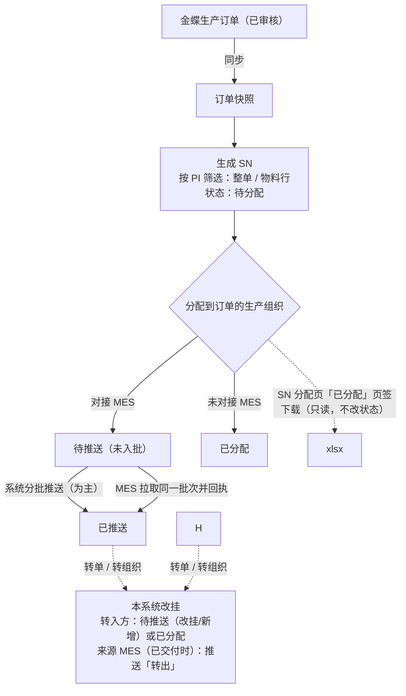

# 多生产组织 SN 防重管控需求文档（PRD）

## 1. 文档信息

| 项目 | 内容 |
| --- | --- |
| 项目名称 | 多生产组织 SN 防重管控系统 |
| 文档版本 | V31 |
| 文档状态 | 评审中 |
| 需求负责人 | @magic |
| 相关干系人 | 业务方、项目负责人、产品、开发、测试、运维、安全；金蝶实施方；各生产组织 MES 方 |
| 创建日期 | 2026-10-19 |

**阅读说明**

- 本文档独立成篇，不依赖其他文档；业务规则以本文为准。
- 每条规则只写一处：通用规则在 5.2，功能特有规则在各功能下，其他位置只引用，格式如「5.2.5 第 2 条」「F-16 第 6 条」「F-11 分配与分批推送第 5 条」。
- 标「见 Qn」的是待确认事项的暂行写法，确认前按正文实施，汇总见 8.4。
- 各功能只列有内容的栏目；页面通用约定见 F-23。
- 数值默认值均可配置，配置项见附录 C；字段映射、表结构等实现要点见附录 D。

## 2. 背景与目标

### 2.1 项目背景

公司多个生产组织（含越南等海外生产组织）按金蝶已审核的生产订单生产，产品须贴含米数信息的 SN 标签。对接 MES 的生产组织由 MES 打标，未对接的由现场按号单打标。生产中订单会作废、拆单、反审核修改，号也会在生产组织之间调拨。

SN 由各处分别发放时容易出现两类重复：生成时编出相同的号；交付时同一枚号交给两处现场，打出两张相同的标签。本系统统一从金蝶同步订单、统一生成和发放 SN，用一个号池保证全局不重复，交付、转移全程留痕。本系统为新建，没有旧系统需要迁移或查重。

【待补充：重复标签发生次数、影响范围、各生产组织每月用号量等现状数据（见 Q66）】

### 2.2 要解决的问题

| 问题 | 场景 | 对策 |
| --- | --- | --- |
| 生成撞号 | 为多个生产组织、多条规则发号，前缀相近或规则改格式后编出相同 SN | 统一号池 + 前缀规则（5.2.4） |
| 重复交付 | 对接 MES 的生产组织有推送、MES 拉取两种取号方式，超时重试、并发时同一枚号交出两次 | 共用「未入批」号池；推送与拉取送达同一批次、按批次号去重并以回执确认；MES 按版本号逐枚覆盖或跳过（5.2.5） |
| 挂靠失真 | 订单作废、拆单、修改或号调拨后，挂靠和 MES 数据与实际不符，旧标签继续使用 | 转单、转组织 + 改挂 / 转出推送（5.2.8） |
| 变更无感知 | 金蝶订单的 PI、生产组织、客户、数量、物料变化后，已出的号没有提醒和处理手段 | 订单变更提醒（F-06） |

### 2.3 业务目标

- 生成的 SN 全局不重复，同一 PI 内流水连续、不跳号。
- 每枚号同一时刻只在一个批次中；推送与拉取送达的是同一批次，重试一律幂等，不重复交付。
- 号按订单数量受控发放；订单变更、转单、转组织后，挂靠和额度清楚可查。
- 每枚号的生成、分配、交付、转移全程留痕，可追溯到批次和操作人。

### 2.4 成功指标

| 指标 | 当前值 | 目标值 | 统计口径 | 衡量时间 |
| --- | --- | --- | --- | --- |
| 号池重复 SN 数 | —（新建系统） | 0 | 号池中完整 SN 相同的记录数（唯一键保证） | 上线后持续 |
| 重复交付次数 | 【待补充】 | 0 | 未经转单、转组织，同一 SN 出现在两个成功交付批次（推送、拉取）中的次数 | 上线后 30 天起按月 |
| 推送一次成功率 | — | 【待定】 | 首次推送即成功的推送批次数 / 推送批次总数 | 上线后 30 天 |
| 推送中断平均恢复时长 | — | 【待定】 | 批次推送中断（自动重试用尽仍未确认，或失败）到经 MES 回执确认（续推，或 MES 拉取后回执）的平均时长 | 上线后 30 天 |
| 订单变更提醒平均处理时长 | — | 【待定】 | 提醒生成到总部处理关闭的平均时长 | 上线后 30 天 |

目标值待项目负责人确认（见 Q66）。指标都取自操作痕迹（F-21）和批次表，不另设前端埋点（7.3）。

## 3. 范围与用户

### 3.1 本期包含

5.1 所列 F-01 至 F-23 全部功能。

### 3.2 本期不包含

- 生产组织主数据维护：只从金蝶同步，不新增、修改、停用，不写回金蝶（F-03）。
- 写回金蝶：订单、SN 都不写回；不使用金蝶序列号功能（`SerialSubEntity`、`SNUnitID`、`SNQty`），不读写「开始序列(其他)」`F_ora_xlh`、「结束序列号(其他)」`F_ORA_txm`。
- 旧系统迁移、旧号查重。
- 从 SN 中拆解米数：以号上记录的米数为准。
- 标签打印：本系统只交付号（推送、拉取、SN 导出文件），打标由 MES 或现场完成。
- MES 回调已领用（F-13）：回调只改显示状态，本期不做。
- 向 MES 发撤回或改挂通知（统一用推送类型新增、改挂、转出，5.2.8）；转单、转组织的对外接口。
- 现场旧标签作废的线下流程（业务方另定，见 Q65）；MES 侧除按 SN 和挂靠版本号接收以外的处理逻辑。

### 3.3 目标用户与角色

账户与生产组织绑定规则见 F-01，各角色的页面、操作和数据范围见 F-02。

| 角色 | 是谁 | 核心诉求 |
| --- | --- | --- |
| 系统管理员 | 部署时创建的唯一管理员账户：全部生产组织、全部功能（含配置与账户管理） | 按人开通账户、授权生产组织，维护 MES 对接配置，控制 MES 接口账户密钥 |
| 普通操作员 | 计划、物控及各生产组织人员，授权一个或多个生产组织 | 在授权组织内按订单准确、及时发号、分配、转移，异常可处理、可追溯 |
| 审计员 | 质量、追溯、审计人员，授权一个或多个生产组织 | 在授权组织内按条件查号、核对、导出，查看操作痕迹 |
| MES 接口账户 | 各生产组织 MES 调用本系统用，不能登录页面 | 推送故障时能自己取批次并回执，重复取拿到的仍是同一批 |
| 系统（定时任务） | 比对同步、维护任务、后台推送；操作人记为 system | — |

## 4. 用户场景与用户故事

### 4.1 典型场景

**总部发号**：计划员打开订单页，系统自动从金蝶同步已审核的生产订单。她在 SN 生成页打开新到的 PI，为各物料行选好编码规则（规则库或自定义前缀），整单预演确认起止号和各物料行号段后生成 12 万枚；再到 SN 分配页点「分配（推送 24 次）」，号挂到订单的生产组织，系统按每批 5000 枚逐批推送 MES，每批 MES 写入后回执确认才推下一批。第 9 批超时，系统用原批次号自动重试 3 次仍未确认后停下；她点「继续推送（剩余 16 次）」，系统先用原批次号重推第 9 批，再推完其余批次。若在此之前 MES 已自行拉取第 9 批并回执，这一批即告成功，续推直接从第 10 批开始。

**未对接 MES 的生产组织取号**：越南生产组织操作员在 SN 分配页「已分配」页签找到某张单据，直接下载 xlsx（列与 SN 查询导出统一，见 F-14 第 4 条）交打标岗位；导出只读，号的状态不变，可反复下载。

**拆单与调拨**：一张订单在金蝶拆成两张新单，总部在「SN 转移」页把原单的号按物料转到新单，已推送的号以「改挂」重推 MES。另一批已打标的号要调到别的生产组织：来源生产组织的操作员（或总部）填写转移原因直接转组织，确认后立即生效，系统把号推给转入方 MES，同时向来源 MES 推送「转出」，来源现场按转出号清单作废旧标签。

### 4.2 整体流程

1. **主流程**：同步已审核订单（F-05）→ 生成 SN（F-09）→ 分配到订单的生产组织（F-11）→ 交付到现场。
2. **交付**：对接 MES 的生产组织以系统分批推送为主（F-11），MES 拉取（F-12）为补充。推送与拉取送达的是同一批次，以 MES 回执确认，二者互不重复（5.2.5 第 2、6 条）。SN 导出（F-14）与分配后的推送、拉取是两套独立的机制：号一经分配，不论是否对接 MES、推送是否成功，都可在 SN 分配页「已分配」页签查看、下载；导出只读，不改状态，也不影响推送、拉取。
3. **转移**：订单作废、拆单时转单（F-15），号要换生产组织、PI、客户或物料时转组织（F-16）；转移后的 MES 处理见 5.2.8。

### 4.3 用户故事

| 编号 | 用户故事 | 优先级 |
| --- | --- | --- |
| US-01 | 作为总部，我希望系统自动从金蝶同步已审核的生产订单，以便按最新订单发号 | P0 |
| US-02 | 作为总部，我希望为每个物料行选定或自定义编码规则，以便号的格式符合客户要求且全局不重复 | P0 |
| US-03 | 作为总部，我希望按 PI 筛选后整单或按物料行预演并一次生成大批量号，以便在额度内准确发号 | P0 |
| US-04 | 作为总部，我希望分配后系统自动分批推送到 MES，中断后一键续推，以便不重复、不遗漏 | P0 |
| US-05 | 作为 MES，我希望推送故障时能按 PI、单据或 PI + 单据自行取批次并回执，没回执前再取拿到的仍是同一批，以便自行取号又不重复 | P0 |
| US-06 | 作为生产组织操作员，我希望在 SN 分配页「已分配」页签按单据查看并下载已分配的号，以便未对接 MES 或应急时用号 | P0 |
| US-07 | 作为总部，我希望订单作废或拆单时把号转到新单据，以便号的挂靠与订单一致 | P0 |
| US-08 | 作为生产组织操作员，我希望填写转移原因后直接把号转到别的生产组织，系统随即通知两边 MES，以便调拨后旧号不再被使用 | P0 |
| US-09 | 作为总部，我希望金蝶订单的 PI、生产组织、客户、数量、物料变化时收到提醒并处理，以便已出的号与订单一致 | P0 |
| US-10 | 作为查询员，我希望按 PI、单据、批次、流水范围查号并导出，以便核对和追溯 | P0 |
| US-11 | 作为系统管理员，我希望按人开通账户、管理 MES 接口账户密钥，以便权限可控 | P0 |
| US-12 | 作为所有角色，我希望每个关键操作都留痕可查，以便追溯责任 | P0 |
| US-13 | 作为总部，我希望在首页看到在途的号、推送中断和交付告警，以便及时处理异常 | P1 |
| US-14 | 作为 MES，我希望领用后回调已领用，以便本系统反映现场用号情况 | P2（本期不做） |
| US-15 | 作为海外生产组织的用户，我希望用中文、英文或越南文使用系统 | P1 |

## 5. 功能需求

### 5.1 功能清单

优先级：P0 必须有，缺少不能上线；P1 应该有，本期尽量完成；P2 可延后。本版为暂拟，待产品确认（见 Q66）。

| 编号 | 模块 | 功能名称 | 简要描述 | 优先级 | 关联用户故事 |
| --- | --- | --- | --- | --- | --- |
| F-01 | 账户与权限 | 账户管理 | 系统管理员维护页面账户和 MES 接口账户；登录、改密、单会话 | P0 | US-11 |
| F-02 | 账户与权限 | 角色与权限 | 四种页面账户（系统管理员、管理员、生产组织操作员、查询员）和 MES 接口账户的页面、数据范围 | P0 | US-11 |
| F-03 | 基础数据 | 生产组织同步 | 从金蝶组织机构同步生产组织列表，只读 | P0 | US-01 |
| F-04 | 基础数据 | MES 对接配置 | 按生产组织维护对接开关、地址、凭证、批量、超时、并发、时区 | P0 | US-04 |
| F-05 | 订单 | 订单同步 | 同步金蝶已审核生产订单到本地快照；附件项次与米数的填写 | P0 | US-01 |
| F-06 | 订单 | 订单变更处理 | 已出号单据的 PI、生产组织、客户、数量、物料变化和离开快照的提醒与处理 | P0 | US-09 |
| F-07 | 订单 | 订单页 | 查看快照中的订单和物料行，去生成 | P0 | US-01 |
| F-08 | 规则 | 规则库与规则选取 | 规则参数、前缀防冲突、按物料行选取规则、版本、规则库页 | P0 | US-02 |
| F-09 | 生成 | SN 生成 | 范围、额度、预演、生成、取消、撤销 | P0 | US-03 |
| F-10 | 生成 | SN 生成页、SN 分配页 | 以 PI 为单位的两个工作台：生成页管生成与撤销，分配页管分配与推送；状态、下一步按钮、详情 | P0 | US-03、US-04 |
| F-11 | 交付 | 分配与分批推送 | 分配到订单的生产组织；按批次推送 MES，以回执确认，中断即停、续推；分配记录 | P0 | US-04 |
| F-12 | 交付 | MES 拉取 | MES 按 PI、单据或 PI + 单据取最早的未确认批次，没有则建批；处理后提交回执 | P0 | US-05 |
| F-13 | 交付 | MES 回调 | 本期不做（3.2） | P2 | US-14 |
| F-14 | 交付 | SN 导出 | 已分配的号按「生产组织 + PI + 单据」查看、下载（只读，不改状态） | P0 | US-06 |
| F-15 | 转移 | 转单 | 订单作废、拆单时把号改挂到新单据 | P0 | US-07 |
| F-16 | 转移 | 转组织 | 直接转移（原因必填，立即生效） | P0 | US-08 |
| F-17 | 转移 | SN 转移记录页 | 转单单、转组织单的查询与明细 | P1 | US-07、US-08 |
| F-18 | 查询 | SN 查询与导出 | SN 明细、交付批次、交付告警；流水范围查询；导出 | P0 | US-10 |
| F-19 | 查询 | 对外只读接口 | 按生产组织和 PI 拉取、按批次号查询明细（不改状态） | P1 | US-10 |
| F-20 | 支撑 | 首页看板 | 在途、中断、待处理和今日统计 | P1 | US-13 |
| F-21 | 支撑 | 操作痕迹 | 全部写操作留痕、查询、导出、归档 | P0 | US-12 |
| F-22 | 规则 | 按客户绑定规则接口（已取消） | 规则只按 PI 维度绑定，不按客户绑定；编号保留不复用 | — | US-02 |
| F-23 | 支撑 | 界面通用约定与多语言 | 中英越三语、列表与详情布局、确认、导出、时区 | P1 | US-15 |

### 5.2 通用业务规则

本节规则适用于全部功能，是各功能引用的唯一出处。

#### 5.2.1 SN 与 PI

- 一张 PI 对应一张或多张生产订单，一张生产订单只有一个 PI；SN 挂在 PI 上。
- 一张 PI 一套流水：PI 下所有订单、所有物料行的号，不论用哪条规则，都在这套流水上连续编号（5.2.4 第 4 条）。
- 规则按物料行选取（F-08），同一 PI 的不同物料行可以用不同规则。
- 完整 SN 全局唯一，全部由本系统生成，查重只以本系统号池为准；客户不参与查重。

#### 5.2.2 SN 组成

完整 SN = 前缀 + 流水（补 0 到流水号位数）+ 米数前分隔符 + 米数（补 0 到米数位数）+ 米数后分隔符 + 单位 + 固定后缀，总长不超过 64 位（F-08）；一经写出，字符串不再修改。**规则不限制字符**：前缀、分隔符、后缀可用任意字符（只去首尾空格，区分大小写）。

| 组成 | 规则 | 作用 |
| --- | --- | --- |
| 前缀 | 必填，不限制字符 | 区分规则版本和 PI（5.2.4） |
| 流水 | 定长（流水号补 0 位数 1–12），左侧用字符表第一个字符（默认字符表即 `0`）补齐；10 / 16 / 32 / 36 进制 | PI 内从 1 开始连续递增；紧跟前缀，可从 SN 反解出流水 |
| 米数前分隔符 | 选填，≤ 16 个字符，不限制字符；只在规则带米数时写入 | 分隔流水与米数 |
| 米数 | 所属物料行的米数（金蝶明细「长度」Flength，随订单同步；金蝶值原样使用，也可在生成页改）。**米数是字符串，不是数值**：去首尾空格后原样写入，`000`、`001`、`10.50` 或其他写法都可以，不做规范化；不足「米数补 0 位数」时左侧补 0（超过不截断，0 = 不补）；金蝶米数含中文也原样使用；**金蝶米数为空时，规则带米数须在生成页填写后才能生成**（不再默认 `000`）；规则可设为不带米数 | 体现产品规格；只写入 SN、不从 SN 拆出 |
| 米数后分隔符 | 选填，≤ 16 个字符，不限制字符；只在规则带米数时写入 | 分隔米数与单位 |
| 单位 | 所属物料行的产品单位（金蝶明细 FProductUnit，随订单同步），原样写入（是中文如「条」「个」也照用），也可在生成页改；规则可设为不带单位；**产品单位为空时，规则带单位须在生成页填写后才能生成**（页面填写的值不能含中文，如 M、m、L） | 体现计量单位 |
| 固定后缀 | 选填，不限制字符 | 规则自定义内容 |

示例（前缀 `HX`、10 进制、6 位流水、带米数不补 0、无分隔符、不带单位、后缀 `A`）：米数 `100` → `HX000001100A`（`HX` + `000001` + `100` + `A`）；米数 `10.50` → `HX00000110.50A`；米数为空须先在生成页填写（填 `000` → `HX000001000A`）。
示例（前缀 `光-SN`、4 位流水、米数前分隔符 `-`、米数补 0 到 5 位、米数后分隔符 `M`、带单位、后缀 `#尾`）：米数 `51.5`、产品单位 `条` → `光-SN0007-051.5M条#尾`（第 7 号）。

**米数按字符串处理**：米数原样写入（只去首尾空格，按规则左侧补 0），`100` 与 `0100`、`10.5` 与 `10.50` 是不同的米数；不判断是否为数字，金蝶的任何非空内容（含中文）都可以生成；页面填写的值不能含中文。

#### 5.2.3 每枚 SN 记录的内容

| 类别 | 字段 |
| --- | --- |
| 当前挂靠 | 生产组织（分配时写入）、PI、客户编码（生成时写入）、来源单据编号与序号、物料编码、挂靠版本号 `rev`（生成时为 1，规则见 5.2.5 第 3 条）；转单、转组织时按 F-15、F-16 改写 |
| 生成信息（之后不改） | 生成时订单生产组织、生成单据编号与生成序号、生成物料编码（用于计算本单生成数和额度）、流水归属 PI、十进制流水、米数、规则版本、生成批次、生成时间 |
| 交付信息 | 状态、交付方式（推送 / 拉取 / SN 分配页「已分配」页签下载）、下次推送类型（新增 / 改挂）、交付批次（推送或拉取建立）、暂停交付标记（5.2.10）、MES 持有组织（5.2.8） |

#### 5.2.4 全局不撞号

1. **前缀不能相同**：任何两条规则（含各版本）的前缀不能相同。只是开头相同不算同号，如 `SD` 与 `SDD` 可以并存；区分大小写，`AX` 与 `ax` 也可以并存（见 Q22）。前缀互为开头时，不同版本拼出的完整 SN 理论上可能相同（如 `SD` + 米数 `D1` 与 `SDD` + 米数 `1`），由第 5 条唯一键拦下。
2. **一个前缀只用于一张 PI**：同一 PI 的多个物料行可以共用一个规则版本；别的 PI 要用同一条规则，必须换新前缀另出版本（F-08 规则选取第 4 条，见 Q68）。不同 PI 的流水都从 1 开始，靠前缀区分。
3. **一个前缀只对应一种格式**：用过的版本改格式时另出新版并换新前缀（F-08 版本与删除第 1 条，见 Q20）。
4. **流水区分 PI 内的号**：PI 内的号从 1 开始依次接续、不跳号，跨订单、跨物料行、跨规则、跨生产组织都不另起流水，米数不同或新增订单也不另起；同一 PI 下分属不同生产组织的单据共用这一套流水，谁先生成谁的流水在前。米数位数不定（如 50、100、001）也不会撞号：同一版本的前缀、流水位数、后缀固定，SN 总长减去这几部分就是米数位数，所以同一版本下米数或流水不同 SN 必然不同。
5. **兜底**：号池对完整 SN 建全局唯一键（按字节、区分大小写）；万一撞上，整次生成回滚，提示撞上的号及其所在 PI，不自动跳号。

**转入号**：别的 PI 的号经转单、转组织挂到本 PI 下时，SN 字符串和流水归属（原 PI）都不变，不占本 PI 流水、不参与本 PI 起点计算；本 PI 照常从自己的最大流水 + 1 生成，前缀不同，不会与转入号相同。转移不改 SN，不另做查重。

#### 5.2.5 交付防重

生成唯一还不够：同一枚号交出两次（同一或不同生产组织），现场就可能打出两张相同标签。防重分四层（第 1–4 条），另有每日自检（第 5 条）；交付批次的建立、送达与确认见第 6 条，批次的人工处理见第 7 条，交付告警的处理见第 8 条：

1. **生成防重**：号池唯一键（5.2.4 第 5 条）。
2. **交付防重（核心）**：一枚号同一时刻只能在一个批次里。对接 MES 的生产组织只有两种方式认领「待推送、未入批」且未暂停（5.2.10）的号：建立交付批次（推送任务建批，或 MES 拉取时建批，第 6 条）；被一方认领后其他方取不到；认领在短事务内完成，可同时进行、互不阻塞（5.2.9）。重试一律幂等：推送与拉取按批次号。各通道细则见 F-11、F-12；SN 导出（F-14）只读，不认领号。
3. **MES 按版本号幂等接收**：每枚 SN 带挂靠版本号 `rev`：生成时为 1；之后凡推给 MES 的挂靠内容改变（转单、转组织、订单变更「确认对应」）就加 1，与改挂在同一事务内完成，所以同一 `rev` 的挂靠必然相同。批次中的每一枚（交付、转出）都带建批时的 `rev`。MES 只做接收：先校验批次（生产组织编码等于本组织；交付批次的 PI 为本组织所有、每枚的 PI 与批次头相同；枚数与明细条数相符；批内 SN 不重复、必填字段齐全等），不通过整批退回且不登记批次号、不写入任何数据；通过后按批次号去重，每枚 SN 只存一条，按下表逐枚处理，整批在同一事务内落库后回执整批结果（推送时在响应中，拉取时另行提交，第 6 条）。MES 不需要区分新增或改挂、转单或转组织。

   | 收到的情况 | 交付批次的 SN | 转出批次的 SN |
   | --- | --- | --- |
   | 批次号已处理过（内容摘要相同） | 不再处理，回执「已处理」 | 同左 |
   | 本侧没有该 SN | 按收到的挂靠新增 | 建一条只有 SN 与 `rev` 的「已转走」记录，禁止打标 |
   | `rev` 大于或等于本侧已存 | 按收到的挂靠覆盖（单据、序号、物料、客户、PI），清除「已转走」，保留打标状态 | 更新 `rev`，置「已转走」并记转入生产组织，禁止打标 |
   | `rev` 小于本侧已存 | 跳过，不覆盖 | 跳过 |

   回执只有整批结果：「已处理」（`OK`）或「整批退回」（`NG`，附原因）；逐枚的新增、覆盖、跳过不回传，本系统也不需要。`rev` 相等即挂靠相同，重复覆盖结果不变；`rev` 更小正常不应出现（第 4 条、5.2.8 第 7 条保证同一 SN 的批次按顺序送达），极少数迟到的旧请求被跳过。转出时本侧没有该 SN 也要建档，迟到的旧交付因 `rev` 更小被跳过，不会被当成本组织持有而继续打标。MES 不得因「批次里没有某枚 SN」作废本侧数据（批次是增量的）。交付防重由第 2 层保证，本层用于抵御乱序与重复送达，联调重点验证（9.2），风险见 8.2。
4. **批次未确认的号冻结**：号所在交付批次未确认（推送中、等待重试、重试用尽、MES 已取走待回执）或失败（MES 整批拒绝、回执与批次不符等）时，MES 可能已收到，因此不能转单、转组织，也不能因关闭「对接 MES」改为已分配；订单变更「确认对应」（F-06）涉及这些号时，须等批次确认后再做，以免批次内容与号上挂靠不一致。冻结由续推、MES 回执或总部人工处理（第 7 条）解除，不会永久停留。转出批次未确认或失败的号同样不能再转（5.2.8 第 7 条）。
5. **每日交付自检**：MES 只做接收、不提供查询接口，本系统以 MES 回执为准，在每天 2:10 的维护任务中自检：成功批次的明细是否都已记为接收（回执「已处理」即整批逐枚记为接收）；未经转单、转组织，同一 SN（同一 `rev`）是否出现在两个成功交付批次（推送、拉取）中；未确认超过告警时长（`SN_BATCH_UNCONFIRMED_ALERT_MINUTES`）的批次。发现问题列入首页告警（F-20）并留痕。人工确认的批次没有 MES 回执，不做明细核对，在自检结果中单列。
6. **统一批次**：交付批次（含转出批次）只由本系统建立：推送任务从号池认领建批（F-11），或 MES 拉取时范围内没有未确认批次而认领建批（F-12）；此外转移（5.2.8 第 2–4 条）、确认物料对应（F-06）、交付告警重推（第 8 条）、批次作废重建（第 7 条）时在同一事务内当场建批。一批只有一种批次类型、只属一张 PI。批次一经建立，批次号、所含 SN 及其挂靠和 `rev` 都不再改变。
   - **送达**：推送与拉取送达的是同一份批次，内容相同（内容摘要相同，推送的请求体逐字节相同）：本系统推送给 MES，或 MES 拉取回去。同一批次可能经两条路、多次送达，MES 按批次号只处理一次，回执相同。
   - **确认**：批次以 MES 回执确认：推送时 MES 的响应只表示「已收到」，MES 写入后经回执接口提交回执；拉取时 MES 处理后同样提交。推送响应不是「已收到」或批次号不符时批次记为失败，失败的批次 MES 取批时照样给出（MES 没有批次号），只挡住它所在 PI 的后续批次（见 F-12 第 5 条），MES 修正后经回执接口提交正确回执即确认；回执的批次号写在回执中，回执不完整（缺批次号、结果无法识别）时只拒收该回执、批次不变，MES 改正后重新提交。确认后批次成功、号改为已推送；先到的回执生效，后到的只存入明细、不再改状态。MES 整批退回时批次记为失败（原因取回执中的说明），号保持冻结，列入首页推送失败。
   - **结果**：未确认、成功、失败、已作废。未确认的批次由推送自动重试、续推或 MES 拉取后回执完成；失败的批次由 MES 修正后续推或补交回执完成；两者都可由总部人工处理（第 7 条）。成功、已作废为终态，每个批次都会走到其中之一。
7. **批次人工处理**：续推和回执都完成不了时（MES 确实处理不了、长期停机或已停用），由总部处理。只有总部能做，须填原因（≤ 500 字）和依据（如 MES 方书面确认），二次确认后执行并留痕（F-21）；入口在首页推送失败与交付告警（F-20）、SN 分配页的分配记录（F-10）、转单单与转组织单（F-17）。

   | 操作 | 适用批次 | 结果 |
   | --- | --- | --- |
   | 人工确认 | 未确认或失败的批次，MES 方确认已全部入库 | 批次记为成功，确认方式「人工」；号按回执确认同样处理（交付批次的号改为已推送并记 MES 持有组织，转出批次按 5.2.8 的条件清除 MES 持有组织）；推送任务不再重试这一批；之后 MES 再提交回执只存入明细 |
   | 作废 | MES 没有处理的批次：失败原因为整批拒绝、报文过大、认证失败或地址错误的批次；或经 MES 方书面确认未处理的未确认批次 | 批次记为已作废，不再推送，取批不返回，按批次号取回和提交回执都被拒绝。交付批次的号清除批次号，回到待推送（未入批），`rev` 不变，可按当前单批枚数重新组批，也可转移；当场建立的交付批次（同组织转移、跨组织转入、改挂，5.2.8 第 2、3 条、F-06、第 8 条）按原号重建同类型的新批次（同一 `rev`，按当前单批枚数拆分，暂停交付的号留在号池）并自动推送；转出批次按原明细重建新的转出批次（同一 `rev`，按当前单批枚数拆分）并自动推送，来源 MES 照样会收到转出 |

   回执或推送响应与批次不符、推送响应无效、MES 报「同一批次号内容不同」的失败批次，MES 可能已经处理过，不能作废，只能由 MES 补交回执或人工确认。作废后万一 MES 其实处理过，号重新组批送达同一 MES 时 `rev` 不变、挂靠相同，MES 覆盖一次结果不变，不会出错；但作废的号若之后转到别的组织，原 MES 不会收到转出（MES 持有组织未记录），就成了两处可用且无从发现，所以作废未确认的批次必须有 MES 方书面确认。
8. **交付告警处理**：交付告警（每日自检发现的问题，第 5 条）列在首页（F-20），总部核查后填写结论关闭并留痕（如已线下处理、确认无需系统处理）。

#### 5.2.6 号的状态与迁移

状态记在每一枚 SN 上，不记在 PI 上。单据反审核中或订单变更待确认时，该单未交付的号暂停交付，状态不变（5.2.10）。

| 状态 | 含义 | 适用生产组织 |
| --- | --- | --- |
| 待分配 | 已生成，未分到生产组织 | — |
| 待推送 | 已分到生产组织、未交付：未入批，或所在交付批次未确认、失败（5.2.5 第 4 条）；含转移后等待改挂或新增推送的号 | 对接 MES |
| 已推送 | MES 已确认：所在批次经 MES 回执或总部人工确认（5.2.5 第 6、7 条）；MES 拉取后回执确认的页面显示「已推送（拉取）」（见 Q33） | 对接 MES |
| 已分配 | 已分到生产组织（未对接 MES）；分配后即可在 SN 分配页「已分配」页签下载，导出不改状态 | 未对接 MES |

| 从 | 到 | 触发 | 功能 |
| --- | --- | --- | --- |
| — | 待分配 | 生成 | F-09 |
| 待分配 | （删除） | 取消生成、撤销生成 | F-09 |
| 待分配 | 待推送（未入批）/ 已分配 | 分配到对接 / 未对接 MES 的生产组织 | F-11 |
| 待推送（未入批） | 待推送（批次未确认） | 推送任务建批，或 MES 拉取建批 | F-11、F-12 |
| 待推送（批次未确认） | 已推送 / 待推送（批次失败） | MES 回执确认 / MES 整批拒绝，或推送响应无效、与批次不符 | F-11、F-12 |
| 待推送（批次失败） | 已推送 | MES 修正后续推得到确认，或 MES 补交回执 | F-11、F-12 |
| 待推送（批次未确认、失败） | 已推送 / 待推送（未入批） | 总部人工确认 / 作废（5.2.5 第 7 条） | 5.2.5 |
| 待推送（未入批）/ 已分配 | 已分配 / 待推送（未入批） | 关闭 / 开启「对接 MES」 | F-04 |
| 可转状态 | 见 5.2.8 第 2、3 条 | 转单、转组织 | F-15、F-16 |
| 待推送（改挂，同一生产组织） | 已推送 | 改挂所在批次经 MES 确认 | 5.2.8 |

#### 5.2.7 计数口径

额度、本单生成数、已生成数、已分配数都按物料行（单据编号 + 序号，序号即物料在生产订单中的行号）计，存在快照之外的计数表（F-05 快照规则第 10 条）；同一单据中物料编码相同的多行各算各的。

| 计数 | 含义 | 生成 | 取消 / 撤销生成 | 分配 | 转单 | 转组织 |
| --- | --- | --- | --- | --- | --- | --- |
| 本单生成数 | 物料行自己生成的号数，按号上的生成单据、生成序号计 | 增加 | 减少 | — | 不变 | 不变 |
| 已生成数 | 当前挂在物料行下的号数 | 增加 | 减少 | — | 来源减、目标加 | 目标物料行与来源不同时来源减、目标加（见 Q59） |
| 额度（未生成额度） | 物料行数量 − 本单生成数，小于 0 按 0 计 | 减少 | 增加 | — | 不变 | 不变 |
| 已分配数 | 已分配的号按当前挂靠计（见 Q64） | — | — | 增加 | 来源减、目标加（只转已分配的号） | 同已生成数 |

1. 物料行数量取该行数量，不限业务状态；单据额度、PI 额度为各物料行额度之和；额度为 0 的物料行不能生成。
2. 转单、转组织（同 PI 或跨 PI）都把号改挂到目标物料行，只移动已生成数、已分配数，来源和目标的额度都不变；转组织的目标物料行与来源相同（只换生产组织）时计数不变。
3. 整单作废、拆单转单后，新单据的额度仍按本单生成数计，仍可按订单数量生成（见 Q61）。
4. 订单页「已生成」显示已生成数，「可生成」显示额度；PI 维度的汇总口径见 F-10 第 1 条。

#### 5.2.8 转移后的 MES 处理

转单（F-15）、转组织（F-16）只在本系统改挂，不改 SN 字符串，不向 MES 发撤回或改挂通知，也不等 MES 确认；需要告知 MES 的，统一按推送类型（新增、改挂、转出，见 F-11 推送内容）推送，MES 按 SN 和挂靠版本号接收（5.2.5 第 3 条）。下文「已交付给某组织 MES」以号上的「MES 持有组织」为准，不按号的状态推断：交付批次（推送或拉取）经确认（含人工确认）时记为该批次的生产组织；向该组织推送的转出批次经确认时，只有号上的 MES 持有组织仍是该转出批次的来源组织才清除，已是别的组织的（如转入方的交付批次先确认）保持不变；批次作废不改它。号在同组织改挂待推送期间状态为待推送，但 MES 中仍有旧版本，持有组织仍是本组织。

1. **清除原批次、版本号加 1**：号上原有的推送、拉取批次清掉，挂靠版本号 `rev` 加 1（5.2.5 第 3 条）。
2. **仍在同一生产组织**：MES 持有组织为本组织的号改为待推送，推送类型记为改挂，在转移的同一事务内建立同组织转移批次（见下方「转移交付批次」），系统随即自动推送，MES 按 `rev` 覆盖挂靠；推送完成前 MES 也可拉取这些批次；所在批次经 MES 确认后恢复为已推送。未交付给 MES 的号状态不变，按正常流程交付。
3. **转到别的生产组织**：转入方对接 MES 时改为待推送，MES 持有组织为来源组织的号推送类型记为改挂（转入 MES 无该 SN 时按新增入库），在转移的同一事务内建立跨组织转入批次；其余记为新增，回到未入批号池按正常流程交付。确认后随即自动推送到转入 MES，不等来源 MES，推送完成前转入 MES 也可拉取。转入方未对接 MES 时改为已分配。

   **转移交付批次**（第 2、3 条）：转移前 MES 已持有的号不回号池，在转移时就给转入方建批，批次上记转移类型和转移单号，在转单单、转组织单上与转出批次一起列出。批次类型为同组织转移或跨组织转入（一批只有一种），按转入组织当前单批枚数拆分。确认物料对应（F-06）时，MES 已持有的号同样当场建批，批次类型为改挂。目标单据暂停交付（5.2.10）的号不建批，留在号池，解除后按正常流程交付。批次未确认或失败期间这些号不能再转（5.2.5 第 4 条）。
4. **转出推送**：号的 MES 持有组织为来源组织、且转入生产组织与来源不同时（转入方是否对接 MES、来源此时是否仍开启「对接 MES」都一样），系统向来源 MES 推送一批「转出」，与向转入方的推送各自进行、互不等待。转出批次与转移在同一事务内建立，按转出前的 PI 分批（一张转移单只有一张来源 PI）、按来源组织当前单批枚数拆分；明细与交付批次同一结构，逐枚带转出前的挂靠和转入生产组织（附录 D.3）。每个生产组织各自一套 MES（F-04 第 6 条），改挂与转出不会到达同一个 MES。来源组织已关闭「对接 MES」时，转出照常推送到原接口地址，来源 MES 也可照常取回转出批次并回执（F-01 第 13 条、F-04 第 4 条）。
5. **来源 MES 查不到**：已转到别的生产组织的号，来源 MES 按批次号只读查询、按生产组织和 PI 只读查询都查不到（F-19）；整批已移出的批次返回 0 枚。来源 MES 不据查询结果删号，以转出推送（第 4 条）为准，保留本侧的转出标记和打标状态。
6. **推送中断**：改挂、转出批次与普通批次一样先自动重试、仍未确认即停、用原批次号续推（F-11 分配与分批推送第 5、6 条）；MES 也可拉取这些批次并回执（F-12），转出批次由来源 MES 拉取；都完成不了时由总部人工确认或作废（5.2.5 第 7 条）。在转单单或转组织单上显示「继续推送（剩余 N 次）」，并列入首页推送失败（F-20）。
7. **转出未完成的号不能再转**：号所在转出批次未确认或失败时，不能再转单、转组织；按转出明细校验，列为不可转并提示「先在原转组织单上继续推送转出」。这样号转回来源前，来源 MES 一定先收到转出、后收到改挂或新增，不会被后到的旧数据覆盖（见 Q63）。
8. **旧标签**：已打出的旧标签由来源现场作废；转组织单可导出转出号清单（完整 SN、流水、原批次）作为作废依据（作废流程和是否系统登记见 Q65）。

#### 5.2.9 PI 操作锁与并发

1. **PI 操作锁**：同一 PI 的生成（含取消）、撤销生成、分配、转单、转组织共用一把锁，同一时刻只执行一个，后到的提示稍后再试（见 Q54）。
2. **推送任务**：同一 PI 同一时刻只运行一个推送任务；同一生产组织同时运行的推送任务数（跨 PI）不超过「推送并发上限」（F-04），超出的排队（见 Q34）。
3. **拉取**：不占 PI 操作锁，不受推送并发上限限制；与推送从同一「未入批」号池认领，互不阻塞、互不重复（附录 D.3 写入方式第 4 条）。SN 导出只读，不认领号。MES 拉取建批时按生产组织加锁，并发的取批请求不会为同一范围各建一批（F-12 取批规则第 6 条）。
4. **转移与认领互斥**：转单、转组织对所涉的号逐行加锁，与推送、拉取的认领互斥（见 Q54）。

#### 5.2.10 单据暂停交付

1. **何时暂停**：以下任一情况，该单据未交付的号暂停：
   - 单据反审核中：已出号单据离开快照后按单号查到、单据状态不是已审核（含已作废，系统只看单据状态、不区分）；查询失败、判断不了时同样按反审核中（F-06）；
   - 同步比对发现单据的 PI、生产组织、客户或物料行的物料编码与台账不同（F-06），不论期间是否发现过反审核。只有数量变化不暂停。
2. **暂停范围**：号上当前来源单据为该单据、尚未交付的号（待分配、待推送（未入批）、已分配）：不能分配（F-11）；推送任务、MES 拉取都不把它们建入批次，转移、确认物料对应、告警重推时也不当场建批（留在号池，解除后按正常流程交付）；SN 导出照常展示和下载（第 7 条）。
3. **不暂停**：
   - 已入批、批次未确认或失败的号：MES 可能已收到，照常续推，MES 照常可拉取该批并回执（5.2.5 第 4 条）。
   - 已推送的号：已在现场，系统不收回；提醒列出已交付枚数，由总部决定是否通知现场暂停使用。
   - 转出推送：只是通知来源 MES 号已转走，照常推送。
4. **转移**：转单、转组织照常可做。号改挂到未暂停的单据后随即可交付；转组织的目标单据仍是来源单据时，号仍暂停，直到该单据解除。
5. **解除**：
   | 情况 | 解除方式 |
   | --- | --- |
   | 反审核中的单据重新审核回到快照，与台账没有变化或只有数量变化 | 自动解除；数量变化照常按 F-06 提示 |
   | 有第 1 条所列 PI、生产组织、客户、物料变化 | 继续暂停；总部在提醒中处理后点「确认变更」（物料变化为「确认对应」或「确认无关」）解除 |
   | 按单号查无此单（已删除） | 自动解除 |
   | 单据实际已作废 | 总部在提醒中点「确认已作废」后解除（F-06） |

   解除后，涉及的 PI 有可推送的号时，系统自动启动推送（5.2.9 第 2 条）。
6. **及时发现重新审核**：比对同步每个周期都能发现重新审核回到已审核的单据，并对反审核中的已出号单据按单号复查（F-05 同步方式第 1 条），最迟一个同步周期内处理；总部也可在提醒上点「立即同步」。
7. **显示**：暂停的号在 SN 生成页与 SN 分配页（含「已分配」页签）、SN 查询中标「暂停（单据反审核中）」或「暂停（订单变更待确认）」；推送次数、剩余可拉枚数都不含暂停的号，另显示暂停枚数；SN 导出照常展示和下载暂停的号，另显示暂停枚数。

### 5.3 功能详细说明

#### F-01 账户管理

系统管理员维护页面账户（普通操作员、审计员）和 MES 接口账户；账户本人登录、改密。

**操作流程**：系统管理员在账户页「账户」页签新建账户（工号、姓名、角色、授权生产组织、初始密码）→ 用户用工号和初始密码登录，可随时改密。MES 接口账户创建后系统生成密钥（加密保存，系统管理员可随时查看或重置），MES 每次调用接口时带工号 + 密钥（`Authorization: Bearer <工号>:<密钥>`），不换令牌。

**业务规则**：

1. 系统管理员只有一个（工号 `SN_INIT_ADMIN_EMP_NO`，默认 `admin`，角色值 `admin`），只有它能创建、修改、停用、启用账户和重置密码；它不能改角色、不能被停用，也不能新建系统管理员或把别的账户改为系统管理员。
2. 工号唯一，4–32 位字母和数字，区分大小写（如 `hq01` 与 `HQ01` 是两个账户，登录须按原样输入），创建后不能改（MES 接口账户同）；姓名必填，≤ 64 字。不合规时保存失败并提示原因。
3. 新账户用工号和初始密码直接登录，任何时候都不强制改密（见 Q3）；本人可随时在账户菜单「修改密码」中改密（须输原密码，新旧不能相同）。
4. 本人改密或系统管理员重置密码后，该账户所有已登录的页面（含改密的当前页面）立即退出，提示「密码已修改或被重置，请用新密码重新登录」，用新密码重新登录后即可正常使用，不要求再改密。
5. 授权生产组织：普通操作员、审计员可多选，**至少一个**（没有授权的账户不能登录，已登录的请求一律拒绝）；系统管理员不绑（全部组织）；MES 接口账户绑一个生产组织，不要求已开启「对接 MES」（可先建账户交给 MES 方联调，联调通过后再开启，见 F-04）。可选范围是生产组织列表（F-03）中金蝶启用的；已授权的之后在金蝶被禁用，授权保留。之后从金蝶新增的生产组织不会自动授权给任何账户。
6. 账户只停用、不删除，可重新启用（见 Q4）；不能停用自己。「账户」页签只列页面账户，「MES 接口账户」页签只列 MES 接口账户。
7. 密码 8–64 位，须同时含字母和数字，可含 `!`、`@`、`#`、`$`、`&`、`*`，不能含其他字符（如空格、中文）。
8. 登录失败不锁定、不限速、不加验证码，每次失败留痕（含来源地址）；统一提示「工号或密码错误」，停用账户提示「账户已停用」。
9. 登录令牌默认 12 小时有效（`ACCESS_TOKEN_TTL_SECONDS`）。
10. 单会话：每个浏览器标签页各自保存登录状态，同一账户同一时刻只在一个页面有效，别处再登录时原页面退出并提示「该账户已在其他页面登录」；MES 接口账户不受此限。车间按人建账号，共用会互相挤下线（见 Q6）。
11. 系统管理员在空库首次启动时按部署配置创建，正式环境密码不能是默认值；忘记密码时运维设 `SN_RESET_ADMIN=true` 重启一次恢复，并留痕。
12. 账户页签可按工号（开头匹配）、姓名（包含）搜索，按角色（含 MES 接口账户）、状态、生产组织筛选。
13. **MES 接口账户**：不能登录页面；密钥在创建或重置时弹出，加密保存（列表不显示），系统管理员可随时点「查看密钥」再看（每次查看留痕 `USER_VIEW_SECRET`），也可「重置密钥」重新生成，重置后旧密钥立即失效；更换 `SN_SECRET` 后旧密钥无法查看，须重置；每次调用接口都带工号 + 密钥，不换令牌。密钥认证连续失败 10 次（`SN_MES_AUTH_MAX_FAILURES`）锁定 15 分钟（`SN_MES_AUTH_LOCK_MINUTES`），锁定期间密钥正确也拒绝，锁定和解锁留痕；可配置来源地址白名单，配置后只接受白名单内的请求（见 Q5）。所绑生产组织未开启或已关闭「对接 MES」时，取批只返回本组织的转出批次，不再返回或新建交付批次；回执和只读查询仍可用。

**验收标准**：

- 给定普通操作员，当其登录，那么看不到账户页签和生产组织页签。
- 给定普通操作员的授权组织被全部删除，当其登录，那么提示「账户未授权任何生产组织，请联系系统管理员」。
- 给定账户 A 已在页面 1 登录，当 A 在页面 2 登录，那么页面 1 退出并提示「该账户已在其他页面登录」。
- 给定 MES 接口账户已连续 10 次密钥认证失败，当 15 分钟内用正确密钥调用接口，那么仍被拒绝，并有锁定痕迹。
- 给定管理员重置了 MES 接口账户密钥，当 MES 用旧密钥调用拉取接口，那么调用被拒绝。
- 给定生产组织 A 未开启「对接 MES」、已有已分配的号，当系统管理员为 A 建 MES 接口账户，那么创建成功；MES 取批时不建交付批次、号仍为已分配；A 开启对接后，同一账户即可取到这些号。

#### F-02 角色与权限

三种页面账户——系统管理员（唯一）、普通操作员、审计员，加只调接口的 MES 接口账户。导航只显示本角色可用的页面，数据按账户的授权生产组织自动过滤。

**业务规则**：

1. **系统管理员**：全部生产组织、全部功能、全部数据，含配置与权限管理——账户维护（F-01）、生产组织同步与 MES 对接配置（F-03、F-04）、全量重建订单快照（F-05），以及普通操作员的全部业务操作；转单、转组织都直接转移（原因必填），不限组织。
2. **普通操作员**：只看、只操作授权组织的数据（每张单据只属于一个生产组织）——
   - 生产订单：只列授权组织的单据，授权多个组织时生产组织筛选框只列授权组织；可按单据同步、立即比对、填写附件项次 / 米数 / 产品单位、处理订单变更提醒（单据的组织、号所在的组织须都在授权范围内）；
   - SN 生成：PI 列表与汇总、生成详情只含授权组织的单据；预演、生成、取消、撤销只能针对授权组织的物料行；撤销要一并撤掉流水在其后的别的组织的物料行时拒绝；PI 级默认规则（绑定、解除）须对这张 PI 的全部单据都有授权；
   - SN 分配：只分配到授权组织；整张 PI 分配时只分授权组织的号；推送进度、续推、人工确认、作废、交付告警处理限授权组织；
   - 规则库：见第 5 条；
   - SN 转移：转单、转组织都直接转移、立即生效，须填转移原因（没有申请、审批）；转单的来源单据、号所在组织须在授权范围内，转组织的来源生产组织须在授权范围内；目标单据、转入生产组织不限；
   - SN 导出、SN 查询（含交付批次、交付告警）：限授权组织；
   - 不能：维护账户、生产组织与 MES 配置、全量重建快照，不看操作痕迹。
3. **审计员**：只读，限授权组织——SN 查询（SN 明细）与导出（已分配的号也在这里按 PI、单据导出，列与 SN 导出统一）、操作痕迹（审计报表）；不看生产订单、生成、分配、规则、转移记录、交付批次；可按授权范围调用对外只读接口（F-19）。
4. **MES 接口账户**：只能调用本生产组织的拉取（F-12，含回执）、只读接口（F-19）。
5. **规则所属组织**：每条规则有所属组织；不填 = 全局规则。全局规则所有组织都能看到、选用（物料行选定、绑定给授权范围内的 PI、换前缀另出版本），只有系统管理员能修改、删除；普通操作员新建的规则必须归属一个授权组织（只授权一个时默认它），只有该组织的普通操作员和系统管理员能看到、修改、删除、选用；生成时存入规则库的自定义规则归属物料行的组织（同一 PI 不同组织的物料行共用同一自定义规则时为全局规则）。前缀全局不能相同的规定（5.2.4）不变。
6. 页面权限：

   | 页面 | 系统管理员 | 普通操作员 | 审计员 |
   | --- | --- | --- | --- |
   | 首页看板、SN 查询 | ✓ | ✓（授权组织） | ✓（只读，授权组织；SN 查询只有 SN 明细页签） |
   | 生产订单、SN 生成、SN 分配（含 SN 导出）、规则库、SN 转移 | ✓ | ✓（授权组织） | — |
   | 操作痕迹 | ✓ | — | ✓（授权组织） |
   | 账户页 · 生产组织页签 | ✓ | — | — |
   | 账户页 · 账户页签 | ✓ | — | — |

7. 生产组织筛选：系统管理员在各页都有；授权多个组织的账户在各页有，只列授权组织；只授权一个组织的账户没有。
8. 无权限的页面不出现在导航中，直接访问回到首页；越权调用接口一律拒绝并留失败痕迹（F-21），各接口不再单列。

**验收标准**：

- 给定普通操作员授权生产组织 A，当其打开 SN 分配页的「已分配」页签，那么只看到 A 的行，且不显示生产组织列。
- 给定一张 PI 有 A、B 两个组织的单据，当只授权 A 的普通操作员打开它的生成详情，那么只看到 A 的单据；预演 B 的单据被拒绝；B 的号流水在 A 之后时，撤销 A 的物料行被拒绝。
- 给定只授权 A 的普通操作员，当其修改全局规则，那么提示「全局规则只有系统管理员能修改、删除」；当其新建规则，那么规则归属 A，别的组织的账户看不到。
- 给定只授权 A 的普通操作员，当其填写原因把 A 的号直接转到 B，那么立即生效；不填原因时被拒绝；只授权 B 的普通操作员转 A 的号被拒绝。
- 给定审计员，当其打开 SN 查询，那么只有 SN 明细页签，没有任何写操作入口。

#### F-03 生产组织同步

从金蝶组织机构接口同步生产组织列表，用于账户绑定、MES 对接配置、选择转组织转入方。主数据只来自金蝶，本系统只维护对接配置（F-04）。

**两处生产组织**：生产组织列表（组织机构接口，全部生产组织）和订单上的生产组织（生产订单接口，随订单同步）来自金蝶同一套组织机构。号的归属一律按订单上的生产组织：直接使用订单返回的编码和名称，不与列表校验，列表中没有该编码也照常生成、分配、转单。号上按编码记录，名称只用于显示，改名不影响归属。

**业务规则**：

1. **同步时机**：总部打开生产组织页签时先显示现有列表、再自动同步一次；可手动同步；每天 2:10 维护任务同步一次，订单快照全量重建时也顺带同步；失败不影响订单同步。
2. **同步规则**：本地没有的编码新增（金蝶已禁用的不新增）；名称、启用状态随金蝶更新；编码唯一；调用失败时列表不动并提示原因；每次同步留痕。
3. **金蝶禁用**：不能再绑定账户，不能作转组织转入方；已有绑定保留；已分到该组织的号照常推送、拉取、导出、转出。生成、分配、转单按订单上的生产组织进行，不看列表状态。

**页面与交互**：生产组织页签仅总部可用，列出编码、名称、状态、对接 MES（是 / 否）、MES 配置状态、绑定的启用账户数；只有 MES 对接配置可改。

**验收标准**：

- 给定金蝶中某生产组织改名，当同步完成，那么列表名称更新，号上的生产组织编码不变。
- 给定生产组织 B 在金蝶被禁用，当总部发起转组织，那么选不到 B；已分到 B 的号照常可导出、推送。
- 给定金蝶组织机构接口调用失败，当同步，那么列表不变并提示失败。

#### F-04 MES 对接配置

按生产组织编码维护，是本系统对生产组织唯一可维护的内容，仅总部可改。订单上的生产组织不在列表中或未开启「对接 MES」时，按未对接处理。

**前置条件**：MES 方已提供接口地址和凭证。

**操作流程**：选生产组织 → 填配置 → 连接测试 → 保存。

**业务规则**：

| 配置项 | 说明 | 默认 |
| --- | --- | --- |
| 对接 MES | 是：分配后系统推送，MES 也可拉取；否：在 SN 分配页「已分配」页签下载。两者都可在 SN 分配页「已分配」页签下载已分配的号 | 否 |
| MES 接口地址 | 推送地址（含改挂、转出推送） | — |
| 认证方式与凭证 | SN 调用 MES 时使用，加密保存，不回显；认证方式可选无认证（不需凭证，只用于 MES 在内网自行限制访问的场合） | — |
| gzip 压缩 | 推送请求体是否 gzip 压缩；关闭时发原始 JSON。已开启对接时改动须先连接测试 | 关 |
| 单批推送枚数 | 每批推送上限，也是 MES 拉取建批的上限 | 5000 |
| 推送超时 | 每批等待 MES 响应的时间，超时后批次仍为未确认，按 F-11 自动重试 | 60 秒 |
| 推送并发上限 | 该组织同时运行的推送任务数（跨 PI），超出排队（5.2.9 第 2 条） | 2 |
| 时区 | 该组织账户的页面时间显示和「今日」统计时区（F-23 第 8 条） | UTC+8 |
| 连接测试 | 保存前测试：向接口地址发送一个不含号的连接测试批次，认证、压缩与正式推送相同，MES 校验认证和生产组织编码后返回成功，不登记、不写数据；只提示结果 | — |
| 配置状态 | 只读：未配置 / 正常 / 最近一次测试或推送失败 | — |

MES 调用本系统用 MES 接口账户（F-01 第 13 条），与上表中 SN 调用 MES 的凭证方向相反，分开维护。

1. **开启条件**：接口地址、凭证（无认证时不需要）已填且连接测试通过。
2. **开启时**：该组织已分配的号改为待推送（未入批），不自动推送；由总部点「继续推送」或等 MES 拉取。
3. **关闭条件**：该组织没有进行中的推送任务、没有未确认或失败的交付批次（含 MES 拉取建立的批次和转出批次）、没有等待改挂重推的号（5.2.5 第 4 条）；不满足时拒绝，列出阻塞的批次和枚数；MES 已停用时，先续推，仍无法确认的批次由总部人工确认或作废（5.2.5 第 7 条）。
4. **关闭时**：待推送（未入批）的号改为已分配；已推送的号不变。接口地址和凭证保留：这些号之后转走时，转出照常推送，MES 也可照常取转出批次并回执（5.2.8 第 4 条）。
5. 切换前提示受影响的枚数，确认后执行并留痕（见 Q35）。
6. 每个生产组织各自对接一套 MES，不共用，配置逐个维护。

**验收标准**：

- 给定连接测试未通过，当把「对接 MES」设为是，那么保存被拒绝。
- 给定该组织有一个未确认的推送批次，当关闭「对接 MES」，那么被拒绝并提示先续推或等 MES 回执。
- 给定该组织有 3000 枚待推送（未入批）和 2000 枚已推送，当关闭对接，那么 3000 枚改为已分配，2000 枚不变。

#### F-05 订单同步

把金蝶已审核的生产订单同步到本地快照，生成和分配都读快照、不现读金蝶。快照按物料行保存，顺序按金蝶明细行号。仅总部可操作。

**前置条件**：附录 D.1 字段映射已由金蝶实施方核对（见 Q7、Q8）；现有查询脚本已按附录 D.1 调整（见 Q10）。

**操作流程**：系统每 10 分钟比对同步，进入订单页时也触发一次；也可手动立即比对同步、按单据编号同步或全量重建 → 变动的单据整单替换或移出 → 对变动的已出号单据执行订单变更比对（F-06）。

**同步字段**（金蝶位置与取值约定见附录 D.1）：

| 位置 | 字段 | 说明 |
| --- | --- | --- |
| 表头 | 单据编号、单据状态、客户编码、PI、PO、生产组织（编码、名称）、修改日期 | 单据状态存入快照（均为已审核 C），只按单据状态判断，不看作废状态；PO 可空，只用于显示和搜索；生产组织编码用于号的归属、匹配 MES 配置和过滤，名称只显示（F-03）；修改日期（ModifyDate）用于比对同步判断单据内容是否改过，并在订单页显示、排序（新的在前） |
| 明细 | 序号、附件项次、物料编码、物料名称、米数、产品单位、数量 | 序号 = 金蝶明细行号，即物料在订单中的行数位置，物料行以「单据编号 + 序号」识别；米数写入 SN（5.2.2），金蝶值原样使用，为空时规则带米数须在生成页填写才能生成；产品单位（FProductUnit）在规则带单位时写入 SN，规则同；附件项次可空，空时须在生成页填写 |
| 同步记录 | 本次同步时间 | 不显示 |

不同步业务状态、需求单据号。

**快照规则**：

1. 每张生产订单只有一个 PI、属于一个生产组织；一张 PI 可有多张订单。表头字段写在该单每一行上。
2. 不存单据头，不存金蝶单据内码、分录内码。
3. 只同步单据状态为已审核（`DocumentStatus` = C）的单据；只看单据状态，不看作废状态等其他字段（作废的单据须先反审核，单据状态不再是已审核）。
4. 已审核单据同步全部物料行，不按业务状态过滤；订单下达、开工、完工后仍在快照中，不影响额度、生成、分配（见 Q25）。
5. 单据状态不再是已审核（反审核、作废）或被删除后，下次同步从快照移除；已生成的号不受影响，仍按来源单据编号查询；重新审核后回到快照。已出号单据离开和回来时按 F-06 处理（见 Q16）。
6. 同一单据同一物料有多行时不合并，按序号分别计额度、分别生成。
7. 数量有小数时按整数部分计，为空、不是数字或小于 0 时按 0 计；物料编码为空的行照常计入，物料视为「空」。
8. 客户编码为空的订单与有客户编码的订单流程一致：订单页、生成页照常显示，照常生成、分配、转单、转组织（客户编码按空值写入号上），订单页顶部注明这样的单据数；PI 为空的订单在订单页可见，不进入生成页。
9. 订单上的生产组织原样使用订单接口返回的编码和名称（F-03）。
10. 已生成数、本单生成数、已分配数按物料行存在快照之外，快照覆盖、单据离开快照都不会丢失。
11. 单据编号为空的行不进快照；同一单据返回多行相同序号时只保留第一行；序号取不到时按 0。各字段的去空格、空值判断和长度上限见附录 D.1 取值约定。
12. 米数在快照中按金蝶原值保存（金蝶返回整数型数字时去掉末尾「.0」），生成时按字符串原样写入（5.2.2），不判断是否为数字、不规范化。

**附件项次、米数与产品单位的填写**（见 Q67）：

1. 物料行附件项次在金蝶为空（去首尾空格后）时，在生成详情的物料行里直接填写（订单页右表只显示，空的标红「缺失」，不能填写）；只有总部可填写；填写值不写回金蝶。金蝶有附件项次的不能在页面修改；米数、产品单位见第 3、3a 条。
1a. **附件项次按点选顺序自动填**：在生成详情里点选（点行或勾选框）附件项次为空的物料行时，自动填上该行的点选顺序（与行前的序号标记一致，从 1 起），输入框里可直接改；连续点选停下约 1 秒后一并保存；保存前取消点选则撤掉自动填的值。已有附件项次的行不自动填。
2. **附件项次必填**：为空时输入框标红「必填」，不能生成（F-09）；去首尾空格后不能为空，≤ 64 字，否则提示「附件项次不能为空，不超过 64 字」。
3. **米数**：输入框显示金蝶原值（原样使用，含中文也照用），可选改；金蝶为空时规则带米数必填（输入框标红，不能生成），不再默认 `000`。填写的内容按字符串原样保存（去首尾空格，≤ 64 字，不能含中文），`000`、`001`、`002` 等都可以（5.2.2）；留空或填回金蝶值即清除填写、改回金蝶值。
3a. **产品单位**：输入框显示金蝶原值（原样使用，是中文如「条」「个」也照用），可选改；金蝶为空时规则带单位必填（输入框标红，不能生成）。填写的值不能含中文（如 `M`、`m`、`L`，或其他英文字符、符号），含中文时提示「产品单位不能含中文」；去首尾空格，≤ 64 字，按字符串原样写入 SN；留空或填回金蝶值即清除填写、改回金蝶值。规则不带单位时不挡生成。
4. **有号后锁定**：物料行一旦生成过号，附件项次、米数和产品单位输入框置灰，不能修改——号还未分配时可撤销生成（F-09 撤销生成）、修改后再生成；号已分配后不能再修改，也不能再撤销重来。锁定只针对这几个字段，不影响转单、拆单、转组织（F-15、F-16）。同一物料行之后接着生成剩余额度时仍用锁定的值。
5. 填写值按物料行（单据编号 + 序号）存在快照之外，同时记下填写时的物料编码；之后同步时同一序号的物料编码变了，视为对不上原行，该值失效。物料行不在快照中时不能填写。
6. **金蝶后来有值**：页面填写过附件项次的行之后同步时金蝶返回非空值，该行标「金蝶已有值」，同时显示金蝶值和页面填写的值（不同时醒目标出）；同步完成提示「N 行附件项次金蝶已有值」，并列入订单变更提醒（F-06），总部点「知道了」关闭。之后生成以金蝶值为准；已生成的号不受影响。
7. 填写、修改都留痕（F-21）。

**同步方式**：

1. **比对同步（日常）**：默认每 10 分钟（`SN_SYNC_INTERVAL_MINUTES`）执行一次，多台服务器只执行一次，操作人记为 system。先从金蝶分页拉取单据状态为已审核的单据编号和修改时间（只取这两个表头字段；若按明细返回多行，本地去重），与快照比对：

   | 比对结果 | 处理 |
   | --- | --- |
   | 金蝶有、快照没有 | 按单据拉取明细，写入快照 |
   | 修改时间与快照不同，或金蝶未返回修改时间 | 按单据拉取明细，整单替换（同一事务内先删该单全部行再插入），金蝶删掉的物料行随之消失；未返回修改时间的单据每个周期都重新拉取 |
   | 快照有、金蝶没有 | 从快照移出该单 |
   | 相同 | 不处理 |

   比对出变动、按单据拉取明细时已拉不到的单据（两步之间被反审核），快照中有的按「快照有、金蝶没有」移出。每张变动的单据替换或移出后，立即对这张单执行订单变更比对（F-06）。同一周期内，还对处于反审核中的已出号单据按单号各查一次（第 2 条），以发现重新审核或删除。任一页拉取失败时间隔 10 秒重试 3 次，仍失败则本周期不改快照，下个周期再试；分页方式、频率、单次上限由金蝶实施方给出（见 Q8）。不受订单业务状态影响，也不依赖金蝶审核、反审核是否更新修改时间：状态变化体现为单据出现在或离开已审核列表。
2. **按单据编号同步**：不带单据状态条件按单号查询金蝶，只看单据状态。已审核时替换该编号下的行；不是已审核时从快照移除，提示「该单据当前为〈单据状态〉，已从快照移除」，快照中原本没有的提示「该单据未审核，不同步」；查无此单时从快照移除并提示「该单据在金蝶中不存在」。
3. **进页同步与立即比对同步**：新开、刷新页面或重新登录后首次进入订单页时，先显示现有快照，再在后台触发一次比对同步；正有同步在运行时跳过。总部也可在订单页点「立即比对同步」手动执行一次（同第 1 条），正有同步在运行时跳过并提示「已有同步在运行，本次跳过」。
4. **全量重建**：只用于首次上线导入和总部手动「重建快照」（如怀疑快照与金蝶不一致）。按已审核条件完整拉取后整体替换旧快照（附录 D.2），失败整体回滚，不会出现空快照；顺带同步生产组织列表（F-03），生产组织同步失败不影响订单快照；完成后对全部已出号单据执行订单变更比对。
5. 金蝶调用失败（配置缺失、登录失败、查询失败）时快照不动并提示原因，订单页顶部显示最近一次比对同步的时间、结果和失败原因；手动触发的同步完成后提示变动的单据数和物料行数；按单据同步、全量重建每次留痕，比对同步有变动时留痕，无变动的按天汇总次数。
6. **互斥**：各种同步共用一把同步锁（多台服务器间有效），同一时刻只运行一个；后到的按单据同步、全量重建排队，最多等 10 分钟，仍等不到提示「订单同步正在进行，请稍后再试」；比对同步、进页同步和立即比对同步直接跳过（见 Q17）。

**验收标准**：

- 给定金蝶中一张单据状态为 D（重新审核），当比对同步，那么该单不进入快照。
- 给定一张已审核单据在两次比对同步之间反审核、改了物料又重新审核，当下一次比对同步，那么因修改时间不同该单被整单替换，并出现物料变化提醒。
- 给定比对同步中途第 5 页连续 3 次失败，当同步结束，那么快照不变，可正常生成、分配，下个周期再试。
- 给定全量重建中途失败，那么旧快照完整保留。
- 给定一张已审核单据的 PI 金蝶返回为一个空格，当同步，那么该单 PI 视为空，在订单页可见但不进入生成页。
- 给定一张已审核单据客户编码为空，当同步，那么该单在订单页、生成页照常显示并可生成，订单页顶部的「无客户编码单据数」计入该单。
- 给定一条物料行金蝶数量为空，当同步，那么数量按 0 计，该行可生成为 0。
- 给定金蝶未返回某张已审核单据的修改时间，当每个周期比对同步，那么该单都按单据重新拉取并整单替换。
- 给定全量重建正在运行，当总部点「立即比对同步」，那么提示已有同步在运行、本次跳过，快照不变。
- 给定总部填写附件项次时只填空格或超过 64 字，那么拒绝并提示原因。

#### F-06 订单变更处理

每次同步完成后，把新快照与已出号单据台账、物料行计数表按物料行（单据 + 序号）比对，对已有号的单据生成「订单变更提醒」，由总部处理并留痕。

**台账**：单据第一次生成号时建立，记下每张已出号单据最近一次在快照中时的 PI、客户编码、生产组织和各物料行的物料编码、数量，只在单据出现在快照中时更新；单据反审核后修改再重新审核回来，比对仍能发现其间的变化。

**业务规则**：

| 变化 | 处理 | 编号 |
| --- | --- | --- |
| 单据的 PI 改了 | 冻结该单生成和分配（执行时跳过并列出原因），未交付的号暂停交付（5.2.10）；已有的号不自动改挂，仍挂旧 PI，总部可先把已分配的号转组织改挂新 PI，再「确认变更」解冻；之后该单生成的号进新 PI 的流水 | Q11 |
| 单据的生产组织改了 | 该单未交付的号暂停交付，总部「确认变更」后解除（5.2.10）；解除后待分配的号按当前快照中的生产组织分配；已分配的号不自动改挂，提醒列出仍在原生产组织的枚数，由总部决定是否转组织 | Q12 |
| 单据的客户改了 | 该单未交付的号暂停交付，总部「确认变更」后解除（5.2.10）；号上已记的客户不自动改；之后生成的号用新客户；需要时用转组织改客户 | Q13 |
| 物料行数量下调到本单生成数以下 | 额度按 0 计；只提示多出的枚数，不自动处理；转单只改挂靠，不能用来释放额度 | Q14 |
| 物料行改了物料编码或被删除 | 记录过已生成数的物料行，同步后该序号不存在或物料编码变了，列为「失去对应」；该单新出现或改了物料的物料行暂不能生成，直到总部「确认对应」（把失去对应行的已生成数、本单生成数并入指定新行，号改挂到新行；这是订单变更修正，不是转单）或确认两者无关；期间该单未交付的号暂停交付（5.2.10）。确认对应时，已交付给 MES 的号挂靠版本号加 1，按 5.2.8 第 2 条以「改挂」重推 | Q15 |
| 页面填写过附件项次的物料行，金蝶后来有值 | 只提示，不冻结；不限已出号单据；见 F-05 附件项次与米数的填写第 6 条 | Q67 |
| 单据离开快照（反审核、作废或删除） | 移出后不带单据状态条件按单据编号查一次，只看单据状态，列入提醒。**查到、单据状态不是已审核（反审核中，含已作废，系统不区分）**：该单未交付的号暂停分配和交付（5.2.10），提醒列出暂停枚数和已交付枚数；之后每个比对周期按单号复查。重新审核回来后按本表其他各行比对：没有变化或只有数量变化时自动解除暂停、提醒关闭，有其他变化时继续暂停至总部确认（5.2.10 第 5 条）。单据实际已作废时，总部在提醒中点「确认已作废」（须填原因）解除暂停、关闭提醒：待分配的号按生成时订单生产组织分配，已分配的号照常交付，也可转单到新单据（F-15，只转分配成功的号）；之后不再按单号复查，单据若又重新审核回到快照，照常比对。**查无此单（已删除）**：不暂停，已暂停的自动解除，之后处理同已确认作废。查询失败、判断不了时按反审核中处理，下个周期再查 | Q16 |

**提醒合并与自动关闭**：同一单据、同一变化类型、同一物料行只保留一条未处理提醒，值再变时更新提醒中变化后的值；PI、生产组织、客户、物料的变化与台账重新一致（如又改回去）时，对应提醒自动关闭并重算暂停交付。

**分配取哪个生产组织**：取当前快照中该订单的生产组织；订单已不在快照中时，取号上记的「生成时订单生产组织」（反审核中的单据暂不分配）。

**页面与交互**：订单页顶部显示未处理提醒数；提醒列表列出单据、变化类型、变化前后的值、涉及枚数（含暂停、已交付枚数）和可执行的处理按钮；反审核中的提醒另有「立即同步」（按单据编号同步，F-05 同步方式第 2 条）和「确认已作废」。

**验收标准**：

- 给定已出号单据的 PI 由 P1 改为 P2，当同步完成，那么该单生成和分配被冻结并出现提醒；总部「确认变更」后，该单新生成的号排在 P2 的流水上。
- 给定已出号单据被反审核，当同步完成，那么提醒显示「反审核中」，该单待分配的号不能分配，待推送（未入批）的号推送、MES 拉取都取不到；已入批、尚未确认的批次照常可续推，MES 也可拉取并回执。
- 给定反审核中的单据重新审核回到快照，与台账没有变化，当复查或同步完成，那么暂停解除，系统自动继续推送该单的号。
- 给定反审核中的单据重新审核时 PI 已改，当同步完成，那么该单的号仍暂停，总部「确认变更」后才可交付。
- 给定单据在两次同步之间反审核、改了客户、又重新审核，当同步完成，那么该单未交付的号暂停交付，提醒中出现客户变化。
- 给定单据反审核中，金蝶已重新审核但没人打开订单页，那么最迟一个比对同步周期（默认 10 分钟）内发现并处理。
- 给定已出号单据在金蝶作废，当比对同步完成，那么提醒显示「反审核中」，该单未交付的号暂停；总部点「确认已作废」后暂停解除，待分配的号可按生成时订单生产组织分配。
- 给定反审核中的单据在金蝶被删除，当下一次比对同步按单号查无此单，那么暂停自动解除。
- 给定反审核中单据的号转单到一张已审核单据，那么这些号随即可推送、拉取。
- 给定单据重新审核后与台账没有差异，当同步完成，那么提醒自动关闭。
- 给定物料行附件项次曾在页面填写为 X，金蝶后来返回 Y，当同步完成，那么该行标「金蝶已有值」并同时显示 Y 和 X，提醒列表中出现这一行；之后生成用 Y。

#### F-07 订单页

查看快照中的生产订单和物料行，发起同步，跳转生成。

**操作流程**：进入页面 → 自动同步（F-05）→ 搜索、筛选 → 点单据看物料行 → 总部点「去生成」。

**业务规则**：

1. 左表每张单据一行：单据编号、PI、单据状态、订单数量、生产组织、PO、客户，修改日期放最后一列；只含已审核单据，单据状态每行都显示「已审核」（另附暂停交付、离开快照、PI 冻结、未处理提醒等标签）；按金蝶修改日期（ModifyDate）排序，越新越前（同一时间单据编号大的在前）。右表物料行列出附件项次、物料编码、物料名称、米数、产品单位等。可按单据编号、PI、PO、物料、客户编码模糊搜索，按客户编码精确筛选；不绑生产组织的账户另可按生产组织筛选。
2. 点一行，右表显示该单的 PI、PO、客户、生产组织和各物料行（序号、附件项次、物料编码、物料名称、米数、产品单位、数量；已生成、可生成、SN 规则在生成详情查看），按序号排列；附件项次、米数、产品单位为空的标红「缺失」（产品单位是中文时也标红），订单页不能填写，在生成详情填写（F-05 附件项次与米数的填写）。总部点「去生成」打开该 PI 的生成详情并定位到这张单据。
3. 顶部显示：最近同步时间，快照单据数和物料行数，客户编码为空的单据数，附件项次待填写的物料行数，比对同步状态（最近一次时间和结果），未处理的订单变更提醒数。同步失败时顶部提示原因，列表照常显示旧快照。
4. 未审核单据不在快照中，可用按单据编号同步查看其金蝶当前状态（F-05 同步方式第 2 条）。
5. 查询员只读，按所绑生产组织过滤（见 Q1）。

**验收标准**：

- 给定查询员绑定生产组织 A，当其打开订单页，那么只看到 A 的单据，且没有「去生成」按钮。
- 给定总部在右表点「去生成」，那么打开该 PI 的生成详情并定位到这张单据。

#### F-08 规则库与规则选取

维护编码规则，并按物料行为 PI 下的号确定规则。

**操作流程**：总部在规则库新建或编辑规则（实时看示例号）→ 在生成详情点物料行，展开「SN 规则」，选规则库规则或自定义，也可为整张 PI 绑定规则 → 首次生成成功后该行规则固定。

**规则参数**：

| 参数 | 要求 | 默认 |
| --- | --- | --- |
| 规则编码 | 1–64 位字母、数字、`_`、`-`，唯一，创建后不能改 | — |
| 名称 | 必填，≤ 128 字 | — |
| 前缀 | 必填，不限制字符；满足 5.2.4 第 1 条（含本规则旧版本） | — |
| 进制 | 10 / 16 / 32 / 36 | 10 |
| 流水号补 0 位数（流水位数） | 1–12 | 规则库 5，自定义 4 |
| 字符集 | 留空用默认字符表；自定义时不能含空格，字符数等于进制、不重复 | 默认字符表 |
| 带米数 | 是 / 否 | 规则库是，自定义否 |
| 米数前分隔符 | 选填，≤ 16 个字符，不限制字符（带米数时才有） | 空 |
| 米数补 0 位数 | 0–32，0 = 不补（带米数时才有） | 0 |
| 米数后分隔符 | 选填，≤ 16 个字符，不限制字符（带米数时才有） | 空 |
| 带单位 | 是 / 否（单位取物料行的产品单位） | 否 |
| 固定后缀 | 选填，不限制字符 | 空 |
| PI | 必填，≤ 64 位；规则只绑定 PI（不再按未分类 / 客户分类；早先这样分类的规则原样保留，修改时须补填 PI），用于筛选和推荐 | — |

- 前缀 + 流水 + 分隔符 + 米数（按补 0 位数计，生成时按实际米数、单位再校验）+ 单位 + 后缀总长不超过 64；前缀冲突、超长、字符集不合规时不能保存或沿用，前缀冲突时弹窗提示「前缀***已被使用，请更换其他。」。
- 默认字符表（字母一律大写，见 Q23）：10 进制 `0123456789`；16 进制 `0123456789ABCDEF`；32 进制 `0123456789ABCDEFGHJKMNPQRSTVWXYZ`（去掉易混的 I、L、O、U）；36 进制 `0123456789ABCDEFGHIJKLMNOPQRSTUVWXYZ`。
- 编辑时实时显示示例号（前 5 个和最大号，米数、单位用示例值）和最大流水，并提示本次是就地修改还是另出一版。

**规则选取**（按物料行，见 Q68）：

1. **入口**：在生成详情点物料行展开「SN 规则」；整单生成时，单据下每个物料行都须有确定的规则。
2. **生效顺序**：物料行已选规则 ＞ PI 绑定规则。规则只按 PI 维度绑定，不按客户绑定。都没有时该行标「需先选规则」，不能生成。
3. **两种选法**：
   - **规则库**：选一条规则；列表精简为每条只列「规则编码 v版本号」（本 PI 将用的版本），分类与本 PI 客户或本 PI 相同的标「推荐」排前面；格式悬停可看，选中后显示格式。
   - **自定义**：必填前缀（默认取本 PI 第一张单据（单据编号最小）编码后 7 位，可改；同一 PI 的各张单据默认同一前缀：第一张单据用它生成后，选第二张单据或全选时仍默认这个前缀，并按已用的格式填好其他参数，保存时沿用那一版、流水接续；同一 PI 用这个前缀换了格式，或前缀已被别的 PI、别的规则使用，保存和确认生成时后台都按 5.2.4 第 1 条查重，冲突时弹窗提示），可选进制、流水位数（默认 4 位）、是否带米数（默认不带；带米数时可设米数前后分隔符、米数补 0 位数）、是否带单位（默认不带）、后缀，格式自动为「前缀 + PI 内流水 + 米数前分隔符 + 本行米数 + 米数后分隔符 + 本行单位 + 后缀」，输入时即时校验前缀冲突并显示第一个号。生成成功后自动存入规则库并指定给本 PI（编码 `PI-PI号-n`，名称默认 `PI号_vn`，n 为本 PI 第几条自定义规则，如 `PI001_v1`），本 PI 选了同一自定义规则、这次没生成的物料行一并改用这条规则，之后接着用；生成失败或取消不留规则。选定后前缀被别的规则先占用时，预演即标「规则须换前缀」，确认生成时弹窗提示前缀冲突。「选规则」打开时默认在自定义页签；规则选取弹窗不放说明文字。
4. **换前缀**：选中的规则版本已用于别的 PI 时，须为本 PI 填新前缀（满足 5.2.4 第 1 条），系统按原格式另出属于本 PI 的版本；不换不能生成。本 PI 其他物料行可直接沿用该版本。
5. **绑定 PI**：每张 PI 可绑一条规则作为各物料行的默认，单行另选优先；绑定时同样适用第 4 条。PI 绑定影响这张 PI 的全部单据，普通操作员须对这张 PI 全部单据的生产组织都有授权；只授权部分组织时按物料行选规则。
6. **改选与解绑**（二次确认）：物料行生成过号后改选规则，已生成的号不变，流水接续，之后的号用新格式；解除 PI 绑定后规则转为通用模板，已选过规则的物料行不受影响。
7. **流水顺序**：不论用哪条规则，号都排在 PI 内一套流水上，顺序见 F-09 生成范围。

**版本与删除**：

1. 改了前缀、进制、位数、字符集、是否带米数、米数补 0 位数、米数前后分隔符、是否带单位或后缀：当前版本从没生成过号的就地修改；生成过的（含之后撤销的）必须另出一版并换新前缀，新版只用于之后生成的号。只改名称或 PI 不另出版（见 Q20）。
2. 改格式另出的版本、为另一张 PI 换前缀另出的版本，都编为新版本（版本 1、2…），每个版本归属一张 PI（5.2.4 第 2 条）。
3. 可查看版本历史：改格式出的版本一行一版（新 → 旧），每行显示格式（字符表非默认时一并显示）、是否已使用、归属 PI、创建人与时间；为其他 PI 换前缀另出的版本挂在其来源版本下，只显示版本号、归属 PI 与前缀。
4. 只能删除从没生成过号、也没指定给任何 PI 的规则（连同全部版本），删除前确认并留痕；生成过号的规则永久保留。
5. 单张 PI 累计生成数不设上限；规则位数用尽时停止并提示。

**页面与交互**：规则库页只维护规则、不做绑定；默认分页列出全部规则，可按 PI 筛选，可按名称、PI、编码搜索；列依次为名称、版本、PI、进制、进制流水（流水号补 0 位数）、带米数、带单位、生成过号、生产组织、操作；展开行看版本历史（格式、归属 PI、由哪版换前缀而来）。新建规则须填 PI。

**验收标准**：

- 给定已有前缀 `AX`，当新建前缀 `AX`，那么保存被拒绝并提示与 `AX` 冲突；新建 `AXB`、`A` 或 `ax` 可以保存（只是开头相同不算同号，区分大小写，见 5.2.4 第 1 条）。
- 给定规则版本 1 已生成过号，当修改进制并沿用原前缀，那么保存被拒绝；换不冲突的新前缀后另出版本 2。
- 给定规则当前版本（前缀 `HX`）已被 PI-1 使用，当 PI-2 的物料行选这条规则，那么须先填新前缀（如 `HY`）才能生成，PI-2 的号以 `HY` 开头。
- 给定物料行 1 用规则 A、物料行 2 用规则 B，当整单生成 100 + 50 枚，那么行 1 得流水 1–100、行 2 得 101–150，各按自己的规则写出。
- 给定规则曾生成过号，当删除，那么被拒绝。

#### F-09 SN 生成

在 PI 下整单或按物料行生成 SN；号都排在该 PI 的同一套流水上，各物料行按自己的规则写出。单个物料可能超过 5 万枚，按大批量设计。

**操作流程**：按 PI 筛选并打开详情 → 补齐各物料行规则和附件项次 → 勾选范围（单据或物料行）→ 自动预演（起止号、各物料行数量和号段）→ 确认生成 → 当场完成或转后台（显示进度）→ 可从流水最末往前撤销。

**最小单位是物料行**：生成时范围内每个还有额度的物料行一次生成它的全部额度，不拆成两次、不填数量；撤销也按物料行（见下文「撤销生成」）。

**生成范围**：

| 范围 | 怎么选 | 排号顺序 |
| --- | --- | --- |
| 整单 | 勾选一张或多张单据 | 按勾选顺序，单据内按序号从小到大 |
| 按物料行 | 点选一个或多个物料行（序号 + 附件项次 + 物料） | 按点选顺序（勾选框旁显示 1、2、3…） |

排号按物料行，不按物料编码：同一单据中物料编码相同的多行不合并，各按自己的序号或点选次序排，各占一段号（5.2.7、F-05 快照规则第 6 条）。

详情按「PI → 生产订单 → 物料行（序号、附件项次、物料编码、米数、数量、已生成、可生成、SN 规则）」逐级展开。可跨单据点选物料行，但只能在同一张 PI 内（见 Q68）。

**生成条件**：所选范围内还有额度的物料行须全部满足以下条件，任一不满足则整次不能生成并列出原因，可缩小范围后再生成：

- 单据在快照中（金蝶已审核），有 PI（客户编码可为空）；
- 规则已确定（F-08 规则选取）；
- 附件项次不为空（金蝶值或页面填写的值，F-05 附件项次与米数的填写）；
- 规则带米数时，米数不为空：金蝶为空时须在生成页填写（金蝶值原样使用，含中文也照用）；
- 规则带单位时，物料行产品单位不为空：金蝶为空时须在生成页填写（金蝶值原样使用，是中文如「条」「个」也照用）；
- 没有未处理的 PI 变更冻结或「失去对应」提醒（F-06）。

不满足时逐行列出原因：PI 变更冻结、失去对应、需先选规则、规则须换前缀（F-08 规则选取第 4 条）、附件项次待填写、米数待填写（规则带米数而米数为空）、产品单位待填写（规则带单位而产品单位为空）；生成页在物料行状态列逐行显示原因。附件项次（金蝶为空时必填）、米数和产品单位（金蝶为空且规则带时必填，金蝶有值时可选改）可在生成页物料行里直接填写，物料行有号后置灰（F-05 附件项次与米数的填写第 4 条）。所选物料行不在快照中，或不属于同一张 PI 时，整次拒绝。确认生成时按最新快照再核对一次额度和以上条件，与预演时不一致则提示「预演条件已改变，请重新预演」。

额度口径见 5.2.7；生成、分配不限订单业务状态（见 Q25）。PI 取自快照中订单的 PI，不能手工指定，不要求有销售订单。

**单次数量**：

1. 不填数量：本次数量 = 所选范围内各物料行剩余额度之和，每行整行生成。
2. 超过单次默认上限（10000，`SN_GEN_DEFAULT_LIMIT`）时提示，须勾选「解除限制」才能生成，也可少选几个物料行分次生成。
3. 后台单次硬上限 50 万枚（`SN_GEN_MAX_PER_RUN`），超过拒绝并提示少选几行分次生成或联系管理员（见 Q28）。
4. 要排到的流水超过规则位数能表示的最大值时，预演即提示「规则位数已用尽」。

**预演与生成**：

1. 生成前必须预演。范围、数量、规则确定后自动预演，改动后停顿片刻重新预演；预演只给出起止号、各物料行数量、号段和所用规则，不落库。
2. 预演只对发起人本人有效，默认 30 分钟过期（`SN_PREVIEW_TTL_MINUTES`），只能生成一次。范围或条件改变、所选规则版本被别的 PI 先用、PI 最大号变化、同步使范围内物料行数量变化时，预演失效（见 Q26）。
3. 生成占用该 PI 的操作锁（5.2.9 第 1 条）。
4. 一次生成在一个事务内完成，事务内按最新快照和计数表重新校验额度，不足时整次失败并提示重新预演；任一项失败整次回滚，不留半批号。一次生成共用一个生成批次，进度、取消按批次整体进行；撤销按物料行。
5. 不超过 5000 枚（`SN_GEN_SYNC_THRESHOLD`）当场生成；更多转后台任务，显示百分比、已生成 / 总数、已写到的号、速度、预计剩余时间，关掉页面再打开仍可见。服务重启时没跑完的任务视为失败，整批回滚。

**号段与起点**：

- 一次生成的号按排号顺序切成连续号段，每个物料行一段，按该行规则写出；每枚号标上该行物料编码和米数，来源单据、序号同时记为生成单据、生成序号、生成物料（之后不改）。物料编码为空的行，号的物料为空。
- 起点 = 本 PI 当前最大流水 + 1（只算本 PI 自己生成的号，含已转出的，不含转入号，5.2.4）；前后两次生成首尾相接、不跳号。撞号由唯一键拦截，整次回滚，不自动跳号。

**取消生成**：生成中总部可取消（须确认）：已写入的号全部删除，PI 最大号、已生成数、本单生成数、规则版本「已使用」标记、自定义规则都不保留；任务记为「已取消」，取消留痕，涉及的单据各留一条失败痕迹。取消到达时已生成完的，提示「这次生成已经结束，不能取消」。

**撤销生成**：

1. 最小按物料行撤销：只能撤这张 PI 流水排在最后的那个物料行号段；撤完后前一个号段成为最后，可接着撤（从后往前逐行）。在物料行上点「撤销」或勾选多行后在底部「撤销」批量撤销，即撤到所选物料行中流水最靠前的那一段为止：流水排在其后的物料行（可跨多次生成）一并撤销；确认弹窗只给提醒（撤销后号删除、计数退回、物料行恢复可改、不能恢复；有连带的行时另提醒「流水排在所选物料行之后的 N 个物料行会一并撤销」），不列号段明细；在一个事务内完成，任一号段不满足第 2 条则整次不撤。
2. 要撤的号须全部仍为待分配且都没转过单（见 Q27）；生成中不能撤销；不用填原因，留痕记原因「生成页撤销生成」。一次生成的物料行全部撤完后，该次生成记为「已撤销」，否则仍为「成功」并标出已撤枚数。
3. 撤销后号从号池删除，PI 最大号和各物料行已生成数、本单生成数一并退回，流水仍连续；规则不变时重新生成的号与撤销前相同。物料行的号全部撤销后，附件项次、米数和产品单位恢复可改（F-05 附件项次与米数的填写第 4 条）。
4. 撤销不改规则，该版本仍算已使用。

**验收标准**：

- 给定 PI 当前最大流水为 1200 且有 50 枚转入号，当再生成 100 枚，那么新号流水为 1201–1300。
- 给定预演后另一用户对同一 PI 生成了一批，当原用户点生成，那么提示预演已失效，须重新预演。
- 给定一次生成 20 万枚在后台运行到 60% 时被取消，那么已写入的号全部删除，PI 最大号、已生成数、本单生成数恢复到生成前。
- 给定流水排在最后的物料行号段中有 1 枚已分配，当撤销该行，那么被拒绝。
- 给定一次生成依次为物料行 1、2、3 排号，当先撤物料行 1，那么被拒绝（只能从流水最末往前撤）；撤物料行 3 后 PI 最大号退回到物料行 2 的末号，再生成物料行 3 时号与撤销前相同。
- 给定一个物料行额度 7、另一个额度 5，当选这两行生成，那么生成 12 枚，每行各一整段，不能只生成其中一部分。
- 给定范围内一个物料行米数为 `10.50` 且规则带米数，当生成，那么该行的号中米数原样写作 `10.50`；米数为 `001` 时写作 `001`。
- 给定范围内一个物料行米数为空、未填写且规则带米数，当预演，那么不能生成，该行原因为「米数待填写」；填写后（如 000）按填写值写入。
- 给定物料行已生成过号且号未分配，当修改附件项次或米数，那么被拒绝并提示先撤销生成；撤销该行全部生成后可修改，再生成用新值。号已分配后修改被拒绝。
- 给定按物料行生成，先点序号 3、再点序号 1，那么序号 3 的号排在前。
- 给定 PI 当前最大流水为 1200，同一单据序号 1、序号 2 物料编码相同，额度分别为 100、50，当整单生成，那么序号 1 得流水 1201–1300、序号 2 得 1301–1350，两行的已生成数、本单生成数、额度分别计算。
- 给定范围内一个物料行附件项次为空且未填写，当预演，那么整次不能生成并列出该行「附件项次待填写」；填写后可以生成。

#### F-10 SN 生成页与 SN 分配页

以 PI 为单位的两个工作台，仅总部可用：SN 生成页只管规则、生成与撤销；SN 分配页只管分配、推送与批次人工处理。两页互相给出入口。

**业务规则**：

1. 每张 PI 一行：PI、客户、单据数、生产组织、状态、订单总数、已生成（汇总该 PI 下各订单的已生成数；转组织改 PI 的号仍计入原 PI）、转入号（挂在本 PI 下、由别的 PI 生成的号数）、可生成、待分配、已分配（含已推送、已拉取）（见 Q60）。顶部显示快照最近同步时间，列表上方汇总还可生成、待分配、待推送的枚数。有订单变更冻结或「失去对应」的 PI 在行上标出原因（F-06）；有暂停交付的号时标出暂停枚数（5.2.10）。
   **排序与订单页相同**（生成页）：PI 按其单据的最新金蝶修改日期越新越前（同一时间单据编号大的在前），修改日期列在操作列之前；详情里的单据同样按修改日期越新越前（已不在快照、没有修改日期的排后），单据头显示修改日期。排序只影响显示：不勾选生成整张 PI 时仍按单据编号从小到大排号。分配页的 PI 排序不变。
2. 状态：待生成、待生成 · 需先选规则（还有额度的物料行中有未定规则的）、不能生成、生成中、还可生成、待分配、推送中断、已完成。生成页把没有额度、也不在生成中的 PI 显示为「已生成完」，页签：待生成（含生成中，默认打开）、已生成完；分配页左侧按单据列出（见第 3 条）。生成中的 PI 排在「待生成」最前，行上显示进度；各页签只列最近 3 页（每页 20 张），更早的用搜索（生成中的不受此限）；一次最多取 500 张，取满时写成「N+」。生成页可按 PI、客户、单据编号、物料搜索。
3. 行上按钮按下表顺序判断（生成页）。分配页左侧每行一张单据（按号取：号现在挂的 PI + 单据，不受订单快照条数限制，单据已移出快照只要还有号也列出；分页列出全部单据，每页条数按高度放满、不出滚动条；按处理时间（单据下的号最近一次变动：生成、分配、推送、回执、转移等）越近越前），列单据编号（不夹带 PI）、SN 枚数、状态；状态：待分配（还有待分配的号）、待处理（号都已分配，但还有待推送的号：推送中、等回执、推送失败、重试用尽、暂停交付等）、已分配；页签：待分配（含待处理，默认打开）、已分配；只按 PI、单据编号筛选。点一行在右侧打开该单据所在 PI 的详情并定位到该单据；右侧始终跟随左侧列表：待分配页签下所选单据不在当前页时改选第一张；已分配页签左侧点了单据右侧才显示；列表为空时右侧也为空：

   | 情况（按顺序判断） | 生成页行上按钮 |
   | --- | --- |
   | 生成中 | 生成中（打开详情看进度、取消） |
   | 不能生成 | 查看 |
   | 还有额度，有额度的物料行规则都已确定 | 生成 |
   | 还有额度，有物料行规则未确定 | 选规则 |
   | 已生成完 | 查看（待分配数链接到 SN 分配页） |

4. 生成页详情（右侧抽屉）自上而下：
   - 头部：订单总数、已生成、可生成、下一个流水（有转入号、暂停时另显示）；有号待分配时给「已生成待分配 N 枚 · 去 SN 分配」入口；「PI 规则」打开 PI 绑定的设置（不常用）。
   - 不显示提示条：还有额度但不能生成的物料行在「待处理」页签，原因在各行状态列；生成中显示进度并可取消（F-09）。
   - 物料行（按单据分组，点单据头可展开 / 收起该单的物料行，也可全部展开 / 全部收起，收起不影响勾选；每次打开 PI 时单据默认全部收起（从订单页按单据进来的展开该单）；按处理步骤分「待处理 / 可生成 / 已生成」三个页签（详情只有这三个页签，不再有「物料行」「生成记录」页签）（待处理 = 还有额度但不能生成；可生成 = 还有额度且条件都满足；已生成 = 有号或已没有额度，部分生成的行两边都列；已不在快照的单据列在已生成）。打开 PI 时停在第一个有物料行的页签；页签跟着数据走：每次操作（选规则、填附件项次或米数、生成、撤销）后，刚处理的物料行离开了当前页签时，转到它们现在所在的下一个页签（待处理 → 可生成 → 已生成，撤销后回到可生成），并展开所在单据（不弹提示）；没有行移动但当前页签已空时，转到下一个有物料行的页签）：勾选单据或物料行即为生成范围（F-09 生成范围；不勾选 = 整张 PI），同一勾选也用于批量改规则、批量撤销；在此填写缺失的附件项次、米数和产品单位；不显示 SN 范围列（号段看生成记录、生成确认框）；物料列只显示物料编码。行末操作按页签：待处理页签只有「选规则 / 改规则」；可生成页签有「选规则 / 改规则」，行上有号时另有「撤销」（撤销生成）；已生成页签只有「撤销」（撤销生成，F-09 撤销生成第 1 条；不能撤时置灰）。页签名后不带数字；页签、弹窗都不放提示文字（含悬停说明）；详情不分「主信息」「SN 明细」，只有物料行。底部「撤销」在待处理、可生成页签为撤销配置：所选行中当前页签内、还没有号、做过配置的物料行，该行在本系统做的配置（物料行选定的规则、手填的附件项次、手填的米数、手填的产品单位）恢复为未配置（规则改回按 PI / 客户默认，附件项次待填写，米数、产品单位取金蝶值，金蝶为空时待填写），留痕「物料行撤销配置」；可生成页签所选行都已有号、没有可撤的配置时为撤销生成；已生成页签为撤销生成。
   - 底部操作栏（固定，三个页签相同、按钮名称不随页签改变）**只有三个按钮，不显示任何说明文字**：「选规则」（为所选物料行选规则，前缀默认取本 PI 第一张单据编码后 7 位，见 F-08 规则选取第 3 条）、「撤销」（待处理、可生成页签撤销所选行的配置，已生成页签撤销生成，见上）、「生成 N 枚」（N 为自动预演可生成的枚数，不能生成时为 0 且置灰；不能生成的原因看物料行状态列）。确认框只有表格，不放提示文字：按物料行列出物料编码、附件项次、米数、产品单位（为写进 SN 的值，规则不带时为「—」）、开始 SN 号、结束 SN 号；超过单次默认上限时须在确认框里勾选「解除限制」；预演失败（如超过单次最大上限）时弹出提示。
5. SN 分配页详情（右侧，所选单据所在的 PI）自上而下：头部（已生成、待分配、已分配、待推送，还有额度时给「还可生成 N 枚 · 去生成」入口）；其下按左侧页签：
   - **待分配页签**：本 PI 待分配、待处理的单据（打开后推送完成变为已分配的单据仍留在原处）按单据分组、按物料行列出（单据序号、物料、SN 枚数、号段、分到的生产组织、推送进度条或不能分配的原因；单据头带状态与推送进度条；进度 = 已推送或已分配（未对接 MES）的枚数 / SN 枚数，有失败批次的标红并写失败枚数；点单据头可展开 / 收起该单的物料行，也可全部展开 / 全部收起，收起不影响勾选；单据超过 5 张时只展开左侧所选单据），勾选有待分配号的物料行即为分配范围（不勾选 = 整张 PI），下方实时汇总各组织枚数与推送次数并给「分配（推送 M 次）」（未对接 MES 时为「分配 N 枚」，F-11）；下方的「推送进度」页签只在本 PI 还有待推送的号或推送中断时显示（分配前不显示；分配后推送中、某批次或全部批次失败、重试用尽时一直显示；推送全部完成即消失）：推送中断的组织及「继续推送（剩余 N 次）」（中断信息只在此页签内显示），各组织第 i / N 次、等待回执、已推送枚数、失败原因，下面按建立先后依次分页列出推送批次（每页 20 条，含推送批次和拉取批次：批次号、生产组织、枚数、建立方式、状态、时间；总部可在此对未确认、失败的批次人工确认或作废，5.2.5 第 7 条）。
   - **已分配页签**：左侧点单据后右侧才显示，只有一个页签「SN 明细 · 单据编号」（F-14）：头部为筛选框（物料编码、SN 起止号）与 xlsx 下载，默认列出该单据的全部已分配号，分页，每页条数按高度放满、不出滚动条。
6. 从 `/generate?pi=PI号`、`/generate?bill_no=单据编号` 或订单页「去生成」进入时，直接打开该 PI 的生成详情；从 `/allocate?pi=PI号` 进入时直接打开该 PI 的分配详情。

**验收标准**：

- 给定单据的号都已分配、其中有推送失败的批次，当打开 SN 分配页，那么该单据列在「待分配」页签、状态为「待处理」，物料行进度条标红并写失败枚数，详情给「继续推送（剩余 N 次）」，N 按未入批的号和未确认、失败的批次实时计算。
- 给定从 `/generate?bill_no=MO-2026-001` 进入，那么直接打开该单所属 PI 的生成详情。
- 给定 PI 已没有额度且号都待分配，当打开生成页，那么该 PI 在「已生成完」页签，其单据在分配页「待分配」页签、状态为「待分配」。

#### F-11 分配与分批推送

分配把号分到该订单的生产组织（取值见 F-06「分配取哪个生产组织」），不能分到别的组织。分配后，对接 MES 的组织由系统分批推送（为主），也可由 MES 拉取（F-12）；不论是否对接 MES，分配后的号都可在 SN 分配页「已分配」页签（F-14）下载。

**前置条件**：号为待分配；单据未暂停交付（5.2.10）。

**操作流程**：在 SN 分配页选 PI，勾选范围（不勾选 = 整张 PI）→ 按钮显示「分配（推送 M 次）」→ 确认 → 号挂到生产组织 → 后台自动逐批推送，MES 每批写入后回执确认，收到回执才推下一批 → 中断即停 → 点「继续推送（剩余 N 次）」续传。

**分配范围**：可按整张 PI、单据、物料行分配，只处理范围内的待分配号，同一物料行的号一起分到同一组织；不要求订单仍在快照中，但反审核中的单据跳过并列出原因（F-06，见 Q16）。分配页按物料行列出待分配的号及分到的生产组织，并按生产组织汇总枚数和推送次数，标出是否对接 MES。

**分配与分批推送**（对接 MES 的组织；每批不超过该组织「单批推送枚数」，默认 5000）：

1. 按钮显示枚数和推送次数，如「分配 120,000 枚（推送 24 次）」；涉及多个组织时次数为各组织之和，未对接部分不计。
2. **分配**：确认后范围内的号一次全部挂到生产组织、改为待推送（未入批），数量大时后台分段提交并显示进度；完成后自动开始推送。
3. **推送**：每批从本组织本 PI「待推送、未入批」且未暂停（5.2.10）的号中认领（按流水顺序：流水归属 PI、十进制流水），建立推送批次并提交（批次内容从此不变，5.2.5 第 6 条），再调用 MES；MES 收到即响应「已收到」，写入后经回执接口提交整批结果，回执「已处理」即批次成功、号改为已推送。批次串行执行，收到这一批的回执确认后才发下一批；页面显示「第 i / N 次」（i 为正在推送或等回执的这一次）、等待回执、已推送枚数和失败原因，关掉页面不影响后台执行。
4. **认领互斥**：按 5.2.5 第 2 条。
5. **自动重试与中断即停**：
   - MES 响应「已收到」后等回执：默认等 1 分钟，没有回执即用原批次号、原内容重推，再等 5 分钟，依次再等 10、10 分钟（`SN_PUSH_RECEIPT_WAIT_MINUTES`，个数即重推次数，默认重推 3 次）；仍没有回执即停止，批次记为重试用尽。等待期间后续批次不推，这一批的号保持冻结；截止时间记在批次上，服务重启后照常。期间收到回执立即确认（「已处理」接着推下一批，「整批退回」停止），总部人工确认、作废也立即接着推。
   - 没有送达（网络中断、超时、MES 返回 5xx 或「请求过于频繁」、同一批次正在 MES 处理中）时，批次仍为未确认，用原批次号、原内容自动重试，默认 3 次，间隔 1、5、15 分钟（`SN_PUSH_RETRY_INTERVALS_MINUTES`；MES 给出等待时间时取两者中较大者）；重试期间后续批次等待，这一批的号保持冻结（5.2.5 第 4 条）；下次重试时间记在批次上，服务重启后照常重试。MES 在此期间拉取到这一批并回执（F-12）即告成功，不再重试。
   - MES 明确拒绝（回执为整批退回；返回 4xx：认证失败、地址错误、报文过大、请求无法解析；MES 报「同一批次号内容不同」；或响应不是「已收到」、批次号与批次不符）时批次记为失败，不自动重试；认证失败、地址错误时 F-04 配置状态标为异常。批次内容不能改，须 MES 修正后续推或补交回执；MES 修正不了时由总部作废（5.2.5 第 7 条），号回到未入批重新组批。报文过大时，之后新建的批次按调小后的单批枚数组包，已建的批次作废后按新枚数重新组批。
   - 重试用尽仍未确认或被拒绝即停止后续批次，已成功的保留；行上和面板显示「继续推送（剩余 N 次）」，首页列出推送失败（F-20）。
6. **续推**：先用原批次号、原内容重推本组织本 PI 未确认或失败的批次（含 MES 拉取建立、尚未回执的批次，MES 按批次号去重），再认领后续的号；已经确认或已作废的批次跳过。
7. **次数实时计算**：「推送 N 次」「剩余 N 次」按当时「未入批且未暂停的号 + 未确认或失败的批次」计算，MES 拉取建批后随之减少；推送任务认领时已无未入批的号就正常结束，显示「其余 X 枚已由 MES 拉取」。
8. 分配占用 PI 操作锁；推送任务的串行和并发上限见 5.2.9。

未对接 MES 的组织部分在同一次操作里直接改为已分配，不调接口；数量大时后台分段提交并显示进度。

**推送内容**（默认原始 JSON；组织开启「gzip 压缩」时请求体 gzip）：

推送与拉取送达的批次内容相同（5.2.5 第 6 条），以下也是 F-12 返回的批次内容。

- 批次头：批次号、批次类型（交付类：首次下发、同组织转移、跨组织转入、改挂；转出；连接测试。一批只有一种）、生产组织编码、PI（连接测试批次除外）、建立时间（UTC+8）、内容摘要（对批次明细计算的 SHA-256，建批时写定；MES 按它比对同一批次号的内容是否一致，不自行计算，因为拉取时批次嵌在响应中，重新序列化后字节未必相同）。交付批次只属一张 PI：批次头给出这张 PI，MES 校验该生产组织有这张 PI，没有则整批退回；逐枚仍给出当前 PI（与批次头相同）。批次头给出枚数（等于明细条数），MES 核对不符时整批退回。转出批次同样只属一张 PI（一张转移单只有一张来源 PI），批次头给出转出前的 PI。MES 接口中的时间统一为国内时间 UTC+8，格式 `2026-10-26 11:47:05.303`。
- 交付批次每枚：完整 SN、挂靠版本号 `rev`、进制流水、十进制流水、流水归属 PI、当前 PI、单据编号、单据序号、附件项次、物料编码、米数、客户编码。一批按 PI 流水认领可能跨单据和物料行，同一单据中物料编码还可能重复，所以逐枚给出单据编号和序号（见 Q31）；转入号的流水属于原 PI，所以逐枚给出流水归属 PI。十进制流水、米数都按字符串传（36 进制 12 位流水超出 JavaScript 安全整数）；附件项次是生成时写到号上的值（金蝶值，金蝶为空时为页面填写的值），之后转单、转组织或金蝶改值都不变，见 Q67。这批号从哪来由批次类型说明（交付类四种，MES 处理相同，不改变接收规则）：按 MES 已有的数据判断，号在 MES 写入成功（回执确认）前被转移的，对 MES 仍是首次下发；转移、改挂时 MES 已持有的号当场单独建批，号池认领也按类型分批，所以一批只有一种类型；转移单号、转移前生产组织只在本系统记录，不进报文。
- 转出批次每枚：与交付批次同一结构（同样的 12 个字段），挂靠为转出前的值（PI、单据、序号、附件项次、物料、米数、客户）；转入生产组织编码写在批次头（一批只转到一个组织），交付批次的转入生产组织为空。转移单号只在本系统记录（「转出号清单」可查），不进报文。
- 同一批次每次送达（自动重试、续推、被拉取）内容相同、内容摘要相同，推送的请求体逐字节相同；重试次数只放在请求头，供日志使用。
- MES 先校验批次（生产组织编码等于本组织；交付批次的 PI 为本组织所有、每枚 PI 与批次头相同；枚数与明细条数相符；批内 SN 不重复、必填字段齐全），不通过整批拒绝且不登记批次号，以便修正后续推能重新处理。推送时 MES 收到即响应「已收到」（HTTP 200），整批拒绝与正常处理一样经回执接口提交；HTTP 4xx 只表示请求没进入处理（认证失败、地址错误、报文过大、无法解析）。
- MES 回执整批结果：「已处理」（`OK`，逐枚按 5.2.5 第 3 条新增、覆盖或跳过）或「整批退回」（`NG`，附原因）。本系统核对回执：批次号一致、结果为两者之一；不符视为回执与批次不符。「已处理」时批次明细逐枚记为接收，作为每日交付自检的依据（5.2.5 第 5 条）。

MES 对每一枚按 SN 和挂靠版本号处理（5.2.5 第 3 条，须 MES 方书面确认，见 Q29），只看批次类型、本侧有没有该 SN、`rev` 大小：

| 本系统推送的原因 | 批次 | MES 处理 |
| --- | --- | --- |
| 号第一次交付给 MES | 交付 | 没有则新增；已有时按 `rev` 处理 |
| 已交付给 MES 的号转单、转组织或确认物料对应后按新挂靠重推（5.2.8 第 2、3 条，F-06） | 交付 | `rev` 更大时覆盖单据、序号、物料、客户、PI，并清除「已转走」（号转回来源组织时）；没有该 SN 时新增 |
| 已交付给来源 MES 的号转到别的组织（5.2.8 第 4 条） | 转出 | `rev` 更大时置「已转走」并记转入生产组织，禁止打标；没有该 SN 时按 SN 与 `rev` 建一条「已转走」记录 |

一批只有一种批次类型：首次下发与改挂、转入不在同一批中（号池认领也按类型分批）；转出批次只含转出记录，批次头的生产组织为来源组织。

**连接测试批次**：F-04 连接测试时发送，批次类型为连接测试、枚数为 0、不含号；MES 只做认证和生产组织编码校验，返回成功，不登记批次号、不写数据。

接口规格业务方已同意，须 MES 方书面确认后才能联调（见 Q29）。

**分配记录**：每批一条：生产组织、PI、数量、所含单据和物料、号段清单（连续的号合并为一段，被拉取打散后可有多段，见 Q32）、建立方式（推送 / 拉取）、批次号、结果、确认方式（推送响应 / 拉取回执）、操作人（拉取建立的为 MES 接口账户）、时间。分配记录即分配的操作痕迹，痕迹归档后仍可在详情中查看。

**验收标准**：

- 给定分配 12,000 枚到单批 5000 的组织，那么按钮显示「推送 3 次」，各批次号不同。
- 给定第 2 批超时，那么系统按 1、5、15 分钟用原批次号、原内容自动重试，期间第 3 批不推送；3 次都未确认后停下，显示「继续推送」。
- 给定第 2 批等待重试期间 MES 拉取到第 2 批并回执，那么第 2 批成功，系统不再重试并接着推第 3 批。
- 给定 MES 对第 2 批回执「整批退回」（HTTP 200、`NG`），那么第 2 批记为失败、不自动重试，号保持冻结；MES 修正后点「继续推送」，第 2 批按原内容重推并得到确认。
- 给定第 2 批自动重试用尽，当点「继续推送」，那么先用第 2 批原批次号重推，成功后再推第 3 批。
- 给定 MES 本侧某枚号的 `rev` 比批次中的更大，那么 MES 跳过该枚、整批回执「已处理」，该批次记为成功，不产生告警。
- 给定推送运行中 MES 拉取建了一批 5000 枚，当推送认领下一批，那么不会取到这批号，剩余次数减 1。
- 给定 MES 对某批响应 200 但回执的批次号与该批不符，那么该批次记为失败，号保持冻结。
- 给定 MES 对第 2 批返回报文过大且无法放宽，当总部作废第 2 批，那么第 2 批的号回到未入批，按调小后的单批枚数重新组批推送。
- 给定推送批次 B 未确认，MES 方确认已全部入库但无法回执，当总部人工确认 B，那么 B 成功、号改为已推送，系统不再重试 B。
- 给定一批跨两张单据，那么报文中每一枚都带自己的单据编号、单据序号、物料编码、客户编码、当前 PI 和流水归属 PI。
- 给定 F-04 中把组织 A 的接口地址误填为组织 B 的 MES，当推送，那么 MES-B 校验生产组织编码不符整批拒绝，批次记为失败。
- 给定一批含同一单据中物料编码相同的两行的号，那么报文中每一枚按各自的单据序号区分。

#### F-12 MES 拉取

MES 用 MES 接口账户主动取本生产组织的交付批次。拉取与推送送达的是同一种批次（5.2.5 第 6 条）：取到的批次内容与推送报文相同（F-11 推送内容），MES 按同一规则处理并提交回执；回执确认后批次成功，号改为已推送（页面显示「已推送（拉取）」）。

**前置条件**：已有 MES 接口账户和密钥；所绑生产组织为「对接 MES = 是」。

**操作流程**：MES 调用「取下一批」（可按 PI、单据或 PI + 单据）→ 本系统返回范围内最早的未确认批次，没有时从未入批的号中建一批返回 → MES 按批次号去重入库、生成回执 → MES 提交回执 → 本系统核对后批次成功 → MES 按剩余枚数继续取，直到为 0。

**取批规则**：

1. 只限所绑生产组织（金蝶已禁用的照常可拉）；不要求 PI 仍在订单快照中。组织已关闭「对接 MES」时只返回本组织未确认的转出批次（F-01 第 13 条）。
2. **范围**：四种方式：不填（本组织全部）；按 PI；按单据（号上当前来源单据）；按 PI + 单据。
3. **先给未确认的**：范围内有未确认的批次时，返回其中最早建立的一批，不建新批。未确认的批次包括：推送任务建立、正在推送、等待重试或重试用尽的批次；MES 之前取走但未回执的批次；来源为本组织的转出批次。按单据取时，含该单据号的批次整批返回，批内可能有别的单据的号：批次内容已冻结，不能拆开交付，MES 照常入库即可。**转出批次的范围**按每枚的转出前挂靠判断：按 PI 取时，批内任一枚的转出前 PI 等于该 PI 即在范围内；按单据取时看转出前单据；按 PI + 单据取时两者都须满足；整批返回，不拆开。号已全部转走的 PI，只要范围内有本组织的转出批次，照常可取，不按「没有号分到本组织」拒绝。
4. **没有才建新批**：从范围内「待推送、未入批」且未暂停（5.2.5 第 2 条、5.2.10）的号中，按流水顺序（流水归属 PI、十进制流水）认领，最多为该组织单批推送枚数（默认 5000），建立拉取批次。一批只属一张 PI：范围跨多张 PI 时（不填范围，或按单据取而该单据的号因转组织改过 PI），先取流水最早的那张 PI。
5. **从失败处开始、已作废的批次不再返回**：推送失败（没送到、应答无效或被整批拒绝）的批次 MES 没有登记批次号，取批时与未确认的批次按建立先后给出，不论是否限定范围，以免这批号 MES 始终拿不到。失败批次挡住它所在的 PI：处理掉（MES 回执 OK、总部人工确认或作废）之前不再给该 PI 建新批，限定该 PI 取批时一直先返回它；别的 PI 照常拉取，不限范围时 MES 拉取过后仍失败的批次排在别的 PI 之后、按上次拉取时间轮流给出。MES 拉取过后仍失败的批次及其所在 PI 的号不计入剩余枚数，以免被引着反复拉；已作废的批次不再返回。失败的批次也可按批次号取回（第 9 条），或由总部续推（F-11）、人工处理（5.2.5 第 7 条）。
6. **建批加锁**：同一组织建批时加锁，并发的取批请求不会为同一范围各建一批，后到的返回同一批。
7. 建批只把号认领入批（待推送、批次未确认），回执确认后才改为已推送。

**请求与返回**：

| 项 | 说明 |
| --- | --- |
| 请求 | PI、单据编号、批次号，都选填；带批次号时按第 9 条只读取回该批次，忽略 PI、单据编号 |
| 返回 | 批次（批次头和每一枚，格式同 F-11 推送内容）；范围内剩余可拉枚数（未入批且未暂停的号，加上其余未确认批次（含转出批次）的枚数）、暂停枚数；没有可给的批次时批次为空 |

**回执**：

8. MES 处理完批次后提交回执，内容同推送响应（整批「已处理」）；本系统按 F-11 推送内容的规则核对，通过即批次成功、号改为已推送，推送任务若正在重试这一批随即停止，续推跳过它。也可提交整批退回（附原因）：批次记为失败，号保持冻结，列入首页推送失败（F-20）。
9. **按批次号取回**：取批请求带批次号时，只读取回本组织该未确认或失败批次的完整内容，不建批、不改状态，用于宕机或修正后补交回执；已确认、已作废的批次不能取回。
10. 回执按批次号幂等：重复提交返回首次结果；批次已确认的（推送响应、更早的回执或人工确认），回执只存入明细、不再改状态；批次已作废的，回执被拒绝；回执不完整（缺批次号、结果无法识别）时拒收，批次不变，仍为未确认，MES 改正后重新提交即确认，一直未改正的按未确认超时告警（第 12 条）。

**其他**：

11. 取批与回执都不需要请求号：没回执的批次会被一再返回，MES 宕机后再取，拿到的仍是同一批；回执按批次号幂等。
12. 拉取建立的批次超过告警时长（默认 30 分钟，`SN_BATCH_UNCONFIRMED_ALERT_MINUTES`）仍未回执时首页告警；总部也可「继续推送」把它推给 MES（F-11 分配与分批推送第 6 条），或人工处理（5.2.5 第 7 条）。
13. 请求体、响应体都支持 gzip。
14. 限流：默认同一生产组织每分钟 60 次（可配置），超出返回「请求过于频繁」（见 Q39）。

**拉取之后**：回执确认后的号与推送的号同等对待，转单、转组织按 5.2.8 处理。

**只读接口不是拉取**：见 F-19 第 2 条。给 MES 方的注意事项见附录 D.4。

**页面与交互**：无页面；拉取批次可在 SN 查询「交付批次」页签查看（F-18）。

**验收标准**：

- 给定 MES 取到批次 B 后宕机、未回执，当 MES 再取，那么返回同一批 B，不建新批。
- 给定推送批次 B 等待重试，当 MES 取批，那么返回 B；MES 回执后 B 成功，系统不再重试，「继续推送」跳过 B。
- 给定推送任务正在发送批次 B，MES 同时取到 B，那么 MES 按批次号只处理一次，推送响应与拉取回执相同，先到的生效。
- 给定按单据 X 取批，X 的号有 100 枚在未确认的推送批次 B 中（B 另含单据 Y 的号），那么返回整批 B。
- 给定范围内没有未确认的批次，当按 PI + 单据取批，那么只从该 PI 下该单据未入批、未暂停的号中建批，最多 5000 枚。
- 给定推送批次 B 失败（MES 没收下，没有批次号），当 MES 取批（限定或不限范围），那么在建新批之前返回 B，剩余枚数含 B 之外的号；MES 回执 OK 后 B 成功，停止的推送任务自动接着推后续的号。
- 给定 MES 拉到 B 后又整批退回，当 MES 再取 B 所在的 PI，那么仍返回 B、不建新批，剩余枚数不含 B 和该 PI 的号；别的 PI 照常取到新批；MES 修正后回执 OK，B 成功，该 PI 接着拉。
- 给定转出批次 XO 推送中断，当来源 MES 取批，那么返回 XO；来源 MES 回执后 XO 成功，号置「已转走」。
- 给定范围内没有未确认的批次，两个取批请求同时到达，那么只建一批，两次返回同一批。
- 给定单据 X 暂停交付，当按单据 X 取批，那么批次为空，返回暂停枚数。
- 给定 MES 对批次 B 提交的回执批次号与 B 不符，那么回执被拒收、B 记为失败；MES 再取批时跳过 B、拿到下一批；MES 修正后提交正确回执，B 成功。
- 给定批次 B 已作废，当 MES 按批次号取回 B 或提交 B 的回执，那么都被拒绝。
- 给定组织已关闭「对接 MES」且有未确认的转出批次，当来源 MES 取批，那么返回该转出批次，不返回、不新建交付批次。
- 给定转出批次 XO 的转出前 PI 为 P，且组织在 P 下的号已全部转走，当来源 MES 按 P 取批，那么返回 XO，不被拒绝。

#### F-13 MES 回调（本期不做）

本期不做（3.2）。对接 MES 组织的号以「已推送」为交付完成；回调只改显示状态，却要 MES 维护最近接收批次号、处理「不在批次里」等情况。确需反映现场用号时，二期按 SN 回调另行设计，不要求批次号。

#### F-14 SN 导出

SN 导出并入 SN 分配页：左侧切到「已分配」页签、点一张单据，右侧逐枚查看、下载该单据已分配的号（只读，不改状态）；未对接 MES 的组织分配后号即为「已分配」。推送未完成（待处理）的单据在「待分配」页签，其已分配的号在 SN 查询按单据导出。
导出与 SN 分配后的推送、拉取相互独立：导出只看号是否已分配，不看推送进度和结果；推送、拉取也不看号是否导出过。

1. **展示范围**：左侧「已分配」页签列出号都已分配且推送完成的单据（未对接 MES 的分配即完成）；待分配的号不展示，操作员也看不到本组织订单下待分配的号。
2. **单据**：在左侧列表点选（按 PI、单据编号查找），右侧只有一个页签，不显示单据、生产组织等表头。
3. **明细**：
   - **筛选**（页签头部）：按物料编码（下拉，空 = 全部）、SN 起止号（含两端，可只填一端；按号的流水取范围，起止号须是该单据已分配的号，否则没有结果）；不筛选时列出该单据全部已分配号。
   - **SN 明细**：逐枚列出全部 SN（不按号段合并显示范围），顺序与下载文件一致（按单据序号、流水）；每枚一行只列：行号、完整 SN、物料编码、进制、进制流水、十进制流水；转入号注明流水归属 PI（状态在 SN 查询中看；交付方式、交付批次在下载文件和 SN 查询「交付批次」页签中看）。分页按枚计数，每页条数按高度放满，不出滚动条。
4. **下载**：页签头部点 xlsx 下载，内容为下载时刻该单据的全部已分配号，每枚一行，按单据序号、流水排序。**列与 SN 查询导出统一**：行号、完整SN、进制流水、十进制流水、组织编号、生产组织名称（金蝶组织的简体中文名称）、客户编码、PI、单据编号、单据序号、物料编码、附件项次、米数、状态、交付方式、交付批次（附件项次、米数为生成时写到号上的值）。文本写法按 F-23 第 7 条。
5. **只读、独立**：导出不改变号的状态、不建批次、不留痕，可反复下载；对接 MES 的号照常推送、拉取，推送失败、批次未确认、暂停交付的号也照常展示和下载。
6. **权限**：随 SN 分配页（系统管理员、普通操作员），按可看的生产组织范围过滤（操作员只看本组织）；审计员没有分配页，在 SN 查询按 PI、单据导出（列相同）。旧地址 `/export` 自动转到 SN 分配页（审计员转到 SN 查询）。

**验收标准**：

- 给定未对接 MES 的组织某单据已分配 5 枚，当连续两次下载 xlsx，那么两次都是 5 行（含组织编号与生产组织名称），号仍为已分配。
- 给定对接 MES 的组织某单据 13 枚，其中 5 枚所在批次推送失败、未确认，那么该单据为「待处理」、在「待分配」页签；导出照常可在 SN 查询按单据导出全部 13 枚；导出后推送照常进行。
- 给定号尚未分配，那么「已分配」页签不展示，下载提示没有已分配的号。
- 给定操作员绑定生产组织 A，那么只看到、只能下载 A 的号。
- 给定导出的 xlsx 中某单据编号以 `=` 开头、某 SN 以 `-` 开头，当用表格软件打开，那么都按文本原样显示、不当作公式执行，SN 不被改动。

#### F-15 转单

订单在金蝶作废或拆单时，把号改挂到新的生产订单。转单、转组织都不改 SN 字符串，都在「SN 转移」页操作，没有对外接口。

|  | 转单 | 转组织 |
| --- | --- | --- |
| 场景 | 原单整单作废，或原单拆成几张新单 | 号要换到别的生产组织，可同时换 PI、单据、物料 |
| 谁操作 | 系统管理员、普通操作员直接执行，原因必填 | 同转单 |
| 来源 | PI → 单据，范围三选一：整张单据 / 单据 + 物料编码下全部号 / 单据 + 物料编码下单枚或连续号段 | 同转单，另限来源生产组织 |
| 目标（都必填） | PI + 单据 + 生产组织 + 物料编码（快照中的物料行）；生产组织取目标单据的，目标单据不能是来源单据 | PI + 单据 + 生产组织 + 物料编码（快照中的物料行）；生产组织可任选启用的（可与来源相同），单据可与来源相同 |
| 计数 | 已生成数、已分配数随号移动，额度不变（5.2.7） | 同转单；目标物料行与来源相同时不变（5.2.7） |
| 可转状态 | 只有分配成功的号：待推送（未入批）、已推送、已分配 | 同转单 |
| 不可转 | 待分配的号（先分配再转）；所在批次未确认或失败的号（5.2.5 第 4 条）；所在转出批次未确认或失败的号（5.2.8 第 7 条） | 同转单 |
| 状态与 MES | 5.2.8 | 5.2.8 |

**前置条件**：目标单据在快照中，且有 PI（客户编码可为空）。

**操作流程**：来源选 PI → 单据 → 范围（整张单据 / 物料编码 / 单枚或号段）→ 目标填 PI、单据、生产组织、物料编码 → 填原因 → 预览确认 → 生成转单单 → 需要时自动改挂推送、转出推送。

**业务规则**：

1. **来源**：先按 PI 筛选，再选该 PI 下的单据（号上当前的 PI 与来源单据），范围三选一：
   - **整张单据**：该单据下全部号整体转移（订单整单作废时用，转单单方式记为整单作废）；
   - **单据 + 物料编码**：该单据下这个物料编码的全部号（含物料为空；同一单据中物料编码相同的多行一起转）；
   - **单据 + 物料编码 + 单枚或连续号段**：填起止完整 SN，只填起始即单枚，可倒序；起止号须都在所选单据和物料编码下、属于同一流水归属 PI，按十进制流水取其间（含两端）仍在所选范围内的号，其间已转走的号自然不在其中。
   后两种转单单方式记为拆单。
2. **目标**：PI、单据、生产组织、物料编码都必填。单据须在快照中且属于所填 PI；转单的生产组织就是目标单据的生产组织（页面自动带出、不能改），目标须为另一张单据，同一单据内不同物料行之间不能转单（见 Q58）。所选范围的号全部改挂到目标单据中该物料编码的物料行。
3. 来源单据可以已不在快照中；目标单据必须在快照中（生产组织取值按 F-03）。
4. 目标物料行按物料编码确定：目标单据中该物料只有一行时自动对应，有多行时须选定序号，没有则拒绝。目标物料米数与号上米数不同时拒绝（SN 已含米数，见 Q45），因此范围内米数不同的号须分次转。
5. 须填原因（≤ 500 字）；确认框显示枚数、各状态枚数、不可转枚数及原因、跨生产组织枚数、将向来源 MES 推送转出的枚数、来源和目标已生成数的变化，并提示「未生成额度不变」。
6. **计数**：号上来源单据、序号、物料改为目标物料行，生成单据、生成序号、生成物料不变；计数按 5.2.7。
7. **状态与 MES**：只转分配成功的号，待分配的号列为不可转（须先分配，F-11）。目标单据生产组织与号当前相同时按 5.2.8 第 2 条；不同时等同同时转组织，按 5.2.8 第 3、4 条。推送失败在转单单上续推（5.2.8 第 6 条）。
8. **流水**：流水归属不变；目标 PI 与原 PI 不同时，号作为转入号挂到目标 PI 下（5.2.4）。
9. 每次转单生成一张转单单（单号、来源、目标、范围、枚数、原因、操作人、时间），可查每枚号转单前后的挂靠，并留痕。

**验收标准**：

- 给定原单 100 枚全部生成，按号段把前 60 枚转到新单 A、再按物料编码把其余 40 枚转到新单 B，那么原单已生成数为 0、A 为 60、B 为 40，三张单的未生成额度都不变（Q61 确认前）。
- 给定来源单据中某物料编码有两行，当按物料编码转单，那么两行的号一起转到目标物料行；只填起始 SN 时只转这一枚。
- 给定目标单据属于生产组织 B，当转单时目标生产组织填 A，那么被拒绝。
- 给定已推送的号在同一组织内转单，那么号改为待推送（改挂），当场建同组织转移批次并自动推送，成功后恢复为已推送。
- 给定目标物料米数为 200、号上米数为 100，当转单，那么被拒绝。
- 给定号所在的转出批次未确认，当转单，那么这些号列为不可转。
- 给定待分配的号，当转单或转组织，那么列为不可转（「待分配」），来源候选中不列这些号；分配后照常可转。

#### F-16 转组织

把号改挂到别的生产组织，可同时换 PI、单据、物料。与转单的区别见 F-15 对比表。

**前置条件**：操作方为系统管理员，或来源生产组织在授权范围内的普通操作员（转入组织不限）；转入组织在金蝶为启用状态。

**操作流程**：操作员（或总部）在转组织页选来源（生产组织 → PI → 单据 → 范围）→ 填目标（PI、单据、生产组织、物料编码）和转移原因 → 预览确认 → 立即按 5.2.8 改挂和推送。

**业务规则**：

1. 一次转移的来源限于同一生产组织、同一 PI、同一单据，范围与转单相同（F-15 第 1 条）：整张单据；单据 + 物料编码下全部号；单据 + 物料编码下单枚或连续号段（只取来源组织的号，其间已转走或分到别的组织的号自然不在其中，不可转的号按第 2 条列出原因）。
2. 可转状态见 F-15 对比表。
3. 转入目标：PI、单据、生产组织、物料编码都必填。单据从快照选（须属于所填 PI，可与来源单据相同），物料编码确定目标物料行（规则同 F-15 第 4 条）；生产组织从列表选（默认目标单据的生产组织，金蝶已禁用的不能选，可与来源相同）；客户取目标单据的客户编码。目标与来源完全相同（同一生产组织、同一物料行）时拒绝。目标物料米数与号上米数不同则拒绝（见 Q46）。
4. **流程**：系统管理员、普通操作员都直接转移，没有申请、审批；须填转移原因（≤ 500 字），提交前弹出确认（列出枚数、目标和原因），确认后立即生效。原因记入转组织单和操作痕迹。
5. **权限**：普通操作员的来源生产组织须在授权范围内，转入生产组织不限（转出后本组织不能再操作这些号）；系统管理员不限。
6. **确认后的状态与推送**：按 5.2.8 第 1–3 条。转入生产组织与来源相同时按第 2 条：MES 持有组织为本组织的号改挂重推，其余号状态不变，不改为新增推送。转到别的生产组织时按第 3 条：转入方对接 MES 的改为待推送并自动推送，MES 持有组织为来源组织的记改挂、其余记新增；转入方未对接的改为已分配。推送失败在转组织单上续推（5.2.8 第 6 条）。
7. **来源 MES 与旧标签**：跨组织转移时向来源 MES 推送转出（5.2.8 第 4、5 条）；转组织单可导出转出号清单（5.2.8 第 8 条，见 Q65）。
8. **计数**：号改挂到目标物料行；目标物料行与来源不同时已生成数、已分配数随号移动，额度不变（5.2.7，见 Q59）。
9. 转出组织仍能在转组织记录中查到这些号，标为已转出。
10. **改 PI**：号上的 PI、单据改为目标 PI 和目标单据，作为转入号挂在新 PI 下（5.2.4）；SN 查询、SN 导出、推送、看板按号上当前 PI 归组。单据当前 PI 与号上 PI 不同的号（如订单 PI 变更待确认）在查询结果中标「已改 PI」（见 Q47）。

**验收标准**：

- 给定已推送到 MES-A 的 500 枚号转到对接 MES-B 的组织 B，当确认转移，那么 500 枚当场建跨组织转入批次推给 MES-B，同时建转出批次推给 MES-A，两者互不等待；MES-A 收到转出后这 500 枚置「已转走」，之后 MES-A 按 PI 只读查询、取批都不再得到这 500 枚。
- 给定上述 500 枚之后又转回组织 A，那么 MES-A 收到 `rev` 更大的改挂，清除「已转走」，这些号在 A 可以打标。
- 给定转组织未填转移原因，那么不能提交。
- 给定组织 A 在某单据、物料下有流水 1–10 的号，其中流水 5 已转到 B，当按号段「流水 7 的号 ~ 流水 3 的号」转组织，那么转移流水 3、4、6、7 共 4 枚，转组织单记下起止号。
- 给定号段的止号不在所选单据和物料下（或与起号流水归属 PI 不同），那么被拒绝。
- 给定转往 B 的转出批次尚未确认，当总部再把这些号转回 A，那么被拒绝并提示先续推转出。
- 给定转组织改了 PI（目标单据属于新 PI），那么号在 SN 查询中按新 PI 归组、标为转入号，已生成数从来源物料行移到目标物料行。
- 给定转组织的目标 PI、单据、生产组织、物料编码有一项未填，那么不能提交。
- 给定转组织确认，那么转组织单可导出转出号清单。
- 给定已推送到 MES-A 的号在 A 内转单、改挂批次尚未建立，当总部再把这些号转组织到 B，那么照常向 MES-A 推送转出。
- 给定组织 A 已关闭「对接 MES」，当总部把 A 曾推送给 MES-A 的号转到 B，那么照常向 MES-A 推送转出，MES-A 也可取回该转出批次并回执。
- 给定号从 A 转到 B，B 的交付批次先确认、A 的转出批次后确认，那么号的 MES 持有组织仍为 B；之后再把号从 B 转到 C，系统向 MES-B 推送转出。

#### F-17 SN 转移记录页

查询转单单、转组织单（权限按 F-02）。

**业务规则**：

1. 转单、转组织合在一张记录表（新的在前），可按类型（全部 / 转单 / 转组织）筛选；都直接生效，没有待处理状态；列出转移原因。
2. 可按 PI（转出或转入）、单据编号搜索；不绑生产组织的账户可按生产组织筛选；绑定的账户只看转出或转入本范围的单，并标出方向。
3. 每张单可查看所含的号、转移前后的挂靠和状态、原批次、改挂和转出推送的批次与结果（总部可对其中未确认、失败的批次人工确认或作废，5.2.5 第 7 条）、操作人和转移原因。

**验收标准**：

- 给定操作员绑定 A，当打开转组织页签，那么只看到转出或转入 A 的单，并标出方向。

#### F-18 SN 查询与导出

只读查询 SN、交付批次、交付告警并导出，按账户可看范围过滤；本页不能转走号。

**业务规则**：

1. **SN 明细**：查询条件第一行为生产组织（只有总部、授权多个组织的账户有）、PI、单据编号、完整 SN、状态（含暂停交付），第二行为客户、物料、米数、流水范围，均精确筛选。填了 PI 时按单据、序号、流水排序，否则最新生成的在前。列出完整 SN、进制流水、十进制流水、PI、单据编号 / 单据序号、物料、附件项次、米数、客户、生产组织、状态、流水归属 PI（转入号注明「转入」）、生成时间、分配时间；单据 PI 与号 PI 不同的标「已改 PI」。**不列交付方式、交付批次、推送类型、MES 持有组织、交付时间等交付业务信息，也不按交付方式、批次号查**（交付批次在「交付批次」页签看）。
2. **交付批次**：推送批次、拉取批次和转出批次合并显示，按 PI、批次号、生产组织、建立方式（推送 / 拉取）、批次类型、结果查找，最新的在前；列出枚数、建立方式、结果（未确认、成功、失败、已作废）、确认方式（推送响应 / 拉取回执 / 人工）与确认时间、失败原因、人工处理的原因和依据、重推次数、操作人和时间，可查明细和逐枚接收情况、导出。
3. **流水范围查询**：必须先填 PI；起止可填流水号或完整 SN，两端都包含，只填一端表示另一端不限；只查本 PI 自己生成的流水；结果附小计（查到几枚、各状态几枚，两端都填时给出应有枚数和不在结果中的枚数）。
4. **导出**：SN 明细可导出 xlsx（列与 SN 导出统一，见 F-14 第 4 条；含组织编号与中文生产组织名称），默认最多 100 万行；列表总数超过 10 万时只统计到 10 万并注明。

**验收标准**：

- 给定操作员只能看本组织的号，PI 流水 1–1000 中有 300 枚在别的组织，当按 1–1000 查，那么结果为 700 枚，小计给出应有 1000 枚、不在结果中 300 枚。
- 给定导出 120 万行，那么只导出前 100 万行并提示。

#### F-19 对外只读接口

按生产组织和 PI 拉取号（客户、物料可不传），按推送或拉取批次号查询明细；只读、不改状态，调用账户须有对应可看范围（查询员、MES 接口账户等）。

**业务规则**：

1. 按账户可看范围返回，分页（默认每页 1000 枚，最多 5000 枚）。
2. 只读接口不改状态，返回的号不代表已交付，**MES 不得据此取号打标**；接口文档须醒目写明。
3. MES 接口账户「按生产组织和 PI 拉取」时，只返回已交付给本组织 MES、仍属本组织的号（MES 持有组织为本组织：已推送，含拉取；也含改挂后待推送的号，按当前挂靠与状态返回），不返回未推送的号（见 Q48）。
4. 已转到别的组织的号不再返回；按批次号查询只返回仍在该批次中的号，整批已移出时返回 0 枚（5.2.8 第 5 条）。

**验收标准**：

- 给定组织 A 有 1000 枚待推送（未入批）、2000 枚已推送，当 A 的 MES 接口账户按 PI 只读拉取，那么只返回 2000 枚已推送的号，状态不变。

#### F-20 首页看板

按账户范围显示在途、异常和今日统计。

**业务规则**：

1. **在途**：待推送、已分配、暂停交付各多少枚（待分配只给总部看），推送中断的批次数（含改挂、转出，以及 MES 整批拒绝的批次），拉取后超过告警时长仍未回执的批次（F-12 第 12 条），交付告警（每日自检问题，5.2.5 第 5、8 条）；推送失败、超时未回执的批次和交付告警都可点开处理（5.2.5 第 7、8 条，仅总部）；数字可能有数秒延迟（附录 D.3 号段汇总）。
2. **今日**：生成、分配、推送、MES 拉取、转单各多少枚，取自当天成功的操作痕迹；推送与拉取按确认方式（推送响应 / 拉取回执）分开列；「今日」按账户显示时区（F-23 第 8 条）。
3. 不绑生产组织的账户另看累计生成枚数；总部另看生成中的任务数、最近 8 个生成任务和最近的推送失败。
4. 本角色可用页面的快捷入口，最多 6 个。

**验收标准**：

- 给定一个转出批次失败，当总部打开首页，那么在最近的推送失败中看到该批次。

#### F-21 操作痕迹

记录全部写操作和关键事件，供查询、导出、归档。

**业务规则**：

1. 留痕范围：

   | 类别 | 操作 |
   | --- | --- |
   | 登录 | 登录成功、失败（记来源地址）、修改密码；MES 接口账户密钥认证失败 |
   | 账户 | 创建、修改、停用、启用、重置密码（含运维恢复系统管理员）、生成或重置 MES 接口账户密钥 |
   | 生产组织 | 同步（含新增、更名、启用、禁用）、修改 MES 对接配置、切换「对接 MES」 |
   | 订单 | 同步（比对、按单据、全量重建）；附件项次填写、修改；订单变更提醒的生成与处理（含确认已作废）；单据暂停交付与恢复 |
   | 规则 | 创建、就地修改、另出一版、改名、改分类、修改绑定、物料行选定或改选规则、换前缀另出版本、删除 |
   | SN | 生成、取消生成、撤销生成、分配、每一批推送（含自动重试和续推）、MES 取批（含建批）、MES 回执（含整批拒绝）、批次人工确认、批次作废（含转出批次重建）、交付告警处理 |
   | 转移 | 转单、转组织（直接转移，含原因）；转移后的改挂推送、转出推送（按批次） |
   | 维护 | 痕迹归档、归档清理、交付自检 |

2. MES 拉取：取到批次的每次都留痕（调用账户、范围（PI、单据）、批次号、是否新建、枚数、来源「接口」）；没有批次可给的不逐条留痕，按天汇总调用次数；每次回执留痕（批次号、结果、接收枚数，整批退回记原因）；被拒绝的请求（越权、回执不完整、限流等）留失败痕迹。
3. 被拒绝或失败的写操作也留一条失败痕迹，按所做操作归类；未登录请求（登录除外）和只读查询失败不留痕。
4. 每条痕迹记录操作人、时间、来源（页面、接口、系统）、PI、单据、生产组织、号段或数量、操作前后状态，以及批次号、请求号、转单 / 转组织单号或原因（有则记）。
5. 所有角色可开操作痕迹页，按账户的生产组织范围查看；可按时间、动作、结果、来源、工号、生产组织、PI、单据、批次号、关键字筛选，默认最近 30 天；可导出 xlsx（默认最多 20 万条，超过只导出前 20 万条并提示）。
6. 痕迹在线保存 3 年，之后整月移入归档表（每天 2:10 维护任务）；查询覆盖到归档月份时一并查出，标「已归档」。总保存期默认 5 年（`SN_AUDIT_ARCHIVE_RETENTION_DAYS`，0 = 永久），超期的归档痕迹每天清理并留痕。保存期须与公司数据保留政策核对（见 Q50）。

**验收标准**：

- 给定一次被限流拒绝的取批，那么留一条失败痕迹，含调用账户和取批范围。
- 给定查询时间范围覆盖已归档月份，那么结果中含归档痕迹并标「已归档」。

#### F-22 按客户绑定规则接口（已取消）

规则只按 PI 维度绑定（F-08 规则选取第 2、5 条），不再按客户绑定，本接口取消；编号保留不复用。规则库规则只绑定 PI（新建须填 PI），早先按「客户」分类的规则仍只用于推荐，不是绑定。

#### F-23 界面通用约定与多语言

**业务规则**：

1. 支持简体中文、英文、越南文，登录页即可切换，每个账户记住自己的语言。
2. 列表页（SN 生成）每张 PI 一行，行上按钮写着下一步；点一行在右侧打开详情。SN 分配页左侧为 PI 列表、右侧为所选 PI 的详情。
3. 分配按钮写明枚数和推送次数（如「分配 120,000 枚（推送 24 次）」）；推送中断后变为「继续推送（剩余 N 次）」，次数随 MES 拉取实时减少。
4. 按物料行生成时，勾选框旁显示点选次序（排号顺序），与物料行「序号」（行号）分开显示。
5. 数量、起止 SN、原因等手填框单独占一行，放在该步操作上方。
6. 会改动号或数据的操作（生成、分配、续推、取消生成、撤销生成、转单、转组织、停用账户、修改 MES 配置、切换「对接 MES」、重置 MES 接口账户密钥、删除或解绑规则）执行前都要确认；撤销生成、转单、重置密码在弹窗里填原因或新密码。
7. 导出文件只提供 xlsx（不提供 csv）；文本单元格按字符串原样写出，以 `=`、`+`、`-`、`@` 开头的文本不被当作公式执行，也不加前缀，SN 与系统中一致。
   **列的统一**：按号逐枚导出的表格（SN 导出、SN 查询导出）用同一套列（F-14 第 4 条）；各种导出都带组织编号和中文生产组织名称（交付批次明细为接收方组织、转出号清单为来源组织，另列转入组织的编号与名称）。
   **物料编码带附件项次、米数**：页面列表和导出中凡是列出物料编码的地方，紧跟着列出附件项次和米数（号上的为生成时写定的值，物料行上的为生效值）。
8. **时区**：时间按 UTC 存储；页面按账户所绑生产组织的时区显示（F-04，默认 UTC+8），不绑或绑多个组织的账户按 UTC+8；首页「今日」按显示时区统计；每天 2:10 的维护任务按 UTC+8（见 Q49）。

**验收标准**：

- 给定账户切换为越南文后退出，当再次登录，那么界面仍为越南文。
- 给定绑定 UTC+7 组织的账户，那么页面时间按 UTC+7 显示，「今日」按 UTC+7 自然日统计。

## 6. 非功能需求

| 类别 | 要求 | 衡量方式 |
| --- | --- | --- |
| 性能 | 建议值（见 Q52）：10 万枚单次生成 ≤ 60 秒（不含排队）；10 万枚分配 ≤ 30 秒；单批 5000 枚推送本系统侧认领与组包 ≤ 2 秒；MES 取批（新建 5000 枚一批）响应 ≤ 3 秒；SN 导出 5 万枚 xlsx ≤ 60 秒；号池 1.5 亿行时列表与查询首屏 ≤ 2 秒 | 压测报告 |
| 并发与容量 | 按每月约 400 万枚、每天生成并分配准备容量，3 年约 1.5 亿枚。痕迹按月分区并归档；SN 不分区、不归档、不删除。查询、导出、推送、拉取都按条件分页读取，不一次装入内存。推送、拉取两通道并发取号按 5.2.5 第 2 条、5.2.9 | 压测报告；并发取号测试 |
| 可用性与灾备 | 号池纳入公司数据库灾备，建议 RPO ≤ 5 分钟、RTO ≤ 4 小时（见 Q53）。从备份恢复后，先暂停生成、推送、拉取，按 MES 已接收的号和操作痕迹核对号池，确认各 PI 最大流水不小于已交付的最大号再恢复，否则会把已交付的号再生成一次。服务重启时未完成的生成任务整批回滚；推送、拉取按批次号，均可安全重试 | 灾备演练记录 |
| 安全 | 账户与会话见 F-01；MES 接口账户密钥、白名单、锁定见 F-01 第 13 条（见 Q5）；SN 调用 MES 的凭证加密保存、不回显（F-04）；接口按所绑生产组织鉴权（F-02）；导出防公式注入（F-23 第 7 条） | 安全测试 |
| 数据库 | 公司 MySQL，按环境分库 `sn_dev`、`sn_test`、`sn_prod`；取号用 `SELECT … FOR UPDATE SKIP LOCKED`，需 MySQL 8.0 及以上；低于 8.0 时改为按「PI + 生产组织」加锁串行认领，并发能力下降（见 Q51） | 运维确认 |
| 兼容性 | 简体中文、英文、越南文（F-23）；浏览器范围【待补充：如 Chrome / Edge 最新两个版本】 | 兼容性测试 |
| 易用性 | F-23 第 2–6 条 | 可用性测试 |
| 时区 | F-23 第 8 条（见 Q49） | 功能测试 |
| 合规 | SN 永久保存；操作痕迹保存期见 F-21 第 6 条（见 Q50） | 业务方或合规确认 |

## 7. 数据与接口

### 7.1 数据对象

| 数据对象 | 关键字段 | 来源 | 保存期限 |
| --- | --- | --- | --- |
| 订单快照 | F-05 同步字段 | 金蝶 `PRD_MO` | 随同步覆盖 |
| 生产组织 | 编码、名称、状态；MES 对接配置 | 金蝶组织机构 + 本系统配置 | 长期 |
| SN 号池 | 5.2.3 | 本系统 | 永久 |
| 计数、台账、批次（含逐枚接收记录） | 附录 D.3 | 本系统 | 长期 |
| 操作痕迹 | F-21 第 4 条 | 本系统 | 在线 3 年，总共 5 年（见 Q50） |

存储与写入方式见附录 D.2、D.3。

### 7.2 外部接口

| 方向 | 接口 | 提供方 | 用途 | 规格 |
| --- | --- | --- | --- | --- |
| SN → 金蝶 | 组织机构查询 | 金蝶 | 拉取全部生产组织，只读 | F-03 |
| SN → 金蝶 | 生产订单查询 | 金蝶 | 拉取 `PRD_MO`；比对同步和全量重建只取已审核，按单据同步和离开快照检测不带状态条件，只看单据状态 | F-05、附录 D.1；分页、频率、上限见 Q8 |
| SN → MES | 推送 SN 批次 | 各组织 MES | 交付批次、转出批次；批次号幂等；校验生产组织编码；按 `rev` 逐枚新增、覆盖或跳过，在响应中回执整批结果（OK / NG）；MES 只做接收；另含连接测试批次 | F-11、5.2.5、5.2.8；须 MES 方书面确认（Q29） |
| MES → SN | 取下一批 | 本系统 | 返回范围内最早的未确认批次，没有时建批；可按 PI、单据、PI + 单据；带批次号时只读取回本组织未确认或失败的批次；限流 | F-12 |
| MES → SN | 提交回执 | 本系统 | 拉取的批次处理后回执整批结果（OK / NG）；按批次号幂等 | F-12 |
| MES → SN | 按批次号查询明细 | 本系统 | 只读，分页 | F-19 |
| MES → SN | 按生产组织和 PI 拉取 | 本系统 | 只读，分页，不得据此打标 | F-19 |

MES 调用本系统的接口都使用 MES 接口账户（F-01 第 13 条）。

### 7.3 数据埋点

内部业务系统，不另设前端埋点。成功指标（2.4）和看板（F-20）都取自操作痕迹（F-21）和批次表，须保证以下记录完整：交付批次结果（含批次类型、建立方式、确认方式、自动重试与重推次数、逐枚接收记录）、MES 取批与回执（含无批次可给的按天汇总）、转单和转组织确认（含已交付枚数、改挂和转出批次）、订单变更提醒的生成与关闭、交付批次明细（SN、批次号、交付方式）。

## 8. 依赖、风险与假设

### 8.1 外部依赖

| 依赖方 | 事项 | 需要的交付时间 |
| --- | --- | --- |
| 金蝶实施方 | 长度 `Flength` 单位（Q7）；接口分页、频率、上限，只取表头字段时的返回行数（Q8） | 开发启动前【待定】 |
| 各组织 MES 方 | 书面确认接口规格，含按 SN 和挂靠版本号逐枚覆盖或跳过、整批回执、统一批次的取批与回执（Q29）；批次报文结构（Q31）；共建联调环境（Q57） | 联调前【待定】 |
| 运维 | 生产库 MySQL 版本与隔离级别（Q51）；号池 RPO、RTO 与灾备（Q53）；分库与部署配置 | 技术方案评审前【待定】 |
| 安全 | MES 接口账户锁定阈值与白名单策略（Q5） | 上线前【待定】 |
| 业务方 | 待确认事项回复（8.4）；各组织时区（Q49）；现场旧标签作废流程（Q65） | 需求定稿前【待定】 |

### 8.2 风险

| 风险描述 | 可能性 | 影响 | 应对措施 | 负责人 |
| --- | --- | --- | --- | --- |
| 本系统若出错把同一枚号交出两次，现场可能打出两张相同标签 | 低 | 高 | 三通道共用未入批号池与行锁；推送与拉取送达同一批次，按批次号去重并以回执确认（5.2.5 第 6 条）；MES 按版本号逐枚覆盖或跳过，迟到的旧版本不会盖掉新数据（5.2.5 第 3 条）；每日交付自检（5.2.5 第 5 条）；联调重点验证（Q57） | 开发、测试 |
| MES 拉取后长期不回执，或某一批 MES 一直无法处理，号停在冻结状态 | 低 | 中 | 未确认超过告警时长即首页告警（F-12 第 12 条）；总部可续推；MES 可整批拒绝，被拒批次、回执不符的批次取批时跳过，不卡住后续的号（F-12 第 5 条）；MES 确实处理不了或已停用时总部人工确认或作废（5.2.5 第 7 条） | 开发、MES 方 |
| 总部作废未确认的批次时 MES 其实已处理，号之后又转到别的组织，原 MES 收不到转出，两处可用且无从发现 | 低 | 高 | 作废未确认的批次须 MES 方书面确认（5.2.5 第 7 条） | 业务方、开发 |
| 跨组织转移后来源现场未作废旧标签，出现两张相同标签 | 中 | 高 | 转出推送与转出号清单（5.2.8 第 4、8 条）；业务方给出作废流程（Q65） | 业务方 |
| 转出批次未确认时号又转回，来源 MES 被后到的转出覆盖成错误状态 | 低 | 中 | 版本号使后到的旧数据被 MES 忽略（5.2.5 第 3 条）；5.2.8 第 7 条冻结作双保险（Q63） | 产品、开发 |
| 拆单转单后新单额度仍满，号总数超过订单数量（Q61） | 中 | 中 | 业务方确认新单据能否再生成；确认前按能再生成实施，并在转单确认框提示 | 业务方 |
| 长度 `Flength` 为文本、样例为空，为空时号中米数一律为 `000`（Q7） | 中 | 中 | 金蝶实施方确认单位和录入要求；订单页标红米数缺失的物料行，生成页可逐行填写 | 金蝶实施方、业务方 |
| 附件项次大量为空，逐行填写工作量大（Q67） | 中 | 中 | 订单页显示待填写行数；业务方推动在金蝶中维护 | 业务方 |
| 生产库 MySQL 低于 8.0，取号只能串行（Q51） | 低 | 中 | 运维尽早确认；低于 8.0 时串行认领并重新压测 | 运维、开发 |
| 作废与反审核都表现为单据状态不是已审核，系统不区分，作废单据的号会一直暂停 | 中 | 低 | 提醒中列出，总部「确认已作废」解除或转单（F-06） | 业务方 |
| 推送自动重试用尽后需手动续推，号可能停在中断 | 低 | 中 | 自动重试 3 次（F-11 分配与分批推送第 5 条）；MES 可自行取批并回执（F-12）；首页列出推送失败 | 产品、开发 |
| MES 方未按期书面确认接口或联调未通过，上线延期 | 中 | 高 | 联调前取得书面确认（Q29）；联调全部通过才能上线（9.2） | 项目负责人 |

### 8.3 假设与约束

- 假设：本系统为新建，没有旧系统的号需要查重或迁移。
- 假设：订单数量的 1 个生产单位对应 1 枚 SN（见 Q9）。
- 假设：每个对接 MES 的生产组织各自对接一套 MES，不共用。
- 约束：见 3.2、5.2 和第 6 章。

### 8.4 待确认问题

共 55 项：高优先级 17 项、中低优先级 38 项（页面领取下线后 Q2、Q41–Q44 不再适用，已移除）。正文标「见 Qn」处即暂行写法，确认前按正文实施；确认后修改正文对应条款并从本节移除。

**高优先级，上线前必须关闭（17 项）**

| 编号 | 事项 | 暂行写法 | 出处 | 负责方 |
| --- | --- | --- | --- | --- |
| Q7 | 附件项次、PO 取自金蝶哪个字段；长度 `Flength` 单位是否为米；批量查询列名核对 | 字段已按生产订单查询接口确定：PO `F_HX_PO`、附件项次 `FTERM`、长度 `Flength`；米数单位待确认 | 附录 D.1 | 金蝶实施方 |
| Q8 | 金蝶接口分页、频率、单次上限；只取表头字段时是否每单一行 | 比对同步每 10 分钟分页拉取，单页失败重试 3 次 | F-05 同步方式第 1 条 | 金蝶实施方 |
| Q10 | 现有金蝶查询脚本按需求口径调整 | 按附录 D.1 调整 | 附录 D.1 现有查询脚本 | 开发 |
| Q11 | 单据的 PI 在金蝶被修改：冻结与解冻方式 | 冻结该单生成和分配，未交付的号暂停交付；总部「确认变更」解除 | F-06、5.2.10 | 业务方、产品 |
| Q12 | 单据的生产组织在金蝶被修改：分配取值口径 | 未交付的号暂停交付至总部确认；之后待分配的号按当前快照的生产组织分配，已分配的不自动改挂 | F-06、5.2.10 | 业务方、产品 |
| Q16 | 已出号单据离开快照：反审核期间的处理、重新审核后的比对 | 单据状态不是已审核（含作废，不区分）时该单未交付的号暂停分配和全部交付，每个比对周期按单号复查；重新审核后无变化或只有数量变化自动解除；作废由总部「确认已作废」解除，删除自动解除 | F-06、5.2.10 | 业务方、产品 |
| Q20 | 改格式必须换前缀 | 生成过号的版本改格式须另出一版并换新前缀 | F-08 版本与删除第 1 条 | 产品、开发 |
| Q29 | MES 方书面确认接口规格 | 按正文规格：统一批次（推送与拉取送达同一批次，以回执确认）；MES 只做接收，校验生产组织编码和 PI，按 SN 和挂靠版本号逐枚覆盖或跳过，回执只有整批结果（OK / NG），出问题整批退回（业务方已同意） | 5.2.5 第 3、6 条、F-11 推送内容、F-12 | 项目负责人、MES 方 |
| Q31 | 一批跨多张单据时的批次报文结构；每枚是否带单据序号 | 逐枚带单据编号、单据序号、当前 PI、流水归属 PI | F-11 推送内容 | 开发、MES 方 |
| Q51 | 生产库 MySQL 版本与事务隔离级别 | 按 8.0 及以上（`SKIP LOCKED`）设计 | 第 6 章数据库 | 运维 |
| Q53 | 号池 RPO、RTO | RPO ≤ 5 分钟、RTO ≤ 4 小时 | 第 6 章可用性与灾备 | 运维 |
| Q57 | 与 MES 的异常场景联调 | 9.2 所列场景全部通过才能上线 | 9.2 | 测试、MES 方 |
| Q61 | 整单作废、拆单转单后新单据能否再生成 | 能 | 5.2.7 第 3 条 | 业务方 |
| Q63 | 转出批次未确认或失败的号不能再转移 | 不能再转 | 5.2.8 第 7 条 | 产品、开发 |
| Q65 | 转出组织现场旧标签作废流程 | 系统提供转出号清单，流程待业务方给出 | 5.2.8 第 8 条 | 业务方 |
| Q67 | 附件项次填写：填写格式；金蝶后来有值时用哪个值；是否记到号上、进入推送报文和导出文件 | 以金蝶值为准并提示；生成时记到号上（之后转单、转组织、金蝶改值都不变），进入 MES 报文（交付、转出批次逐枚带附件项次），也列在 SN 导出文件中 | F-05 附件项次与米数的填写 | 业务方 |
| Q68 | 按物料行选规则：另一张 PI 用同一规则须换前缀；生成过号后能否改选；整单生成时各物料行须先确定规则 | 须换前缀；可改选；须确定，可用 PI 绑定作默认 | F-08 规则选取 | 业务方、产品 |

**中低优先级（38 项）**

| 编号 | 事项 | 暂行写法 | 出处 |
| --- | --- | --- | --- |
| Q1 | 查询员能否查看生产订单页 | 只读，按所绑组织过滤 | F-02、F-07 第 5 条 |
| Q3 | 新账户首次登录、被重置密码后是否强制改密 | 都不强制；本人改密或被重置后须用新密码重新登录 | F-01 第 3、4 条 |
| Q4 | 账户能否删除 | 只停用，可重新启用 | F-01 第 6 条 |
| Q5 | MES 接口账户锁定阈值与白名单（安全） | 连续失败 10 次锁 15 分钟；可配白名单 | F-01 第 13 条 |
| Q6 | 车间是否共用操作员账号 | 按人建账号，单会话 | F-01 第 10 条 |
| Q9 | 订单数量与 SN 枚数的对应 | 1 个生产单位对应 1 枚 | 8.3；附录 D.1 |
| Q13 | 单据的客户在金蝶被修改 | 未交付的号暂停交付至总部确认；已有号不改，之后用新客户 | F-06、5.2.10 |
| Q14 | 物料行数量下调到本单生成数以下 | 额度按 0 计，只提示 | F-06 |
| Q15 | 物料行改物料编码或被删除 | 列为「失去对应」，未交付的号暂停交付，总部确认对应或无关后解除 | F-06、5.2.10 |
| Q17 | 同步互斥时后到的请求 | 按单据同步、全量重建排队（最多 10 分钟），比对同步、进页同步和立即比对同步跳过 | F-05 同步方式第 6 条 |
| Q22 | 前缀是否区分大小写 | 区分；规则不限制字符，大小写、中文、符号都可以 | 5.2.4 第 1 条 |
| Q23 | 默认字符表字母大小写 | 一律大写 | F-08 规则参数 |
| Q25 | 生成、分配是否受订单业务状态限制 | 不限 | F-05 快照规则第 4 条；F-09 |
| Q26 | 预演失效条件 | 按正文所列 | F-09 预演与生成第 2 条 |
| Q27 | 撤销生成是否要求号未转过单 | 要求 | F-09 撤销生成第 2 条 |
| Q28 | 单次生成硬上限 | 50 万枚，超出分次 | F-09 单次数量第 3 条 |
| Q32 | 分配记录号段被打散 | 连续的合并为一段，可多段 | F-11 分配记录 |
| Q33 | MES 拉取的号如何显示 | 「已推送（拉取）」 | 5.2.6 |
| Q34 | 推送并发上限与排队 | 同组织默认 2 个，超出排队 | 5.2.9 第 2 条 |
| Q35 | 切换「对接 MES」前的提示与留痕 | 提示受影响枚数，确认后执行并留痕 | F-04 第 5 条 |
| Q38 | MES 无批次可取时轮询间隔 | 不少于 1 分钟 | 附录 D.4 第 9 条 |
| Q39 | 拉取限流 | 同组织每分钟 60 次 | F-12 第 14 条 |
| Q45 | 转单目标米数与号上不同 | 拒绝 | F-15 第 4 条 |
| Q46 | 转组织目标物料米数与号上不同 | 拒绝（目标须为快照中的物料行，不再手工填写） | F-16 第 3 条 |
| Q47 | 转组织改 PI 后的归组与标识 | 按号上当前 PI 归组；号随目标单据改挂；单据当前 PI 与号上 PI 不同的号（如订单 PI 变更待确认）标「已改 PI」 | F-16 第 10 条 |
| Q48 | MES 接口账户只读拉取的返回范围 | 只返回已交付给本组织 MES 的号 | F-19 第 3 条 |
| Q49 | 各组织时区与维护任务时区（业务方） | 按组织配置，默认 UTC+8；维护任务按 UTC+8 | F-23 第 8 条 |
| Q50 | 操作痕迹保存期（业务方或合规） | 在线 3 年，总共 5 年 | F-21 第 6 条 |
| Q52 | 性能指标（项目负责人） | 按第 6 章建议值 | 第 6 章 |
| Q54 | PI 操作锁范围与转移逐行加锁 | 按正文所列操作共用一把锁 | 5.2.9 第 1、4 条 |
| Q55 | 号池取号索引设计 | 按附录 D.3 组合索引 | 附录 D.3 |
| Q56 | 号段汇总表及统计延迟 | 后台合并，可能延迟数秒 | 附录 D.3；F-20 第 1 条 |
| Q58 | 同一单据内不同物料行之间能否转单 | 不能 | F-15 第 2 条 |
| Q59 | 转组织的计数 | 号改挂到目标物料行，已生成数、已分配数随号移动，额度不变 | 5.2.7；F-16 第 8 条 |
| Q60 | 生成页、分配页 PI 维度汇总口径 | 按正文所列 | F-10 第 1 条 |
| Q64 | 已分配数的统计口径 | 按当前挂靠计 | 5.2.7 |
| Q66 | 现状数据、指标目标值、功能优先级、里程碑日期（项目负责人） | 待补充 | 2.1、2.4、5.1、9.1 |
| Q69 | 转组织后到转出送达来源 MES 前，来源 MES 中的号仍可打标（业务方） | 转组织直接生效、随即推送转出，来源现场在转出送达前自行停止使用，以转出为准 | F-16 第 4 条；5.2.8 第 4 条 |

## 9. 里程碑与排期

### 9.1 里程碑

| 阶段 | 主要交付物 | 负责人 | 计划完成日期 |
| --- | --- | --- | --- |
| 需求评审 | 定稿需求文档；高优先级业务事项（Q11、Q12、Q16、Q61、Q65、Q67、Q68）已回复 | 产品 | 【待定】 |
| 外部确认 | 金蝶字段与接口限制（Q7、Q8）；MES 方书面接口规格（Q29、Q31）；数据库与灾备（Q51、Q53） | 项目负责人 | 【待定】 |
| 设计 | 技术方案（数据库、接口、锁与批次）；交互稿 | 开发、设计 | 【待定】 |
| 开发 | 可提测版本 | 开发 | 【待定】 |
| 测试 | 功能、性能（第 6 章）、安全测试报告 | 测试 | 【待定】 |
| MES 联调 | 9.2 必测场景全部通过的联调报告 | 测试、MES 方 | 【待定】 |
| 上线 | 正式发布；灾备演练记录 | 全员 | 【待定】 |

日期由项目负责人确认（见 Q66）。

### 9.2 上线准入：MES 异常场景联调

上线前与 MES 方共建测试环境，以下场景全部通过才能上线（见 Q57）：

1. 推送超时（未确认）后按间隔自动重试并续推；期间 MES 取到同一批并回执，系统即停止重试。
2. 推送建批、MES 拉取建批并发取号，同一枚号不会进入两个批次。
3. 推送与拉取同时送达同一批次，MES 只处理一次，推送响应与拉取回执相同。
4. MES 取到批次后宕机未回执，再取仍得到同一批；按 PI、单据、PI + 单据取批；无批次可给时返回空并给出剩余、暂停枚数。
5. MES 整批拒绝（含生产组织编码不符、本组织没有批次头的 PI）：不登记批次号；取批跳过该批；修正后续推或按批次号取回内容补交回执，批次成功。
6. 转单、转组织后的改挂重推（`rev` 加 1，MES 覆盖、没有则新增）和转出推送（`rev` 加 1，MES 置「已转走」，本侧没有该 SN 时也建档）；号转回来源组织后，来源 MES 清除「已转走」。
7. 转出后来源 MES 按批次号、按 PI 只读查询都查不到已转出的号；转出批次推送中断时，来源 MES 可取回并回执。
8. 转出批次未确认或失败时，这些号不能再转单、转组织（见 Q63）。
9. 按批次号取回：未确认、失败的批次可取回，不建批、不改状态；已确认、已作废的批次被拒绝。
10. 同一 SN 再次推送、拉取后，MES 中只保留一条。
11. 单据暂停交付期间（反审核中或订单变更待确认），推送、拉取都取不到该单未交付的号，已入批未确认的批次可续推、可被拉取；解除后自动继续推送。
12. MES 按挂靠版本号逐枚处理、整批回执：`rev` 更大或相同时覆盖；更小时跳过，整批仍为「已处理」；回执与批次不符（批次号不一致、结果无法识别）时批次记为失败。
13. 连接测试批次：认证、生产组织编码校验通过即成功，MES 不写任何数据。
14. 回执与批次不符：推送响应不符时批次记为失败，取批跳过该批；拉取回执不完整时只拒收、批次不变；MES 修正后提交正确回执，批次成功。
15. 批次人工处理：整批拒绝的批次作废后，号重新组批送达；报文过大的批次作废后按调小后的枚数重新组批；转出批次作废后按原明细重建并送达；已作废的批次取回、回执都被拒绝；人工确认后推送停止重试。
16. 交付告警处理：每日自检问题核查后填写结论关闭；结论必填，已关闭的告警不能再处理。
17. 同组织改挂待推送的号再转到别的组织，来源 MES 收到转出；组织关闭「对接 MES」后转走曾推送的号，转出照常送达（推送或取批）。
18. 跨组织转移后，转入方交付批次与来源转出批次不论谁先确认，MES 持有组织都正确；再次转移时，转出推给正确的组织。
19. 转出批次推送中断后，来源 MES 按转出前的 PI 或单据取批能取到；号已全部转走的 PI 照常可取，不被拒绝。

## 10. 评审与确认

| 角色 | 姓名 | 意见 | 日期 |
| --- | --- | --- | --- |
| 产品负责人 |  | 通过 / 需修改 |  |
| 研发负责人 |  | 通过 / 需修改 |  |
| 测试负责人 |  | 通过 / 需修改 |  |
| 业务方 |  | 通过 / 需修改 |  |
| 运维负责人 |  | 通过 / 需修改 |  |
| MES 方代表 |  | 通过 / 需修改 |  |

## 附录

### A. 术语表

| 术语 | 解释 |
| --- | --- |
| SN | 序列号，本系统生成、全局不重复的产品标识（5.2.1–5.2.2） |
| PI | 生产订单上的 PI 号，由金蝶同步；一张 PI 一套流水（5.2.1） |
| MES | 生产执行系统；每个对接 MES 的生产组织各自对接一套 |
| 生产组织 | 金蝶组织机构中的生产单位，按编码识别（F-03）；分对接 MES 和未对接 MES 两类 |
| 总部 | 文中「总部」的业务操作（生成、分配、转移、处理提醒等）在 V31 起由系统管理员或授权范围内的普通操作员执行（F-02） |
| 授权组织 | 普通操作员、审计员账户授权的一个或多个生产组织，决定能看、能操作的数据范围（F-01 第 5 条、F-02） |
| 订单快照 | 本地保存的金蝶已审核生产订单副本，按物料行保存（F-05） |
| 物料行、序号 | 物料行：生产订单下的一行物料，以「单据编号 + 序号」识别，计数、规则选取都按物料行；序号：金蝶明细行号 |
| 已生成数、本单生成数、额度、已分配数 | 5.2.7 |
| 流水 | SN 中间定长的进制序号，PI 内从 1 开始连续递增（5.2.4 第 4 条） |
| 版本 | 规则的版本：用过后改格式、或用到另一张 PI 时另出，须换新前缀；每个版本归属一张 PI（F-08 版本与删除第 2 条） |
| 未入批 | 已分到对接 MES 的组织、还没被建入交付批次的号；推送、拉取都只从这里取号（5.2.5 第 2 条） |
| 交付批次 | 本系统建立的一批号：推送任务建立的为推送批次，MES 拉取时建立的为拉取批次，另有转出批次。内容建立后不变，可被推送，也可被 MES 拉取，以 MES 回执确认（5.2.5 第 6 条） |
| 未确认 / 回执 | 未确认：交付批次还没得到 MES 回执（推送中、等待重试、重试用尽、MES 已取走待回执）；回执：MES 对一个批次的整批处理结果：已处理（OK）或整批退回（NG，附原因），推送时在响应中，拉取时另行提交 |
| 转出批次 | 号转到别的组织后推给来源 MES 的批次（批次类型 `TRANSFER_OUT`），只记在转出明细中、号上不记（5.2.8 第 4 条） |
| 交付方式 / 推送类型 | 交付方式：推送、拉取、SN 分配页「已分配」页签下载（未对接 MES）；推送类型：新增、改挂、转出（F-11）；批次类型见 F-11 推送内容 |
| 已交付给 MES / MES 持有组织 | 以号上的「MES 持有组织」为准：交付批次确认时写入，向该组织的转出批次确认时清除（仍为该组织时才清除）；不按号的状态推断（5.2.8） |
| 人工确认 / 作废 | 续推和回执都完成不了的批次由总部处理：MES 已入库则人工确认，MES 未处理则作废，号回到未入批或转出批次重建（5.2.5 第 7 条） |
| 转单、转组织 | F-15 对比表 |
| 转入号 | 别的 PI 生成、经转单或转组织挂到本 PI 下的号（5.2.4） |
| 米数 | 金蝶生产订单明细「长度」，写在 SN 前缀与流水之间（5.2.2） |
| 附件项次 | 金蝶生产订单明细的附件项次；为空须在生成页填写后才能生成（F-05） |
| 失去对应 | 有已生成数的物料行，同步后该序号不存在或物料编码变了（F-06） |

### B. 参考资料

- 金蝶《生产订单完整数据结构》（`PRD_MO`，样例单据 `VT2026090001`）。
- 【待补充：原型或设计稿链接】

### C. 配置项清单

| 配置项 | 含义 | 默认 | 出处 |
| --- | --- | --- | --- |
| `SN_INIT_ADMIN_EMP_NO` | 系统管理员工号 | `admin` | F-01 |
| `SN_RESET_ADMIN` | 设为 true 重启一次，恢复系统管理员 | false | F-01 |
| `ACCESS_TOKEN_TTL_SECONDS` | 登录令牌有效期 | 12 小时 | F-01 |
| `SN_MES_AUTH_MAX_FAILURES` | MES 接口账户密钥认证连续失败锁定阈值 | 10 次 | F-01 |
| `SN_MES_AUTH_LOCK_MINUTES` | MES 接口账户锁定时长 | 15 分钟 | F-01 |
| `SN_SYNC_INTERVAL_MINUTES` | 比对同步间隔 | 10 分钟 | F-05 |
| `SN_GEN_DEFAULT_LIMIT` | 单次生成默认上限 | 10000 枚 | F-09 |
| `SN_GEN_MAX_PER_RUN` | 单次生成硬上限 | 50 万枚 | F-09 |
| `SN_PREVIEW_TTL_MINUTES` | 预演有效期 | 30 分钟 | F-09 |
| `SN_GEN_SYNC_THRESHOLD` | 当场生成与转后台的分界 | 5000 枚 | F-09 |
| `SN_PUSH_RETRY_INTERVALS_MINUTES` | 推送没送达时自动重试的间隔（个数即次数） | 1, 5, 15 分钟 | F-11 |
| `SN_PUSH_RECEIPT_WAIT_MINUTES` | MES 响应已收到后等回执的时长，超时按原批次重推（个数即重推次数，最后一次重推后按最后一个时长等） | 1, 5, 10 分钟 | F-11 |
| `SN_BATCH_UNCONFIRMED_ALERT_MINUTES` | 交付批次未确认的告警时长 | 30 分钟 | F-12、F-20、5.2.5 第 5 条 |
| `SN_AUDIT_ARCHIVE_RETENTION_DAYS` | 操作痕迹总保存期（0 = 永久） | 5 年 | F-21 |
| 单批推送枚数（按组织） | 每批推送上限，也是 MES 拉取建批上限 | 5000 枚 | F-04 |
| 推送超时（按组织） | 每批等待 MES 响应时间 | 60 秒 | F-04 |
| 推送并发上限（按组织） | 同时运行的推送任务数 | 2 | F-04 |
| 时区（按组织） | 页面显示与「今日」统计时区 | UTC+8 | F-04 |
| 拉取限流【配置项名待技术方案定，下同】 | 同组织每分钟拉取次数 | 60 次 | F-12 |
| 只读接口分页 | 每页枚数 | 1000，最多 5000 | F-19 |
| SN 明细导出上限 | 一次导出最大行数 | 100 万行 | F-18 |
| 操作痕迹导出上限 | 一次导出最大条数 | 20 万条 | F-21 |

### D. 实现要点

供开发、金蝶实施方、MES 方使用，业务规则以正文为准。

#### D.1 金蝶生产订单字段映射

依据金蝶生产订单（`PRD_MO`）单查 `View` 返回结构（样例单据 `VT2026090001`）。「返回路径」为 `Result.Result` 下的位置；「查询列」供批量查询（`ExecuteBillQuery`）使用。字段位置与列名以[生产订单查询接口](k3/k3cloud_query.md)为准，完整返回结构见[生产订单完整数据结构](k3/prd_mo_structure.md)。字段名是接口约定，写在代码里，不做成配置项。

| 快照字段 | 位置 | 返回路径 | 查询列 | 类型与样例 | 说明 |
| --- | --- | --- | --- | --- | --- |
| 单据编号 | 表头 | `BillNo` | `FBillNo` | 文本，`VT2026090001` | |
| 单据状态 | 表头 | `DocumentStatus` | `FDocumentStatus` | A 创建、B 审核中、C 已审核、D 重新审核、Z 暂存 | 只取 C；存入快照 |
| PI | 表头，自定义 | `F_HX_PI` | `F_HX_PI` | 文本，`000001` | |
| PO | 表头，自定义 | `F_HX_PO` | `F_HX_PO` | 文本，样例为空格 | 可空 |
| 客户编码 | 表头，自定义基础资料 `BD_Customer` | `F_ora_Base.Number` | `F_ora_kh.FNumber` | 文本，`0001` | `View` 键为 `F_ora_Base`，字段标识为 `F_ora_kh` |
| 生产组织编码 | 表头，`ORG_Organizations` | `PrdOrgId.Number` | `FPrdOrgId.FNumber` | 文本，`110` | |
| 生产组织名称 | 表头 | `PrdOrgId.Name`（Key 2052） | `FPrdOrgId.FName` | 文本，`光纤连接（越南）有限公司` | |
| 序号 | 明细 | `TreeEntity[].Seq` | `FTreeEntity_FSeq` | 数字，`1` | 物料行 = 单据编号 + 序号 |
| 附件项次 | 明细，自定义 | `TreeEntity[].FTERM` | `FTERM` | 文本，`0002` | 可空，空时须在生成页填写（F-05） |
| 物料编码 | 明细，`BD_MATERIAL` | `TreeEntity[].MaterialId.Number` | `FMaterialId.FNumber` | 文本，`9148363` | |
| 物料名称 | 明细 | `TreeEntity[].MaterialId.Name`（Key 2052） | `FMaterialId.FName` | 文本，`带接头光缆线` | |
| 数量 | 明细 | `TreeEntity[].Qty` | `FQty` | 数字，`10.0` | 生产单位数量（样例单位「条」），1 单位对应 1 枚 SN（见 Q9）；小数按 F-05 快照规则第 7 条 |
| 米数 | 明细，自定义 | `TreeEntity[].Flength` | `Flength` | 文本，`51.5` | 见下文「米数」 |
| 产品单位 | 明细，自定义 | `TreeEntity[].FProductUnit` | `FProductUnit` | 文本，`条` | 可空；规则带单位时写入 SN（5.2.2） |
| 修改日期 | 表头 | `ModifyDate` | `FModifyDate` | 日期时间 | 比对同步用；订单页显示并按它排序（新的在前） |

取值约定：

1. 文本未填写时金蝶常返回一个空格：一律去首尾空格，去完为空即视为空（PI、PO、附件项次、米数等）。
2. 基础资料未填写时内码为 `0`、对象为 `null`，视为空。
3. 多语言名称取简体中文（Key 2052）。
4. 表头字段写在该单每一条物料行上。
5. 生产组织只取表头 `PrdOrgId`；不取明细入库组织 `StockInOrgId`、需求组织 `RequestOrgId`、入库货主 `InStockOwnerId`，也不取表头「组织编码」`F_ora_BHYJ`（样例为 `VT`）。样例中这些组织都是 `110`，但含义不同，不能混用。
6. 单据内码 `Id`、分录内码 `TreeEntity[].Id` 不进快照。
7. 金蝶自带序列号字段和 `F_ora_xlh`、`F_ORA_txm` 不读不写（3.2）。
8. 业务状态 `TreeEntity[].Status`、需求单据号 `TreeEntity[].SaleOrderNo` 不同步，业务状态也不作过滤条件。
9. 作废状态 `CancelStatus` 不读，只按单据状态判断（F-05 快照规则第 3 条）。
10. 快照字段长度上限，超出部分截掉：客户编码、PI、生产组织编码、附件项次、物料编码、米数 64 字；PO、生产组织名称 128 字；物料名称 255 字。
11. 数字类字段：序号取整数，取不到按 0；数量为空或不是数字按 0（F-05 快照规则第 7 条）；米数为整数型数字时按整数写（如 `100.0` 存为 `100`），其余按文本原样保存（F-05 快照规则第 12 条）。
12. 修改时间支持 ISO 日期文本和 `/Date(毫秒)/` 两种返回格式，取不到时视为有变动（F-05 同步方式第 1 条）。

**米数**：取明细「长度」`Flength`（文本，样例 `51.5`），去首尾空格后按字符串原样写入 SN（5.2.2）；金蝶值原样使用，可在生成页改；为空时规则带米数须在生成页填写。单位是否为米、各物料是否都已维护由金蝶实施方确认（见 Q7）。

**现有查询脚本**：现只输出 10 个字段，缺生产组织编码和米数，且只保留业务状态 1（计划）、2（计划确认）。须去掉业务状态过滤、改按单据状态已审核过滤，按 F-05 同步字段输出，并补取明细行号和金蝶修改时间（见 Q10）。样例单据 `VT2026090001` 单据状态为 D，按 F-05 快照规则第 3 条不进快照。

#### D.2 订单快照存储

1. 快照按单据维护：比对同步和按单据同步在原表按单据替换（同一事务内先删该单全部行再插入）或移出整单；计数、台账等业务数据不存快照，替换和移出都不会丢失（F-05 快照规则第 10 条）。
2. 快照按单据保存金蝶修改时间，按单据编号建索引；比对同步只从金蝶读单据编号和修改时间两列，比对在本地完成。
3. 全量重建采用「写入新表 → 原子换表（RENAME）」：写入期间旧快照照常可读，切换瞬间完成。各种同步共用同步锁（F-05 同步方式第 6 条），重建写新表期间不会有其他同步写入旧表而丢失。

#### D.3 表结构与写入方式

| 表 | 主要内容 | 要点 |
| --- | --- | --- |
| SN 号池 | 自增主键；5.2.3 所列字段 | 完整 SN 唯一键，排序规则 `utf8mb4_bin`（区分大小写）；索引：（流水归属 PI，十进制流水）、取号用（PI，生产组织，状态，暂停交付标记，交付批次号，流水归属 PI，十进制流水）使过滤和排序都在索引内完成（见 Q55）、（来源单据，序号）、（生成单据，生成序号）、各批次号 |
| PI 流水 | PI；当前最大流水 | 生成时对该行 `SELECT … FOR UPDATE`，同一 PI 串行 |
| 物料行计数 | 单据编号 + 序号（主键）；物料编码；已生成；本单生成；已分配 | 口径见 5.2.7 |
| 物料行规则 | 单据编号 + 序号（主键）；规则版本；选定方式（物料行选定 / PI 绑定） | 见 F-08 规则选取 |
| 附件项次、米数的页面填写 | 单据编号 + 序号（主键）；填写值；填写时的物料编码；金蝶已有值标记与提示状态（附件项次） | 见 F-05 附件项次与米数的填写 |
| 已出号单据台账 | 单据编号（主键）；最近一次在快照中的 PI、客户编码、生产组织；各物料行（序号）的物料编码和数量；是否在快照中；离开原因（反审核中 / 已确认作废 / 已删除）和时间 | 见 F-06 |
| 生成批次 / 任务 | 范围、数量、起止号、进度、状态、原因 | 进度用独立连接写，页面轮询 |
| 交付批次 | 批次号；建立方式（推送 / 拉取）；批次类型（首次下发 / 同组织转移 / 跨组织转入 / 改挂 / 转出）；生产组织；PI；枚数；建立时间；批次内容（所含 SN 及其挂靠、`rev`）与内容摘要；结果（未确认 / 成功 / 失败 / 已作废）；确认方式（推送响应 / 拉取回执 / 人工）与确认时间；人工处理的原因、依据和操作人；转出批次与当场建立的交付批次作废后重建的新批次号；自动重试次数与下次重试时间；重推次数；失败或退回原因；逐枚接收情况（回执「已处理」时整批记为接收） | 推送与拉取批次共用一张表；批次内容建立后不改，推送与拉取都按它生成报文，保证同一批次每次送达内容相同；未确认批次按（生产组织，PI，结果，建立时间）建索引供取批使用；转出批次另记明细（SN、转出前挂靠、转入生产组织、转单或转组织单号），号上不记，明细按 SN 建索引用于 5.2.8 第 7 条校验 |
| 号段汇总（可选） | 生产组织、PI、单据、序号、物料、状态 → 枚数、起止流水 | 号池事务内只追加变更记录，后台按批合并到汇总表，避免并发更新同一行；列表页不扫号池，数字可能延迟数秒（见 Q56） |

写入方式：

1. 号由应用按流水顺序计算，每 2000 枚一条多行 `INSERT`；一次生成一个事务，撞唯一键即整体回滚。
2. 单次 50 万枚硬上限用于控制单个事务的回滚日志体积。
3. 状态变更（分配、推送、拉取、转移）按主键区间分段 `UPDATE`，每段不超过推送批次大小，避免长时间大范围锁。
4. 推送任务建批、MES 拉取建批认领号时，按（PI，生产组织，状态）索引取「待推送、未入批」的号，用 `SELECT … FOR UPDATE SKIP LOCKED` 加锁并写入批次号，在短事务内完成，互不阻塞、互不重复。MES 拉取先查范围内的未确认批次，没有时再建批；查与建在同一把按生产组织的锁内完成（F-12 第 6 条）。
5. SN 号池不分区、不归档，查询都走组合索引并分页。
6. PI 操作锁见 5.2.9。
7. 改挂：号在转移（或确认物料对应、告警重推）事务内改为待推送、推送类型记为改挂、`rev` 加 1；MES 已持有的号在同一事务内当场建批（按类型、按单批枚数拆分，暂停交付的号留在号池），提交后由推送任务推送；MES 未持有的号回号池，与普通推送共用号池和规则。
8. 暂停交付：同步判定单据反审核中或比对出 5.2.10 第 1 条所列变化后，按（来源单据，序号）索引把该单未交付的号记上暂停标记，分段更新、逐行加锁，已被认领入批的号跳过；解除时、转单改挂到未暂停的单据时清除。认领条件带「未暂停」（5.2.10）。
9. MES 持有组织：交付批次确认（含人工确认）时，与号改为已推送在同一事务内写入；向该组织的转出批次确认时，只在持有组织等于该批次来源组织时清除（按条件更新，不直接置空），转入方交付批次先确认的不受影响；批次作废不改。转出、改挂、批次类型（同组织转移 / 跨组织转入）的判断都读它（5.2.8）。

#### D.4 给 MES 方的注意事项

随接口文档提供；本节面向外部读者，有意把相关规则集中写在一起。

1. **一个处理逻辑**：推送收到的批次和拉取取到的批次格式相同，用同一个处理逻辑：按批次号加锁去重，批次号已处理过就返回存下的回执（按批次头的内容摘要核对内容一致，不自行计算）；先校验（生产组织编码等于本组织；交付批次的 PI 是本组织已有的，且逐枚 PI 与批次头相同；枚数与明细条数相符；批内 SN 不重复、必填字段齐全），不通过整批拒绝且不登记批次号；通过后在一个事务内逐枚入库并存下回执，提交后再响应或提交回执。
2. **逐枚规则**：每枚 SN 只保存一条，并保存它的挂靠版本号 `rev` 和最近一次接收它的批次号；按 5.2.5 第 3 条处理：`rev` 大于或等于本侧才处理，交付批次覆盖挂靠（保留打标状态）并清除「已转走」，转出批次置「已转走」、记转入生产组织并禁止打标（本侧没有时按 SN 与 `rev` 建档）；更小时跳过。回执只有整批结果（OK / NG）。
3. **取批**：调用「取下一批」，可按 PI、单据或 PI + 单据；有未回执的批次时一定先返回它，回执后才会拿到新批；宕机重启后直接再取，拿到的仍是同一批，不需要请求号。按单据取时，返回的批次可能含别的单据的号，照常入库。转出批次按转出前的 PI、单据判断是否在范围内。
4. **回执**：推送时在响应中返回；拉取时处理完立即提交，提交失败用同一份回执重试。无法处理的批次提交整批拒绝并写明原因，之后取批会跳过它；修正后按批次号取回内容补交回执。回执被拒收（与批次不符）时批次记为失败、取批跳过，MES 修正后重新提交。批次被总部作废后，取回和回执都会被拒绝，MES 不得再处理该批内容（包括本地缓存的内容）。
5. 入库完成前不打标；推送和拉取收到的号放在同一处管理，不分开计数。
6. 十进制流水、米数按字符串保存；SN 区分大小写，数据库默认排序规则不区分大小写时须改为二进制比较。
7. 号转单、转组织、确认物料对应后会以新的交付批次再次送达（批次类型为同组织转移、跨组织转入或改挂，处理与首次下发相同），按 `rev` 覆盖挂靠；号转到别的组织时来源 MES 会收到「转出」，旧标签由现场作废；之后按批次号或按 PI 只读查询已查不到这些号，不据此删号，以转出为准。
8. 本期不做回调（F-13），MES 不需要向本系统报告领用。
9. 没有批次可取时轮询间隔不少于 1 分钟（可约定，见 Q38）；遇到「请求过于频繁」稍后再试。
10. 只读接口（按生产组织和 PI 查询、按批次号查询明细）不改状态，不得据此取号打标。
11. MES 只做接收：除取批和回执外，不需要调用或提供其他接口；本系统以推送响应和拉取回执为准自检（5.2.5 第 5 条）。
12. **关闭对接后**：组织关闭「对接 MES」后仍会收到转出推送，取批也只返回转出批次，须照常处理并回执，接收接口和凭证不能随关闭一起下线。
