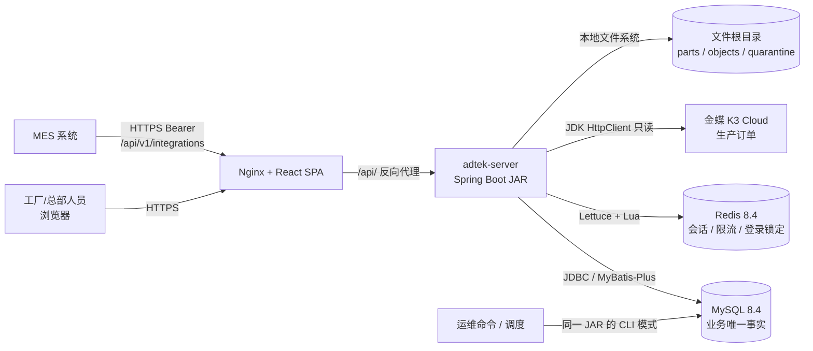
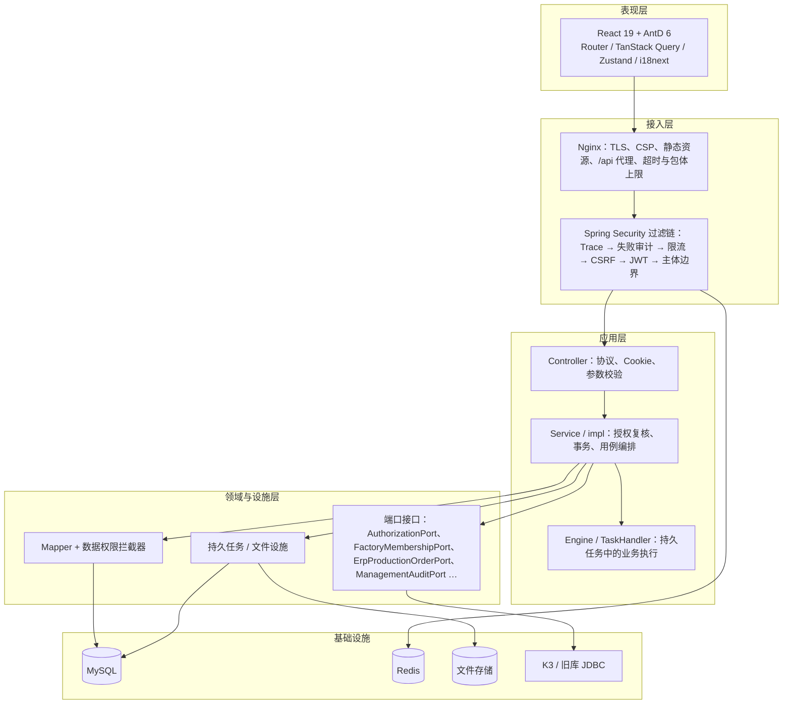
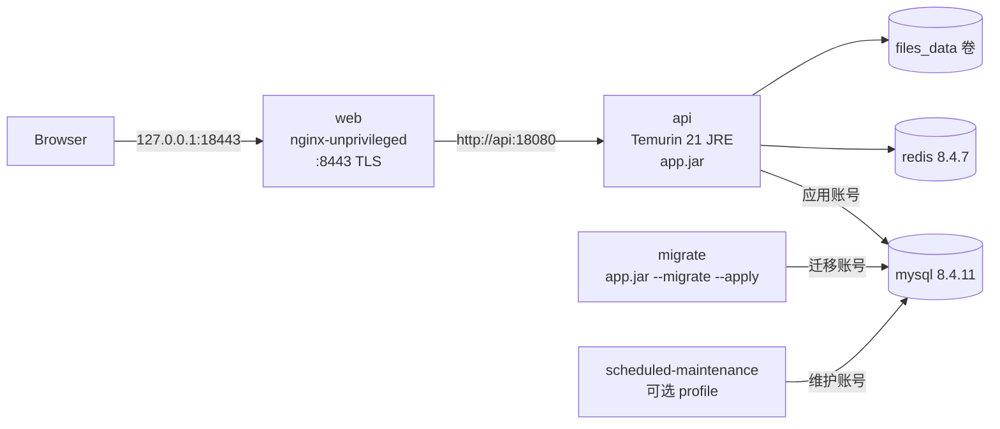
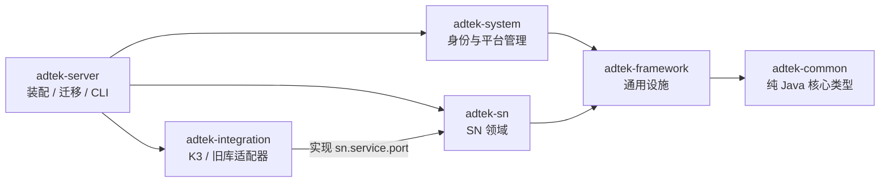
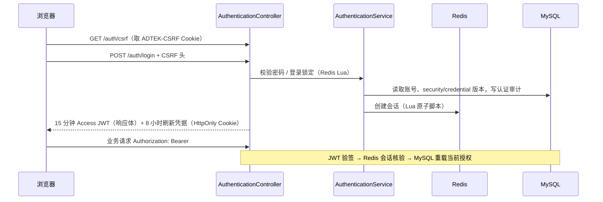
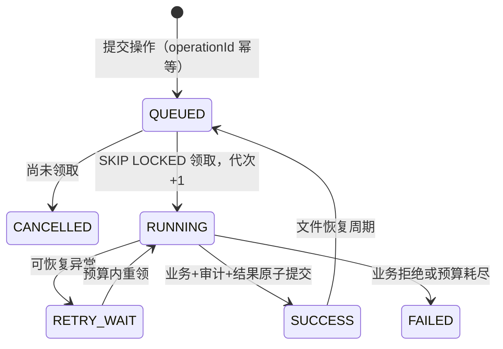
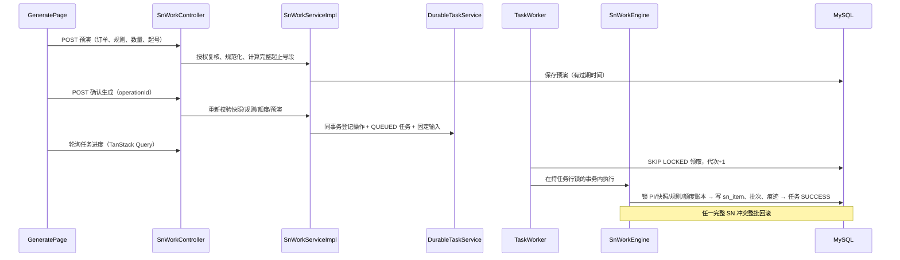

# 技术架构与技术栈说明

维护日期：2026-10-12。本文是面向开发、评审与交接人员的整体技术架构说明，汇总系统分层、模块职责、关键机制和全部技术栈在本项目中的具体作用。细节规则以下列当前正文为准，本文不替代它们：

- 模块与事务细节：[当前架构](架构与工程结构.md)、[数据库设计](数据库设计.md)
- 精确版本与兼容例外：[技术选型与版本基线](../development/技术版本.md)、`frontend/package.json`、`backend/pom.xml`
- 业务与接口：[接口契约](../business/接口契约.md)、[SN补迁契约](../business/SN补迁契约.md)、[MES领取与打印契约](../business/MES领取与打印契约.md)
- 运维：[部署与运维](../operations/部署与运维.md)、[维护与恢复](../operations/维护与恢复.md)、[K3订单同步](../operations/K3订单同步.md)
- 验证：[测试策略与命令](../testing/README.md)

## 1. 系统定位

Adtek SN 中心（工程名 `adtek-platform-sn`）是产品序列号（SN）全生命周期管理平台，由原 Python 原型迁移而来。它负责：

| 业务域 | 说明 |
| --- | --- |
| 账号与权限 | 人员登录、改密、用户/角色/部门/菜单/字典管理，部门数据范围 + 工厂资格双维度授权 |
| 主数据 | 工厂目录、ERP 生产组织映射、K3 生产订单快照与定时全量同步 |
| SN 规则 | 前后缀、进制、位数、字符表的编码规则及版本化 |
| SN 作业 | PI 起始号/历史导入初始化、按订单生成、整单分配、领取、打印（XLSX/CSV）、转厂申请/审批 |
| 查询与留痕 | SN 查询与固定快照导出、SN 操作痕迹、平台审计日志及 CSV 导出、工作台统计 |
| 外部集成 | 金蝶 K3（只读拉取生产订单）、MES（独立服务身份调用领取/打印回调） |
| 运维 | Flyway 迁移、分区维护、预演清理、审计冷存储归档、旧库只读迁移 CLI、备份恢复 |

系统形态为 **前后端分离的 Maven 模块化单体**：一个 Spring Boot 可执行 JAR 承载全部后端能力，React SPA 由 Nginx 托管并反向代理 `/api/`，MySQL 是唯一业务事实来源，Redis 只承担会话与限流。

## 2. 总体架构

### 2.1 系统上下文



### 2.2 逻辑分层



### 2.3 部署拓扑（容器验收环境）

`deploy/compose.container-test.yml` 定义的拓扑也是生产形态的参照：



启动顺序：`mysql` 健康 → `migrate` 一次性执行 Flyway 成功退出 → `redis` 健康 → `api` 健康（`--healthcheck` 命令探测 readiness）→ `web`。数据库按职责拆分 `adtek_migration`（DDL）、`adtek_app`（DML）、`adtek_maintenance`（维护）三个账号，运行中的 API 关闭 Flyway（`SPRING_FLYWAY_ENABLED=false`）。

本机开发形态：Vite 开发服务器 `127.0.0.1:15173` 代理 `/api` 至后端 `127.0.0.1:18080`；MySQL/Redis 由 `deploy/compose.test.yml` 提供。

## 3. 后端：Maven 模块化单体

### 3.1 六模块与依赖方向



| 模块 | 职责 | 主要内容 |
| --- | --- | --- |
| `adtek-common` | 不依赖 Spring 的核心契约 | `Actor`、`Result`、`PageResult`、`CursorResult`、`BusinessException`、`ErrorCode`、`DataScopeType`；注解 `@DataScope`、`@Idempotent`、`@OperLog`、`@RateLimiter` |
| `adtek-framework` | 与业务无关的横切设施 | `security`（JWT、Redis 会话、限流、CSRF、主体边界过滤器、端口定义）；`mybatis`（数据权限拦截器与规则）；`audit`（操作日志切面、请求失败审计过滤器、审计端口/观察者）；`task`（持久操作/任务/文件、工作器、下载）；`web`（TraceId、全局异常） |
| `adtek-system` | 身份、授权、平台配置与审计 | 认证、用户管理、角色/部门/菜单/字典、服务客户端（MES 凭据）、审计查询/导出；实现 `AuthorizationPort`、`AuthorizationMutationPort`、`ManagementAuditPort` 等框架端口 |
| `adtek-sn` | SN 业务领域 | 工厂、订单、定时同步、规则、初始化/生成/分配（SnWork）、领取/打印（Acquire/Print）、转厂、查询、SN 痕迹、工作台、维护与旧库转换；定义 `ErpProductionOrderPort`、`LegacySnapshotPort` |
| `adtek-integration` | 外部系统适配器 | `K3ProductionOrderAdapter`（实现 ERP 端口）、`JdbcLegacySnapshot`（旧库只读快照） |
| `adtek-server` | 启动装配与运维入口 | `AdtekApplication`、`application*.yml`、Flyway `db/migration/V1—V41`、OpenAPI 配置、初始管理员、全部 CLI 命令；ArchUnit 与集成测试 |

约束（由 Maven Enforcer + ArchUnit `ArchitectureTest` 自动检查）：

- 方向固定为 server → system/sn → framework → common；integration 只实现 sn 的 `service.port`。
- 模块间无环；禁止跨模块引用其他模块的 Mapper 或 `service.impl`；跨模块协作只经 framework 定义的端口。
- Entity 不依赖上层（Controller/VO/DTO）。
- framework 不读取 system/sn 的表；common 不依赖 Spring。

### 3.2 模块内分层

每个业务模块固定 `controller / service / service.impl / mapper / domain / dto / query / vo / convert`（sn 另有 `service.port`、`service.support`、`config`）：

| 层 | 作用 |
| --- | --- |
| Controller | 只处理 HTTP 协议、Cookie、Bean Validation；不含业务判断 |
| Service / impl | 用例入口：从可信 `Actor` 重新加载当前权限、开启事务、加锁、调用 Mapper 与端口、写审计 |
| Engine / Handlers | 在持久任务执行事务内运行业务（如 `SnWorkEngine`、`AcquireEngine`、`TransferEngine`），由 `TaskHandler` 按动作登记 |
| Mapper | MyBatis-Plus Mapper + 注解 SQL；每条语句在数据权限规则中逐条登记 |
| domain / dto / query / vo | Entity、入参命令、查询条件、出参视图严格区分，Entity 不直接返回 HTTP |
| convert | MapStruct 编译期生成 DTO→Entity、Entity→VO 转换，未映射字段即编译失败 |

### 3.3 运行模式

同一个 JAR 按首个参数切换模式（`AdtekApplication.main`）：

| 参数 | 作用 |
| --- | --- |
| （无） | 启动 Web 服务、持久任务工作器、订单定时同步工作器 |
| `--migrate [--apply]` | 使用迁移账号执行/预演 Flyway |
| `--healthcheck` | 容器健康检查，访问本机 readiness |
| `--maintenance` / `--maintenance-scheduler` | 分区维护、预演清理、审计归档；后者按 cron 独立调度，不启动 Web/Redis/Flyway |
| `--legacy-inventory` / `--legacy-master` / `--legacy-stage` / `--legacy-snapshot` | 旧 Python 库只读盘点、主数据转换、暂存与快照迁移 |

## 4. 关键技术机制

### 4.1 认证与会话



- **JWT**：Spring Security OAuth2 Resource Server + Nimbus，HS256，`issuer/audience` 固定；JWT 只证明身份，权限每次请求从 MySQL 重新装配（`CurrentAuthorizationServiceImpl`）。
- **Redis 会话**：`RedisSessionStore` 用 Lua 脚本原子创建/检查/轮换刷新凭据；`credential_version`（V38）变化使旧会话失效。
- **CSRF**：基于 Cookie 的人员接口启用 `CookieCsrfTokenRepository`（SameSite=Strict）；MES `/api/v1/integrations/**` 使用纯 Bearer，免 CSRF。
- **限流与登录锁定**：`EntryRateLimitFilter` + `RedisRateLimitService`（按主体与来源 IP 两级窗口，Lua 原子计数）；`LoginFailureGuard` 15 分钟内失败 5 次锁定 15 分钟。Redis 不可用时明确失败，不放行。
- **前端**：Access Token 仅存于 Zustand 内存，刷新依靠 HttpOnly Cookie；`BroadcastChannel` 在同源标签页之间同步退出。

### 4.2 授权：部门数据范围 + 工厂资格

- **权限码**：菜单 F 类型的 `permission_code`（如 `sn:acquire:take`），Controller/Service 以当前 `Actor` 判断。
- **部门数据范围**（五类：全部/自定义/本部门/本部门及下级/仅本人）：`@DataScope` → `DataScopeAspect` 写入 `ScopeContext` → `ScopedDataPermissionInterceptor`（继承 MyBatis-Plus `DataPermissionInterceptor`，基于 JSqlParser 改写 SQL）。规则按精确 statement ID 登记，缺失规则/上下文即拒绝（失败关闭），分页 COUNT 一并约束。
- **工厂资格**：与部门范围相互独立，由 sn 通过 `FactoryMembershipPort` 提供 `allFactories/factoryIds`，空集合恒为假条件。
- **并发版本**：`security_version`（授权）与 `credential_version`（凭据）分离；授权变化时任务、游标重新校验。

### 4.3 审计体系

| 类型 | 实现 | 事务语义 |
| --- | --- | --- |
| 管理操作审计 | `@OperLog` + `OperLogAspect` 计算白名单字段 before/after diff，经 `ManagementAuditPort` 写 `sys_oper_log` | 与业务同事务，审计失败即回滚业务 |
| 认证审计 | `AuthenticationAuditService` | 成功随用例事务；失败登录独立事务 |
| 入口失败审计 | `RequestFailureAuditFilter`、防火墙 `RequestRejectedHandler` | `REQUIRES_NEW` 独立提交，只记方法/路由模板/状态/错误码，不读请求体与凭据 |
| SN 业务痕迹 | `AuditEventObserver` 观察者 + `SnAuditObserver` 等写 `sn_audit`，`*FailureAuditAspect` 记录拒绝 | 成功痕迹与业务同事务 |

### 4.4 持久操作、任务与文件

长耗时或需要可恢复的命令（生成、分配、初始化、领取、打印文件、转厂、查询导出、审计导出）统一使用 framework.task：



- **幂等**：`@Idempotent` 标记的 `DurableTaskService` 以（主体, 动作, operationId）复合唯一键防重；同号重放比较规范化载荷的 SHA-256。
- **工作器**：`TaskWorker` 单调度线程、固定延迟扫描，无内存积压；`FOR UPDATE SKIP LOCKED` 领取，租约 30 秒、最多 3 次 / 300 秒预算；MySQL 行锁天然支持多实例抢占。
- **文件**：`FileStorage` 先在 `parts` 有界写入并 fsync、计算摘要，原子移动到 `objects` 后标记 READY；损坏移入 `quarantine`；下载按 64 KiB 分块，每块重新核验当前授权。
- **前端**：`useSnOperation`/`useAuditExport` 在 localStorage 只保存按用户隔离的 operationId，用于刷新后“查询原操作”，不自动换号重做。

### 4.5 事务与并发

- 写用例统一 `READ_COMMITTED`，固定加锁顺序：协调控制行（如 `sys_security_control`、SN 快照控制）→ 操作者账号 → 目标行 / 规则头 / 来源额度账本。
- MySQL 唯一键保证 SN 双唯一性、来源额度、固定成员与任务终态；完整 SN 冲突整批回滚，不分段提交。
- 乐观版本号（`version` 列）用于页面编辑冲突，返回 409。
- Redis 不保存任何业务最终状态。

### 4.6 外部集成

| 集成 | 实现 | 要点 |
| --- | --- | --- |
| 金蝶 K3 | `adtek-integration` 的 `K3ProductionOrderAdapter` 实现 `ErpProductionOrderPort`，使用 JDK `HttpClient` | 默认关闭（`ADTEK_K3_ENABLED`）；每次读取独立登录 Cookie，禁止重定向/系统代理；分页、行数、响应字节和总时长预算（`adtek.k3.*`）；拉取在事务外，校验后单事务发布快照 |
| 订单定时同步 | `OrderSyncWorker`（`SmartLifecycle` 单线程每 30 秒扫描）+ `OrderScheduleService` | MySQL 负责跨实例抢占；保存者权限失效即停止执行 |
| MES | `MesSnController`（`/api/v1/integrations/sn`）+ system 的 `ServiceClientService` | 独立 SERVICE 主体，`clientId/clientSecret` 换取 Bearer；仅 4 项权限且需显式绑定工厂；与页面共用同一 Service 与事务 |
| 旧 Python 库 | `JdbcLegacySnapshot` 实现 `LegacySnapshotPort` | 仅 CLI 使用；显式 DataSource/schema 白名单，只读 |

### 4.7 横切设施

- `TraceFilter`：为每个请求生成 traceId 并放入 MDC，日志格式 `[traceId=…]`，错误响应返回 traceId 供排查。
- `GlobalExceptionHandler`：统一 `Result` 响应与分号段错误码（`ErrorCodeConstants`），不泄露异常消息/堆栈（`server.error.include-* = never`）。
- Actuator 仅暴露 `health`，readiness 组包含 `db`、`redis`。
- Springdoc 仅 `local` profile 开放，用于导出 OpenAPI 并生成前端类型；生产关闭。

## 5. 前端架构

```text
frontend/src
├─ main.tsx / app/          应用壳：App 路由、WorkspaceShell 布局、queryClient、SN 导航
├─ api/                     Axios 传输层 client.ts、各领域 API、contract.ts 运行时校验、generated/schema.d.ts
├─ features/                按领域组织页面与 hooks：auth、users、configuration、audit、sn
├─ components/              通用组件（错误提示、语言选择、原型图标/空态）
├─ stores/session.ts        Zustand 内存会话
├─ i18n/                    i18next 初始化与 zh-CN / en / vi 文案、错误码文案
└─ utils/                   时间等工具
```

| 关注点 | 方案 |
| --- | --- |
| 路由 | React Router 7 SPA；页面 `lazy` 懒加载；菜单由后端按当前角色返回，前端只接受固定组件注册表中的组件 |
| 服务端状态 | TanStack Query：`staleTime` 30 秒，查询与写命令均**不自动重试**；查询 key 包含主体及 `authorizationVersion`，身份变化清空缓存 |
| 客户端状态 | Zustand 仅保存会话控制状态（无 persist） |
| HTTP | Axios 实例 `baseURL=/api/v1`、`withCredentials`、`validateStatus` 全接受后自行解析 `Result`；响应以 `unknown` 接收再做类型守卫，拒绝数字 ID、缺字段和未知枚举 |
| 类型契约 | `openapi-typescript` 从实际后端导出的 `openapi/adtek-sn.json` 生成 `schema.d.ts`，CI 执行 `api:check` 防漂移 |
| 精确数值 | 业务 ID、版本、数量、流水在前后端均以字符串传输（后端 long/BigInteger） |
| UI | Ant Design 6 + `@ant-design/icons`，三语言 `ConfigProvider` locale；`dayjs` 用于日期选择与展示 |
| 国际化 | i18next + react-i18next，简体中文 / English / Tiếng Việt；界面语言保存在账号与 localStorage |

主要页面：登录/改密/个人设置；用户、角色、部门、菜单、字典管理；操作日志与导出；SN 工作台、工厂、订单、规则、起始号与历史导入、生成与分配、领取/打印、转厂、SN 查询、SN 操作痕迹、SN 账户。

## 6. 数据架构

### 6.1 MySQL

- MySQL 8.4，`utf8mb4` / `utf8mb4_0900_as_cs`（区分大小写与重音），会话与存储时间统一 UTC，时间列 `DATETIME(6)`。
- 主要表族：`sys_*`（账号、角色、部门、菜单、字典、关联、审计 `sys_oper_log`、安全控制行）；框架任务表（操作、任务、进度、文件）；`sn_*`（工厂、组织映射、用户工厂、订单快照/分录/同步记录、来源额度、规则头/版本、SN 条目 `sn_item`、批次、打印、转厂、`sn_audit` 及归档、维护运行记录等）。
- `sn_item`、`sn_audit`、`sn_audit_archive` 按月 RANGE COLUMNS 分区，由维护命令预建和整理。
- 不使用数据库外键，关系由 Service 在协调事务内校验；不引入 tenant_id。
- 表结构详解见[数据库设计](数据库设计.md)。

### 6.2 Flyway 迁移

- 脚本位于 `backend/adtek-server/src/main/resources/db/migration`，已交付 V1—V41 **保持原字节**（`tools/check-docs.mjs` 校验冻结摘要），新增结构从 V42 开始。
- `validate-on-migrate: true`、`clean-disabled: true`、`baseline-on-migrate: false`，禁止清库重跑冒充升级。
- 迁移使用独立账号与 `ADTEK_MIGRATION_ALLOWED_SCHEMA` 白名单，由 `--migrate` 进程或 Compose `migrate` 服务执行。

### 6.3 Redis 职责

| 用途 | 实现 |
| --- | --- |
| 人员 / MES 会话与刷新凭据轮换 | `RedisSessionStore`（Lua） |
| 入口与接口限流 | `RedisRateLimitService`、`@RateLimiter` + `RateLimiterAspect` |
| 登录失败锁定 | `LoginFailureGuard`（Lua） |

Redis 数据丢失只导致重新登录与计数清零，不影响业务数据；备份恢复不恢复 Redis。

## 7. 技术栈总表及在项目中的作用

### 7.1 后端运行时

| 技术 | 版本 | 在项目中的作用 |
| --- | --- | --- |
| Java（Temurin JDK/JRE） | 21 | 语言与运行时；使用 record、`HttpClient`、精确 `long/BigInteger` 计算 SN 流水与额度 |
| Spring Boot | 4.1.1 | 父 POM 与 BOM，自动装配、配置绑定（`adtek.*` 设置类）、优雅停机、可执行 JAR |
| Spring Web MVC（`spring-boot-starter-webmvc`） | Boot BOM | REST Controller、Servlet 过滤链；Enforcer 禁止旧 `starter-web` 与 `javax.servlet` |
| Spring Security | 7.1.1 | 无状态过滤链、方法级安全、CSRF、防火墙；自定义限流/失败审计/主体边界过滤器 |
| Spring Security OAuth2 Resource Server + Nimbus JOSE | Boot BOM | `JwtTokenCodec` 签发与验证 HS256 访问令牌，`SessionJwtAuthenticationConverter` 转为 `Actor` |
| Spring Data Redis（Lettuce） | Boot BOM | 会话、限流、登录锁定；全部写操作使用 `DefaultRedisScript` Lua 原子脚本 |
| Spring AOP / AspectJ（`spring-boot-starter-aspectj`） | Boot BOM | `OperLogAspect`、`DataScopeAspect`、`RateLimiterAspect`、SN 失败审计切面 |
| Bean Validation（Jakarta Validation） | Boot BOM | DTO 入参约束；common 仅依赖 API |
| Spring Boot Actuator | Boot BOM | 只暴露 `health`，liveness/readiness 探针（含 db、redis） |
| Jackson 3（`tools.jackson`） | 3.1.5 | JSON 序列化；Springdoc 传递引入 Jackson 2 但应用代码不使用 |
| MyBatis-Plus（Boot 4 starter） | 3.5.17 | Mapper 与注解 SQL、分页插件；`DataPermissionInterceptor` 是数据范围控制的基础 |
| JSqlParser（`mybatis-plus-jsqlparser`） | 随 MyBatis-Plus | 解析并改写 SQL，追加部门/本人范围条件并重新绑定参数 |
| HikariCP | Boot BOM | 连接池（最大 12、最小空闲 2、连接超时 5 秒） |
| MySQL Connector/J | 9.7.0 | JDBC 驱动（服务器锁定 MySQL 8.4.11） |
| Flyway（core + flyway-mysql） | 12.4.0 | 版本化 DDL 迁移，独立账号执行 |
| MapStruct | 1.6.3 | 编译期对象转换，`unmappedTargetPolicy=ERROR` 保证字段不遗漏 |
| Springdoc OpenAPI（webmvc-ui） | 3.1.1 | 本机导出 OpenAPI 文档，作为前端类型生成的唯一来源；生产关闭 |
| Apache POI（`poi-ooxml`，SXSSF 流式） | 5.5.1 | 打印/查询/痕迹 XLSX 文件生成，固定 ZIP 时间保证恢复后摘要一致 |
| JDK `HttpClient` | JDK 21 | K3 ERP 调用与容器健康检查，不引入额外 HTTP 依赖 |

### 7.2 前端

| 技术 | 版本 | 在项目中的作用 |
| --- | --- | --- |
| React / React DOM | 19.3.0 | 函数组件 + Hooks 构建 SPA |
| TypeScript | 5.9.3（strict，`skipLibCheck=false`） | 全量静态类型；受 openapi-typescript 约束未升级到 6.x |
| Vite + `@vitejs/plugin-react` | 8.3.1 / 6.1.1 | 开发服务器（15173，代理 `/api`）与生产构建（目标 ES2023） |
| Ant Design / @ant-design/icons | 6.6.5 / 6.3.4 | 表格、表单、弹窗、分页等全部 UI 组件与三语言 locale；`frontend/patches` 维护两处类型声明补丁 |
| React Router DOM | 7.18.4 | SPA 路由、懒加载页面、受控菜单注册表 |
| TanStack React Query | 5.104.0 | 服务端数据缓存、失效与刷新；不自动重试写命令 |
| Zustand | 5.0.15 | 内存会话状态（Access Token、会话状态机） |
| Axios | 1.20.0 | 统一 HTTP 传输、Bearer/CSRF 头、错误归一为 `ApiError` |
| i18next / react-i18next | 26.4.2 / 17.0.15 | zh-CN / en / vi 界面文案与错误码文案 |
| dayjs | 1.11.23 | 日期范围选择、本地时区展示 |
| openapi-typescript | 7.13.0 | 由后端 OpenAPI 生成 `schema.d.ts`，编译期契约约束 |

### 7.3 数据与中间件

| 技术 | 版本 | 在项目中的作用 |
| --- | --- | --- |
| MySQL | 8.4.11 | 唯一业务事实来源：账号授权、SN 状态、额度、任务终态、审计；行锁 + 唯一键保证一致性；月分区 |
| Redis | 8.4.7-alpine | 会话、限流、登录锁定；不承担业务最终状态 |
| 本地文件系统 | — | 持久任务产出文件（XLSX/CSV）的 parts/objects/quarantine 三段存储 |

### 7.4 部署与运行环境

| 技术 | 版本/来源 | 在项目中的作用 |
| --- | --- | --- |
| Docker / Docker Compose | Desktop 4.93 / Compose 5.5 | `compose.test.yml` 提供本机 MySQL/Redis；`compose.container-test.yml` 提供完整容器验收环境 |
| 镜像 `eclipse-temurin:21-jre-noble` | 锁定 sha256 | API 镜像，非 root（UID 10001）、只读根文件系统、`cap_drop: ALL` |
| 镜像 `nginx-unprivileged:stable-alpine` | 锁定 sha256 | 托管前端静态资源，TLS 1.2/1.3、CSP 等安全头、`/api` 反向代理（480 秒读超时、初始化接口 160 MB 包体） |
| Docker secrets / configtree | — | 数据库、Redis、JWT、TLS、K3 凭据以文件注入，不入库 |
| `deploy/images.lock.json` | — | 记录镜像摘要，禁止使用 `latest` |

### 7.5 构建、质量与 CI

| 技术 | 版本 | 在项目中的作用 |
| --- | --- | --- |
| Maven + Maven Wrapper | 3.9.16 / 3.3.4 | 多模块构建；Wrapper 校验 SHA256 |
| Maven Enforcer | 3.6.2 | 锁定 Java 21、Maven 3.9.x，禁止 H2、SQLite、javax.servlet、旧 starter-web |
| Spotless + google-java-format（AOSP）+ SortPom | 3.10.3 / 1.36.1 / 4.0.0 | Java 与 POM 格式；`validate` 阶段只检查 |
| Maven Checkstyle（仅 LineLength） | 3.6.0 | Mapper 源码行宽 ≤ 100 |
| ESLint + typescript-eslint + react-hooks/refresh 插件 | 10.11.0 / 8.71.0 | 前端静态检查，`--max-warnings 0` |
| Prettier | 3.9.9 | 前端源码及 YAML/JSON 配置格式 |
| PSScriptAnalyzer | 1.25.0 | PowerShell 运维脚本格式 |
| pnpm / Node.js | 10.34.6 / 24.x | 前端包管理（严格 peer、冻结锁文件、补丁）与运行时 |
| GitHub Actions | `.github/workflows` | `backend.yml`：`mvnw -Pintegration verify` 并拒绝零测试/跳过测试；`frontend.yml`：api:check、lint、格式、单元测试、构建 |

### 7.6 测试

| 技术 | 版本 | 在项目中的作用 |
| --- | --- | --- |
| JUnit 5 + Spring Boot Test | Boot BOM | 后端单元测试（`*Test`，Surefire） |
| Testcontainers（MySQL、JUnit Jupiter） | 2.0.5 | 集成测试（`*IT`，Failsafe，`-Pintegration`）使用真实 MySQL/Redis 容器，缺少 Docker 即失败 |
| ArchUnit | 1.4.1 | `ArchitectureTest` 检查模块方向、无环、跨模块 Mapper/impl 引用、Entity 分层 |
| Vitest | 5.0.2 | 前端单元测试（API 契约守卫、错误文案、表单状态等） |
| Playwright | 1.63.0 | 浏览器 E2E（`e2e/`）、容器环境验收及新旧系统一致性比较（parity 配置） |
| Python 脚本 | `tools/testing` | 一致性验收夹具与文件比对（打印文件、导出、恢复等） |

### 7.7 运维脚本

`tools/*.ps1`（PowerShell）封装本机工具链与运维：`bootstrap-build`/`maven`/`pnpm`（固定版本工具安装与调用）、`infra`/`start-test`/`stop-test`（本机设施）、`format`（统一格式）、`verify`/`verify-web`（验证入口）、`export-api`（导出 OpenAPI）、`configure-k3`、`invoke-mes`、`backup-container`/`restore-container`、`legacy-*`、`maintain`。`tools/check-docs.mjs` 校验文档链接、归档字节和冻结 SQL 摘要。

## 8. 典型请求链路

### 8.1 页面生成 SN（持久任务）



### 8.2 MES 领取与打印回调

1. MES 以 `clientId/clientSecret` 调用 `POST /api/v1/integrations/auth/token` 获得 Bearer（按 clientId 与 IP 限流）。
2. `PrincipalBoundaryFilter` 保证 SERVICE 主体只能访问 `/api/v1/integrations/**` 及本人任务查询 `GET /api/v1/tasks/{id}`，人员 JWT 不能调用 MES 接口。
3. 领取/打印回调进入与页面相同的 `AcquireService`/`PrintService`，以持久任务固定输入和结果，按 operationId 幂等重放；批次结果使用绑定主体与授权版本的签名游标分页。

## 9. 架构约束速查（开发必读）

1. 新增功能按模块分层放置，跨模块只能通过 framework 端口；新增 Mapper 语句必须在对应 `*DataPermissionRules` 中登记，否则失败关闭。
2. 写用例使用 `READ_COMMITTED` 并遵循既定加锁顺序；业务正确性依赖 MySQL 锁与唯一键，不依赖 Redis 或前端校验。
3. 长耗时/需恢复的命令走持久任务模板，禁止另开无协调线程写业务数据。
4. DTO/VO 变更后从实际运行实例导出 OpenAPI 并执行 `pnpm api:generate`，不得手改生成类型。
5. 新增表结构使用下一个未占用 Flyway 版本（当前 V42），不得改写已交付脚本。
6. 业务 ID、版本、数量、流水在 API 中保持精确字符串。
7. 修改代码后执行 `tools/format.ps1` 并以 `-Check` 核对。

## 10. 当前边界

- 当前为本机功能交付：真实 K3 账套、真实 MES 联调、多主机部署、生产容量（如 50 万导入性能、全量账号授权重算的锁持有时间）尚未验收，详见[待办与验收边界](../releases/待办与验收边界.md)。
- 未配置外部告警通道；维护调度以退出码和日志作为监控接入点。
- 前端浏览器 E2E 未纳入 GitHub Actions，由本机 `tools/verify-web.ps1 -Browser` 执行。
