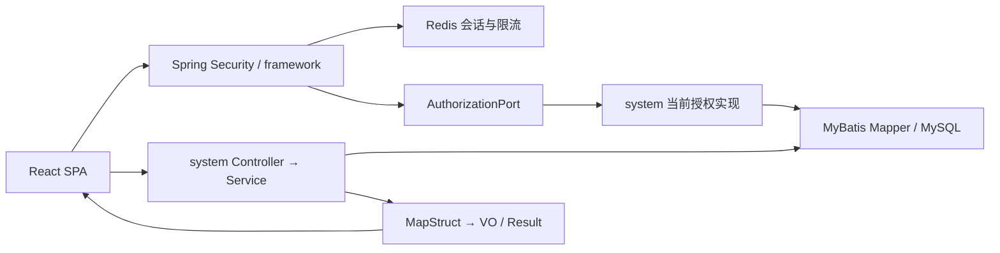
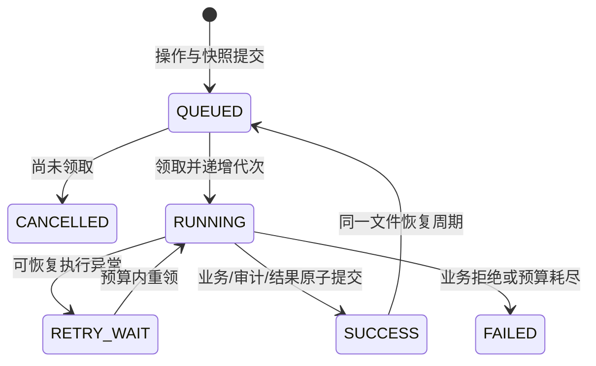

# 当前架构

Java 21 / Boot 4.1 的 Maven 模块化单体，命名空间 com.adtek。server 负责装配，system 承担账号，sn 承担领域，integration 的K3只读适配器实现 sn 的 service.port；framework 只提供通用设施，common 不依赖 Spring。Enforcer 检查依赖，ArchUnit 检查环和跨模块 Mapper/impl 引用。

后端目录遵守 controller/service/service.impl/mapper/domain/dto/query/vo/convert；不存在实现内容的目录不生成空类占位。Entity 不直接返回 HTTP；DTO 到 Entity、Entity 到 VO 由 MapStruct 编译期生成，派生安全状态在 Service 中设置。

framework 的 RedisSessionStore 原子轮换凭据，RedisRateLimitService 原子计数；JwtTokenCodec 使用标准 Spring JWT 组件。system 的 CurrentAuthorizationServiceImpl 从当前 MySQL 建立 Actor，并按同一 permissionCode 合并部门/工厂范围，防止“全局只读角色”扩大“局部写角色”的范围。

用户管理通过 @DataScope → ScopeContext → ScopedDataPermissionInterceptor（继承 MyBatis-Plus DataPermissionInterceptor）执行 SQL 范围。规则由 system 提供，按精确 statement ID、资源、操作权限、表和列白名单匹配；缺失规则/上下文/解析失败拒绝，空范围追加假条件。先于分页改写 SQL，并按最终 SQL 占位符位置重新绑定原参数和 Long 范围值，覆盖分页 COUNT 和结果。认证、单次初始化、内部协调和审计豁免逐语句登记理由，没有包级豁免；未来 SN/JDBC 路径必须新增受控策略，不能自动放行。

用户写用例使用 READ_COMMITTED，先锁 sys_security_control，再锁操作者和目标行，重新读取授权与安全版本。当前系统用户的 SELF 对应 sys_user.id（不是创建者）。修改旧页面版本返回409，部门/角色有效性和逐权限范围包含关系在同一事务校验；成功递增安全版本。本人停用/重置拒绝，并发本人缩权也至少保留一个启用的显式 security:administer 主体。

认证 Controller 只负责协议/Cookie，服务处理密码、事务和审计。成功认证/改密审计随用例事务；失败登录审计独立事务；语言 diff 只含实际前后语言值。管理 @OperLog 在事务拦截器内部执行；白名单由业务注解声明，framework 计算实际 before/after diff，system 经 ManagementAuditPort 同事务追加审计。成功审计失败会回滚用户变更；用例内拒绝独立事务记录错误码。

React 使用函数组件/Hooks、React Router SPA、TanStack Query 保存服务端资料、Zustand 只保存内存会话状态，Axios 统一传输与 unknown 校验。生成类型是编译约束，运行时仍拒绝数字 ID、缺失字段和未知枚举。localStorage 保存界面语言和按用户隔离的导出操作 UUID，不存输入快照、密码或令牌；刷新秘密仅在 HttpOnly Cookie。

菜单由当前角色查询返回，前后端固定组件注册表接受 system.users、system.roles、system.departments、system.menus、system.dictionaries、system.audit 及对应路径。用户、配置与审计页懒加载，查询 key 含主体及 authorizationVersion；身份/授权版本变化清缓存，影响本人授权时清除会话并重新登录。

角色、菜单、部门及字典是没有所属部门的全局配置。ConfigurationPolicy 要求对应 list/update 权限及 system:security:administer，两个权限的部门范围均必须为 ALL；不把这些表伪装成局部部门数据。Mapper 仍逐语句登记全局策略理由，未登记方法继续失败关闭。

配置写使用与用户管理相同的协调行→当前账号锁顺序，事务内重读身份，再按 ID 顺序锁定账号。共享角色先验证拟授予的每项权限和工厂范围上限，修改前后比较账号授权；角色关联账号、菜单直接关联账号和其他授权实际变化账号增加 security_version。部门移动/启停通过授权前后重算传播后代与自定义范围变化。成功审计、关系、配置版本及账号版本原子提交；最后一个拥有 ALL 范围的安全管理员不能失效，配置写不能令操作者失去本用例的全局管理能力。

当前实现对角色/菜单/部门写采用全量账号授权重算，保障一致性但尚未验证大规模账号下的锁持有时间；上线前必须压测，必要时再设计等价的受影响集合查询。配置目录最多 1000 项、单角色菜单/自定义部门关系最多 100 项；超限明确拒绝，不能截断后宣称完整。

审计查询只要求 system:audit:list，不要求全局配置权限。列表、COUNT、详情和筛选元数据分别登记精确 Mapper 规则，在 SQL 层按 actor_dept_id 快照及 user_id 过滤。历史 NULL 部门不按用户现部门回填；本人范围按记录主体匹配，ALL 可见匿名与缺失快照。列表不取原始 changes，详情以服务端字段白名单重新投影历史 JSON，MapStruct 输出 Entity 的安全字段。

RequestFailureAuditFilter 位于安全上下文清理内层、限流/CSRF 外层，记录 /api/ 内尚未独立留痕的 4xx/5xx。只接受认证完成的 Actor，方法和路由模板来自白名单，不读请求体、查询参数、Cookie 或 Authorization。防火墙在链外拒绝的请求另由 RequestRejectedHandler 以匿名主体和固定模板记录。framework 定义端口，system 用 REQUIRES_NEW 追加；业务失败独立事务提交成功后才标记本请求已记录，避免重复。身份快照单独普通 SELECT，不使用可能等待外层账号写锁的 INSERT…SELECT。

入口失败审计无法在数据库不可写时保证持久化，此时保留原拒绝响应，只警告服务器 traceId 与异常类型。HTTP 失败不等价于业务回滚；提交结果未知或响应失败时可能同时存在成功业务记录。容器/网络在应用外拒绝、未来异步请求和归档审计不在当前覆盖范围。

## 持久操作、任务与文件

framework.task 管理自己的基础设施表，不读取身份或业务表。AuthorizationPort 重新装配当前 Actor，TaskHandler 由业务模块登记类型/动作并实现完整对象授权、事务内执行和终态审计。只有受控业务 Service 可提交任务；HTTP 不开放任意类型/载荷执行。Mapper 逐语句登记内部理由，不扩大原拦截器豁免。

`@Idempotent` 标记 DurableTaskService 的数据库实现入口，不另建 Controller AOP 或 Redis 状态。READ_COMMITTED 提交事务先锁设施容量控制行，再查询当前主体/动作/operationId；同号重放重新授权后比较 v1 规范化载荷 SHA-256。新提交原子保存操作、QUEUED 任务、完整业务快照、文件元数据和提交审计；数据库复合唯一键最终防重。控制锁后使用当前读可见性，避免并发提交沿用锁前快照重复登记。

领取事务 `FOR UPDATE SKIP LOCKED`；执行事务第一把锁是任务行，复核 owner、代次和入场租约，持锁至业务/成功审计/任务/操作完成一起提交。执行中租约到期不解除行锁；接管者只能在旧事务结束后领取。独立进度表没有父行外键，避免独立进度事务等待正在执行的任务行；迟到旧代进度不能覆盖新代，进度从不表示业务已提交。提交异常后另开事务先读持久终态与代次，SUCCESS 不被迟到错误覆盖。

工作器一个调度线程，固定延迟扫描，没有内存任务积压队列。最多3次/300秒、租约30秒；执行事务超时30秒。IO/临时数据库及明确依赖/代次故障在预算内延迟3秒重试，其余终态失败；只有未领取 QUEUED 可取消。关闭先停止领取，等待20秒，仍未结束则中断并再等5秒；中断不证明业务回滚，重启以数据库状态为准。真实强杀和多主机演练仍待做。

system 的审计导出在一次受控 SELECT 中固定 list/export 两项权限范围交集，最多10000行。成员序号、CSV安全文本及部门/主体快照保存于 system 表；恢复不再读取当前日志。操作 SUCCEEDED 与不可变结果不随文件恢复改写；任务可重新排队，文件进入 RECOVERING。基础设施不能自动给未来 SN 用例提供 PI/额度/工厂等业务锁和授权，后续处理器必须自行实现这些约束。

文件先在受控 parts 中有界写入并关闭/fsync/算摘要，再原子移动到 objects，最后同事务标 READY。已发布而未提交的产物可核对复用；恢复时先验证原摘要才可发布。损坏原件移入 quarantine 保留，临时失败清理；接管持任务锁只清理该任务残留 part。下载先按完整快照和当前两项权限授权、核验完整长度/摘要，再同步按64KiB读取；每个块重新加载当前授权。已输出后的拒绝停止后续块、关闭流并记录 traceId，不追加JSON，也不声称撤回已发送字节。

## SN目录、快照与规则

sn拥有工厂、组织映射、用户工厂关系、订单快照/同步记录/来源额度和规则头/版本。system通过framework的FactoryMembershipPort读取和变更SN关系，变更仍属于身份用例事务，不导入SN Mapper。AuthorizationMutationPort由system实现，在SN写事务中锁安全协调行/当前账号并重载授权；SN随后锁快照协调或规则头/当前版本。工厂范围按具体permissionCode的allFactories/factoryIds执行，与部门SELF完全分离，空工厂集合恒假。

订单读取、详情、COUNT、统计和客户候选使用同一SQL工厂策略；material搜索先在同范围分录匹配，再查询完整订单汇总。ERP拉取在事务外；完整验证后比较开始版本，单事务替换全量或单据范围、维护稳定来源身份、初始化历史账本并提交成功审计。并发期间目录/快照变化返回409。原位修改未使用规则；已用编码变化建立新版本，名称变化不出版本。S4生成/可解析历史导入已在业务事务标记used，生成/分配同时消耗来源账本。

K3适配器使用JDK HttpClient，不新增依赖；每次读取独立登录Cookie，禁止跳转/系统代理，逐响应大小/超时和总读取预算限制，绝不记录凭据或原始错误体。分页排序和稳定ID不能代替ERP跨页一致性水位，真实合同确认仍待完成。

## S4 有状态命令样板

SnWorkService承接协议授权/规范化/预演与短提交，SnWorkEngine只在framework已持任务行锁的执行事务中处理业务；三个TaskHandler按动作分别装配。common/framework不访问SN表，system不直接写SN数据。持久Entity/Mapper/VO/MapStruct按原模块分层，SnWorkInput是服务器固定计划值对象。全部新Mapper语句逐条登记内部理由，服务和工作器分别复核当前操作全厂范围。

初始化/生成/整单分配共用PI占用；快照控制排除同步与业务写交错，来源账本和规则版本按顺序锁定。固定成员、护栏和成功审计与任务/操作结果同事务。详细并发及恢复边界见[S4报告](reports/2026-09-29-S4-初始化生成与分配.md)，此样板用于后续S5/S6而不是另开异步线程写业务。

## S5 固定成员和服务身份

AcquireService/AcquireEngine承接领取/回调，同一持久任务模板保存固定输入和结果；AcquireMapper每个语句均登记精确内部理由，权限参数来自可信Actor。500枚SQL窗口共用一个业务事务，不拆分提交。批次/结果使用绑定主体和授权版本的签名ordinal游标，当前投影与不可变展示快照分离。

PrintService在submit回调内原子确认PRINTED、保存打印成员/审计并将operation置SUCCEEDED，同时登记XLSX及CSV两个文件任务；框架confirmBusiness是受约束的业务提交钩子。PrintHandlers只消费固定快照生成文件。TaskHandler的sharedFileAccess/authorizeFile明确允许原工厂当前下载资格读取历史文件，不放开跨主体任务查询或恢复。下载逐块复核当前授权。

Actor加入USER/SERVICE类型；身份模块共用全局稳定ID和授权版本，服务秘密/权限独立存储。SERVICE不读取人员角色授权，工厂仍通过FactoryMembershipPort装配。JWT类型须与数据库当前类型一致；协议过滤器隔离人员路径和MES路径，服务层继续复核动作/工厂/当前版本，不能依赖过滤器代替业务授权。framework没有新增对system/sn表的访问。

## S6 业务与审计边界

sn新增Transfer、SnQuery、Dashboard、SnAudit的controller/service/impl/mapper/domain/dto/query/vo/convert。TransferEngine保持SN/护栏/精确例外/成员/状态/审计同事务，任务只承担排队和恢复。查询导出与审计导出使用不同固定快照表和任务类型，文件消费端不再读取当前SN。

framework新增AuditEventObserver通用端口；system在ManagementAuditPort事务内通知观察器并提供非秘密历史身份，sn观察器只依赖自身Mapper和框架任务元数据，不跨模块访问system表/实现，也不再次调用审计端口。成功观察失败回滚原业务；独立失败审计不能取得外层业务写锁。React共享SnExportHistory，保留查询/痕迹各自过滤、权限与操作号。

## S7 离线工具

server仅装配独立CLI，不在普通Web启动时注册旧库写入入口。integration实现只读来源快照端口；sn持有源描述、暂存及业务转换，system通过framework的LegacyIdentityPort在调用方提供的同一JDBC事务中处理停用身份；framework的LegacyTaskGuard只检查自身任务/文件表。sn不导入system实现或直接操作身份表。

离线迁移使用明确DataSource/schema白名单、源目标实例区分、运行锁和显式事务，不借用页面请求身份，也不借Redis提供最终状态。主数据及库存成功标记是阶段证明，不是账号启用或全量迁移完成证明。维护、调度、Flyway和页面进程分开；归档终结必须验证实际恢复证据和本次源内容。
