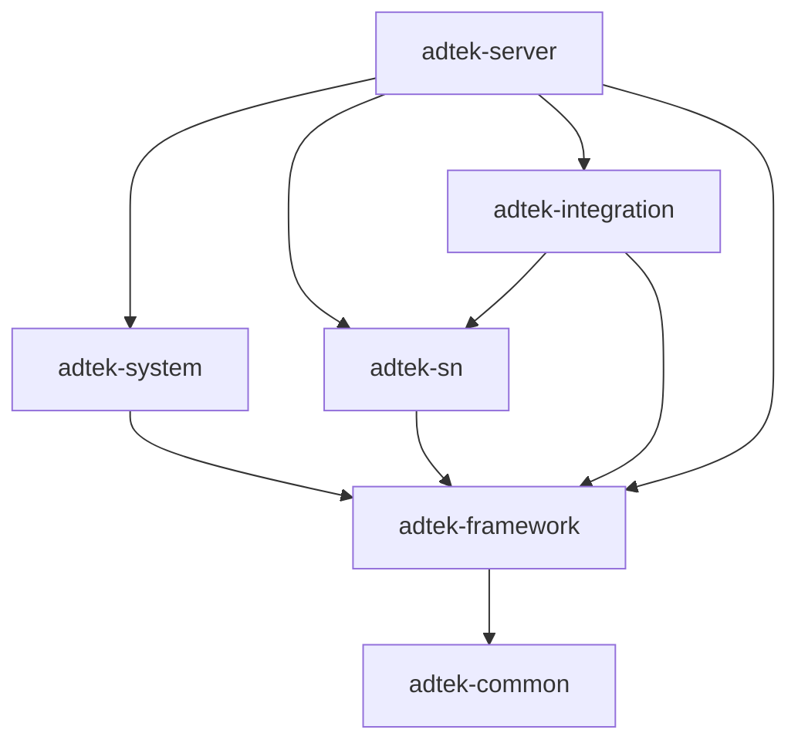

# SN项目迁移方案（v1.1）

> 版本：v1.1；编制日期：2026-09-29。  
> 状态：迁移实施方案，供后续建项、详细设计、开发和验收使用；不代表目标工程已经实现或验收。  
> 适用来源：`sn-center-python`，受检提交 `17b78db707b2046dee9e98926843cf9550f5533f`；分析开始时工作区无本地修改。  
> 前版：本次工作区根目录没有可承接的同名迁移方案；按配套规范已经约定的文件名补齐 v1.1，不虚构前版或历史评审。  
> 本版内容：现状核查、目标模块、完整功能清单、SN 不变量、接口与数据迁移、实施阶段、验收及切换恢复。  
> 本次交付范围：阅读分析和编写方案；未修改旧项目代码，未连接业务数据库或 ERP/MES，未执行数据迁移、构建、应用测试或部署。

**配套约束：**[技术栈和工程结构（v1.1）](技术栈和工程结构（v1.1）.md)（下称“架构基线”）与 [AI 生成代码注释规范（v1.1）](AI%20生成代码注释规范（v1.1）.md)（下称“注释规范”）。通用技术、分层和注释要求以这两份文件为准；本文维护 SN 项目的迁移范围与实施契约。后续修订另存递增版本，保留本版和两份依据原件。

阅读顺序建议：先看第 2.2 节差异和第 5 节完整功能范围，再看第 6 节业务不变量；第 12 节用于分阶段执行，第 13 节用于验收，第 14 节用于切换，第 15.1 节用于安排需补齐的输入。

## 1. 迁移目标、范围与依据

### 1.1 目标及完成定义

将现有 Python/FastAPI + Vue 项目完整迁移到自建的 **Java 21 / Spring Boot 4.1 模块化单体 + React / TypeScript + MySQL 8.4 + Redis** 工程，保留全部有效业务能力，同时补齐架构基线要求的企业基础能力、可靠性和质量门禁。

“全部迁移”同时包含后端、前端、接口、数据库与存量数据、历史追溯、任务与文件、权限、多语言、测试、部署工具和有效文档。最终生产构建与运行不依赖 Python、Vue、Pinia、Element Plus、旧自制迁移器或旧身份体系。旧工程可以留作只读历史、对照和切换前的运行系统，不构成目标工程的运行依赖。

完成条件是第 5 节功能清单逐项有实现与证据，第 6 节不变量全部得到数据库和用例保护，第 13 节门禁通过，并完成第 14 节数据核对、演练和切换。不能以基础 CRUD、首页可打开或单元测试通过代替完整迁移。

首期不引入微服务、独立消息中间件、SSR/RSC、多租户、销售订单额度系统或新的激活流程；不重新评选若依/芋道整套脚手架。它们不属于本次既定目标。

### 1.2 依据与权威顺序

| 依据 | 本次用途及边界 |
| --- | --- |
| 两份 v1.1 配套规范 | 目标技术栈、模块依赖、权限/事务/任务/文件、注释和交付约束 |
| [需求说明（修订版）](sn-center-python/docs/多工厂SN防重管控-需求说明（修订版）.md) | SN 业务主要依据；其中“待业务确认”事项不当成已经获得业务签字 |
| [技术文档](sn-center-python/docs/技术文档.md) | 现有功能、接口、权限、状态机和实现说明；与代码不一致处见第 2.2 节 |
| [数据库表设计](sn-center-python/docs/数据库表设计.md)与[实际 V1](sn-center-python/app/db/migration/V1__init.sql) | 旧库字段、护栏、分区和转换依据；实际库仍须另行盘点 |
| [接口数据库与架构设计](sn-center-python/docs/接口数据库与架构设计.md) | K3 出站、MES 入站、部署及历史容量说明 |
| [部署启动关闭方式说明书](sn-center-python/docs/部署启动关闭方式说明书.md)、[README](sn-center-python/README.md) | 旧配置、启动、关闭、账号初始化及运维能力 |
| [旧数据库方案](sn-center-python/docs/db/数据库设计-MySQL.md)及其 SQL | 文首已声明被取代；仅历史参考，不采纳部分领取、抬高转入 PI 水位、分批提交等旧规则 |
| `app/`、`frontend/`、`tests/`、构建与部署文件 | 静态核对实际行为、可复用算法和测试场景，不能据源码存在推断已通过运行验证 |

业务需求与实现冲突时，不能默认复制代码；目标规范与旧需求发生实质变化时，登记差异并在对应阶段冻结契约。尤其是注释规范引用的“稳定来源、按分录额度、固定批次、转入成员例外”，在旧需求中并未完整定义。本文第 6 节给出目标设计，第 15 节登记需要业务/接口证据确认的事项，不把注释示例本身当作需求签字。

本文沿用注释规范已引用的章节位置：第 4 节授权，第 6.1 节十二项不变量，第 6.2 节来源与额度，第 6.3 节状态机，第 7～8 节接口/事务，第 9 节文件，第 11.2 节双唯一性，第 13 节关键审查。

## 2. 现状、差异与资产处理

### 2.1 已核实的工程现状

| 方面 | 当前事实 | 迁移处理 |
| --- | --- | --- |
| 后端 | `app/` 下 64 个 Python 文件；FastAPI、PyMySQL、httpx、structlog、openpyxl；SQL 大量位于 services | 重写 Java 用例与适配层；保留有效算法和事务意图，不机械搬目录 |
| 分层 | 虽有 models/repositories 目录，models 主要是表清单，mysql_repo 主要重导出数据库原语 | 建立真实的 Service 接口、ServiceImpl、Mapper、Entity、DTO/Query/VO 与 MapStruct |
| 前端 | 13 个业务/认证视图，合计 18 个 Vue 文件；Vue 3、Vite 6、Pinia、Element Plus，npm 锁文件 | 全部重写 React；复用交互要求、词条、视觉变量和测试场景 |
| 数据 | 实际 V1 定义 19 张业务表；`sn_item`、`sn_audit` 分区，`sn_key` 不分区 | 独立新 schema 和正式 Flyway 链；保留双唯一性设计，扩展历史关系与来源身份 |
| 认证 | PBKDF2 哈希、自定义两段 HMAC 令牌；请求查账户状态/口令版本；浏览器 localStorage 保存 token | 标准 JWT + Redis 可撤销会话；人员与 MES 服务主体分离 |
| 权限 | 三种硬编码角色 + 可空工厂绑定；静态菜单 | RBAC、菜单按钮权限、五类部门范围及 SN 工厂/历史对象资格 |
| 任务 | 生成任务落表，但由进程线程池执行；无完整租约接管流程 | 统一持久操作记录、任务领取、提交保护和中断恢复 |
| 契约 | snake_case；成功对象直接返回；97 个 `ErrorCode` 枚举项，另有边界处理的字符串码 | 版本化 camelCase 契约、统一 Result、数字分段码、精确字符串与兼容登记 |
| 测试 | 静态检索到 62 个 `test_` 函数，前端另有 3 个 `.test.js` 文件 | 移植场景并补充缺口；函数数不等于实际执行用例数或通过数 |
| 运行 | Python 启动/停止、单端口托管、Compose/nginx、分区定时维护 | Java/Node 工具、部署目录、MySQL/Redis/持久文件、健康与恢复手册 |

旧测试的集成夹具会重建指定数据库，MySQL 不可用会跳过。因此本次仅阅读测试，没有执行它们；后续只能在明确隔离、可销毁的测试库运行。

### 2.2 必须进入实施清单的差异

下表是静态分析发现，不是本次运行复现报告。实现阶段补充可重复的失败场景和修复证据。

| 编号 | 位置与现状 | 目标处理 / 验收重点 |
| --- | --- | --- |
| GAP-01 | `services/k3.py` 的 Row、`orders._to_args`、`sn_prd_mo` 仅保留单据号和每次同步重排的 line_seq；组织按名称匹配 | 补采稳定单据/分录/组织身份；不能按物料或新行号猜历史来源 |
| GAP-02 | `sn_bill_gen` 只按 bill_no 累计；`sn_items.split` 按整单累计位置续切 | 按稳定分录保存历史已生成量，防止删行、重排、重复物料及数量变化导致额度错配 |
| GAP-03 | `acquire.acquire` 仅检查“PI 在任意有效快照中” | 普通号逐枚核验其自身来源分录；手工转入例外仅作用于经确认的固定成员 |
| GAP-04 | `generate.allocate` 接受小于待分配总数的 qty，SQL 使用 LIMIT | 按需求整来源订单分配；拒绝部分数量，不按物料拆分 |
| GAP-05 | `batch_items` 从当前 `sn_item.batch_no` 查成员；转厂 `_move` 清空 batch_no | 独立固定领取成员与领取时快照，转厂/重领不改旧批次内容 |
| GAP-06 | 打印单提交状态后，`print_file_rows` 再按当前 print_no 动态读取；转厂清空该字段 | 保存固定打印成员，生成不可变文件；失败可恢复，旧文件不能因转厂变成空文件 |
| GAP-07 | `_run_job` 在生成事务提交后另行标记 SUCCESS；线程池没有持久领取/接管 | 业务数据、最终任务/操作结果与成功审计原子提交；处理提交前后杀进程 |
| GAP-08 | 页面领取/打印仅按工厂+request_no 幂等；其他命令无统一持久操作号 | 主体+动作+operationId、规范化载荷、进行中结果、重放授权；兼容旧请求号范围 |
| GAP-09 | `types/api.ts` 的 ID/流水为 number，Generate/PiInit 使用 Number 转换起始号 | JSON、输入框、计算、下载全链路精确；覆盖超过 2^53−1 的值 |
| GAP-10 | `/orders/{bill_no}/lines`、meta、customers 调用不接收工厂范围的服务方法 | 列表、详情、候选、统计与导出统一范围；增加绑厂查询员越权负例 |
| GAP-11 | 领取 PI 列表 LIMIT 2000，客户/转厂候选 LIMIT 200；部分明细 OFFSET 分页 | 有界分页且可继续读取；固定成员 ordinal 游标；不静默遗漏候选或明细 |
| GAP-12 | `segments` 排除 seq_dec 为空的号；部分入口把空物料转为不筛选 | 历史不可解析号仍可见；“全部/空物料/指定物料”三态明确 |
| GAP-13 | 自制迁移器对 checksum 变化只告警；注释引用不存在的 parity/i18n 测试文件 | 正式 Flyway validate 失败即处理；引用实际证据，不承接“可轮流共库”的注释结论 |
| GAP-14 | 旧配置非法值多处静默回退；源码/模板中有默认口令类配置 | 类型化配置和启动校验；迁移时扫描并清除新工程硬编码秘密，示例仅用占位符 |
| GAP-15 | XLSX 字符串单元格未统一显式设置文本类型；CSV 对特定前缀加单引号 | 验证前导零、长整数、公式文本；不能为防公式悄悄改变真实 SN |
| GAP-16 | 归档流程复制后 DROP 分区；旧文档部分链接指向不存在的小节；POC 为旧表说明 | 增加归档校验/恢复门禁，重建有效导航；容量和性能重新实测 |

### 2.3 复用与只读边界

可复用资产包括：编码规则及解析案例、双护栏思路、状态枚举、需求场景、K3 报文事实、三语言资源和占位符检查、既有测试中的业务输入输出。Python/JavaScript 测试应转为新栈测试；旧测试断言与新契约冲突时先登记变更，不能为迁移方便把缺陷固化为目标行为。

旧项目源码、现有 V1、被取代的 `docs/db/mysql/V1__init_schema.sql`、已有历史目录均保留。本次未审查 `bak/` 内其他工程，不能引用其候选构建、POC 或迁移脚本作为新工程已验证的证据。注释规范提到的旧 `sn-platform`、V3～V6 不在本次 Python 迁移链中；若后续需要复用，先另行盘点，已应用文件仍不可修改。

没有本次可核验的若依/芋道候选试跑记录，不补写“候选失败/已验证”等结论。自建路线直接依据架构基线；不安排无关的双候选适配。

## 3. 目标技术栈与工程结构

### 3.1 技术基线与版本锁定门禁

以下继承架构基线的建议版本线，**不是已经安装、构建或验收的版本锁**。S1 建项时记录维护状态、兼容结果、完整补丁及镜像来源。

| 层面 | 目标 | 落锁/验证要求 |
| --- | --- | --- |
| 后端 | Java 21 LTS、Maven Wrapper、多模块、Spring Boot 4.1.x、Web MVC、Security 7.x | 根 dependencyManagement/Boot BOM 管理；Wrapper、插件、Java release 明确版本 |
| 数据访问 | MyBatis-Plus Boot 4 starter，3.5.17 候选；复杂 SQL 用 XML/JDBC | 不混装其他 starter；JSQLParser 模块显式声明；验证数据权限、分页、事务共用数据源 |
| 数据/会话 | MySQL 8.4 LTS、Redis/Lettuce、正式 Flyway + MySQL 支持模块 | Redis、Connector/J、Flyway、镜像补丁与部署来源一起登记；不连接旧生产库做验证 |
| 契约/映射 | Springdoc 3.x（3.1.1 候选）、Jackson 3、Jakarta Validation、MapStruct | 启动并导出 OpenAPI，验证 JWT/错误/时间/文本 ID；MapStruct unmapped target 默认报错 |
| 观测/文件 | SLF4J/Logback、Actuator/Micrometer、CSV 流式输出、Apache POI 流式 XLSX | 持久文件状态、权限、容量、临时文件清理与指标标签有界 |
| 前端 | React 19、TypeScript 6.0 优先、Vite 8、Node 24 LTS、pnpm | TS 5.9 仅作有证据的兼容回退；锁 packageManager 与 pnpm-lock.yaml |
| 前端组件 | Ant Design 6/icons 6、React Router 7 SPA、TanStack Query、Zustand、Axios、i18next/react-i18next | strict、统一 typed client、本地组件注册、多语言 Locale、路由拆包 |
| 质量 | JUnit Jupiter 随 Boot BOM、Mockito、Testcontainers、Enforcer、ArchUnit、ESLint、Prettier、tsc | 前端组件/浏览器测试建议使用 Vitest + Testing Library、Playwright，S1 验证后锁版本 |

本次补充查阅的官方资料显示：Boot 系统要求页列出 4.1.1，Java 21 位于其支持区间；MyBatis-Plus 安装页列出 Boot 4 starter 及 3.5.17；Springdoc 页列出 3.1.1 并声明 3.x 支持 Boot 4，但细分矩阵仍只列 Boot 4.0/3.0。**这些资料不能证明本项目 Boot 4.1 组合已经兼容。**来源：[Boot 系统要求](https://docs.spring.io/spring-boot/system-requirements.html)、[MyBatis-Plus 安装](https://baomidou.com/en/getting-started/install/)、[Springdoc 兼容矩阵](https://springdoc.org/#what-is-the-compatibility-matrix-of-springdoc-openapi-with-spring-boot)。其他建议版本沿用本地架构基线，建项时复核，不自行宣称都是当日最新。

S1 必须交付最小纵向验证：JWT 认证 → Service → MapStruct → MyBatis/JDBC → 真实 MySQL/Flyway → Result/OpenAPI → React typed client，以及 Redis 撤销与限流。若版本组合失败，保留精确依赖树、失败日志、修复或回退决定；不静默改用 Boot 3、Vue 或关闭类型检查。

### 3.2 仓库与模块

规划在工作区新建独立目标工程 `adtek-sn-center/`，保留 `sn-center-python/` 为来源。该目录名是本方案工程建议，尚未创建；S0 确定仓库、分支与目标路径后登记映射。旧项目不作为 Maven 模块或构建输入。

```text
adtek-sn-center/
├── README.md / AGENTS.md / CLAUDE.md
├── backend/
│   ├── pom.xml                     # com.adtek:adtek-parent
│   ├── mvnw / mvnw.cmd / .mvn/
│   ├── adtek-common/
│   ├── adtek-framework/
│   ├── adtek-system/
│   ├── adtek-sn/
│   ├── adtek-integration/
│   └── adtek-server/               # AdtekApplication；统一迁移入口
├── frontend/                      # @adtek/admin-web
├── deploy/                        # nginx、容器、环境模板
├── tools/                         # 构建/启动/停止/迁移/核对工具
├── docs/                          # 架构基线规定的 01～11 正文及 plans/reports/references
├── memory/                        # 项目状态、决策与变更日志、维护规则
└── .editorconfig / .gitattributes / .gitignore
```

| 模块/包根 | SN 项目职责 |
| --- | --- |
| `adtek-common` / `com.adtek.common` | Result、分页/游标、BusinessException、稳定主体/错误契约、纯声明注解 |
| `adtek-framework` / `com.adtek.framework` | Security 扩展、类型化范围、Web 错误、MyBatis/Redis、操作幂等、限流、任务/文件、管理日志设施 |
| `adtek-system` / `com.adtek.system` | 用户/角色/菜单/部门/字典、人员与服务主体、登录会话、系统日志；实现基础层身份接口 |
| `adtek-sn` / `com.adtek.sn` | 工厂、规则、订单快照/额度、生成/分配、领取/打印、转厂、查询/业务审计及对应 HTTP 用例 |
| `adtek-integration` / `com.adtek.integration` | K3 HTTP、认证/分页/字段映射，实现 `com.adtek.sn.service.port` 端口；不直接修改 SN Mapper |
| `adtek-server` / `com.adtek.server` | 模块、配置、调度/工作器、迁移与运行装配，不承载业务流程 |



system 与 sn 不直接互相依赖。system 管用户身份；SN 的用户—工厂资格放在 SN 领域关联中，经基础层扩展端口验证和协作，不能让 framework 查询 SN/system 业务表。集成模块只能使用声明的端口类型，禁止凭传递依赖访问业务 Mapper。用 Enforcer + ArchUnit 检查允许边和包访问。

### 3.3 分层与前端目录

SN 模块采用 `controller / service / service.impl / mapper / domain / dto / query / vo / convert`。各层按 `factory/rule/order/generation/initialization/acquire/print/transfer/query/audit/dashboard` 建相同功能子包；`domain` 仅表示数据库 Entity。所需外部接口放 `service.port`，SQL XML 放 `src/main/resources/mapper`。不另建一套 application/infrastructure/web 分层。

Controller 只解析/校验协议、传可信主体、调 Service、包装 Result；Service 接口与实现分离，业务授权/状态/事务在用例；Mapper 只访问数据库。DTO→Entity、Entity→VO 用 MapStruct；计算和状态转换显式放 Service。新增/更新映射白名单及 null 策略分别定义，主键、状态、水位、额度、审计字段禁止被输入覆盖。

前端按 `src/app、api、components、features/auth、features/system、features/sn、stores、router、locales、utils` 组织。每个功能使用 `index.tsx`、局部 components/hooks；TanStack Query 保存服务端状态，Zustand 只保存会话摘要、偏好及必要跨页状态。不保留 Vue 运行组件或 Python 词条生成依赖。

## 4. 身份、权限与历史访问

### 4.1 角色迁移和范围

| 主体 | 目标操作能力 | 数据范围/约束 |
| --- | --- | --- |
| 原 admin → SN 总部角色 | 规则、快照同步、生成/分配、初始化、代厂领取/打印、转厂审批/直转、全部查询 | 明确授予全部工厂资格；仍遵守额度、状态、唯一性；不以 ID=1 或角色名绕过 |
| 原 factory_operator → 厂区操作角色 | 本厂领取/打印、申请/撤回、查询 | 必须绑定一个工厂；不能生成/分配或代其他工厂写入 |
| 原 query、未绑厂 → 跨厂查询角色 | 全部业务只读，含领取/转厂记录页面 | 不授写权限；对未分配号的可见范围沿用总部级只读需求 |
| 原 query、绑厂 → 本厂查询角色 | 本厂只读 | 列表、详情、统计、候选、任务、文件均按本厂限制 |
| 新 MES 服务主体 | 对外领取、批次读取、回调、只读拉取中被明确授权的操作 | 独立凭据、工厂范围、速率预算；不能登录管理页面或调用转厂/生成/分配 |

原 admin 同时具备账号管理能力。迁移时显式分配相应 system 权限，之后可以拆分“基础平台管理员”和“SN 总部业务角色”；普通 SN 管理员不能通过重置高权限平台账号提权。新建/重置、首次改密、只停用不删除、重新启用、本人保护和最后管理员保护都须保留。

RBAC 建立 `sys_user/sys_role/sys_menu/sys_dept/sys_user_role/sys_role_menu/sys_role_dept`，补齐字典和日志所需表。菜单 M/C/F、本地组件 key、按钮标识如 `sn:generate:execute`、`sn:transfer:approve`、`system:user:add` 统一登记。部门五类范围按架构基线实现；**部门、工厂、K3 生产组织不等同**，不靠 department_id 自动推导工厂资格，不增加空壳 tenant_id。

系统数据使用部门范围；SN 使用显式工厂/对象策略。具有多角色时，操作权限和对应范围成对合并，写范围不得由只读跨厂资格扩大。空授权范围返回空集；缺失上下文或策略解析失败拒绝执行。MyBatis 使用数据权限拦截器，JDBC 显式绑定相同类型化范围。

### 4.2 SN 特殊访问规则

1. 厂区默认读取本厂。具有本厂某 PI 归属资格时，可切换只读查看该 PI 已分配到各厂的号；待分配、工厂为空的号排除。不允许借此领取、打印、导出越出该只读资格的其他 PI 或访问他厂文件。
2. 转出厂可读与本厂相关的历史转厂记录和固定来源快照，不获得目标厂当前写权限。领取/打印批次的历史读取依据批次原所属厂及当前主体权限，不依据号当前已转入哪个厂重新授予权限。
3. 列表、订单详情、候选、首页统计、批次/转厂明细、任务状态、导出与文件下载必须逐入口覆盖。对返回信息作最小化处理，拒绝通过对象 ID 猜测跨厂详情。
4. HTTP、后台工作器、外部 API、幂等重放共用用例授权。操作号查询不允许跨主体碰撞读取；管理员故障排查使用单独授权的查询入口并留痕。
5. 页面隐藏按钮仅用于交互。历史快照不被当前工厂名称/用户改名覆盖；账号停用后保留历史身份。

### 4.3 会话与凭据切换

使用标准 JwtEncoder/JwtDecoder，校验算法、签名、有效期、issuer/audience；JWT 带会话标识，Redis 存会话有效状态与授权版本。账号、角色、范围权威在 MySQL；注销、停用、改密、重置、范围收缩后旧授权立即失效，可靠失效失败不能长期放行。

浏览器 access token 仅存内存；刷新凭据采用 HTTPS HttpOnly/Secure Cookie，明确 SameSite、CSRF、轮换及重放处置。401、403、429、503 分别展示，Redis 会话/限流不可用时受保护请求失败关闭。登录/刷新及外部 API 使用 Redis 原子滑动窗口，返回 Retry-After；写请求不自动重发。

旧 HMAC 令牌不导入新会话；切换后人员重新登录，MES 换发独立服务凭据。旧 PBKDF2 哈希可通过隔离的 PasswordEncoder 兼容验证，在成功登录时升级目标哈希；不把旧哈希当明文二次散列。旧格式兼容、编码及测试向量通过后方可启用，否则采用可审计的强制重置。首次改密/停用/语言偏好原样迁入。

## 5. 完整功能迁移清单

下表是迁移范围基线。S0 转成目标 `docs/11-完整功能迁移清单.md` 的执行矩阵，每行关联需求条款、旧入口、新前后端/SQL、权限、测试编号、阶段及报告；状态初始均为“未实施”。一个条目只有前后端、权限、数据、异常和证据齐全才标完成。

| 功能 ID | 旧资产/入口 | 目标能力及不得遗漏项 | 阶段 |
| --- | --- | --- | --- |
| F-01 | auth、Login/ChangePassword | 登录、本人资料、首次/主动改密、语言偏好、注销/刷新、撤销 | S2 |
| F-02 | users、Users | 工号唯一、查询分页、新增/更新、启停/重置、本人/最后管理员保护、历史身份 | S2 |
| F-03 | 旧静态菜单/三角色 | 新增角色、菜单按钮、部门、字典、数据范围管理；完整用户管理样板 | S2 |
| F-04 | factories、Factories | 手工建档、K3 同步、查询、稳定组织映射及未映射提示 | S3 |
| F-05 | orders/k3、Orders | 全量/单据同步、空快照/依赖失败区分、同步记录、有效版本、未建档组织 | S3 |
| F-06 | orders 列表/lines/meta/customers | 单据汇总+分录明细、客户/PI/工厂筛选、历史已生成/剩余额度、完整候选分页 | S3 |
| F-07 | rules/encoding、Rules | 通用/客户/PI 优先级、规则预览、改名/未用就地改/已用新版本、字符集与容量 | S3 |
| F-08 | pi_init、PiInit、snList.js | 每 PI 一次起号、CSV/TXT/粘贴清单、历史已打印导入、不可解析号、重复及精度提示 | S4 |
| F-09 | generate/context/preview、Generate | 来源订单上下文、PI 汇总、预演绑定/失效、物料连续段、可调数量提示 | S4 |
| F-10 | generate/jobs | 原子生成、任务进度/结果/失败恢复、同 PI 串行、额度/容量/防重 | S4 |
| F-11 | generate/allocate/allocations | 整来源订单分配到固定生产组织、分配历史，纠正部分分配入口 | S4 |
| F-12 | acquire/pis/segments、Acquire | 工厂+PI 汇总、物料/状态/连续段、本厂与同 PI 跨厂只读、空流水单枚展示 | S5 |
| F-13 | acquire/take、open/acquire | 同一用例整工厂+PI 领取、可领/阻止原因、零可领结果、持久幂等 | S5 |
| F-14 | acquire/batches、open/batches | 批次列表、固定成员/快照、全部明细游标读取、重试/转厂后历史不变 | S5 |
| F-15 | acquire/print/prints/file | 页面整 PI 打印确认、打印历史、固定文件、重下载/生成失败恢复 | S5 |
| F-16 | open/callback | 清单或合法范围确认、PRINTED 唯一目标、逐项 updated/already/skipped、当前批次保护 | S5 |
| F-17 | open/sn | 按组织/客户/PI/物料只读拉取；不改变状态，不代替领取 | S5 |
| F-18 | transfers/candidates/targets、Transfer | PI/物料/单枚三种范围，快照或手工目标、空值沿用、完整候选 | S6 |
| F-19 | transfers apply/withdraw/reject/approve/direct | 申请冻结、撤回/驳回恢复、总部批准/直转、目标冲突整批拒绝、现场标签处理 | S6 |
| F-20 | transfers list/detail/items | 固定成员和原状态、转出/转入方向、转出历史只读、全部明细 | S6 |
| F-21 | query、Query | 全部已有筛选、精确 SN、来源订单/批次、多工厂读取、稳定分页 | S6 |
| F-22 | query/export、audit_query/export | CSV/XLSX、准确文本、完整分页导出、大任务/下载权限、格式容量提示 | S6 |
| F-23 | audit/audit_query、Audit | 成功/失败业务留痕、筛选/元数据/归档检索，新增管理 UPDATE 白名单 diff | S2/S6 |
| F-24 | dashboard、Dashboard | 在途状态、待审批转厂、今日作业、最近任务；按权限统计 | S6 |
| F-25 | locales、i18n、scripts | 中/英/越全功能词条、错误参数、组件语言、偏好持久化；生成工具转 TS/Node | S2～S6 |
| F-26 | partitions/scheduler | 月分区预建、痕迹归档/校验、预演清理、维护竞争与失败告警 | S7 |
| F-27 | start.py/bat/stop.bat、Docker/nginx/config | 开发/本机/容器三类运行方式、安全启动停止、迁移/初始化/恢复、健康检查 | S1/S7 |
| F-28 | tests、前端辅助测试 | 有效旧场景移植、新差异回归、真实依赖/浏览器/三语/文件/性能 | 全阶段 |
| F-29 | 19 表及线上文件/账户/调用方 | 全量存量迁移、无法还原数据处置、旧新标识/错误/幂等映射、核对 | S7 |
| F-30 | README、docs | 01～11 有效正文、命令手册、用户手册、AGENTS/memory、证据与版本导航 | 全阶段 |

## 6. SN 业务不变量与状态机

### 6.1 十二项强制不变量

本节中“保留”来自有效旧需求；“增强”承接 v1.1 要求但旧代码尚未具备；“差异”需要按第 15 节冻结业务契约。实现不得以迁移为名默默降级。

1. **双唯一性（保留）。**当前 PI + 完整 SN 唯一；流水归属 PI + 十进制流水唯一。客户不参与查重；不同 PI 可有同串 SN；完整 SN 写出后不可变。转入号参加目标 PI 的完整 SN 查重，但不消耗目标 PI 的流水。
2. **来源不可变（增强/差异）。**每枚新生成 SN 固定记录来源四元组、来源单据展示号、生成时 PI/生产组织及规则版本。转厂只改当前归属，不改来源；物料、显示行号和同步生成的本地行 ID 不能代替 ERP 稳定分录身份。字段定义见 6.2。
3. **额度按历史分录累计（增强/差异）。**每个来源分录可生成量为有效计划数量减去该分录历史已生成量；订单汇总分录额度。转厂、打印、快照消失不退历史额度。调整数量/重排/删除分录不能把已占额度挪到其他分录。
4. **完整快照原子发布（保留并增强）。**K3 完整拉取、校验成功后才原子替换对应范围；任一页、身份映射或落库失败保留原版本。合法空快照与错误不同。只保留计划/计划确认的有效资格，历史来源账本不随快照删除。生成/领取事务禁止调用 ERP。
5. **生成先预演（保留并增强）。**预演只计算起止/号段，不落 SN、不占用额度/水位；可落预演令牌。绑定主体、来源订单/分录版本、规则内容摘要、数量、首次起号条件、PI 基准水位及有效期；任一相关条件变化需重新预演。
6. **同 PI 生成串行、整批原子（保留）。**所有来源订单共享该 PI 流水；SQL 分块仍单事务。完整 SN 冲突、容量不足或写入失败时全批回滚，不自动跳号，不推进水位/额度/规则 used。任务最终结果与成功业务数据同事务提交。
7. **生成数量与整单分配（保留/纠偏）。**生成可在来源订单剩余额度内指定正整数，按固定分录顺序切号段；同物料多行不合并，空物料保留。分配覆盖同一来源订单当次命令范围内全部待分配号，目标只能为其固定生产组织，不支持部分数量或部分物料。页面 10,000 是可调整提示值，不能变成后端新增业务硬上限；额度、规则容量、数据库数值范围和资源准入分别检查。
8. **领取资格逐成员判断（增强/差异）。**命令范围始终是工厂+PI，不接受物料/数量缩小范围。普通生成号须自身来源分录仍有效且 PI、生产组织匹配；同 PI 的另一张合格订单不能替它背书。成功转入形成的领取例外只覆盖该转厂固定成员和当前归属，不豁免目标 PI 其他普通号。申请中/待分配不参加；返回可领数、阻止数及分类原因，零可领也保存明确结果，不制造空有效批次。
9. **领取批次永久固定（增强）。**领取事务保存有序成员和领取时 SN、进制流水、十进制流水、PI、工厂、客户、物料、来源展示快照。重放、分页、转厂、重领、规则/工厂改名均不能改变旧批次成员、数量及原始展示值；当前状态另字段返回。
10. **打印/回调逐项核验（保留并增强）。**同时核验当前授权、历史成员、当前工厂、当前有效批次及待打印状态。已打印仅在当前批次匹配时算重复成功；申请中、转走、已重领到新批次、非本批分别返回原因。范围必须解析成原批固定成员，禁止 SN 字符串字典序推断连续。只读拉取绝不改变状态。文件状态按第 9 节独立恢复。
11. **转厂固定成员与整批拒绝（保留并增强）。**来源限同厂同 PI 的待领取/待打印/已打印，范围为整 PI、PI+物料或单枚；同枚仅一张未完成申请。申请冻结并逐枚保存原状态；撤回/驳回精确恢复。批准/直转后统一待领取，清空当前批次/打印指针但保留历史关联。目标工厂须存在，PI 必填，客户/物料空值沿用原值；任一目标完整 SN 冲突则整批拒绝。来源额度和流水归属不变，目标水位不抬高。
12. **历史初始化一次且原子（保留并增强）。**每 PI 仅在首次生成前允许一次设置起始号和可选历史清单导入。历史清单以已打印写入，双护栏、起号锁定、导入记录、操作结果和审计同事务；水位为已有水位、起始号−1、可解析历史最大流水的最大值。不可解析项保留原 SN、流水空值，不伪造十进制值；以后遇完整 SN 冲突仍停止，不跳号。导入失败可修正后重新提交，不遗留部分号或锁定。

### 6.2 来源、额度及规则模型

目标来源四元组定义为 `(sourceSystem, sourceAccount, sourceBillId, sourceEntryId)`：分别为受控来源系统代码、K3 账套标识、生产订单稳定内码、稳定分录内码。该端口固定处理 PRD_MO，未来接入其他表单须扩展身份契约，不把不同表单内码放进同一命名空间。来源系统/账套是数据身份，不是租户。

| 字段/数据 | 处理规则 |
| --- | --- |
| sourceBillNo / displayLineNo | 展示与检索，可随 ERP 更新；不能充当最终唯一身份 |
| sourceBillId / sourceEntryId | 外部原始标识以精确字符串接收；数据库类型按最大长度/字符集验证后确定 |
| sourceOrgId / sourceOrgCode | 受控映射到本地工厂；名称仅展示；手工工厂需显式建立外部映射 |
| qty | 保留 ERP 精确小数用于对账；SN 是离散枚数。旧实现截取整数的口径尚待确认，冻结前不自动舍入/截断新数据 |
| historicalGeneratedQty | 按稳定分录持久累计，不依赖当前号池归属；维护操作与生成原子提交 |
| availableQty | 分录有效且无异常时为 `max(planSnQty − historicalGeneratedQty, 0)`；下调到低于已生成量另标异常，不能仅显示 0 掩盖原因 |
| currentFactory/currentPi/currentMaterial/currentCustomer | 可由合法转厂改变；与不可变来源字段分开 |
| seqPi / seqDec / ruleVersion | 流水归属和生成编码依据永久保留；不是“当前 PI 当前生效规则” |

规则优先级沿用 PI > 客户 > 通用；一个绑定对象一条规则、多版本演进。保留进制 10/16/32/36、位数 1～12、完整 SN 长度不超过 64 的当前规则约束；最大流水取规则容量与所选数据库精确类型可承载值的较小者，算法中间计算避免 long 溢出。未使用版本可原位更新，已被生成/可解析历史导入引用的版本禁止改变编码参数；仅改名称不出新版本。预演同时绑定版本内容摘要，防止“版本 ID 未变但参数原位修改”。

旧“无需存 ERP 内码”与目标来源身份要求存在明确变化。S0/S3 要确认 ERP 可提供字段、完整性和稳定性；没有稳定分录及历史映射证据时，不能以显示行号推断后继续新生成。已存在但无法匹配来源的号保留历史读和已确定事实，生成/普通领取资格进入待核对状态，见第 11.4 节。

### 6.3 状态机

| 命令 | 前置状态 | 成功后状态及不可变项 |
| --- | --- | --- |
| 生成 | 合法预演、额度和水位 | 新增 PENDING_ALLOC；固定来源、规则、流水 |
| 整单分配 | PENDING_ALLOC | TO_ACQUIRE，固定目标厂 |
| 按 PI 领取 | 合格 TO_ACQUIRE | TO_PRINT，新固定领取批次 |
| 页面打印/回调 | 当前批次 TO_PRINT | PRINTED，固定打印事实；重试不能再次变更 |
| 工厂申请转厂 | TO_ACQUIRE / TO_PRINT / PRINTED | APPLYING，保存 prevStatus 和固定成员 |
| 撤回/驳回 | APPLYING 且该申请仍 PENDING | 精确恢复每枚 prevStatus，保留申请历史 |
| 批准/直转 | APPLYING / 可转移状态 | TO_ACQUIRE，当前归属改变，当前批次/打印指针清空 |
| 历史导入 | 该 PI 尚未锁定初始化 | PRINTED；流水可空，护栏和水位按 6.1 第 12 项 |

转厂单状态保留 PENDING / APPROVED / REJECTED / WITHDRAWN，模式保留 APPLY / DIRECT。SN 状态、转厂单状态、任务状态和文件状态分别建枚举，不混用。字段通用编辑接口不能绕过这些命令。原标签作废属于现场作业责任，系统提供明确提示和痕迹，不声称软件已使实体标签失效。

## 7. API、错误码和前端数据契约

### 7.1 接口迁移映射

新契约采用 camelCase，按 `/api/v1/system`、`/api/v1/sn`、`/api/v1/integrations` 分组。下表是目标资源规划，S0/S1 落为详细接口正文及 OpenAPI；路径不能被误记为当前已存在接口。

| 当前路径族 | 目标路径族 | 主要变化 |
| --- | --- | --- |
| `/api/auth/login/me/password/lang` | `/api/v1/system/auth/**` | 标准 JWT、刷新/注销、会话撤销、语言偏好 |
| `/api/users/**` | `/api/v1/system/users/**` | RBAC/范围绑定、字段 diff；不增加用户删除 |
| 无 | `/api/v1/system/roles/menus/depts/dicts/**` | 新增底座管理能力，分别定义资源，非任意动态表接口 |
| `/api/factories/**` | `/api/v1/sn/factories/**` | 组织映射、完整候选、权限 |
| `/api/orders/**` | `/api/v1/sn/orders/**`、`/order-syncs/**` | 单据内部身份寻址、分录/快照版本、同步任务；billNo 作为检索字段 |
| `/api/rules/**` | `/api/v1/sn/rules/**` | 编码版本行为保留，精确输入输出 |
| `/api/pi-init` | `/api/v1/sn/pi-initializations/**` | 操作号、校验报告、原子导入任务 |
| `/api/generate/context/preview` | `/api/v1/sn/generation-contexts`、`/generation-previews` | 来源订单身份、分录版本、文本流水 |
| `/api/generate`、`/jobs/**` | `/api/v1/sn/generations`、`/tasks/**` | 持久操作/任务及恢复查询 |
| `/api/generate/allocate/allocations` | `/api/v1/sn/allocations/**` | 整单命令，移除任意部分数量语义 |
| `/api/acquire/pis/segments/take/batches/**` | `/api/v1/sn/acquisitions/**`、`/acquire-batches/**` | 资格分类、固定成员、稳定游标 |
| `/api/acquire/print/prints/**` | `/api/v1/sn/prints/**`、受控文件下载资源 | 状态确认和文件任务分离，可恢复重下载 |
| `/api/transfers/**` | `/api/v1/sn/transfers/**` | 保留申请/撤回/审批/直转与固定成员；仅管理/厂区人员权限 |
| `/api/sn`、`/sn/export` | `/api/v1/sn/items`、`/exports/**` | 类型化范围、三态物料、游标、持久导出 |
| `/api/audits/**`、`/dashboard` | `/api/v1/sn/audits/**`、`/dashboard` | 历史归档可查、数字错误/旧码展示、范围一致 |
| `/api/open/acquire` | `/api/v1/integrations/sn/acquisitions` | 服务主体、operationId、统一 Result；与页面共用 SN Service |
| `/api/open/batches/{batch_no}/items` | `/api/v1/integrations/sn/acquire-batches/{batchNo}/items` | 固定 ordinal 游标、快照字段 |
| `/api/open/callback` | `/api/v1/integrations/sn/print-confirmations` | 回调操作号、当前批次保护、逐项结果 |
| `/api/open/sn` | `/api/v1/integrations/sn/items` | 保持只读，不提供外部生成/分配/转厂 |
| `X-Request-ID`、旧错误体 | `traceId`、Result 及受控追踪响应头 | 追踪与幂等分离 |
| `/health/live`、`/health/ready` | 运维 liveness/readiness（可保留反代别名） | ready 检查 MySQL/Redis/必要存储；不公开配置和管理 Actuator |

默认采用**前端与 MES 协同版本切换**，不让旧 Vue 调用新接口，也不将新 Java 直接接到旧库轮流写入。新 OpenAPI 冻结后向调用方提供字段/错误/认证/分页/回调差异、示例和契约测试。若盘点发现 MES 无法同步升级，必须在切换前制定有期限的兼容接口决定及安全边界；不能临时恢复旧人员凭据、旧脆弱精度或一套平行业务实现。

### 7.2 Result、精度和分页

- 所有业务 JSON 返回 `Result<T>`：`code` 为 int32 number，成功为 0；`message` 为安全兜底文案，`params` 支持本地化，`data` 为对象，`traceId` 用于定位。错误使用正确 HTTP 状态，不全部返回 200。异常统一 `BusinessException`，认证链/参数校验/运行错误也遵守统一契约。
- 小型管理列表用 `Result<PageResult<VO>>`；SN 大明细用 `Result<CursorResult<VO>>`；提交长任务 HTTP 202 + `Result<TaskVO>`，同步完成可以 HTTP 200 返回同一明确完成结果。轮询不会因数据库事务尚未提交而把“已处理数量”当成“已生效数量”。
- 所有 ID、完整 SN、进制/十进制流水、起止流水、精确大整数数量为字符串；分页页码/受控页大小、枚举数值、错误码按已声明的安全小整数类型。ERP 小数通过精确十进制字符串传输。Java 用 long/BigInteger/BigDecimal 等适当类型，数据库字段不因 JSON 字符串要求统一改 VARCHAR。
- 输入先校验完整格式和范围再做精确计算；前端精确整数使用 BigInt 或等价精确工具，序列化时转十进制字符串。不先经 Number、parseInt 或浮点计算，不用业务编码排序推断创建顺序。
- 固定批次/打印/转厂成员按持久 ordinal 排序，游标绑定集合 ID 与固定版本。实时 SN 列表采用有稳定次级键的游标，明确当前视图会随状态变化；需要完整一致集合的导出走固定快照任务。游标绑定筛选和授权版本、做完整性校验；不接受客户端拼 SQL。
- 物料筛选定义为 `ALL / EMPTY / VALUE`，VALUE 才要求编码；不用空串兼任“不筛选”。转入字段的空值沿用语义与查询空物料语义分别定义。缺失、null、空串按 DTO 字段登记。
- 时间新库统一 UTC，API 用带偏移的 ISO 8601；页面默认 Asia/Shanghai，可作为项目统一展示设置。日期筛选用业务时区的 `[开始日00:00, 结束日次日00:00)` 转 UTC，查询与导出一致。旧无时区 DATETIME 按实际旧 TZ 转换，不能一律认作 UTC。

### 7.3 错误码与历史兼容

遵守架构基线独占区间：common `1000000000～1000999999`、system `1002000000～1002999999`、framework `1003000000～1003999999`、sn `1004000000～1004999999`、integration `1005000000～1005999999`。常量留在各所属模块；common 不引用 SN 常量。

| 旧码类别/示例 | 目标归属和处理 |
| --- | --- |
| UNAUTHENTICATED、TOKEN_INVALID、FORBIDDEN | framework 认证/授权码；保留 401/403 区别 |
| LOGIN_FAILED、ACCOUNT_DISABLED、PASSWORD_CHANGE_REQUIRED、USER_* | system 账号用例码；首次改密可识别，不归为普通登录失败 |
| VALIDATION、INTERNAL、NOT_FOUND 等边界错误 | 按通用/模块语义登记；旧枚举之外的处理器字面量也纳入扫描 |
| FACTORY_*、ORDER_*、RULE_*、GEN_*、ALLOC_*、PI_*、ACQ_*、PRINT_*、CALLBACK_*、TR_*、QUERY_* | sn 业务码；按实际行为逐条映射，不能仅按前缀统一成一个错误 |
| ACQ_REQUEST_CONFLICT 等操作号冲突 | framework 持久幂等码，并保留来源动作/对象 params；不能丢工厂/PI 语义 |
| K3_CONFIG_MISSING、K3_LOGIN_FAILED、K3_QUERY_FAILED | integration 依赖码，区分配置缺失/拒绝/故障；不返回完整外部报文 |
| EXPORT_TOO_LARGE | 按格式容量或资源准入重新分清；能转任务时返回任务，不以截断冒充成功 |

S0/S1 交付 `旧码 → 新整数码 → 常量名 → HTTP → params → 三语词条 → 调用方处理 → 历史展示` 的逐项登记，覆盖已核实的 97 个枚举项及全局处理器/持久任务中的额外旧码。已发布码不复用；删改旧语义需要差异说明。新代码禁止再抛旧字符串码或解析 message。

旧 `sn_gen_job.error_code` 和审计错误事实保留 legacyCode/legacyMessage；能映射时附新语义用于展示，不能把不可识别旧错误改写成成功或通用“通过”。迁移不重写原始错误事实；未知历史码显示受控原始描述。三语 key/占位符和 OpenAPI 错误结构进入契约检查。

### 7.4 requestId、request_no、traceId、operationId

旧前端 `newRequestId()` 既用于追踪头，又被业务页面用于请求号生成；实际领取幂等字段是 `request_no`，并非统一命名的 requestId。迁移必须按**使用位置**映射：

| 旧用途 | 目标 |
| --- | --- |
| 每次 HTTP 请求新建的 X-Request-ID / request_id | traceId，可在每次尝试不同，不决定业务重复 |
| 领取/打印 request_no，或其他调用方称为业务 requestId 的稳定值 | operationId；同一业务意图的重试、查询、恢复使用同号 |
| 预演 token、生成 job_id | 分别为 previewToken、taskId，不能直接当全局幂等号 |

规范化载荷包括工厂、PI、源单据、预演、转入目标、导入文件摘要等业务字段；排除 traceId、分页页大小等响应读取参数。空/null、清单顺序或集合去重规则按命令定义，并记录规范化版本。同号异载荷返回 409；不能仅比较 PI。

## 8. 事务、幂等、任务与集成实现方案

### 8.1 生成与分配事务

生成先在短事务内原子登记操作和 QUEUED 任务，并以唯一约束占用同 PI 活跃任务及预演—操作绑定；同一个预演不能被不同操作号重复使用。短事务失败不留下孤立任务或预演占位。随后由同步等待或工作器走相同执行入口；同号重试先返回原任务，不把其已绑定预演判成新的生成失败。长事务中重新加载当前授权、预演、有效快照/分录、额度和规则，不信任提交时的旧主体快照。

目标加锁顺序统一登记为：任务/操作执行控制 → 快照发布控制与必要来源订单控制（排序）→ PI 控制行（排序）→ 来源分录额度（排序）→ 规则版本（排序）→ 用例头记录 → SN 成员（稳定键排序）→ 护栏。各命令只锁需要的对象，但不能反向取锁；同厂同 PI 的领取/打印/转厂与新分配通过共享控制行形成明确先后。快照替换和额度更新也遵守同一约定。S4 用真实并发验证实际 SQL 的锁顺序，不能只凭这份顺序表宣称无死锁。

生成的一个业务事务必须包含：

1. 锁定并复核预演条件、规则内容和水位，确认首次起号资格、逐分录额度及总容量。
2. 按稳定分录顺序分配本次数量；每块有界编码并插入护栏与 SN，保存不可变来源及规则依据。
3. 更新 PI 水位、分录历史已生成量、订单汇总、规则使用标志和预演消耗状态。
4. 写成功审计、不可变操作结果、任务 SUCCESS，释放同 PI 活跃占位后一起提交。

SQL 分块是内存/发送控制，不分块提交。冲突只在能识别对应护栏时翻译为防重错误，其他数据库异常不能都解释成重复 SN。失败后原事务回滚，再独立记录 FAILED 和失败审计；提交结果未知时先核对持久操作结果，不能直接重跑或先记失败。

分配锁定来源订单控制和全部当前待分配成员，固定目标为生成时来源生产组织；客户端可传预期总量用于防陈旧校验，不提供任意 qty 限定。事务写状态、分配固定成员/记录、数量、操作结果和审计。若 ERP 后续改生产组织，不把已有待分配号悄悄分给新厂，需按已冻结的来源事实与异常处理契约处理。

### 8.2 统一持久幂等与任务恢复

framework 建议拥有 `sys_operation`、`sys_task`、`sys_task_progress`、`sys_file` 等基础设施表；其职责是操作/任务设施，不读取 system 身份表。具体表名在 S1 数据模型冻结。业务成员、资格和状态始终由 SN 表和 Service 管理。

| 对象 | 必要持久字段/约束 |
| --- | --- |
| 操作记录 | principalType/principalId、action、operationId 复合唯一；规范化摘要/版本、范围摘要、状态、任务/结果引用、错误、时间 |
| 任务记录 | 类型、输入引用/摘要、提交主体、权限版本、状态、owner、执行代次、租约、次数/预算、结果、错误与时间 |
| 任务进度 | taskId、处理数量/阶段、更新时间；独立于最终成功，允许丢失后重算 |
| 文件记录 | 不可变对象标识、摘要、类型/大小、业务及范围引用、状态、存储位置、保留/恢复依据 |

操作状态与任务状态分别定义。操作终态保存原始结果；同号同载荷返回原结果/原任务，业务失败修正参数后必须新操作号。可恢复的依赖/执行故障在原操作下继续受控恢复，不让重复 HTTP 请求启动第二次执行。权限拒绝不能泄露原结果。

业务终态失败后如需重新生成，重新预演并使用新操作号；不能删除失败记录、解绑原操作号后复用同一预演。短暂执行故障的内部恢复仍使用原任务与绑定预演，复核业务条件后继续；条件已失效则转明确业务失败。预演过期清理不能删除仍被未结束任务引用的输入。

首期可采用数据库任务领取，不引入消息队列。领取短事务使用行锁/SKIP LOCKED，增加 owner 与执行代次；真正业务事务先锁任务执行控制行并检查代次，再锁业务对象。接管者只有在取得控制行锁、核对最终状态和原业务事务已结束后才能接管；租约超时本身不证明旧事务已回滚。旧工作器代次失效必须拒绝执行/提交。进度写独立进度表，避免独立事务更新被业务事务持有锁的同一任务行。

工作器支持启动扫描、定时恢复、有界队列/线程数、最大尝试与总预算。关闭时停止领取新任务，按窗口等待在途事务完成或回滚，最后关闭连接池和资源；强制退出后依靠数据库状态恢复。用户取消轮询仅取消等待；业务取消首期仅允许尚未执行的 QUEUED，已提交结果不可被取消。不能显示“浏览器取消成功”等同业务撤销。

幂等能力覆盖生成、分配、初始化、领取、页面打印、回调、转厂申请/撤回/审批/直转、同步/导出任务提交；其他管理写使用适合的幂等/版本控制。所有路径复用同一操作机制，`@Idempotent` 不是第二套 Redis 状态。Redis 丢键或 TTL 结束不得让操作重做。

### 8.3 K3 端口、快照与映射

在 `adtek-sn.service.port` 定义生产订单与组织读取端口；integration 实现 LoginByAppSecret、ExecuteBillQuery、View 协议。只读 K3，不向 MES 主动推送，不回写 ERP。

| 当前 K3 字段 | 目标语义 | 迁移检查 |
| --- | --- | --- |
| FBillNo | sourceBillNo | 原始精确业务编码；跨账套重号不混合 |
| FID、FTreeEntity_FEntryId（当前只用于排序） | sourceBillId、sourceEntryId | 需实际报文确认并加入查询字段；View 的内部字段路径单独核对 |
| FPrdOrgId.FNumber/内部组织身份（待补采） | sourceOrgCode/sourceOrgId → 本地 factory | 不再按名称唯一匹配；改名不改变映射 |
| FPrdOrgId.FName | 组织展示快照 | 名称变化与身份变化区分 |
| F_ora_kh.FNumber、F_HX_PO、F_HX_PI | 客户、PO、PI | 长度、大小写、空白、null 与空串规则明确；不静默截断 |
| FMaterialId.FNumber/FName | 物料编码/名称 | 空物料参与数量；同物料多分录不得合并 |
| FQty | 精确 planQty → planSnQty | 类型/单位、非整数/负数/非法值明确；不能解析失败就当 0 |
| FStatus、FSaleOrderNo | 资格状态、需求单据号 | 仅 1/2 有效；销售订单号可空，不新增销售订单资格依赖 |

完整字段表应补齐来源/目标类型、长度、单位、可空性、时区、转换及损失处理。真实接口返回需脱敏保存契约样例；当前可用的字典/假 K3 测试不能证明生产字段已经正确。

拉取在业务提交事务外执行，分页写暂存版本，有界内存；订单和组织都必须支持读取全部页。校验必需字段、稳定身份、重复/缺失页、同单表头一致及数量合法后，通过发布控制记录原子切换有效版本；全量范围为来源系统+账套，单据范围为稳定单据身份。全量和单据同步竞争时用发布版本比较/互斥防止较旧结果覆盖新结果。

K3 无快照令牌时，稳定排序本身不能保证跨页读取一致；记录拉取窗口并检测重复/变化，必要时重拉或使用业务低变更窗口，真实环境验证后冻结策略。合法零行才能清空对应资格；认证失败、未知结构、缺字段不允许作为空快照发布。历史来源/额度记录不被快照替换删除。

连接、读取、整体预算、响应大小、最大页数/并发和重试只在 integration 一层配置；仅可恢复的只读错误采用有限退避。耗尽预算记录同步失败，保留旧版本和时效提示。订单同步附带组织同步失败时明确 partial/warning 和未映射状态，不能伪装全成功或自动按名称猜工厂。

### 8.4 领取、回调、转厂与初始化事务

领取在同一事务内锁定工厂+PI 控制，读取一致的资格版本，确定全部合格 TO_ACQUIRE 成员；落固定 batch/items/快照及 ordinal，更新当前状态/批次，保存分类结果、操作终态和成功审计。无法领取的成员不改变，原因/数量必须完整返回；大分类明细可分页关联结果。零可领也持久保存结果，原操作重试不因之后新增可领号而多领；新意图需要新 operationId。

回调从固定批次成员解析 SN 清单或连续范围，再锁当前 SN 对象。重复输入先按明确集合规则去重；范围两端须属于该批同一流水归属且流水可解析，不含批外成员。返回 updated、alreadyPrinted、skipped 分类及逐项原因；大结果用固定结果明细分页，不只返回前若干项。旧批次回调不能确认转出后又转回、已重领到新批次的成员。

转厂申请事务确定固定成员、原状态/归属/当前批次，预查目标防重，再冻结状态和活动申请标识；批准时仅处理固定成员并复查。更新护栏当前 PI、当前归属、状态、当前批次/打印指针、成员级领取例外、操作与审计同事务完成。每次条件更新核对影响行数；冲突整批回滚，申请保持原可处理状态。撤回/驳回逐枚恢复，不能把混合状态统一改为待领取。

历史初始化先解析/校验受控上传产物，再在 PI 控制锁内执行一次性检查、批量防重、原子导入与水位/规则更新。资源阈值超过同步预算时转持久任务，不能拆成半成功批次。`seqDec=null` 的历史号在查询/转厂/固定成员中仍为真实号，只是不参与依赖连续流水的范围推断。

## 9. 文件、导出和打印恢复

### 9.1 打印事实与文件状态

目标采用“**数据库先固定打印事实与成员，再由任务生成同一不可变产物**”的明确契约：

1. 页面确认打印时，在一个事务内固定该厂该 PI 合格待打印成员及展示快照，写 PRINTED、打印记录、operation 结果、文件生成任务和成功业务审计。
2. 返回打印确认结果和文件状态 PREPARING，不声称文件已经可下载。文件失败不伪装成打印确认回滚，页面显示“确认已提交，文件生成失败/待恢复”，重试只恢复同一文件任务。
3. 工作器按固定快照分块写受控临时文件，关闭/校验数量、格式、摘要后发布到不可变存储键；最后短事务标 READY。下载只有 READY 可用，每次重新核验当前权限。
4. 发布前失败清理临时文件；已发布但 READY 未提交时按固定对象键/摘要核对后补记，不重新确认业务状态。READY 但文件丢失时进入恢复状态，从固定快照重建；不能用当前号池替代历史数据。
5. 重复下载不改变 SN。转厂不改变旧产物；界面明确历史打印和已转出/失效情况，旧文件用于历史追溯不代表当前打印授权；现场必须按有效作业记录处理旧标签。

PRINTED 沿用原需求的“页面确认/回调事实”，不代表服务端感知到物理打印机完成。若业务要求“文件成功才允许确认”，须先修改契约和冻结/解冻方案，不能在实现中无声改变提交时机。

### 9.2 导出及资源契约

普通小导出可受控流式输出；大导出提交持久任务，固定筛选、主体、授权版本、生成时间和完整数据快照。不能在分页扫描过程中因转厂导致重复/漏行却声称是同一时刻导出；首期按一致读事务分块读取并写快照产物，压测长读视图/undo 成本，必要时先物化导出成员。临时行级预算超出则明确排队/失败及恢复方式，不静默截断结果。

下载前重新核验当前账号和文件所含对象范围。授权缩小后文件范围不再满足则拒绝并允许重新生成；不能因任务由本人创建而永久放行。文件处于已建立的下载连接时权限变化的停止策略在 S5 记录，至少禁止新下载和新分块读取绕过当前授权。

- XLSX 使用 POI 流式写，SN/编码/ID/精确整数使用文本单元格。单 sheet 行数含表头计算；超容量拆 sheet/分文件或提供 CSV，并在结果说明，不截断。
- CSV 保留业务编码原值。对人名、备注等非编码外部输入防公式解释；危险前缀的真实 SN 不能通过添加字符改变。面向电子表格的此类编码优先提供显式文本 XLSX，CSV 使用场景和格式策略在契约中声明。
- 导入支持现有 CSV/TXT/粘贴功能；若新增 XLSX，先验证类型、压缩展开量、行列/单元格限制。每行错误可定位，重复和空行处理与业务契约一致。
- 文件标识由服务器生成；解析后路径必须位于允许目录，不能拼接客户端路径。校验文件内容/编码/大小，正常、失败、取消路径释放流和临时文件。
- 共享部署使用共享持久文件存储，备份目录与清理策略明确；不能把已提交产物仅放某个容器临时盘。清理跳过仍被恢复、任务和审计引用的产物。

## 10. 前端与注释规范落地

### 10.1 React 迁移方式

先完成登录/会话、typed client、全局错误、布局/菜单/按钮权限及用户管理样板，再按第 5 节逐个业务页面实现完整闭环。SN 状态命令不套成通用编辑 Modal；生成、转厂、初始化保持明确步骤和操作前预览。

保留现有页面能力及中/英/越文案语义，不要求逐像素复刻 Vue。数量、起始号、起止 SN、原因等手填项独占一行并位于步骤操作上方。生成保留两步“准备号→整单分配”，物料筛选只影响展示，领取命令界面明确说明是整工厂+PI。查询员能进入只读页面，但没有写操作入口。

Query key 包含主体、权限版本/范围、业务筛选和分页；登出、换身份、范围收缩清除相关缓存及任务结果。写命令 operationId 在首次意图建立时生成，超时保留并显示“结果待确认”，刷新后可查询原操作；不自动换号、重复生成或领取。只持久化必要且不敏感的恢复标识，不存长期 bearer token。

每页覆盖 loading、空结果、权限拒绝、依赖失败、冲突、处理中、待确认、成功和可恢复失败。远程候选支持继续读取；长列表和表格按服务端分页，不能加载前 200/500 行当全部。导出按钮/下载错误由统一 API 层解析 JSON 或二进制错误。

旧 `ui_messages.py/error_messages.py/gen_locales.py` 的有效词条迁为 TS/Node 资源流程；页面不继续依赖 Python。保留三语键与占位符一致检查，错误展示按 code+params；Ant Design Locale、日期数字展示与 i18next 同步，原始 PI/SN/物料编码不翻译。

### 10.2 注释作为每个条目的完成条件

| 位置 | 必须交付的说明 |
| --- | --- |
| 公开 Service/跨模块端口 | Javadoc：用途、范围/权限、关键入参、事务、并发、幂等/恢复、失败语义；引用本文不变量 ID |
| ServiceImpl/工作器 | 继承契约，就近解释锁顺序、实际事务代理入口、状态保护、异常回滚/恢复及资源关闭 |
| Mapper/XML/JDBC | 查询意图、范围参数、空范围、排序/影响行数、锁前提和实际护栏；JDBC 不被 MyBatis 拦截器保护 |
| DTO/Query/Entity/VO/record | 单位/精度、空值、不可变字段、当前值或历史快照来源；record 用必要的 @param |
| MapStruct | 新增/更新白名单、忽略字段/null 策略及原因；不隐藏业务计算 |
| React 组件/Hooks/API | 状态归属、缓存权限维度、操作号重用、取消/恢复、空物料与精度；不复述类型 |
| 迁移/脚本/配置/测试 | 迁移链、执行位置、前提、副作用、资源释放、失败恢复及可观察测试场景 |

关键权限/事务处可用 SAFETY、CONCURRENCY 标记具体理由；不以标记存在代替审查。不机械要求所有类/public 方法补模板，不编造作者、日期、索引、issue、性能或“已测试通过”。TODO/FIXME 必须指向真实计划条目及移除条件，不能用它们代替当前阶段应完成的实现。

Controller/OpenAPI、详细接口正文、注释、数据库约束和测试须同步；注释只描述当前实现。未实现能力在计划/memory 中记录，不写成源码已保证。注释规则检查限定手写契约/关键入口，排除生成代码、第三方和冻结历史；不改已应用 Flyway 文件的注释来补规范。

## 11. 数据模型、存量迁移与容量

### 11.1 新旧表映射及字段约定

目标新 schema 建立自己的 Flyway 链，旧 V1 保持原字节。以下为逻辑表规划，S1/S3 形成带字段、键、枚举、COMMENT、索引和迁移顺序的 `docs/03-数据模型.md` 后实施；表名不是当前已创建对象。

| 旧表/资产 | 目标模型 | 转换要点 |
| --- | --- | --- |
| sn_user | sys_user + RBAC 关联 + sn_user_factory_scope | 保留历史 ID 映射、工号/状态/改密/语言；角色与厂区资格分开 |
| sn_factory | sn_factory + 外部组织映射 | 保留编码和历史名称，补稳定来源组织；不擅自合并同名厂 |
| sn_rule/sn_rule_version | 同领域规则/版本表 | 版本/字符表/used 和历史引用保持一致，展示改名不改历史编码 |
| sn_prd_mo | sn_source_bill/sn_source_line + 版本化快照/同步批次 | 稳定身份长期保存；有效快照按版本发布；来源和当前资格分开 |
| sn_bill_gen | sn_source_line_quota + 订单汇总 | 分录历史累计回填必须有证据，订单总数用于核对，不能凭物料任意平摊 |
| sn_pi_counter | sn_pi_counter/PI 控制 | 水位/首次锁定不降低，转厂不抬高目标水位；锁协议统一 |
| sn_gen_preview | 新预演记录 | 旧短期预演不跨系统继续使用；切换作废，重新预演 |
| sn_gen_job | SN 生成事实 + sys_task/sys_operation | 保留旧任务结果/错误/范围；旧 RUNNING 先核对实际提交，不直接重跑 |
| sn_item | sn_item | 保留完整 SN、状态、当前/来源归属、分区键；新增稳定来源和行版本 |
| sn_key | sn_key | 从受检源数据重建/核对双护栏，任何冲突阻断切换 |
| sn_allocation | sn_allocation + 固定成员关系 | 保存历史部分分配事实；目标新命令整单分配，不能回写历史伪装成整单 |
| sn_acquire_batch | sn_acquire_batch + sn_acquire_batch_item | 固定 ordinal、成员与领取快照；历史缺口见 11.4 |
| sn_print | sn_print + sn_print_item + sys_file | 固定成员/打印快照、文件摘要与状态，恢复不依赖当前 print_no |
| sn_transfer/sn_transfer_item | 同领域转厂/固定成员表 | 原状态/原归属/批次、审批痕迹、成员资格例外，完整迁入 |
| sn_pi_import | 初始化/导入记录 | 一次性事实与水位/导入枚数核对，不能补空表重开初始化 |
| sn_audit/sn_audit_archive | sn_audit 与归档 | 保留成功/失败、操作者快照、旧码/原因/时间/关联；新管理 diff 单独维护 |
| 无 | sys_operation/sys_task/sys_file、登录/管理日志、RBAC/字典 | 新链管理，不通过修改旧 V1 增加；测试数据不进入生产迁移 |

新表公共字段遵循 `create_by/create_time/update_by/update_time`。旧 `created_at/updated_at/created_by` 显式映射；历史操作人工号映射不到当前用户时保存历史显示与 legacy 引用，不制造现存账号。分区列不因更名或转厂改变。

内部 ID 首期建议使用数据库有符号 BIGINT 自增并维护旧新映射，特殊业务单号沿用独立文本号；分区明细引用包含 itemId 与 genMonth，不能仅凭一个 ID 假定全表唯一。高位序列/数量先按范围审计，不自动压缩为 int。主键算法最终由 S1 数据设计冻结，不泛化为“全部 VARCHAR(32)”或强行采用雪花。

编码比较须在字段字典中明确大小写、前后空白、字符集/排序规则及空值；旧 `utf8mb4_bin` 不应仅凭名称被描述为任意场景的逐字节比较。新旧建库用例验证大小写、尾空格、多语言字符、前导零，避免排序规则或 trim 改变 PI/SN 唯一性。新输入对不合规值明确拒绝，迁移保留原文并列差异，不静默清洗冲突。

### 11.2 分区与双唯一性护栏

保留“不分区护栏 + 按月 SN 明细”的正确性结构。MySQL 要求分区表达式使用的列包含在每个唯一键中，因此按月分区明细不能直接用跨月 `(pi, sn)` 唯一键承担业务防重。[MySQL 8.4 分区与唯一键规则](https://dev.mysql.com/doc/refman/8.4/en/partitioning-limitations-partitioning-keys-unique-keys.html)

- `sn_key` 保持当前 PI+完整 SN 唯一、流水归属 PI+十进制流水唯一；可解析成员必须有完整流水身份，不可解析历史成员允许相应流水键为空。
- 护栏与 SN 在生成、导入和转厂中同事务更新；护栏需能定位对应 SN/分区，或建立可验证的一对一映射。应用预查仅改善提示，最终以数据库唯一约束为准。
- 转厂只移动当前 PI 防重键；流水唯一键及原 PI 水位不变。跨 PI 同串 SN 保持合法；同 PI 大小写/空白的含义与选定比较语义一致。
- SN 明细/业务审计按月分区；固定领取/打印成员也是接近明细级的长期大表，按实际基数和读取方式评估分区/索引，不默认“小表”。
- 不删除仍承担防重和追溯作用的护栏、来源额度、固定成员、规则版本或 SN。冷热迁移后查询、回调和防重仍应覆盖全部历史。

### 11.3 迁移链与工具

优先采用**新库建表 + 受控 ETL + 核对 + 单写切换**。避免把旧 Flyway 风格历史直接复制成新 Java 链，或让新 Flyway 指向旧库跳过不兼容脚本。

S7 交付可重复的数据工具：只读盘点、预检查/dry-run、全量导入、按固定检查点续传、核对报告、错误清单；工具自带 source/target/runId/schema 识别与目标白名单，默认不做破坏性动作。源数据库只读，写入目标 staging/正式表的步骤和恢复点明确。凭据外部注入，不把本机路径/密码写入工具或报告。

流程为：确认源实际版本与历史 → 固定一致快照/导出清单 → 新链初始化 → 主数据/身份映射 → 来源/额度/水位/规则 → SN/护栏 → 批次/打印/转厂/审计与文件 → 二级约束/索引验证 → 全量核对。大批 ETL 可在明确检查点分段提交，且依靠旧键唯一避免重复导入；这不改变线上生成/转厂必须整批原子的规则。

源只读盘点包含真实表结构、迁移历史、行数/分区、存量级别、字符集、时区、空值/孤儿/重复、任务状态、调用方与文件清单。实际源库可能不等于仓库 V1；发现差异先形成支持版本列表。未来目标库升级只新增迁移，分别验证空库初始化和每个受支持版本升级；校验失败不通过删除历史、repair 掩盖文件变更。

### 11.4 不能靠代码自动推断的历史数据

| 历史缺口 | 处理策略及禁止事项 |
| --- | --- |
| 旧号没有 ERP 分录内码 | 优先取历史 ERP 导出、生成任务 segments_json、同时间快照及审计组成证据链；显示行号相同不等于身份相同。唯一匹配才能回填，歧义单据冻结新增生成/普通领取，人工核对 |
| 旧 batch 明细已因转厂被清空 | 当前 batch 指针 + 已确认转厂成员/原批次可辅助重建；只计真实曾属该批的记录，去重并与 batch.qty 对账。不能把申请、撤回等重复历史当新增成员 |
| 领取时客户/物料等快照缺失 | 用可核验历史来源还原；无法证明的字段标记未知/重建来源，不取当前值冒充领取时值 |
| 旧 print_no 被转厂清空，缺固定打印成员 | 原始已保存打印文件/MES 留存/完整审计优先；证据不足不能生成“精确历史重打文件”，保留事实、缺口及限制 |
| 旧 RUNNING 与 SN 实际状态不一致 | 依据 job_id、SN/护栏数量、额度、水位和审计判定已提交/未提交/待核对；不因 RUNNING 或进度 100% 自动重生成 |
| 旧额度不一致、规则已变/无法解析 | 保留原号与来源事实，隔离问题对象；不得重编号、跳号补洞、降低水位或删除护栏修复 |
| 旧 request_no 的唯一范围不同 | 保存旧工厂+动作+请求号→原批次/打印结果的兼容索引，当前授权通过后可查询原结果；不能只把工号迁成新主体后重建另一批 |
| 旧无时区时间 | 查旧实际 TZ/运行环境并抽样核对；保存转换依据，业务 gen_month 按原业务月份保留，不因转 UTC 跨月重算 |

尚未完结的旧领取批次尤其重要：切换前优先结清打印回调；需要跨切换继续回调的，必须完整重建成员、绑定新 MES 主体/工厂，并通过旧批次号契约测试。证据不足的在途批次不允许进入新写链路。历史只读缺口需业务明确接受并登记例外；没有接受记录时不能把它计入“全部迁移完成”。

旧请求号映射使用显式 legacy 命名空间及登记的调用方/工厂绑定，与新主体+动作+operationId 唯一范围分开。凭据轮换仍保持稳定服务主体 ID。对无法证明归属或原载荷的旧请求，返回待核对并禁止自动创建新批次；不能为了“重试成功”绕过新幂等载荷检查。

### 11.5 数据核对与容量目标

核对不仅比较总行数。按工厂/当前 PI/流水 PI/来源订单/分录/月份/状态生成分组账，验证以下关系：

1. 每个 SN 有且仅有对应完整 SN 护栏；可解析流水护栏一致；两种唯一性零冲突、零孤儿。
2. 规则版本、当前状态、完整 SN、来源/流水归属、工厂及分区键逐项一致；SN 文本可用有序分块摘要和差异明细核对。
3. 历史生成额度与来源 SN/生成事实相符；转出号仍计来源；PI 水位不低于已占流水与初始化依据，不因目标转入抬高。
4. batch.qty/print.qty/transfer.qty 与固定成员数一致，成员 ordinal 不重复；当前批次、活动申请与成员状态一致。
5. 用户/角色/范围/语言、待改密、停用、审计/归档、旧新 ID/错误码、文件摘要与下载范围核对完成。
6. 所有差异都有对象、原因、处置和复核证据；只有零差异或有明确接受记录的历史只读例外才能进入切换门禁。

设计负载沿用每月约 400 万枚，36 个月为 **1.44 亿枚**，规划时按约 1.5 亿枚并留增长余量。月均不代表峰值，峰值厂区数、订单/PI 大小、并发生成/领取、转厂频率在 S0 采集。

旧文档提及“100 万枚约 34 秒、约 330 字节/枚”的窄表 POC，本次没有独立复现，不能用作目标系统性能证明。目标容量必须包含 SN、双护栏、领取/打印固定快照、转厂关系、来源账本、索引、临时文件、undo/redo/binlog、备份和复制开销；同号多次转厂重领会使固定关系远大于 SN 枚数。

建议在 S0 冻结如下初始性能目标，在代表性硬件和数据分布上验证后成为发布门禁：有选择性的常用列表/单枚详情 p95 ≤2 秒；持久任务受理 p95 ≤2 秒；10,000 枚生成 p95 ≤10 秒、同等规模领取 p95 ≤5 秒。这里是**工程建议目标，未实测、非已确认 SLA**；大批量和全量导出按任务吞吐、内存峰值、锁等待与完整性单独定标，不承诺所有规模即时返回。

容量测试逐级用 100 万/1000 万/目标级代表数据验证热点 PI、跨月、同串跨 PI、冷历史查询、混合转厂重领和深页游标。发布报告记录实际达到的规模与限制；未完成目标级验证不能标记“三年容量已验收”。

审计至少保留三年、可永久；归档不等于销毁。归档执行复制→行数/摘要/引用验证→备份可恢复确认→切读策略→移除在线分区；中断可重入。不能仅 INSERT IGNORE 后就认定复制完整。新数据模型和运维文档明确“1095 天”与业务“三个日历年”的选择及边界；SN/护栏不按此期限删除。

## 12. 实施阶段与工作包

### 12.1 执行原则与依赖

按 **S0 → S1 → S2 → S3 → S4 → S5 → S6 → S7 → S8** 推进。每个业务阶段同时交付后端、前端、数据、权限、三语和必要测试，不等到最后才集中重写 UI。迁移工具的只读盘点可在 S0 设计，S3 后开始开发映射，S7 集成验收；性能基线从 S4 持续测量，不到上线前才发现长事务成本。

本次仅交付方案，不自动执行以下阶段。后续已获授权的实施范围内连续完成常规工作；技术冲突只阻塞相关工作包，不能以“等全部业务确认”为由停止底座建设。人工评审是质量责任，不额外变成每个方法、每次文件修改的重复批准流程。

### 12.2 阶段计划与退出条件

| 阶段 | 输入/任务 | 可评审交付 | 退出条件 |
| --- | --- | --- | --- |
| **S0：范围与基线冻结** | 本文、两份规范、旧代码；确认仓库/分支、真实数据与调用方清单、关键差异 | docs 导航、需求差异表、30 项功能矩阵、接口/数据映射初稿、风险/负责人、版本来源、memory；源库只读盘点计划 | 目标路径及支持迁移源版本明确；第 15 节问题有责任角色/证据需求/阻塞点；不是所有问题都必须先有答案 |
| **S1：骨架和版本验证** | 既定 Java/React 基线 | Maven 6 模块/Wrapper、前端 pnpm 骨架、配置/Result/错误/MapStruct、Flyway 新链、CI/ArchUnit/Enforcer；纵向兼容报告 | 实际落锁组合编译/启动/OpenAPI/序列化通过；真实 MySQL/Redis 可测试；测试发现数量可核验 |
| **S2：底座及用户样板** | S1 契约 | RBAC/会话撤销/限流/范围、管理 diff/日志、用户后端与 React 页面、菜单/按钮、登录/改密/语言、基础操作/任务/文件设施 | 用户完整闭环与三语通过；越权/提权/撤销/Redis 故障有测试；首套样板经人工重点审查后记录版本 |
| **S3：工厂、规则、来源快照** | 稳定 ERP 身份/映射和数量口径证据 | K3 端口/适配、工厂映射、规则版本/编码、版本化快照与来源/额度模型、订单/规则/工厂页面 | 真实字段契约确认；全量/单据/分页失败/空结果/重排/重复物料可验证；来源身份问题未解决的对象不能进写流程 |
| **S4：初始化、预演、生成、分配** | S3 及整单分配契约 | 精确编码、历史初始化、预演绑定、原子生成、任务接管、整单分配、页面进度/待确认/历史 | INV-01～07/12 相关测试通过；真实并发/中断恢复无重复/跳号/额度误推进；事务人工审查 |
| **S5：领取、打印及 MES** | 领取资格/转入例外契约、固定成员模型 | 领取页/批次/打印、文件恢复、回调/只读接口、MES 服务主体、契约示例和联调工具 | 固定快照、旧批次保护、文件故障窗口、零可领/部分阻止、重放授权、精度及三语全部通过 |
| **S6：转厂、查询、审计、首页** | S4/S5 固定关系 | 三种转厂范围与全状态机、转出历史、查询/导出、归档可查、首页；全页面闭环 | 转厂与领取/回调并发、目标冲突整批回滚、恢复原状态、跨厂负例通过；F-01～25 无功能空缺 |
| **S7：数据演练与交付硬化** | 冻结目标模型/业务、源库脱敏副本 | ETL/续传/核对、旧账号/错误/幂等/文件映射、部署/启动停止、分区归档、备份恢复、用户/命令手册、性能报告 | 至少一次完整迁移和恢复演练；零未处理关键差异；目标量级测试/运行门禁及全部功能矩阵证据完备 |
| **S8：业务验收与切换** | 发布候选准确提交及 S7 报告 | 业务 UAT、MES 切换记录、备份点/写入封锁、最终数据核对、发布与监控、回退演练结果 | 业务/运维/接口负责人完成对应验收；只有一个生产写入权威；观察窗口及恢复安排有记录 |

每阶段报告必须记录受检提交、未提交差异（如有）、命令/工具版本、测试发现/通过/失败/跳过数、实际结果和未验证项。阶段可有明确状态的提交，但未通过门禁不能标为交付完成。提交、推送、合并、标签、部署各按已有授权核实，本方案不代替这些操作的授权。

### 12.3 必需工作包与交接信息

每个工作包至少包含 `功能ID/不变量ID → 输入契约 → 允许修改目录 → 实现与数据影响 → 验证 → 退出条件 → 未决问题`。不得用“前端后续补”“真实库以后测”“任务先用内存模拟”关闭条目。

先固化两套不同样板：S2 用户管理样板用于同类管理页；S4 原子生成命令样板用于有状态、幂等和长事务的业务。普通 CRUD 样板不能代替领取/转厂设计。

排期按工作包、环境/联调等待和关键人工审查分别估算。现阶段没有团队人数、峰值负载、ERP/MES 联调窗口及历史数据质量证据，不承诺固定“几天完成”；S1/S2 实际交付节奏确定后再基于完整清单排期，数据清理、压测和切换不能从工作量中省略。

## 13. 测试、审查与迁移验收

### 13.1 核心验收场景

下表 ID 是本方案测试需求编号，**不是声称测试已存在**。实现时关联实际测试文件/方法和报告。INV-01～12 对应第 6.1 节同序号条款。

| 编号 | 场景/断言 | 依赖与证据 |
| --- | --- | --- |
| T-01 | 同 PI 同串/同流水拒绝；跨 PI 同串允许；客户不同仍防重；大小写/空白语义一致 | 真实 MySQL，护栏与 SN 一致；INV-01 |
| T-02 | ERP 行重排、重复物料、删除/再现、单据重号、组织改名不改变历史来源/额度 | K3 契约替身+真实映射样例、MySQL；INV-02/03 |
| T-03 | 全量中途失败、单据失败、合法空数据、并发发布、外部非法数量都保留正确版本 | 故障注入；INV-04 |
| T-04 | 预演后水位/规则内容/分录数量/PI/工厂/主体变化均失效；预演不占额度 | INV-05 |
| T-05 | 同 PI 多订单并发、不同 PI 并发、重复护栏在最后分块失败整批回滚 | 真实 MySQL 控制同步点；无水位/额度/used 推进；INV-06 |
| T-06 | 10,000 以上合法任务可受理；规则容量上界/long 中间溢出；部分分配拒绝 | 精确数学+真实库；INV-07 |
| T-07 | 同 PI 内合格/失效来源混合，只领取符合资格者；手工转入例外不放宽普通号 | INV-08，分类总数对账 |
| T-08 | 零可领同号重放仍为原结果；新号才可领取后来增加成员 | 持久幂等+MySQL |
| T-09 | 批次大于一页，读完所有 ordinal；转厂/重领/规则改名后旧快照不变 | INV-09 |
| T-10 | 回调清单/范围含重复、批外、申请中、已转出、已重领成员；旧批次不能误确认 | INV-10，逐项结果完整 |
| T-11 | 转厂三种范围；申请冻结；混合原状态撤回/驳回；批准/直转后待领取 | INV-11 |
| T-12 | 转厂目标出现同串、并发转厂/领取/打印/回调，任一冲突整批拒绝 | 真实 MySQL，原来源额度和流水不变 |
| T-13 | 初始化重复提交、清单内部/数据库重复、不可解析号、起号大于安全整数、规则不足 | INV-12，整批回滚和一次性锁定 |
| T-14 | 同号同载荷并发重试、异载荷冲突、Redis 丢键/重启、结果重放权限收缩 | MySQL+Redis；唯一操作与一次业务事实 |
| T-15 | 杀进程于排队后/第一块/末块/提交后响应前；工作器接管/失去代次/优雅关闭 | 持久结果与实际数据一致；无双执行 |
| T-16 | 打印提交后文件失败、发布后 READY 前失败、文件丢失、下载断连、转厂后历史文件 | 固定快照、摘要、无二次状态变更 |
| T-17 | CSV/XLSX 前导零、2^53+、long 边界、公式文本、中文/越文、超格式容量、路径越界 | 解析导出文件比对文本/行数/摘要 |
| T-18 | 本厂/跨厂只读/总部/查询/MES：列表、详情、候选、统计、写、历史、任务、下载负例 | HTTP 与直接用例/工作器授权；不能只测按钮 |
| T-19 | 账号停用/重置/角色范围缩小/注销立即撤销；刷新/CSRF；Redis 故障/并发限流 | 真实 Redis，401/403/429/503 区分 |
| T-20 | 成功业务审计同事务、失败独立审计、管理字段 diff、秘密脱敏、归档完整/重入 | 事务故障注入及数据核对 |
| T-21 | ID/流水 JSON 全程文本、空物料三态、时间跨日/月、旧码三语占位符、未知错误 | OpenAPI/前后端契约、浏览器 |
| T-22 | 从空库初始化、所有支持源版本导入/目标升级、检查点续传、约束前预检 | 真实 MySQL，迁移历史校验 |
| T-23 | 三角色+查询员两种范围+MES 完整业务流程，13 个旧视图及新增系统页全部可用 | 浏览器/人工 UAT，三语言 |
| T-24 | 目标负载下生成/领取/查询/导出/归档混跑，热点 PI、冷历史、任务积压/恢复 | 数据分布、硬件/版本、p95/吞吐/内存/锁/计划报告 |

编码纯函数、精确计算、规则解析、Service 业务拒绝、框架会话/幂等/限流等使用有意义单元测试。真实数据库测试不以 H2/SQLite 或 Mock 替代 InnoDB 锁/唯一性/回滚；集成缺环境标“未执行”，不能自动 skip 后计为通过。

### 13.2 构建与 CI 门禁

| 门禁 | 必须检查的事实 |
| --- | --- |
| 后端构建 | Wrapper/准确 JDK/锁版本，编译与打包；生产资源无测试替身/演示秘密 |
| 后端测试 | Surefire 的单元测试和 Failsafe 的 IT 发现规则/生命周期显式绑定；核对实际数量/跳过/报告，零发现不计通过 |
| 架构与规范 | Enforcer 禁止依赖/版本；ArchUnit 分层、循环、Mapper 越界；MapStruct、错误码重号/越界、重点 Javadoc |
| 前端 | pnpm frozen lockfile、tsc --noEmit、ESLint/格式、组件/辅助函数、浏览器、三语占位符和契约类型生成无漂移 |
| 数据/恢复 | 新链初始化、支持升级/导入、MySQL/Redis 并发/故障、文件状态恢复与越权 |
| 交付 | 文档/配置/命令与实现一致，构建产物关联提交与摘要，已知限制可定位 |

S1 必须创建并验证对应命令，再写入 `docs/10-命令手册.md`。每条命令注明工作目录、Shell、前提、用途、预期结果及副作用；不会把尚未创建的 `pnpm test`、迁移脚本或 CI job 伪称为当前可运行命令。Maven verify 成功要同时检查 Failsafe 报告，不能只看进程退出码。

### 13.3 人工重点审查

必须安排真实人工审查：Security/会话撤销及提权边界；数据权限 SQL 与 JDBC；来源身份和历史额度；双护栏、实际事务与锁/条件更新；持久幂等和工作器接管；固定批次/旧回调；文件提交/权限；数据迁移不可恢复点及切换。

记录审查人、范围/提交、问题与关闭证据，Agent 自查单独标为自查。普通低风险页面可在符合样板后抽查；核心状态命令不得仅作 CRUD 抽查。注释不能声称索引必走、事务已保证或性能达标，必须由实现、执行计划及报告支持。

## 14. 部署、切换与回退

### 14.1 目标运行与配置映射

生产采用 nginx/静态 React + Java 应用 + 独立 MySQL 8.4 + Redis + 持久文件存储。先以单业务部署验证，若多实例须同时验证任务竞争、会话一致性和共享文件。开发前后端独立；本机一键工具可构建前端并由 Java 托管或配本机反代，保留易用启动/关闭能力，产物不依赖 Python。

| 旧配置/工具 | 目标处理 |
| --- | --- |
| DB_URL/DB_USER/DB_PASSWORD | Spring 类型化数据源配置/部署秘密；显式新 schema 与环境，不读取旧 .env |
| SN_SECRET/ACCESS_TOKEN_TTL_SECONDS | 标准 JWT 密钥/issuer/audience/期限 + Redis 会话期限；旧 token 作废 |
| SN_INIT_ADMIN_PASSWORD/SN_RESET_ADMIN | 外部安全初始化/受控恢复命令，首次改密和审计；去除通用生产密码与每次启动隐式重置 |
| SN_DEMO_SEED | 独立 dev/test 显式开关，生产禁止重种；启动不得因空库自动装演示业务 |
| K3_* | integration 类型化配置、受控地址、字段映射、整体/连接/读取预算及失败语义 |
| SN_ACQUIRE_REQUIRE_SNAPSHOT | 不原样迁为全局放宽开关；用逐成员资格/确认转入例外替代，业务差异明确登记 |
| SN_GEN_SYNC_THRESHOLD/SN_PREVIEW_TTL_MINUTES | 显式同步等待阈值/令牌有效期，不改变业务数量上限 |
| IMPORT/CALLBACK/EXPORT_LIMIT | 区分请求资源上限与业务集合；提供任务/分页/分文件，不静默截断 |
| PARTITION_CRON/AHEAD、AUDIT_RETENTION、TZ | 分区维护窗口/未来月数、审计保留、UTC+显示时区，迁移与运行语义分别校验 |
| Python start/stop、npm、Compose/Docker/nginx | tools 中 PowerShell/Shell/包装入口、Maven/Node/pnpm、Java/React 容器与新健康检查 |

配置缺失/非法在启动阶段清楚失败，不退回内存或模拟成功；运行依赖故障按错误/就绪策略处理。构建账号、数据库运行账号、迁移/分区维护权限分离，迁移和 DDL 不授予普通页面用户。应用正常关闭顺序为停止接收相关写入/任务领取→处理在途→释放文件/执行器→关闭连接池。

观测至少包含请求 traceId、操作/任务查询、排队时间/失败率、同 PI 冲突、SQL/锁等待、文件磁盘/临时空间、分区 pmax、归档完整性、备份和恢复。高基数的 SN、operationId、用户不作为指标标签，详细上下文放受控日志。

### 14.2 切换步骤

| 步骤 | 动作与检查 | 继续条件 |
| --- | --- | --- |
| C1：演练 | 用隔离源副本完成新链初始化、数据迁移、核对、UAT、性能与恢复；测出窗口 | 有可复核报告、版本和工具，不能仅凭空库启动 |
| C2：切换准备 | 锁定发布提交/产物、新库/Redis/文件、反代/MES 配置，完成备份恢复验证；记录负责人/窗口/恢复指标 | 发布候选与被测版本相同，源与目标可明确区分 |
| C3：停止旧写入 | 页面维护、MES 停发新命令；排空生成/同步/文件任务，结清或登记在途回调/转厂；封锁旧应用数据库写权限或等效写栅栏 | 可证明没有旧后台工作器/定时写入和遗漏调用方继续写 |
| C4：固定数据点 | 保存旧库/文件/迁移历史和一致性位置，执行最终全量或已演练的增量方案 | 源静止、最终数据点明确，失败可从原点重来 |
| C5：转换与核对 | 运行目标工具，完成 11.5 全项；检查旧操作号/在途批次/账号/文件 | 零关键差异，无未确认身份或批次被放行 |
| C6：切换入口 | 切换前端/API/MES，新会话登录与服务凭据；先只读冒烟，再有限真实业务核对 | 角色/范围、规则/订单、批次、文件和链路正常；放开前确认唯一写权威 |
| C7：观察/收尾 | 跟踪真实生成/领取/回调/转厂、数据对账和任务恢复，保存报告；旧工程/库只读留存 | 业务约定观察窗口通过，才停用兼容入口并按保留策略归档 |

默认不做新旧双写，也不以工厂灰度同时开放旧新两套生成：不同工厂可能共享 PI，单厂流量切分不能保证 PI 流水与防重一致。对照运行仅在隔离副本或只读路径进行，不能让演练号进入真实 MES/标签流程。

数据量过大、停写窗口不足时，可另设计初始快照+binlog/CDC 追平，仍必须有最终停写/位点核对/单写切换；不在未演练情况下临时使用增量。来源/规则/权限/历史关联也必须一起追平，不能只搬 sn_item。

### 14.3 回退边界

| 时点 | 允许的恢复路径 |
| --- | --- |
| 新系统未开放业务写入/未对外发号 | 保留失败目标现场，入口指回一致快照对应旧系统，确认新写栅栏后才恢复旧写入；新令牌/凭据重新处理 |
| 新系统已经写入，但仍可使用兼容的上一 Java 版本 | 优先回退到与当前新库 schema 兼容的应用产物；扩展式数据库迁移保持回退窗口，不执行随意降级 DDL |
| 新系统已经生成/领取/打印/转厂或号已传出 | 立即控制写入，保留新库/文件/操作结果；优先向前修复。恢复旧系统前必须反向迁移并核对所有新事实/护栏/额度/批次，确认 MES/实体标签处置，禁止仅切代理 |
| 数据库或文件损坏 | 按已经演练的备份/时间点恢复，核对恢复点之后所有外发号及操作；无法证明未重复时先保持停止发号 |

数据库、文件与外部标签不存在共同回滚按钮。删除新生成号、降低计数器或清幂等表以恢复旧界面都不是允许的回退。关键已提交业务数据以 RPO=0 为设计目标；备份恢复 RPO/RTO、可停写窗口和外发结果核对能力须在 S7 由业务/运维共同验收，不写成当前已具备保证。

## 15. 未决事项、风险和文档承接

### 15.1 实施前必须解决的事项

以下不是本次必须向用户逐项提问才能完成方案的问题，而是后续对应阶段的明确输入；技术选择已由两份规范确定的，不重新表决。

| 编号 | 缺失信息/冲突 | 建议处理 | 责任角色 / 最迟阻塞点 |
| --- | --- | --- | --- |
| Q-01 | ERP 稳定内码/组织身份的可取字段与历史可追溯性；旧需求明说不存内码 | 采用 6.2 四元组及稳定组织映射，补实际报文/业务确认；不能以行号代替 | ERP 对接+业务 / S3 来源写模型 |
| Q-02 | 非整数、负数、非法 ERP 数量；旧实现取整 | 建议正整数才可产生 SN；非整数进入异常待处理，若需换算须定义单位/精度，不能隐式丢小数 | 业务 / S3 额度契约 |
| Q-03 | 旧整单需求与部分分配代码冲突；“整单”是否指全部当前待分配号 | 本方案按全部当前待分配成员；分配后后续增量生成再整体分配，不允许拆现有成员 | 业务 / S4 分配 |
| Q-04 | 普通领取按自身分录资格与手工转入可重新领取；旧全局开关存在 | 按 6.1 第 8 项，明确零可领/被阻止结果和只对固定转入成员的例外 | 业务+MES / S5 领取 |
| Q-05 | 生产存量数量、真实源 schema、无时区时间、已有迁移历史/文件是否完整 | 只读盘点、数据质量分级、历史缺口处置；不按本地源码猜生产状态 | DBA+业务 / S7 导入 |
| Q-06 | MES 调用方数量、旧请求号范围、未完批次、能否协同升级 | 首选版本协同切换，确定旧批次/请求号解析和服务凭据映射；需要兼容则先制定有期限契约 | MES 对接 / S5 联调与 S8 切换 |
| Q-07 | 工厂/部门映射、总部管理权限范围、历史重打资格 | 工厂独立模型；RBAC 明确授权，历史查询与当前执行分别核验 | 业务+平台管理员 / S2/S5 |
| Q-08 | 规则唯一绑定、不可解析历史号、历史初始化等旧需求附录未确认事项 | 沿用已有稳定行为作为拟议迁移口径，逐条记录确认来源；冲突改正文再实现 | 业务 / S3/S4 |
| Q-09 | 三年按日历年还是 1095 天、永久配置、打印文件/固定成员保留期 | 业务审计至少覆盖约定三年；有效防重/来源/成员长期保留，不随审计归档删除 | 业务+运维 / S7 |
| Q-10 | 峰值、最大 PI/批次、硬件/磁盘、并发、停机窗口与 RTO | 实际数据建模和代表性压测后冻结 SLO/容量与切换窗口 | 运维+业务 / S7/S8 |
| Q-11 | 目标仓库/分支、生产形态、域名/HTTPS、备份及秘密配置来源 | 建项记录；保留旧工程只读，不借用其他应用秘密 | 项目负责人+运维 / S0/S1 |

规范已确定的“React、自建模块化单体、MapStruct、Result、BusinessException、可撤销会话、无首期多租户、注释按风险覆盖”均不属于待确认选型。表中未决项如需改变配套基线，另存递增版本并说明采用关系；不能由实现注释静默覆盖。

### 15.2 风险与防线

| 风险 | 防线/放行证据 |
| --- | --- |
| 历史来源/批次无法完整还原 | 预先盘点和证据分级；问题对象冻结，历史只读例外有接受记录 |
| 版本组合或 Jackson 迁移不兼容 | S1 真实纵向构建/启动/契约门禁；精确依赖及回退决定 |
| 锁、幂等和任务提交窗口引入重复 SN | 双护栏、同 PI 控制、原子结果、受控并发/杀进程恢复测试 |
| 数据权限遗漏/JDBC 绕过/文件泄露 | 类型化范围、全入口负例、当前授权复核、人工审查 |
| 全量快照失真或来源映射错误 | 稳定身份、分页完整性、原子发布、真实 ERP 样例、失败保留旧版 |
| 固定成员使容量明显增加 | 将关系表/文件/重领倍数纳入容量与备份，实际执行计划和压测 |
| 文件失败被误认为打印失败再执行 | 明确业务已提交/文件待恢复状态；同 operation/产物恢复 |
| 新旧同时写入或回退复用已外发号 | 切换写栅栏、单写权威、原操作查询、已外发结果核对 |
| 仅迁移页面漏后台/运维/接口 | F-01～30 完整矩阵、全生命周期验收与真实证据 |

### 15.3 文档与共同工作入口

目标工程按实际内容建立以下承接关系，不一次性创建空模板：

| 目标文档 | 本文承接内容 |
| --- | --- |
| docs/01-需求规格.md | 第 4～6 节、Q 项确认后的需求与不变量 |
| docs/02-架构设计.md | 第 3、8～9 节的模块、事务/任务/文件边界 |
| docs/03-数据模型.md | 第 6.2、11 节、完整字段/索引/对账模型 |
| docs/04-接口契约.md | 第 7 节、全接口/错误码/外部映射/幂等/空值/分页契约 |
| docs/05-开发与协作规范.md | 引用实际采用的两份 v1.1，补实际样板位置与门禁 |
| docs/06-测试与性能方案.md | 第 13 节测试映射与 11.5 容量/SLO |
| docs/07-部署与运维.md | 第 14 节、备份/恢复/配置/归档 |
| docs/08-用户操作手册.md | 总部/工厂/查询员全流程、异常恢复和标签处置 |
| docs/09-技术选型与版本基线.md | S1 真正落锁版本、来源、兼容证据，区分候选与采用 |
| docs/10-命令手册.md | 实际脚本/命令、工作目录/前提/副作用/预期结果 |
| docs/11-完整功能迁移清单.md | F-01～30 与接口/页面/数据/测试/报告的覆盖状态 |
| docs/plans、docs/reports、memory | 当前任务与门禁、实际执行证据、当前状态与真实决定 |

根 README/docs 导航和 AGENTS 指向唯一有效组合；CLAUDE 只引用 AGENTS。三份版本基线带入新仓库时记录来源/哈希与承接关系，更新新仓库副本的相对引用但不回写本次原件；无内容变更的来源快照存 references，不形成另一组平行有效规则。memory 只记录事实和真实决定，不编造评审/用户确认。

### 15.4 本次分析与文档检查边界

本次使用实际文件清单、源码/SQL/测试静态阅读和文档互相对照，额外查阅第 3.1、11.2 节列出的官方资料。没有运行旧测试、构建新工程、连接数据库/Redis/K3、执行性能测试或验证线上数据。62 个测试函数、97 个旧枚举错误码和旧 POC 数字均不能作为运行通过证据。

本次文档自查已核对：15 个主章节连续、12 项不变量、30 个功能条目、9 个实施阶段、24 类验收场景；本地 Markdown 文件链接全部可定位，代码围栏成对，UTF-8 无替换字符。两份输入基线哈希未变，旧项目 Git 工作区仍无修改。此处为文档检查结果，不是迁移代码验收。

输入文件 SHA-256（用于定位本次依据）：

- 架构 v1.1：`32703451CE6DA911029A9FD98FA501B79784EA062EC8B6E4DF0BB56FC858F133`。
- 注释 v1.1：`990620792CD4F0C950FB9CEF112241580D33F0D90ED5DCD30096673D18BBC777`。

本次方案放在工作区根目录，与两份规范中已经存在的 `SN项目迁移方案（v1.1）.md` 引用对应；旧 `sn-center-python` 和 `bak` 不被修改。后续实施从 S0 开始，先形成有效需求差异、真实来源/调用方清单和目标工程契约，再按阶段完成迁移。
