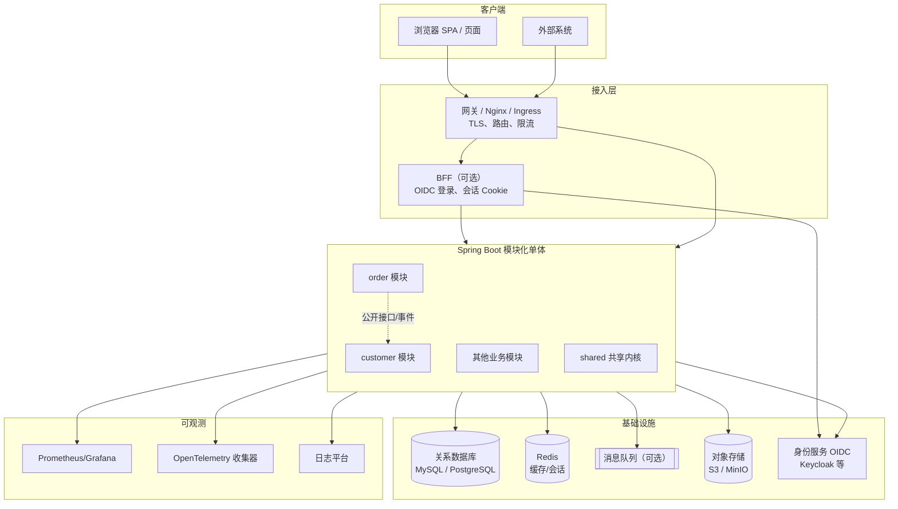
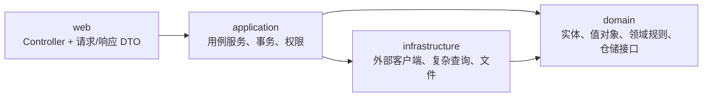
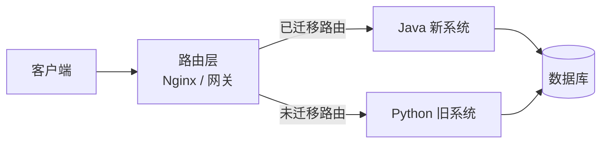
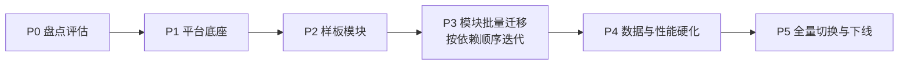
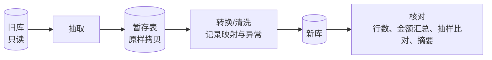
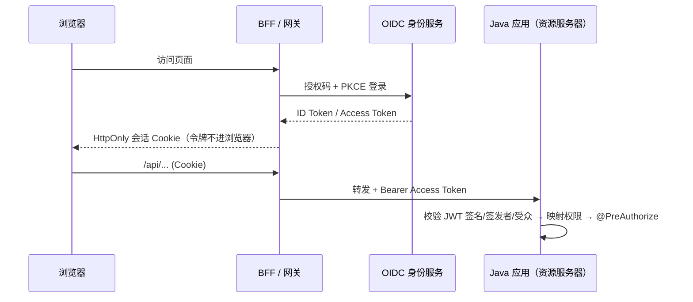
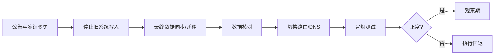

# Python 项目迁移 Java 企业级通用指南

> **文档性质**：独立、自包含的企业级迁移指南。不依赖任何特定工程，可直接用于将任意 Python Web 项目（Django / Flask / FastAPI 等）完整迁移到 Java。
>
> **占位约定**：公司包名 `com.company`，应用名 `app`，示例业务模块 `order`（订单）、`customer`（客户）。实施时替换为实际名称。
>
> **版本说明**：文中版本为 2026 年下半年的主流稳定线。落地时以各项目官网当期最新的稳定补丁版本为准，并在工程中锁定精确版本。

---

## 目录

1. [目标与总体决策](#1-目标与总体决策)
2. [目标架构：为什么是这套](#2-目标架构为什么是这套)
3. [迁移策略：渐进替换还是一次切换](#3-迁移策略渐进替换还是一次切换)
4. [实施路线与阶段](#4-实施路线与阶段)
5. [第 0 阶段：盘点与评估](#5-第-0-阶段盘点与评估)
6. [工程结构与骨架](#6-工程结构与骨架)
7. [Python → Java 映射大全](#7-python--java-映射大全)
8. [分层实现规范与标准代码](#8-分层实现规范与标准代码)
9. [数据层迁移](#9-数据层迁移)
10. [API 契约迁移](#10-api-契约迁移)
11. [认证与授权迁移](#11-认证与授权迁移)
12. [事务、并发与幂等](#12-事务并发与幂等)
13. [异步、定时与批处理](#13-异步定时与批处理)
14. [外部集成、缓存与文件](#14-外部集成缓存与文件)
15. [可观测性](#15-可观测性)
16. [测试体系与新旧对照](#16-测试体系与新旧对照)
17. [构建、质量门禁与 CI/CD](#17-构建质量门禁与-cicd)
18. [部署与运行](#18-部署与运行)
19. [前端处理](#19-前端处理)
20. [切换、回退与下线](#20-切换回退与下线)
21. [常见陷阱](#21-常见陷阱)
22. [按规模裁剪](#22-按规模裁剪)
23. [附录：模板与检查清单](#23-附录模板与检查清单)

---

## 1. 目标与总体决策

### 1.1 迁移目标

把现有 Python 系统的**全部有效业务能力**迁移到 Java 平台，并同时补齐企业级能力：安全、可观测、可测试、可运维、可扩展。具体包括：

- 后端业务逻辑、接口、后台任务、定时任务、外部集成；
- 数据库结构（以及按需迁移的存量数据）；
- 认证授权、审计日志、多语言、文件导入导出；
- 测试、构建、部署、监控、运维手册。

完成后，生产运行**不依赖 Python**（第 1.3 节列出的明确例外除外）。

### 1.2 一页纸决策总表

| 决策项 | 推荐（默认） | 备选 / 何时选备选 |
| --- | --- | --- |
| 语言/运行时 | **Java 21 LTS**（新项目可直接 Java 25 LTS） | — |
| 应用框架 | **Spring Boot 4.x** | Quarkus / Micronaut：强需求原生镜像、极低内存时 |
| 架构形态 | **模块化单体（Spring Modulith）** | 微服务：团队 > 50 人、模块需独立扩缩容和发布节奏时，从单体按模块拆出 |
| 编程模型 | **Spring MVC + 虚拟线程**（阻塞式） | WebFlux：只有极高并发流式场景才考虑 |
| 迁移策略 | **渐进替换（绞杀者模式）** | 一次切换：系统小（< 30 个接口）、可停机窗口充足时 |
| 构建工具 | **Maven** | Gradle：团队已熟悉，或需要复杂构建逻辑 |
| 数据访问 | **Spring Data JPA（Hibernate）+ JdbcClient 处理复杂查询** | MyBatis / MyBatis-Plus：原项目以手写 SQL 为主或团队熟悉；jOOQ：SQL 复杂且要类型安全 |
| 数据库迁移 | **Flyway** | Liquibase：需多数据库方言或回滚脚本时 |
| 对象映射 | **MapStruct** | — |
| API | **REST + OpenAPI 3（springdoc）+ RFC 9457 ProblemDetail** | GraphQL（Spring for GraphQL）、gRPC：已有此类接口时 |
| 认证 | **OIDC 身份服务（Keycloak 等）+ 资源服务器**；SPA 采用 **BFF** | 无 SSO 需求：Spring Security 表单登录 + Spring Session（Redis） |
| 授权 | **RBAC（权限码）+ 方法级 `@PreAuthorize`** + 数据范围过滤 | ABAC / OPA：规则高度动态时 |
| 后台任务 | **JobRunr** 或 **db-scheduler**（持久化、可重试、集群安全） | 消息队列（RabbitMQ / Kafka）：跨系统异步、削峰 |
| 定时任务 | **`@Scheduled` + ShedLock** | Quartz（JDBC 存储）：需要复杂日历与动态调度 |
| 模块间事件 | **Spring Modulith 事件 + 事件发布登记表（事务性发件箱）** | Kafka 外部化：需要跨系统发布事件时 |
| 批处理/数据迁移 | **Spring Batch** | 简单场景用 CLI + JdbcClient |
| 缓存 | **Spring Cache + Caffeine（本地）/ Redis（分布式）** | — |
| HTTP 客户端 | **RestClient + HTTP 接口（`@HttpExchange`）** + 重试/熔断 | — |
| 韧性 | **Spring Framework 7 `@Retryable` / `@ConcurrencyLimit` + Resilience4j 熔断** | — |
| 可观测 | **Actuator + Micrometer + Prometheus + OpenTelemetry + 结构化 JSON 日志** | 商业 APM |
| 测试 | **JUnit 5 + AssertJ + Mockito + Testcontainers + Spring Modulith 测试 + ArchUnit + WireMock** | Pact：多个外部消费者的契约测试 |
| 质量 | **Spotless、Checkstyle、SpotBugs、JaCoCo、依赖漏洞扫描、SonarQube** | — |
| 交付 | **容器镜像 + Kubernetes（Helm）** | Docker Compose / 虚拟机：规模小、无 K8s 平台时 |
| 前端 | **保持现有前端不变，先迁后端**；如需重写用 React + TypeScript | 服务端渲染页面多：Thymeleaf |

### 1.3 哪些不应该迁移

并非所有 Python 代码都适合迁到 Java。下列情况建议**保留为独立 Python 服务**，由 Java 主系统通过 HTTP / 消息调用：

- 机器学习训练与推理（PyTorch、TensorFlow、scikit-learn），除非可以导出为 ONNX 后由 ONNX Runtime for Java 推理；
- 重度数据分析与科学计算（pandas、numpy、scipy）；
- 依赖 Python 专有生态、没有成熟 Java 等价物的功能。

这类功能在盘点阶段单独标记为“保留 Python 服务”，并定义清晰的接口契约。

---

## 2. 目标架构：为什么是这套

### 2.1 架构总览



### 2.2 为什么选模块化单体

| 方案 | 优点 | 缺点 | 结论 |
| --- | --- | --- | --- |
| 传统分层单体（controller/service/dao 全局分包） | 简单 | 随规模膨胀成“大泥球”，边界无约束 | 不推荐 |
| **模块化单体** | 一次部署、一个数据库事务、调试简单；模块边界清晰并可自动校验；将来可按模块拆服务 | 需要纪律（由工具保证） | **推荐默认** |
| 微服务 | 独立部署和扩缩容 | 分布式事务、网络故障、运维成本、数据一致性复杂度高 | 只在组织规模和需求确实需要时采用 |

迁移本身已经是高风险工程，**不要同时引入“迁移语言”和“拆微服务”两个变量**。先迁成模块化单体，稳定后再按需拆分。

### 2.3 模块化的规则（Spring Modulith 约定）

1. 主应用类所在包的**每个直接子包是一个业务模块**，例如 `com.company.app.order`。
2. 模块根包中的类型是**公开 API**，子包（`internal`、`web`、`domain` 等）中的类型对其他模块**不可见**。
3. 模块之间只能：
   - 调用对方根包中的公开接口（同步）；
   - 监听对方发布的领域事件（异步、解耦，**首选**）。
4. 不允许循环依赖，不允许直接访问其他模块的 Repository / 表。
5. 以上规则由 `ApplicationModules.of(Application.class).verify()` 在测试中自动校验。
6. 共享内核 `shared` 的子包需要被所有模块使用，须声明为**开放模块**：

   ```java
   // src/main/java/com/company/app/shared/package-info.java
   @org.springframework.modulith.ApplicationModule(type = org.springframework.modulith.ApplicationModule.Type.OPEN)
   package com.company.app.shared;
   ```

   共享内核只放真正通用的技术类型（错误、分页、审计基类、安全工具），**不放业务逻辑**。

### 2.4 模块内部分层



| 层 | 职责 | 禁止 |
| --- | --- | --- |
| web | HTTP 协议、参数校验、DTO 转换 | 业务判断、直接访问 Repository |
| application | 用例编排、事务边界、权限校验、发布事件 | HTTP 细节 |
| domain | 实体、值对象、状态机与业务规则、Repository 接口 | 依赖 web / 框架细节（JPA 注解除外） |
| infrastructure | 外部系统适配、复杂 SQL、文件存储、消息 | 业务规则 |

---

## 3. 迁移策略：渐进替换还是一次切换

### 3.1 推荐默认：渐进替换（绞杀者模式）



做法：

1. 在 Python 前面放一个路由层（若已有 Nginx 则直接复用）。
2. 按模块逐个用 Java 实现，**保持接口契约与旧系统完全一致**（路径、JSON 字段名、错误格式）。
3. 先用影子流量或对照测试验证结果一致，再把该模块路由切到 Java，可按比例灰度。
4. 一个模块稳定运行一段时间后，删除 Python 中对应代码。
5. 全部模块迁完后下线 Python，再按需推出新版 API（v2）。

Nginx 路由示例：

```nginx
upstream python_app { server python-app:8000; }
upstream java_app   { server java-app:8080; }

# 灰度：按客户端地址把 10% 流量分到 Java（仅用于已验证的只读接口）
split_clients "${remote_addr}" $orders_backend {
    10%     java_app;
    *       python_app;
}

server {
    listen 443 ssl;
    # 已完全迁移的模块
    location /api/customers/ { proxy_pass http://java_app; }
    # 灰度中的模块
    location /api/orders/    { proxy_pass http://$orders_backend; }
    # 其余仍由 Python 处理
    location /api/           { proxy_pass http://python_app; }
}
```

### 3.2 何时选一次切换

| 条件 | 渐进替换 | 一次切换 |
| --- | --- | --- |
| 系统规模 | 中大型 | 小型（接口少、模块少） |
| 停机窗口 | 不允许或很短 | 允许较长停机 |
| 风险承受 | 低 | 可接受 |
| 是否同时大改数据模型 | 否（共享库更容易） | 是（新库 + 一次性 ETL 更清晰） |
| 总周期 | 较长，但持续交付价值 | 较短，但价值集中在最后 |

### 3.3 共存期的三个关键问题

**1. 数据库**

| 方案 | 说明 | 适用 |
| --- | --- | --- |
| **共享数据库（推荐）** | Java 直接使用现有库；**结构变更权在切换开始时统一交给 Flyway**，Python 端只同步改模型、不再生成迁移 | 渐进替换的默认选择 |
| 新库 + 同步 | 新库结构重新设计，用 CDC（如 Debezium）或批处理同步 | 数据模型必须大改时；复杂度高 |
| 双写 | 应用同时写两个库 | **不推荐**，极易不一致 |

**2. 登录态**：两套系统必须认同同一身份。最佳做法是先引入 OIDC 身份服务，Python 与 Java 都作为资源服务器校验同一签发者的令牌；过渡期也可以让 Java 临时校验 Python 现有令牌（同密钥、同算法），切换完成后再移除。

**3. 后台任务与定时任务**：同一任务在任何时刻只能由一方执行。迁移某个任务时，先在 Python 侧关闭，再在 Java 侧开启，并用分布式锁防止重复执行。

---

## 4. 实施路线与阶段



| 阶段 | 主要工作 | 退出条件（全部满足才能进入下一阶段） |
| --- | --- | --- |
| **P0 盘点评估** | 资产盘点、功能矩阵、依赖图、差异清单、风险登记、迁移顺序、团队与排期 | 范围冻结；每个模块有负责人；“保留 Python”的部分已标出 |
| **P1 平台底座** | 工程骨架、CI/CD、Flyway 基线、认证授权、统一错误、日志/指标/链路、测试容器、路由层 | 空应用可经 CI 构建并部署到测试环境；监控可见；认证接通 |
| **P2 样板模块** | 选一个中等复杂度模块完整迁移（含写操作、事务、权限、后台任务） | 对照测试通过；代码评审确认样板；形成团队模板 |
| **P3 批量迁移** | 按依赖顺序（被依赖的先迁）逐模块迁移、对照、灰度、切换 | 每个模块满足完成定义（DoD，附录 C） |
| **P4 硬化** | 性能压测、故障演练、存量数据迁移演练（如需）、安全扫描、运维手册 | 达到容量与 SLO 目标；演练记录完整 |
| **P5 切换下线** | 全量切流、观察期、Python 下线、旧资产归档 | 观察期无严重问题；回退预案保留到观察期结束 |

**迁移顺序原则**：

1. 被依赖多、依赖少的基础模块先迁（如字典、组织、客户）；
2. 先迁只读查询，再迁写操作；
3. 风险最高的核心交易模块在团队熟悉模板后迁移，但不能放到最后；
4. 横切能力（认证、审计、文件）在 P1 完成，不要每个模块各做一套。

---

## 5. 第 0 阶段：盘点与评估

### 5.1 资产盘点清单

| 方面 | 需要查清的事实 | 产出 |
| --- | --- | --- |
| 框架与入口 | Django / Flask / FastAPI 版本；WSGI/ASGI；全部路由、方法、请求响应模型 | 接口清单（可从 OpenAPI 或路由表导出） |
| 业务模块 | 按业务能力划分的模块、模块间调用关系 | 模块依赖图 |
| 数据访问 | ORM 还是裸 SQL；SQL 所在层；事务边界（autocommit？`atomic`？） | 事务边界清单 |
| 数据库 | 表、索引、约束、触发器、存储过程、视图、分区；迁移工具 | 结构导出（`mysqldump --no-data` / `pg_dump -s`） |
| 认证 | 密码哈希算法与格式；令牌/会话机制；第三方登录 | 账号迁移方案 |
| 授权 | 角色、权限、数据过滤规则所在位置 | 权限模型对照表 |
| 后台与定时 | Celery / RQ / APScheduler / cron / 线程；任务清单、频率、幂等性 | 任务清单 |
| 外部集成 | 出站：地址、协议、认证、超时、重试；入站：调用方清单 | 集成清单与调用方联系人 |
| 文件 | 上传、导入解析、导出（Excel/CSV/PDF）、存储位置 | 文件能力清单 |
| 配置与秘密 | 配置项、环境差异、**硬编码的口令和密钥** | 配置清单；秘密清理计划 |
| 非功能 | 峰值 QPS、数据量、响应时间、可用性要求 | 容量与 SLO 目标 |
| 测试 | 现有测试数量和覆盖的场景；可复用的测试数据 | 场景清单（用于对照测试） |
| 运维 | 部署方式、监控、备份、告警 | 运维现状 |
| 依赖库 | `requirements.txt` / `pyproject.toml` 全部依赖 | 依赖映射表（第 7 节） |

可借助的工具：
- 路由清单：Django `show_urls`（django-extensions）、Flask `flask routes`、FastAPI `/openapi.json`；
- 代码规模：`cloc`；依赖关系：`pydeps`；
- 运行时行为：从网关/访问日志统计接口调用频率，识别“死接口”（无调用的接口不迁移，或经确认后下线）。

### 5.2 功能矩阵

| 功能ID | 模块 | 功能 | 旧接口/页面 | 新接口 | 权限 | 关键规则/不变量 | 测试 | 负责人 | 状态 |
| --- | --- | --- | --- | --- | --- | --- | --- | --- | --- |
| F-001 | order | 创建订单 | `POST /api/orders` | 同左（兼容） | `order:create` | 订单号唯一 | OrderApiIT | 张三 | 已验证 |

状态：未开始 / 开发中 / 对照中 / 灰度中 / 已切换 / 已下线旧代码 / 不迁移（注明原因）。

### 5.3 差异清单（GAP）

迁移中发现的“旧实现缺陷或与需求不符”必须登记，**禁止悄悄修复或悄悄保留**：

| 编号 | 位置 | 旧行为 | 问题 | 决定 | 对外影响 | 确认人 |
| --- | --- | --- | --- | --- | --- | --- |
| GAP-001 | `orders/views.py:88` | 先查询再插入判重 | 并发下会重复 | 修复：唯一约束 | 并发重复提交改为返回 409 | 业务负责人 |

决定只能是：修复（行为改变需通知调用方）/ 保持兼容 / 待确认（写明期限）。

### 5.4 风险登记

| 风险 | 概率 | 影响 | 应对 | 负责人 |
| --- | --- | --- | --- | --- |
| 旧系统隐性逻辑没被发现 | 高 | 高 | 对照测试 + 生产流量回放 | |
| 数值/时间语义差异 | 中 | 高 | 第 7.3 节专项测试 | |
| 外部调用方无法同步升级 | 中 | 中 | 保持旧契约；新契约另起版本 | |

### 5.5 工作量估算方法

按“功能点 × 复杂度系数”估算，再加上固定成本：

- 简单 CRUD 接口：系数 1；含事务/并发/状态机：系数 3；含外部集成或后台任务：系数 2–4；
- 固定成本：平台底座（P1）、样板（P2）、对照测试基础设施、数据迁移演练、压测与切换。

以样板模块（P2）的实际耗时校准系数后再出正式排期，不要在 P0 就承诺精确工期。

---

## 6. 工程结构与骨架

### 6.1 仓库结构（单 Maven 模块 + Spring Modulith，默认推荐）

```text
app/
├─ pom.xml
├─ mvnw, mvnw.cmd, .mvn/
├─ compose.yaml                         本地开发依赖（数据库、Redis 等）
├─ Dockerfile
├─ .github/workflows/ci.yml             或 .gitlab-ci.yml
├─ docs/                                架构、契约、运维、ADR（架构决策记录）
└─ src/
   ├─ main/java/com/company/app/
   │  ├─ Application.java
   │  ├─ shared/                        共享内核（显式声明为开放模块）
   │  │  ├─ error/   ErrorCode、BusinessException、GlobalExceptionHandler
   │  │  ├─ web/     PageResponse、TraceId 处理
   │  │  ├─ security/ 当前用户、数据范围
   │  │  └─ jpa/     审计基类 BaseEntity
   │  ├─ order/                         业务模块
   │  │  ├─ OrderApi.java               公开接口（供其他模块调用）
   │  │  ├─ OrderCreatedEvent.java      公开领域事件
   │  │  ├─ web/          OrderController、请求/响应 DTO
   │  │  ├─ application/  OrderService（实现 OrderApi）
   │  │  ├─ domain/       Order、OrderStatus、OrderRepository
   │  │  └─ infrastructure/ OrderQueryDao、外部客户端
   │  └─ customer/ …
   ├─ main/resources/
   │  ├─ application.yml
   │  ├─ application-local.yml
   │  ├─ db/migration/                  Flyway 脚本
   │  └─ i18n/messages*.properties
   └─ test/java/com/company/app/
      ├─ ModularityTest.java
      ├─ ArchitectureTest.java
      ├─ TestcontainersConfiguration.java
      └─ order/ …
```

**何时改为 Maven 多模块**：团队较大（例如超过 15 人）或需要在编译期强制隔离时，把每个业务模块拆为独立 Maven 子模块（`app-order`、`app-customer`、`app-shared`、`app-boot`），Spring Modulith 规则保持不变。

### 6.2 pom.xml（核心部分）

```xml
<project>
  <modelVersion>4.0.0</modelVersion>
  <parent>
    <groupId>org.springframework.boot</groupId>
    <artifactId>spring-boot-starter-parent</artifactId>
    <version>4.1.x</version><!-- 锁定为当期最新补丁版本 -->
    <relativePath/>
  </parent>
  <groupId>com.company</groupId>
  <artifactId>app</artifactId>
  <version>1.0.0-SNAPSHOT</version>

  <properties>
    <java.version>21</java.version>
    <spring-modulith.version>2.x.x</spring-modulith.version>
    <mapstruct.version>1.6.x</mapstruct.version>
    <springdoc.version>3.x.x</springdoc.version>
    <shedlock.version>6.x.x</shedlock.version>
  </properties>

  <dependencyManagement>
    <dependencies>
      <dependency>
        <groupId>org.springframework.modulith</groupId>
        <artifactId>spring-modulith-bom</artifactId>
        <version>${spring-modulith.version}</version>
        <type>pom</type>
        <scope>import</scope>
      </dependency>
    </dependencies>
  </dependencyManagement>

  <dependencies>
    <!-- Web / 校验 / 安全 -->
    <dependency><groupId>org.springframework.boot</groupId><artifactId>spring-boot-starter-webmvc</artifactId></dependency>
    <dependency><groupId>org.springframework.boot</groupId><artifactId>spring-boot-starter-validation</artifactId></dependency>
    <dependency><groupId>org.springframework.boot</groupId><artifactId>spring-boot-starter-security</artifactId></dependency>
    <dependency><groupId>org.springframework.boot</groupId><artifactId>spring-boot-starter-security-oauth2-resource-server</artifactId></dependency>

    <!-- 数据 -->
    <dependency><groupId>org.springframework.boot</groupId><artifactId>spring-boot-starter-data-jpa</artifactId></dependency>
    <dependency><groupId>org.springframework.boot</groupId><artifactId>spring-boot-starter-flyway</artifactId></dependency>
    <dependency><groupId>org.flywaydb</groupId><artifactId>flyway-mysql</artifactId></dependency>
    <dependency><groupId>com.mysql</groupId><artifactId>mysql-connector-j</artifactId><scope>runtime</scope></dependency>
    <dependency><groupId>org.springframework.boot</groupId><artifactId>spring-boot-starter-data-redis</artifactId></dependency>
    <dependency><groupId>org.springframework.boot</groupId><artifactId>spring-boot-starter-cache</artifactId></dependency>
    <!-- 仅在采用第 11.3 节“会话登录”方案时加入：spring-session-data-redis -->

    <!-- 模块化 + 事务性事件（发件箱） -->
    <dependency><groupId>org.springframework.modulith</groupId><artifactId>spring-modulith-starter-core</artifactId></dependency>
    <dependency><groupId>org.springframework.modulith</groupId><artifactId>spring-modulith-starter-jpa</artifactId></dependency>

    <!-- 定时任务分布式锁 -->
    <dependency><groupId>net.javacrumbs.shedlock</groupId><artifactId>shedlock-spring</artifactId><version>${shedlock.version}</version></dependency>
    <dependency><groupId>net.javacrumbs.shedlock</groupId><artifactId>shedlock-provider-jdbc-template</artifactId><version>${shedlock.version}</version></dependency>

    <!-- 可观测 -->
    <dependency><groupId>org.springframework.boot</groupId><artifactId>spring-boot-starter-actuator</artifactId></dependency>
    <dependency><groupId>io.micrometer</groupId><artifactId>micrometer-registry-prometheus</artifactId></dependency>
    <dependency><groupId>io.micrometer</groupId><artifactId>micrometer-tracing-bridge-otel</artifactId></dependency>
    <dependency><groupId>io.opentelemetry</groupId><artifactId>opentelemetry-exporter-otlp</artifactId></dependency>

    <!-- API 文档、对象映射 -->
    <dependency><groupId>org.springdoc</groupId><artifactId>springdoc-openapi-starter-webmvc-ui</artifactId><version>${springdoc.version}</version></dependency>
    <dependency><groupId>org.mapstruct</groupId><artifactId>mapstruct</artifactId><version>${mapstruct.version}</version></dependency>

    <!-- 本地开发：启动时自动拉起 compose.yaml -->
    <dependency><groupId>org.springframework.boot</groupId><artifactId>spring-boot-docker-compose</artifactId><optional>true</optional></dependency>

    <!-- 测试 -->
    <dependency><groupId>org.springframework.boot</groupId><artifactId>spring-boot-starter-test</artifactId><scope>test</scope></dependency>
    <dependency><groupId>org.springframework.boot</groupId><artifactId>spring-boot-starter-webmvc-test</artifactId><scope>test</scope></dependency>
    <dependency><groupId>org.springframework.boot</groupId><artifactId>spring-boot-testcontainers</artifactId><scope>test</scope></dependency>
    <dependency><groupId>org.testcontainers</groupId><artifactId>testcontainers-mysql</artifactId><scope>test</scope></dependency>
    <dependency><groupId>org.testcontainers</groupId><artifactId>testcontainers-junit-jupiter</artifactId><scope>test</scope></dependency>
    <dependency><groupId>org.springframework.modulith</groupId><artifactId>spring-modulith-starter-test</artifactId><scope>test</scope></dependency>
    <dependency><groupId>com.tngtech.archunit</groupId><artifactId>archunit-junit5</artifactId><version>1.4.x</version><scope>test</scope></dependency>
    <dependency><groupId>org.springframework.security</groupId><artifactId>spring-security-test</artifactId><scope>test</scope></dependency>
  </dependencies>

  <build>
    <finalName>app</finalName>
    <plugins>
      <plugin>
        <groupId>org.springframework.boot</groupId>
        <artifactId>spring-boot-maven-plugin</artifactId>
      </plugin>
      <plugin>
        <groupId>org.apache.maven.plugins</groupId>
        <artifactId>maven-compiler-plugin</artifactId>
        <configuration>
          <parameters>true</parameters>
          <annotationProcessorPaths>
            <path><groupId>org.mapstruct</groupId><artifactId>mapstruct-processor</artifactId><version>${mapstruct.version}</version></path>
          </annotationProcessorPaths>
          <compilerArgs>
            <arg>-Amapstruct.defaultComponentModel=spring</arg>
            <arg>-Amapstruct.unmappedTargetPolicy=ERROR</arg>
          </compilerArgs>
        </configuration>
      </plugin>
      <!-- 质量插件见第 17 节 -->
    </plugins>
  </build>
</project>
```

> Spring Boot 4 对 starter 做了模块化拆分（如 `spring-boot-starter-webmvc`、`spring-boot-starter-flyway`、`spring-boot-starter-webmvc-test`）。如果使用 Boot 3.x，对应名称为 `spring-boot-starter-web`、`flyway-core` 等。

### 6.3 application.yml（基线）

```yaml
spring:
  application:
    name: app
  threads:
    virtual:
      enabled: true                      # Java 21 虚拟线程：阻塞式代码获得高并发
  datasource:
    url: ${DB_URL}
    username: ${DB_USER}
    password: ${DB_PASSWORD}
    hikari:
      maximum-pool-size: 20
      connection-timeout: 5000
  jpa:
    open-in-view: false                  # 禁止在视图层懒加载，避免隐式查询
    hibernate:
      ddl-auto: validate                 # 结构只由 Flyway 管理，启动时校验实体与表一致
    properties:
      hibernate.jdbc.time_zone: UTC
      hibernate.jdbc.batch_size: 100
      hibernate.order_inserts: true
  flyway:
    enabled: true
    validate-on-migrate: true
    clean-disabled: true
  data:
    redis:
      host: ${REDIS_HOST}
      port: ${REDIS_PORT:6379}
      password: ${REDIS_PASSWORD:}
  mvc:
    problemdetails:
      enabled: true                      # 框架异常统一输出 RFC 9457
  security:
    oauth2:
      resourceserver:
        jwt:
          issuer-uri: ${OIDC_ISSUER_URI}
  lifecycle:
    timeout-per-shutdown-phase: 30s

server:
  port: 8080
  shutdown: graceful
  error:
    include-message: never
    include-stacktrace: never

management:
  endpoints:
    web:
      exposure:
        include: health,info,prometheus
  endpoint:
    health:
      probes:
        enabled: true
      show-details: never
  tracing:
    sampling:
      probability: 0.1

logging:
  structured:
    format:
      console: ecs                       # JSON 结构化日志，便于日志平台检索

springdoc:
  api-docs:
    enabled: ${API_DOCS_ENABLED:false}   # 生产默认关闭

app:                                     # 业务配置统一前缀，用 @ConfigurationProperties 绑定并校验
  export:
    max-rows: 100000
```

### 6.4 本地开发依赖（compose.yaml）

```yaml
services:
  mysql:
    image: mysql:8.4
    environment:
      MYSQL_DATABASE: app
      MYSQL_USER: app
      MYSQL_PASSWORD: app
      MYSQL_ROOT_PASSWORD: root
    command: [--character-set-server=utf8mb4, --collation-server=utf8mb4_0900_ai_ci, --default-time-zone=+00:00]
    ports: ['3306:3306']
  redis:
    image: redis:8
    ports: ['6379:6379']
```

依赖 `spring-boot-docker-compose` 后，本地 `./mvnw spring-boot:run` 会自动启动这些容器并注入连接信息。

---

## 7. Python → Java 映射大全

### 7.1 框架与库映射

| 类别 | Python | Java（推荐） | 备注 |
| --- | --- | --- | --- |
| Web 框架 | Django / Flask / FastAPI | Spring Boot + Spring MVC | |
| 路由/视图 | `urls.py` + views；`@app.route`；`@router.get` | `@RestController` + `@GetMapping` 等 | |
| 依赖注入 | FastAPI `Depends`；全局单例 | 构造器注入（Spring IoC） | |
| 中间件 | Django Middleware；`before_request` | `Filter` / `HandlerInterceptor` | |
| 请求校验 | Pydantic、Marshmallow、DRF Serializer、WTForms | `record` DTO + Jakarta Bean Validation（`@NotBlank`、`@Size`…） | 复杂规则写自定义约束注解 |
| 序列化 | Pydantic `.dict()`、DRF | Jackson 3 + MapStruct | |
| ORM | SQLAlchemy、Django ORM、Peewee、Tortoise | Spring Data JPA（Hibernate 7） | |
| 裸 SQL | PyMySQL、psycopg、`text()` | `JdbcClient` / MyBatis / jOOQ | |
| 数据库迁移 | Alembic、Django migrations | Flyway | |
| 事务 | `transaction.atomic`、`session.begin()` | `@Transactional` | |
| 信号/钩子 | Django signals、SQLAlchemy events | `ApplicationEventPublisher` + `@ApplicationModuleListener`；JPA `@PrePersist` | |
| 管理后台 | Django Admin | 无直接等价物：自建管理页面，或使用低代码后台工具 | 需单独排期 |
| 认证 | Django auth、Flask-Login、FastAPI Security、PyJWT、authlib | Spring Security、OAuth2 Resource Server / Client | |
| 密码哈希 | Django PBKDF2、passlib bcrypt/argon2 | `DelegatingPasswordEncoder`（BCrypt/Argon2/PBKDF2） | 兼容旧格式见第 11.4 节 |
| 权限 | Django permissions、DRF permissions、装饰器 | `@PreAuthorize` + 权限码 | |
| 后台任务 | Celery、RQ、Dramatiq、Huey | JobRunr / db-scheduler；或 RabbitMQ/Kafka + 监听器 | |
| 定时任务 | Celery beat、APScheduler、cron | `@Scheduled` + ShedLock；Quartz | |
| 批处理/ETL | 脚本 + pandas | Spring Batch | |
| 缓存 | django-cache、Flask-Caching、redis-py | Spring Cache + Caffeine / Redis | |
| HTTP 客户端 | requests、httpx、aiohttp | `RestClient` + `@HttpExchange` 接口 | |
| 重试/熔断 | tenacity、backoff | `@Retryable`（Spring 7）、Resilience4j | |
| 消息 | kombu、pika、kafka-python | Spring AMQP、Spring for Apache Kafka | |
| WebSocket | Django Channels、FastAPI WebSocket | Spring WebSocket（STOMP） | |
| GraphQL | Graphene、Strawberry | Spring for GraphQL | |
| gRPC | grpcio | grpc-java / Spring gRPC | |
| 模板 | Jinja2、Django Templates | Thymeleaf | |
| 邮件 | smtplib、django.core.mail | Spring Mail（JavaMailSender） | |
| Excel | openpyxl、xlsxwriter、pandas | Apache POI（`SXSSFWorkbook` 流式）/ FastExcel | |
| CSV | `csv` | Apache Commons CSV | |
| PDF | ReportLab、WeasyPrint | OpenPDF、Apache PDFBox、OpenHTMLtoPDF | |
| 图片 | Pillow | Thumbnailator、ImageIO | |
| 对象存储 | boto3 | AWS SDK for Java v2 / MinIO Java SDK | |
| 日志 | logging、structlog、loguru | SLF4J + Logback（Boot 结构化日志） | |
| 配置 | settings.py、pydantic-settings、python-dotenv | `application.yml` + `@ConfigurationProperties` + `@Validated` | |
| 命令行 | click、argparse、Django management command | Spring Shell / picocli；或 `ApplicationRunner` + profile | |
| 国际化 | gettext、Babel | `MessageSource`（`messages_*.properties`） | |
| 数据分析 | pandas、numpy | SQL 聚合 / Tablesaw / Apache Commons Math；**重度分析保留 Python** | |
| 机器学习 | scikit-learn、PyTorch | ONNX Runtime、DJL；**通常保留 Python 服务** | |
| 测试框架 | pytest、unittest | JUnit 5 + AssertJ | |
| Mock | unittest.mock、pytest-mock、monkeypatch | Mockito；依赖注入替换 | |
| 测试数据 | factory_boy、Faker | 测试数据构建器、Instancio、Datafaker | |
| HTTP Mock | responses、httpretty、respx | WireMock、`MockRestServiceServer` | |
| 时间冻结 | freezegun | 注入 `java.time.Clock` | |
| 数据库测试 | pytest-django、SQLite 内存库 | Testcontainers（真实数据库） | 不用 H2 代替 |
| 接口测试 | Django test client、TestClient | `MockMvcTester`、REST Assured | |
| 压测 | Locust | Gatling、k6（与语言无关） | |
| 代码格式 | black、isort | Spotless（google-java-format / palantir-java-format） | |
| 静态检查 | flake8、ruff、mypy、pylint | 编译器 + Checkstyle、SpotBugs、Error Prone、SonarQube | |
| 依赖管理 | pip、poetry、uv | Maven / Gradle | |
| 运行服务器 | gunicorn、uvicorn | 内嵌 Tomcat（可执行 JAR） | |

### 7.2 语言惯用法映射

| Python | Java | 说明 |
| --- | --- | --- |
| `dict` 承载业务数据 | `record` / 类 | 禁止用 `Map<String,Object>` 在层间传业务数据 |
| `dataclass`、`NamedTuple` | `record` | 不可变 |
| 鸭子类型 | 接口（`interface`） | |
| Mixin、多重继承 | 组合 + 接口默认方法 | |
| 装饰器（横切） | 注解 + AOP（`@Transactional`、`@Cacheable`、自定义切面） | |
| 上下文管理器 `with` | try-with-resources | |
| 生成器 `yield` | `Stream`、`Iterator`；大结果集用 `Stream<T>` 查询或分页游标 | |
| 列表推导式 | `stream().filter().map().toList()` | |
| `None` | `null` + `Optional`（只用于返回值）；JSpecify `@Nullable` 标注 | |
| 异常体系 | 非受检异常（`RuntimeException`）为主 | 业务异常统一 `BusinessException` |
| `async def` / `await` | **普通阻塞代码 + 虚拟线程** | 不必改成响应式 |
| `asyncio.gather` 并发 | `StructuredTaskScope`（预览）或 `ExecutorService`（虚拟线程）+ `Future` | |
| `threading.Lock` | 单机：`ReentrantLock`；**集群：数据库行锁 / 分布式锁** | |
| 全局变量/模块级状态 | Spring Bean（单例）+ 不可变配置 | 禁止可变静态状态 |
| `getattr` / 动态属性 | 明确的字段与类型 | |
| 枚举字符串 | `enum` | |
| `typing` 类型注解 | 编译期类型 | |
| `__str__` / `__repr__` | `toString()`（record 自动生成） | 不要输出敏感字段 |
| `__eq__` / `__hash__` | `equals` / `hashCode`（record 自动生成；JPA 实体按 ID 规则实现） | |

### 7.3 必须专项测试的语义差异（高频 Bug 来源）

| 场景 | Python 行为 | Java 行为 | 正确迁移 |
| --- | --- | --- | --- |
| 整数范围 | 任意精度，不会溢出 | `int`/`long` 会溢出 | `Math.addExact` / `multiplyExact`；超大值用 `BigInteger` |
| 整除 | `-7 // 2 == -4`（向下取整） | `-7 / 2 == -3`（向零取整） | `Math.floorDiv` |
| 取模 | `-7 % 3 == 2` | `-7 % 3 == -1` | `Math.floorMod` |
| 四舍五入 | `round(2.5) == 2`（银行家舍入） | `Math.round(2.5) == 3` | 用 `BigDecimal.setScale(n, RoundingMode.HALF_EVEN)` 并与业务确认规则 |
| 小数 | `Decimal` 精确 | `double` 不精确 | 金额/数量用 `BigDecimal`（构造用字符串 `new BigDecimal("0.1")`） |
| 字符串长度/切片 | 按 Unicode 码点 | `length()` 按 UTF-16 单元，表情等占 2 | 需要按字符处理时用 `codePoints()` |
| 大小写 | `str.lower()` 与区域无关 | `toLowerCase()` 受默认区域影响（土耳其语 i） | `toLowerCase(Locale.ROOT)` |
| 去空白 | `strip()` 去除 Unicode 空白 | `trim()` 只去 ≤ U+0020 | 用 `strip()` |
| 真值判断 | 空串、0、空列表为假 | 无隐式真值 | 显式判断 |
| 字典顺序 | 插入有序 | `HashMap` 无序 | 需要顺序用 `LinkedHashMap` |
| 时间 | 常见 naive datetime（无时区） | — | 统一 `Instant`（UTC）存储，`ZoneId` 显式转换 |
| 日期格式化 | `strftime` | `DateTimeFormatter`（注意 `yyyy` 与 `YYYY` 不同） | |
| 正则 | `re`（`\d` 默认匹配 Unicode 数字） | `java.util.regex`（`\d` 默认只匹配 ASCII） | 写对照测试 |
| JSON 数字 | 大整数原样输出 | JS 前端会丢精度 | ID/大数在 API 中输出为字符串 |
| 排序 | 稳定 | `List.sort` 稳定；`Arrays.sort(int[])` 不涉及稳定性 | 比较器写全 |
| 可变默认参数 | 常见 Bug | 不存在 | 迁移时修复对应缺陷 |
| 字符编码 | 默认 UTF-8 | Java 18+ 默认 UTF-8 | 仍建议显式指定 |

---

## 8. 分层实现规范与标准代码

以下代码全部基于标准 Spring 组件，可直接作为团队模板。

### 8.1 共享内核：错误码与业务异常

```java
package com.company.app.shared.error;

import org.springframework.http.HttpStatus;

/** 稳定错误码：对外公开后含义不得改变。前缀按模块划分。 */
public enum ErrorCode {
    VALIDATION_FAILED("COMMON-0001", HttpStatus.BAD_REQUEST),
    FORBIDDEN("COMMON-0002", HttpStatus.FORBIDDEN),
    NOT_FOUND("COMMON-0003", HttpStatus.NOT_FOUND),
    CONCURRENT_MODIFICATION("COMMON-0004", HttpStatus.CONFLICT),
    IDEMPOTENCY_CONFLICT("COMMON-0005", HttpStatus.CONFLICT),
    ORDER_NO_DUPLICATED("ORDER-0001", HttpStatus.CONFLICT),
    ORDER_STATUS_INVALID("ORDER-0002", HttpStatus.CONFLICT);

    private final String code;
    private final HttpStatus status;

    ErrorCode(String code, HttpStatus status) {
        this.code = code;
        this.status = status;
    }

    public String code() { return code; }
    public HttpStatus status() { return status; }
}
```

```java
package com.company.app.shared.error;

import java.util.Map;

/** 可向客户端公开的业务失败。消息键用于国际化，参数不得包含敏感信息。 */
public class BusinessException extends RuntimeException {
    private final ErrorCode error;
    private final Map<String, Object> params;

    public BusinessException(ErrorCode error) {
        this(error, Map.of());
    }

    public BusinessException(ErrorCode error, Map<String, Object> params) {
        super(error.code());
        this.error = error;
        this.params = Map.copyOf(params);
    }

    public ErrorCode error() { return error; }
    public Map<String, Object> params() { return params; }
}
```

### 8.2 全局异常处理（RFC 9457 ProblemDetail）

```java
package com.company.app.shared.error;

import io.micrometer.tracing.Tracer;
import java.net.URI;
import java.util.Locale;
import org.slf4j.Logger;
import org.slf4j.LoggerFactory;
import org.springframework.context.MessageSource;
import org.springframework.dao.OptimisticLockingFailureException;
import org.springframework.http.HttpStatus;
import org.springframework.http.ProblemDetail;
import org.springframework.web.bind.annotation.ExceptionHandler;
import org.springframework.web.bind.annotation.RestControllerAdvice;
import org.springframework.web.servlet.mvc.method.annotation.ResponseEntityExceptionHandler;

@RestControllerAdvice
public class GlobalExceptionHandler extends ResponseEntityExceptionHandler {
    private static final Logger log = LoggerFactory.getLogger(GlobalExceptionHandler.class);
    private final MessageSource messages;
    private final Tracer tracer;

    public GlobalExceptionHandler(MessageSource messages, Tracer tracer) {
        this.messages = messages;
        this.tracer = tracer;
    }

    @ExceptionHandler(BusinessException.class)
    ProblemDetail business(BusinessException e, Locale locale) {
        return problem(e.error(), e.params(), locale);
    }

    /** @PreAuthorize 等抛出的拒绝异常必须单独处理，否则会被兜底处理器误报为 500。 */
    @ExceptionHandler(org.springframework.security.authorization.AuthorizationDeniedException.class)
    ProblemDetail denied(Exception e, Locale locale) {
        return problem(ErrorCode.FORBIDDEN, java.util.Map.of(), locale);
    }

    @ExceptionHandler(OptimisticLockingFailureException.class)
    ProblemDetail conflict(OptimisticLockingFailureException e, Locale locale) {
        return problem(ErrorCode.CONCURRENT_MODIFICATION, java.util.Map.of(), locale);
    }

    @ExceptionHandler(Exception.class)
    ProblemDetail unexpected(Exception e) {
        log.error("Unhandled exception", e);              // 详细信息只进日志
        var pd = ProblemDetail.forStatus(HttpStatus.INTERNAL_SERVER_ERROR);
        pd.setTitle("Internal error");
        pd.setProperty("traceId", traceId());
        return pd;                                          // 不向客户端暴露异常消息
    }

    private ProblemDetail problem(ErrorCode error, java.util.Map<String, Object> params, Locale locale) {
        var detail = messages.getMessage("error." + error.code(), params.values().toArray(), error.code(), locale);
        var pd = ProblemDetail.forStatusAndDetail(error.status(), detail);
        pd.setType(URI.create("urn:problem:" + error.code()));
        pd.setTitle(error.code());
        pd.setProperty("code", error.code());
        pd.setProperty("params", params);
        pd.setProperty("traceId", traceId());
        return pd;
    }

    private String traceId() {
        var span = tracer.currentSpan();
        return span == null ? null : span.context().traceId();
    }
}
```

> 校验失败（`MethodArgumentNotValidException`）等框架异常由 `ResponseEntityExceptionHandler` 统一转为 ProblemDetail；如需附加字段级错误，覆写 `handleMethodArgumentNotValid`。
>
> **兼容旧契约**：渐进替换期间若旧客户端依赖旧错误格式，可在该处理器中按路径或请求头输出旧格式，新版 API 再统一使用 ProblemDetail。

### 8.3 审计基类与实体

```java
package com.company.app.shared.jpa;

import jakarta.persistence.*;
import java.time.Instant;
import org.springframework.data.annotation.*;
import org.springframework.data.jpa.domain.support.AuditingEntityListener;

@MappedSuperclass
@EntityListeners(AuditingEntityListener.class)
public abstract class BaseEntity {
    @Id
    @GeneratedValue(strategy = GenerationType.IDENTITY)
    private Long id;

    @Version
    private long version;                    // 乐观锁

    @CreatedDate @Column(updatable = false)
    private Instant createdAt;
    @CreatedBy @Column(updatable = false)
    private String createdBy;
    @LastModifiedDate
    private Instant updatedAt;
    @LastModifiedBy
    private String updatedBy;

    public Long getId() { return id; }
    public long getVersion() { return version; }
    public Instant getCreatedAt() { return createdAt; }
    // 其余 getter 省略
}
```

```java
// 开启审计：提供当前用户
@Configuration
@EnableJpaAuditing
class JpaAuditingConfig {
    @Bean
    AuditorAware<String> auditorAware() {
        return () -> Optional.ofNullable(SecurityContextHolder.getContext().getAuthentication())
                .filter(Authentication::isAuthenticated)
                .map(Authentication::getName);
    }
}
```

```java
package com.company.app.order.domain;

import com.company.app.shared.error.*;
import com.company.app.shared.jpa.BaseEntity;
import jakarta.persistence.*;
import java.math.BigDecimal;

@Entity
@Table(name = "orders")
public class Order extends BaseEntity {
    @Column(nullable = false, unique = true, length = 64)
    private String orderNo;

    @Column(nullable = false)
    private Long customerId;

    @Column(nullable = false, precision = 18, scale = 2)
    private BigDecimal amount;

    @Enumerated(EnumType.STRING)
    @Column(nullable = false, length = 32)
    private OrderStatus status;

    protected Order() {}                      // JPA 需要

    public static Order create(String orderNo, Long customerId, BigDecimal amount) {
        if (amount.signum() <= 0) throw new BusinessException(ErrorCode.VALIDATION_FAILED);
        var o = new Order();
        o.orderNo = orderNo;
        o.customerId = customerId;
        o.amount = amount;
        o.status = OrderStatus.CREATED;
        return o;
    }

    /** 状态迁移规则写在实体内，而不是散落在服务中。 */
    public void confirm() {
        if (status != OrderStatus.CREATED) throw new BusinessException(ErrorCode.ORDER_STATUS_INVALID);
        status = OrderStatus.CONFIRMED;
    }

    public String getOrderNo() { return orderNo; }
    public Long getCustomerId() { return customerId; }
    public BigDecimal getAmount() { return amount; }
    public OrderStatus getStatus() { return status; }
}
```

### 8.4 仓储

```java
package com.company.app.order.domain;

import jakarta.persistence.LockModeType;
import java.util.Optional;
import org.springframework.data.jpa.repository.*;  // JpaRepository、JpaSpecificationExecutor、Lock

public interface OrderRepository extends JpaRepository<Order, Long>, JpaSpecificationExecutor<Order> {
    Optional<Order> findByOrderNo(String orderNo);

    /** 需要悲观锁的写路径：生成 SELECT ... FOR UPDATE（派生查询，避免 Order 与 JPQL 关键字冲突） */
    @Lock(LockModeType.PESSIMISTIC_WRITE)
    Optional<Order> findWithLockById(Long id);
}
```

复杂报表或批量 SQL 放在 infrastructure，使用 `JdbcClient`：

```java
@Repository
class OrderQueryDao {
    private final JdbcClient jdbc;

    OrderQueryDao(JdbcClient jdbc) { this.jdbc = jdbc; }

    List<DailyTotal> dailyTotals(LocalDate from, LocalDate to) {
        return jdbc.sql("""
                SELECT DATE(created_at) AS day, COUNT(*) AS cnt, SUM(amount) AS total
                FROM orders WHERE created_at >= :from AND created_at < :to
                GROUP BY DATE(created_at) ORDER BY day
                """)
                .param("from", from.atStartOfDay(ZoneOffset.UTC).toInstant())
                .param("to", to.plusDays(1).atStartOfDay(ZoneOffset.UTC).toInstant())
                .query(DailyTotal.class)
                .list();
    }
}
```

### 8.5 DTO 与 MapStruct

```java
package com.company.app.order.web;

import jakarta.validation.constraints.*;
import java.math.BigDecimal;

public record CreateOrderRequest(
        @NotBlank @Size(max = 64) String orderNo,
        @NotBlank @Pattern(regexp = "\\d{1,19}") String customerId,   // ID 以字符串接收
        @NotNull @Positive @Digits(integer = 16, fraction = 2) BigDecimal amount) {}

public record OrderResponse(
        String id, String orderNo, String customerId, String amount, String status,
        String version, java.time.Instant createdAt) {}
```

```java
package com.company.app.order.web;

import com.company.app.order.domain.Order;
import org.mapstruct.*;

@Mapper
interface OrderWebMapper {
    @Mapping(target = "amount", expression = "java(order.getAmount().toPlainString())")
    OrderResponse toResponse(Order order);   // Long → String、enum → String 自动转换
}
```

### 8.6 应用服务（事务、权限、事件）

```java
package com.company.app.order;

/** 模块公开接口：其他模块只能通过它同步调用 order。 */
public interface OrderApi {
    OrderSummary findSummary(long orderId);
}

public record OrderSummary(long id, String orderNo, String status) {}

public record OrderCreatedEvent(long orderId, String orderNo, long customerId) {}
```

```java
package com.company.app.order.application;

import com.company.app.order.*;
import com.company.app.order.domain.*;
import com.company.app.shared.error.*;
import org.springframework.context.ApplicationEventPublisher;
import org.springframework.dao.DataIntegrityViolationException;
import org.springframework.security.access.prepost.PreAuthorize;
import org.springframework.stereotype.Service;
import org.springframework.transaction.annotation.Transactional;

@Service
public class OrderService implements OrderApi {
    private final OrderRepository orders;
    private final ApplicationEventPublisher events;
    private final CurrentUserProvider currentUser;       // shared.security：从 SecurityContext 解析当前用户与数据范围

    public OrderService(OrderRepository orders, ApplicationEventPublisher events, CurrentUserProvider currentUser) {
        this.orders = orders;
        this.events = events;
        this.currentUser = currentUser;
    }

    @Transactional
    @PreAuthorize("hasAuthority('order:create')")
    public Order create(String orderNo, long customerId, java.math.BigDecimal amount) {
        try {
            var order = orders.saveAndFlush(Order.create(orderNo, customerId, amount));
            // 事件随事务提交；Spring Modulith 事件发布登记表保证监听方失败可重试（事务性发件箱）
            events.publishEvent(new OrderCreatedEvent(order.getId(), order.getOrderNo(), customerId));
            return order;
        } catch (DataIntegrityViolationException e) {   // 唯一约束兜底并发重复
            throw new BusinessException(ErrorCode.ORDER_NO_DUPLICATED);
        }
    }

    @Transactional
    @PreAuthorize("hasAuthority('order:confirm')")
    public Order confirm(long id) {
        var order = orders.findWithLockById(id)
                .orElseThrow(() -> new BusinessException(ErrorCode.NOT_FOUND));
        order.confirm();
        return order;                                     // 脏检查自动更新
    }

    @Transactional(readOnly = true)
    @PreAuthorize("hasAuthority('order:list')")
    public Page<Order> search(OrderSearch search, Pageable pageable) {
        Specification<Order> spec = DataScopeSpecs.<Order>visibleTo(currentUser.get()).and(search.toSpecification());
        return orders.findAll(spec, pageable);           // 数据范围 + 查询条件，见第 9.4 节
    }

    @Override
    @Transactional(readOnly = true)
    public OrderSummary findSummary(long orderId) {
        var o = orders.findById(orderId).orElseThrow(() -> new BusinessException(ErrorCode.NOT_FOUND));
        return new OrderSummary(o.getId(), o.getOrderNo(), o.getStatus().name());
    }
}
```

其他模块监听事件：

```java
package com.company.app.customer.application;

import com.company.app.order.OrderCreatedEvent;
import org.springframework.modulith.events.ApplicationModuleListener;
import org.springframework.stereotype.Component;

@Component
class CustomerStatisticsListener {
    /** 原事务提交后异步执行、使用新事务；失败的事件保留在登记表中可重新投递。 */
    @ApplicationModuleListener
    void on(OrderCreatedEvent event) {
        // 更新客户下单统计……
    }
}
```

### 8.7 控制器

```java
package com.company.app.order.web;

import com.company.app.order.application.OrderService;
import com.company.app.shared.web.PageResponse;
import io.swagger.v3.oas.annotations.Operation;
import jakarta.validation.Valid;
import org.springframework.data.domain.Pageable;
import org.springframework.data.web.PageableDefault;
import org.springframework.http.*;
import org.springframework.web.bind.annotation.*;

@RestController
@RequestMapping("/api/v1/orders")
class OrderController {
    private final OrderService service;
    private final OrderWebMapper mapper;

    OrderController(OrderService service, OrderWebMapper mapper) {
        this.service = service;
        this.mapper = mapper;
    }

    @PostMapping
    @Operation(summary = "创建订单", description = "需要 order:create；订单号唯一")
    ResponseEntity<OrderResponse> create(@Valid @RequestBody CreateOrderRequest req) {
        var order = service.create(req.orderNo(), Long.parseLong(req.customerId()), req.amount());
        return ResponseEntity.status(HttpStatus.CREATED).body(mapper.toResponse(order));
    }

    @PostMapping("/{id}/confirm")
    @Operation(summary = "确认订单", description = "需要 order:confirm；状态必须为 CREATED")
    OrderResponse confirm(@PathVariable long id) {
        return mapper.toResponse(service.confirm(id));
    }

    @GetMapping
    PageResponse<OrderResponse> list(OrderSearch search, @PageableDefault(size = 20) Pageable pageable) {
        return PageResponse.of(service.search(search, pageable).map(mapper::toResponse));
    }
}
```

```java
package com.company.app.order.web;

/** 查询条件：只拼接用户提供的条件，数据范围由服务层统一追加。 */
public record OrderSearch(String orderNo, OrderStatus status) {
    public Specification<Order> toSpecification() {
        Specification<Order> spec = (root, q, cb) -> cb.conjunction();
        if (orderNo != null && !orderNo.isBlank()) {
            spec = spec.and((root, q, cb) -> cb.equal(root.get("orderNo"), orderNo.strip()));
        }
        if (status != null) {
            spec = spec.and((root, q, cb) -> cb.equal(root.get("status"), status));
        }
        return spec;
    }
}
```

```java
package com.company.app.shared.web;

import java.util.List;
import org.springframework.data.domain.Page;

/** 稳定的分页结构，不直接序列化 Spring 的 Page。 */
public record PageResponse<T>(List<T> items, long total, int page, int size) {
    public static <T> PageResponse<T> of(Page<T> p) {
        return new PageResponse<>(p.getContent(), p.getTotalElements(), p.getNumber(), p.getSize());
    }
}
```

### 8.8 配置属性（替代 settings.py）

```java
@ConfigurationProperties(prefix = "app.export")
@Validated
public record ExportProperties(@Min(1) @Max(1_000_000) int maxRows) {}

// 启用：@ConfigurationPropertiesScan 放在 Application 类上
```

配置非法时应用启动即失败，杜绝 Python 中常见的“读不到就用默认值”。

### 8.9 新功能开发步骤（团队 SOP）

1. 在契约文档/OpenAPI 中定义接口、权限、错误码；
2. 写 Flyway 脚本（表、约束、索引、权限种子数据）；
3. 实体 + 仓储（领域规则写在实体）；
4. 应用服务（事务、权限、事件）；
5. DTO + MapStruct + 控制器；
6. 错误码与 `messages*.properties` 多语言文案；
7. 单元测试（领域规则）+ 集成测试（Testcontainers）+ 对照测试（迁移功能）；
8. `./mvnw verify` 全绿后提交，代码评审。

---

## 9. 数据层迁移

### 9.1 结构迁移

**场景 A：共享现有数据库（渐进替换默认）**

1. 导出现有结构：`mysqldump --no-data --routines --triggers app > V1__baseline.sql`，整理后放入 `db/migration`（仅用于新建环境）。
2. 对已有生产/测试库执行 Flyway 基线，使 V1 不被重复执行：

   ```yaml
   spring:
     flyway:
       baseline-on-migrate: true   # 仅首次接入现有库时开启
       baseline-version: 1
   ```

3. 从这一刻起**结构变更唯一入口为 Flyway**：Python 端冻结 Alembic / Django migrations，仅同步修改模型定义（Django 可用 `managed = False`）。
4. JPA `ddl-auto: validate` 保证实体与表一致。

**场景 B：新建数据库**

用 Flyway 从 V1 编写目标结构，存量数据通过 9.3 节的 ETL 迁入。

### 9.2 结构规范与类型映射

| 项 | 规范 |
| --- | --- |
| 字符集 | MySQL：`utf8mb4`；PostgreSQL：UTF8 |
| 主键 | `BIGINT` 自增（内部）；对外暴露的标识可另设 UUIDv7 或业务编号 |
| 金额/数量 | `DECIMAL(p,s)`，Java `BigDecimal`；禁止 `FLOAT/DOUBLE` |
| 时间 | 存 UTC：MySQL `DATETIME(6)`，PostgreSQL `timestamptz`；Java `Instant` |
| 日期 | `DATE`，Java `LocalDate` |
| 枚举 | `VARCHAR` + `CHECK` 约束，Java `@Enumerated(EnumType.STRING)`；禁止 `ORDINAL` |
| 布尔 | MySQL `TINYINT(1)` / PostgreSQL `boolean` |
| JSON | `JSON` / `jsonb`，Hibernate `@JdbcTypeCode(SqlTypes.JSON)` |
| 乐观锁 | `version BIGINT NOT NULL` |
| 审计列 | `created_at`、`created_by`、`updated_at`、`updated_by` |
| 唯一性 | 一律数据库唯一约束，应用层判重仅用于友好提示 |
| 外键 | 模块内可用；跨模块不建外键，只存 ID |
| 软删除 | 确有需要才用，并配合唯一约束设计（如 `deleted_at` 参与唯一键） |
| 命名 | 表/列 `snake_case`，Java 字段 `camelCase`（Hibernate 默认命名策略自动转换） |

Flyway 规则：

- 文件名 `V{版本}__{描述}.sql`；**已发布的脚本永不修改**，修改一律新增版本；
- 生产禁用 `clean`；`validate-on-migrate` 保持开启；
- 大表变更评估锁表时间，必要时使用在线 DDL 工具（gh-ost / pt-online-schema-change）并在脚本外执行，脚本中记录说明；
- 迁移与应用使用不同数据库账号（迁移账号有 DDL 权限，应用账号只有 DML 权限）。

### 9.3 存量数据迁移（新库场景）



- 用 **Spring Batch** 实现：分块读写、断点续跑、跳过与重试策略、执行记录。
- 每张表制定“旧字段 → 新字段 → 转换规则 → 异常处理”映射表。
- 无法自动转换的数据输出异常报告，由业务确认处理方式。
- 核对至少包括：行数、关键金额/数量汇总、按主键抽样逐字段比对、关键业务状态分布。
- **至少完整演练两次**（一次在测试环境，一次用生产数据脱敏副本），记录耗时，用于确定切换窗口。

### 9.4 数据权限与多租户

| 需求 | 推荐实现 |
| --- | --- |
| 多租户（按租户隔离） | Hibernate `@TenantId`（列隔离）或按租户分库，由 `CurrentTenantIdentifierResolver` 提供租户 |
| 按部门/组织等数据范围过滤 | Spring Data `Specification` 统一追加范围条件；复杂场景用 Hibernate `@Filter` 在请求开始时启用 |
| 行级精细权限 | 服务层显式校验 + 查询条件，必要时引入 ABAC |

数据范围示例：

```java
public final class DataScopeSpecs {
    private DataScopeSpecs() {}

    public static <T> Specification<T> visibleTo(CurrentUser user) {
        return (root, query, cb) -> user.allDepartments()
                ? cb.conjunction()
                : root.get("departmentId").in(user.departmentIds());   // 空集合时由调用方拒绝或返回空
    }
}

// 使用：orders.findAll(DataScopeSpecs.<Order>visibleTo(user).and(searchSpec), pageable)
```

---

## 10. API 契约迁移

### 10.1 两阶段契约策略

| 阶段 | 契约 | 原因 |
| --- | --- | --- |
| 迁移期（渐进替换） | **与旧 Python 接口完全兼容**：路径、方法、JSON 字段名（如 snake_case）、分页与错误格式 | 客户端无需改动，可随时切回 |
| 迁移完成后 | 推出 `/api/v2` 新规范契约，旧版本设定下线日期 | 一次性统一规范 |

兼容 snake_case 的方式（仅迁移期、仅需要的接口）：

```java
@JsonNaming(PropertyNamingStrategies.SnakeCaseStrategy.class)
public record LegacyOrderResponse(String orderNo, String customerId, String amount) {}
```

或全局配置 `spring.jackson.property-naming-strategy: SNAKE_CASE`（影响所有接口，慎用）。

### 10.2 目标契约规范（v2 及新接口）

| 方面 | 规范 |
| --- | --- |
| 路径 | `/api/v{n}/{资源复数}`；资源名用名词 |
| 方法 | `GET` 查询、`POST` 创建、`PUT` 全量替换、`PATCH` 部分更新、`DELETE` 删除；非 CRUD 动作用 `POST /{id}/{动作}`（如 `/orders/{id}/confirm`） |
| 字段命名 | camelCase |
| 成功响应 | 直接返回资源或 `PageResponse`；创建返回 201 |
| 错误响应 | RFC 9457 ProblemDetail，`Content-Type: application/problem+json`，含 `code`、`traceId` |
| 标识与大数 | ID、超过 2^53 的整数、高精度小数输出为**字符串** |
| 时间 | ISO-8601，UTC（`2026-10-12T08:00:00Z`） |
| 分页 | `page`、`size`（设上限）、`sort`；超大数据集用游标分页 |
| 并发控制 | 返回 `version` 或 `ETag`；更新携带 `If-Match` / `version`，冲突返回 409/412 |
| 幂等 | 有副作用的 `POST` 支持 `Idempotency-Key` 请求头（第 12.4 节） |
| 版本 | URL 版本（`/v1`、`/v2`）；不兼容变更才升版本 |
| 文档 | 代码即文档：springdoc 生成 OpenAPI，CI 中检查契约变更（openapi-diff） |
| 限流 | 网关或应用层返回 429 + `Retry-After` |

### 10.3 OpenAPI 与客户端生成

- 后端：springdoc 生成 `/v3/api-docs`，在 CI 中导出为 `openapi.json` 并纳入版本控制；
- 前端：用 `openapi-typescript` 或 OpenAPI Generator 生成类型/客户端，禁止手写重复类型；
- 外部调用方：提供 OpenAPI 文档和示例；重要调用方建立契约测试（Pact 或 Spring Cloud Contract）。

---

## 11. 认证与授权迁移

### 11.1 推荐架构



- **身份服务**：Keycloak（开源）或企业已有的 IdP（Azure AD / Okta / 国内统一身份平台）。
- **BFF 模式**：浏览器不持有令牌，这是当前浏览器端应用的推荐安全实践。BFF 可用 Spring Cloud Gateway + `spring-boot-starter-oauth2-client`（`TokenRelay` 过滤器）实现。
- **Java 应用**：作为资源服务器，只校验 JWT 并做授权，不处理登录页面。

### 11.2 资源服务器配置

```java
@Configuration
@EnableMethodSecurity
class SecurityConfig {
    @Bean
    SecurityFilterChain api(HttpSecurity http) throws Exception {
        return http
                .authorizeHttpRequests(a -> a
                        .requestMatchers("/actuator/health/**", "/actuator/info").permitAll()
                        .requestMatchers("/actuator/**").hasAuthority("ops:actuator")
                        .anyRequest().authenticated())
                .oauth2ResourceServer(o -> o.jwt(j -> j.jwtAuthenticationConverter(jwtConverter())))
                .sessionManagement(s -> s.sessionCreationPolicy(SessionCreationPolicy.STATELESS))
                .csrf(c -> c.disable())               // 无 Cookie 的 Bearer API 不需要 CSRF
                .build();
    }

    /** 把令牌中的权限声明映射为 Spring 权限，例如 claim "permissions": ["order:create", ...] */
    private JwtAuthenticationConverter jwtConverter() {
        var authorities = new JwtGrantedAuthoritiesConverter();
        authorities.setAuthoritiesClaimName("permissions");
        authorities.setAuthorityPrefix("");
        var converter = new JwtAuthenticationConverter();
        converter.setJwtGrantedAuthoritiesConverter(authorities);
        return converter;
    }
}
```

> 若权限变化必须立即生效，不要只依赖令牌中的权限声明：令牌有效期设短（如 5–15 分钟），或在 `JwtAuthenticationConverter` 中按用户 ID 从数据库/缓存加载当前权限。

### 11.3 备选：无 SSO 的自建登录（会话 + Redis）

适用于内部系统、没有身份服务的场景：

```java
@Configuration
@EnableMethodSecurity
class SessionSecurityConfig {                // 引入 spring-session-data-redis 后，Boot 自动把会话存入 Redis
    @Bean
    SecurityFilterChain web(HttpSecurity http) throws Exception {
        return http
                .authorizeHttpRequests(a -> a
                        .requestMatchers("/api/auth/login", "/actuator/health/**").permitAll()
                        .anyRequest().authenticated())
                .csrf(c -> c
                        .csrfTokenRepository(CookieCsrfTokenRepository.withHttpOnlyFalse())   // SPA 读取 XSRF-TOKEN
                        .csrfTokenRequestHandler(new CsrfTokenRequestAttributeHandler()))
                .exceptionHandling(e -> e.authenticationEntryPoint(new HttpStatusEntryPoint(HttpStatus.UNAUTHORIZED)))
                .logout(l -> l.logoutUrl("/api/auth/logout")
                        .logoutSuccessHandler(new HttpStatusReturningLogoutSuccessHandler()))
                .build();
    }

    @Bean
    AuthenticationManager authenticationManager(UserDetailsService users, PasswordEncoder encoder) {
        var provider = new DaoAuthenticationProvider(users);
        provider.setPasswordEncoder(encoder);
        return new ProviderManager(provider);
    }
}
```

```java
@RestController
@RequestMapping("/api/auth")
class LoginController {
    private final AuthenticationManager authManager;
    private final SecurityContextRepository contextRepository = new HttpSessionSecurityContextRepository();

    LoginController(AuthenticationManager authManager) { this.authManager = authManager; }

    @PostMapping("/login")
    void login(@Valid @RequestBody LoginRequest req, HttpServletRequest request, HttpServletResponse response) {
        var auth = authManager.authenticate(
                UsernamePasswordAuthenticationToken.unauthenticated(req.username(), req.password()));
        var context = SecurityContextHolder.createEmptyContext();
        context.setAuthentication(auth);
        SecurityContextHolder.setContext(context);
        request.changeSessionId();                       // 防会话固定
        contextRepository.saveContext(context, request, response);
    }
}
```

会话 Cookie 配置为 `HttpOnly`、`Secure`、`SameSite=Lax/Strict`；登录接口加限流和失败锁定。

### 11.4 账号与旧密码哈希迁移

目标：**用户无感迁移**，首次登录成功后自动升级为新哈希。

```java
@Bean
PasswordEncoder passwordEncoder() {
    Map<String, PasswordEncoder> encoders = new HashMap<>();
    encoders.put("bcrypt", new BCryptPasswordEncoder(12));
    encoders.put("argon2", Argon2PasswordEncoder.defaultsForSpringSecurity_v5_8());   // 需要 bcprov 依赖
    encoders.put("django", new DjangoPbkdf2PasswordEncoder());   // 兼容旧 Django 哈希
    return new DelegatingPasswordEncoder("bcrypt", encoders);    // 新密码一律 bcrypt
}
```

旧哈希迁移时加前缀写入新表：

| 旧来源 | 旧格式示例 | 新库存储 |
| --- | --- | --- |
| passlib / bcrypt | `$2b$12$...` | `{bcrypt}$2b$12$...`（Spring 原生支持） |
| Django 默认 | `pbkdf2_sha256$600000$salt$hash` | `{django}pbkdf2_sha256$600000$salt$hash` |
| passlib argon2 | `$argon2id$v=19$...` | `{argon2}$argon2id$...`（参数需验证） |
| 无法识别 / 明文 / MD5 | — | 不迁移哈希，标记“必须重置密码” |

Django PBKDF2 兼容编码器：

```java
/** 只用于校验旧 Django 哈希；不用于生成新密码。 */
public class DjangoPbkdf2PasswordEncoder implements PasswordEncoder {
    @Override
    public String encode(CharSequence raw) {
        throw new UnsupportedOperationException("Legacy format is verify-only");
    }

    @Override
    public boolean matches(CharSequence raw, String encoded) {
        String[] p = encoded.split("\\$");                    // algorithm$iterations$salt$hash
        if (p.length != 4 || !"pbkdf2_sha256".equals(p[0])) return false;
        try {
            int iterations = Integer.parseInt(p[1]);
            byte[] expected = Base64.getDecoder().decode(p[3]);
            var spec = new PBEKeySpec(raw.toString().toCharArray(),
                    p[2].getBytes(StandardCharsets.UTF_8), iterations, expected.length * 8);
            byte[] actual = SecretKeyFactory.getInstance("PBKDF2WithHmacSHA256").generateSecret(spec).getEncoded();
            return MessageDigest.isEqual(expected, actual);   // 常量时间比较
        } catch (GeneralSecurityException | IllegalArgumentException e) {
            return false;
        }
    }

    @Override
    public boolean upgradeEncoding(String encoded) { return true; }
}
```

自动升级：实现 `UserDetailsPasswordService`，`DaoAuthenticationProvider` 在登录成功且 `upgradeEncoding` 为真时会调用它写入新哈希：

```java
@Service
class UserPasswordUpgrader implements UserDetailsPasswordService {
    private final UserRepository users;
    UserPasswordUpgrader(UserRepository users) { this.users = users; }

    @Override
    @Transactional
    public UserDetails updatePassword(UserDetails user, String newEncodedPassword) {
        users.updatePasswordHash(user.getUsername(), newEncodedPassword);
        return User.withUserDetails(user).password(newEncodedPassword).build();
    }
}
// 并在 DaoAuthenticationProvider 上调用 provider.setUserDetailsPasswordService(upgrader)
```

使用 OIDC 身份服务时，Keycloak 等也支持导入旧哈希或通过“用户存储联邦”在首次登录时校验旧系统密码，原理相同。

### 11.5 授权模型

| 层次 | 做法 |
| --- | --- |
| 权限码 | `模块:资源:动作`，例如 `order:create`、`order:confirm`；由 Flyway 种子数据维护 |
| 角色 | 角色 = 权限码集合，存数据库或 IdP；用户 ↔ 角色多对多 |
| 接口/方法 | `@PreAuthorize("hasAuthority('order:create')")` 写在**应用服务**上，而非仅在控制器 |
| 数据范围 | 第 9.4 节的 Specification / Filter |
| 对象级 | 服务层加载对象后校验归属（防止越权访问他人数据，即 IDOR） |
| 服务间/外部系统 | OAuth2 客户端凭证模式（client credentials），独立服务账号、最小权限 |

迁移旧权限时输出“旧角色 → 新角色 → 权限码”对照表，并为每个权限至少写一个**越权负例测试**。

---

## 12. 事务、并发与幂等

### 12.1 事务规范

| 规则 | 说明 |
| --- | --- |
| 事务只在应用服务层 | `@Transactional` 放在 service 的 public 方法上；控制器、仓储不开事务 |
| 只读查询 | `@Transactional(readOnly = true)` |
| 同类内部调用不生效 | 代理机制决定 `this.method()` 不经过事务切面，需拆到另一个 Bean |
| 不在事务中做远程调用 | 先调外部、再开事务写库；或写库后通过事件/发件箱异步调用 |
| 异常回滚 | 默认只回滚运行时异常；业务异常继承 `RuntimeException` |
| 隔离级别 | MySQL 默认 `REPEATABLE READ`，PostgreSQL 默认 `READ COMMITTED`；需要“读最新值再写”的场景用显式行锁，不靠隔离级别 |
| 长事务 | 禁止；大批量处理按块提交（Spring Batch） |

### 12.2 Python 常见并发问题的改造

| Python 中的写法 | 问题 | Java 正确做法 |
| --- | --- | --- |
| autocommit 下执行多条 SQL | 中途失败留下半成品 | 整个用例一个事务 |
| 先查询判重，再插入 | 并发下重复 | 唯一约束 + 捕获异常 |
| 读余额 → 计算 → 写回 | 丢失更新 | `@Version` 乐观锁，或 `SELECT ... FOR UPDATE` |
| `threading.Lock` 保护共享资源 | 多实例无效 | 数据库行锁 / 唯一约束 / 分布式锁 |
| Redis `SETNX` 当作业务锁且无过期处理 | 死锁或锁失效 | 优先数据库锁；必须用分布式锁时用成熟实现并设置租约 |
| 批量操作部分成功 | 数据不一致 | 明确语义：整批原子，或逐条结果返回 |
| `UPDATE ... SET x = x - 1` 不判断结果 | 超卖 | `UPDATE ... WHERE stock >= :n`，检查影响行数 |

### 12.3 锁的选择

| 场景 | 选择 |
| --- | --- |
| 冲突少，用户编辑表单 | 乐观锁 `@Version`，冲突返回 409 让用户刷新 |
| 冲突多、必须串行（库存、额度、序号） | 悲观锁 `PESSIMISTIC_WRITE`，**多个资源按固定顺序加锁**防死锁 |
| 唯一性 | 数据库唯一约束 |
| 跨实例定时任务互斥 | ShedLock |
| 计数类原子更新 | 条件更新语句 `UPDATE ... WHERE ...` |

### 12.4 幂等（Idempotency-Key）

```sql
CREATE TABLE idempotency_record (
  idempotency_key VARCHAR(64)  NOT NULL,
  principal       VARCHAR(128) NOT NULL,
  request_hash    CHAR(64)     NOT NULL,
  status          VARCHAR(16)  NOT NULL,         -- PROCESSING / COMPLETED
  response_status INT          NULL,
  response_body   JSON         NULL,
  created_at      DATETIME(6)  NOT NULL,
  PRIMARY KEY (principal, idempotency_key)
);
```

```java
@Service
public class IdempotencyService {
    private final IdempotencyRepository records;
    private final ObjectMapper json;

    public IdempotencyService(IdempotencyRepository records, ObjectMapper json) {
        this.records = records;
        this.json = json;
    }

    /** 与业务在同一事务中执行：同键同请求返回首次结果；同键不同请求返回冲突。 */
    @Transactional
    public <T> T execute(String key, String principal, Object request, Class<T> type, Supplier<T> action) {
        String hash = DigestUtils.sha256Hex(json.writeValueAsBytes(request));
        var existing = records.findForUpdate(principal, key);
        if (existing.isPresent()) {
            var r = existing.get();
            if (!r.requestHash().equals(hash)) throw new BusinessException(ErrorCode.IDEMPOTENCY_CONFLICT);
            return json.readValue(r.responseBody(), type);
        }
        T result = action.get();
        records.insert(principal, key, hash, json.writeValueAsString(result));  // 主键冲突说明并发重复，整体回滚
        return result;
    }
}
```

（`DigestUtils` 来自 Apache Commons Codec，也可用 `MessageDigest` 自行实现；示例按 Spring Boot 4 的 Jackson 3 编写，其异常为非受检异常，Jackson 2 需处理 `JsonProcessingException`。规范化载荷时应排除时间戳等易变字段。）

---

## 13. 异步、定时与批处理

### 13.1 选型

| Python 原方案 | 场景 | Java 方案 |
| --- | --- | --- |
| Celery 任务（导出、通知、计算） | 应用内可靠后台任务 | **JobRunr** 或 **db-scheduler**（数据库持久化、重试、集群安全、仪表盘） |
| Celery + 跨服务消费 | 跨系统、削峰、多消费者 | **RabbitMQ**（Spring AMQP）/ **Kafka**（Spring for Apache Kafka） |
| Django signals / 进程内回调 | 模块解耦 | **Spring Modulith 事件 + 发布登记表** |
| Celery beat / APScheduler / cron | 周期任务 | **`@Scheduled` + ShedLock**；复杂调度用 Quartz（JDBC 存储） |
| 数据迁移/批量脚本 | 大批量处理 | **Spring Batch** |
| `ThreadPoolExecutor` 临时并发 | 请求内并行 IO | 虚拟线程 `Executors.newVirtualThreadPerTaskExecutor()` |

**原则**：任何“丢了会出问题”的异步工作都不能只放在内存线程池中；必须持久化并可在重启后恢复。

### 13.2 定时任务 + ShedLock

```sql
CREATE TABLE shedlock (
  name       VARCHAR(64)  NOT NULL PRIMARY KEY,
  lock_until TIMESTAMP(3) NOT NULL,
  locked_at  TIMESTAMP(3) NOT NULL,
  locked_by  VARCHAR(255) NOT NULL
);
```

```java
@Configuration
@EnableScheduling
@EnableSchedulerLock(defaultLockAtMostFor = "PT10M")
class SchedulingConfig {
    @Bean
    LockProvider lockProvider(DataSource dataSource) {
        return new JdbcTemplateLockProvider(JdbcTemplateLockProvider.Configuration.builder()
                .withJdbcTemplate(new JdbcTemplate(dataSource))
                .usingDbTime()
                .build());
    }
}

@Component
class OrderTimeoutJob {
    private final OrderService orders;
    OrderTimeoutJob(OrderService orders) { this.orders = orders; }

    @Scheduled(cron = "0 */5 * * * *", zone = "Asia/Shanghai")
    @SchedulerLock(name = "orderTimeoutJob", lockAtLeastFor = "PT30S", lockAtMostFor = "PT4M")
    void closeExpiredOrders() {
        orders.closeExpired(Instant.now());       // 方法内部分批、每批独立事务，可重复执行
    }
}
```

### 13.3 持久后台任务（以 JobRunr 为例）

```java
@Service
class ExportService {
    private final JobScheduler jobs;
    ExportService(JobScheduler jobs) { this.jobs = jobs; }

    /** 请求线程只登记任务并返回任务 ID；任务落库，重启后继续，失败按策略重试。 */
    @Transactional
    public UUID requestExport(long requestId) {
        return jobs.enqueue(() -> generateExport(requestId)).asUUID();
    }

    @Job(name = "导出订单 %0", retries = 3)
    public void generateExport(long requestId) {
        // 读取固定的查询条件快照 → 生成文件 → 上传对象存储 → 标记完成
        // 必须幂等：重复执行不会产生重复副作用
    }
}
```

> JobRunr 开源版为 LGPL，部分高级功能需商业版；若需完全 Apache 许可证，可选 db-scheduler。选型时确认许可证合规。

后台任务设计要点：

1. 任务参数只放 ID 或**固定的输入快照**，不要依赖“提交时的内存状态”；
2. 任务必须**幂等**（可安全重试）；
3. 执行时重新校验权限和数据状态；
4. 前端通过任务 ID 查询进度和结果。

### 13.4 消息队列（需要跨系统时）

- 生产者：使用 Spring Modulith 事件外部化（`@Externalized`）或事务性发件箱，保证“数据库提交”和“消息发送”一致；
- 消费者：手动/自动确认 + 幂等处理（消息 ID 去重表）+ 死信队列；
- 禁止在数据库事务中直接同步发送消息后再提交（提交失败会产生“幽灵消息”）。

---

## 14. 外部集成、缓存与文件

### 14.1 HTTP 客户端（替代 requests / httpx）

```java
public interface ErpClient {
    @GetExchange("/orders/{no}")
    ErpOrder getOrder(@PathVariable String no);

    @PostExchange("/orders")
    ErpOrder createOrder(@RequestBody ErpOrderRequest request);
}

@Configuration
@EnableResilientMethods               // 启用 Spring Framework 7 的 @Retryable / @ConcurrencyLimit
class ErpClientConfig {
    @Bean
    ErpClient erpClient(RestClient.Builder builder, ErpProperties props) {
        var http = java.net.http.HttpClient.newBuilder()
                .connectTimeout(Duration.ofSeconds(5))
                .followRedirects(java.net.http.HttpClient.Redirect.NEVER)
                .build();
        var factory = new JdkClientHttpRequestFactory(http);
        factory.setReadTimeout(Duration.ofSeconds(30));
        var restClient = builder
                .baseUrl(props.baseUrl())
                .requestFactory(factory)
                .defaultHeader(HttpHeaders.AUTHORIZATION, "Bearer " + props.token())
                .build();
        return HttpServiceProxyFactory.builderFor(RestClientAdapter.create(restClient))
                .build()
                .createClient(ErpClient.class);
    }
}

@Component
class ErpGateway {
    private final ErpClient client;
    ErpGateway(ErpClient client) { this.client = client; }

    @Retryable(includes = ResourceAccessException.class, maxRetries = 3, delay = 500, multiplier = 2)
    public ErpOrder fetch(String no) {
        return client.getOrder(no);
    }
}
```

集成规范：

- 每个外部系统一个适配器（infrastructure 层），业务层只依赖自己定义的接口；
- 必须设置连接/读取超时；只对**幂等**操作自动重试；
- 下游不稳定时加 Resilience4j 熔断与舱壁；
- 日志不记录凭据和完整报文中的敏感字段；
- 用 WireMock 编写集成测试，覆盖超时、5xx、错误报文、分页中断。

### 14.2 缓存

```java
@Configuration
@EnableCaching
class CacheConfig { }   // 配置 spring.cache.type=redis 或引入 Caffeine

@Service
class DictionaryService {
    @Cacheable(cacheNames = "dict", key = "#type")
    public List<DictItem> items(String type) { ... }

    @CacheEvict(cacheNames = "dict", key = "#type")
    public void update(String type, ...) { ... }
}
```

规则：缓存只用于**可丢失、可重建**的数据；必须设置过期时间；业务最终状态以数据库为准。

### 14.3 文件导入导出

| 需求 | 做法 |
| --- | --- |
| 大 Excel 导出 | Apache POI `SXSSFWorkbook`（流式，内存恒定）或 FastExcel；编号/长数字列显式设为文本 |
| Excel 导入 | 流式读取（POI 事件模式 / FastExcel），逐行校验，汇总错误后整体拒绝或按规则部分导入 |
| CSV | Apache Commons CSV；UTF-8（Excel 打开需 BOM 时显式添加）；防公式注入（单元格以 `= + - @` 开头时转义） |
| 大文件/耗时导出 | 后台任务生成 → 存对象存储 → 返回下载链接（预签名 URL，限时） |
| 上传 | 限制大小与类型（校验内容而非仅扩展名）；存对象存储，不存数据库/本地磁盘 |
| 下载 | 下载时重新校验权限 |

---

## 15. 可观测性

| 维度 | 实现 | 要点 |
| --- | --- | --- |
| 健康 | Actuator `/actuator/health/liveness`、`/readiness` | readiness 包含数据库、Redis 等关键依赖 |
| 指标 | Micrometer + Prometheus（`/actuator/prometheus`）+ Grafana | JVM、HTTP、连接池、缓存、任务指标；业务指标（如下单数）用 `Counter`/`Timer` |
| 链路追踪 | Micrometer Tracing + OpenTelemetry（OTLP 导出），或 OpenTelemetry Java Agent | traceId 贯穿日志、响应和下游调用 |
| 日志 | Boot 结构化日志（ECS / Logstash JSON） | 包含 traceId、spanId；禁止记录密码、令牌、身份证号等 |
| 审计 | 独立审计表或审计事件：谁、何时、对什么、做了什么、结果 | 与业务同事务写入；敏感字段脱敏 |
| 告警 | Prometheus Alertmanager / 平台告警 | 错误率、P95 延迟、可用性、任务积压、连接池耗尽 |

业务指标示例：

```java
@Component
class OrderMetrics {
    private final Counter created;
    OrderMetrics(MeterRegistry registry) {
        this.created = Counter.builder("orders.created").description("已创建订单数").register(registry);
    }
    void onCreated() { created.increment(); }
}
```

建议定义 SLO（如：99.9% 可用、P95 < 300ms），迁移前后用同一套指标对比。

---

## 16. 测试体系与新旧对照

### 16.1 测试金字塔

| 层次 | 工具 | 覆盖内容 | 运行时机 |
| --- | --- | --- | --- |
| 单元 | JUnit 5、AssertJ、Mockito | 领域规则、计算、状态机、工具类 | 每次提交 |
| 模块结构 | Spring Modulith `verify()`、ArchUnit | 模块边界、分层依赖、命名规范 | 每次提交 |
| 切片 | `@WebMvcTest` + `MockMvcTester`、`@DataJpaTest` | 控制器协议/校验/权限、仓储查询 | 每次提交 |
| 集成 | `@SpringBootTest` + Testcontainers | 事务、并发、锁、唯一约束、Flyway、Redis、消息 | 每次提交（CI） |
| 外部契约 | WireMock；Pact / Spring Cloud Contract | 外部系统交互、对外接口兼容 | 每次提交 |
| 对照 | 旧系统录制结果 / 影子流量比对 | 新旧行为一致性 | 每个模块切换前 |
| 端到端 | Playwright | 关键业务流程 | 每日 / 发布前 |
| 性能 | Gatling / k6 | 容量、延迟、资源 | 发布前、重大变更后 |
| 安全 | OWASP ZAP、依赖扫描 | 常见漏洞、已知 CVE | 每日 / 发布前 |

### 16.2 测试代码模板

模块结构测试：

```java
class ModularityTest {
    static final ApplicationModules modules = ApplicationModules.of(Application.class);

    @Test
    void verifiesModularStructure() {
        modules.verify();                         // 无循环、未访问其他模块内部类型
    }

    @Test
    void writesDocumentation() {
        new Documenter(modules).writeDocumentation();   // 生成模块关系图（PlantUML/C4）
    }
}
```

分层规则（ArchUnit）：

```java
@AnalyzeClasses(packages = "com.company.app")
class ArchitectureTest {
    @ArchTest
    static final ArchRule controllersDoNotUseRepositories = noClasses()
            .that().resideInAPackage("..web..")
            .should().dependOnClassesThat().haveSimpleNameEndingWith("Repository");

    @ArchTest
    static final ArchRule domainDoesNotDependOnWeb = noClasses()
            .that().resideInAPackage("..domain..")
            .should().dependOnClassesThat().resideInAnyPackage("..web..", "org.springframework.web..");

    @ArchTest
    static final ArchRule noFieldInjection = noFields()
            .should().beAnnotatedWith(org.springframework.beans.factory.annotation.Autowired.class);
}
```

Testcontainers 共享配置：

```java
@TestConfiguration(proxyBeanMethods = false)
public class TestcontainersConfiguration {
    @Bean
    @ServiceConnection
    MySQLContainer mysql() {                       // Testcontainers 2.x：org.testcontainers.mysql.MySQLContainer
        return new MySQLContainer("mysql:8.4");
    }

    @Bean
    @ServiceConnection(name = "redis")
    GenericContainer<?> redis() {
        return new GenericContainer<>("redis:8").withExposedPorts(6379);
    }
}
```

集成测试（含并发）：

```java
@SpringBootTest
@Import(TestcontainersConfiguration.class)
class OrderServiceIT {
    @Autowired OrderService service;

    @Test
    void duplicateOrderNoIsRejectedUnderConcurrency() throws Exception {
        try (var pool = Executors.newVirtualThreadPerTaskExecutor()) {
            var tasks = IntStream.range(0, 10)
                    .mapToObj(i -> (Callable<Boolean>) () -> {
                        try {
                            runAs("order:create", () -> service.create("NO-1", 1L, new BigDecimal("10.00")));
                            return true;
                        } catch (BusinessException e) {
                            return false;
                        }
                    }).toList();
            long success = pool.invokeAll(tasks).stream().filter(f -> get(f)).count();
            assertThat(success).isEqualTo(1);       // 并发只成功一次
        }
    }
    // runAs / get 为测试辅助方法：在新线程中设置 SecurityContext、包装受检异常
}
```

控制器切片测试：

```java
@WebMvcTest(OrderController.class)
class OrderControllerTest {
    @Autowired MockMvcTester mvc;
    @MockitoBean OrderService service;
    @MockitoBean OrderWebMapper mapper;

    @Test
    @WithMockUser
    void rejectsInvalidRequest() {
        assertThat(mvc.post().uri("/api/v1/orders").with(csrf())
                        .contentType(MediaType.APPLICATION_JSON).content("{\"orderNo\":\"\"}"))
                .hasStatus(HttpStatus.BAD_REQUEST);
    }
}
```

### 16.3 迁移 pytest 用例

1. 列出全部 pytest 用例，提取“前置数据 → 操作 → 期望结果”为场景表；
2. 每个场景在 Java 中重写（单元或集成），场景表标注对应的 Java 测试；
3. 旧断言与已登记的 GAP 冲突时，以 GAP 决定为准并注明；
4. 旧测试中依赖 SQLite/内存库的，改为 Testcontainers 真实数据库。

### 16.4 新旧对照测试（迁移成败的关键）

| 方法 | 说明 | 适用 |
| --- | --- | --- |
| **黄金样本（录制回放）** | 在旧系统上执行场景，录制请求与响应（含数据库状态快照）存为文件；Java 测试回放并比较 | 所有模块，首选 |
| **影子流量** | 网关将生产请求复制一份发给 Java（只读或写入影子库），异步比较响应差异 | 只读接口、高价值模块 |
| **数据对账** | 同一批操作分别在两套系统执行后，比较数据库结果 | 写操作 |
| **报表/文件比对** | 解析导出文件逐行逐列比较 | 导出、打印、报表 |

比较时需要忽略的字段（时间戳、自增 ID、traceId）要显式列出；差异按“新系统缺陷 / 旧系统缺陷 / 有意变更”归类并处理。JSON 比较可用 JSONAssert 或 AssertJ 的递归比较。

---

## 17. 构建、质量门禁与 CI/CD

### 17.1 质量插件

| 工具 | 作用 | 门禁 |
| --- | --- | --- |
| Spotless（google-java-format 或 palantir-java-format） | 统一格式 | `spotless:check` 失败即构建失败 |
| Checkstyle | 编码规范 | 无违规 |
| SpotBugs / Error Prone | 静态缺陷检测 | 无高优先级问题 |
| JaCoCo | 覆盖率 | 例如行覆盖 ≥ 70%（领域层更高） |
| OWASP Dependency-Check 或 Trivy / Grype | 依赖漏洞 | 无高危 CVE |
| SonarQube | 综合质量 | 质量门通过 |
| Maven Enforcer | 锁定 JDK/Maven 版本、禁止问题依赖 | 无违规 |
| Renovate / Dependabot | 自动升级依赖 | 定期合并 |

### 17.2 CI 流水线（GitHub Actions 示例）

```yaml
name: ci
on: [push, pull_request]
jobs:
  build:
    runs-on: ubuntu-latest
    steps:
      - uses: actions/checkout@v4
      - uses: actions/setup-java@v4
        with:
          distribution: temurin
          java-version: '21'
          cache: maven
      - name: Build, test, quality gates
        run: ./mvnw -B verify          # 包含格式检查、单元/集成测试（Testcontainers）、覆盖率、静态分析
      - name: Dependency scan
        run: ./mvnw -B org.owasp:dependency-check-maven:check -DfailBuildOnCVSS=7
      - name: Build image
        if: github.ref == 'refs/heads/main'
        run: docker build -t registry.company.com/app:${{ github.sha }} .
      - uses: actions/upload-artifact@v4
        if: always()
        with:
          name: test-reports
          path: target/*-reports/
```

CD 建议：主干合并后自动部署测试环境 → 自动化测试 → 人工审批 → 预发布 → 生产（滚动或蓝绿发布）；镜像只构建一次，在各环境间晋级。

### 17.3 分支与评审

- 主干开发 + 短生命周期特性分支；
- 合并前：CI 全绿 + 至少一名评审；涉及事务、并发、安全、数据迁移的变更需资深评审；
- 每个架构决策写 ADR（架构决策记录），存放于 `docs/adr/`。

---

## 18. 部署与运行

### 18.1 Dockerfile（分层 + 非 root）

```dockerfile
# 构建阶段（测试已在 CI 中执行）
FROM eclipse-temurin:21-jdk AS build
WORKDIR /src
COPY . .
RUN ./mvnw -B -DskipTests package \
 && java -Djarmode=tools -jar target/app.jar extract --layers --launcher --destination /extracted

# 运行阶段
FROM eclipse-temurin:21-jre
RUN groupadd --system app && useradd --system --gid app --uid 10001 app
WORKDIR /app
COPY --from=build /extracted/dependencies/ ./
COPY --from=build /extracted/spring-boot-loader/ ./
COPY --from=build /extracted/snapshot-dependencies/ ./
COPY --from=build /extracted/application/ ./
USER 10001
EXPOSE 8080
ENTRYPOINT ["java", "-XX:MaxRAMPercentage=75", "-XX:+ExitOnOutOfMemoryError", \
            "org.springframework.boot.loader.launch.JarLauncher"]
```

也可使用 `./mvnw spring-boot:build-image`（Cloud Native Buildpacks）或 Jib 构建，无需 Dockerfile。生产镜像固定基础镜像摘要并定期扫描。

### 18.2 Kubernetes 要点

```yaml
# Deployment 片段
containers:
  - name: app
    image: registry.company.com/app:1.0.0
    ports: [{ containerPort: 8080 }]
    env:
      - { name: SPRING_PROFILES_ACTIVE, value: prod }
    envFrom:
      - secretRef: { name: app-secrets }        # 数据库、Redis、OIDC 等秘密
    resources:
      requests: { cpu: 500m, memory: 1Gi }
      limits:   { memory: 1Gi }
    readinessProbe:
      httpGet: { path: /actuator/health/readiness, port: 8080 }
      periodSeconds: 10
    livenessProbe:
      httpGet: { path: /actuator/health/liveness, port: 8080 }
      initialDelaySeconds: 60
      periodSeconds: 20
    lifecycle:
      preStop:
        exec: { command: ['sh', '-c', 'sleep 10'] }   # 等待流量摘除后再优雅停机
securityContext:
  runAsNonRoot: true
  readOnlyRootFilesystem: true
```

- 数据库迁移：作为独立 Job（或 initContainer）在部署前执行 Flyway，应用启动时 `spring.flyway.enabled=false`；也可让单副本应用启动时自动迁移（小规模）。
- 秘密：Kubernetes Secret + 外部秘密管理（Vault / 云 KMS），不进镜像和仓库。
- 至少 2 个副本，配置 PodDisruptionBudget 与 HPA。

### 18.3 无 Kubernetes 时

使用 Docker Compose 或虚拟机 + systemd 运行可执行 JAR，Nginx 反向代理；同样遵守健康检查、优雅停机、秘密外置、日志集中收集的要求。

---

## 19. 前端处理

| 现状 | 推荐 |
| --- | --- |
| 已有独立 SPA（Vue / React / Angular） | **前端不动，先迁后端**；保持 API 兼容。前端升级/重写另立项目 |
| Django / Jinja2 服务端渲染页面，页面少 | 迁移到 **Thymeleaf**（模板语法相近，成本最低） |
| 服务端渲染页面多、需要现代化 | 新建 **React + TypeScript + Vite** SPA（UI 组件库按团队习惯选 Ant Design / MUI 等），按模块逐页替换 |
| Django Admin 重度使用 | 单独评估：自建管理界面或采用低代码后台工具 |

新建 SPA 的约定：

- 服务端数据用 TanStack Query 管理，令牌不存 localStorage（采用 BFF + HttpOnly Cookie）；
- 由后端 OpenAPI 生成 TypeScript 类型；
- ID、大数、金额以字符串处理；
- 多语言 i18next；单元测试 Vitest，端到端 Playwright。

---

## 20. 切换、回退与下线

### 20.1 单个模块切换检查清单

- [ ] 功能矩阵中该模块所有功能为“已验证”
- [ ] 对照测试通过，差异已归类处理
- [ ] 性能测试达到旧系统同等或更好水平
- [ ] 监控面板、告警已配置
- [ ] 相关后台/定时任务已规划切换顺序（先停 Python，再启 Java）
- [ ] 回退步骤已演练（路由切回 Python 即可回退的前提：共享数据库且结构兼容）
- [ ] 通知相关业务方与外部调用方

### 20.2 全量切换（一次切换策略或最终切换）



- 每一步有负责人、预计时长、检查标准和“回退触发条件”；
- **任何时刻只有一个系统写生产数据**；
- 回退预案需在预发布环境完整演练；
- 观察期（建议至少 2 周或一个完整业务周期）内保留回退能力。

### 20.3 下线旧系统

1. 观察期结束且无回退需求；
2. 删除路由中的 Python 上游，停止服务；
3. 旧代码仓库设为只读归档，旧文档归档；
4. 回收服务器、域名、凭据（旧密钥全部轮换或吊销）；
5. 旧数据库按数据保留策略归档或删除；
6. 输出迁移总结：范围、差异处理结果、遗留事项、经验教训。

---

## 21. 常见陷阱

| 陷阱 | 后果 | 预防 |
| --- | --- | --- |
| 逐行翻译 Python 代码 | 得到“用 Java 写的 Python”，难维护 | 按目标分层重写，保留业务意图 |
| 迁移的同时拆微服务 | 风险叠加 | 先模块化单体，后按需拆分 |
| 没有对照测试就切换 | 隐性逻辑丢失 | 黄金样本 + 数据对账 |
| 忽略数值/时间语义差异 | 金额、取整、时区错误 | 第 7.3 节专项测试 |
| 前端用 Number 处理大 ID | 精度丢失 | API 输出字符串 |
| 先查后插判重 | 并发重复 | 唯一约束 |
| 后台任务放内存线程池 | 重启丢任务 | JobRunr / db-scheduler / 消息队列 |
| 在事务中调用外部系统 | 长事务、不一致 | 先调外部或用发件箱 |
| `open-in-view` 开启 + 懒加载 | N+1 查询、隐式数据库访问 | 关闭并显式抓取（`@EntityGraph` / join fetch） |
| JPA `ddl-auto=update` | 生产结构失控 | 只用 Flyway，`validate` |
| `@Transactional` 同类调用 | 事务不生效 | 拆分 Bean |
| 权限只在前端或控制器 | 越权 | 服务层 `@PreAuthorize` + 对象级校验 |
| 秘密写在配置文件 | 泄露 | 环境变量 / 秘密管理系统 |
| 用 H2 跑集成测试 | 线上行为不同 | Testcontainers |
| 一次性大爆炸切换且无回退 | 事故不可逆 | 渐进替换；回退演练 |
| 两边同时执行同一定时任务 | 重复处理 | 切换顺序 + ShedLock |

---

## 22. 按规模裁剪

| 项目规模 | 建议裁剪 |
| --- | --- |
| **小型**（< 30 接口，1–3 人） | 一次切换即可；单 Maven 模块 + 按包分模块（可不引入 Spring Modulith，用 ArchUnit 守边界）；`@Scheduled` + ShedLock 代替 JobRunr；自建登录 + Spring Session；Docker Compose 部署；对照测试只做黄金样本 |
| **中型**（30–200 接口，3–15 人） | 本文默认方案全部适用 |
| **大型**（> 200 接口，> 15 人，多团队） | Maven 多模块编译期隔离；独立平台团队维护共享内核与 CI 模板；必须有 OIDC 身份服务、消息队列、K8s；影子流量对照；按模块组建迁移小组并行推进；架构委员会评审 ADR |

---

## 23. 附录：模板与检查清单

### 附录 A：模块迁移工作包模板

```markdown
# 工作包：<模块名> 迁移

- 功能范围：F-xxx ～ F-yyy
- 依赖模块：<已迁移/未迁移>
- 输入契约：<旧接口清单、OpenAPI、数据表>
- 差异处理：GAP-xxx（决定）
- 数据影响：<新增/修改表、Flyway 版本>
- 后台/定时任务：<清单与切换顺序>
- 验证：单元 / 集成 / 对照 / 性能 / 安全
- 退出条件：附录 C 全部满足
- 未决问题：<问题、负责人、期限>
```

### 附录 B：阶段验收记录模板

```markdown
# <阶段/模块> 验收记录 YYYY-MM-DD

- 受检版本：<commit / 镜像标签>
- 环境：<环境名、JDK、数据库版本>
- 执行与结果：
  - ./mvnw verify：单元 N、集成 M、失败 0、跳过 0
  - 对照测试：场景 K 个，一致 K1，差异 K2（已归类）
  - 性能：P95 = xx ms，吞吐 = xx req/s（旧系统基线 yy）
- 未验证项及原因：
- 遗留问题与负责人：
- 结论：通过 / 有条件通过 / 不通过
```

### 附录 C：模块完成定义（Definition of Done）

- [ ] 功能矩阵中全部功能实现并通过测试
- [ ] 业务规则在领域层实现，有单元测试
- [ ] 事务、并发、唯一性有集成测试（Testcontainers）
- [ ] 每个权限至少一个越权负例测试
- [ ] 对照测试通过，差异已归类并获确认
- [ ] OpenAPI 文档准确；契约变更已通知调用方
- [ ] 错误码与多语言文案齐全
- [ ] 日志、指标、链路追踪可见，告警已配置
- [ ] Flyway 脚本经评审，可在空库与现有库上执行
- [ ] 代码评审通过，CI 全部门禁通过
- [ ] 运维文档（配置项、任务、故障处理）已更新
- [ ] 旧 Python 对应代码已标记为待下线

### 附录 D：总体检查清单

**规划**
- [ ] 资产盘点完成（第 5.1 节 14 项）
- [ ] 功能矩阵、差异清单、风险登记建立
- [ ] 迁移策略（渐进/一次）与数据库策略（共享/新库）已决策并记录 ADR
- [ ] “保留 Python”的部分已明确接口

**平台**
- [ ] 工程骨架、版本锁定、CI/CD、质量门禁
- [ ] Flyway 基线（共享库）或 V1（新库）
- [ ] 认证（OIDC/BFF 或会话）与授权模型
- [ ] 统一错误（ProblemDetail）、日志、指标、追踪
- [ ] 后台任务、定时任务、事件、缓存基础设施
- [ ] Testcontainers 测试基础、对照测试框架
- [ ] 路由层支持按路径/比例切流

**迁移**
- [ ] 样板模块通过评审并形成模板
- [ ] 各模块按依赖顺序迁移，满足 DoD
- [ ] 旧密码哈希兼容与自动升级
- [ ] 存量数据迁移演练 ≥ 2 次（如需）

**上线**
- [ ] 性能、安全、故障演练完成
- [ ] 切换与回退演练完成
- [ ] 观察期结束，旧系统下线与归档
- [ ] 迁移总结输出
