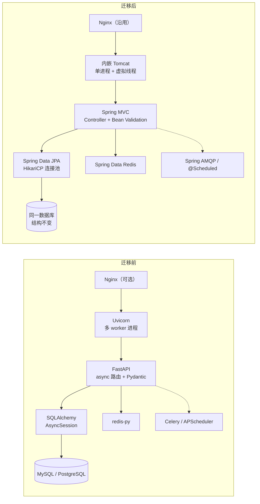
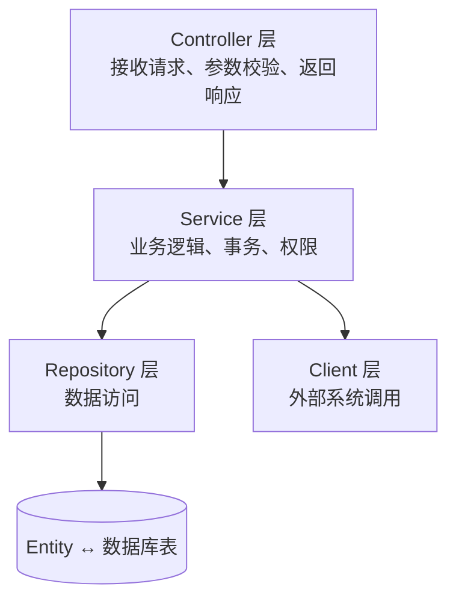
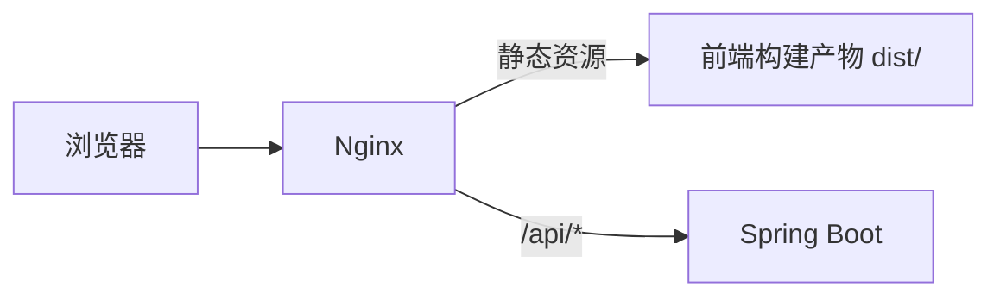
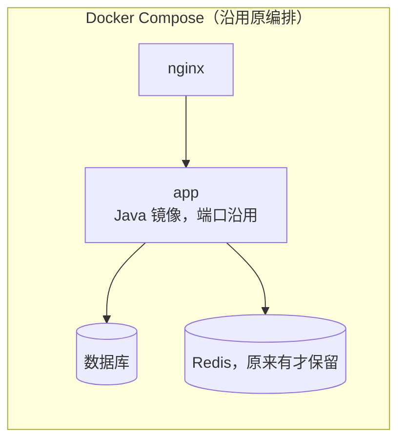

# FastAPI 项目迁移 Java 技术栈指南

> **适用对象**：以 **FastAPI + Uvicorn + Docker** 为主的 Python 项目（常见搭配 Pydantic、SQLAlchemy、Alembic、Redis、Celery/APScheduler，前端为独立 SPA 或 Jinja2 模板）。
>
> **迁移原则**：**等价替换为主，原生优化为辅**。
> - 功能不增不减，对外行为（接口、数据、认证）与原系统一致；
> - Java 框架**原生具备**、且更好或性能更优的实现方式，可以替换原实现（第 4 节逐项标明是否影响对外行为）；
> - 前后端遵循通用 Java Web 架构与规范，代码易读、简洁。
>
> **版本基线**：Java 25 LTS（平台受限时用 21 LTS）、Spring Boot 4.1.x、Maven 3.9.x，数据库沿用原版本。落地时锁定当期最新补丁版本。
>
> **占位约定**：包名 `com.company.app`，示例业务“订单（order）”。

---

## 目录

1. [范围与原则](#1-范围与原则)
2. [迁移前后架构对比](#2-迁移前后架构对比)
3. [目标技术架构](#3-目标技术架构)
4. [技术替换与原生优化方案](#4-技术替换与原生优化方案)
5. [工程目录布局](#5-工程目录布局)
6. [后端实现：FastAPI 到 Spring Boot 逐层对照](#6-后端实现fastapi-到-spring-boot-逐层对照)
7. [行为一致性要点（FastAPI 专项）](#7-行为一致性要点fastapi-专项)
8. [认证与权限](#8-认证与权限)
9. [数据库：SQLAlchemy + Alembic](#9-数据库sqlalchemy--alembic)
10. [异步、后台任务与定时任务](#10-异步后台任务与定时任务)
11. [外部调用、缓存、文件、日志、配置](#11-外部调用缓存文件日志配置)
12. [前端](#12-前端)
13. [Docker 与部署](#13-docker-与部署)
14. [开发规范](#14-开发规范)
15. [测试与对照验收](#15-测试与对照验收)
16. [迁移步骤、切换与回退](#16-迁移步骤切换与回退)
17. [差异清单](#17-差异清单)
18. [常见陷阱](#18-常见陷阱)
- [附录 A：可选增强（不在本次范围）](#附录-a可选增强不在本次范围)
- [附录 B：模板与检查清单](#附录-b模板与检查清单)

---

## 1. 范围与原则

### 1.1 做与不做

| 做 | 不做 |
| --- | --- |
| FastAPI 后端用 Spring Boot 重写 | 新增业务功能 |
| 依赖库替换为 Java 对应技术；有原生更优方案时采用 | 引入原系统没有的基础设施（消息队列、K8s、身份服务、监控平台等） |
| 后台任务、定时任务、外部集成迁移 | 修改接口路径、字段、状态码、错误格式 |
| Dockerfile、启动方式替换为 Java | 修改数据库结构、认证方式、密码哈希 |
| 前后端按通用 Java Web 规范整理目录、格式、注释 | 前端功能和页面改版 |
| 测试改写，并建立新旧对照测试 | |

### 1.2 原则

1. **对外行为一致**：同样的请求和数据，得到同样的响应和数据库结果。
2. **原生优化可采用**：Java 框架自带、能实现原功能且更优的方案可以替换；若会改变对外行为，必须登记并确认（见第 4 节“影响”列）。
3. **原来没有的不引入**：每项技术按“原系统用了 X → 替换为 Y”决定。
4. **旧缺陷原样保持**：登记到差异清单（第 17 节）。只有安全漏洞和数据损坏问题，经确认后可在本次修复。
5. **可随时回退**：数据库、令牌、密码哈希与 Python 兼容，任何阶段都能切回原系统。
6. **规范统一**：目录、命名、格式、注释、文档遵循第 5、14 节，用工具自动检查。

### 1.3 完成定义

- 原系统每个依赖都有结论：替换 / 原生优化 / 删除 / 保留 Python；
- 每个接口通过新旧对照测试；
- 后台和定时任务已在 Java 运行，Python 侧停用；
- 代码通过格式、静态检查和架构规则检查；
- Python 服务下线。

---

## 2. 迁移前后架构对比



| 方面 | FastAPI + Uvicorn | Spring Boot（迁移后） |
| --- | --- | --- |
| 并发模型 | 单线程事件循环 + `async/await`；多 worker 进程 | 每个请求一个**虚拟线程**，普通阻塞写法即可高并发；单进程 |
| 依赖注入 | `Depends()` | Spring IoC 构造器注入 |
| 校验 | Pydantic | Bean Validation（Hibernate Validator） |
| 序列化 | Pydantic | Jackson |
| 接口文档 | 自动生成 `/docs`、`/openapi.json` | springdoc-openapi，**可配置为相同路径** |
| 数据访问 | SQLAlchemy | Spring Data JPA / JdbcClient |
| 进程模型 | Uvicorn/Gunicorn 多进程，各自连接池和缓存 | 单 JVM 进程，共享连接池和本地缓存 |

---

## 3. 目标技术架构

### 3.1 后端分层架构

采用通用 Java Web 分层架构：



| 层 | 职责 | 对应 FastAPI 中的 |
| --- | --- | --- |
| Controller | 路由、参数接收与校验、调用 Service、返回 VO | `routers/*.py` 中的路由函数 |
| Service（接口 + 实现） | 业务逻辑、事务边界、权限判断 | `services/*.py`，或写在路由里的业务代码 |
| Repository | 数据库读写 | `crud/*.py`、直接使用 `session` 的代码 |
| Entity | 映射数据库表 | `models/*.py`（SQLAlchemy 模型） |
| DTO / VO | 请求参数对象 / 响应对象 | `schemas/*.py`（Pydantic 模型） |
| Convert | DTO、Entity、VO 之间转换 | 手写赋值或 `model_validate()` |
| Config | 框架和第三方配置 | `core/config.py`、`main.py` 中的初始化 |

**分层规则**（用 ArchUnit 自动检查，见 14.8 节）：

- Controller 只调用 Service，不直接访问 Repository；
- Entity 不返回给前端，统一转换为 VO；
- 跨业务模块只通过对方的 Service 接口调用；
- Service 之间避免循环依赖。

### 3.2 前端架构

前后端分离，前端为独立工程，由 Nginx 提供静态资源并代理 `/api` 到后端：



- 原前端为 Vue / React SPA：**保留原框架和功能**，按第 12 节整理目录和规范；
- 原前端为 Jinja2 模板：替换为 Thymeleaf，页面输出保持一致；
- 原来由 FastAPI `StaticFiles` 托管前端的，改为 Nginx 托管（原生优化）。

### 3.3 部署架构



服务名、端口、环境变量、挂载目录全部沿用原 `docker-compose.yml`，只替换 `app` 服务的镜像。

---

## 4. 技术替换与原生优化方案

**说明**：
- “替换”：等价替换，对外行为不变；
- “原生优化”：Java 框架自带的更优方案，“影响”列说明是否改变对外行为；
- 只处理原系统实际用到的项。

### 4.1 Web 层

| 原技术 | Java 方案 | 类型 | 收益 | 影响 |
| --- | --- | --- | --- | --- |
| FastAPI 路由 `@router.get` | `@RestController` + `@GetMapping` | 替换 | — | 无 |
| `APIRouter(prefix=, tags=)` | 类级 `@RequestMapping` + `@Tag` | 替换 | — | 无 |
| `Depends()` 依赖注入 | 构造器注入 | 原生优化 | 依赖在启动时检查，缺失立即报错；无每次请求解析依赖的开销 | 无 |
| Pydantic 请求模型 | `record` DTO + Bean Validation | 替换 | — | 校验错误格式需复刻（7.2 节） |
| Pydantic 响应模型 `response_model` | `record` VO + MapStruct | 原生优化 | MapStruct 编译期生成转换代码，无反射；漏映射字段编译即报错 | 无 |
| `async def` 路由 | 普通方法 + 虚拟线程 | 原生优化 | 不再区分同步/异步写法；阻塞的数据库、HTTP 调用不会卡住事件循环 | 无 |
| `def` 同步路由（在线程池执行） | 同上 | 原生优化 | 不受 Starlette 线程池大小限制 | 无 |
| 中间件 `@app.middleware` | `Filter` / `HandlerInterceptor` | 替换 | — | 执行顺序保持一致 |
| `exception_handler` | `@RestControllerAdvice` | 替换 | — | 无 |
| `lifespan` / `startup` 事件 | `ApplicationRunner` / `@EventListener(ApplicationReadyEvent.class)` | 替换 | — | 无 |
| `BackgroundTasks` | `@TransactionalEventListener(AFTER_COMMIT)` + `@Async` | 原生优化 | 只在事务提交成功后执行，避免“数据回滚了但通知已发出” | 失败路径行为更正确，登记差异 |
| `StreamingResponse` | `StreamingResponseBody` | 替换 | — | 无 |
| SSE（`EventSourceResponse`） | `SseEmitter` | 替换 | — | 无 |
| WebSocket | Spring WebSocket | 替换 | — | 消息格式不变 |
| `UploadFile` | `MultipartFile` | 替换 | 超过阈值自动落盘，不占内存 | 大小限制与原配置一致 |
| `CORSMiddleware` | `CorsConfigurationSource` | 替换 | — | 无 |
| `GZipMiddleware` | `server.compression.enabled=true` | 原生优化 | 容器原生压缩，无需额外中间件 | 无 |
| `StaticFiles` 托管前端 | Nginx 托管 | 原生优化 | 静态资源不经过应用，性能更好，可配置缓存 | 缓存头需确认 |
| `Jinja2Templates` | Thymeleaf | 替换 | — | 输出 HTML 一致 |
| 自动 OpenAPI（`/docs`、`/openapi.json`） | springdoc-openapi，配置为相同路径 | 替换 | — | 无 |
| slowapi 限流 | Bucket4j | 替换 | — | 限流规则与响应一致 |

### 4.2 数据层

| 原技术 | Java 方案 | 类型 | 收益 | 影响 |
| --- | --- | --- | --- | --- |
| SQLAlchemy ORM（同步/异步） | Spring Data JPA（Hibernate） | 替换 | — | 无 |
| SQLModel / Tortoise ORM | Spring Data JPA | 替换 | — | 无 |
| asyncpg / aiomysql 异步驱动 | JDBC 驱动 + 虚拟线程 | 原生优化 | 同等并发能力，代码为普通同步写法 | 无 |
| SQLAlchemy 连接池（每个 worker 一个） | HikariCP（单进程共享） | 原生优化 | 总连接数可控，避免多 worker 时连接数成倍增长 | 无 |
| `session.execute(text(...))` | `JdbcClient` | 替换 | — | 无 |
| 逐条 `session.add()` 批量插入 | `JdbcTemplate.batchUpdate` | 原生优化 | JDBC 批处理，大批量写入显著更快 | 无 |
| Alembic | Flyway（接入时只做基线） | 替换 | 启动时校验已执行脚本的校验和 | 无 |
| redis-py / aioredis | Spring Data Redis（Lettuce） | 替换 | 线程安全的共享连接 | 无 |
| fastapi-cache / 手写缓存 | Spring Cache（`@Cacheable`）+ Redis / Caffeine | 原生优化 | 注解声明，替代手写读写缓存代码 | 过期时间与原来一致 |

### 4.3 任务与集成

| 原技术 | Java 方案 | 类型 | 收益 | 影响 |
| --- | --- | --- | --- | --- |
| Celery + RabbitMQ | Spring AMQP（沿用原 RabbitMQ） | 替换 | — | 切换方法见 10.3 节 |
| Celery + Redis / ARQ / RQ | Spring Data Redis 队列 | 替换 | — | 同上 |
| APScheduler / Celery beat | `@Scheduled` | 原生优化 | 无需额外调度器进程 | cron 与时区一致 |
| `asyncio.gather` 并发调用 | 虚拟线程执行器 | 替换 | — | 无 |
| httpx / requests / aiohttp | `RestClient` + `@HttpExchange` 声明式接口 | 原生优化 | 用接口声明外部 API，代码量更少 | 超时、重试与原来一致 |
| tenacity 重试 | `@Retryable`（Spring Framework 7 内置） | 原生优化 | 无需额外依赖 | 重试次数与间隔一致 |
| python-jose / PyJWT | Spring Security OAuth2 资源服务器 | 替换 | 标准过滤链 + 方法级权限注解 | 无（同密钥、同算法） |
| passlib（bcrypt） | `BCryptPasswordEncoder` | 替换 | — | 哈希格式与 Python 互认 |
| openpyxl | Apache POI（大数据量用 `SXSSFWorkbook`） | 替换 | 流式写入，内存恒定 | 输出内容一致 |
| pandas 简单汇总 | SQL 聚合 / Java Stream | 替换 | — | 需对照数值 |
| pandas / numpy 复杂分析、机器学习 | 保留 Python 服务 | — | — | — |

### 4.4 运行与工程

| 原技术 | Java 方案 | 类型 | 收益 | 影响 |
| --- | --- | --- | --- | --- |
| Uvicorn（`--workers N`） | 内嵌 Tomcat，单进程 | 原生优化 | 内存不随 worker 数成倍增加；连接池、本地缓存共享 | 无 |
| Gunicorn + UvicornWorker | 同上 | 原生优化 | 同上 | 无 |
| Uvicorn `--proxy-headers` | `server.forward-headers-strategy=native` | 替换 | — | 无 |
| `root_path` | `server.servlet.context-path` | 替换 | — | 无 |
| 优雅停机（信号处理） | `server.shutdown=graceful` | 原生优化 | 内置，停机时处理完进行中的请求 | 无 |
| pydantic-settings | `@ConfigurationProperties` + `@Validated` | 原生优化 | 类型安全；配置错误时启动即失败 | 原来缺配置也能启动的，现在会失败（登记） |
| logging / loguru | SLF4J + Logback | 替换 | 可异步写日志 | 日志格式与原来一致 |
| python:3.x-slim 镜像 | eclipse-temurin JRE 镜像 + 分层 JAR | 原生优化 | 依赖层缓存，改代码只重建应用层 | 无 |
| 启动速度 | Java 25 AOT 缓存 / CDS（可选） | 原生优化 | 缩短启动时间 | 无 |
| pytest + TestClient | JUnit 5 + MockMvcTester + Testcontainers | 替换 | 真实数据库测试 | 无 |
| black / isort / ruff / mypy | Spotless、Checkstyle、编译器 | 替换 | — | 无 |
| pip / poetry / uv | Maven | 替换 | — | 无 |

### 4.5 原生优化的取舍原则

- “影响”为“无”的项：默认采用；
- 只改变失败路径的项（如 `BackgroundTasks` 改为提交后执行、配置启动校验）：默认采用，同时登记到差异清单并告知相关方；
- 会改变正常路径对外行为的项：不采用，列入附录 A。

---

## 5. 工程目录布局

### 5.1 FastAPI 目录 → Java 目录对照

| FastAPI 典型位置 | Java 位置 |
| --- | --- |
| `app/main.py` | `AppApplication.java` + `config/` |
| `app/core/config.py` | `application.yml` + `config/AppProperties.java` |
| `app/core/security.py` | `common/security/` + `config/SecurityConfig.java` |
| `app/api/deps.py` | 不需要（Spring 依赖注入） |
| `app/routers/order.py` | `modules/order/controller/OrderController.java` |
| `app/schemas/order.py` | `modules/order/dto/`（入参）、`modules/order/vo/`（出参） |
| `app/models/order.py` | `modules/order/entity/Order.java` |
| `app/crud/order.py` | `modules/order/repository/OrderRepository.java` |
| `app/services/order.py` | `modules/order/service/OrderService.java` + `service/impl/OrderServiceImpl.java` |
| `app/db/session.py` | 不需要（Spring Boot 自动配置数据源） |
| `app/tasks/` | `modules/<业务>/job/`（定时）、`modules/<业务>/listener/`（消息消费） |
| `app/utils/` | `common/util/` |
| `alembic/` | `src/main/resources/db/migration/` |
| `tests/` | `src/test/java/` |
| `requirements.txt` / `pyproject.toml` | `pom.xml` |
| `.env` | `.env`（沿用，供 Docker Compose 使用） |
| `Dockerfile` | `Dockerfile` |

### 5.2 后端目录

标准 Maven 布局，**按业务模块分包，模块内按层分包**：

```text
app-backend/
├── pom.xml
├── mvnw, mvnw.cmd, .mvn/
├── Dockerfile
├── README.md
└── src/
    ├── main/
    │   ├── java/com/company/app/
    │   │   ├── AppApplication.java              启动类
    │   │   ├── config/                          框架配置：安全、Jackson、OpenAPI、异步
    │   │   ├── common/                          公共组件
    │   │   │   ├── exception/                   全局异常处理、ApiException
    │   │   │   ├── security/                    认证入口、当前用户
    │   │   │   └── util/                        工具类（无状态）
    │   │   └── modules/                         业务模块
    │   │       ├── order/
    │   │       │   ├── controller/              OrderController
    │   │       │   ├── service/                 OrderService（接口）
    │   │       │   │   └── impl/                OrderServiceImpl
    │   │       │   ├── repository/              OrderRepository
    │   │       │   ├── entity/                  Order
    │   │       │   ├── dto/                     OrderCreateDTO、OrderQueryDTO
    │   │       │   ├── vo/                      OrderVO
    │   │       │   ├── convert/                 OrderConvert（MapStruct）
    │   │       │   └── enums/                   OrderStatus
    │   │       └── user/ …
    │   └── resources/
    │       ├── application.yml                  公共配置
    │       ├── application-dev.yml              开发环境
    │       ├── application-prod.yml             生产环境
    │       ├── logback-spring.xml
    │       └── db/migration/                    Flyway 脚本
    └── test/
        ├── java/com/company/app/
        │   ├── ArchitectureTest.java
        │   └── modules/order/ …                 与 main 目录对应
        └── resources/
```

小项目（业务模块不超过 3 个）可以省略 `modules/` 层级，直接在根包下按层分包（`controller/`、`service/` 等）。

### 5.3 仓库布局

```text
project/
├── app-backend/          Spring Boot 后端
├── app-frontend/         前端（原 SPA；原为独立仓库的保持不变）
├── deploy/               docker-compose.yml、nginx.conf（沿用原文件）
├── docs/                 文档（14.5 节）
└── README.md
```

### 5.4 pom.xml 依赖

只引入原系统实际用到的能力对应的依赖：

```xml
<parent>
    <groupId>org.springframework.boot</groupId>
    <artifactId>spring-boot-starter-parent</artifactId>
    <version>4.1.x</version>
</parent>

<properties>
    <java.version>25</java.version>
    <mapstruct.version>1.6.x</mapstruct.version>
    <springdoc.version>3.x.x</springdoc.version>
</properties>

<dependencies>
    <!-- 必选：Web、校验、安全（JWT）、数据访问、数据库迁移 -->
    <dependency><groupId>org.springframework.boot</groupId><artifactId>spring-boot-starter-webmvc</artifactId></dependency>
    <dependency><groupId>org.springframework.boot</groupId><artifactId>spring-boot-starter-validation</artifactId></dependency>
    <dependency><groupId>org.springframework.boot</groupId><artifactId>spring-boot-starter-security-oauth2-resource-server</artifactId></dependency>
    <dependency><groupId>org.springframework.boot</groupId><artifactId>spring-boot-starter-data-jpa</artifactId></dependency>
    <dependency><groupId>org.springframework.boot</groupId><artifactId>spring-boot-starter-flyway</artifactId></dependency>
    <dependency><groupId>com.mysql</groupId><artifactId>mysql-connector-j</artifactId><scope>runtime</scope></dependency>
    <dependency><groupId>org.mapstruct</groupId><artifactId>mapstruct</artifactId><version>${mapstruct.version}</version></dependency>
    <!-- 对应 FastAPI 自带的 /docs -->
    <dependency><groupId>org.springdoc</groupId><artifactId>springdoc-openapi-starter-webmvc-ui</artifactId><version>${springdoc.version}</version></dependency>

    <!-- 按原系统选择：原来用 Redis / 缓存 / Celery+RabbitMQ / openpyxl 时才加 -->
    <!-- spring-boot-starter-data-redis、spring-boot-starter-cache、spring-boot-starter-amqp、poi-ooxml -->

    <!-- 测试 -->
    <dependency><groupId>org.springframework.boot</groupId><artifactId>spring-boot-starter-test</artifactId><scope>test</scope></dependency>
    <dependency><groupId>org.springframework.boot</groupId><artifactId>spring-boot-starter-webmvc-test</artifactId><scope>test</scope></dependency>
    <dependency><groupId>org.springframework.boot</groupId><artifactId>spring-boot-testcontainers</artifactId><scope>test</scope></dependency>
    <dependency><groupId>org.testcontainers</groupId><artifactId>testcontainers-mysql</artifactId><scope>test</scope></dependency>
    <dependency><groupId>org.springframework.security</groupId><artifactId>spring-security-test</artifactId><scope>test</scope></dependency>
    <dependency><groupId>com.tngtech.archunit</groupId><artifactId>archunit-junit5</artifactId><version>1.4.x</version><scope>test</scope></dependency>
</dependencies>
```

MapStruct 需在 `maven-compiler-plugin` 中配置注解处理器 `mapstruct-processor`，并加编译参数 `-Amapstruct.defaultComponentModel=spring`。PostgreSQL 项目把 MySQL 驱动换为 `org.postgresql:postgresql`。

> Spring Boot 4 的 starter 名称与 3.x 不同（如 `spring-boot-starter-webmvc`），默认 JSON 库为 Jackson 3（包名 `tools.jackson`）。参考网上 3.x 示例时需注意。

---

## 6. 后端实现：FastAPI 到 Spring Boot 逐层对照

以一个典型的订单接口为例。

### 6.1 原 FastAPI 代码

```python
# app/models/order.py
class Order(Base):
    __tablename__ = "orders"
    id = Column(Integer, primary_key=True)
    order_no = Column(String(64), unique=True, nullable=False)
    amount = Column(Numeric(18, 2), nullable=False)
    status = Column(String(16), nullable=False, default="new")
    created_at = Column(DateTime(timezone=True), server_default=func.now())

# app/schemas/order.py
class OrderCreate(BaseModel):
    order_no: str = Field(..., max_length=64)
    amount: Decimal = Field(..., gt=0)

class OrderOut(BaseModel):
    id: int
    order_no: str
    amount: Decimal
    status: str
    created_at: datetime
    model_config = ConfigDict(from_attributes=True)

# app/routers/order.py
router = APIRouter(prefix="/api/orders", tags=["orders"])

@router.post("", response_model=OrderOut, status_code=201)
async def create_order(body: OrderCreate, db: AsyncSession = Depends(get_db),
                       user: User = Depends(get_current_user)):
    exists = await db.scalar(select(Order).where(Order.order_no == body.order_no))
    if exists:
        raise HTTPException(status_code=409, detail="Order number already exists")
    order = Order(order_no=body.order_no, amount=body.amount)
    db.add(order)
    await db.commit()
    await db.refresh(order)
    return order

@router.get("/{order_id}", response_model=OrderOut)
async def get_order(order_id: int, db: AsyncSession = Depends(get_db)):
    order = await db.get(Order, order_id)
    if not order:
        raise HTTPException(status_code=404, detail="Order not found")
    return order
```

### 6.2 Entity（对应 `models`）

```java
package com.company.app.modules.order.entity;

import jakarta.persistence.*;
import java.math.BigDecimal;
import java.time.Instant;

/**
 * 订单，映射已有表 orders。
 */
@Entity
@Table(name = "orders")
public class Order {

    @Id
    @GeneratedValue(strategy = GenerationType.IDENTITY)
    private Long id;

    @Column(name = "order_no", nullable = false, length = 64)
    private String orderNo;

    @Column(nullable = false, precision = 18, scale = 2)
    private BigDecimal amount;

    @Column(nullable = false, length = 16)
    private String status = "new";

    /** 由数据库默认值生成，与原 server_default 一致。 */
    @Column(name = "created_at", insertable = false, updatable = false)
    private Instant createdAt;

    protected Order() {
    }

    public Order(String orderNo, BigDecimal amount) {
        this.orderNo = orderNo;
        this.amount = amount;
    }

    public Long getId() {
        return id;
    }

    public String getOrderNo() {
        return orderNo;
    }

    public BigDecimal getAmount() {
        return amount;
    }

    public String getStatus() {
        return status;
    }

    public Instant getCreatedAt() {
        return createdAt;
    }
}
```

### 6.3 Repository（对应 `crud`）

```java
package com.company.app.modules.order.repository;

import com.company.app.modules.order.entity.Order;
import org.springframework.data.jpa.repository.JpaRepository;

public interface OrderRepository extends JpaRepository<Order, Long> {

    boolean existsByOrderNo(String orderNo);
}
```

### 6.4 DTO 与 VO（对应 `schemas`）

```java
package com.company.app.modules.order.dto;

import jakarta.validation.constraints.DecimalMin;
import jakarta.validation.constraints.NotNull;
import jakarta.validation.constraints.Size;
import java.math.BigDecimal;

/**
 * 创建订单请求，对应原 OrderCreate。
 */
public record OrderCreateDTO(
        @NotNull @Size(max = 64) String orderNo,
        @NotNull @DecimalMin(value = "0", inclusive = false) BigDecimal amount) {
}
```

```java
package com.company.app.modules.order.vo;

import java.math.BigDecimal;
import java.time.Instant;

/**
 * 订单响应，对应原 OrderOut。字段顺序与原响应一致。
 */
public record OrderVO(Long id, String orderNo, BigDecimal amount, String status, Instant createdAt) {
}
```

字段名通过全局 `SNAKE_CASE` 策略输出为 `order_no`、`created_at`（7.1 节）。

### 6.5 Convert（替代手写赋值）

```java
package com.company.app.modules.order.convert;

import com.company.app.modules.order.entity.Order;
import com.company.app.modules.order.vo.OrderVO;
import org.mapstruct.Mapper;

/**
 * 订单对象转换，由 MapStruct 在编译期生成实现。
 */
@Mapper
public interface OrderConvert {

    OrderVO toVO(Order order);
}
```

### 6.6 Service（对应 `services`）

```java
package com.company.app.modules.order.service;

import com.company.app.modules.order.dto.OrderCreateDTO;
import com.company.app.modules.order.vo.OrderVO;

/**
 * 订单业务。
 */
public interface OrderService {

    /**
     * 创建订单。
     *
     * @param dto 订单信息
     * @return 创建后的订单
     * @throws com.company.app.common.exception.ApiException 订单号已存在时（409）
     */
    OrderVO create(OrderCreateDTO dto);

    /**
     * 按 ID 查询订单。
     *
     * @param id 订单 ID
     * @return 订单
     * @throws com.company.app.common.exception.ApiException 订单不存在时（404）
     */
    OrderVO getById(Long id);
}
```

```java
package com.company.app.modules.order.service.impl;

import com.company.app.common.exception.ApiException;
import com.company.app.modules.order.convert.OrderConvert;
import com.company.app.modules.order.dto.OrderCreateDTO;
import com.company.app.modules.order.entity.Order;
import com.company.app.modules.order.repository.OrderRepository;
import com.company.app.modules.order.service.OrderService;
import com.company.app.modules.order.vo.OrderVO;
import jakarta.persistence.EntityManager;
import org.springframework.http.HttpStatus;
import org.springframework.stereotype.Service;
import org.springframework.transaction.annotation.Transactional;

@Service
public class OrderServiceImpl implements OrderService {

    private final OrderRepository orderRepository;
    private final OrderConvert orderConvert;
    private final EntityManager entityManager;

    public OrderServiceImpl(OrderRepository orderRepository, OrderConvert orderConvert, EntityManager entityManager) {
        this.orderRepository = orderRepository;
        this.orderConvert = orderConvert;
        this.entityManager = entityManager;
    }

    @Override
    @Transactional
    public OrderVO create(OrderCreateDTO dto) {
        // 与原实现一致：先查询再插入；并发重复问题见差异 D-001
        if (orderRepository.existsByOrderNo(dto.orderNo())) {
            throw new ApiException(HttpStatus.CONFLICT, "Order number already exists");
        }
        Order order = orderRepository.saveAndFlush(new Order(dto.orderNo(), dto.amount()));
        // 读回数据库生成的 created_at，对应原代码的 db.refresh(order)
        entityManager.refresh(order);
        return orderConvert.toVO(order);
    }

    @Override
    @Transactional(readOnly = true)
    public OrderVO getById(Long id) {
        return orderRepository
                .findById(id)
                .map(orderConvert::toVO)
                .orElseThrow(() -> new ApiException(HttpStatus.NOT_FOUND, "Order not found"));
    }
}
```

### 6.7 Controller（对应 `routers`）

```java
package com.company.app.modules.order.controller;

import com.company.app.modules.order.dto.OrderCreateDTO;
import com.company.app.modules.order.service.OrderService;
import com.company.app.modules.order.vo.OrderVO;
import io.swagger.v3.oas.annotations.Operation;
import io.swagger.v3.oas.annotations.tags.Tag;
import jakarta.validation.Valid;
import org.springframework.http.HttpStatus;
import org.springframework.web.bind.annotation.*;

/**
 * 订单接口，对应原 routers/order.py。
 */
@Tag(name = "orders")
@RestController
@RequestMapping("/api/orders")
public class OrderController {

    private final OrderService orderService;

    public OrderController(OrderService orderService) {
        this.orderService = orderService;
    }

    @Operation(summary = "创建订单")
    @PostMapping
    @ResponseStatus(HttpStatus.CREATED)
    public OrderVO create(@Valid @RequestBody OrderCreateDTO dto) {
        return orderService.create(dto);
    }

    @Operation(summary = "查询订单")
    @GetMapping("/{orderId}")
    public OrderVO getById(@PathVariable Long orderId) {
        return orderService.getById(orderId);
    }
}
```

### 6.8 业务异常（对应 `HTTPException`）

```java
package com.company.app.common.exception;

import org.springframework.http.HttpStatus;

/**
 * 对应 FastAPI 的 HTTPException：携带状态码和 detail。
 */
public class ApiException extends RuntimeException {

    private final HttpStatus status;

    public ApiException(HttpStatus status, String detail) {
        super(detail);
        this.status = status;
    }

    public HttpStatus getStatus() {
        return status;
    }
}
```

全局处理器见 7.2 节，输出与 FastAPI 相同的 `{"detail": ...}` 格式。

### 6.9 写法速查

| FastAPI | Spring Boot | 说明 |
| --- | --- | --- |
| `Depends(get_db)` | 不需要 | 事务由 `@Transactional` 管理 |
| `Depends(get_current_user)` | `@AuthenticationPrincipal` | 第 8 节 |
| `await db.commit()` | 方法正常返回时自动提交 | 抛出运行时异常自动回滚 |
| `response_model` 过滤字段 | 返回 VO，只包含需要的字段 | — |
| `status_code=201` | `@ResponseStatus(HttpStatus.CREATED)` | — |
| `Query(default=10, le=100)` | `@RequestParam(defaultValue = "10") @Max(100) int size` | 类上加 `@Validated` |
| `Path(...)` | `@PathVariable` | — |
| `Header(...)` | `@RequestHeader("X-Request-Id")` | FastAPI 自动把 `_` 转为 `-`，Java 写实际头名 |
| `Cookie(...)` | `@CookieValue` | — |
| `Form(...)` | `@RequestParam`（表单） | — |
| `UploadFile` | `@RequestParam MultipartFile file` | — |

---

## 7. 行为一致性要点（FastAPI 专项）

### 7.1 JSON 输出

```yaml
spring:
  jackson:
    property-naming-strategy: SNAKE_CASE   # 与 Pydantic 字段名一致
    default-property-inclusion: always     # Pydantic 默认输出 null 字段
```

| 项 | FastAPI / Pydantic v2 | Java 处理 |
| --- | --- | --- |
| 字段命名 | 与 Python 属性名相同（通常 snake_case） | 全局 `SNAKE_CASE`；个别字段 `@JsonProperty` |
| 别名 `Field(alias=...)` | 输出别名 | `@JsonProperty("别名")` |
| `None` | 输出 `null` | 默认相同 |
| `response_model_exclude_none=True` | 省略 null 字段 | VO 上加 `@JsonInclude(JsonInclude.Include.NON_NULL)` |
| `Decimal` | **Pydantic v2 输出字符串**（如 `"99.00"`）；v1 输出数字 | 字符串则 VO 字段用 `String`（`amount.toPlainString()`），数字则用 `BigDecimal` |
| `datetime`（带时区 UTC） | `"2026-10-12T08:00:00Z"`，有微秒时带小数 | `Instant` 输出形式相同；小数位以样本为准 |
| `datetime`（无时区） | `"2026-10-12T08:00:00"` | `LocalDateTime` |
| `date` | `"2026-10-12"` | `LocalDate` |
| `Enum` | 输出枚举值 | 枚举加 `@JsonValue` 返回原值 |
| `float` | 如 `1e-05` | Jackson 为 `1.0E-5`，解析结果相同；按字符串比较时才需处理 |
| 字段顺序 | 模型定义顺序 | record 按声明顺序 |

时间精度：Python 为微秒，Java `Instant.now()` 可能到纳秒。写入时截断，保证两边一致：

```java
Instant now = Instant.now().truncatedTo(ChronoUnit.MICROS);
```

**以真实响应样本为准**：所有格式问题都通过对照测试（第 15 节）确认，不凭经验判断。

### 7.2 错误响应

| 场景 | 状态码 | FastAPI 默认响应 |
| --- | --- | --- |
| `HTTPException(404, "Order not found")` | 404 | `{"detail": "Order not found"}` |
| 路由不存在 | 404 | `{"detail": "Not Found"}` |
| 方法不允许 | 405 | `{"detail": "Method Not Allowed"}` |
| 未携带令牌（`OAuth2PasswordBearer`） | 401 | `{"detail": "Not authenticated"}`，响应头 `WWW-Authenticate: Bearer` |
| 参数校验失败 | **422** | `{"detail": [{"type": "missing", "loc": ["body", "order_no"], "msg": "Field required", "input": {...}}]}` |
| 请求体不是合法 JSON | 422 | `{"detail": [{"type": "json_invalid", ...}]}` |

全局异常处理器：

```java
package com.company.app.common.exception;

import java.util.LinkedHashMap;
import java.util.List;
import java.util.Map;
import org.springframework.http.HttpStatus;
import org.springframework.http.ResponseEntity;
import org.springframework.web.HttpRequestMethodNotSupportedException;
import org.springframework.web.bind.MethodArgumentNotValidException;
import org.springframework.web.bind.annotation.ExceptionHandler;
import org.springframework.web.bind.annotation.RestControllerAdvice;
import org.springframework.web.servlet.resource.NoResourceFoundException;

/**
 * 全局异常处理，输出与 FastAPI 默认格式一致的错误响应。
 */
@RestControllerAdvice
public class GlobalExceptionHandler {

    @ExceptionHandler(ApiException.class)
    public ResponseEntity<Map<String, Object>> handleApi(ApiException e) {
        return ResponseEntity.status(e.getStatus()).body(Map.of("detail", e.getMessage()));
    }

    @ExceptionHandler(NoResourceFoundException.class)
    public ResponseEntity<Map<String, Object>> handleNotFound() {
        return ResponseEntity.status(HttpStatus.NOT_FOUND).body(Map.of("detail", "Not Found"));
    }

    @ExceptionHandler(HttpRequestMethodNotSupportedException.class)
    public ResponseEntity<Map<String, Object>> handleMethodNotAllowed() {
        return ResponseEntity.status(HttpStatus.METHOD_NOT_ALLOWED).body(Map.of("detail", "Method Not Allowed"));
    }

    /** 参数校验失败：返回 422 和 Pydantic 风格的错误列表。 */
    @ExceptionHandler(MethodArgumentNotValidException.class)
    public ResponseEntity<Map<String, Object>> handleValidation(MethodArgumentNotValidException e) {
        List<Map<String, Object>> errors = e.getBindingResult().getFieldErrors().stream()
                .map(error -> {
                    Map<String, Object> item = new LinkedHashMap<>();
                    item.put("type", PydanticErrors.type(error));
                    item.put("loc", List.of("body", PydanticErrors.snakeCase(error.getField())));
                    item.put("msg", PydanticErrors.message(error));
                    item.put("input", error.getRejectedValue());
                    return item;
                })
                .toList();
        return ResponseEntity.unprocessableEntity().body(Map.of("detail", errors));
    }
}
```

`PydanticErrors` 是一个小工具类，把 Bean Validation 约束映射为 Pydantic 的错误类型和文案：

| Bean Validation | Pydantic `type` | `msg` |
| --- | --- | --- |
| `@NotNull`（字段缺失） | `missing` | `Field required` |
| `@Size(max = 64)` | `string_too_long` | `String should have at most 64 characters` |
| `@DecimalMin(value = "0", inclusive = false)` | `greater_than` | `Input should be greater than 0` |

> 只复刻客户端实际依赖的部分。多数前端只使用状态码 422 和 `msg`，`type`、`input` 可按需简化。请求体无法解析时 Spring 抛出 `HttpMessageNotReadableException`，同样处理为 422。

### 7.3 HTTP 细节

| 项 | FastAPI / Uvicorn | Java 处理 |
| --- | --- | --- |
| POST 默认状态码 | 200（除非声明 `status_code`） | 不加 `@ResponseStatus` 即为 200 |
| 末尾斜杠 | `/api/orders/` 与 `/api/orders` 不匹配时 **307 重定向** | Spring 6+ 不自动匹配；按原路径映射，客户端依赖重定向时加过滤器返回 307 |
| 列表查询参数 | `?tag=a&tag=b` | `@RequestParam List<String>`。Spring 还会把 `?tag=a,b` 拆成两个值，FastAPI 不会，值中可能含逗号时需单独处理 |
| 布尔查询参数 | 接受 `true/false/1/0/yes/no/on/off` | Spring 接受同样的取值 |
| 接口文档 | `/docs`、`/openapi.json` | `springdoc.swagger-ui.path=/docs`、`springdoc.api-docs.path=/openapi.json`；生产环境开关与原来一致 |
| 代理头 | `--proxy-headers` | `server.forward-headers-strategy=native` |
| 上传大小 | Nginx 或代码限制 | `spring.servlet.multipart.max-file-size` 与原来一致 |

### 7.4 数值、字符串与时间

| 场景 | Python | Java |
| --- | --- | --- |
| 负数整除 / 取模 | `//` 向下取整，`%` 与除数同号 | `Math.floorDiv`、`Math.floorMod` |
| `round(2.5)` | 2（银行家舍入） | `BigDecimal.setScale(0, RoundingMode.HALF_EVEN)` |
| 大整数 | 不溢出 | `Math.addExact` 或 `BigInteger` |
| `str.lower()` | 与区域无关 | `toLowerCase(Locale.ROOT)` |
| `str.strip()` | 去 Unicode 空白 | `String.strip()` |
| `len(s)` | 按字符 | 含表情等字符时用 `codePointCount` |
| 正则 `\d`、`\w` | 匹配 Unicode | 加 `Pattern.UNICODE_CHARACTER_CLASS` |
| `datetime.utcnow()` | 无时区 UTC | `LocalDateTime.now(ZoneOffset.UTC)` |
| `dict` 顺序 | 插入顺序 | `LinkedHashMap` |

### 7.5 SQLAlchemy 行为

| 项 | SQLAlchemy | Java 处理 |
| --- | --- | --- |
| `default=` | 插入时由应用赋值 | 字段初始值或构造器赋值 |
| `server_default=` | 数据库生成 | `insertable = false`，保存后 `refresh` |
| `onupdate=` | 更新时应用赋值 | `@PreUpdate` |
| 查询无 `order_by` | 顺序不保证 | 原代码依赖顺序的，加相同排序 |
| `relationship(lazy="selectin")` | 自动批量加载 | `@EntityGraph` 或 JOIN FETCH，避免 N+1 |
| 一个请求多次 `commit()` | 多个事务 | 拆成多个事务方法，提交点一致 |

---

## 8. 认证与权限

### 8.1 FastAPI 典型认证方式

- `POST /token`：表单提交 `username`、`password`，返回 `{"access_token": "...", "token_type": "bearer"}`；
- 其他接口携带 `Authorization: Bearer <token>`；
- python-jose / PyJWT 用 HS256 签名，声明为 `sub`、`exp`；
- passlib bcrypt 存储密码。

Java 使用**相同的算法、密钥、声明和有效期**，两边签发的令牌互相有效，共存期用户无感知。

### 8.2 安全配置

```java
package com.company.app.config;

import com.company.app.common.security.FastApiAuthEntryPoint;
import java.nio.charset.StandardCharsets;
import javax.crypto.spec.SecretKeySpec;
import org.springframework.context.annotation.Bean;
import org.springframework.context.annotation.Configuration;
import org.springframework.security.config.Customizer;
import org.springframework.security.config.annotation.method.configuration.EnableMethodSecurity;
import org.springframework.security.config.annotation.web.builders.HttpSecurity;
import org.springframework.security.config.http.SessionCreationPolicy;
import org.springframework.security.crypto.bcrypt.BCryptPasswordEncoder;
import org.springframework.security.crypto.password.PasswordEncoder;
import org.springframework.security.oauth2.jose.jws.MacAlgorithm;
import org.springframework.security.oauth2.jwt.*;
import org.springframework.security.web.SecurityFilterChain;

/**
 * 与原 FastAPI 一致的 JWT 认证：相同密钥、算法和声明。
 */
@Configuration
@EnableMethodSecurity
public class SecurityConfig {

    private final SecretKeySpec signingKey;

    public SecurityConfig(AppProperties properties) {
        byte[] secret = properties.security().secretKey().getBytes(StandardCharsets.UTF_8);
        this.signingKey = new SecretKeySpec(secret, "HmacSHA256");
    }

    @Bean
    public SecurityFilterChain securityFilterChain(HttpSecurity http, FastApiAuthEntryPoint entryPoint)
            throws Exception {
        return http.csrf(csrf -> csrf.disable())
                .sessionManagement(session -> session.sessionCreationPolicy(SessionCreationPolicy.STATELESS))
                .authorizeHttpRequests(auth -> auth.requestMatchers("/token", "/docs/**", "/openapi.json", "/health")
                        .permitAll()
                        .anyRequest()
                        .authenticated())
                .oauth2ResourceServer(oauth -> oauth.jwt(Customizer.withDefaults()).authenticationEntryPoint(entryPoint))
                .exceptionHandling(e -> e.authenticationEntryPoint(entryPoint))
                .build();
    }

    @Bean
    public JwtDecoder jwtDecoder() {
        return NimbusJwtDecoder.withSecretKey(signingKey).macAlgorithm(MacAlgorithm.HS256).build();
    }

    @Bean
    public JwtEncoder jwtEncoder() {
        return NimbusJwtEncoder.withSecretKey(signingKey).algorithm(MacAlgorithm.HS256).build();
    }

    /** 与 passlib bcrypt 互认：$2b$ 前缀、相同成本因子。 */
    @Bean
    public PasswordEncoder passwordEncoder() {
        return new BCryptPasswordEncoder(BCryptPasswordEncoder.BCryptVersion.$2B, 12);
    }
}
```

未认证时返回与 FastAPI 相同的响应：

```java
package com.company.app.common.security;

/**
 * 未认证时返回 FastAPI 格式：401 + {"detail": "..."} + WWW-Authenticate 头。
 */
@Component
public class FastApiAuthEntryPoint implements AuthenticationEntryPoint {

    @Override
    public void commence(HttpServletRequest request, HttpServletResponse response, AuthenticationException e)
            throws IOException {
        boolean hasToken = request.getHeader(HttpHeaders.AUTHORIZATION) != null;
        // 文案与原系统一致：无令牌时为 FastAPI 默认文案，令牌无效时为原代码中的文案
        String detail = hasToken ? "Could not validate credentials" : "Not authenticated";
        response.setStatus(HttpStatus.UNAUTHORIZED.value());
        response.setHeader(HttpHeaders.WWW_AUTHENTICATE, "Bearer");
        response.setContentType(MediaType.APPLICATION_JSON_VALUE);
        response.getWriter().write("{\"detail\":\"" + detail + "\"}");
    }
}
```

### 8.3 登录接口

```java
package com.company.app.modules.auth.controller;

/**
 * 登录接口，对应原 POST /token：表单登录，返回与原系统相同结构的令牌。
 */
@RestController
public class AuthController {

    private final UserRepository userRepository;
    private final PasswordEncoder passwordEncoder;
    private final JwtEncoder jwtEncoder;
    private final AppProperties properties;

    public AuthController(
            UserRepository userRepository,
            PasswordEncoder passwordEncoder,
            JwtEncoder jwtEncoder,
            AppProperties properties) {
        this.userRepository = userRepository;
        this.passwordEncoder = passwordEncoder;
        this.jwtEncoder = jwtEncoder;
        this.properties = properties;
    }

    @PostMapping(value = "/token", consumes = MediaType.APPLICATION_FORM_URLENCODED_VALUE)
    public Map<String, String> login(@RequestParam String username, @RequestParam String password) {
        User user = userRepository
                .findByUsername(username)
                .filter(u -> passwordEncoder.matches(password, u.getHashedPassword()))
                .orElseThrow(() -> new ApiException(HttpStatus.UNAUTHORIZED, "Incorrect username or password"));

        Duration ttl = Duration.ofMinutes(properties.security().accessTokenExpireMinutes());
        JwtClaimsSet claims = JwtClaimsSet.builder()
                .subject(user.getUsername())
                .expiresAt(Instant.now().plus(ttl))
                .build();
        JwsHeader header = JwsHeader.with(MacAlgorithm.HS256).build();
        String token = jwtEncoder.encode(JwtEncoderParameters.from(header, claims)).getTokenValue();
        return Map.of("access_token", token, "token_type", "bearer");
    }
}
```

> 声明内容与原令牌逐项对照：原来只有 `sub`、`exp` 就只放这两项；有 `iat`、角色等字段就照样加入。原系统 401 响应若带 `WWW-Authenticate` 头，`ApiException` 处理时一并加上。

### 8.4 获取当前用户（对应 `Depends(get_current_user)`）

```java
@GetMapping("/users/me")
public UserVO me(@AuthenticationPrincipal Jwt jwt) {
    return userService.getByUsername(jwt.getSubject());
}
```

### 8.5 权限（对应依赖中的角色判断）

| FastAPI 写法 | Spring 写法 |
| --- | --- |
| `Depends(get_current_active_user)`（检查 `is_active`） | Service 中检查，或在认证转换时加载用户并判断 |
| `Depends(require_role("admin"))` | `@PreAuthorize("hasRole('ADMIN')")`（角色从原用户表或令牌读取） |
| `Security(get_current_user, scopes=["items:read"])` | `@PreAuthorize("hasAuthority('SCOPE_items:read')")`（令牌 `scope` 声明自动映射） |
| 查询中按当前用户过滤 | Repository 方法加相同条件 |

无权限时的状态码和 `detail` 文案与原系统一致（以实际响应为准）。

### 8.6 互认测试

- Python 签发的令牌 Java 能校验，Java 签发的令牌 Python 能校验；
- Python 生成的 bcrypt 哈希 Java 能校验，反之亦然；
- 过期令牌两边都拒绝。

---

## 9. 数据库：SQLAlchemy + Alembic

### 9.1 接入现有库

1. 迁移期间**表结构不变**，冻结 Alembic 新迁移；
2. 导出当前结构作为 `V1__baseline.sql`，仅用于新建空库和测试；
3. 对已有库只做 Flyway 基线登记：

```yaml
spring:
  flyway:
    baseline-on-migrate: true
    baseline-version: 1
  jpa:
    open-in-view: false
    hibernate:
      ddl-auto: validate      # 实体与表不一致时启动失败，绝不自动修改表
```

`alembic_version` 表保留不动，Python 下线后再删除。

### 9.2 类型映射

| SQLAlchemy | Java |
| --- | --- |
| `Integer` / `BigInteger` 主键 | `Integer` / `Long` + `@GeneratedValue(strategy = IDENTITY)` |
| `String(n)` | `String` + `@Column(length = n)` |
| `Text` | `String` + `@Column(columnDefinition = "TEXT")` |
| `Numeric(p, s)` | `BigDecimal` + `precision`、`scale` |
| `Float` | `Double` |
| `Boolean` | `Boolean` |
| `DateTime(timezone=True)` | `Instant` / `OffsetDateTime` |
| `DateTime`（无时区） | `LocalDateTime` |
| `Date` | `LocalDate` |
| `Enum(PyEnum)` | 枚举 + `AttributeConverter`（存原值，不用序号） |
| `JSON` / `JSONB` | `@JdbcTypeCode(SqlTypes.JSON)` + `Map` 或 record |
| `UUID` | `UUID` |
| `ForeignKey` + `relationship` | `@ManyToOne(fetch = FetchType.LAZY)` + `@JoinColumn`，或只映射外键 ID |
| 可空列 | 包装类型（不用 `int`、`boolean`） |

时区：数据库存 UTC 的，设置 `spring.jpa.properties.hibernate.jdbc.time_zone=UTC`；存本地时间的，用 `LocalDateTime` 并保持原时区语义。用真实数据验证两边读出的值一致。

### 9.3 复杂查询

原系统中 `select()` 组合查询和 `text()` 原生 SQL，用 JPA `@Query` 或 `JdbcClient` 迁移：

```java
/**
 * 订单统计查询，SQL 与原实现一致。
 */
@Repository
public class OrderStatRepository {

    private final JdbcClient jdbcClient;

    public OrderStatRepository(JdbcClient jdbcClient) {
        this.jdbcClient = jdbcClient;
    }

    public List<DailyTotal> listDailyTotals(LocalDate start, LocalDate end) {
        return jdbcClient
                .sql("""
                        SELECT DATE(created_at) AS day, COUNT(*) AS cnt, SUM(amount) AS total
                        FROM orders
                        WHERE created_at >= :start AND created_at < :end
                        GROUP BY DATE(created_at)
                        ORDER BY day
                        """)
                .param("start", start)
                .param("end", end)
                .query(DailyTotal.class)
                .list();
    }
}
```

### 9.4 原生优化：批量写入

原代码逐条 `session.add()` 后一次 `commit()` 的批量导入，改用 JDBC 批处理：

```java
jdbcTemplate.batchUpdate(
        "INSERT INTO orders (order_no, amount, status) VALUES (?, ?, ?)",
        rows,
        1000,
        (ps, row) -> {
            ps.setString(1, row.orderNo());
            ps.setBigDecimal(2, row.amount());
            ps.setString(3, "new");
        });
```

> 使用 `IDENTITY` 主键时，Hibernate 无法批量执行实体插入，大批量写入应走 JDBC 批处理。MySQL 连接串加 `rewriteBatchedStatements=true` 可进一步提速。

---

## 10. 异步、后台任务与定时任务

### 10.1 async/await → 虚拟线程

```yaml
spring:
  threads:
    virtual:
      enabled: true
```

开启后每个请求运行在虚拟线程上，阻塞操作不占用平台线程。原来的 `async def` + `await` 全部改为普通同步写法：

| Python | Java |
| --- | --- |
| `await db.execute(...)` | `repository.findXxx(...)` |
| `await client.get(url)` | `restClient.get().uri(url).retrieve().body(Xxx.class)` |
| `await asyncio.sleep(1)` | `Thread.sleep(1000)`（虚拟线程中不占用平台线程） |
| `await asyncio.gather(a(), b())` | 见下例 |

```java
try (var executor = Executors.newVirtualThreadPerTaskExecutor()) {
    Future<User> user = executor.submit(() -> userClient.getUser(userId));
    Future<List<Order>> orders = executor.submit(() -> orderClient.listOrders(userId));
    return new Dashboard(user.get(), orders.get());
}
```

> Java 21 中，虚拟线程在 `synchronized` 块内阻塞会占住平台线程（Java 24 起已修复），这是推荐 Java 25 的原因之一。

### 10.2 BackgroundTasks → 事务提交后异步执行（原生优化）

```java
// Service 事务方法中发布事件
eventPublisher.publishEvent(new OrderCreatedEvent(order.getId()));
```

```java
/**
 * 订单创建后的通知，对应原 BackgroundTasks。只在事务提交成功后执行。
 */
@Component
public class OrderNotifyListener {

    private final NotifyService notifyService;

    public OrderNotifyListener(NotifyService notifyService) {
        this.notifyService = notifyService;
    }

    @Async
    @TransactionalEventListener(phase = TransactionPhase.AFTER_COMMIT)
    public void onOrderCreated(OrderCreatedEvent event) {
        notifyService.sendOrderCreated(event.orderId());
    }
}
```

在配置类上加 `@EnableAsync`；开启虚拟线程后，`@Async` 默认使用虚拟线程执行。

### 10.3 Celery 任务

Celery 消息是专有协议，Java 不直接消费。**按任务类型整体切换**：

1. 该任务的生产者接口和消费者一起迁到 Java，使用新的队列名和 JSON 消息体；
2. Nginx 把生产者接口切到 Java → 等 Python 队列中该类任务处理完 → 停掉 Python worker 对该任务的监听；
3. 回退时把接口切回 Python 即可。

```java
/**
 * 报表生成任务消费者，对应原 Celery 任务 generate_report。
 */
@Component
public class ReportTaskListener {

    private final ReportService reportService;

    public ReportTaskListener(ReportService reportService) {
        this.reportService = reportService;
    }

    /** 重试次数与原任务 max_retries 一致，通过 spring.rabbitmq.listener.simple.retry 配置。 */
    @RabbitListener(queues = "app.report.generate")
    public void handle(ReportTaskMessage message) {
        reportService.generate(message.reportId());
    }
}
```

前端如果轮询任务状态（原 Celery `AsyncResult`），Java 提供相同路径和响应结构的状态查询接口。

### 10.4 定时任务

```java
/**
 * 每日报表任务，对应原 APScheduler CronTrigger(hour=2, minute=0, timezone="Asia/Shanghai")。
 */
@Component
public class DailyReportJob {

    private final ReportService reportService;

    public DailyReportJob(ReportService reportService) {
        this.reportService = reportService;
    }

    @Scheduled(cron = "0 0 2 * * *", zone = "Asia/Shanghai")
    public void run() {
        reportService.generateDaily();
    }
}
```

- 配置类上加 `@EnableScheduling`；
- Spring cron 为 6 段（首位为秒），APScheduler / crontab 为 5 段；
- 切换顺序：先停 Python 的该项调度，再启用 Java；
- 原系统多实例部署且有防重复执行机制（如 Redis 锁）的，Java 用相同锁键或 ShedLock。

---

## 11. 外部调用、缓存、文件、日志、配置

### 11.1 外部调用（httpx → RestClient 声明式接口）

```java
/**
 * ERP 接口声明，替代原 httpx 调用代码。
 */
public interface ErpClient {

    @GetExchange("/orders/{orderNo}")
    ErpOrder getOrder(@PathVariable String orderNo);
}
```

```java
@Configuration
@EnableResilientMethods
public class ErpClientConfig {

    @Bean
    public ErpClient erpClient(RestClient.Builder builder, AppProperties properties) {
        HttpClient httpClient = HttpClient.newBuilder()
                .connectTimeout(Duration.ofSeconds(5)) // 与原 httpx.Timeout 一致
                .build();
        JdkClientHttpRequestFactory factory = new JdkClientHttpRequestFactory(httpClient);
        factory.setReadTimeout(Duration.ofSeconds(30));
        RestClient restClient = builder.baseUrl(properties.erp().baseUrl())
                .requestFactory(factory)
                .build();
        return HttpServiceProxyFactory.builderFor(RestClientAdapter.create(restClient))
                .build()
                .createClient(ErpClient.class);
    }
}
```

重试：原 tenacity `stop_after_attempt(3)` 表示共 3 次尝试，即首次加重试 2 次：

```java
@Retryable(includes = ResourceAccessException.class, maxRetries = 2, delay = 1000, multiplier = 2)
public ErpOrder getErpOrder(String orderNo) {
    return erpClient.getOrder(orderNo);
}
```

### 11.2 缓存

```java
@Cacheable(cacheNames = "dict", key = "#type")
public List<DictItemVO> listByType(String type) {
    // ...
}

@CacheEvict(cacheNames = "dict", key = "#type")
public void update(String type, DictUpdateDTO dto) {
    // ...
}
```

- 过期时间在 `RedisCacheConfiguration` 中设为原值；
- Python 缓存值多为 pickle 或自定义格式，Java 使用**不同的键前缀**；
- 某数据的读写接口分别在两边且有缓存时，必须同批切换，否则一方会读到旧缓存。

### 11.3 文件

| 项 | 要求 |
| --- | --- |
| 存储位置 | 沿用原目录（Docker 挂载卷不变） |
| 下载文件名 | `Content-Disposition` 与原来一致 |
| Excel | 表名、表头、列顺序、单元格类型一致；大数据量用 `SXSSFWorkbook` 流式写（原生优化） |
| CSV | 编码、BOM、分隔符、换行符（Python `csv` 默认 `\r\n`）一致 |
| 流式下载 | `StreamingResponseBody`，对应原 `StreamingResponse` |

### 11.4 日志

```xml
<!-- logback-spring.xml -->
<configuration>
    <!-- 对应原 logging 格式："%(asctime)s %(levelname)s %(name)s %(message)s" -->
    <appender name="CONSOLE" class="ch.qos.logback.core.ConsoleAppender">
        <encoder>
            <pattern>%d{yyyy-MM-dd HH:mm:ss,SSS} %level %logger{36} %msg%n</pattern>
        </encoder>
    </appender>
    <!-- 原生优化：异步输出，日志 I/O 不阻塞请求线程 -->
    <appender name="ASYNC" class="ch.qos.logback.classic.AsyncAppender">
        <appender-ref ref="CONSOLE"/>
    </appender>
    <root level="INFO">
        <appender-ref ref="ASYNC"/>
    </root>
</configuration>
```

Uvicorn 默认输出访问日志；Java 侧由 Nginx 访问日志承担，或开启 `server.tomcat.accesslog.enabled=true`。

### 11.5 配置（pydantic-settings → @ConfigurationProperties）

**环境变量名保持不变**，部署文件无需修改。

```python
# 原 app/core/config.py
class Settings(BaseSettings):
    secret_key: str
    access_token_expire_minutes: int = 30
    erp_base_url: str = "http://erp.local"
```

```yaml
# application.yml：引用原环境变量
app:
  security:
    secret-key: ${SECRET_KEY}
    access-token-expire-minutes: ${ACCESS_TOKEN_EXPIRE_MINUTES:30}
  erp:
    base-url: ${ERP_BASE_URL:http://erp.local}
```

```java
/**
 * 应用配置，对应原 Settings。启动时校验，配置错误立即失败。
 */
@Validated
@ConfigurationProperties(prefix = "app")
public record AppProperties(@Valid Security security, @Valid Erp erp) {

    public record Security(@NotBlank String secretKey, @Positive int accessTokenExpireMinutes) {
    }

    public record Erp(@NotBlank String baseUrl) {
    }
}
```

在启动类上加 `@ConfigurationPropertiesScan`。原 `DATABASE_URL`（如 `mysql+aiomysql://user:pass@db:3306/app`）不是 JDBC 格式：推荐在 `.env` 中增加 `SPRING_DATASOURCE_URL`、`SPRING_DATASOURCE_USERNAME`、`SPRING_DATASOURCE_PASSWORD`；不能改部署文件时，写一个配置类解析 `DATABASE_URL` 后创建数据源。

---

## 12. 前端

### 12.1 处理方式

| 原系统 | 处理 |
| --- | --- |
| 独立 SPA（Vue / React），由 Nginx 托管 | 功能不变；按 12.2–12.4 节整理目录和规范 |
| 独立 SPA，由 FastAPI `StaticFiles` 托管 | 改为 Nginx 托管（原生优化），SPA 路由配置 `try_files $uri /index.html` |
| Jinja2 模板页面 | 替换为 Thymeleaf，放在 `src/main/resources/templates/`，页面输出一致 |

接口地址、请求和响应格式都不变，前端业务代码一般**无需修改**。

### 12.2 目录规范（Vue 3 + TypeScript + Vite）

```text
app-frontend/
├── package.json
├── vite.config.ts
├── tsconfig.json
├── .env.development / .env.production     环境变量（VITE_API_BASE 等）
├── eslint.config.js / .prettierrc
├── index.html
└── src/
    ├── main.ts                             入口
    ├── App.vue
    ├── api/                                接口请求，按业务分文件：order.ts、user.ts
    ├── views/                              页面，按业务分目录：order/OrderList.vue
    ├── components/                         通用组件
    ├── router/                             路由
    ├── stores/                             状态管理（Pinia）
    ├── utils/                              工具：request.ts（Axios 封装）、format.ts
    ├── types/                              TypeScript 类型定义
    └── assets/                             静态资源
```

React 项目对应：`views/` 改为 `pages/`，`stores/` 用 Zustand 或 Redux Toolkit，其余相同。

### 12.3 前端规范

| 项 | 规范 |
| --- | --- |
| 语言 | TypeScript，开启 `strict`（原为 JavaScript 的项目逐步迁移，不强制一次完成） |
| 格式 | Prettier（2 空格缩进、单引号、行宽 100） |
| 检查 | ESLint（Vue 官方规则 / React Hooks 规则），提交前无错误 |
| 命名 | 组件文件 `PascalCase.vue`；其他文件 `camelCase.ts`；常量 `UPPER_SNAKE_CASE` |
| 接口调用 | 统一放在 `api/` 目录，页面中不直接写 URL |
| 类型 | 接口类型定义在 `types/`，字段与后端响应一致（snake_case 保持原样） |
| 注释 | 组件顶部说明用途；复杂逻辑说明原因 |

### 12.4 原生优化（不改功能）

- Nginx 对带哈希的静态资源设置长缓存（`expires 1y`），`index.html` 不缓存；
- 开启 Nginx gzip；
- 构建工具若为旧版 webpack / Vue CLI，可评估换为 Vite（构建更快，产物功能不变），由前端负责人决定。

---

## 13. Docker 与部署

### 13.1 Dockerfile 对照

原 Python：

```dockerfile
FROM python:3.11-slim
WORKDIR /app
COPY requirements.txt .
RUN pip install --no-cache-dir -r requirements.txt
COPY . .
EXPOSE 8000
CMD ["uvicorn", "app.main:app", "--host", "0.0.0.0", "--port", "8000", "--workers", "4"]
```

Java（多阶段构建 + 分层 JAR，**端口沿用 8000**）：

```dockerfile
# 构建阶段
FROM eclipse-temurin:25-jdk AS build
WORKDIR /src
COPY .mvn/ .mvn/
COPY mvnw pom.xml ./
RUN ./mvnw -B dependency:go-offline
COPY src/ src/
RUN ./mvnw -B -DskipTests package \
 && java -Djarmode=tools -jar target/app.jar extract --layers --launcher --destination /extracted

# 运行阶段
FROM eclipse-temurin:25-jre
RUN groupadd --system app && useradd --system --gid app --uid 10001 app
WORKDIR /app
COPY --from=build /extracted/dependencies/ ./
COPY --from=build /extracted/spring-boot-loader/ ./
COPY --from=build /extracted/snapshot-dependencies/ ./
COPY --from=build /extracted/application/ ./
USER 10001
EXPOSE 8000
ENTRYPOINT ["java", "-XX:MaxRAMPercentage=75", "org.springframework.boot.loader.launch.JarLauncher"]
```

> 测试在 CI 中执行，镜像构建阶段跳过测试。`pom.xml` 中设置 `<finalName>app</finalName>`。

```yaml
# application.yml
server:
  port: ${PORT:8000}                 # 与原 Uvicorn 端口一致，compose 和 nginx 无需修改
  shutdown: graceful
  forward-headers-strategy: native
  compression:
    enabled: true                    # 原来有 GZipMiddleware 时开启
spring:
  lifecycle:
    timeout-per-shutdown-phase: 30s
```

### 13.2 docker-compose.yml

只修改 `app` 服务的构建目录和停机等待时间，其余不变：

```yaml
services:
  app:
    build: ./app-backend               # 原为 Python 工程目录
    env_file: .env                     # 沿用
    ports:
      - "8000:8000"                    # 沿用
    volumes:
      - ./data/uploads:/app/uploads    # 沿用
    depends_on:
      - db
    healthcheck:                       # 原来有才保留，路径与原系统一致
      test: ["CMD", "curl", "-f", "http://localhost:8000/health"]
      interval: 30s
      timeout: 5s
      retries: 3
    stop_grace_period: 40s             # 大于 timeout-per-shutdown-phase，保证优雅停机
```

> 运行镜像若不含 `curl`，在 Dockerfile 中安装，或改用镜像中已有的工具做健康检查。

原系统有 `/health` 接口的，提供相同路径和响应：

```java
/**
 * 健康检查，路径和响应与原系统一致。
 */
@RestController
public class HealthController {

    @GetMapping("/health")
    public Map<String, String> health() {
        return Map.of("status", "ok");
    }
}
```

### 13.3 运行时原生优化

| 项 | 做法 | 收益 |
| --- | --- | --- |
| 进程模型 | 单个 JVM 替代 `--workers 4` | 内存不再成倍增长；连接池、本地缓存共享 |
| 内存 | `-XX:MaxRAMPercentage=75`，容器设置内存上限 | JVM 按容器限制自动调整 |
| GC | 默认 G1；对延迟敏感时 `-XX:+UseZGC` | 低停顿 |
| 启动 | Java 25 AOT 缓存（训练运行生成缓存，启动时加载） | 缩短启动时间（可选，先在测试环境验证） |
| 镜像 | 分层 JAR | 修改代码只重建应用层，构建和拉取更快 |
| 连接池 | `spring.datasource.hikari.maximum-pool-size` 按压测设置 | 原来每个 worker 一个池，现在全局一个，总连接数可控 |

---

## 14. 开发规范

### 14.1 代码格式（工具强制）

| 项 | 规范 | 工具 |
| --- | --- | --- |
| 风格基线 | 《阿里巴巴 Java 开发手册》+ Google Java Style | — |
| 缩进 | 4 个空格，不使用 Tab | Spotless + palantir-java-format |
| 行宽 | 120 字符 | 同上 |
| import | 不使用未使用的 import | 同上 |
| 编码 | UTF-8，换行符 LF | `.editorconfig` |
| 检查时机 | `mvn verify` 时检查，不通过则构建失败 | Spotless `check` + Checkstyle |

```xml
<plugin>
    <groupId>com.diffplug.spotless</groupId>
    <artifactId>spotless-maven-plugin</artifactId>
    <version>${spotless.version}</version>
    <configuration>
        <java>
            <palantirJavaFormat/>
            <removeUnusedImports/>
        </java>
    </configuration>
    <executions>
        <execution>
            <goals>
                <goal>check</goal>
            </goals>
            <phase>validate</phase>
        </execution>
    </executions>
</plugin>
```

本地执行 `./mvnw spotless:apply` 自动格式化。

### 14.2 命名规范

| 对象 | 规则 | 示例 |
| --- | --- | --- |
| 包名 | 全小写，单数 | `com.company.app.modules.order` |
| 类名 | UpperCamelCase | `OrderServiceImpl` |
| 方法、变量 | lowerCamelCase | `getById`、`orderNo` |
| 常量 | UPPER_SNAKE_CASE | `MAX_PAGE_SIZE` |
| 布尔字段 | 不加 `is` 前缀（避免序列化问题） | `deleted`、`enabled` |
| Controller | `XxxController` | `OrderController` |
| Service | 接口 `XxxService`，实现 `XxxServiceImpl` | `OrderService` |
| Repository | `XxxRepository` | `OrderRepository` |
| Entity | 业务名词，不加后缀 | `Order` |
| 请求对象 | `XxxDTO`，查询条件 `XxxQueryDTO` | `OrderCreateDTO` |
| 响应对象 | `XxxVO` | `OrderVO` |
| 转换器 | `XxxConvert` | `OrderConvert` |
| 枚举 | 名词，值为 UPPER_SNAKE_CASE | `OrderStatus.PAID` |
| 测试类 | 被测类名 + `Test`（单元）/ `IT`（集成） | `OrderServiceImplTest` |
| 方法前缀 | 查询单个 `get`，查询列表 `list`，分页 `page`，统计 `count`，新增 `create`，修改 `update`，删除 `delete` | `pageOrders` |

### 14.3 编码规范（易读、简洁）

1. 一个方法只做一件事，超过 50 行考虑拆分；
2. 依赖注入只用构造器注入，字段声明为 `final`，不在字段上用 `@Autowired`；
3. Controller 不写业务逻辑，只做参数接收、调用 Service、返回结果；
4. 事务只加在 Service 实现的 public 方法上；只读方法用 `@Transactional(readOnly = true)`；同类内部方法调用不经过事务代理；
5. 不返回 `null` 集合，返回空集合；单个对象可能不存在时用 `Optional` 作为返回值；
6. 业务错误抛出 `ApiException`，由全局处理器统一转换；不吞异常，不使用 `e.printStackTrace()`；
7. 日志用 SLF4J 占位符：`log.info("order created, id={}", id)`；不记录密码、令牌等敏感信息；
8. 不使用魔法值，提取为常量或枚举；
9. DTO、VO 优先用 `record`；Entity 用普通类（JPA 需要）；
10. 字符串比较用 `equals`，常量放左侧；包装类型比较用 `Objects.equals`；
11. 金额用 `BigDecimal`，构造用字符串，比较用 `compareTo`；
12. 时间只用 `java.time`，不用 `Date`、`Calendar`；
13. 不保留注释掉的代码，不创建空类、空方法占位。

### 14.4 注释规范

| 位置 | 要求 |
| --- | --- |
| 类 | 必须有 Javadoc，一句话说明职责 |
| Service 接口方法 | 必须有 Javadoc：做什么、参数、返回值、异常 |
| Controller 方法 | 用 `@Operation(summary = "...")` 说明，同时生成接口文档 |
| 实现类方法 | 不重复接口上的 Javadoc；复杂逻辑写行内注释 |
| 行内注释 | 说明**为什么**这样做，而不是代码在做什么 |
| 迁移相关 | 为保持与原系统一致而保留的写法，注明原因或差异编号，如 `// 与原实现一致：先查后插，见差异 D-001` |
| 待办 | `// TODO(负责人): 说明`，不留无人负责的 TODO |
| 禁止 | 注释掉的代码、与代码不符的过时注释、作者和日期头（由 Git 记录） |

```java
// 与原系统一致：金额按银行家舍入（Python round 的默认行为）
BigDecimal rounded = amount.setScale(2, RoundingMode.HALF_EVEN);
```

### 14.5 文档规范

```text
docs/
├── README.md                     文档索引
├── architecture.md               技术架构：分层、模块、部署（含图）
├── deployment.md                 部署与运维：环境变量、启动、健康检查、回退
├── migration/
│   ├── dependency-mapping.md     依赖替换表
│   ├── differences.md            差异清单
│   └── parity-reports/           各批次对照验收记录
└── adr/                          架构决策记录，如 0001-use-virtual-threads.md
```

| 文档 | 规范 |
| --- | --- |
| 根目录 README.md | 项目简介、技术栈与版本、本地启动、构建与测试命令、目录说明、文档链接 |
| 接口文档 | 由 springdoc 根据代码生成（`/docs`），不单独维护重复的接口文档 |
| 架构决策（ADR） | 每个重要技术决策一篇：背景、决策、备选方案、影响 |
| 格式 | Markdown；标题层级不跳级；代码块标注语言；图用 Mermaid |
| 更新 | 代码变更影响文档时，在同一次提交中更新文档 |

### 14.6 接口规范

迁移期间以**与原系统一致**为最高规则。迁移后新增接口遵循：

| 项 | 规范 |
| --- | --- |
| 路径 | `/api/{资源复数}`，小写，多个单词用 `-` 连接 |
| 方法 | GET 查询、POST 新增、PUT 修改、DELETE 删除 |
| 字段命名、错误格式、分页结构 | 与现有接口保持一致 |

### 14.7 Git 规范

| 项 | 规范 |
| --- | --- |
| 分支 | `main`（可发布）、`feature/<描述>`、`fix/<描述>` |
| 提交信息 | Conventional Commits：`feat: 迁移订单查询接口`、`fix:`、`docs:`、`refactor:`、`test:`、`chore:` |
| 合并 | 通过合并请求，至少一人评审，CI 通过 |
| 内容 | 一个提交只做一件事；不提交密钥、`.env`、构建产物 |

### 14.8 架构规则自动检查

```java
@AnalyzeClasses(packages = "com.company.app", importOptions = ImportOption.DoNotIncludeTests.class)
class ArchitectureTest {

    @ArchTest
    static final ArchRule controllerShouldNotAccessRepository = noClasses()
            .that().resideInAPackage("..controller..")
            .should().dependOnClassesThat().resideInAPackage("..repository..");

    @ArchTest
    static final ArchRule controllerShouldNotUseEntity = noClasses()
            .that().resideInAPackage("..controller..")
            .should().dependOnClassesThat().resideInAPackage("..entity..");

    @ArchTest
    static final ArchRule noFieldInjection = noFields().should().beAnnotatedWith(Autowired.class);

    @ArchTest
    static final ArchRule serviceImplNaming = classes()
            .that().resideInAPackage("..service.impl..")
            .should().haveSimpleNameEndingWith("ServiceImpl");
}
```

---

## 15. 测试与对照验收

### 15.1 复用原 pytest 接口测试（推荐）

把原来基于 `TestClient(app)` 的接口测试改为对真实地址发请求，分别对 Python 和 Java 运行，结果必须相同：

```python
# tests/conftest.py
import os

import httpx
import pytest

BASE_URL = os.environ.get("TARGET_BASE_URL", "http://127.0.0.1:8000")


@pytest.fixture
def client():
    with httpx.Client(base_url=BASE_URL) as c:
        yield c
```

```bash
TARGET_BASE_URL=http://127.0.0.1:8000 pytest tests/api    # Python
TARGET_BASE_URL=http://127.0.0.1:8080 pytest tests/api    # Java
```

`httpx.Client` 与 `TestClient` 用法基本相同，原测试代码只需替换 fixture。

### 15.2 录制回放比对

没有接口测试的部分：在 Python 上执行一组请求（成功、校验失败、未认证、无权限、不存在、冲突），录制响应和数据库变化；在 Java 上用同一数据快照重放并比对。只允许忽略事先列明的易变字段（自增 ID、当前时间、令牌）。

### 15.3 Java 测试

| 类型 | 写法 |
| --- | --- |
| 单元测试 | JUnit 5 + AssertJ + Mockito：Service 逻辑、工具类、第 7 节格式转换 |
| 接口测试 | `@WebMvcTest` + `MockMvcTester`：参数校验、错误格式、状态码 |
| 集成测试 | `@SpringBootTest` + Testcontainers（与生产相同的数据库版本）：实体映射、SQL、事务 |
| 互认测试 | JWT、bcrypt 与 Python 交叉验证 |
| 架构测试 | 14.8 节 |

```java
@WebMvcTest(OrderController.class)
class OrderControllerTest {

    @Autowired
    private MockMvcTester mvc;

    @MockitoBean
    private OrderService orderService;

    @Test
    @WithMockUser
    void createReturns422WhenOrderNoMissing() {
        assertThat(mvc.post()
                        .uri("/api/orders")
                        .contentType(MediaType.APPLICATION_JSON)
                        .content("{\"amount\": 10}"))
                .hasStatus(HttpStatus.UNPROCESSABLE_ENTITY)
                .bodyJson()
                .extractingPath("$.detail[0].loc[1]")
                .isEqualTo("order_no");
    }
}
```

```java
@TestConfiguration(proxyBeanMethods = false)
class TestcontainersConfiguration {

    /** 与生产相同的数据库版本。Testcontainers 2.x 的类为 org.testcontainers.mysql.MySQLContainer。 */
    @Bean
    @ServiceConnection
    MySQLContainer mysql() {
        return new MySQLContainer("mysql:8.0.36");
    }
}
```

### 15.4 性能对比

同环境、同数据量，用 k6 或 JMeter 对 Python 和 Java 执行同一脚本，比较吞吐量、平均和 P95 响应时间、内存占用。Java 结果不低于 Python 才能切换。

---

## 16. 迁移步骤、切换与回退

### 16.1 总体步骤

| 步骤 | 内容 | 产出 |
| --- | --- | --- |
| 1. 盘点 | 依赖、接口（含真实请求/响应样本）、任务、配置 | 依赖替换表、接口清单 |
| 2. 搭建骨架 | 后端工程、规范工具、CI、Docker；前端目录整理 | 可构建、可启动的工程 |
| 3. 公共部分 | 全局异常（FastAPI 错误格式）、JSON 配置、JWT 互认、健康检查 | 公共组件 + 互认测试 |
| 4. 按批迁移接口 | 只读接口 → 简单写接口 → 核心业务 → 登录接口 | 每批对照验收记录 |
| 5. 后台与定时任务 | 按任务类型整体切换 | 切换记录 |
| 6. 全量切换与观察 | 所有流量到 Java，观察一个完整业务周期 | 观察报告 |
| 7. 下线 Python | 停止 Python 服务，归档代码 | 迁移总结 |

### 16.2 按路由逐批切换

```nginx
upstream python_app { server python-app:8000; }
upstream java_app   { server java-app:8000; }

server {
    location /api/dicts/  { proxy_pass http://java_app; }    # 已切换
    location /api/orders/ { proxy_pass http://java_app; }    # 已切换
    location /            { proxy_pass http://python_app; }  # 其余仍在 Python
}
```

共存期两个容器同时运行，连接同一数据库；JWT 两边互认，用户无感知。

### 16.3 回退

数据库结构、令牌、密码哈希都与 Python 兼容，**任何一批都可以通过修改 Nginx 路由并 reload 回退**。迁移期内禁止任何破坏兼容的改动（改表结构、改令牌格式、改哈希格式）。

### 16.4 原系统没有 Nginx 时

- 方案一：迁移期临时加一层 Nginx，用于逐批切换；
- 方案二：在测试环境完成全部对照验收后，一次性替换容器（`docker compose up -d app`），回退时换回原镜像。

---

## 17. 差异清单

迁移中发现的问题默认**原样保持**，登记后另行处理：

| 编号 | 位置 | 原行为 | 问题 | 本次处理 | 确认人 |
| --- | --- | --- | --- | --- | --- |
| D-001 | `routers/order.py:create_order` | 先查询再插入判断重复 | 并发下可能重复 | 保持 | |
| D-002 | `BackgroundTasks` 发通知 | 事务回滚后仍可能发送 | 通知与数据不一致 | 原生优化：提交后发送 | |
| D-003 | `core/config.py` | 配置缺失时使用默认值 | 错误配置难以发现 | 原生优化：启动校验 | |

本次允许修复的只有：安全漏洞、数据损坏问题，以及第 4 节中只影响失败路径的原生优化。其他问题在迁移完成后单独立项。

---

## 18. 常见陷阱

| 陷阱 | 后果 | 预防 |
| --- | --- | --- |
| 校验失败返回 400 | FastAPI 为 422，前端处理出错 | 全局处理器返回 422 和原结构 |
| `Decimal` 输出为数字 | Pydantic v2 为字符串，前端出错 | 以样本为准选择 `String` 或 `BigDecimal` |
| 字段输出为 camelCase | 前端取不到值 | 全局 `SNAKE_CASE` |
| 缺少 401 的 `WWW-Authenticate` 头 | 部分客户端行为不同 | 自定义认证入口 |
| 末尾斜杠处理不同 | 404 或重定向不一致 | 按原路径映射，必要时补 307 |
| 列表参数逗号拆分 | `?tag=a,b` 结果不同 | 含逗号的参数单独处理 |
| JWT 密钥编码不同 | 令牌互不承认 | 统一 UTF-8 字节，互认测试 |
| 时区与时间精度 | 时间偏移或小数位不同 | 7.1、9.2 节 |
| 环境变量名或端口变化 | 部署失败 | 沿用原变量名和端口 |
| 定时任务两边同时运行 | 重复执行 | 先停 Python 再启 Java |
| Celery 任务只迁一半 | 任务丢失 | 生产者和消费者同批切换 |
| 缓存两边不一致 | 读到旧数据 | 同批切换，或不同前缀 + 主动失效 |
| `ddl-auto=update` | 自动修改生产表 | 只用 `validate` |
| Controller 写业务逻辑 | 违反分层，难维护 | ArchUnit 检查 |

---

## 附录 A：可选增强（不在本次范围）

以下内容会改变对外行为或引入原系统没有的技术，迁移完成后按需单独立项：

| 增强项 | 内容 |
| --- | --- |
| 接口规范化 | 统一响应包装、camelCase、RFC 9457 错误格式、`/api/v2` 版本化、ID 字符串化 |
| 并发与一致性 | 唯一约束、乐观锁版本列、幂等键 |
| 认证升级 | 刷新令牌、令牌吊销、OIDC 统一身份认证 |
| 可观测性 | Micrometer + Prometheus、OpenTelemetry 链路追踪、告警 |
| 可靠任务 | JobRunr、事务性发件箱，任务持久化可恢复 |
| 部署 | Kubernetes、自动扩缩容、GraalVM 原生镜像 |
| 质量 | SonarQube、依赖漏洞扫描、覆盖率门槛 |
| 前端 | 框架升级或重构 |

---

## 附录 B：模板与检查清单

### B.1 依赖替换表

| Python 依赖 | 用途 | 结论 | Java 方案 |
| --- | --- | --- | --- |
| fastapi | Web 框架 | 替换 | Spring Boot（Spring MVC） |
| uvicorn[standard] | 运行服务器 | 原生优化 | 内嵌 Tomcat + 虚拟线程 |
| pydantic / pydantic-settings | 校验、配置 | 替换 / 原生优化 | Bean Validation / @ConfigurationProperties |
| sqlalchemy[asyncio] / asyncpg / aiomysql | ORM、驱动 | 替换 | Spring Data JPA + JDBC 驱动 |
| alembic | 数据库迁移 | 替换 | Flyway（基线） |
| python-jose / passlib[bcrypt] | JWT、密码 | 替换 | Spring Security |
| python-multipart | 表单、上传 | Java 内置可替代 | Spring MVC |
| httpx | 外部调用 | 原生优化 | RestClient + @HttpExchange |
| redis | 缓存 | 替换 | Spring Data Redis + Spring Cache |
| celery / apscheduler | 任务、定时 | 替换 | Spring AMQP / @Scheduled |
| openpyxl | Excel | 替换 | Apache POI |
| pytest / httpx（测试） | 测试 | 替换，并保留用于对照 | JUnit 5 + Testcontainers |

结论只能是：替换 / 原生优化 / Java 内置可替代 / 删除（写明原因）/ 保留 Python。

### B.2 每批接口对照验收记录

```markdown
# 第 N 批接口对照验收记录（YYYY-MM-DD）

- 接口：GET /api/orders、POST /api/orders、……
- Java 版本：<commit>；Python 版本：<commit>
- 对照测试：用例 X 个，一致 X 个，差异 0 个（或已登记 D-xxx）
- 忽略字段及原因：id（自增）、created_at（当前时间）
- 互认测试：JWT / bcrypt 通过（如涉及）
- 性能：Python 平均/P95 = a/b ms；Java = c/d ms
- 结论：可切换 / 不可切换（原因）
```

### B.3 总体检查清单

**盘点与骨架**
- [ ] 依赖替换表每项有结论
- [ ] 接口清单含真实请求/响应样本
- [ ] 后端目录、命名符合第 5、14 节
- [ ] Spotless、Checkstyle、ArchUnit 已接入并通过
- [ ] 端口、环境变量名、日志格式沿用原系统

**一致性**
- [ ] JSON 命名、null、Decimal、时间格式与原响应一致
- [ ] 错误格式（`detail`、422 结构、401 响应头）一致
- [ ] JWT、bcrypt 双向互认通过
- [ ] 实体映射全部现有表，`ddl-auto: validate` 启动通过

**迁移与切换**
- [ ] 每批接口对照测试通过，性能不低于原系统
- [ ] 后台任务按类型整体切换，定时任务先停后启
- [ ] 每批都可通过路由回退
- [ ] 观察期结束，Python 下线

**规范与文档**
- [ ] 类、Service 接口方法有 Javadoc；Controller 方法有 `@Operation`
- [ ] README、architecture、deployment、差异清单、ADR 齐全
- [ ] 提交信息符合 Conventional Commits
