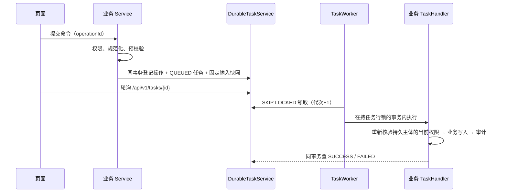

# Python 项目迁移到 Java 技术栈指南

维护日期：2026-10-12。本文指导将一个现有 Python 项目（FastAPI / Flask / Django 等后端，常配 Vue 或其他前端）迁移到本工程使用的 **Java 21 + Spring Boot 4.1 模块化单体 + React 19 / TypeScript + MySQL 8.4 + Redis** 技术栈。内容来自 SN 中心从 Python 原型迁移到本工程的实际经验，并抽象为可复用的方法。

配套阅读：

- 目标技术栈与架构：[技术架构与技术栈说明](../architecture/技术架构与技术栈说明.md)、[当前架构](../architecture/架构与工程结构.md)
- 精确版本：[技术选型与版本基线](技术版本.md)
- SN 迁移的原始方案、差异清单与验收报告（可作范例）：[迁移归档](../archive/python-migration/README.md)，其中[SN项目迁移方案（v1.1）](../archive/python-migration/docs/references/baselines/SN项目迁移方案（v1.1）.md)、[SN迁移总结与验收记录](../archive/python-migration/docs/reports/2026-10-04-SN迁移总结与验收记录.md)

---

## 1. 迁移的目标与原则

### 1.1 完成的定义

“迁移完成”不是“Java 版能启动、页面能打开”，而是同时满足：

1. **功能完整**：功能矩阵中每一项都有 Java/React 实现、测试与证据（见第 3.3 节模板）。
2. **业务不变量受保护**：唯一性、额度、状态机、幂等等关键约束由 MySQL 约束和服务用例双重保证，有并发/故障测试。
3. **契约一致或差异已登记**：API、错误码、导出文件、页面行为与旧系统逐项对照；不一致之处要么修复，要么写入差异清单并获得业务确认。
4. **质量门禁通过**：格式、架构测试、单元测试、真实数据库集成测试、前端检查和浏览器验收全部通过，且没有跳过的测试。
5. **运行不依赖 Python**：生产构建与运行不再需要 Python 解释器、旧前端框架或旧迁移器；旧工程只作只读追溯和对照。

### 1.2 十条迁移原则

| # | 原则 | 说明 |
| --- | --- | --- |
| 1 | **重写，而不是逐行翻译** | 保留业务意图、算法和测试场景，按目标分层重新实现；不要把 Python 的目录、全局变量和隐式事务原样搬过去 |
| 2 | **契约先行** | 先写清接口、数据、状态机和错误码契约，再写代码；契约变化要登记 |
| 3 | **不复制缺陷** | 旧代码与需求冲突时，不默认照抄代码；登记为差异（GAP）并决定修复或保留 |
| 4 | **MySQL 是唯一事实来源** | 唯一性、额度、终态由数据库约束和行锁保证；Redis 只做会话、限流等可丢失状态 |
| 5 | **精确数值** | 业务 ID、版本号、数量、流水号在 API 中用字符串传输，后端用 `long`/`BigInteger`/`BigDecimal`，避免 JavaScript 超过 2^53 后丢失精度 |
| 6 | **权限在服务层校验** | 按钮隐藏和 Controller 注解都不能代替 Service 用例里的权限与数据范围检查 |
| 7 | **整批原子** | 批量写入任何一项冲突都整批回滚，不分段提交、不“尽量成功” |
| 8 | **长任务可恢复** | 进程内线程池/后台线程改为持久任务（数据库表 + 工作器），进程被强杀后可接管 |
| 9 | **样板先行** | 先做一个管理类 CRUD 样板和一个有状态业务命令样板，评审通过后再批量复制 |
| 10 | **证据说话** | 每个阶段记录实际执行的命令、测试数量与结果；“代码存在”不等于“已验证” |

---

## 2. 迁移总体流程


| 阶段 | 主要工作 | 退出条件 |
| --- | --- | --- |
| **S0 盘点与冻结范围** | 盘点旧工程（第 3 节）、建立功能矩阵、差异清单、接口/数据映射初稿、风险与负责人 | 范围、目标路径、数据是否迁移明确；待确认问题有负责人 |
| **S1 骨架与版本验证** | 按第 4 节建立 Maven 六模块、前端 pnpm 工程、Flyway 新链、CI、ArchUnit、Enforcer | 锁定版本组合能编译、启动、导出 OpenAPI；真实 MySQL/Redis 集成测试能运行 |
| **S2 底座与用户样板** | 登录/会话/改密、RBAC、数据范围、操作日志、持久任务与文件设施、用户管理前后端 | 用户管理完整闭环 + 三语言；越权、会话撤销、Redis 故障有测试；样板经人工评审 |
| **S3 主数据与只读集成** | 基础资料、规则/配置类数据、外部系统只读适配器（端口 + 适配器） | 外部真实字段契约确认；分页失败、空结果、重排等边界可验证 |
| **S4 核心业务命令** | 最复杂、有状态、需幂等的业务（例如 SN 的生成与分配） | 业务不变量测试、并发与中断恢复测试通过；事务经人工审查 |
| **S5 其余业务与写入集成** | 剩余业务流程、对外开放接口（服务账号）、文件产出 | 固定快照、重放授权、文件恢复、精度与三语通过 |
| **S6 查询、导出、审计、首页** | 查询页、导出任务、业务痕迹、统计 | 功能矩阵无空缺；跨范围负例通过 |
| **S7 数据演练与硬化** | 旧数据 ETL（如需要）、备份恢复、部署脚本、手册、性能测试 | 至少一次完整迁移 + 恢复演练；关键差异清零 |
| **S8 验收与切换** | 业务 UAT、写入冻结、最终数据核对、切换与回退预案 | 业务/运维/接口负责人签字；只有一个生产写入方 |

每个业务阶段同时交付 **后端 + 前端 + 数据库迁移 + 权限 + 三语言 + 测试**，不要先写完全部后端再集中补前端。

---

## 3. S0：盘点旧 Python 工程

### 3.1 盘点清单

逐项填写，所有结论标注依据（文件路径、命令输出），区分“静态阅读得出”和“运行验证得出”。

| 方面 | 需要查清的事实 | 常见位置 |
| --- | --- | --- |
| Web 框架与路由 | 框架（FastAPI/Flask/Django）、全部路由、HTTP 方法、请求/响应模型、命名风格（snake_case） | `app/main.py`、`routers/`、`urls.py`、`views.py` |
| 数据访问 | ORM（SQLAlchemy/Django ORM/Peewee）还是裸 SQL（PyMySQL/aiomysql）；SQL 写在哪一层；事务边界（autocommit？`with conn:`？） | `models/`、`repositories/`、`services/` |
| 数据库结构 | 全部表、索引、唯一约束、分区、触发器、视图；迁移工具（Alembic/Django migrations/自制） | `migrations/`、`*.sql` |
| 认证 | 密码哈希算法（PBKDF2/bcrypt/argon2）及参数、令牌格式（JWT/自制 HMAC/Session）、存储位置（localStorage/Cookie） | `auth.py`、`security.py` |
| 权限 | 角色是否硬编码；菜单是否静态；数据范围（按部门/工厂/租户）如何过滤 | 依赖注入、装饰器、SQL 中的 WHERE |
| 后台任务 | Celery/RQ/APScheduler/`threading`/`asyncio.create_task`；任务状态是否落库；进程重启后能否接管 | `tasks.py`、`worker.py`、`scheduler.py` |
| 外部集成 | 出站调用（requests/httpx）的地址、认证、超时、重试；入站接口给哪些系统调用 | `clients/`、`integrations/` |
| 文件 | Excel/CSV 生成（openpyxl/pandas/csv）、上传解析、存储位置、下载权限 | `export.py`、`utils/` |
| 配置与秘密 | `.env`、settings、默认值；**硬编码口令与默认秘密**必须列出并在新工程中消除 | `config.py`、`settings.py` |
| 错误处理 | 错误码枚举、字符串错误、HTTP 状态映射；前端如何显示 | `errors.py`、`exceptions.py` |
| 日志 | structlog/logging 格式、是否记录敏感信息、请求追踪号 | `logging.py` |
| 前端 | 框架、页面清单、状态管理、i18n 词条、数值是否用 `Number` 处理大 ID | `frontend/src/` |
| 测试 | pytest 用例数量与覆盖的业务场景；集成测试是否会**重建数据库**（只能在隔离库运行） | `tests/` |
| 部署运维 | 启动/停止方式、Compose、nginx、定时维护、备份 | `deploy/`、`Dockerfile` |

### 3.2 差异清单（GAP）

盘点时发现的“旧实现与需求不一致”“旧实现有隐患”的点逐条登记，作为实施输入，而不是在迁移时悄悄修改或悄悄保留：

| 编号 | 位置与现状 | 目标处理 / 验收重点 | 决定 |
| --- | --- | --- | --- |
| GAP-01 | `services/order.py` 用每次同步重排的行号关联历史数据 | 使用稳定来源 ID；行重排不影响历史额度 | 修复 |
| GAP-02 | 后台任务在业务事务提交后再单独标记成功 | 业务数据与任务终态同事务提交 | 修复 |
| GAP-03 | 前端把 ID 转为 `Number` | 全链路字符串 | 修复 |
| … | … | … | 修复 / 保留并告知 / 待业务确认 |

SN 迁移中登记的 16 项 GAP 可作参考：[SN项目迁移方案（v1.1）第 2.2 节](../archive/python-migration/docs/references/baselines/SN项目迁移方案（v1.1）.md)。

### 3.3 功能矩阵模板

| 功能ID | 功能 | 旧入口（路由/页面） | 新接口 | 新页面 | 权限码 | 不变量 | 测试 | 状态 |
| --- | --- | --- | --- | --- | --- | --- | --- | --- |
| F-01 | 登录与改密 | `POST /login` / `Login.vue` | `POST /api/v1/system/auth/login` | `LoginPage.tsx` | — | 会话撤销 | `AuthenticationIT` | 已验证 |
| F-02 | … | | | | | | | 未开始 / 实现中 / 已验证 / 差异保留 |

每个工作包按 `功能ID/不变量ID → 输入契约 → 允许修改目录 → 实现与数据影响 → 验证 → 退出条件 → 未决问题` 组织。不允许以“前端后续补”“真实库以后测”“任务先用内存模拟”关闭条目。

---

## 4. S1：建立目标工程骨架

### 4.1 获取骨架

优先基于 Adtek Platform Template 0.1.0（见[开发约定与框架版本](README.md)）或直接以本工程为参照创建新仓库：

```text
<project>/
├─ backend/
│  ├─ pom.xml                     父 POM：spring-boot-starter-parent 4.1.1，统一版本属性与插件
│  ├─ mvnw / mvnw.cmd / .mvn/      Maven Wrapper（固定 3.9.x）
│  ├─ adtek-common/               纯 Java：Result、ErrorCode、BusinessException、Actor、注解
│  ├─ adtek-framework/            安全、数据权限、审计、持久任务、TraceId、全局异常
│  ├─ adtek-system/               账号、角色、部门、菜单、字典、审计查询
│  ├─ adtek-<业务>/               新业务模块（替代 adtek-sn）
│  ├─ adtek-integration/          外部系统适配器（实现业务模块的 service.port）
│  └─ adtek-server/               启动类、application.yml、db/migration、CLI、集成测试
├─ frontend/                      React + Vite + pnpm
├─ deploy/                        Dockerfile、nginx.conf、compose、镜像锁
├─ tools/                         格式化、验证、运维脚本
└─ docs/                          架构、业务契约、运维、测试文档
```

- 通用模块（common/framework/system）直接复用，不在迁移中改写其通用行为；业务差异通过端口扩展。
- 业务模块命名为 `adtek-<业务名>`，包名 `com.adtek.<业务名>`；在 `adtek-server/pom.xml` 中引入，并加入 `@MapperScan`。
- 错误码为新模块分配下一个未占用的十亿级区间（现有：common `1000xxxxxx`、system `1002xxxxxx`、framework `1003xxxxxx`、sn `1004xxxxxx`），发布后数字含义不再改变。

### 4.2 版本锁定与验证

- 后端：JDK 21、Maven 3.9.x、Spring Boot 4.1.1、MyBatis-Plus 3.5.17、MapStruct 1.6.3、Springdoc 3.1.1、POI 5.5.1（需要 Excel 时）。
- 前端：Node 24、pnpm 10.34.6、React 19.3、TypeScript 5.9.3、Vite 8.3、AntD 6.6、TanStack Query 5、Zustand 5、Axios 1.20、i18next 26。
- 数据：MySQL 8.4.11、Redis 8.4.7（镜像锁 sha256）。
- 新增第三方依赖需记录版本来源与理由，写入[技术版本](技术版本.md)同类文档；能用 JDK 自带能力（如 `HttpClient`）就不引入新库。

S1 退出前必须实际执行：`mvnw -Pintegration verify`（真实 MySQL/Redis 容器）、`pnpm install --frozen-lockfile && pnpm build && pnpm test`、本机启动后导出 OpenAPI 并生成前端类型。

---

## 5. Python → Java 技术映射

### 5.1 后端组件映射

| Python 常见技术 | Java 目标 | 迁移要点 |
| --- | --- | --- |
| FastAPI / Flask / Django views | Spring Web MVC `@RestController` | Controller 只做协议与校验；路由统一 `/api/v1/<模块>/...`，写操作用 `POST`（含 `/{id}/update` 风格） |
| Pydantic 模型 / Marshmallow / DRF Serializer | DTO（入参）+ Jakarta Bean Validation；VO（出参）；Query（查询条件） | 三类对象分开；字段改 camelCase；ID/数量/流水用 `String` |
| `dataclass` / `NamedTuple` | Java `record` | 不可变值对象、内部计划值（如 `SnWorkInput`） |
| SQLAlchemy / Django ORM / PyMySQL 裸 SQL | MyBatis-Plus `BaseMapper` + 注解 SQL（`@Select`/`@Update`） | SQL 只出现在 Mapper；每条语句在 `DataPermissionRules` 登记；锁用 `SELECT … FOR UPDATE` |
| ORM Model | Entity（`domain` 包） | Entity 不返回给 HTTP；转换用 MapStruct |
| 手写 dict 转换 | MapStruct `@Mapper` | `unmappedTargetPolicy=ERROR` 迫使字段完整映射 |
| Alembic / Django migrations / 自制迁移器 | Flyway `V{n}__{描述}.sql` | 已发布脚本不可修改；`validate-on-migrate=true`；独立迁移账号 |
| `with session.begin()` / autocommit | `@Transactional(isolation = READ_COMMITTED)` 于 ServiceImpl | 事务只在 Service 层；固定加锁顺序 |
| Celery / RQ / `ThreadPoolExecutor` / `asyncio` 后台任务 | framework.task 持久任务：`DurableTaskService` + `TaskHandler` + `TaskWorker` | 任务、操作号、结果落库；`SKIP LOCKED` 领取；业务结果与任务终态同事务 |
| APScheduler / cron 脚本 | `SmartLifecycle` 单线程工作器（如 `OrderSyncWorker`）或 `--maintenance-scheduler` 独立进程 | 多实例抢占靠 MySQL 行锁，不靠进程内锁 |
| requests / httpx | JDK 21 `HttpClient`，放在 `adtek-integration` 并实现业务模块的 port 接口 | 明确超时、响应大小、总预算；不记录凭据和原始错误体 |
| openpyxl / pandas 导出 | Apache POI `SXSSFWorkbook`（流式） | 文本列显式设为字符串，避免前导零和长整数被改写；CSV 防公式注入 |
| `csv` 模块 | 手写安全 CSV 工具（UTF-8、转义、防公式） | 参考 `SnQueryFiles`、`SnAuditFiles` |
| PyJWT / 自制 HMAC token | Spring Security OAuth2 Resource Server（Nimbus JWT）+ Redis 会话 | 访问令牌短时效；刷新凭据放 HttpOnly Cookie；权限每次请求从 MySQL 重新加载 |
| passlib / hashlib PBKDF2 / bcrypt | Spring Security `DelegatingPasswordEncoder`（本工程默认 PBKDF2） | 若需沿用旧密码哈希，按旧参数增加兼容编码器，登录成功后升级；否则要求重置 |
| 装饰器权限 `@require_role` | `CurrentActor.requirePermission("<权限码>")` 在 Service 内调用 | 权限码形如 `模块:资源:动作` |
| 数据过滤 `WHERE dept_id IN (...)` 手写 | `@DataScope` + `ScopedDataPermissionInterceptor` | 缺少登记规则时拒绝，而不是放行 |
| 自定义异常 + `HTTPException` | `BusinessException(ErrorCode)` + `GlobalExceptionHandler` → 统一 `Result` | 错误码数字分段，`message` 为前端翻译键 |
| structlog / logging | SLF4J + Logback，MDC `traceId`（`TraceFilter`） | 响应带 traceId；日志不记录密码、令牌、SQL 原始错误 |
| pydantic-settings / `.env` | `application.yml` + 环境变量 + `@ConfigurationProperties` 设置类 | 非法配置启动即失败，不静默回退；秘密只从环境/文件注入 |
| click / argparse 命令 | 同一 JAR 的 CLI 模式（`AdtekApplication.main` 按参数分派） | 默认 dry-run，`--apply` 才写入；独立数据库账号 |
| `Decimal` | `BigDecimal`（金额/小数）、`BigInteger`/`long`（流水） | 禁止 `double` 参与业务计算 |
| `datetime`（naive/本地时区） | `java.time.Instant`/`LocalDate`；数据库 `DATETIME(6)` 存 UTC | 页面按用户时区展示；业务日期边界明确时区 |
| `Enum` / 字符串常量 | Java `enum` 或常量类 + 数据库 CHECK | 未知值拒绝 |
| pytest / pytest fixtures | JUnit 5 + Spring Boot Test；Testcontainers（真实 MySQL/Redis） | `*Test` 单元、`*IT` 集成；禁止用 H2/SQLite 代替 InnoDB |
| uvicorn/gunicorn + nginx | 可执行 JAR（内置 Tomcat）+ nginx-unprivileged 反代 | 健康检查 `--healthcheck`，readiness 包含 db/redis |

### 5.2 前端映射

| 旧前端 | 目标 | 要点 |
| --- | --- | --- |
| Vue 3 SFC / jQuery / 模板页面 | React 19 函数组件 + Hooks | 按 `features/<领域>/pages|components` 组织 |
| Pinia / Vuex | 服务端数据：TanStack Query；会话：Zustand（仅内存） | 不把服务端数据复制进全局 store；令牌不写 localStorage |
| Element Plus | Ant Design 6 | 表格、表单、弹窗、分页；三语言 locale |
| vue-router | React Router 7，页面 `lazy` 加载 | 菜单由后端按权限返回，前端固定组件注册表 |
| axios 封装 / fetch | `api/client.ts` 的 Axios 实例 + `contract.ts` 运行时校验 | 响应按 `unknown` 处理并做类型守卫；写命令不自动重试 |
| 手写 TS 类型 / 无类型 | openapi-typescript 由后端 OpenAPI 生成 `schema.d.ts` | 不手改生成文件；CI 执行 `api:check` |
| vue-i18n | i18next + react-i18next（zh-CN / en / vi） | 错误码 → `message` 翻译键 → 各语言文案 |
| Jest / 无测试 | Vitest（单元）+ Playwright（浏览器） | 迁移旧前端测试场景 |
| npm | pnpm（冻结锁文件、严格 peer） | 锁定版本，不使用 `latest` |

---

## 6. 后端逐层迁移方法

### 6.1 一个接口的完整迁移示例

**旧 Python（FastAPI 示意）**：

```python
@router.post("/rules")
def create_rule(body: RuleIn, user=Depends(require_role("hq"))):
    with db.begin() as conn:
        if conn.execute("SELECT 1 FROM sn_rule WHERE code=%s", body.code).first():
            raise HTTPException(409, "rule exists")
        rid = conn.execute("INSERT INTO sn_rule(code, name, ...) VALUES (...)").lastrowid
        log_operation(conn, user, "create_rule", body.dict())
    return {"id": rid, "code": body.code, "name": body.name}
```

**目标 Java 拆分**（参考本工程 `RuleController` / `RuleServiceImpl` / `RuleMapper`）：

```java
// controller：只处理协议
@RestController
@RequestMapping(value = "/api/v1/sn/rules", produces = "application/json")
public class RuleController {
    private final RuleService service;

    public RuleController(RuleService service) {
        this.service = service;
    }

    @PostMapping
    @Operation(summary = "全部工厂create权限，代码和绑定唯一，首版与审计同事务")
    public Result<RuleVO> create(@Valid @RequestBody RuleSaveDTO command, HttpServletRequest request) {
        return Result.success(service.create(command), TraceFilter.current(request));
    }
}

// service.impl：权限、事务、唯一性、审计
@Override
@Transactional(isolation = Isolation.READ_COMMITTED)
@OperLog(title = "编码规则", action = "sn:rule:create",
        businessType = OperLog.BusinessType.INSERT, fields = {"name", "currentVersion"})
public RuleVO create(RuleSaveDTO input) {
    validator.requireValid(input);
    var actor = policy.lock("sn:rule:create");      // 从可信主体重新核验权限并加协调锁
    var rule = convert.rule(normalize(input));       // MapStruct：DTO → Entity
    rule.setCreatedBy(actor.userId());
    try {
        rules.insert(rule);                          // 唯一性交给数据库唯一键
    } catch (DuplicateKeyException e) {
        throw new BusinessException(ErrorCodeConstants.RULE_EXISTS);
    }
    AuditContext.record(rule.getId().toString(), Map.of(), snapshot(rule));
    return convert.rule(rule);                       // MapStruct：Entity → VO
}

// mapper：SQL 只在这里
@Mapper
public interface RuleMapper extends BaseMapper<RuleEntity> {
    @Select("SELECT * FROM sn_rule WHERE id=#{id} FOR UPDATE")
    RuleEntity lock(@Param("id") long id);
}
```

要点对照：

| 旧写法 | 新写法 | 原因 |
| --- | --- | --- |
| 先 `SELECT` 判重再 `INSERT` | 唯一键 + 捕获 `DuplicateKeyException` | 先查后插在并发下不安全 |
| `HTTPException(409, "rule exists")` | `BusinessException(RULE_EXISTS)` | 稳定数字码 + 翻译键 + HTTP 状态统一管理 |
| 角色依赖注入 | Service 内 `requirePermission`/策略对象 | 任务工作器、MES 等非 HTTP 入口也必须经过同一检查 |
| 手写 `log_operation` | `@OperLog` + `AuditContext`，与业务同事务 | 审计失败即回滚业务，字段白名单防泄密 |
| 返回 dict | 返回 VO，统一 `Result` 信封 | 契约稳定，可生成 OpenAPI |

### 6.2 新增一个模块功能的步骤清单

1. 在业务契约文档中写清接口、权限码、状态变化、错误码。
2. 编写 Flyway 脚本 `V{下一个版本}__<描述>.sql`（表、唯一键、索引、权限/菜单种子）。
3. `domain` Entity → `mapper` Mapper（并在模块的 `*DataPermissionRules` 中逐条登记语句与理由）。
4. `dto` / `query` / `vo` → `convert` MapStruct 接口。
5. `service` 接口 + `service.impl` 实现（权限、事务、锁顺序、审计）。
6. `controller`（`@Valid`、`@Operation` 注明权限与语义）。
7. 错误码加入模块 `ErrorCodeConstants`，前端三语言 `errors.*.json` 补文案。
8. 单元测试（纯规则/计算）+ `*IT` 集成测试（真实 MySQL：并发、回滚、越权负例）。
9. 本机启动 → `tools/export-api.ps1` 导出 OpenAPI → `pnpm api:generate`。
10. 前端 `api/<领域>.ts` + 类型守卫 + 页面 + 三语言词条 + Vitest。
11. 执行 `tools/format.ps1`，再以 `-Check` 核对；跑全部检查。

### 6.3 事务与并发：Python 常见写法的改造

| Python 常见问题 | Java 中的正确做法 |
| --- | --- |
| autocommit 下多条 SQL，中途失败留下半成品 | 整个用例放在一个 `@Transactional` 方法中，任何异常整体回滚 |
| 应用内 `threading.Lock` 防并发 | 数据库协调行 `SELECT … FOR UPDATE`，多实例同样有效 |
| 先读水位、再计算、再写入（读写之间无锁） | 先锁控制行/目标行，再读当前值，再写；固定加锁顺序避免死锁 |
| 批量处理“能成几条算几条” | 整批校验、整批写入，冲突即整批回滚 |
| 请求号只在内存或 Redis 去重 | 主体 + 动作 + operationId 的数据库唯一键；同号重放比对载荷摘要 |
| 后台线程提交业务后另起事务标记任务成功 | 业务写入、审计、任务终态在同一事务提交 |
| 乐观更新无版本号，后写覆盖先写 | `version`/`revision` 列，版本不符返回 409，页面提示刷新 |

### 6.4 长任务迁移到持久任务



迁移步骤：

1. 把 Python 任务函数的输入固定为可序列化的输入快照（record），提交时写库，执行时只读快照，不读“当前页面状态”。
2. 实现 `TaskHandler`：声明任务类型/动作、执行时的完整对象授权、业务执行、终态审计。
3. 前端用 `operationId` 提交，并将其按用户保存在 localStorage，刷新后可“查询原操作”；不自动换号重做。
4. 测试：排队后、执行中、提交前强杀进程，重启后不重复执行、不丢结果。

---

## 7. 数据库迁移

### 7.1 Schema 迁移

1. **新库、新链**：在独立 schema 用 Flyway 从 V1 建立新结构，不在旧库上原地改。
2. **字符集与时间**：`utf8mb4` + `utf8mb4_0900_as_cs`（区分大小写，避免旧系统大小写混淆导致唯一性变化，如需不区分大小写请显式决定）；连接与存储统一 UTC，时间列 `DATETIME(6)`。
3. **类型映射**：

| 旧类型/用法 | 新类型 | 说明 |
| --- | --- | --- |
| `INT` 自增 ID | `BIGINT` | 前后端以字符串传输 |
| `FLOAT`/`DOUBLE` 金额或数量 | `DECIMAL(p,s)` 或 `BIGINT`（最小单位） | Java 用 `BigDecimal`/`long` |
| `VARCHAR` 存 JSON | `JSON` 或 `TEXT` + 应用校验 | 只存白名单字段 |
| `DATETIME`（本地时间） | `DATETIME(6)` UTC | 迁移时明确旧数据时区 |
| 字符串状态 | `VARCHAR` + `CHECK` 约束 | 与 Java 枚举一致 |
| 应用层判重 | `UNIQUE KEY` | 唯一性必须由数据库保证 |

4. **大表**：按月 `RANGE COLUMNS` 分区的表，由维护命令预建未来分区，不在页面进程执行 DDL。
5. **种子数据**：角色、权限码、菜单通过 Flyway 种入；不种默认账号和默认口令，初始管理员用受控命令创建。
6. **已发布的迁移脚本永不修改**；变更一律新增版本。

### 7.2 存量数据迁移（如需要）

先决定是否迁移旧数据。若不迁移（SN 本轮即如此），在文档中写明并保留旧库只读。若需要迁移：

- 以 CLI 模式实现（参考 `--legacy-inventory / --legacy-master / --legacy-stage / --legacy-snapshot`）：只读连接旧库、明确 schema 白名单、运行锁、显式事务、dry-run 默认。
- 分步：**盘点**（行数、异常值、无法解析的数据）→ **暂存**（原样拷贝到 staging 表）→ **转换**（按新模型写入，记录映射）→ **核对**（行数、内容摘要、业务汇总）。
- 不能靠代码推断的历史事实（例如已无来源的历史额度）列为人工确认项。
- 至少完成一次全量演练和一次恢复演练后才能切换。

---

## 8. 接口契约迁移

| 方面 | 旧（常见） | 新约定 |
| --- | --- | --- |
| 路径 | `/rules`、`/api/rule_list` | `/api/v1/<模块>/<资源>`，人员接口与外部系统接口（`/api/v1/integrations/...`）分开 |
| 命名 | snake_case | camelCase |
| 响应 | 直接返回对象或列表 | `Result { code, message, data, params, traceId }`，成功 `code=0` |
| 分页 | `offset/limit`，无总数或数字总数 | `PageResult`（总数为字符串），大明细用签名游标 `CursorResult` |
| 错误 | HTTP 状态 + 自由文本 | 数字错误码（模块分段）+ 翻译键 + HTTP 状态；参数不含 SQL/堆栈 |
| 数值 | number | ID、版本、数量、流水为字符串 |
| 写入幂等 | 无或仅请求号 | `operationId`（UUID），同号同载荷返回原结果，异载荷拒绝 |
| 文档 | 手写或 FastAPI 自动文档 | Springdoc 从运行实例导出 → 前端生成类型 |

**外部调用方兼容**：如果旧接口已被其他系统（如 MES）调用，迁移前列出调用方清单，并在下面两种方式中选一种：

1. 新接口 + 调用方适配（推荐，契约干净）；
2. 在 integration 层保留兼容入口，把旧错误码映射到新错误码，并登记在兼容表里（参考[旧错误码兼容登记](../archive/python-migration/docs/15-旧错误码兼容登记.md)）。

无论哪种方式，外部系统都使用独立的服务身份（client 凭据换 Bearer），不与人员账号混用。

---

## 9. 认证与权限迁移

1. **账号**：旧用户名、状态迁入 `sys_user`；密码哈希若算法/参数可识别，可配置兼容编码器；否则统一设置“必须改密”并通过安全渠道发放临时密码。
2. **角色**：旧硬编码角色映射为数据库角色 + 菜单/按钮权限码；在 Flyway 种子中定义，列出“旧角色 → 新角色 → 权限码”对照表。
3. **数据范围**：旧代码中散落的 `WHERE factory_id=…` 统一改为数据范围（部门五类范围）或业务资格端口（如工厂资格 `FactoryMembershipPort`）。每条 Mapper 语句都要登记规则。
4. **会话**：旧令牌全部作废，切换后用户重新登录；新会话为 15 分钟访问令牌 + 8 小时 HttpOnly 刷新凭据，账号停用/改密/授权变化立即失效。
5. **测试负例**：越权读取列表/详情/统计/导出/下载、改他人数据、Redis 不可用、并发限流，都要有用例。

---

## 10. 前端迁移

1. **先列页面清单**：旧页面 → 新页面（`features/<领域>/pages/*Page.tsx`）→ 菜单组件 key → 权限码。
2. **API 层**：每个领域一个 `api/<领域>.ts`，响应用 `contract.ts` 中的类型守卫校验；不要把 Axios 原始错误或配置（可能含密码/令牌）传给页面。
3. **数据获取**：读用 `useQuery`（key 包含当前主体与 `authorizationVersion`），写用 `useMutation`，均不自动重试；写操作失败或超时时提供“查询原操作 / 按原号重试”。
4. **精确数值**：输入框、计算、展示、导出全程字符串；需要计算时用 `BigInt`。
5. **国际化**：迁移旧词条到 `i18n/locales/{zh-CN,en,vi}.json`，错误码文案放 `errors.*.json`；检查占位符一致。
6. **外观对照**：只在业务要求“与旧系统一致”时做逐像素对照；否则以功能一致为准，避免陷入外观矩阵。
7. **测试**：纯函数和状态逻辑写 Vitest；关键流程写 Playwright。

---

## 11. 测试与新旧对照验收

### 11.1 测试分层

| 层次 | 工具 | 内容 |
| --- | --- | --- |
| 单元 | JUnit 5 / Vitest | 规则解析、精确计算、状态转换、错误码目录、前端契约守卫 |
| 架构 | ArchUnit、Maven Enforcer | 模块方向、无环、禁止跨模块 Mapper/impl、禁用依赖 |
| 集成 | Testcontainers（MySQL + Redis） | 事务回滚、唯一性、并发、锁、幂等、越权、任务恢复、迁移升级 |
| 浏览器 | Playwright | 关键业务闭环、三语言、权限可见性 |
| 对照 | Playwright parity 配置 + `tools/testing/*.py` 夹具 | 同一输入在新旧系统上执行，比对 API 结果、页面状态、导出文件 |

### 11.2 迁移 pytest 用例

- 把每个 pytest 用例的“输入 → 期望输出”提取为场景，在 Java 中重写为 JUnit/IT；旧断言与新契约冲突时先登记差异再改。
- 旧集成测试若会重建数据库，只能在隔离、可销毁的库运行。
- 没有 Docker 时集成测试必须**失败**，不能自动 skip 后算通过；CI 中检查测试报告的数量和 skipped=0。

### 11.3 新旧对照（Parity）

1. 两套系统各自使用**独立的隔离数据库**和合成数据，绝不共享生产库。
2. 编写数据夹具（Python 脚本可直接复用旧工程的数据访问方式），在两边准备相同的初始状态。
3. 用 Playwright 对同一操作序列分别执行，采集：接口响应、页面关键文本/状态、导出文件（解析后比较行列内容和摘要）、审计记录。
4. 差异逐项归类：**新系统缺陷**（修复）/ **旧系统缺陷**（不复制，登记）/ **有意变更**（契约中写明）。
5. 每轮对照形成阶段记录：受检提交、命令、通过/失败数、未验证项。

---

## 12. 质量门禁

| 门禁 | 命令/检查 |
| --- | --- |
| 格式 | `tools/format.ps1` → `tools/format.ps1 -Check`（Spotless/google-java-format AOSP、SortPom、Prettier、PSScriptAnalyzer） |
| Mapper 行宽 | Checkstyle LineLength ≤ 100（Maven validate） |
| 后端 | `backend/mvnw -B -Pintegration verify`，报告中 tests>0、failures=errors=skipped=0 |
| 前端 | `pnpm api:check && pnpm lint && pnpm format:check && pnpm test && pnpm build` |
| 文档 | `node tools/check-docs.mjs`（链接与冻结文件摘要） |
| 迁移脚本 | 已发布 Flyway 脚本摘要不变 |
| 秘密 | 仓库中无真实口令、密钥、默认共享秘密；示例只用占位符 |

---

## 13. 部署与切换

1. **部署形态**：参考 `deploy/compose.container-test.yml`：`mysql` → `migrate`（一次性 Flyway）→ `redis` → `api`（只读根文件系统、非 root、`cap_drop: ALL`）→ `web`（nginx TLS 反代）。
2. **数据库账号分权**：迁移账号（DDL）、应用账号（DML）、维护账号分开；运行中的 API 关闭 Flyway。
3. **秘密注入**：Docker secrets / configtree，不进镜像和仓库。
4. **切换步骤**：
   1. 冻结旧系统写入（只读模式或停服）；
   2. 备份旧库并记录备份点；
   3. 执行最终数据迁移与核对（若迁移数据）；
   4. 新系统上线，外部调用方切换到新接口与新服务凭据；
   5. 业务冒烟验证；
   6. 观察窗口内保留回退方案（恢复旧系统写入的条件与步骤事先演练）。
5. 任何时刻只能有**一个**生产写入方。

---

## 14. 常见陷阱

| 陷阱 | 后果 | 预防 |
| --- | --- | --- |
| 前端用 `Number` 处理 ID/流水 | 超过 2^53 后静默出错 | 全链路字符串，测试覆盖大数 |
| 用外部系统的“行号/名称”关联历史数据 | 对方重排或改名后历史错配 | 采集并保存稳定 ID |
| 先查后插判重 | 并发下重复 | 数据库唯一键 |
| 后台任务只在内存 | 进程重启丢任务或重复执行 | 持久任务 + 租约 + 代次 |
| 导出文件按“当前数据”实时生成 | 历史打印/导出内容随后续变化而变化 | 保存固定快照成员，文件由快照生成 |
| Excel 单元格类型自动推断 | 前导零丢失、长数字变科学计数法 | 显式文本单元格 |
| 配置非法时静默使用默认值 | 线上行为与预期不符 | 启动时类型化校验并失败 |
| 只在前端/Controller 判断权限 | 任务工作器、外部接口绕过 | Service 用例内统一校验 |
| 修改已发布的迁移脚本 | 已部署环境校验失败或结构漂移 | 只新增版本 |
| 测试缺环境时自动跳过 | 误以为通过 | 缺 Docker 即失败；检查 skipped=0 |
| 把旧缺陷当作需求复制 | 新系统带着旧问题上线 | GAP 清单逐条决定 |
| 外观逐像素对齐无止境 | 进度失控 | 事先约定“功能一致”与“外观一致”的范围 |

---

## 15. 交付物清单

迁移工程至少应包含以下文档（可参照本工程 `docs/` 结构）：

- `docs/architecture/`：架构与工程结构、数据库设计、技术架构与技术栈说明
- `docs/business/`：用户手册、接口契约、业务规则契约、外部接口契约
- `docs/development/`：开发约定、技术版本基线
- `docs/operations/`：部署与运维、命令手册、维护与恢复、外部集成配置
- `docs/testing/`：测试策略与命令、功能一致性清单、阶段验收记录
- `docs/releases/`：交付记录、功能与差异状态、待办与验收边界
- `docs/archive/`：旧工程文档的只读归档（保留原字节和清单）
- `memory/` 或同类：当前状态的简短记录，供后续接手
