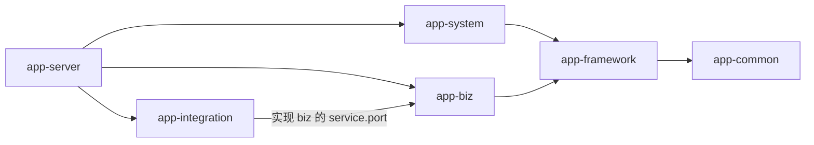
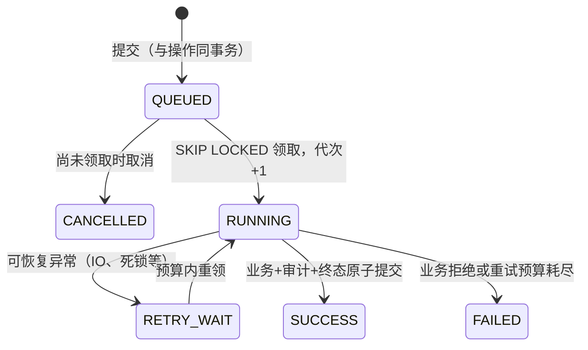
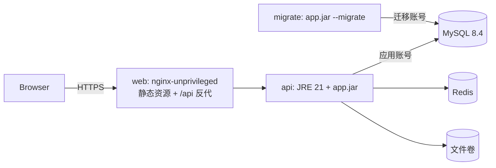

# Python 项目迁移到 Java 技术栈指南

> 本文是独立的迁移指导文档，不依赖任何其他工程或文档即可阅读和执行。文中示例使用占位名：公司包名 `com.company`、业务模块 `biz`、示例业务“订单（order）”，实施时替换为实际名称。

---

## 0. 适用范围

本文适用于将一个现有 Python Web 项目（FastAPI / Flask / Django 等后端，常配 Vue / jQuery / 模板页面前端，MySQL 或其他关系库）完整迁移为以下目标技术栈：

| 层 | 目标技术 |
| --- | --- |
| 后端 | Java 21 + Spring Boot 4.1 的 **Maven 多模块单体**，MyBatis-Plus、MapStruct、Flyway、Spring Security（JWT） |
| 前端 | React 19 + TypeScript（strict）+ Vite + Ant Design 6 + TanStack Query + Zustand + Axios + i18next |
| 数据 | MySQL 8.4（唯一业务事实来源）+ Redis（会话、限流等可丢失状态） |
| 部署 | Docker / Docker Compose，Nginx 托管前端并反向代理 API |
| 质量 | Spotless、Checkstyle、Maven Enforcer、ArchUnit、JUnit 5、Testcontainers、ESLint、Prettier、Vitest、Playwright、CI |

“迁移完成”同时包含：后端、前端、接口、数据库结构、（如需要）存量数据、权限、后台任务、文件导出、多语言、测试、部署脚本和文档。最终生产构建与运行**不依赖 Python** 及旧前端框架；旧工程只作为只读追溯和对照。

---

## 1. 迁移目标与原则

### 1.1 完成的定义

不能以“Java 版能启动、页面能打开、单元测试通过”代替迁移完成。必须同时满足：

1. **功能完整**：功能矩阵（第 3.3 节）每一项都有实现、测试和证据。
2. **业务不变量受保护**：唯一性、额度/库存、状态机、幂等等约束由数据库约束 + 服务用例双重保证，并有并发和故障测试。
3. **契约一致或差异已登记**：接口、错误码、导出文件、页面行为与旧系统逐项对照，不一致处要么修复，要么写入差异清单并获业务确认。
4. **质量门禁全部通过**，且没有被跳过的测试。
5. **运行不依赖旧工程**。

### 1.2 十条原则

| # | 原则 | 说明 |
| --- | --- | --- |
| 1 | **重写，不逐行翻译** | 保留业务意图、算法和测试场景，按目标分层重新实现；不要把 Python 的目录结构、全局变量、隐式事务原样搬过来 |
| 2 | **契约先行** | 先写清接口、数据、状态机、错误码，再写代码；契约变化必须登记 |
| 3 | **不复制缺陷** | 旧代码与需求冲突时不默认照抄，登记为差异（GAP）后决定修复或保留 |
| 4 | **数据库是唯一事实来源** | 唯一性、额度、终态由数据库唯一键和行锁保证；Redis 只放可丢失状态 |
| 5 | **精确数值** | 业务 ID、版本号、数量、流水号在 API 中用字符串；后端用 `long`/`BigInteger`/`BigDecimal`，杜绝 JavaScript 超过 2^53 丢精度 |
| 6 | **权限在服务层校验** | 前端按钮隐藏、Controller 注解都不能替代 Service 用例中的权限与数据范围检查 |
| 7 | **整批原子** | 批量写入任一项冲突即整批回滚，不分段提交 |
| 8 | **长任务可恢复** | 进程内线程池/后台线程改为持久任务（数据库表 + 工作器），进程被杀后可接管 |
| 9 | **样板先行** | 先做“管理类 CRUD 样板”和“有状态业务命令样板”，评审通过后再批量复制 |
| 10 | **证据说话** | 每阶段记录实际执行的命令、测试数量与结果；“代码已写”不等于“已验证” |

---

## 2. 迁移总体流程


| 阶段 | 主要工作 | 退出条件 |
| --- | --- | --- |
| **S0 盘点与冻结范围** | 按第 3 节盘点旧工程；建立功能矩阵、差异清单、接口/数据映射初稿、风险与负责人 | 范围、目标仓库、是否迁移旧数据已明确；待确认问题有负责人 |
| **S1 骨架与版本验证** | 按第 4 节建立后端多模块、前端工程、Flyway、CI、架构测试 | 锁定版本能编译、启动、导出 OpenAPI；真实 MySQL/Redis 集成测试能跑 |
| **S2 通用底座与用户样板** | 登录/会话/改密、RBAC、数据范围、操作日志、持久任务与文件、用户管理前后端 | 用户管理完整闭环 + 多语言；越权、会话撤销、Redis 故障有测试；样板经人工评审 |
| **S3 主数据与只读集成** | 基础资料、配置类数据、外部系统只读适配器 | 外部字段契约确认；分页失败、空结果、数据重排等边界可验证 |
| **S4 核心业务命令** | 最复杂、有状态、需幂等的业务 | 业务不变量、并发、中断恢复测试通过；事务经人工审查 |
| **S5 其余业务与写入集成** | 剩余流程、对外开放接口（服务账号）、文件产出 | 固定快照、重放授权、文件恢复、精度、多语言通过 |
| **S6 查询/导出/审计/首页** | 查询页、导出任务、业务痕迹、统计 | 功能矩阵无空缺；跨范围负例通过 |
| **S7 数据演练与硬化** | 旧数据 ETL（如需）、备份恢复、部署脚本、手册、性能测试 | 至少一次完整迁移 + 恢复演练；关键差异清零 |
| **S8 验收与切换** | 业务 UAT、写入冻结、最终数据核对、切换与回退预案 | 业务/运维/接口负责人签字；只有一个生产写入方 |

每个业务阶段同时交付 **后端 + 前端 + 数据库迁移 + 权限 + 多语言 + 测试**，不要先写完全部后端再集中补前端。

---

## 3. S0：盘点旧 Python 工程

### 3.1 盘点清单

逐项填写，所有结论注明依据（文件路径、命令输出），并区分“静态阅读得出”和“运行验证得出”。

| 方面 | 需要查清的事实 | 常见位置 |
| --- | --- | --- |
| Web 框架与路由 | 框架类型、全部路由与方法、请求/响应模型、命名风格 | `main.py`、`routers/`、`urls.py`、`views.py` |
| 数据访问 | ORM（SQLAlchemy / Django ORM）还是裸 SQL（PyMySQL）；SQL 写在哪层；事务边界（autocommit？`with conn:`？） | `models/`、`repositories/`、`services/` |
| 数据库结构 | 全部表、索引、唯一约束、分区、触发器；迁移工具（Alembic / Django migrations / 自制） | `migrations/`、`*.sql` |
| 认证 | 密码哈希算法与参数；令牌格式（JWT / 自制 HMAC / Session）；前端存储位置 | `auth.py`、`security.py` |
| 权限 | 角色是否硬编码；菜单是否静态；数据如何按部门/工厂/租户过滤 | 装饰器、依赖注入、SQL WHERE |
| 后台任务 | Celery / RQ / APScheduler / `threading` / `asyncio`；状态是否落库；重启能否接管 | `tasks.py`、`worker.py` |
| 外部集成 | 出站调用（requests/httpx）的地址、认证、超时、重试；入站接口由哪些系统调用 | `clients/`、`integrations/` |
| 文件 | Excel/CSV 生成（openpyxl/pandas）、上传解析、存储位置、下载权限 | `export.py` |
| 配置与秘密 | `.env`、settings、默认值；**硬编码口令/密钥必须列出并在新工程中消除** | `config.py`、`settings.py` |
| 错误处理 | 错误码枚举、字符串错误、HTTP 状态映射、前端展示方式 | `errors.py` |
| 日志 | 格式、是否记录敏感信息、是否有请求追踪号 | `logging.py` |
| 前端 | 框架、页面清单、状态管理、i18n 词条、大数是否被 `Number` 处理 | `frontend/src/` |
| 测试 | pytest 用例数与覆盖场景；集成测试是否会**重建数据库**（只能在隔离库运行） | `tests/` |
| 部署运维 | 启停方式、Compose、nginx、定时维护、备份 | `deploy/`、`Dockerfile` |

### 3.2 差异清单（GAP）模板

盘点中发现的“旧实现与需求不符”“旧实现有隐患”逐条登记，作为实施输入，禁止在迁移中悄悄改或悄悄保留：

| 编号 | 位置与现状 | 目标处理 / 验收重点 | 决定 |
| --- | --- | --- | --- |
| GAP-01 | `services/order.py` 用每次同步都会重排的行号关联历史数据 | 使用外部系统稳定 ID；行重排不影响历史 | 修复 |
| GAP-02 | 后台任务在业务事务提交后另起事务标记成功 | 业务数据与任务终态同事务提交 | 修复 |
| GAP-03 | 前端把 ID 转成 `Number` | 全链路字符串 | 修复 |
| GAP-04 | 配置非法时静默回退默认值 | 启动校验失败即退出 | 修复 |
| GAP-05 | 导出文件按“当前数据”实时生成，历史文件内容会变化 | 保存固定快照，文件由快照生成 | 修复 / 待业务确认 |

“决定”只能是：修复 / 保留并告知 / 待业务确认（需写明负责人与截止阶段）。

### 3.3 功能矩阵模板

| 功能ID | 功能 | 旧入口（路由/页面） | 新接口 | 新页面 | 权限码 | 不变量 | 测试 | 状态 |
| --- | --- | --- | --- | --- | --- | --- | --- | --- |
| F-01 | 登录与改密 | `POST /login` / `Login.vue` | `POST /api/v1/system/auth/login` | `LoginPage.tsx` | — | 会话撤销 | `AuthenticationIT` | 已验证 |
| F-02 | 订单列表 | `GET /orders` / `Orders.vue` | `GET /api/v1/biz/orders` | `OrdersPage.tsx` | `biz:order:list` | 数据范围 | `OrderIT` | 实现中 |

状态取值：未开始 / 实现中 / 已验证 / 差异保留。

每个工作包按 `功能ID/不变量ID → 输入契约 → 允许修改目录 → 实现与数据影响 → 验证 → 退出条件 → 未决问题` 组织。不允许以“前端后续补”“真实库以后测”“任务先用内存模拟”关闭条目。

---

## 4. S1：建立目标工程骨架

### 4.1 仓库结构

```text
<project>/
├─ backend/
│  ├─ pom.xml                 父 POM：继承 spring-boot-starter-parent，统一版本属性与插件
│  ├─ mvnw / mvnw.cmd / .mvn/ Maven Wrapper
│  ├─ app-common/             纯 Java：Result、ErrorCode、BusinessException、Actor、PageResult、注解
│  ├─ app-framework/          通用设施：安全、数据权限、审计、持久任务、TraceId、全局异常
│  ├─ app-system/             账号、角色、部门、菜单、字典、审计查询
│  ├─ app-biz/                业务模块（可按领域拆成多个）
│  ├─ app-integration/        外部系统适配器（实现业务模块定义的端口接口）
│  └─ app-server/             启动类、application.yml、db/migration、CLI 命令、集成测试
├─ frontend/                  React + Vite + pnpm
├─ deploy/                    Dockerfile、nginx.conf、compose 文件、镜像摘要锁
├─ tools/                     格式化、验证、运维脚本
└─ docs/                      架构、契约、运维、测试、交付文档
```

### 4.2 模块依赖方向（必须遵守）



- `common` 不依赖 Spring；`framework` 不读取 system/biz 的表。
- 模块间无环；禁止跨模块直接引用其他模块的 Mapper 或 `service.impl`；跨模块协作只能通过 framework 中定义的**端口接口**（例如 `AuthorizationPort`），由提供方模块实现。
- 外部系统（ERP、MES 等）调用：业务模块在 `service.port` 中定义接口，`integration` 模块实现。

### 4.3 模块内分层

每个业务模块固定包结构：

```text
com.company.biz
├─ controller     HTTP 协议、参数校验，无业务判断
├─ service        用例接口
│  ├─ impl        用例实现：权限复核、事务、加锁、调用 Mapper、写审计
│  ├─ port        对外部系统的端口接口（由 integration 实现）
│  └─ support     纯计算/策略/值对象
├─ mapper         MyBatis-Plus Mapper（SQL 只在这里）
├─ domain         Entity（只用于持久化，不返回 HTTP）
├─ dto            写入命令入参
├─ query          查询条件
├─ vo             响应视图
├─ convert        MapStruct 转换接口
└─ constant       错误码常量
```

不要为“没有内容的层”生成空类占位。

### 4.4 版本基线（建议锁定）

| 部件 | 版本 |
| --- | --- |
| JDK | 21（Temurin） |
| Maven / Wrapper | 3.9.x / 3.3.x |
| Spring Boot | 4.1.1（Spring Security 7.1、Jackson 3、Flyway 12） |
| MyBatis-Plus | 3.5.17（`mybatis-plus-spring-boot4-starter` + `mybatis-plus-jsqlparser`） |
| MapStruct | 1.6.3 |
| Springdoc OpenAPI | 3.1.1 |
| Apache POI（需要 Excel 时） | 5.5.1 |
| ArchUnit / Testcontainers | 1.4.1 / 2.0.x |
| MySQL / Redis | 8.4.11 / 8.4.7 |
| Node / pnpm | 24.x / 10.34.x |
| React / TypeScript / Vite | 19.3 / 5.9.3 / 8.3 |
| Ant Design / TanStack Query / Zustand / Axios / i18next | 6.6 / 5.104 / 5.0 / 1.20 / 26.4 |
| ESLint / Prettier / Vitest / Playwright | 10.x / 3.9 / 5.0 / 1.63 |

新增第三方依赖需记录版本来源和理由；能用 JDK 自带能力（如 `java.net.http.HttpClient`）就不引入新库。镜像使用固定版本 + sha256 摘要，禁止 `latest`。

### 4.5 父 POM 关键配置

```xml
<parent>
  <groupId>org.springframework.boot</groupId>
  <artifactId>spring-boot-starter-parent</artifactId>
  <version>4.1.1</version>
</parent>
<properties>
  <java.version>21</java.version>
  <maven.compiler.release>21</maven.compiler.release>
  <mybatis-plus.version>3.5.17</mybatis-plus.version>
  <mapstruct.version>1.6.3</mapstruct.version>
</properties>
<build>
  <plugins>
    <!-- MapStruct：生成 Spring Bean，未映射字段即编译失败 -->
    <plugin>
      <groupId>org.apache.maven.plugins</groupId>
      <artifactId>maven-compiler-plugin</artifactId>
      <configuration>
        <parameters>true</parameters>
        <annotationProcessorPaths>
          <path>
            <groupId>org.mapstruct</groupId>
            <artifactId>mapstruct-processor</artifactId>
            <version>${mapstruct.version}</version>
          </path>
        </annotationProcessorPaths>
        <compilerArgs>
          <arg>-Amapstruct.defaultComponentModel=spring</arg>
          <arg>-Amapstruct.unmappedTargetPolicy=ERROR</arg>
        </compilerArgs>
      </configuration>
    </plugin>
    <!-- Enforcer：锁定 JDK/Maven 版本，禁止 H2/SQLite 等替代数据库 -->
    <plugin>
      <groupId>org.apache.maven.plugins</groupId>
      <artifactId>maven-enforcer-plugin</artifactId>
      <executions>
        <execution>
          <goals><goal>enforce</goal></goals>
          <configuration>
            <rules>
              <requireJavaVersion><version>[21,22)</version></requireJavaVersion>
              <requireMavenVersion><version>[3.9.9,4)</version></requireMavenVersion>
              <bannedDependencies>
                <excludes>
                  <exclude>com.h2database:*</exclude>
                  <exclude>org.xerial:sqlite-jdbc</exclude>
                  <exclude>javax.servlet:*</exclude>
                </excludes>
              </bannedDependencies>
            </rules>
          </configuration>
        </execution>
      </executions>
    </plugin>
    <!-- 单元测试 *Test 用 Surefire；集成测试 *IT 放在 integration profile 用 Failsafe -->
  </plugins>
</build>
```

另建议：Spotless（google-java-format AOSP 风格 + SortPom）在 `validate` 阶段只检查格式；Checkstyle 仅对 Mapper 启用行宽检查。

### 4.6 S1 必须实际执行

```bash
cd backend && ./mvnw -B -Pintegration verify     # 真实 MySQL/Redis 容器
cd frontend && pnpm install --frozen-lockfile && pnpm build && pnpm test
# 本机启动后端（local profile 打开 springdoc），导出 OpenAPI，生成前端类型
pnpm api:generate
```

---

## 5. Python → Java 技术映射

### 5.1 后端

| Python 常见技术 | Java 目标 | 迁移要点 |
| --- | --- | --- |
| FastAPI / Flask / Django views | Spring Web MVC `@RestController` | Controller 只做协议与校验；路径 `/api/v1/<模块>/<资源>` |
| Pydantic / Marshmallow / DRF Serializer | DTO + Jakarta Bean Validation；VO；Query | 三类对象分开；camelCase；ID/数量/流水用 `String` |
| `dataclass` / `NamedTuple` | Java `record` | 不可变值对象、内部计划值 |
| SQLAlchemy / Django ORM / PyMySQL 裸 SQL | MyBatis-Plus `BaseMapper` + 注解 SQL | SQL 只在 Mapper；锁用 `SELECT … FOR UPDATE` |
| ORM Model | Entity | 不返回 HTTP；用 MapStruct 转换 |
| 手写 dict 转换 | MapStruct | `unmappedTargetPolicy=ERROR` |
| Alembic / Django migrations / 自制迁移器 | Flyway `V{n}__{描述}.sql` | 已发布脚本永不修改；独立迁移账号 |
| `with session.begin()` / autocommit | ServiceImpl 上的 `@Transactional(isolation = READ_COMMITTED)` | 事务只在 Service 层；固定加锁顺序 |
| Celery / RQ / 线程池 / `asyncio` 后台任务 | 持久任务：任务表 + 工作器 + 处理器（第 6.4 节） | 状态落库；`SKIP LOCKED` 领取；业务结果与任务终态同事务 |
| APScheduler / crontab | `SmartLifecycle` 单线程调度器，或独立 CLI 进程 + 外部调度 | 多实例抢占靠数据库行锁 |
| requests / httpx | JDK `HttpClient`，放 integration 模块 | 明确超时、响应大小、总时长预算；不记录凭据 |
| openpyxl / pandas 导出 | Apache POI `SXSSFWorkbook`（流式） | 文本列显式设字符串，防前导零/长整数被改写 |
| `csv` 模块 | 自写安全 CSV 工具 | UTF-8、转义、防公式注入（`=`/`+`/`-`/`@` 开头） |
| PyJWT / 自制 HMAC token | Spring Security OAuth2 Resource Server（Nimbus JWT）+ Redis 会话 | 短时效访问令牌；刷新凭据放 HttpOnly Cookie；权限每次请求从库加载 |
| passlib / PBKDF2 / bcrypt | `DelegatingPasswordEncoder` | 可兼容旧哈希（第 9 节） |
| 装饰器 `@require_role` | Service 内 `currentActor.requirePermission("biz:order:create")` | 工作器、外部接口入口同样经过 |
| 手写 `WHERE dept_id IN (...)` | 数据范围注解 + MyBatis 数据权限拦截器 | 缺少规则时拒绝而非放行 |
| `HTTPException` / 自定义异常 | `BusinessException(ErrorCode)` + `@RestControllerAdvice` → 统一 `Result` | 数字错误码 + 翻译键 |
| structlog / logging | SLF4J + Logback，MDC 中放 `traceId` | 响应带 traceId；不记录密码/令牌/SQL 原始错误 |
| pydantic-settings / `.env` | `application.yml` + 环境变量 + `@ConfigurationProperties` | 非法配置启动失败 |
| click / argparse 命令 | 同一 JAR 的 CLI 模式（`main` 按首个参数分派） | 默认 dry-run，`--apply` 才写入 |
| `Decimal` | `BigDecimal` / `BigInteger` / `long` | 禁止 `double` 参与业务计算 |
| `datetime` | `java.time.Instant` / `LocalDate`；库中 `DATETIME(6)` 存 UTC | 页面按用户时区展示 |
| `Enum` / 字符串常量 | Java `enum` + 数据库 `CHECK` | 未知值拒绝 |
| pytest | JUnit 5 + Spring Boot Test + Testcontainers | `*Test` 单元、`*IT` 集成；禁用 H2/SQLite 替代 |
| uvicorn / gunicorn | 可执行 JAR（内置 Tomcat）+ Nginx 反代 | 健康检查 readiness 包含 db、redis |

### 5.2 前端

| 旧前端 | 目标 | 要点 |
| --- | --- | --- |
| Vue SFC / jQuery / 服务端模板 | React 19 函数组件 + Hooks | `features/<领域>/pages|components` |
| Pinia / Vuex | 服务端数据：TanStack Query；会话：Zustand（仅内存） | 不把服务端数据复制进全局 store；令牌不写 localStorage |
| Element Plus / Bootstrap | Ant Design 6 | 表格、表单、弹窗、分页；多语言 locale |
| vue-router | React Router 7，页面 `lazy` 加载 | 菜单由后端按权限返回，前端只接受固定组件注册表 |
| axios 封装 / fetch | 统一 Axios 实例 + 运行时类型守卫 | 写命令不自动重试 |
| 手写类型 / 无类型 | openapi-typescript 从后端 OpenAPI 生成 | 不手改生成文件；CI 检查无漂移 |
| vue-i18n | i18next + react-i18next | 错误码 → 翻译键 → 各语言文案 |
| Jest / 无测试 | Vitest + Playwright | 迁移旧前端测试场景 |
| npm / yarn | pnpm（冻结锁文件、严格 peer） | 精确版本 |

---

## 6. 后端实现规范与示例

### 6.1 common 模块核心类型

```java
/** 统一响应信封；code=0 表示成功，message 为前端翻译键。 */
public record Result<T>(int code, String message, T data, Map<String, String> params, String traceId) {
    public static <T> Result<T> success(T data, String traceId) {
        return new Result<>(0, "common.success", data, Map.of(), traceId);
    }
    public static Result<Void> failure(ErrorCode e, Map<String, String> params, String traceId) {
        return new Result<>(e.code(), e.message(), null, Map.copyOf(params), traceId);
    }
}

/** 稳定错误定义：数字码按模块分段，发布后含义不变。 */
public record ErrorCode(int code, int httpStatus, String message) {}

/** 可向客户端公开的业务失败；其他异常统一脱敏为内部错误。 */
public final class BusinessException extends RuntimeException {
    private final ErrorCode error;
    private final Map<String, String> params;
    public BusinessException(ErrorCode error) { this(error, Map.of()); }
    public BusinessException(ErrorCode error, Map<String, String> params) {
        super(error.message());
        this.error = error;
        this.params = Map.copyOf(params);
    }
    public ErrorCode getError() { return error; }
    public Map<String, String> getParams() { return params; }
}

/** total 为十进制字符串，避免前端精度问题。 */
public record PageResult<T>(List<T> items, String total, int page, int size) {}

/** 可信主体：由认证过滤器根据 JWT + 会话 + 数据库当前授权装配。 */
public record Actor(long userId, String username, Set<String> permissions, /* 数据范围等 */ ...) {}
```

错误码分段示例：common `1000xxxxxx`、system `1002xxxxxx`、framework `1003xxxxxx`、各业务模块依次取下一个区间：

```java
public final class ErrorCodeConstants {
    public static final ErrorCode ORDER_EXISTS = new ErrorCode(1_004_000_001, 409, "biz.orderExists");
    public static final ErrorCode VERSION_CHANGED = new ErrorCode(1_004_000_002, 409, "biz.versionChanged");
}
```

### 6.2 一个接口的完整迁移示例

**旧 Python（FastAPI 示意）：**

```python
@router.post("/orders")
def create_order(body: OrderIn, user=Depends(require_role("admin"))):
    with db.begin() as conn:
        if conn.execute("SELECT 1 FROM orders WHERE order_no=%s", body.order_no).first():
            raise HTTPException(409, "order exists")
        oid = conn.execute("INSERT INTO orders(order_no, customer, qty) VALUES (...)").lastrowid
        log_operation(conn, user, "create_order", body.dict())
    return {"id": oid, "order_no": body.order_no, "qty": body.qty}
```

**目标 Java：**

```java
// ---------- dto：入参 ----------
public record OrderCreateDTO(
        @NotBlank @Size(max = 64) String orderNo,
        @NotBlank @Size(max = 128) String customer,
        @NotBlank @Pattern(regexp = "[1-9][0-9]{0,17}") String quantity) {}   // 数量用字符串

// ---------- vo：出参 ----------
public record OrderVO(String id, String orderNo, String customer, String quantity, String version) {}

// ---------- domain：Entity ----------
@TableName("biz_order")
public class OrderEntity {
    @TableId(type = IdType.AUTO) private Long id;
    private String orderNo;
    private String customer;
    private Long quantity;
    private Long version;
    private Long createdBy;
    private Instant createdAt;
    // getter / setter
}

// ---------- convert：MapStruct ----------
@Mapper
public interface OrderConvert {
    @Mapping(target = "id", ignore = true)
    @Mapping(target = "version", constant = "1L")
    @Mapping(target = "createdBy", ignore = true)
    @Mapping(target = "createdAt", ignore = true)
    OrderEntity order(OrderCreateDTO dto);

    OrderVO order(OrderEntity entity);   // Long → String 由 MapStruct 自动转换
}

// ---------- mapper：SQL 只在这里 ----------
@Mapper
public interface OrderMapper extends BaseMapper<OrderEntity> {
    @Select("SELECT * FROM biz_order WHERE id=#{id} FOR UPDATE")
    OrderEntity lock(@Param("id") long id);
}

// ---------- controller：只处理协议 ----------
@RestController
@RequestMapping(value = "/api/v1/biz/orders", produces = "application/json")
public class OrderController {
    private final OrderService service;
    public OrderController(OrderService service) { this.service = service; }

    @PostMapping
    @Operation(summary = "需要 biz:order:create；订单号唯一；审计同事务")
    public Result<OrderVO> create(@Valid @RequestBody OrderCreateDTO command, HttpServletRequest request) {
        return Result.success(service.create(command), TraceFilter.current(request));
    }
}

// ---------- service.impl：权限、事务、唯一性、审计 ----------
@Service
public class OrderServiceImpl implements OrderService {
    // 构造器注入 currentActor、orders、convert …

    @Override
    @Transactional(isolation = Isolation.READ_COMMITTED)
    @OperLog(title = "订单", action = "biz:order:create", fields = {"orderNo", "customer", "quantity"})
    public OrderVO create(OrderCreateDTO input) {
        var actor = currentActor.requirePermission("biz:order:create");   // 服务层复核权限
        var order = convert.order(input);
        order.setCreatedBy(actor.userId());
        order.setCreatedAt(Instant.now());
        try {
            orders.insert(order);                                         // 唯一性交给数据库唯一键
        } catch (DuplicateKeyException e) {
            throw new BusinessException(ErrorCodeConstants.ORDER_EXISTS);
        }
        AuditContext.record(order.getId().toString(), Map.of(), snapshot(order));  // 审计与业务同事务
        return convert.order(order);
    }
}
```

| 旧写法 | 新写法 | 原因 |
| --- | --- | --- |
| 先 `SELECT` 判重再 `INSERT` | 唯一键 + 捕获 `DuplicateKeyException` | 先查后插在并发下不安全 |
| `HTTPException(409, "...")` | `BusinessException(ORDER_EXISTS)` | 稳定数字码 + 翻译键 + 状态统一管理 |
| 依赖注入里判断角色 | Service 内复核权限码 | 工作器、外部接口等非 HTTP 入口同样受控 |
| 手写 `log_operation` | 审计切面 + 审计上下文，同事务 | 审计失败即回滚；字段白名单防泄密 |
| 返回 dict / snake_case | 返回 VO（camelCase），包在 `Result` 中 | 契约稳定，可生成 OpenAPI |
| `qty: int` | `quantity: String` | 前端精度安全 |

### 6.3 新增一个功能的步骤清单

1. 在业务契约文档写清接口、权限码、状态变化、错误码。
2. 新增 Flyway 脚本（表、唯一键、索引、权限/菜单种子）。
3. Entity → Mapper（如启用数据权限拦截器，逐条登记语句规则）。
4. DTO / Query / VO → MapStruct 转换接口。
5. Service 接口 + 实现（权限、事务、锁顺序、审计）。
6. Controller（`@Valid`；`@Operation` 注明权限与语义）。
7. 错误码常量 + 前端各语言错误文案。
8. 单元测试（纯计算）+ 集成测试（真实 MySQL：并发、回滚、越权负例）。
9. 本机启动 → 导出 OpenAPI → `pnpm api:generate`。
10. 前端 API 函数 + 类型守卫 + 页面 + 多语言词条 + Vitest。
11. 格式化并跑全部门禁。

### 6.4 事务与并发：Python 常见写法的改造

| Python 常见问题 | Java 中的正确做法 |
| --- | --- |
| autocommit 下多条 SQL，中途失败留下半成品 | 整个用例放在一个 `@Transactional` 方法中 |
| `threading.Lock` 防并发 | 数据库协调行 `SELECT … FOR UPDATE`，多实例同样有效 |
| 读水位 → 计算 → 写入，中间无锁 | 先锁控制行/目标行，再读当前值，再写；**全局固定加锁顺序**防死锁 |
| 批量处理“能成几条算几条” | 整批校验、整批写入，冲突整批回滚 |
| 请求号只在内存/Redis 去重 | （主体, 动作, operationId）数据库唯一键；同号重放比对载荷摘要 |
| 后台线程提交业务后另起事务标记成功 | 业务写入、审计、任务终态同事务提交 |
| 无版本号，后写覆盖先写 | `version` 列乐观锁，不符返回 409，页面提示刷新 |

### 6.5 后台任务改为持久任务

**数据表（最小设计）：**

```sql
CREATE TABLE app_operation (            -- 幂等操作
  id BIGINT AUTO_INCREMENT PRIMARY KEY,
  actor_id BIGINT NOT NULL,
  action VARCHAR(64) NOT NULL,
  operation_id CHAR(36) NOT NULL,       -- 前端生成的 UUID
  payload_sha256 CHAR(64) NOT NULL,     -- 规范化载荷摘要
  state VARCHAR(16) NOT NULL,           -- PENDING / SUCCEEDED / FAILED
  result_json JSON NULL,
  created_at DATETIME(6) NOT NULL,
  UNIQUE KEY uk_operation (actor_id, action, operation_id)
);
CREATE TABLE app_task (
  id BIGINT AUTO_INCREMENT PRIMARY KEY,
  operation_ref BIGINT NOT NULL,
  type VARCHAR(64) NOT NULL,
  state VARCHAR(16) NOT NULL,           -- QUEUED / RUNNING / RETRY_WAIT / SUCCESS / FAILED / CANCELLED
  input_json JSON NOT NULL,             -- 提交时固定的输入快照
  owner VARCHAR(64) NULL,               -- 领取者
  generation INT NOT NULL DEFAULT 0,    -- 代次，每次领取 +1
  attempts INT NOT NULL DEFAULT 0,
  lease_until DATETIME(6) NULL,
  next_run_at DATETIME(6) NOT NULL,
  error_code INT NULL,
  updated_at DATETIME(6) NOT NULL,
  KEY idx_claim (state, next_run_at)
);
```

**状态机与执行流程：**



要点：

1. 提交时：同事务写入操作记录、`QUEUED` 任务和**固定输入快照**；执行时只读快照，不读“当前页面状态”。
2. 工作器：单调度线程固定间隔扫描，`SELECT … FOR UPDATE SKIP LOCKED` 领取；设租约（如 30 秒）、最大尝试次数（如 3 次）和总预算（如 300 秒）。
3. 执行事务第一把锁是任务行，复核 owner 和代次后执行业务，**业务数据、审计、任务 SUCCESS 一起提交**。
4. 执行前用任务记录中的主体**重新加载当前权限**，权限被撤销则失败。
5. 优雅停机：先停止领取，等待正在执行的任务，超时再中断；重启以数据库状态为准。
6. 前端：用 `operationId` 提交并按用户保存在 localStorage；刷新后可“查询原操作”，不自动换号重做；任务进度不代表业务已提交。
7. 测试：在排队后、执行中、提交前强杀进程，重启后不重复执行、不丢结果。

### 6.6 文件导出

- 先在临时目录有界写入 → 关闭并 fsync → 计算 SHA-256 → 原子移动到正式目录 → 同事务标记 READY。
- 文件内容由**固定快照**生成，后续数据变化不影响已生成文件；丢失或校验失败可用原快照恢复同一文件。
- 下载时按当前权限授权，分块读取；拥有文件链接不能绕过权限。
- Excel：POI `SXSSFWorkbook` 流式写；编号、长数字显式设为文本单元格；固定 ZIP 时间戳使重新生成摘要一致。
- CSV：UTF-8，自由文本以 `=`/`+`/`-`/`@` 开头时加前缀防公式注入，但**不得改写真实业务编号**。

### 6.7 横切设施

| 设施 | 做法 |
| --- | --- |
| 请求追踪 | 过滤器为每个请求生成 traceId 放入 MDC，日志格式含 `[traceId=…]`，响应 `Result.traceId` 返回 |
| 全局异常 | `@RestControllerAdvice`：`BusinessException` → 对应状态与码；校验失败 → 400；其他 → 500 内部错误，不输出消息与堆栈（`server.error.include-message: never`） |
| 操作审计 | `@OperLog` 切面在事务内计算白名单字段 before/after，写审计表；失败请求由过滤器以独立事务记录（只记方法、路由模板、状态、错误码） |
| 限流 | Redis + Lua 原子计数，按主体和来源 IP 两级；Redis 不可用时明确失败，不放行 |
| 健康检查 | Actuator 只暴露 `health`；readiness 组含 `db`、`redis` |
| API 文档 | Springdoc 仅本地 profile 开放，用于导出 OpenAPI；生产关闭 |

### 6.8 配置示例（application.yml）

```yaml
spring:
  datasource:
    url: ${APP_DB_URL}
    username: ${APP_DB_USER}
    password: ${APP_DB_PASSWORD}
    hikari: { maximum-pool-size: 12, minimum-idle: 2, connection-timeout: 5000 }
  data:
    redis: { host: ${APP_REDIS_HOST}, port: ${APP_REDIS_PORT}, password: ${APP_REDIS_PASSWORD}, timeout: 2s }
  flyway:
    user: ${APP_MIGRATION_USER}          # 独立迁移账号
    password: ${APP_MIGRATION_PASSWORD}
    validate-on-migrate: true
    clean-disabled: true
    baseline-on-migrate: false
server:
  port: ${APP_SERVER_PORT:18080}
  shutdown: graceful
  error: { include-message: never, include-stacktrace: never }
management:
  endpoints.web.exposure.include: health
  endpoint.health: { show-details: never, probes.enabled: true, group.readiness.include: readinessState,db,redis }
springdoc: { api-docs.enabled: false, swagger-ui.enabled: false }
mybatis-plus:
  configuration: { map-underscore-to-camel-case: true }
app:
  security:
    jwt-secret: ${APP_JWT_SECRET}
    access-minutes: 15
    refresh-hours: 8
  tasks: { max-attempts: 3, lease-seconds: 30, budget-seconds: 300, file-root: ${APP_FILE_ROOT:./var/files} }
logging:
  pattern:
    level: '%5p [traceId=%X{traceId}]'
```

秘密一律来自环境变量或挂载文件（Docker secrets），不写进仓库和镜像。

---

## 7. 数据库迁移

### 7.1 结构迁移

1. **新库、新链**：在独立 schema 用 Flyway 从 V1 建立新结构，不在旧库上原地修改。
2. **字符集与时间**：`utf8mb4`，排序规则需显式决定（`utf8mb4_0900_as_cs` 区分大小写；如旧系统依赖不区分大小写的唯一性，要评估后选择）；连接与存储统一 UTC，时间列 `DATETIME(6)`。
3. **类型映射：**

| 旧类型/用法 | 新类型 | 说明 |
| --- | --- | --- |
| `INT` 自增 ID | `BIGINT` | API 中为字符串 |
| `FLOAT`/`DOUBLE` 金额/数量 | `DECIMAL(p,s)` 或 `BIGINT`（最小单位） | Java `BigDecimal`/`long` |
| 本地时间 `DATETIME` | `DATETIME(6)` UTC | 迁移时明确旧数据时区 |
| 字符串状态 | `VARCHAR` + `CHECK` | 与 Java 枚举一致 |
| 应用层判重 | `UNIQUE KEY` | 唯一性必须由数据库保证 |
| JSON 字符串 | `JSON` 或 `TEXT` | 只存白名单字段 |

4. **大表**：按月 `RANGE COLUMNS` 分区，由维护命令预建未来分区，不在 Web 进程执行 DDL。
5. **种子数据**：角色、权限码、菜单由 Flyway 种入；**不种默认账号和默认口令**，初始管理员用受控命令创建并要求首次改密。
6. **已发布的迁移脚本永不修改**，变更一律新增版本；禁止“清库重跑”冒充升级。
7. **数据库账号分权**：迁移账号（DDL）、应用账号（DML）、维护账号分开。

Flyway 脚本示例：

```sql
-- V3__biz_order.sql
CREATE TABLE biz_order (
  id BIGINT AUTO_INCREMENT PRIMARY KEY,
  order_no VARCHAR(64) NOT NULL,
  customer VARCHAR(128) NOT NULL,
  quantity BIGINT NOT NULL CHECK (quantity > 0),
  version BIGINT NOT NULL,
  created_by BIGINT NOT NULL,
  created_at DATETIME(6) NOT NULL,
  UNIQUE KEY uk_order_no (order_no)
) ENGINE=InnoDB DEFAULT CHARSET=utf8mb4 COLLATE=utf8mb4_0900_as_cs;

INSERT INTO sys_menu (menu_type, permission_code, ...) VALUES ('F', 'biz:order:create', ...);
```

### 7.2 存量数据迁移（如需要）

先明确是否迁移旧数据。若不迁移，书面记录决定并保留旧库只读。若需要：

- 以 CLI 模式实现（同一 JAR，如 `--legacy-inventory`、`--legacy-import`），只读连接旧库、schema 白名单、运行锁、显式事务、默认 dry-run。
- 四步：**盘点**（行数、异常值、无法解析的数据）→ **暂存**（原样拷入 staging 表）→ **转换**（按新模型写入并记录新旧 ID 映射）→ **核对**（行数、内容摘要、业务汇总对账）。
- 无法由代码推断的历史事实列为人工确认项。
- 完成至少一次全量迁移演练和一次备份恢复演练后再切换。

---

## 8. 接口契约迁移

| 方面 | 旧（常见） | 新约定 |
| --- | --- | --- |
| 路径 | `/orders`、`/api/order_list` | `/api/v1/<模块>/<资源>`；人员接口与外部系统接口（`/api/v1/integrations/...`）分开 |
| 命名 | snake_case | camelCase |
| 响应 | 直接返回对象/列表 | `Result { code, message, data, params, traceId }`，成功 `code=0` |
| 分页 | `offset/limit` | `PageResult { items, total(字符串), page, size }`；大明细用签名游标 |
| 错误 | HTTP 状态 + 自由文本 | 数字错误码（模块分段）+ 翻译键 + HTTP 状态；参数中不含 SQL/堆栈 |
| 数值 | number | ID、版本、数量、流水为字符串 |
| 写入幂等 | 无或仅请求号 | `operationId`（UUID）：同号同载荷返回原结果，异载荷拒绝 |
| 文档 | 手写 / 框架自动 | Springdoc 从运行实例导出 → 前端生成类型 |

**已有外部调用方**：迁移前列出调用方清单，二选一：

1. 新接口 + 调用方适配（推荐）；
2. 在 integration 层保留兼容入口，旧错误码映射到新错误码，并维护“旧码 → 新码”兼容登记表。

外部系统使用**独立服务身份**（`clientId/clientSecret` 换取 Bearer 令牌，只授予必要权限并绑定数据范围），不与人员账号混用，也不能访问人员接口。

---

## 9. 认证与权限迁移

1. **账号**：旧用户名、状态迁入新用户表。
2. **密码哈希兼容**：若旧算法和参数可识别，可用带前缀的委派编码器同时识别新旧哈希，新建与改密一律使用新参数：

   ```java
   @Bean
   PasswordEncoder passwordEncoder() {
       var current = new Pbkdf2PasswordEncoder("", 16, 600_000,
               Pbkdf2PasswordEncoder.SecretKeyFactoryAlgorithm.PBKDF2WithHmacSHA256);
       var legacy = new Pbkdf2PasswordEncoder("", 16, 120_000,          // 按旧系统参数
               Pbkdf2PasswordEncoder.SecretKeyFactoryAlgorithm.PBKDF2WithHmacSHA256);
       return new DelegatingPasswordEncoder("pbkdf2-sha256-600k",
               Map.of("pbkdf2-sha256-600k", current, "pbkdf2-sha256-legacy", legacy));
   }
   ```

   迁移工具把旧哈希转为 `{pbkdf2-sha256-legacy}<hash>` 格式；无法识别的统一设置“必须改密”并通过安全渠道发放临时密码。
3. **角色**：硬编码角色 → 数据库角色 + 菜单/按钮权限码（`模块:资源:动作`），给出“旧角色 → 新角色 → 权限码”对照表。
4. **数据范围**：散落的 `WHERE dept_id=…` 统一为数据范围（全部 / 自定义部门 / 本部门 / 本部门及下级 / 仅本人）或业务资格（如工厂、仓库），由 MyBatis 拦截器改写 SQL；**没有登记规则的语句拒绝执行**（失败关闭）。
5. **会话**：
   - 访问令牌 JWT（HS256，15 分钟），放在响应体，前端只存内存；
   - 刷新凭据放 HttpOnly + Secure + SameSite=Strict Cookie（8 小时），Redis 保存会话并原子轮换；
   - Cookie 入口启用 CSRF；
   - 用户表保存 `security_version`（授权版本）和 `credential_version`（凭据版本），停用、改密、授权变化后旧会话立即失效；
   - 每次请求从数据库重新加载当前权限，JWT 只证明身份。
6. **登录保护**：连续失败锁定（如 15 分钟内 5 次锁 15 分钟），登录/刷新接口限流。
7. **切换**：旧令牌全部作废，切换后用户重新登录。
8. **测试负例**：越权读取列表/详情/统计/导出/下载、修改他人数据、Redis 不可用、并发限流。

---

## 10. 前端迁移

### 10.1 目录

```text
frontend/src
├─ main.tsx / app/        路由、布局壳、queryClient
├─ api/                   client.ts（Axios 实例）、contract.ts（类型守卫）、各领域 API、generated/
├─ features/<领域>/       pages、components、hooks
├─ components/            通用组件
├─ stores/session.ts      Zustand 内存会话
├─ i18n/                  i18next 初始化与 locales
└─ utils/
```

### 10.2 关键代码骨架

```ts
// app/queryClient.ts —— 读写都不自动重试，由用户显式重试
export const queryClient = new QueryClient({
  defaultOptions: { queries: { retry: false, staleTime: 30_000 }, mutations: { retry: false } },
});

// stores/session.ts —— 令牌只在内存，不使用 persist
export const useSession = create<{ accessToken: string | null; setAccess: (t: string) => void; clear: () => void }>(
  (set) => ({ accessToken: null, setAccess: (accessToken) => set({ accessToken }), clear: () => set({ accessToken: null }) }),
);

// api/client.ts —— 统一传输；响应按 unknown 校验后再使用
const transport = axios.create({ baseURL: '/api/v1', timeout: 12_000, withCredentials: true, validateStatus: () => true });

// vite.config.ts —— 开发时代理后端
server: { port: 5173, proxy: { '/api': { target: 'http://127.0.0.1:18080' } } }
```

### 10.3 迁移步骤

1. 列页面清单：旧页面 → 新页面 → 菜单组件 key → 权限码。
2. 每个领域一个 `api/<领域>.ts`，响应用类型守卫校验（拒绝数字 ID、缺失字段、未知枚举）；不要把 Axios 原始错误/配置（可能含密码、令牌）传给页面。
3. 读用 `useQuery`（key 包含当前用户与授权版本，身份变化清缓存），写用 `useMutation`；写失败或超时提供“查询原操作 / 按原号重试”。
4. 精确数值：输入、计算、展示、导出全程字符串，需计算时用 `BigInt`。
5. 多语言：迁移旧词条到 `locales/<lang>.json`，错误码文案单独文件；检查各语言占位符一致。
6. 只有业务明确要求“与旧系统外观一致”时才做逐像素对照，否则以功能一致为准。
7. 测试：纯函数和状态逻辑用 Vitest；关键流程用 Playwright。

---

## 11. 测试与新旧对照验收

### 11.1 测试分层

| 层次 | 工具 | 内容 |
| --- | --- | --- |
| 单元 | JUnit 5 / Vitest | 规则解析、精确计算、状态转换、错误码目录唯一性、前端类型守卫 |
| 架构 | ArchUnit、Maven Enforcer | 模块方向、无环、禁止跨模块 Mapper/impl、Entity 不依赖上层、禁用依赖 |
| 集成 | Testcontainers（MySQL + Redis） | 事务回滚、唯一性、并发、锁、幂等、越权、任务恢复、迁移升级 |
| 浏览器 | Playwright | 关键业务闭环、多语言、按权限可见性 |
| 对照 | Playwright + 数据夹具脚本 | 同一输入在新旧系统执行，比对结果 |

ArchUnit 示例：

```java
@Test
void modulesAreAcyclicAndDoNotReachIntoOtherMappers() {
    var classes = new ClassFileImporter().importPackages("com.company");
    slices().matching("com.company.(*)..").should().beFreeOfCycles().check(classes);
    noClasses().that().resideInAPackage("com.company.biz..")
            .should().dependOnClassesThat().resideInAnyPackage("com.company.system.mapper..", "com.company.system.service.impl..")
            .check(classes);
}
```

### 11.2 迁移 pytest 用例

- 提取每个 pytest 用例的“输入 → 期望输出”，在 Java 中重写为 JUnit / IT；旧断言与新契约冲突时先登记差异。
- 旧集成测试若会重建数据库，只能在隔离可销毁的库运行。
- 缺少 Docker 时集成测试必须**失败**，不能自动跳过；CI 检查测试报告：数量 > 0 且 failures = errors = skipped = 0。

### 11.3 新旧对照（Parity）

1. 两套系统各自使用**独立隔离数据库**和合成数据，绝不共用生产库。
2. 编写数据夹具（可用 Python 直接复用旧工程的数据访问），在两边准备相同初始状态。
3. 对同一操作序列分别执行，采集：接口响应、页面关键状态、导出文件（解析后比较行列和摘要）、审计记录。
4. 差异归类：**新系统缺陷**（修复）/ **旧系统缺陷**（不复制，登记）/ **有意变更**（写入契约）。
5. 每轮形成记录：受检提交、命令、通过/失败数、未验证项。

---

## 12. 质量门禁与 CI

| 门禁 | 检查 |
| --- | --- |
| 格式 | Spotless（Java/POM）、Prettier（前端与 YAML/JSON）只检查模式通过 |
| 静态检查 | Checkstyle（Mapper 行宽）、ESLint `--max-warnings 0`、`tsc --noEmit`（strict） |
| 后端测试 | `./mvnw -B -Pintegration verify`；报告数量 > 0、无失败、无跳过 |
| 前端 | `pnpm api:check && pnpm lint && pnpm format:check && pnpm test && pnpm build` |
| 迁移脚本 | 已发布 Flyway 脚本摘要不变（可在 CI 中校验 SHA-256 清单） |
| 秘密 | 仓库中无真实口令、密钥、默认共享秘密；示例只用占位符 |

CI 建议拆为后端、前端两个 job：后端使用 `actions/setup-java`（temurin 21）并运行带 Docker 的集成测试；前端用精确版本的 Node 与 pnpm，`--frozen-lockfile` 安装。

---

## 13. 部署与切换

### 13.1 容器拓扑



- 启动顺序：`mysql` 健康 → `migrate` 一次性执行成功 → `redis` 健康 → `api` 健康 → `web`。运行中的 API 关闭 Flyway。
- 容器加固：非 root 用户、只读根文件系统 + tmpfs、`cap_drop: ALL`、`no-new-privileges`、内存上限、健康检查。
- Nginx：TLS 1.2/1.3、CSP 与 `X-Content-Type-Options` 等安全头、`/api/` 反代并按最长业务调用设置超时、限制请求体大小、SPA `try_files` 回退 `index.html`、访问日志不记录参数和 Cookie。
- 秘密通过 Docker secrets / 挂载文件注入。

### 13.2 切换步骤

1. 冻结旧系统写入（只读或停服）。
2. 备份旧库并记录备份点。
3. 执行最终数据迁移与核对（如迁移数据）。
4. 新系统上线；外部调用方切到新接口与新服务凭据。
5. 业务冒烟验证。
6. 观察窗口内保留回退方案（事先演练恢复旧系统写入的条件与步骤）。

任何时刻只能有**一个**生产写入方。

---

## 14. 常见陷阱

| 陷阱 | 后果 | 预防 |
| --- | --- | --- |
| 前端用 `Number` 处理 ID/流水 | 超过 2^53 静默出错 | 全链路字符串；测试覆盖大数 |
| 用外部系统“行号/名称”关联历史 | 对方重排或改名后错配 | 采集并保存稳定 ID |
| 先查后插判重 | 并发重复 | 数据库唯一键 |
| 后台任务只在内存 | 重启丢任务或重复执行 | 持久任务 + 租约 + 代次 |
| 导出按当前数据实时生成 | 历史文件内容漂移 | 固定快照生成文件 |
| Excel 单元格类型自动推断 | 前导零丢失、长数字变科学计数 | 显式文本单元格 |
| 配置非法时静默默认 | 线上行为不符预期 | 类型化配置 + 启动校验 |
| 只在前端/Controller 判断权限 | 任务、外部接口绕过 | Service 用例内统一校验 |
| 修改已发布迁移脚本 | 校验失败或结构漂移 | 只新增版本 |
| 缺环境时测试自动跳过 | 误以为通过 | 缺 Docker 即失败；检查 skipped=0 |
| 把旧缺陷当需求复制 | 带病上线 | GAP 清单逐条决定 |
| 外观逐像素对齐无止境 | 进度失控 | 事先约定“功能一致”与“外观一致”范围 |
| H2/SQLite 代替 MySQL 测试 | 锁、唯一性、回滚行为不同 | Testcontainers 真实 MySQL |

---

## 15. 交付物清单

迁移完成时，新工程至少应包含：

| 类别 | 文档 |
| --- | --- |
| 架构 | 架构与工程结构、数据库设计、技术栈与版本基线 |
| 业务 | 用户手册、接口契约、业务规则契约、外部接口契约、旧错误码兼容登记（如有） |
| 开发 | 开发规范（分层、命名、注释、格式）、新增功能步骤 |
| 运维 | 部署与升级、命令手册、备份与恢复、外部集成配置 |
| 测试 | 测试策略与命令、功能一致性清单、各阶段验收记录 |
| 交付 | 交付记录、功能与差异状态、待办与验收边界 |
| 归档 | 旧工程文档只读归档（保留原文件及 SHA-256 清单） |

---

## 附录 A：阶段验收记录模板

```markdown
# <阶段> 验收记录（YYYY-MM-DD）

- 受检提交：<commit>；未提交差异：无 / <说明>
- 工具版本：JDK / Maven / Node / pnpm / MySQL / Redis
- 范围：功能 F-xx、F-yy；不变量 INV-xx
- 执行命令与结果：
  - `./mvnw -Pintegration verify`：单元 N 通过 / 集成 M 通过 / 跳过 0
  - `pnpm test`：K 通过
  - 浏览器：<用例>，通过 / 失败
- 新旧对照：<对照项> 一致 / 差异（归类与处理）
- 未验证项与原因：
- 遗留差异与负责人：
```

## 附录 B：迁移检查速查表

- [ ] 盘点清单 13 项完成，依据可追溯
- [ ] 功能矩阵、差异清单建立并有负责人
- [ ] 后端六模块骨架、版本锁定、Enforcer、ArchUnit、CI 就绪
- [ ] Flyway 新链从 V1 建立；独立迁移/应用/维护账号
- [ ] 统一 `Result`、分段错误码、traceId、全局异常
- [ ] JWT + Redis 会话 + CSRF + 限流 + 登录锁定
- [ ] RBAC 权限码、数据范围拦截器（失败关闭）
- [ ] 持久任务与文件设施，强杀恢复测试通过
- [ ] 用户管理样板 + 核心业务命令样板经评审
- [ ] 全部功能前后端完成，多语言齐全
- [ ] 精确数值全链路字符串
- [ ] 集成测试使用真实 MySQL/Redis，无跳过
- [ ] 新旧对照完成，差异全部归类
- [ ] 数据迁移与恢复演练（如需）
- [ ] 部署加固、秘密注入、健康检查
- [ ] 切换与回退预案演练，业务签字
