# 多工厂 SN 防重管控 · 技术文档

> **读者**：开发　**对应代码**：`app/`、`frontend/src/`、`tests/`　**更新**：2026-10-14
> **相关**：[需求说明](多工厂SN防重管控-需求说明（修订版）.md)　[数据库表设计](数据库表设计.md)　[MES 对接接口文档](MES对接接口文档.md)　[运维手册](运维手册.md)　[文档导航](README.md)

## 1. 概述

总部统一生成并分配 SN，具备全部操作权限，也可以代工厂领取、打印；工厂按本厂数量领取、打印；**SN 全局不重复**。

本文从开发角度说明代码结构、权限、状态机、关键时序、接口清单和需求落地方式。总体设计与非功能设计见 [系统技术方案](系统技术方案.md)。

## 2. 技术栈与架构

| 层 | 选型 |
| --- | --- |
| 前端 | Vue 3 + TypeScript + Vite + Element Plus + Pinia + vue-router + vue-i18n（简中 / English / Tiếng Việt） |
| 后端 | Python 3.12、FastAPI + Uvicorn、PyMySQL（手写 SQL + 连接池，事务按 REQUIRED / REQUIRES_NEW 语义）、structlog |
| 数据库 | MySQL 8.0（InnoDB，utf8mb4），版本化建表脚本（Flyway 兼容的 `flyway_schema_history`） |
| 导出 | openpyxl 只写模式（xlsx）/ CSV（UTF-8 BOM，流式） |
| 外部系统 | 金蝶 K3 Cloud WebAPI（LoginByAppSecret、ExecuteBillQuery、View） |
| 接口文档 | FastAPI OpenAPI（`/docs`，对外接口在 `open` 分组；`/redoc` 只在单端口方式可用，nginx / Vite 未代理） |

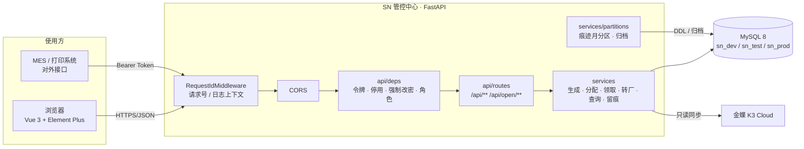

部署形态（单端口 / Docker Compose / 前后端分离开发）见 [运维手册](运维手册.md)。

## 3. 代码结构

```
app/
  main.py        应用装配：中间件、CORS、错误处理（含失败留痕）、单端口托管前端、启动任务
  api/           deps.py（鉴权依赖、分页、下载）、routes/（auth、users、factories、orders、rules、generate、
                 acquire、open、transfers、sn、audits、dashboard、health）
  core/          config（.env / 环境变量）、envfile、errors（ErrorCode + 中文模板）、exceptions（BizError）、
                 encoding（进制编码）、security（PBKDF2、HMAC 令牌、当前操作人）、logging、scheduler、utils
  db/            mysql.py（连接池与事务）、session.py、migrate.py（Flyway 兼容）、migration/V1__init.sql
  middleware/    request_id.py
  models/        表清单
  schemas/       请求体（pydantic）
  services/      users、factories、k3、orders、order_sync_schedule（定时全量同步）、
                 rules、sn_items（号段切分）、generate、acquire、transfers、query、audit、audit_query、dashboard、
                 partitions、files（CSV / XLSX）、demo_seed
tests/           pytest：单元测试 + 集成测试（真实 MySQL + 假金蝶）
frontend/src/
  api/ stores/ router/ layouts/ components/ composables/ views/ locales/（由 scripts/gen_locales.py 生成）
```

## 4. 角色与权限

查询员可绑一个、多个工厂或不绑（`sn_user_factory`，没有记录 = 全部工厂）。下表「绑厂」指只看所绑的这些厂。读范围统一由 `CurrentUser.factories` 给出：厂区操作员 = 本厂，绑厂查询员 = 所绑的厂，总部与不绑厂查询员为空（= 全部）；`read_factories(factory_code)` 指定的工厂须在范围内，否则 403 `FACTORY_FORBIDDEN`。

| 能力 | 系统管理员（总部，不绑厂） | 厂区操作员（必须绑一个厂） | 查询员（不绑厂） | 查询员（绑一个或多个厂） |
| --- | --- | --- | --- | --- |
| 账户：创建 / 修改 / 停用 / 启用 / 重置密码 | 仅内置管理员（`SN_INIT_ADMIN_EMP_NO`） | | | |
| 工厂：金蝶同步 / 手工建档 / 改名 / 停用 / 启用 | ✔（「工厂」菜单只给管理员） | | | |
| 工厂列表 `GET /api/factories`（各页显示工厂名、筛选下拉用） | ✔ | ✔ | ✔ | ✔ |
| 生产订单快照：查看（左表、物料行、客户列表） | ✔ 全部 | | ✔ 全部 | ✔ 所绑工厂（他厂订单的物料行返回 `FACTORY_FORBIDDEN`） |
| 生产订单快照：同步 | ✔ | | | |
| 定时全量同步：查看设置 / 修改设置 | ✔ / ✔ | | ✔ / | ✔ / |
| 规则库维护（分类、版本、删除）；生成页绑定 / 解绑 | ✔ | | | |
| 生成、取消、撤销、分配 | ✔ | | | |
| 领取页：查看 | ✔ 全部，可按厂筛选 | ✔ 本厂；可切换只读看同 PI 各厂 | ✔ 全部（只读） | ✔ 所绑工厂（只读） |
| 领取、打印（页面） | ✔ 代任一厂 | ✔ 本厂 | | |
| 对外接口：领取 / 回调 | ✔ 领取需指定工厂，回调以批次为准 | ✔ 本厂 | | |
| 转厂：提交申请、撤回本厂申请 | | ✔ 本厂 | | |
| 转厂：确认、驳回、直接转移 | ✔ | | | |
| 转厂页、转厂记录：查看 | ✔ | ✔ 转出 / 转入本厂 | ✔（只读） | ✔ 转出 / 转入所绑工厂（只读） |
| SN 查询 / 导出 | ✔ 全部，可按厂筛选 | ✔ 本厂；只读看同 PI 各厂（未分配的号不在范围） | ✔ 全部 | ✔ 所绑工厂 |
| 操作痕迹 | ✔ 全部 | ✔ 本厂 + 转入本厂的转厂 | ✔ 全部 | ✔ 所绑工厂 + 转入这些厂的转厂 |
| 首页看板 | ✔ 全部（含待分配、生成任务） | ✔ 本厂 | ✔ 全部（含累计生成） | ✔ 所绑工厂 |

工厂不能自己生成 SN、不能代其他厂领取或打印、不能在查询界面里把号转走（查询接口只读，转厂只在转厂页）。

页面上的工厂筛选：SN 查询、领取与打印页只有总部显示；生产订单、转厂、操作痕迹页对不绑厂的账户（总部、不绑厂查询员）显示。其他账户按可看范围自动过滤；可看多个厂的账户在领取页另显示工厂列。

## 5. SN 状态机

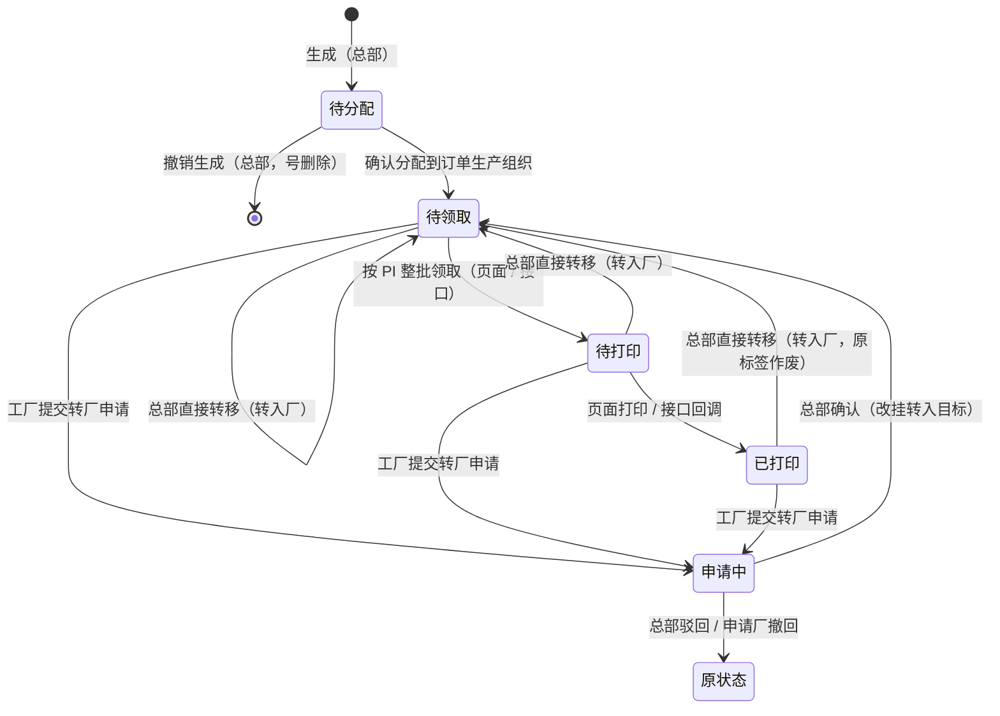

- 撤销生成只删除仍待分配的号，且只能撤销这张 PI 流水排在最后的一次生成（§7.4a）；
- 待分配、申请中的号不能转移；申请中的号不参与领取，回调也不改动它们；
- 同一枚号同时只能有一张未完成的转厂申请（申请中即不可再被选入）；
- 转出厂在转厂记录中仍能查到这些号，标「已转出」。

## 6. 业务总流程

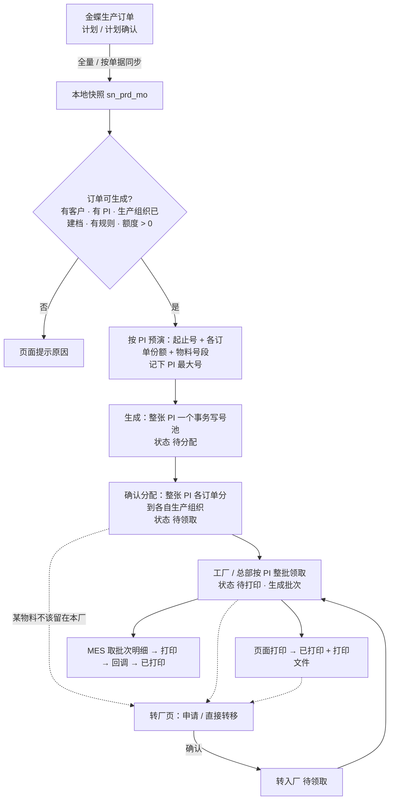

## 7. 关键时序

### 7.1 登录与重置后改密

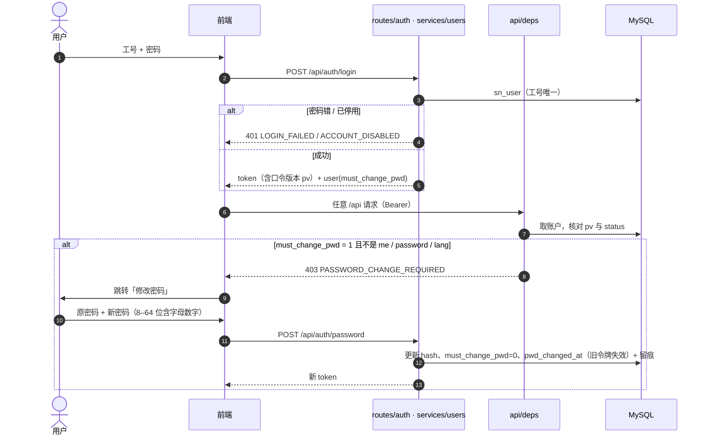

- **令牌**：`base64url(JSON{uid, pv[, sv], exp}).HMAC-SHA256`。`pv` = `pwd_changed_at` 的秒数，改密 / 重置后旧令牌 401 `TOKEN_INVALID`；停用后 401 `ACCOUNT_DISABLED`。
- **一个账户只在一个页面有效**：页面登录带请求头 `X-SN-Client: web`，这时在事务里把 `last_login_at` 推到新值（同一秒内顺延一秒），令牌另带 `sv`；`api/deps` 发现 `sv` 与库里不一致返回 401 `SESSION_REPLACED`。MES 登录不带该头：不改 `last_login_at`，令牌没有 `sv`，互不影响。改密返回的新令牌沿用当前 `sv`。前端另用 `BroadcastChannel("sn_session")` 让同一浏览器里其他页面上的同一账户立即退出；令牌存在 `sessionStorage`，同一台机器不同标签页可登录不同账户。
- **登录失败**：不锁定；工号不存在时也算一次 PBKDF2，避免按响应时间判断工号；成功、失败（含停用）都记 `LOGIN`（`detail` 为来源地址：经 nginx 取 `X-Real-IP`）。失败痕迹用独立事务写，不随请求回滚。

### 7.2 金蝶生产订单同步

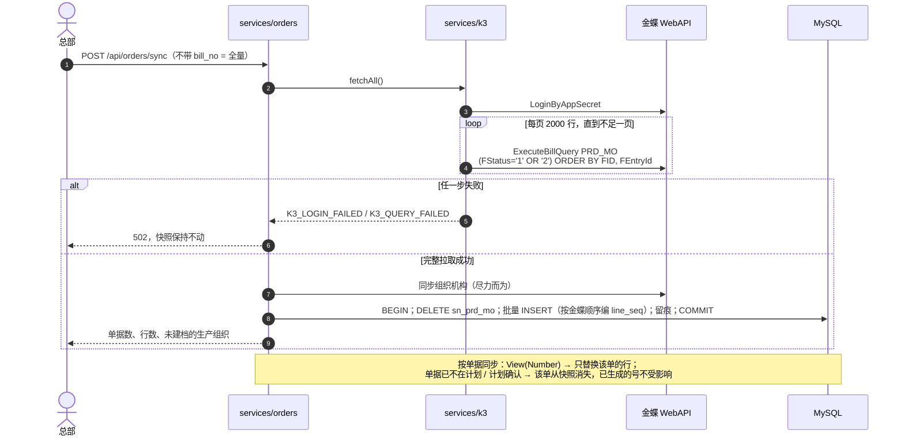

**定时全量同步**（`services/order_sync_schedule`）：设置存在 `sn_order_sync_schedule`（只有 id = 1 一行：开关、间隔分钟、下次执行、最近一次结果）。进程启动后有一个后台线程每 30 秒调一次 `run_due()`：

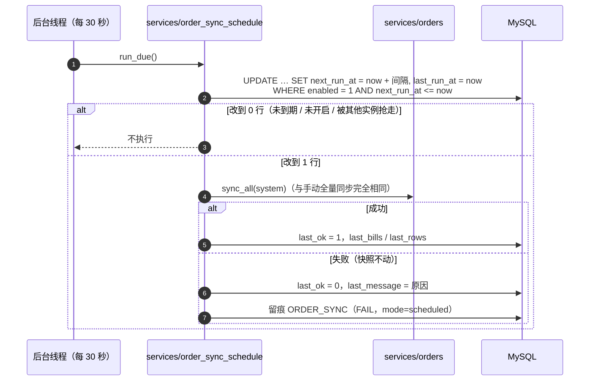

- 抢这一次靠条件 UPDATE：多实例部署时同一周期只有一个实例执行。
- 开启、或改了间隔时，下次执行 = 保存时刻 + 间隔；关闭时 `next_run_at` 置空。间隔 10 分钟–7 天，越界 `ORDER_SYNC_INTERVAL_INVALID`。
- 修改设置留痕 `ORDER_SYNC_SCHEDULE`（前后值写在 detail）。

**金蝶调用细节**（`app/services/k3.py`）：地址 `K3_SERVER_URL`，`httpx` 直连、不走系统代理。每次调用先 `LoginByAppSecret`（账套、用户名、AppId、AppSecret、LCID 默认 2052；`LoginResultType = 1` 才继续），把 `KDSVCSessionId` 写成 Cookie `kdservice-sessionid`。请求体是金蝶 WebAPI 信封：`format=1`、`parameters`、`timestamp`、`v=1.0`。

| 金蝶服务 | 本系统入口 | 说明 |
| --- | --- | --- |
| `ExecuteBillQuery`，表单 `PRD_MO` | `POST /api/orders/sync` 不带单据号、定时全量同步 | 过滤 `FStatus='1' OR FStatus='2'`，按 `FID, FTreeEntity_FEntryId` 排序，每页 2000 行直到不足一页；任一页失败整次失败 |
| `View`，表单 `PRD_MO` | `POST /api/orders/sync` 带 `bill_no` | 只替换这张单；`MsgCode = 10`（找不到）视为已离开计划 / 计划确认，从快照删除，已生成的号不删 |
| `ExecuteBillQuery`，表单 `ORG_Organizations` | `POST /api/factories/sync`；全量订单同步时顺带一次 | 全部组织（含禁用）：新的未禁用组织写入 `sn_factory`（`source=K3`）；已有的金蝶工厂按 `FForbidStatus`（`A` = 启用）同步启停，手工建档的不动；只取一页 2000 行；全量订单同步里这一步失败只记警告 |

生产订单字段（`FieldKeys`）：`F_ora_kh.FNumber, FBillNo, F_HX_PO, F_HX_PI, FMaterialId.FNumber, FMaterialId.FName, FQty, FStatus, FSaleOrderNo, FPrdOrgId.FName`，落到 `sn_prd_mo` 的客户、单据、PO、PI、物料、数量、状态、需求单据号、生产组织名称，不存金蝶内码。超时：登录 30 秒、查询 120 秒、View 60 秒（`K3_LOGIN_TIMEOUT` / `K3_QUERY_TIMEOUT` / `K3_VIEW_TIMEOUT`）。错误：登录失败 502 `K3_LOGIN_FAILED`，查询失败 502 `K3_QUERY_FAILED`，缺配置 503 `K3_CONFIG_MISSING`；本地快照 / 工厂表均不动。

### 7.3 预演与生成

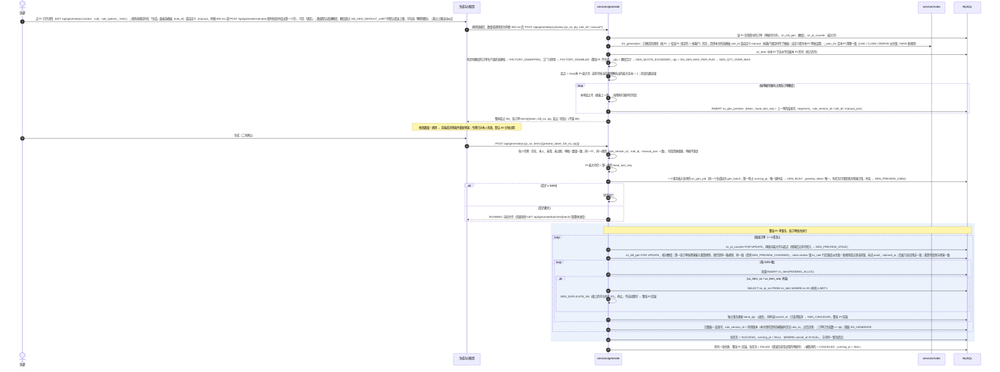

不提供按单张订单生成：原按单据的 `POST /api/generate/preview`、`POST /api/generate` 已删除，避免绕开「有订单的生产组织未建档时整张 PI 不能生成」（26）与「按单据编号顺序占用额度」（10）。

生成事务锁住计数器后会再读一次任务状态：任务已不是 `RUNNING`（被下文的启动回收标为失败）就放弃，不写任何号。

**中断任务回收**：后台任务运行中进程退出（容器重启、`stop.bat`、崩溃）时，未提交的生成事务随连接回滚，但任务行会停在 `RUNNING` 并占住 `running_pi`，这张 PI 之后一直报 `GEN_BUSY`。因此应用每次启动（建表之后）执行 `generate.recover_interrupted()`：对每个 `RUNNING` 任务，用 `FOR UPDATE NOWAIT` 依次锁任务行和该 PI 的计数器行。拿不到锁说明生成事务仍在进行（例如在另一实例上），跳过；拿到锁就把任务标为 `FAILED`（`error_code = INTERRUPTED`）并释放 `running_pi`，这些任务一枚号也没有写入。多实例部署时，一个实例重启可能把另一实例上还在排队、尚未开始的任务也标为失败，这些任务不会再执行，重新预演后生成即可，不会产生重号。

### 7.3a 生成进度与取消

- **进度**：`GET /api/generate/batches/{batch}` 返回整次生成的状态（`RUNNING / SUCCESS / FAILED / CANCELED / REVOKED`）、`qty`、`done_qty`（各任务 `done_qty` 之和，每写完 1000 枚在独立事务里更新）、`current_sn`（已写到的号）、起止号与操作人。页面只显示整体进度，速度与预计剩余由前端按采样计算，不受服务器时钟影响。`/api/orders/pis` 每行带 `running {batch, qty, done_qty}`，列表行上显示「生成中 百分比」。
- **取消**：`POST /api/generate/batches/{batch}/cancel`。一个短事务锁住批次的任务行，给仍是 `RUNNING` 的任务写 `cancel_at / cancel_by`，并留痕 `SN_GEN_CANCEL`（含取消时的已写入枚数）；批次已结束返回 `GEN_CANCEL_NOT_RUNNING`，重复取消不再留痕。生成线程每写完一块就在独立连接里读 `cancel_at`（生成事务自己的快照看不到之后提交的取消），看到后抛 `GEN_CANCELED`，整张 PI 回滚：`sn_item`、计数器、`sn_bill_gen`、规则版本 `used` 都不保留；任务标为 `CANCELED`，后台任务另记 `SN_GENERATE` 失败痕迹。
- **与完成的竞争**：生成最后一步 `UPDATE … SET status='SUCCESS' WHERE … AND cancel_at IS NULL` 是当前读。取消请求先提交，这一步改不到行，整批回滚；取消请求后到，它锁任务行时要等生成事务提交，之后看到已是 `SUCCESS`，返回「已经结束」。不会出现「提示取消成功、号却留下」。

### 7.4 确认分配

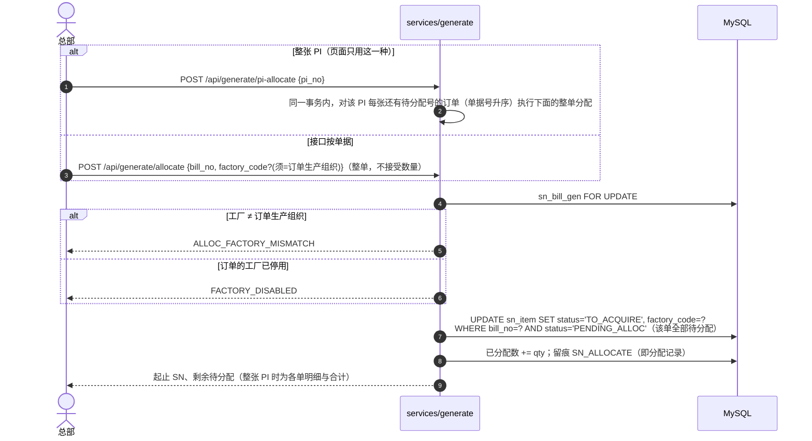

### 7.4a 撤销生成（点错了重来）

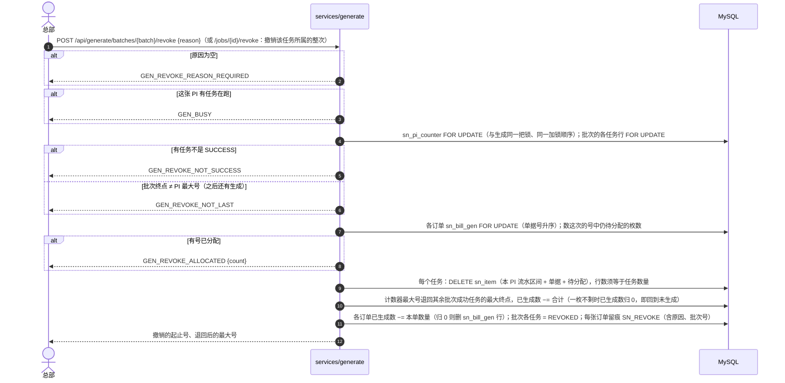

- **整次、只撤最后一次**：撤销以生成批次为单位，一次生成涉及的各订单一起撤销。批次终点必须等于 PI 计数器的最大号。这样退回最大号后重新生成的号与原来完全相同，号段不留空洞，也不会和之后生成的号交错。
- **只撤全部仍待分配的**：这次的号只要有一枚分配出去，就可能已被领取、打印，整次拒绝。待分配的号不能领取、不能转厂，所以撤销不会碰到批次、打印单和转厂记录。
- **不退回的**：规则版本的「已使用」标记（之后改格式仍须另出一版）；给 PI 指定的规则（需要换规则时在页面解绑重选）；`SN_GENERATE` 痕迹（撤销另记一条 `SN_REVOKE`）。
- `pi-context` 返回 `revocable_batch`（批次号、合计、起止号、订单）；生成页详情据此在分配面板显示「撤回本次生成」，`jobs` 中该批次的任务带 `revocable = true`（页面的任务标签页只展示记录）。

### 7.5 领取页：按 PI 领取与打印

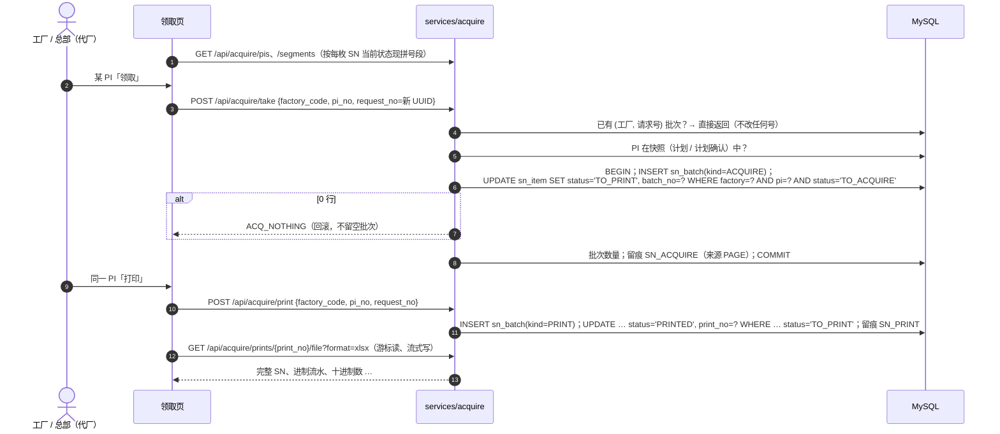

### 7.6 对外接口：领取（幂等）、批次明细、回调

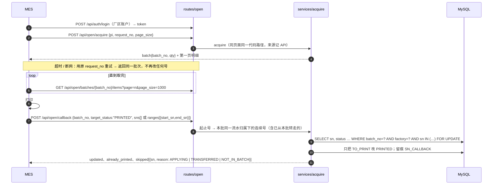

### 7.7 转厂：申请 → 确认 / 驳回 / 撤回；总部直接转移

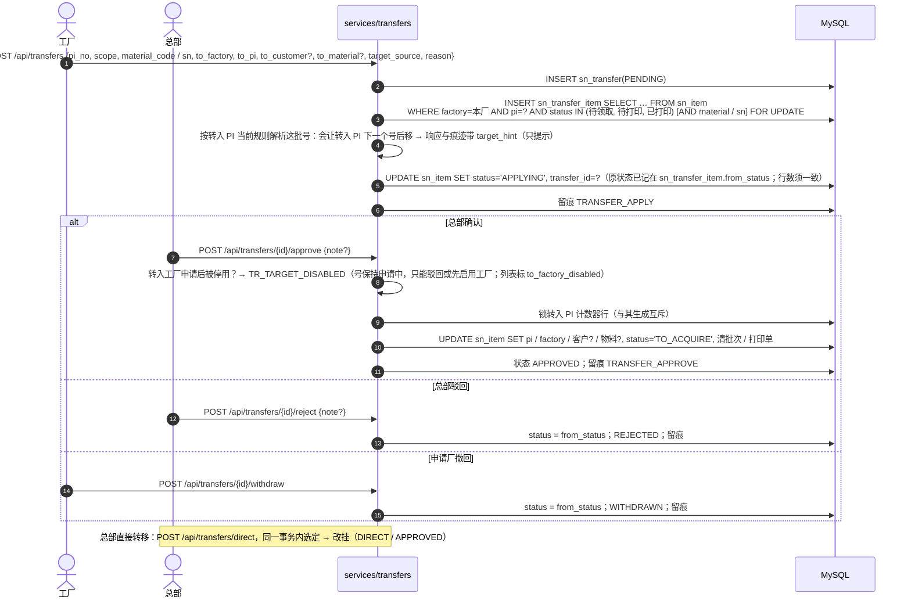

### 7.8 分区维护与痕迹归档

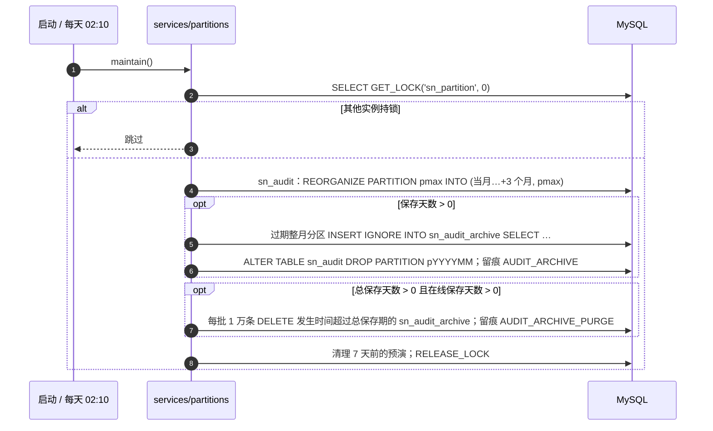

## 8. 接口清单

统一约定：JSON 与查询参数都用 **snake_case**；时间 `yyyy-MM-dd HH:mm:ss`；列表返回 `{items, total, page, page_size, total_capped}`；错误返回 `{code, message, params}`（`message` 为中文，前端按 `code` 显示当前语言）。除登录与健康检查外都需要 `Authorization: Bearer <token>`。

| 分组 | 方法 路径 | 说明 | 角色 |
| --- | --- | --- | --- |
| 认证 | POST `/api/auth/login` | 登录 | 公开 |
| | GET `/api/auth/me` · POST `/api/auth/password` · PUT `/api/auth/lang` | 当前账户 / 改密 / 语言 | 登录 |
| 账户 | GET/POST `/api/users`，PUT `/api/users/{id}`，POST `/{id}/disable|enable|reset-password` | 账户管理；请求体 `factory_code`（厂区操作员）、`factory_codes`（查询员，可多个，空 = 全部；只传 `factory_code` 按绑一个处理） | 仅内置管理员（`SN_INIT_ADMIN_EMP_NO`；其他管理员 403 `USER_MANAGE_FORBIDDEN`） |
| 工厂 | GET `/api/factories`；POST `/api/factories/sync`、POST `/api/factories`、PUT `/api/factories/{code}`、POST `/api/factories/{code}/disable`、`/enable` | 列表（含绑定账户数）/ 金蝶同步 / 手工建档 / 改名称 / 停用 / 启用 | 查看：登录；写：管理员 |
| 订单 | GET `/api/orders`、`/api/orders/meta`、`/api/orders/{bill_no}/lines`、`/api/orders/customers` | 快照；`/api/orders` 的 `q` 匹配单据 / PI / PO / 物料 / 客户，`pending=1` 只要还有额度或待分配的单据 | 管理员、查询员 |
| | POST `/api/orders/sync` `{bill_no?}` | 全量 / 按单据同步 | 管理员 |
| | GET `/api/orders/sync-schedule` · PUT `{enabled, interval_minutes?}` | 定时全量同步：查看 / 修改（间隔 10–10080 分钟） | 查看：管理员、查询员；修改：管理员 |
| 规则 | GET `/api/rules?scope=&category=&category_value=&q=` | 规则库列表（每条带当前版与全部版本）；`q` 模糊匹配编码 / 名称 / 绑定对象 / 分类对象；按「未分类在前、分类、编码」排序 | 管理员 |
| | POST `/api/rules` `{rule_code, rule_name, prefix, suffix?, base, seq_len, charset?, category_scope?, category_value?, bind_scope?, bind_value?}` | 新建；不传 `bind_scope` 即通用规则（页面只这样建），不传分类时同绑定对象 | 管理员 |
| | PUT `/api/rules/{id}` | 修改名称 / 编码参数 / 分类（不传则不变）/ 绑定（不传则不变，改成 `GENERAL` 即解绑；页面不传）；返回 `action`：`NEW_VERSION` / `UPDATED` / `REBOUND` / `RECATEGORIZED` / `RENAMED` / `UNCHANGED` | 管理员 |
| | POST `/api/rules/preview` `{prefix, suffix, base, seq_len, charset, start?}` | 编码预览：前 5 个号与最大号 | 管理员 |
| | DELETE `/api/rules/{id}` | 删除规则及全部版本；生成过号的拒绝（`RULE_IN_USE`），指定给 PI 的拒绝（`RULE_ASSIGNED`） | 管理员 |
| | PUT `/api/rules/pi-binding` `{pi_no, rule_id}` | 给 PI 指定规则库中的规则（通用规则或别的 PI 的规则；按客户绑定的拒绝 `RULE_NOT_GENERAL`；本 PI 已有按 PI 绑定的拒绝 `RULE_BIND_EXISTS`），已指定的直接换掉 | 管理员 |
| | DELETE `/api/rules/pi-binding?pi=` | 解除该 PI 当前生效的绑定：指定的取消指定（`RULE_PI_UNBIND`）；按 PI / 按客户绑定的规则改成通用（`RULE_REBIND`，按客户的该客户全部 PI 解除），分类不变 | 管理员 |
| | GET `/api/rules/effective?pi=&customer=` | PI 当前生效规则（按 PI ＞ 给该 PI 指定的 ＞ 按客户 ＞ 第一条可选模板）；不传 `customer` 时取快照里该 PI 的客户 | 登录 |
| 生成 | GET `/api/orders/pis?customer=&q=&pending=&limit=` | 生成页 PI 列表：单据数、生产组织（`unmapped` 有未建档、`disabled` 有已停用）、额度、已生成 / 已分配 / 待分配、`start_locked`（生成过）、`rule_fixed`（已按 PI / 按客户绑定或已指定，不用先选规则）、`running`（正在生成的批次与进度），最近下单（单据号大）在前；`q` 匹配 PI / 单据 / PO / 客户，命中任一单据即列出整张 PI；`pending=1` 只要还有额度或待分配的 PI；`limit` 默认 50，最多 500 | 管理员、查询员 |
| | GET `/api/generate/pi-context?pi=`（或 `?bill_no=`） | 按 PI：各订单额度 / 已生成 / 已分配 / 待分配（含已离开快照的订单）、生效规则 `rule` 与可选模板 `rule_options`（含本 PI 将用的版本、第一个号、`used_pis`）、计数器、下一个号 `next`、`issues`、正在跑的批次、`revocable_batch`、`limits`、任务、分配记录 | 管理员 |
| | POST `/api/generate/rule-plan` `{pi_no, rule_id? , manual?{prefix, base?, seq_len, suffix?}}` | 选模板 / 自定义时的即时判断：本 PI 将用哪一版（沿用时另出派生版，后缀加 `_v版本号`）、第一个号；自定义参数不合法或前缀冲突时报错 | 管理员 |
| | POST `/api/generate/pi-preview` `{pi_no, qty, rule_id?, manual?}` | 按 PI 预演：数量按单据号顺序占用各订单额度，每张订单一个预演令牌（号段接续）；规则未确定时用 `rule_id` 或 `manual`（都给以 `manual` 为准） | 管理员 |
| | POST `/api/generate/pi` `{pi_no, items:[{preview_token, bill_no, qty}]}` | 按 PI 生成：各订单在同一个事务里依次生成（每张一个任务，逐张校验与写号），任何一张失败整张 PI 回滚；合计超过同步阈值时转后台 | 管理员 |
| | POST `/api/generate/pi-allocate` `{pi_no}` | 整张 PI 分配：各订单待分配号分到各自生产组织，同一事务 | 管理员 |
| | GET `/api/generate/context?bill_no=` | 订单、额度、「工厂 + PI」汇总、规则、计数器、任务（按单据，页面已不用） | 管理员 |
| | GET `/api/generate/jobs`、`/jobs/{id}` | 任务 | 管理员 |
| | GET `/api/generate/batches/{batch}` | 一次生成的整体进度（§7.3a） | 管理员 |
| | POST `/api/generate/batches/{batch}/cancel` | 取消正在进行的生成：整批回滚，已写入的号全部删除，留痕 `SN_GEN_CANCEL`（§7.3a） | 管理员 |
| | POST `/api/generate/batches/{batch}/revoke` `{reason}`、POST `/api/generate/jobs/{id}/revoke` `{reason}` | 整次撤销生成：只能撤销该 PI 流水排在最后、号全部仍待分配的一次成功生成；号删除，PI 最大号、各订单额度退回（§7.4a） | 管理员 |
| | POST `/api/generate/allocate` `{bill_no, factory_code?}`、GET `/api/generate/allocations?bill_no=` | 按单据整单分配（页面不用）/ 分配记录 | 管理员 |
| 领取页 | GET `/api/acquire/pis`、`/segments`、`/batches`、`/batches/{no}/items`、`/batches/{no}/file`、`/prints`、`/prints/{no}/file` | 「工厂 + PI」列表（最近有动作在前，最多 2000 行）/ 号段（`status`、`material_code`、`pi_all`）/ 领取批次（`batch_no`、`request_no`、`source` 精确查）/ 批次明细 / 批次导出（只读，不改状态）/ 打印记录（`print_no`、`request_no` 精确查）/ 打印文件；文件 `format=xlsx\|csv` | 登录（按范围） |
| | POST `/api/acquire/take`、`/api/acquire/print` | 按 PI 领取 / 打印 | 管理员、厂区操作员 |
| **对外** | POST `/api/open/acquire` | 按 PI 整批领取（请求号幂等） | 管理员（需指定工厂）、厂区操作员 |
| | GET `/api/open/batches/{batch_no}/items` | 批次明细（分页，可反复读） | 同上 + 查询员（只读） |
| | POST `/api/open/callback` | 打印回调 | 管理员、厂区操作员 |
| | GET `/api/open/sn?factory_code=&pi=&customer_code=&material_code=` | 只读拉取（`factory_code`、`pi` 必传，缺了 422；传空串则不按该项过滤） | 登录（按范围） |
| 转厂 | GET `/api/transfers`、`/{id}`、`/{id}/items`、`/candidates`、`/targets` | 记录（待确认的附转入后起点提示）/ 明细 / 范围预览（传 `to_pi` 时附转入后起点提示 `target`）/ 快照目标 | 登录（按范围） |
| | POST `/api/transfers` · POST `/{id}/withdraw` | 申请 / 撤回 | 厂区操作员 |
| | POST `/api/transfers/direct` · POST `/{id}/approve|reject` | 直接转移 / 确认 / 驳回 | 管理员 |
| 查询 | GET `/api/sn`、`/api/sn/export` | SN 查询（`pi_all=true` 厂区只读看同 PI 各厂；`seq_from` / `seq_to` 按本 PI 自己的流水号范围查，须带 `pi`，可填流水号或完整 SN，列表附 `range` 小计）/ 导出 | 登录（按范围） |
| 留痕 | GET `/api/audits`、`/api/audits/export`、`/api/audits/meta` | 痕迹 | 登录（按范围） |
| 其他 | GET `/api/dashboard`；GET `/health/live`、`/health/ready`（别名 `/api/health`） | 首页 / 健康检查 | 登录 / 公开 |

对外接口示例：

```http
POST /api/open/acquire
{"pi": "ADT260730-0832-1711", "request_no": "MES-20260928-0001", "page_size": 1000}

→ {"batch": {"batch_no": "B202609281307042814", "qty": 200, "replayed": false, ...},
   "items": {"items": [{"sn": "81260908200001", "seq_text": "00001", "seq_dec": 1, ...}], "total": 200, ...}}

POST /api/open/callback
{"batch_no": "B202609281307042814", "target_status": "PRINTED",
 "ranges": [{"start_sn": "81260908200001", "end_sn": "81260908200120"}]}

→ {"updated": 120, "already_printed": 0, "skipped": [{"sn": "81260908200121", "reason": "APPLYING"}]}
```

## 9. 关键设计与需求落地说明

| 需求 / 附录待确认项 | 落地方式 |
| --- | --- |
| 完整 SN 全局不重复；自己生成的流水不重复 | 规则前缀不能互为开头；同一规则被多张 PI 沿用时各用派生版（后缀加 `_v版本号`）；`sn_item` 唯一键 `(sn)` + `(seq_pi_no, seq_dec)` 兜底；生成、转厂确认都在事务中完成 |
| 1. 每枚记来源生产订单，额度 = 订单数量 − 已生成 | `sn_item.bill_no`、`sn_bill_gen.generated_qty`；转走的号仍计入来源订单（7） |
| 2. 同一 PI 生成加锁串行；最大号变化预演失效 | `sn_gen_job.running_pi` 唯一键 + 计数器 `FOR UPDATE` + 预演 `base_last_seq` 核对 |
| 3. 物料行顺序切段，物料为空的行物料为空 | `sn_items.split`：订单已生成 G 枚时从第 G 个位置接着切；同物料多行多段 |
| 4. 领取请求号幂等；按批次号查明细；分页 | `sn_batch` 唯一键 `(factory_code, kind, request_no)`；批次明细分页、页码不限 |
| 5. 可撤回；驳回 / 撤回恢复原状态；申请中回调不改 | `sn_transfer_item.from_status`；回调 `skipped: APPLYING` |
| 6. 已打印的号转厂后变为待领取、重新打印 | 确认 / 直接转移后统一 `TO_ACQUIRE`，清空批次与打印单 |
| 8. 只停用不删除；重置后改密 | 无删除接口；新建账户可直接用，管理员重置后 `must_change_pwd`；改密 / 重置后旧令牌失效 |
| 9. 生成后发现点错（数量、订单、规则选错）可删除重来 | 整次撤销生成（§7.4a）：只撤 PI 流水排在最后、号全部仍待分配的一次，各订单一起撤；删除号，退回最大号与额度，原因必填并留痕 `SN_REVOKE` |
| 25. 生成中可取消，已写入的号全部删除，痕迹保留 | §7.3a：取消标记 `cancel_at`，生成线程每块检查，整批回滚、任务 `CANCELED`；`SN_GEN_CANCEL` 与 `SN_GENERATE` 失败痕迹保留 |
| 26. 有订单的生产组织未建档时整张 PI 不能生成 | `pi_preview` 对还有额度、生产组织未建档的订单报 `FACTORY_UNMAPPED`（列出组织名） |
| 27. 分配只能整张 PI 一次分完 | 页面只用 `pi-allocate`；`allocate` 不再接受数量，整单分配 |
| 28. 归档痕迹页面可查，归档表设保存上限 | `audit_query`：查询起点早于归档表最新一条时，同条件 `UNION ALL` 在线表与归档表（结果标 `archived`，导出按 id 游标倒序连续读）；`partitions.purge_archive` 按 `SN_AUDIT_ARCHIVE_RETENTION_DAYS` 每天分批删除，留痕 `AUDIT_ARCHIVE_PURGE` |
| 29. 工厂可改名、停用、启用 | `PUT /api/factories/{code}`、`POST /api/factories/{code}/disable`、`/enable`；`factories.must_be_enabled` 用在生成预演、分配、转厂转入（申请、直接转移，以及确认时再查一次：`TR_TARGET_DISABLED`）、账户新绑定；金蝶同步按 `FForbidStatus` 启停来源为金蝶的工厂 |
| 10. 生成以 PI 为单位，整张 PI 一个事务 | 不提供按单张订单生成的接口；`pi_preview` 按单据编号顺序占用各订单额度，每张订单各记一份首尾相接的预演；`generate_pi` 校验令牌顺序后在一个事务里依次生成，任何一张失败全部回滚、各任务都标 FAILED；`allocate_pi` 同一事务分到各订单的生产组织 |
| 预演条件改变 → 失效 | 前端监听数量 / 规则变化丢弃预演并重新预演；后端核对数量、规则（按预演输入重算须仍是同一条、同一版，`realize` 时派生版号、认领状态、手动规则名称未变）、首号串、号段 |
| 规则库只做分类，绑定在生成页 | `sn_rule.category_scope / category_value` 只用于列表筛选与生成页「推荐」；规则库页新建 / 修改不传 `bind_scope`（新建即通用）；生成页 `rule_options` 列出通用规则与各 PI 的规则（按客户绑定的不可选），`pi-binding` 指定 / 解绑；按客户绑定只能经接口设置 |
| 同一规则被多张 PI 沿用不撞号 | `sn_rule_version.claimed_pi`：当前版最先被哪张 PI 用来生成；别的 PI 再用时 `plan_for` 给出派生版（后缀 + `_v版本号`，`derived_from` 指向原版），生成事务里 `realize` 落库；PI 首次用某条规则时固定版本（`sn_pi_counter.rule_version_id`） |
| 自定义规则 | `manual_plan` 校验参数与前缀；预演记 `manual_json`；生成成功时 `realize` 插入按 PI 绑定的规则（编码 `PI-PI号`、名称 `PI号_v1`，分类为该 PI），失败 / 取消随事务回滚不留规则 |
| 规则删除 | 只删各版本 `used` 都为 0、没有 `sn_pi_counter.rule_id` 指向的规则（`RULE_IN_USE` / `RULE_ASSIGNED`），连同版本物理删除并留痕 `RULE_DELETE` |
| 查询员绑多个厂 | `sn_user_factory`；`CurrentUser.factories` 统一给出读范围，SN 查询、领取、批次、打印、转厂、订单、痕迹、首页都按 `factories.scope_sql` 过滤；新绑定的工厂须启用，已停用的旧绑定保留 |
| 转入号不让转入 PI 卡住 | 起点 = max(本 PI 最大号, 转入号按本 PI 当前规则的最大流水) + 1（`generate.NextStart`），预演中注明；预演后又有号转入则预演失效 |
| 生成遇到相同完整 SN 停止，不自动跳号 | 每块直接批量插入，`ux_item_sn`（完整 SN 全局唯一）/ `ux_item_seq` 冲突时查出本块中已存在的号及其所在 PI，转为 `GEN_DUPLICATE_SN`，整批回滚、任务 FAILED |
| 17. 列表只列最近 3 页 | 生成页各页签（「生成中」除外）只显示最近下单的 3 页 PI，领取页各页签只显示最近有动作（`MAX(updated_at)`）的 3 页「工厂 + PI」；超出时页面提示用搜索，按关键字 / PI 搜索时不受页数限制；页签数量取满接口上限时显示「N+」 |
| 16. 生成数量默认填满额度；超过 10000 默认限制、可解除；超额自动纠正 | `pi-context.limits = {default: SN_GEN_DEFAULT_LIMIT, max: SN_GEN_MAX_PER_RUN}`；前端 `genQtyCap` / `clampQty`（`snList.js`）算上限与纠正；后端超过 `SN_GEN_MAX_PER_RUN` 报 `GEN_QTY_OVER_MAX` |
| PI 必须与 ERP 生产订单一致才允许生成、领取 | 生成：订单须在快照中；领取：PI 须在快照中（`SN_ACQUIRE_REQUIRE_SNAPSHOT`，默认开） |
| 转入目标：生产组织须已建档且启用，PI 必填，客户 / 物料留空沿用 | `factories.must_be_enabled`（申请、直接转移时查，确认时再查一次）；`to_customer / to_material` 空串 = 沿用；选了快照目标但快照里找不到「工厂 + PI（+ 客户 / 物料）」时也标「手工填写」 |
| 转厂不会造成重复 | 完整 SN 全局唯一（`ux_item_sn`），转厂只改挂靠 PI / 工厂、不改 `sn`，同一枚号只有一行，不可能与转入 PI 已有的号重复，因此不做转入 PI 查重（原 `TR_DUPLICATE` 与候选预查的 `duplicates` 已删除） |
| 转厂不改流水归属，不抬高转入 PI 计数器 | `seq_pi_no` 不变；`sn_pi_counter.last_seq_dec` 不动（确认时锁该行与生成互斥）；会让转入 PI 下一个号后移时，候选预查、提交 / 确认响应与痕迹给出前后下一个号与不再生成的号数 |
| 痕迹：来源、PI、工厂、号段 / 数量、前后状态、批次 / 请求号 / 原因 | `sn_audit` 冗余这些列；页面与接口同一类审计；已登录账户的写请求失败都在独立事务记 FAIL：业务拒绝、参数不合法（422）、操作冲突（409）、系统错误（500）；PI 从请求体的 `pi_no` 或对外接口的 `pi` 取 |
| 痕迹至少 3 年可永久；按月分区、过期归档 | 见 [数据库表设计 §5](数据库表设计.md#5-分区维护) |
| 生成任务不因服务重启永久占住 PI | 任务状态与号同一事务提交；启动时回收中断的 `RUNNING` 任务（§7.3） |
| 导出文件不执行公式 | XLSX 文本单元格强制按字符串写出（内容原样）；CSV 对 `= + - @`、制表符、回车开头的文本加 `'` 前缀，且在加引号之前处理 |
| 登录令牌不可伪造 | `ENVIRONMENT=production` 时 `SN_SECRET` 为空、为示例值或不足 32 位拒绝启动；非生产只告警 |
| 登录留痕 | 不做失败次数锁定（附录第 22 条已确认）；工号不存在时同样做一次口令校验，响应时间不泄露工号是否存在；登录成功、失败都记 `LOGIN` 痕迹（含来源地址） |

需求未写明、实现时做了取舍的各项（含规则绑定唯一、领取须 PI 在快照中、小数取整、账户可重新启用、页面打印防重等），统一列在 [需求说明附录「待业务确认的项」](多工厂SN防重管控-需求说明（修订版）.md#附待业务确认的项)，按优先级标明现在的做法、要确认的原因和可选改法，本文不再重复。

## 10. 错误码与多语言

- 后端所有业务拒绝都抛 `biz(ErrorCode.X, **params)`（`BizError`）；`ErrorCode` 枚举（`app/core/errors.py`）集中定义 HTTP 状态与中文模板。
- 前端 `locales/errors.{zh-CN,en,vi}.json` 按错误码渲染；UI 词条来自 `frontend/scripts/ui_messages.py`，错误码英 / 越译文来自 `error_messages.py`，由 `python3 frontend/scripts/gen_locales.py` 生成三种语言文件（缺译或占位符不一致会直接报错）。
- 契约测试：`tests/test_unit.py::test_every_error_code_translated`（后端每个错误码三语齐全、占位符一致）、`frontend/src/locales.test.js`（三语键一致，源码里的静态 `t('…')` 键都存在）。

- 数据库异常的统一映射（`app/main.py`）：死锁 / 锁等待超时 / 约束冲突 / 连接池耗尽（等 30 秒仍无空闲连接，日志单独记 `db_pool_exhausted`，说明 `DB_POOL_SIZE` 不够）→ 409 `CONFLICT_RETRY`（可重试）；字段超长、格式不符（`DataError`）→ 422 `VALIDATION`（请求本身有误，重试无效）。编码类字段上限 64 位。

新增错误码：在 `ErrorCode` 加一行 → `error_messages.py` 加英 / 越 → 运行 `gen_locales.py` → `uv run pytest`。

## 11. 配置项

全部来自环境变量或仓库根目录 `.env`（模板 `.env.example`，每项都有注释）。完整清单与默认值只在 [系统技术方案 附录 A](系统技术方案.md#附录-a-配置项) 维护；需要部署时填写的项见 [运维手册 §2](运维手册.md#2-配置-env)。代码读取入口为 `app/core/config.py`。

## 12. 测试

```bash
uv run pytest -q                    # 单元测试 + 集成测试（仓库根目录）
node --test frontend/src/*.test.js  # 前端辅助函数与多语言键
```

- 集成测试（`tests/test_*.py`）启动完整应用 + 真实 MySQL（默认 `127.0.0.1:3306/sndb_test_py`，用 `SN_TEST_DB_HOST / _NAME / _USER / _PASSWORD` 覆盖；测试库每次整库删除重建，不要指向开发 / 测试 / 正式库 `sn_dev` / `sn_test` / `sn_prod`）+ 本地假金蝶 HTTP 服务；连不上 MySQL 时自动跳过。测试库每次整体重建。
- 覆盖：账户（新建直接可用、重置后改密、令牌失效、停用、最后一名管理员、仅内置管理员可管理账户、同机多账户、页面登录互相挤掉而 MES 不受影响、查询员绑一个 / 多个 / 全部工厂）、规则（前缀必填且不互为开头、模板被多张 PI 沿用时派生 `_v版本号`、按客户共用与本 PI 单独设置、自定义规则生成后归档与失败不留、进制、规则库只做分类、按客户绑定在生成页解绑、指定与解绑、删除限制、改名 / 就地改 / 另出一版）、工厂（停用挡住生成 / 分配 / 转入 / 绑定、改名、金蝶启停）、归档痕迹可查与归档清理、快照（多行不合并、状态过滤、单据替换 / 消失、金蝶失败不动快照、范围）、生成（预演不落库、令牌校验、最大号变化失效、额度、同 PI 并发、位数用尽、遇重复整批回滚、后台任务进度、撤销生成）、分配、领取幂等与冲突、回调、转厂（申请 / 撤回 / 驳回 / 确认 / 直接、不再做转入查重、流水归属、来源订单计数、转入厂停用后不能确认）、查询范围、失败留痕、规则版本、分区与归档；中断任务回收（重启后可再生成、仍在生成的不回收、回收后不再写号）、导出防公式注入、生产环境弱密钥拒绝启动、超长字段返回 422、绑厂查询员订单明细范围。
