# 多生产组织 SN 防重管控 · 技术文档

> **读者**：开发　**对应代码**：`app/`、`frontend/src/`、`tests/`　**更新**：2026-10-19
> **相关**：[需求文档（PRD）](需求文档（PRD）.md)　[业务流程说明](业务流程说明.md)　[MES 对接说明](MES对接说明.md)　[数据库表设计](数据库表设计.md)　[运维手册](运维手册.md)　[文档导航](README.md)

## 1. 概述

总部按金蝶生产订单的**物料行**（单据编号 + 序号）统一生成 SN，分配到订单上的生产组织：对接 MES 的生产组织由本系统分批推送（MES 也可主动取批），未对接的在页面领取；订单变更、转单、转组织都只在本系统改挂，号本身（完整 SN）写出后不再改变。**完整 SN 全局唯一**，同一张 PI 的流水不重复。

业务规则以 [需求文档（PRD）](需求文档（PRD）.md)（V30）为准，业务视角的流程见 [业务流程说明](业务流程说明.md)，与 MES 的接口契约见 [MES 对接说明](MES对接说明.md)。本文从开发角度说明代码结构、权限、状态机、关键时序、接口清单和需求落地方式。

## 2. 技术栈与架构

| 层 | 选型 |
| --- | --- |
| 前端 | Vue 3 + TypeScript + Vite + Element Plus + Pinia + vue-router + vue-i18n（简中 / English / Tiếng Việt） |
| 后端 | Python 3.12、FastAPI + Uvicorn、PyMySQL（手写 SQL + 连接池）、structlog、cryptography（MES 凭证 AES-GCM 加密） |
| 数据库 | MySQL 8.0（InnoDB，utf8mb4_bin），版本化建表脚本（Flyway 兼容的 `flyway_schema_history`）；跨实例互斥用 `GET_LOCK` 命名锁，认领号用 `SELECT … FOR UPDATE SKIP LOCKED` |
| 导出 | openpyxl 只写模式（xlsx）/ CSV（UTF-8 BOM，流式） |
| 外部系统 | 金蝶 K3 Cloud WebAPI（LoginByAppSecret、ExecuteBillQuery、View）；各生产组织 MES（本系统推送 ①，MES 调 ②–⑥） |
| 时间 | 一律按 UTC 存储（`DATETIME`），接口输出 ISO 8601 带 `Z`；页面与导出按生产组织配置的时区（`tz_offset_min`，默认 480 = 东八区）显示 |
| 接口文档 | FastAPI OpenAPI（`/docs`；MES 接口在 `open` 分组） |

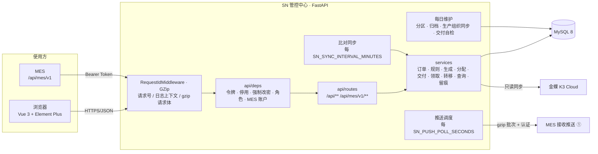

后台任务都在应用进程内（`app/main.py` 的 lifespan 启动）：

| 任务 | 入口 | 周期 | 多实例 |
| --- | --- | --- | --- |
| 每日维护 | `partitions.maintain`（`scheduler.start_daily`） | `SN_PARTITION_CRON`（默认每天 02:10） | 命名锁 `sn_partition`，只有一个实例做 |
| 比对同步 | `orders.run_scheduled`（`scheduler.start_every`） | `SN_SYNC_INTERVAL_MINUTES`（默认 10 分钟）；`SN_SYNC_ENABLED=false` 关闭 | 订单同步锁，只跑一份 |
| 推送调度 | `delivery.start_scheduler` → `run_pending` | `SN_PUSH_POLL_SECONDS`（默认 5 秒）；`SN_PUSH_ENABLED=false` 关闭 | 任务租约（300 秒），宕机后由别的实例接手 |
| 生成后台任务 | `generate._run` 线程 | 一次生成超过 `SN_GEN_SYNC_THRESHOLD` 时 | PI 操作锁交给后台线程，结束时释放 |

每日维护依次：建未来月分区 → 归档过期分区 → 清理过期归档 → 清理限流计数 → 从金蝶同步生产组织（失败只记日志）→ 每日交付自检（`dashboard.self_check`）。启动时另回收中断的生成任务（`generate.recover_interrupted`）。

部署形态（单端口 / Docker Compose / 前后端分离开发）见 [运维手册](运维手册.md)。

## 3. 代码结构

```
app/
  main.py        应用装配：中间件（请求号、CORS、GZip）、错误处理（页面错误体 / MES 错误体，失败留痕）、
                 单端口托管前端、启动任务与三个后台调度
  api/           deps.py（鉴权依赖：页面账户、MES 账户 mes_user、超级管理员；分页、下载）
                 routes/：auth、users、factories、orders、rules、generate、delivery、acquire、transfers、
                 sn、audits、dashboard、mes（/api/mes/v1）、health
  core/          config（.env / 环境变量）、envfile、errors（ErrorCode + 中文模板）、exceptions（BizError、MesError）、
                 encoding（SN 组成、进制、长度写法）、security（口令策略、HMAC 令牌、当前操作人）、secretbox（AES-GCM）、
                 scheduler、logging、utils（状态 / 角色常量、UTC 时间、单号、分页）
  db/            mysql.py（连接池与事务）、session.py、migrate.py（Flyway 兼容）、migration/V1__init.sql
  middleware/    request_id.py
  models/        表清单
  schemas/       请求体（pydantic）：auth、user、rule、gen、transfer、misc
  services/
    k3.py          金蝶调用：已审核单据编号 + 修改时间、按单号取明细、单据查看、组织机构；分页重试
    orders.py      订单快照与四种同步、附件项次补填、订单页查询、转移目标候选
    changes.py     订单变更提醒、单据台账、暂停交付（5.2.10）
    factories.py   生产组织同步、MES 对接配置、连接测试、开关「对接 MES」
    users.py       登录、改密、账户管理、MES 接口账户（密钥、白名单、锁定、换令牌）
    rules.py       规则库、版本与前缀归属、物料行规则选取、PI / 客户绑定
    generate.py    预演、生成（含后台任务、取消）、撤销、分配
    workbench.py   生成与分配页（PI 列表、详情、推送状态）
    delivery.py    交付批次、认领、推送任务、回执、人工确认 / 作废、交付告警、MES 取批与只读接口
    mes_client.py  本系统调 MES（接口 ①）：gzip、认证（Bearer / HMAC）、应答归类
    acquire.py     页面领取与领取文件
    transfers.py   转单、转组织、转移后的 MES 处理（5.2.8）、确认对应
    locks.py       命名锁：PI 操作锁、组织建批锁、订单同步锁
    query.py       SN 查询与导出
    dashboard.py   首页看板、每日交付自检
    audit.py / audit_query.py   操作痕迹写入 / 查询与导出
    partitions.py  月分区、归档、每日维护
    files.py       CSV / XLSX 输出（防公式注入）
    demo_seed.py   本机演示数据
tests/           pytest：单元测试 + 集成测试（真实 MySQL + 假金蝶 + 假 MES）
frontend/src/
  api/ stores/ router/ layouts/ components/ composables/（useTime 按时区显示）utils/ views/
  locales/（由 scripts/gen_locales.py 生成）
frontend/scripts/
  ui_messages.py（公共词条）、ui/*.py（各页面词条）、error_messages.py（错误码英 / 越）、gen_locales.py
```

## 4. 角色与权限

| 角色 | 说明 |
| --- | --- |
| 系统管理员（总部，`admin`） | 不绑生产组织，看全部、做全部总部操作，可代任一生产组织领取 |
| 内置管理员 | 工号 = `SN_INIT_ADMIN_EMP_NO` 的管理员，唯一能管理账户（`SuperAdminDep`）；它建的管理员不能再管理账户 |
| 生产组织操作员（`factory_operator`） | 必须绑一个生产组织，只看、只操作本组织的号 |
| 查询员（`query`） | 只读；可绑一个、多个或不绑（= 全部）生产组织（`sn_user_factory`） |
| MES 接口账户（`mes`） | 必须绑一个「对接 MES = 是」的生产组织；**不能登录页面**（`MES_NO_PAGE_LOGIN`），只能调 `/api/mes/v1`（页面接口返回 403 `FORBIDDEN`）；密钥由系统生成只显示一次，可设来源地址白名单 |

读范围统一由 `CurrentUser.factories` 给出（操作员 = 本组织，绑定的查询员 = 所绑组织，总部与不绑的查询员为空 = 全部）；`read_factories(code)` 指定的组织须在范围内，否则 403 `FACTORY_FORBIDDEN`。写操作的生产组织由 `write_factory` 确定（操作员只能是本组织，总部须指定）。

| 能力 | 总部 | 操作员 | 查询员 | MES 账户 |
| --- | --- | --- | --- | --- |
| 账户管理 | 仅内置管理员 | | | |
| 生产组织：金蝶同步、MES 对接配置、连接测试、开关对接 | ✔ | | | |
| 生产组织列表（各页下拉；MES 配置字段只给总部） | ✔ | ✔ | ✔ | |
| 订单页：查看、订单变更提醒（查看） | ✔ | | ✔（按范围） | |
| 订单同步（按单据 / 立即比对 / 全量重建）、附件项次补填、处理提醒 | ✔ | | | |
| 进页同步 | ✔ | | ✔ | |
| 规则库、生成、撤销、分配、物料行选规则、PI / 客户绑定 | ✔ | | | |
| 交付批次查看、剩余推送次数、交付告警查看 | ✔ | ✔ 本组织 | ✔ 按范围 | |
| 继续推送、人工确认、作废批次、处理交付告警 | ✔ | | | |
| 页面领取 | ✔ 代任一组织 | ✔ 本组织 | | |
| 领取页、领取批次、领取文件（查看 / 下载） | ✔ | ✔ 本组织；可只读看同 PI 各组织 | ✔ 按范围（只读） | |
| 转单（预览、执行） | ✔ | | | |
| 转组织：提交申请、撤回本组织申请 | 撤回 ✔ | ✔ 本组织 | | |
| 转组织：确认、驳回、直接转组织 | ✔ | | | |
| 转单 / 转组织记录、转出号清单 | ✔ | ✔ 转出 / 转入本组织 | ✔ 按范围 | |
| SN 查询 / 导出 | ✔ | ✔ 本组织；只读看同 PI 各组织 | ✔ 按范围 | |
| 操作痕迹 | ✔ | ✔ 本组织 | ✔ 按范围 | |
| 首页看板 | ✔（含待分配、生成任务） | ✔ 本组织 | ✔ 按范围 | |
| MES 接口 ②③④ | | | | ✔ 所绑组织 |
| MES 只读接口 ⑤⑥ | ✔ | ✔ 本组织 | ✔ 按范围 | ✔ 所绑组织 |

页面登录带请求头 `X-SN-Client: web`：同一账户只在最后登录的页面有效（`SESSION_REPLACED`）。管理员重置密码后下次登录须改密（`PASSWORD_CHANGE_REQUIRED`）。口令策略：8–64 位，同时含字母和数字，只能用字母、数字和 `! @ # $ & *`；工号 4–32 位字母数字。

## 5. SN 组成与状态机

### 5.1 SN 组成（`app/core/encoding.py`）

完整 SN = **前缀 + 长度 + 定长进制流水 + 后缀**（5.2.2）：

- 前缀必填（字母、数字），后缀选填（字母、数字、`_`）；任何两条规则（含各版本）的前缀不能相同或互为开头，区分大小写。
- 长度取所属物料行的长度，按「长度写法」规范化（`normalize_length`：去首尾空格；整数部分去前导零，小数去末尾 0，全为 0 时连小数点去掉）后写入；规则 `with_length = false` 时不写。不是数字时该行不能生成（`LENGTH_INVALID`），为空时 `LENGTH_EMPTY`。
- 进制 10 / 16 / 32 / 36，流水位数 1–12，左侧用字符表首字符补齐；32 进制默认字符表 `0123456789ABCDEFGHJKMNPQRSTVWXYZ`（去掉易混的 I L O U）；超出位数拒绝（`GEN_RULE_EXHAUSTED`），不自动加宽。总长不超过 64。
- 同一版本的前缀、位数、后缀固定，`parse` 可把 SN 反解为（长度，流水），用于按完整 SN 查流水范围。

### 5.2 号的状态（`sn_item.status`）

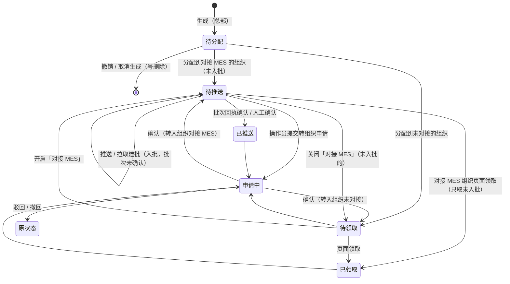

号上另有几项与交付相关的属性：

| 字段 | 含义 |
| --- | --- |
| `rev` | 挂靠版本号：每次转单、转组织、确认对应改挂时 + 1；推送报文和回执逐枚带 `rev`，MES 据此判断新增、改挂或过期 |
| `mes_holder` | MES 持有组织：批次确认后记为该批次的组织；转出批次确认后清除。决定转移后是推「改挂」还是「新增」、要不要向来源 MES 推「转出」 |
| `push_type` | 下次推送类型 `NEW` / `REASSIGN`（转出批次的明细类型为 `TRANSFER_OUT`） |
| `delivery_batch_no` / `acquire_batch_no` | 所在交付批次 / 领取批次；入批后号不再被别的通道认领 |
| `delivery_mode` | `PUSH` 推送 / `PULL` 拉取 / `PAGE` 页面领取 |
| `suspend` | 暂停交付：`REVERSAL`（单据反审核中）/ `CHANGE`（订单变更待确认）；只作用于未交付的号（待分配、待推送未入批、待领取） |
| `transfer_id` / `applying_from` | 未完成的转组织申请与申请前状态 |
| `seq_pi_no` / `seq_dec` | 流水归属 PI 与十进制流水（转组织改 PI 不改流水归属） |

- 撤销生成只删除仍待分配、没转过单的号，且只能撤这张 PI 流水排在最后的一次生成。
- 申请中、所在批次未确认或失败、所在转出批次未确认或失败、领取未完成的号不能转移；转组织另不能转待分配的号。
- 同一枚号同时只能有一张未完成的转组织申请。

### 5.3 计数口径（5.2.7，`sn_line_count`）

按物料行（单据编号 + 序号）记三项：

| 列 | 含义 | 变化 |
| --- | --- | --- |
| `own_generated` | 本单生成数：在该物料行上生成的号数 | 生成 + / 撤销、取消 −；转单不动（额度不变） |
| `gen_count` | 已生成数：当前挂在该物料行上的号数 | 生成 + / 撤销 −；转单从来源行移到目标行；确认对应并入新行 |
| `alloc_count` | 已分配数 | 分配 +；转单随号移动 |

- **可生成额度 = 物料行数量（整数部分）− 本单生成数**，转单、转组织都不改额度；
- 转组织不改来源单据和序号，三项计数都不变；
- 生成起点 = 本 PI 自己生成的最大流水 + 1（`sn_pi_counter.last_seq_dec`），转入的号不抬高起点。

## 6. 业务总流程

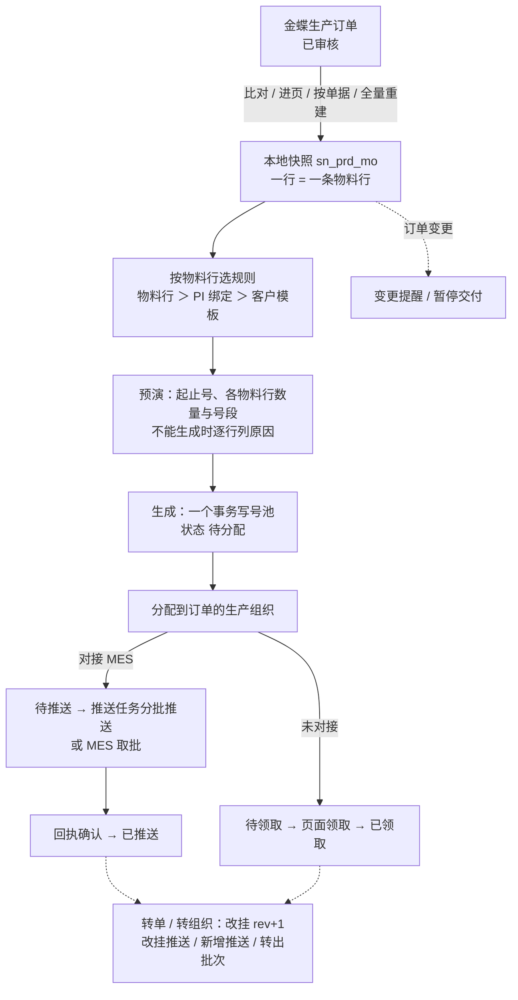

## 7. 关键时序

### 7.1 登录、改密与 MES 换令牌

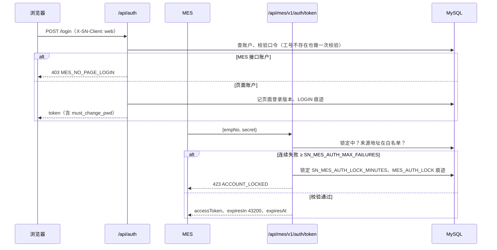

令牌为 HMAC 签名的无状态令牌，载荷含口令版本：改密、重置密码、重置密钥都会让旧令牌失效；MES 换新令牌不使旧令牌失效（多台服务器可各持一个）。

### 7.2 订单同步（F-05）与订单变更（F-06、5.2.10）

四种同步共用订单同步锁（`locks.sync_lock`）：按单据同步排队等待，比对同步和进页同步拿不到锁直接跳过（`skipped`）。

| 方式 | 入口 | 做法 |
| --- | --- | --- |
| 比对同步 | 定时 / `POST /api/orders/compare` | 只拉已审核单据的编号与修改时间（`k3.fetch_approved_heads`），与快照比对：新出现、修改时间不同的整单替换，快照有、金蝶没有的移出；同周期对反审核中的已出号单据按单号复查。任一页拉取失败（重试 `K3_PAGE_RETRIES` 次后）本周期不改快照 |
| 进页同步 | `POST /api/orders/page-sync` | 进入订单页时后台触发一次比对同步，立即返回 |
| 按单据同步 | `POST /api/orders/sync` | 不带单据状态条件按单号查：已审核 → 替换（`REPLACED`）；不是已审核 → 移出（`NOT_APPROVED`，快照里原本没有时 `NOT_APPROVED_NEW`）；查无此单 → 移出（`NOT_FOUND`） |
| 全量重建 | `POST /api/orders/rebuild` | 完整拉取写入新表，`RENAME` 原子换表；失败旧快照完整保留；完成后对全部已出号单据比对 |

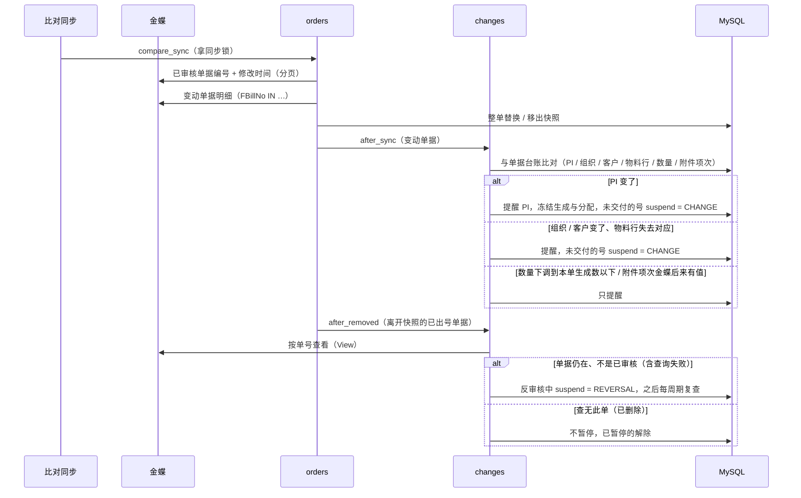

- **单据台账**（`sn_bill_ledger` + `_line`）在单据第一次生成号时建立，表头只在总部「确认变更」时改为新值，所以反审核修改后再重新审核回来仍能发现其间的变化；重新审核回来没有变化或只有数量变化时自动解除暂停。
- **处理提醒**（`POST /api/orders/alerts/{id}/handle`）：`CONFIRM` 确认变更 / `MAP` 确认对应（`target_seq`，计数与号并入新行，已交付给 MES 的号 rev + 1 改挂重推，`transfers.map_material`）/ `UNRELATED` 确认无关 / `VOID` 确认已作废（须填原因）/ `ACK` 知道了。解除暂停后 `delivery.kick_bill` 启动可推送的号。
- **附件项次**：金蝶为空时总部可补填（`sn_line_attach`，只用于本系统生成前的校验，不写回金蝶、不进推送报文和领取文件）；金蝶后来有值时以金蝶为准并提醒。

### 7.3 规则选取（F-08）

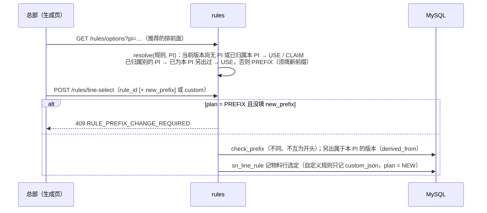

- 物料行生效规则：**物料行已选 ＞ PI 绑定（`sn_pi_rule`）＞ 客户绑定（`sn_customer_rule`，作模板）**（`rules.effective`）；都没有时该行 `NO_RULE`，客户模板首次用于本 PI 须换前缀（`RULE_PREFIX`）。
- 一个前缀只用于一张 PI：版本首次用于生成时归属该 PI（`claimed_pi`）；一个前缀只对应一种格式：生成过号的版本改格式须另出一版并换新前缀（`RULE_USED_FORMAT`），只改名称或分类不另出版本。
- 自定义规则生成成功后才存入规则库（编码 `PI-<PI>-n`、名称 `PI号_物料编码`，归属本 PI；`rules.realize`），失败或取消不留规则。
- 按客户绑定只能经 `POST /api/rules/customer-binding` 设置（F-22），每个客户一条；生成页可解绑（规则转为通用模板）。

### 7.4 预演、生成、进度 / 取消、撤销（F-09）

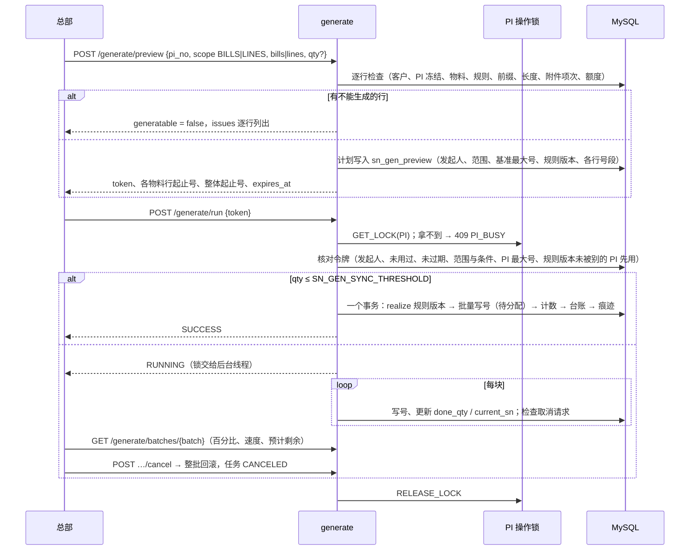

- 一次生成共用一个生成批次（`gen_batch`），所有物料行排在该 PI 的一套流水上，各行按自己的规则写出；BILLS 按勾选单据顺序、单据内按序号，LINES 按点选顺序。
- 预演只对发起人有效、默认 30 分钟（`SN_PREVIEW_TTL_MINUTES`）、只能生成一次（`GEN_PREVIEW_USED`）；PI 最大号变化 → `GEN_PREVIEW_STALE`，条件改变 → `GEN_PREVIEW_CHANGED`。
- 撞号（`ux_item_sn` / `ux_item_seq`）整次回滚报 `GEN_DUPLICATE_SN`，不跳号；单次上限 `SN_GEN_MAX_PER_RUN`，默认填入数量取额度与 `SN_GEN_DEFAULT_LIMIT` 的较小值。
- 服务重启时仍是 `RUNNING` 的任务（事务已随进程退出回滚）标为失败并释放 `running_pi`。
- 撤销（`POST /generate/batches/{batch}/revoke`，原因必填）：只能撤这张 PI 流水排在最后的一次（`GEN_REVOKE_NOT_LAST`），号全部仍待分配且都没转过单（`GEN_REVOKE_ALLOCATED`）；号删除，最大号与三项计数一并退回。

### 7.5 分配（F-11 分配部分）

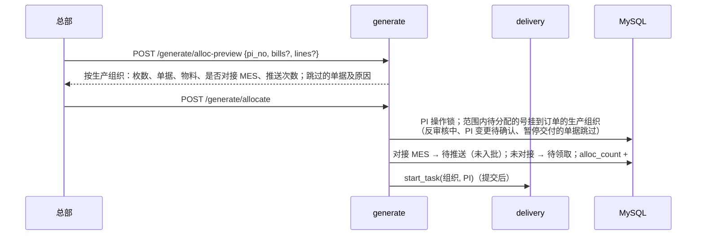

号只能分到订单的生产组织（快照中订单的生产组织；订单已不在快照时取生成时订单的生产组织 `gen_org_code`）。

### 7.6 推送任务与重试（F-11 推送部分、接口 ①）

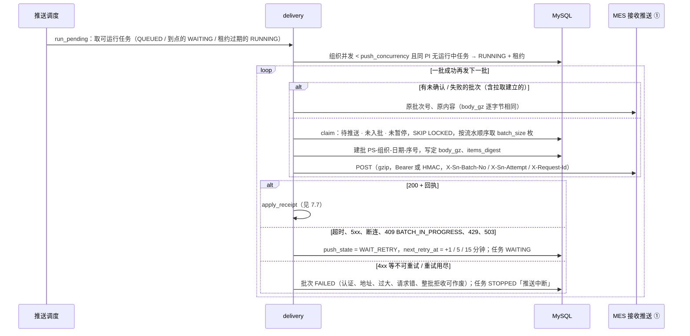

- 同组织 + 同一 PI 一个任务（`sn_push_task`，转出批次用键 `#XO`）；期间后续批次等待。
- 「继续推送」（`POST /api/delivery/resume`）：重置未确认、失败批次的自动重试，按原批次号、原内容先重推，再认领后续的号。`GET /api/delivery/remaining` 给出「剩余 N 次」（未入批未暂停的号按单批枚数折算 + 未确认或失败的批次数）。
- 连接测试（`POST /api/factories/{code}/mes-test`）发 `batchType = PING`、`items = []` 的批次，认证与压缩同正式推送；通过时记下配置摘要，开启「对接 MES」须配置与测试通过时的摘要一致（`MES_TEST_REQUIRED`）。
- HMAC 签名串 = `timestamp + "\n" + batchNo + "\n" + hex(SHA256(原始请求体))`，放 `X-Sn-Timestamp` / `X-Sn-Signature`；凭证用 `SN_SECRET` 派生的密钥 AES-GCM 加密保存，不回显。

### 7.7 MES 取批与回执（F-12、接口 ③④）

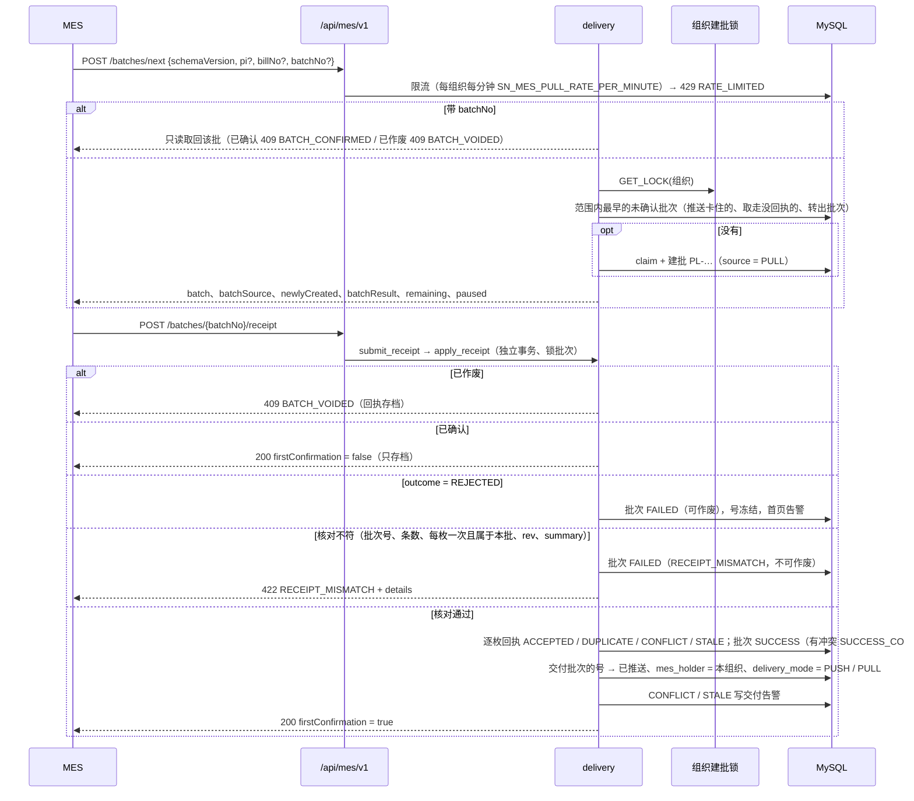

- 交付批次（含转出批次）只由本系统建立；批次号、所含 SN 及其挂靠和 rev 建立后不再改变，推送与拉取送达的内容相同。**先到的回执生效，后到的只存档**（`sn_delivery_receipt`，`verdict` = CONFIRMED / REJECTED / MISMATCH / ARCHIVED / VOIDED）。
- 只读接口 ⑤ `GET /sn/delivered`（MES 账户只得到已交付给本组织 MES 的号）、⑥ `GET /batches/{batchNo}/items`（仍在该批次中的号）用游标翻页，默认 1000 条、最多 5000 条。
- 请求体可 gzip（`Content-Encoding: gzip`）；`/api/mes` 上的所有错误（含业务错误、参数错误）都用 MES 错误体（§10）。

### 7.8 人工确认、作废与交付告警

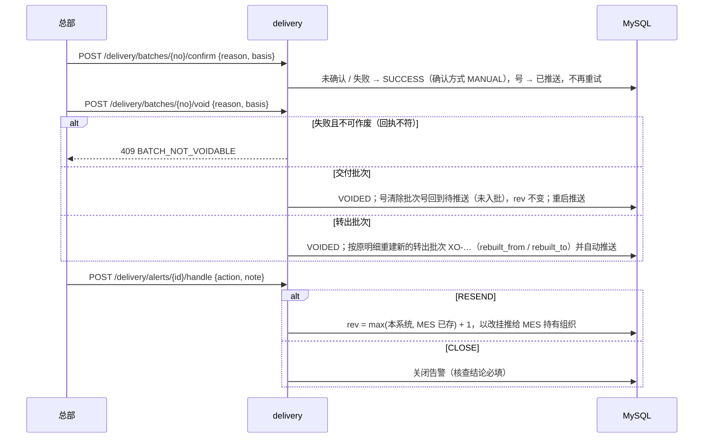

交付告警（`sn_delivery_alert`）：`CONFLICT` 疑似重复交付、`STALE` 版本过期、`CHECK` 每日自检发现的问题；首页汇总未处理的告警。

### 7.9 页面领取（F-14）

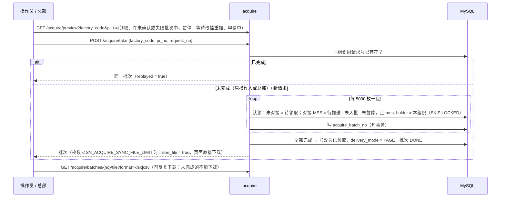

中途失败时批次记为未完成：已认领的号留在该批次、其他通道取不到，但不计已领取；用原请求号「重试」接着认领（`ACQ_BATCH_INCOMPLETE` / `ACQ_RETRY_FORBIDDEN`）。领取后不再推送、不能拉取，暂不通知 MES。

### 7.10 转单（F-15）、转组织（F-16）与转移后的 MES 处理（5.2.8）

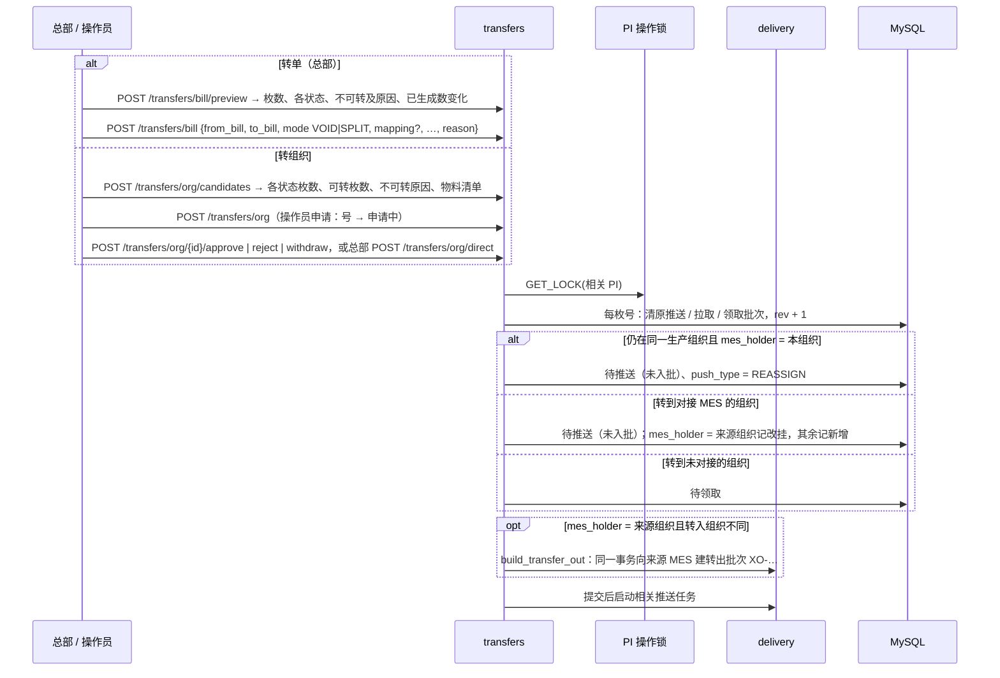

- 转单：`VOID` 整单作废（来源单据全部号转到目标单据，同物料行自动对应，对应不唯一时须给 `mapping`）/ `SPLIT` 拆单（指定来源物料行、起止号转到目标物料行）；可转待分配的号；移动已生成数、已分配数，额度不变；目标物料长度须与号上的长度相同（`TR_LENGTH_MISMATCH`）。
- 转组织：范围整张 PI / PI + 物料 / 单枚 SN，可同时改 PI、客户、物料（手工填写的字段记 `manual_fields`）；转入组织须在金蝶启用（申请、直接转、确认时都查）；不改来源单据和序号，计数和额度不变。
- 转出号清单（`GET /transfers/org/{id}/out-list`）：完整 SN、流水、原批次，来源现场据此作废旧标签。

### 7.11 每日交付自检（5.2.5 第 5 条）

`dashboard.self_check`（每日维护调用）核对近 2 天：成功批次的回执枚数是否等于批次枚数（人工确认的单列）；未经转移，同一 SN 是否在两个成功交付批次、或交付批次与页面领取中；当天的冲突、过期回执；未确认超过 `SN_BATCH_UNCONFIRMED_ALERT_MINUTES` 的批次。问题写入 `CHECK` 交付告警并留痕 `SELF_CHECK`。

### 7.12 分区维护与痕迹归档

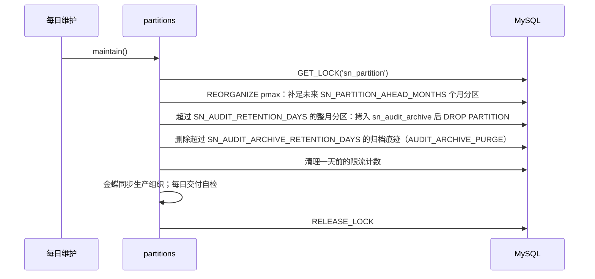

痕迹查询的时间范围覆盖到已归档的痕迹时同时查归档表，结果标 `archived`。

## 8. 接口清单

页面接口前缀 `/api`，MES 接口前缀 `/api/mes/v1`。角色列：管理员 = 总部；内置 = 内置管理员；操作员 = 生产组织操作员；登录 = 任一页面账户（按可看范围过滤）。

### 8.1 登录与账户

| 方法 | 路径 | 角色 | 说明 |
| --- | --- | --- | --- |
| POST | `/auth/login` | 公开 | 登录，返回 Bearer 令牌；带 `X-SN-Client: web` 为页面登录（同账户只在最后登录的页面有效）；MES 账户拒绝 |
| GET | `/auth/me` | 登录 | 当前账户（含显示时区 `tz_offset_min`） |
| POST | `/auth/password` | 登录 | 修改自己的密码（被重置后必须先改），返回新令牌 |
| PUT | `/auth/lang` | 登录 | 语言偏好 |
| GET | `/users` | 内置 | 账户列表：工号开头匹配、姓名包含；按角色（含 `mes`）、状态、生产组织筛选 |
| POST | `/users` | 内置 | 新建账户；MES 接口账户返回 `secret`（只显示这一次） |
| PUT | `/users/{id}` | 内置 | 修改姓名、角色、绑定、白名单（页面账户与 MES 账户不能互改角色） |
| POST | `/users/{id}/disable` · `/enable` | 内置 | 停用 / 启用 |
| POST | `/users/{id}/reset-password` | 内置 | 重置页面账户密码：下次登录须改密，旧令牌失效 |
| POST | `/users/{id}/reset-secret` | 内置 | 重置 MES 密钥：返回新 `secret`，旧密钥和旧令牌立即失效，解除锁定 |

### 8.2 生产组织与 MES 对接配置

| 方法 | 路径 | 角色 | 说明 |
| --- | --- | --- | --- |
| GET | `/factories` | 登录 | 生产组织列表；总部另看 MES 配置（凭证不回显，`credential_set`）、配置状态与绑定账户数 |
| POST | `/factories/sync` | 管理员 | 从金蝶组织机构同步：新增（禁用的不新增），名称、启用状态随金蝶 |
| PUT | `/factories/{code}/mes-config` | 管理员 | 保存配置（地址、认证 TOKEN / HMAC、凭证、单批枚数、超时、并发、时区）；已开启对接时改了地址 / 认证 / 凭证须先测试通过 |
| POST | `/factories/{code}/mes-test` | 管理员 | 连接测试：发 PING 批次（凭证留空 = 已存的） |
| GET | `/factories/{code}/mes-toggle` | 管理员 | 切换前提示：受影响枚数、关闭的阻塞项 |
| POST | `/factories/{code}/mes-toggle` | 管理员 | 开启 / 关闭「对接 MES」 |

### 8.3 生产订单

| 方法 | 路径 | 角色 | 说明 |
| --- | --- | --- | --- |
| GET | `/orders` | 管理员、查询员 | 左表：每张单据一行（客户编码为空的不显示），单据编号大的在前 |
| GET | `/orders/meta` | 管理员、查询员 | 最近同步、快照规模、客户为空的单据数、附件项次待填写行数、比对同步状态、未处理提醒数 |
| GET | `/orders/customers` | 管理员、查询员 | 快照中的客户编码 |
| GET | `/orders/targets` | 管理员、查询员 | 转单、转组织目标候选：快照中的物料行 |
| GET | `/orders/{bill_no}/lines` | 管理员、查询员 | 右表：表头、状态与各物料行（附件项次及来源、长度、计数、额度、SN 规则） |
| POST | `/orders/sync` | 管理员 | 按单据编号同步 |
| POST | `/orders/compare` | 管理员 | 立即比对同步（有同步在运行时 `skipped`） |
| POST | `/orders/page-sync` | 管理员、查询员 | 进页同步（后台触发，立即返回） |
| POST | `/orders/rebuild` | 管理员 | 全量重建快照 |
| PUT | `/orders/attach` | 管理员 | 附件项次补填 |
| GET | `/orders/alerts` | 管理员、查询员 | 订单变更提醒；`status` = OPEN（默认）/ CLOSED / ALL |
| POST | `/orders/alerts/{id}/handle` | 管理员 | 处理提醒：CONFIRM / MAP（`target_seq`）/ UNRELATED / VOID（`note` 必填）/ ACK |

### 8.4 规则

| 方法 | 路径 | 角色 | 说明 |
| --- | --- | --- | --- |
| GET | `/rules` | 管理员 | 规则库：按全部 / 未分类 / 客户 / PI 筛选与搜索 |
| POST | `/rules` | 管理员 | 新建 |
| PUT | `/rules/{id}` | 管理员 | 修改：未生成过号的版本就地改；生成过的改格式须另出一版并换新前缀；只改名称或分类不另出 |
| DELETE | `/rules/{id}` | 管理员 | 删除：只能删从没生成过号、也没指定给任何 PI 的规则 |
| POST | `/rules/preview` | 管理员 | 示例号：前 5 个和最大号、最大流水、格式说明 |
| GET | `/rules/options` | 管理员 | 生成页选项：推荐的排前面；本 PI 用时的版本与是否须换前缀（`plan`） |
| POST | `/rules/line-select` | 管理员 | 物料行选定 / 改选规则：规则库（`rule_id` [+ `new_prefix`]）或自定义（`custom`） |
| POST | `/rules/line-clear` | 管理员 | 物料行改回按 PI / 客户默认 |
| PUT | `/rules/pi-binding` | 管理员 | 给 PI 绑定规则（版本已归属别的 PI 时须填 `new_prefix`） |
| DELETE | `/rules/pi-binding` | 管理员 | 解除 PI 绑定 |
| POST | `/rules/customer-template` | 管理员 | 用客户绑定的规则作模板：为本 PI 换前缀另出版本并绑定给本 PI |
| POST | `/rules/customer-binding` | 管理员 | 按客户绑定规则（F-22，唯一入口）：每个客户一条 |
| DELETE | `/rules/customer-binding` | 管理员 | 解除客户绑定 |

### 8.5 生成与分配

| 方法 | 路径 | 角色 | 说明 |
| --- | --- | --- | --- |
| GET | `/generate/pis` | 管理员 | PI 列表与汇总；`tab` = ALL / TO_GENERATE / GENERATING / TO_ALLOCATE / DONE；行状态 GENERATING / CANNOT / NEED_RULE / TO_GENERATE / PARTIAL / TO_ALLOCATE / PUSH_INTERRUPTED / DONE |
| GET | `/generate/context` | 管理员 | PI 详情（只给单据时取其 PI）：各单据与物料行、规则、计数、任务、分配面板、推送状态、分配记录 |
| POST | `/generate/preview` | 管理员 | 预演 |
| POST | `/generate/run` | 管理员 | 凭预演令牌生成；数量大时返回 RUNNING |
| GET | `/generate/jobs` | 管理员 | 生成任务（最近 N 条），`revocable` 标出可撤销的一次 |
| GET | `/generate/batches/{batch}` | 管理员 | 进度：百分比、已生成 / 总数、已写到的号、速度、预计剩余时间 |
| POST | `/generate/batches/{batch}/cancel` | 管理员 | 取消生成 |
| POST | `/generate/batches/{batch}/revoke` | 管理员 | 撤销生成（原因必填） |
| POST | `/generate/alloc-preview` | 管理员 | 分配面板 |
| POST | `/generate/allocate` | 管理员 | 分配 |

### 8.6 交付批次与推送

| 方法 | 路径 | 角色 | 说明 |
| --- | --- | --- | --- |
| GET | `/delivery/batches` | 登录 | 交付批次（推送、拉取、转出合并），按组织 / PI / 批次号 / 来源 / 类型 / 结果 / 转移单号筛选 |
| GET | `/delivery/batches/{batch_no}` | 登录 | 批次：结果、确认方式、失败原因、人工处理、号段、单据、物料、回执存档 |
| GET | `/delivery/batches/{batch_no}/items` | 登录 | 批次明细与逐枚回执 |
| GET | `/delivery/batches/{batch_no}/export` | 登录 | 导出批次明细与逐枚回执（csv / xlsx） |
| POST | `/delivery/batches/{batch_no}/confirm` | 管理员 | 人工确认（原因、依据必填） |
| POST | `/delivery/batches/{batch_no}/void` | 管理员 | 作废（原因、依据必填） |
| POST | `/delivery/resume` | 管理员 | 继续推送（`factory_code` + `key` = PI 或 `#XO`） |
| GET | `/delivery/remaining` | 登录 | 剩余推送次数与任务状态 |
| GET | `/delivery/alerts` | 登录 | 交付告警：CONFLICT / STALE / CHECK |
| POST | `/delivery/alerts/{id}/handle` | 管理员 | RESEND 以本系统为准重推 / CLOSE 关闭；`note` 必填 |

### 8.7 页面领取

| 方法 | 路径 | 角色 | 说明 |
| --- | --- | --- | --- |
| GET | `/acquire/pis` | 登录 | 每个「生产组织 + PI」一行；`tab` = ALL / ACQUIRABLE / APPLYING；`mes` 筛选是否对接 |
| GET | `/acquire/preview` | 管理员、操作员 | 确认框：可领取、在未确认或失败批次中、暂停、等待改挂重推、申请中的枚数 |
| GET | `/acquire/segments` | 登录 | 号段（组织 + PI + 单据 + 序号 + 物料 + 连续号段 + 状态）；`pi_all=true` 只读看各组织 |
| POST | `/acquire/take` | 管理员、操作员 | 按 PI 整批领取（请求号幂等；未完成的批次用原请求号重试） |
| GET | `/acquire/batches` | 登录 | 领取批次：按 PI、批次号、请求号查找 |
| GET | `/acquire/batches/{batch_no}/items` | 登录 | 领取批次明细 |
| GET | `/acquire/batches/{batch_no}/file` | 登录 | 领取文件（可反复下载，只读）；`format` = csv / xlsx |

### 8.8 转单与转组织

| 方法 | 路径 | 角色 | 说明 |
| --- | --- | --- | --- |
| POST | `/transfers/bill/preview` | 管理员 | 转单确认框 |
| POST | `/transfers/bill` | 管理员 | 转单：VOID 整单作废 / SPLIT 拆单，原因必填 |
| GET | `/transfers/bill` · `/transfers/bill/{id}` · `/transfers/bill/{id}/items` | 登录 | 转单单列表、详情（含转出批次、推送情况）、明细 |
| POST | `/transfers/org/candidates` | 登录 | 转组织确认框 |
| POST | `/transfers/org` | 操作员 | 提交转组织申请 |
| POST | `/transfers/org/direct` | 管理员 | 总部直接转组织，原因必填 |
| GET | `/transfers/org` | 登录 | 转组织单（`status` 筛选），返回待处理数 |
| GET | `/transfers/org/{id}` · `/transfers/org/{id}/items` | 登录 | 详情、明细（转移前后挂靠与状态、原批次、转出批次） |
| POST | `/transfers/org/{id}/approve` · `/reject` | 管理员 | 确认 / 驳回（`note`） |
| POST | `/transfers/org/{id}/withdraw` | 管理员、操作员 | 撤回（操作员只能撤本组织提交的） |
| GET | `/transfers/org/{id}/out-list` | 登录 | 转出号清单（csv / xlsx） |

### 8.9 查询、痕迹与看板

| 方法 | 路径 | 角色 | 说明 |
| --- | --- | --- | --- |
| GET | `/sn` | 登录 | SN 明细；`status` 另可为 SUSPENDED；`seq_from` / `seq_to` 按 PI 自己的流水范围查（须带 `pi`），附 `range` 小计 |
| GET | `/sn/export-check` · `/sn/export` | 登录 | 导出前检查是否超过上限；导出（列同领取文件，另加交付方式） |
| GET | `/audits` · `/audits/export-check` · `/audits/export` · `/audits/meta` | 登录 | 操作痕迹查询、导出、保存期信息 |
| GET | `/dashboard` | 登录 | 首页看板 |
| GET | `/health/live` · `/health/ready` · `/api/health` | 公开 | 健康检查 |

### 8.10 MES 接口（契约见 [MES 对接说明](MES对接说明.md)）

| # | 方法 | 路径 | 说明 |
| --- | --- | --- | --- |
| ① | POST | `{MES 地址}` | 本系统推送批次（MES 提供），应答里返回回执 |
| ② | POST | `/api/mes/v1/auth/token` | 工号 + 密钥换令牌（12 小时） |
| ③ | POST | `/api/mes/v1/batches/next` | 取下一批；带 `batchNo` 时只读取回指定批次 |
| ④ | POST | `/api/mes/v1/batches/{batchNo}/receipt` | 提交回执或整批拒收；按批次号幂等 |
| ⑤ | GET | `/api/mes/v1/sn/delivered` | 已交付给本组织的号（只读核对） |
| ⑥ | GET | `/api/mes/v1/batches/{batchNo}/items` | 批次里仍在该批次中的号（只读核对） |

## 9. 关键设计与需求落地说明

| 需求 | 落地方式 |
| --- | --- |
| F-01 账户管理 | `users.py`：只停用不删除；工号 4–32 位字母数字；口令策略（`security.py`）；MES 接口账户系统生成密钥（只显示一次）、白名单（IP / CIDR）、连续失败锁定并留痕 `MES_AUTH_LOCK` / `MES_AUTH_UNLOCK` |
| F-02 角色与权限 | `api/deps.py`：`AdminDep` / `FactoryDep` / `AdminOrFactoryDep` / `AdminOrQueryDep` / `SuperAdminDep` / `mes_user`；MES 账户调页面接口一律 403 |
| F-03 生产组织同步 | `factories.sync_from_k3`：编码不变，名称、启用状态随金蝶；每日维护自动同步一次；禁用的不能再绑账户、不能作转入方，已分到它的号照常交付 |
| F-04 MES 对接配置 | `factories.save_config` / `test_connection` / `set_mes_enabled`；凭证 AES-GCM 加密（`secretbox`）；开启须测试通过（配置摘要一致），开启时待领取 → 待推送（不自动推送）；关闭须无进行中任务、无未确认或失败批次、无等待改挂重推的号（`MES_DISABLE_BLOCKED`），关闭时未入批的待推送 → 待领取 |
| F-05 订单同步 | `orders.py` 四种同步 + 同步锁；金蝶字段映射见 `k3.py`（PO、附件项次、长度的字段名可配置 `K3_FIELD_*` / `K3_VIEW_*`） |
| F-06 订单变更处理、5.2.10 暂停交付 | `changes.py`：台账比对、提醒、暂停标记记在号上（`sn_item.suspend`），认领、领取、分配都跳过暂停的号 |
| F-07 订单页 | `orders.list_bills` / `lines_of` / `meta`；附件项次补填 `fill_attach` |
| F-08 规则库与规则选取 | `rules.py`（§7.3）；前缀互不为开头（`check_prefix`）、前缀归属一张 PI（`claimed_pi`）、一个前缀一种格式 |
| F-09 SN 生成 | `generate.py`（§7.4）；`ux_item_sn`（完整 SN 全局唯一，utf8mb4_bin 区分大小写）+ `ux_item_seq`（流水归属 PI 内唯一）兜底 |
| F-10 生成与分配页 | `workbench.py`：PI 列表状态与行上按钮、详情（物料行、规则选项、任务、分配面板、推送状态） |
| F-11 分配与分批推送 | `generate.allocate` + `delivery` 推送任务（§7.5、§7.6）；单批枚数、超时、并发按组织配置 |
| F-12 MES 拉取 | `delivery.next_batch` / `submit_receipt`（§7.7）；组织建批锁保证并发取批不会各建一批；限流 `sn_rate_counter` |
| F-13 MES 回调 | 本期不做 |
| F-14 页面领取与导出 | `acquire.py`（§7.9）；与推送、拉取同一号池 SKIP LOCKED 认领，同一枚号不会既进交付批次又进领取文件 |
| F-15 转单 / F-16 转组织 / 5.2.8 | `transfers.py`（§7.10）；都不改 SN 字符串，只改挂靠并 rev + 1 |
| F-17 转移记录页 | `transfers.list_bill` / `list_org` / `items` / `out_list` |
| F-18 SN 查询与导出 | `query.py`：列表总数超过 10 万只统计到 10 万；导出默认最多 100 万行（`SN_EXPORT_LIMIT`），超过只导出前 N 行并提示 |
| F-19 对外只读接口 | `delivery.read_delivered` / `read_batch_items`（接口 ⑤⑥），游标翻页 |
| F-20 首页看板 | `dashboard.load`：在途（待推送、待领取、申请中、暂停；待分配只给总部）、推送中断、拉取未回执、待处理转组织、交付告警、订单变更提醒；今日作业量按账户显示时区 |
| F-21 操作痕迹 | `audit.py`：成功操作与业务写入同一事务；被拒绝的写请求（页面与 MES）用独立事务记 FAIL（`record_failure`，动作按路径归类 `action_for`）；`sn_audit` 按月分区 |
| F-22 按客户绑定规则 | `POST /api/rules/customer-binding`（唯一设置入口） |
| F-23 界面通用约定与多语言 | 三种语言；时间按组织时区显示（`frontend/src/composables/useTime.ts`）；导出防公式注入（`files.py`：CSV 对 `= + - @`、制表符、回车开头的文本加 `'`） |
| 5.2.4 全局不撞号 | 前缀规则 + 唯一键；生成撞号整次回滚，不跳号 |
| 5.2.5 交付防重 | 批次只由本系统建立且内容不变；回执逐枚核对；先到的回执生效；rev 判断新增 / 改挂 / 过期；冲突、过期告警；每日自检（§7.11） |
| 5.2.9 PI 操作锁与并发 | `locks.pi_lock`：同一 PI 的生成（含取消）、撤销、分配、转单、转组织确认同一时刻只执行一个，后到的立即 `PI_BUSY`（不排队） |
| 时间口径 | 存 UTC、输出 ISO Z；「今日」与痕迹日期筛选按账户显示时区的自然日（`utils.local_day_start`）；账户只绑一个组织时用该组织时区，否则 UTC+8 |

暂行做法（PRD 8.4 中标「见 Qn」的项）按正文实施，汇总见 [需求文档（PRD）8.4](需求文档（PRD）.md#84-待确认问题)，本文不再重复。

## 10. 错误码与多语言

- 页面接口的业务拒绝都抛 `biz(ErrorCode.X, **params)`（`BizError`），响应体 `{code, message, params}`；`ErrorCode`（`app/core/errors.py`）集中定义 HTTP 状态与中文模板，`message` 为中文渲染结果，前端按 `code` + `params` 渲染当前语言。
- MES 接口（`/api/mes/v1`）的错误用 `MesError`，响应体 `{schemaVersion, code, message, batchNo?, details?}`，出错不返回 200；限流时带 `Retry-After`。`/api/mes` 上抛出的 `BizError` 与参数错误也转成该格式。错误码有 `INVALID_REQUEST`、`INVALID_CREDENTIALS`、`ACCOUNT_LOCKED`、`TOKEN_EXPIRED`、`TOKEN_INVALID`、`ACCOUNT_DISABLED`、`IP_NOT_ALLOWED`、`FORBIDDEN`、`ORG_NOT_ALLOWED`、`BATCH_NOT_FOUND`、`BATCH_CONFIRMED`、`BATCH_VOIDED`、`RECEIPT_MISMATCH`、`RATE_LIMITED`；含义见 [MES 对接说明](MES对接说明.md)。被拒绝的 MES 请求留失败痕迹（回执不符在处理时已留痕）。
- 前端 `locales/errors.{zh-CN,en,vi}.json` 按错误码渲染；UI 词条来自 `frontend/scripts/ui_messages.py`（公共）与 `frontend/scripts/ui/*.py`（各页面，键不能重复），错误码英 / 越译文来自 `error_messages.py`，由 `python3 frontend/scripts/gen_locales.py` 生成（缺译、占位符不一致或键重复会直接报错）。
- 契约测试：`tests/test_unit.py::test_every_error_code_translated`（每个错误码三语齐全、占位符一致、没有多余的码）、`frontend/src/locales.test.js`（三语键一致，源码里的静态 `t('…')` 键都存在）。
- 数据库异常统一映射（`app/main.py`）：死锁 / 锁等待超时 / 约束冲突 / 连接池耗尽 → 409 `CONFLICT_RETRY`；字段超长、格式不符 → 422 `VALIDATION`。编码类字段上限 64 位。

新增错误码：在 `ErrorCode` 加一行 → `error_messages.py` 加英 / 越 → 运行 `gen_locales.py` → `uv run pytest`。

## 11. 配置项

全部来自环境变量或仓库根目录 `.env`（模板 [`.env.example`](../.env.example)，每项都有注释），读取入口 `app/core/config.py`；部署时要填的项见 [运维手册 §2](运维手册.md#2-配置-env)。PRD V30 新增或改动的项：

| 配置项 | 默认 | 说明 |
| --- | --- | --- |
| `SN_SYNC_ENABLED` | `true` | 定时比对同步开关 |
| `SN_SYNC_INTERVAL_MINUTES` | `10` | 比对同步间隔（分钟） |
| `SN_PUSH_ENABLED` | `true` | 推送调度开关（多实例时也可只开一个） |
| `SN_PUSH_POLL_SECONDS` | `5` | 推送调度轮询间隔（秒） |
| `SN_PUSH_RETRY_INTERVALS_MINUTES` | `1,5,15` | 未确认时自动重试的间隔，个数即次数 |
| `SN_BATCH_UNCONFIRMED_ALERT_MINUTES` | `30` | 批次超过该时长未回执时告警 |
| `SN_MES_AUTH_MAX_FAILURES` / `SN_MES_AUTH_LOCK_MINUTES` | `10` / `15` | MES 账户连续认证失败锁定 |
| `SN_MES_PULL_RATE_PER_MINUTE` | `60` | MES 取批限流（每组织每分钟） |
| `SN_ACQUIRE_SYNC_FILE_LIMIT` | `50000` | 页面领取完成后直接下载文件的枚数上限 |
| `K3_PAGE_RETRIES` / `K3_PAGE_RETRY_SECONDS` | `3` / `10` | 金蝶分页查询失败重试 |
| `K3_FIELD_PO` / `K3_FIELD_ATTACH_NO` / `K3_FIELD_LENGTH` | `F_HX_PO` / 空 / `Flength` | 列表查询（ExecuteBillQuery）的 PO、附件项次、长度字段名；附件项次为空 = 金蝶未提供 |
| `K3_VIEW_PO` / `K3_VIEW_ATTACH_NO` / `K3_VIEW_LENGTH` | 同上 | 单据查看（View）的对应字段名 |
| `SN_SECRET` | — | 令牌签名；同时派生 MES 凭证的加密密钥，更换后须重新填写各组织的 MES 凭证 |

单批枚数、推送超时、推送并发、显示时区是**按生产组织**的配置（`sn_factory`），在「生产组织」页维护，不在 `.env` 中。已删除的旧配置：`SN_ACQUIRE_REQUIRE_SNAPSHOT`、`SN_CALLBACK_MAX`。

## 12. 测试

```bash
uv run pytest -q                    # 单元测试 + 集成测试（仓库根目录）
uv run ruff check app tests         # 代码检查
node --test frontend/src/*.test.js  # 前端辅助函数、时间显示与多语言键
```

- 集成测试启动完整应用 + 真实 MySQL（默认 `127.0.0.1:3306/sndb_test_py`，用 `SN_TEST_DB_HOST / _NAME / _USER / _PASSWORD` 覆盖；测试库每次整库删除重建，不要指向 `sn_dev` / `sn_test` / `sn_prod`）；连不上 MySQL 时自动跳过。
- `tests/conftest.py` 提供：**假金蝶**（`FakeK3`：登记单据 `BILLS`、组织 `ORGS`，可模拟查询失败 `K3_FAIL`）、**假 MES**（`FakeMes`：按 [MES 对接说明](MES对接说明.md) 第 3 节实现 `process(batch)`——校验、按批次号幂等、逐枚比对 rev、回执；校验 Bearer / HMAC；可按组织覆盖应答，如 503、整批拒收、丢弃）、`World` 数据构造助手（生产组织、开启对接、MES 账户、订单、比对同步、规则、绑定、选规则、预演、生成、分配、推送、领取、MES 取批与回执）。测试环境关闭后台调度（`SN_PUSH_ENABLED=false`、`SN_SYNC_ENABLED=false`），推送由用例显式调用 `delivery.run_pending`，重试间隔为 `0,0,0`。

| 文件 | 覆盖 |
| --- | --- |
| `test_unit.py` | SN 组成与长度写法、32 进制字符表、溢出、反解；金蝶行解析；gzip 逐字节相同、HMAC 签名串、PING 批次；错误码三语；建表脚本校验和；cron；CSV 防公式；痕迹动作归类 |
| `test_accounts.py` | 工号与口令策略、内置管理员、单页面会话、MES 账户不能登录页面与密钥只显示一次、白名单、角色页面权限、生产组织同步与禁用、开启对接须测试与关闭阻塞、开关时状态迁移、HMAC 推送、应急重置管理员 |
| `test_orders.py` | 比对同步新增 / 替换 / 移出、失败不动快照、按单据同步结果、重建失败保留旧快照、附件项次补填、PI 变更冻结、反审核暂停与恢复、重新审核有变化继续暂停、删除解除、确认作废、失去对应确认对应、数量下调只提醒、查询员范围 |
| `test_generate.py` | 前缀互为开头、用过的版本改格式、别的 PI 须换前缀、不同规则共用一套流水、自定义规则成功才入库、客户模板、起点不受转入号影响、预演原因、长度规范化、点选顺序与整单顺序、预演失效与一次性、撤销限制、后台生成与取消 |
| `test_delivery.py` | 分批推送与回执、重试用尽后续推（同批次号）、整批拒收、回执缺枚、冲突告警与重推、拉取返回同一未确认批次、回执不符后修正、作废回池重新建批、人工确认停止重试、MES 令牌锁定与重置密钥、取批范围 |
| `test_acquire.py` | 请求号幂等与文件下载、对接 MES 组织只领未入批、推送与领取并发不重叠、权限、CSV 防公式 |
| `test_transfers.py` | 转组织改挂推送与转出批次、转出未确认阻止再转、持有组织、同组织改 PI、转出后来源关闭对接、申请 / 撤回 / 驳回 / 确认、禁用目标、长度校验、拆单计数、同组织转单改挂、转单长度与待分配 |
| `test_query_audit.py` | 流水范围查询与缺号、导出截断、MES 只读接口、限流失败痕迹、痕迹范围与筛选、看板计数、自检、时间为 UTC ISO |
| `test_start.py` | 启动脚本 |
