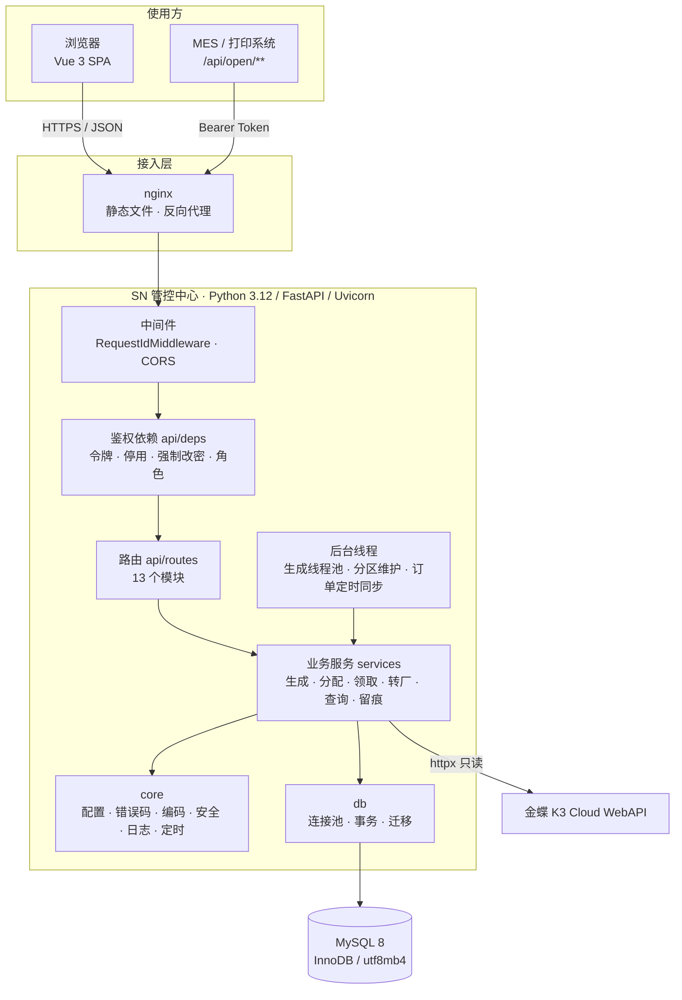
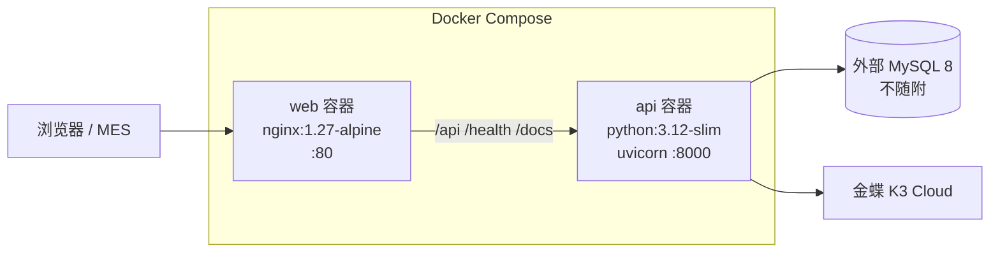
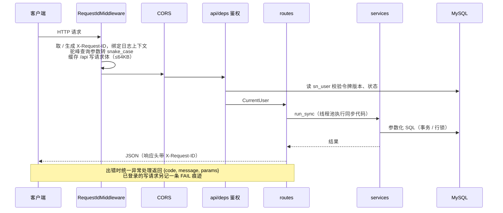

# 多工厂 SN 防重管控 · 技术架构与技术栈说明

> **读者**：开发、评审、新成员　**对应代码**：`app/`、`frontend/`、`tests/`、`Dockerfile`、`docker-compose.yml`、`start.py`　**更新**：2026-10-12
> **相关**：[系统技术方案](系统技术方案.md)　[技术文档](技术文档.md)　[数据库表设计](数据库表设计.md)　[运维手册](运维手册.md)　[文档导航](README.md)

本文按「整体架构 → 分层架构 → 每项技术在本项目里做什么」的顺序说明系统的技术构成。重点是**每个技术选型在代码里落在哪、解决什么问题**。接口清单、表字段、配置项全表不在这里重复，以文中链接的权威文档为准。

---

## 1. 系统定位

总部统一生成并分配 SN（序列号），工厂按 PI（形式发票号）领取、打印，**同一张 PI 下的 SN 不得重复**。系统的技术难点集中在三处：

1. **防重与防超发**：多人、多工厂、MES 接口同时操作同一张 PI 时，不能生成重复的号，也不能超出订单额度。
2. **大批量写入**：单次生成可达数十万枚，要有事务、进度、取消和断点恢复。
3. **全程留痕**：所有写操作（包括失败的）都要记录操作痕迹，痕迹按月分区并定期归档。

技术选型都围绕这三点：**单体应用 + 单库 MySQL**，并发控制全部交给数据库的行锁、唯一约束和命名锁，不引入缓存、消息队列或分布式锁。

---

## 2. 整体架构

### 2.1 逻辑架构



### 2.2 部署形态

同一份代码支持三种运行方式，区别只在「前端由谁托管」：

| 方式 | 入口 | 前端托管 | 适用 |
| --- | --- | --- | --- |
| 单端口（`python start.py` / `start.bat`） | `:8000` | FastAPI 直接托管 `frontend/dist`（`app/main.py` 的 SPA 回退） | 本机演示、Windows 现场部署 |
| Docker Compose（`docker compose up -d --build`） | `:80` | `web` 容器里的 nginx | 服务器部署（`ENVIRONMENT=production`） |
| 前后端分离开发 | `:5173` | Vite 开发服务器，代理 `/api` 到 `:8000` | 日常开发 |



`docker-compose.yml` 不带数据库容器：MySQL 是公司已有实例，地址由 `.env` 的 `DB_HOST / DB_PORT / DB_NAME` 指定。`web` 依赖 `api` 的健康检查（`/health/ready` 能连上数据库）通过后才启动。

---

## 3. 技术栈总览

| 层 | 技术 | 版本 | 在项目中的作用 |
| --- | --- | --- | --- |
| 前端框架 | Vue 3（Composition API + `<script setup>`） | ^3.5 | 12 个页面的 SPA |
| 前端语言 | TypeScript | ^5.6 | 接口类型（`src/types/api.ts`）、编译期检查 |
| UI 组件库 | Element Plus + @element-plus/icons-vue | ^2.9 | 表格、表单、抽屉、分页、消息提示、图标 |
| 状态管理 | Pinia | ^2.3 | 登录态与当前账户（`stores/auth.ts`） |
| 路由 | vue-router | ^4.5 | history 路由、按角色守卫、页面懒加载 |
| 国际化 | vue-i18n | ^11 | 简体中文 / English / Tiếng Việt，按错误码翻译后端错误 |
| HTTP 客户端 | axios | ^1.8 | 统一拦截：令牌、请求号、语言头、错误处理 |
| 构建工具 | Vite + @vitejs/plugin-vue | ^6.2 | 开发服务器（含代理）、生产打包 |
| 按需引入 | unplugin-auto-import、unplugin-vue-components | — | Element Plus 组件与 API 自动按需引入 |
| 类型检查 | vue-tsc | ^2.1 | `npm run build` 前对 `.vue` 做类型检查 |
| 后端语言 | Python | 3.12 | 全部后端代码 |
| Web 框架 | FastAPI（基于 Starlette + pydantic） | — | 路由、依赖注入、参数校验、OpenAPI 文档 |
| ASGI 服务器 | Uvicorn（`uvicorn[standard]`） | — | 运行 FastAPI 应用 |
| 数据校验 | pydantic v2 | 随 FastAPI | 请求体模型（`app/schemas`）、响应模型 |
| 数据库驱动 | PyMySQL | ≥1.1 | 纯 Python MySQL 驱动；手写 SQL + 自建连接池 |
| HTTP 客户端 | httpx | ≥0.27,<1 | 调用金蝶 K3 Cloud WebAPI |
| 日志 | structlog | — | 结构化日志，生产环境单行 JSON，自动带请求号 |
| 表格导出 | openpyxl | ≥3.1 | xlsx 只写模式流式导出 |
| 时区数据 | tzdata | — | 让 `zoneinfo` 在 Windows 等无系统时区库的环境也能用 `Asia/Shanghai` |
| 数据库 | MySQL | 8.0 | 全部业务数据；行锁、唯一键、分区、命名锁 |
| 外部系统 | 金蝶 K3 Cloud WebAPI | — | 生产订单、组织机构的只读数据源 |
| 反向代理 | nginx | 1.27-alpine | 托管前端、代理 API、gzip、长超时 |
| 容器 | Docker（多阶段构建）+ Docker Compose | — | 服务器部署 |
| Python 包管理 | uv（`uv.lock`） | — | 锁定依赖、镜像构建、本地开发 |
| 测试 | pytest、Node 内置 `node --test` | — | 后端单元 + 集成测试；前端纯函数测试 |
| 代码检查 | ruff | — | lint + import 排序（规则 E/F/W/I/B/UP/SIM） |
| 文档工具 | Mermaid、draw.io、pandoc（pypandoc）、python-docx | — | 文档图示与 Word 版技术方案生成 |

下面逐层说明。

---

## 4. 后端架构

### 4.1 目录与分层

```
app/
  main.py          应用装配：中间件、异常处理（含失败留痕）、单端口托管前端、启动 / 关闭钩子
  api/
    deps.py        鉴权依赖、角色依赖、分页、文件下载、run_sync
    routes/        auth users factories orders rules generate acquire open transfers sn audits dashboard health
  core/            config envfile errors exceptions encoding security logging scheduler utils
  db/              mysql.py（连接池 + 事务）session.py migrate.py migration/V1__init.sql
  middleware/      request_id.py
  models/          表清单（不使用 ORM）
  schemas/         pydantic 请求 / 响应模型
  services/        业务逻辑与 SQL（不另设仓储层）
```

请求链路：



| 层 | 职责 | 约定 |
| --- | --- | --- |
| `routes` | 声明路径、参数、权限依赖；把调用转给 services | 不写 SQL、不写业务判断 |
| `deps` | 鉴权、角色、分页、下载 | 所有 `/api` 接口都通过 `UserDep / AdminDep / ...` 声明权限 |
| `services` | 业务规则、SQL、事务、留痕 | SQL 直接写在这里；业务错误一律 `raise biz(ErrorCode.X, ...)` |
| `core` | 与业务无关的基础能力 | 配置、编码、安全、日志、调度 |
| `db` | 连接池、事务传播、建表迁移 | 业务代码只通过 `app.db.session` 取 `db` |

### 4.2 FastAPI / Starlette / Uvicorn

**FastAPI** 是接口层框架，本项目用到的能力：

| 能力 | 在项目中的用法 | 代码位置 |
| --- | --- | --- |
| 路由分组 | 13 个 `APIRouter`，统一挂在 `/api` 前缀下；健康检查挂在根路径 | `app/api/routes/__init__.py` |
| 依赖注入 | `Annotated[CurrentUser, Depends(...)]` 做鉴权和角色校验，路由函数直接拿到当前操作人 | `app/api/deps.py` |
| 参数校验 | 查询参数、路径参数、请求体（pydantic 模型）自动校验；不合法统一转成 `VALIDATION` 错误码 | `app/main.py` 的 `validation_handler` |
| 异常处理 | 分别处理 `AppError/BizError`、`RequestValidationError`、`pymysql` 错误、404/405、其他异常，响应体统一为 `{code, message, params}` | `app/main.py` |
| lifespan | 启动时建表、回收中断任务、建管理员、维护分区；关闭时停定时任务、关连接池 | `app/main.py` 的 `lifespan` |
| OpenAPI | `/docs`（Swagger UI）、`/redoc`、`/openapi.json`；对外接口在 `open` 分组；`DOCS_ENABLED` 可关闭 | `create_app()` |
| 流式响应 | `StreamingResponse` 做导出、打印文件下载，文件名按 RFC 5987 编码避免中文乱码 | `deps.download` |

**Starlette**（FastAPI 的底层）：

- `RequestIdMiddleware` 直接写成 ASGI 中间件（不是 `BaseHTTPMiddleware`），这样可以读出请求体再「回放」给下游，用于失败留痕。
- `CORSMiddleware` 控制跨域；允许的来源由 `CORS_ORIGINS` 配置。
- `StaticFiles` 托管 `frontend/dist/assets`；未知的非 API GET 路径返回 `index.html`，支持前端 history 路由（单端口方式）。

**Uvicorn** 是 ASGI 服务器：Docker 中 `CMD ["uvicorn", "app.main:app", ...]`；单端口方式由 `start.py` 调 `uvicorn.run()`。`uvicorn[standard]` 额外带上 uvloop / httptools 等加速组件（平台支持时）。

**同步代码与 event loop**：数据库访问（PyMySQL）和口令哈希（PBKDF2）都是阻塞调用。路由是 `async def`，通过 `run_sync()`（`asyncio.to_thread`）把同步业务函数放到线程池执行，业务代码本身保持同步写法，事务连接放在 contextvar 里随线程走。

### 4.3 pydantic

- `app/schemas/common.py` 的基类 `In`：`extra="ignore"`（忽略多余字段，对接方多传字段不报错）、`coerce_numbers_to_str=True`（字符串字段收到数字也接受，兼容 MES 的写法）。
- 自定义类型 `OptInt / OptDate / Flag`：查询参数传空串时视为未传，避免前端表单空值导致 422。
- 对外接口声明了响应模型（如批次明细 `SnPageOut / SnItemOut`），让 `/docs` 显示完整的返回字段说明。

### 4.4 数据访问：PyMySQL + 自建连接池 + 事务传播

本项目**不使用 ORM**（`app/models/__init__.py` 只保留表清单）。原因：生成、分配、领取、转厂的防重语义依赖精确控制的 `SELECT ... FOR UPDATE`、`FOR UPDATE NOWAIT`、`INSERT ... ON DUPLICATE KEY UPDATE`、条件更新与影响行数核对，手写 SQL 更直观、更容易审查。

`app/db/mysql.py` 的 `Db` 类提供：

| 能力 | 实现 | 用途 |
| --- | --- | --- |
| 连接池 | `LifoQueue` 存空闲连接 + `BoundedSemaphore` 限总数（`DB_POOL_SIZE`，默认 20）；取连接前 `ping`；等 30 秒无空闲连接抛 `PoolExhausted` | 控制数据库连接数；池满按「稍后重试」返回 409 |
| `db.tx()` | 当前上下文已有事务就加入，否则新开（相当于 Spring 的 REQUIRED） | 一般业务写操作 |
| `db.new_tx()` | 总是用独立连接新开事务（相当于 REQUIRES_NEW） | 失败痕迹、生成进度：不受主事务回滚影响 |
| contextvar 保存当前连接 | 同一请求 / 同一后台线程里的 `db.one / db.all / db.exec` 自动走当前事务的连接 | service 之间互相调用不用传连接 |
| 便捷方法 | `one / all / scalar / count / exists / column / exec / insert / exec_many` | `exec_many` 让 PyMySQL 合并成多行 INSERT，用于批量写号 |
| 错误分类 | `is_duplicate`（1062）、`is_lock_conflict`（1205、1213）、`ER_LOCK_NOWAIT`（3572）、`is_connection_lost`（客户端 2xxx 错误） | 死锁 / 锁超时 / 唯一冲突转为 409 `CONFLICT_RETRY`；只有断线的连接才丢弃，锁冲突回滚后连接照常回池 |

连接参数固定 `charset=utf8mb4`、`autocommit=True`（事务内显式 `begin`）、`DictCursor`（结果按列名取值）。

### 4.5 建表与升级：Flyway 兼容的迁移器

`app/db/migrate.py` 是一个约 150 行的 Flyway 兼容实现，启动时自动执行：

- 扫描 `app/db/migration/V*__*.sql`，按版本号顺序执行未应用的脚本；
- 写 `flyway_schema_history` 表，校验和按 Flyway 算法（逐行 CRC32）计算，因此库也可以交给 Flyway 管理；
- 用 MySQL 命名锁 `GET_LOCK('sn_center_migrate', 120)` 防止多实例同时迁移；
- 已有表但无历史表时，按 `DB_BASELINE_ON_MIGRATE / DB_BASELINE_VERSION` 写基线或拒绝启动。

新增表结构只需新增 `V2__xxx.sql`，`pyproject.toml` 通过 `package-data` 把 SQL 文件打进包里。

### 4.6 MySQL 8 的使用方式

MySQL 是本系统**并发控制的核心**，具体用法：

| MySQL 特性 | 在项目中的作用 |
| --- | --- |
| InnoDB 行锁 `SELECT ... FOR UPDATE` | 生成时锁 PI 计数器 `sn_pi_counter`、订单额度 `sn_bill_gen`，防止重复生成和超发；不同 PI 互不阻塞 |
| `FOR UPDATE NOWAIT` | 启动时回收中断的生成任务：拿不到锁说明任务仍在执行，跳过 |
| 唯一约束 | `sn_item(pi_no, sn)`：同一 PI 完整 SN 唯一（最后一道防线）；`sn_item(seq_pi_no, seq_dec)`：流水唯一；`sn_gen_job.running_pi`：同一 PI 同时只有一个生成任务；`sn_acquire_batch / sn_print (factory_code, request_no)`：领取、打印按请求号幂等 |
| `INSERT ... ON DUPLICATE KEY UPDATE` | 计数器行、额度行「不存在则创建」后再加锁 |
| 条件更新 + 影响行数 | 状态流转（如待领取 → 待打印）、订单定时同步「抢」执行权，多实例不重复执行 |
| 命名锁 `GET_LOCK` | `sn_center_migrate`（迁移）、`sn_partition`（分区 DDL），保证多实例下只有一个实例执行 |
| RANGE COLUMNS 分区 | `sn_audit` 按 `created_at` 月分区；过期整月分区拷到 `sn_audit_archive` 后 `DROP PARTITION`，删除几乎零成本 |
| `utf8mb4` / `utf8mb4_bin` | 支持多语言字符；编码类列区分大小写，SN 比较精确 |
| 不建外键 | 由业务代码保证关系，避免大批量写入时外键检查的锁开销 |

表结构以 `app/db/migration/V1__init.sql` 为准，字段说明见 [数据库表设计](数据库表设计.md)。

### 4.7 httpx：金蝶 K3 Cloud 对接

`app/services/k3.py` 用 httpx 同步客户端调用金蝶 WebAPI（只读）：

| 金蝶接口 | 用途 |
| --- | --- |
| `LoginByAppSecret` | 第三方应用登录，Cookie 由 `httpx.Client` 在同一会话内保持 |
| `ExecuteBillQuery`（`PRD_MO`） | 全量拉取生产订单，按 2000 行分页，只保留业务状态 1 计划、2 计划确认 |
| `View`（`PRD_MO`） | 按单据号拉取单张订单 |
| `ExecuteBillQuery`（`ORG_Organizations`） | 同步组织机构 → 工厂档案 |

要点：`trust_env=False`（不受服务器代理环境变量影响）、登录 / 查询 / 查看分别设超时（`K3_LOGIN_TIMEOUT / K3_QUERY_TIMEOUT / K3_VIEW_TIMEOUT`）、金蝶的业务错误统一转为 `K3_LOGIN_FAILED / K3_QUERY_FAILED` 错误码。拉回的数据写入本地快照表 `sn_prd_mo`，业务只读本地快照，金蝶不可用时不影响领取、打印。

### 4.8 structlog：结构化日志

- `app/core/logging.py`：`ENVIRONMENT=production` 时输出单行 JSON（便于日志平台采集），否则用彩色控制台格式。
- `RequestIdMiddleware` 把请求号绑定到 `structlog.contextvars`，同一请求的所有日志都带 `request_id`；响应头也返回 `X-Request-ID`。前端每个请求都生成请求号（`src/requestId.js`），nginx 未带时用 `$request_id` 补上，从浏览器到数据库错误日志可以串起来。
- 日志用事件名 + 键值对，如 `log.warning("db_conflict", path=..., err=...)`、`log.error("db_pool_exhausted", ...)`。

### 4.9 openpyxl 与 CSV：流式导出

`app/services/files.py`：

- **CSV**：UTF-8 BOM（Excel 直接打开不乱码），边查边写边输出给客户端；
- **XLSX**：openpyxl 的只写模式（`write_only`），内存占用与行数无关，写完一次性输出；
- 以 `= + - @` 等开头的文本加前缀，防止表格软件把单元格当公式执行（CSV 注入防护）；
- 超长数字按文本写入，避免 Excel 丢精度；
- 导出上限由 `SN_EXPORT_LIMIT / AUDIT_EXPORT_LIMIT` 控制。

### 4.10 标准库实现的基础能力

以下能力没有引入第三方库，而是用 Python 标准库自己实现，以减少依赖：

| 能力 | 实现 | 代码位置 |
| --- | --- | --- |
| 口令哈希 | `hashlib.pbkdf2_hmac`（SHA-256，12 万轮，16 字节随机盐）；`hmac.compare_digest` 防时序攻击；口令策略 8–64 位且含字母和数字 | `core/security.py` |
| 登录令牌 | `base64url(JSON{uid, pv, sv, exp}) + "." + HMAC-SHA256`，密钥为 `SN_SECRET`。`pv`（口令版本）：改密后旧令牌失效；`sv`（登录版本）：同一账户在别的页面登录后旧页面失效；MES 令牌不带 `sv`，不受影响 | `core/security.py` |
| 定时任务 | 自写 6 段 cron 解析（Spring 风格：秒 分 时 日 月 周）+ 守护线程；`start_daily` 跑分区维护，`start_every(30s)` 轮询订单定时同步是否到期 | `core/scheduler.py` |
| 后台生成 | `concurrent.futures.ThreadPoolExecutor(max_workers=4)`：超过 `SN_GEN_SYNC_THRESHOLD`（默认 5000 枚）的生成转后台执行，页面轮询进度 | `services/generate.py` |
| SN 进制编码 | 十进制流水 ⇄ 10/16/32/36 进制定长流水 ⇄ 前缀 + 流水 + 后缀；可自定义字符表 | `core/encoding.py` |
| `.env` 读取 | 自写解析，不依赖 python-dotenv；进程环境变量优先 | `core/envfile.py`、`core/config.py` |
| 时区 | `zoneinfo` + tzdata，业务时间统一按 `TZ`（默认 `Asia/Shanghai`） | `core/config.py` |

### 4.11 错误码体系

- `app/core/errors.py` 的 `ErrorCode` 枚举：每个错误码 = 默认 HTTP 状态 + 中文模板（`{name}` 为参数占位）。
- 业务代码 `raise biz(ErrorCode.FACTORY_FORBIDDEN, factory=...)`，异常处理统一返回 `{code, message, params}`。
- `message` 是中文（用于日志、痕迹和不做多语言的对接方）；前端按 `code + params` 从 `locales/errors.*.json` 渲染当前语言。
- 数据库层的死锁、锁超时、唯一冲突、连接池满统一转为 409 `CONFLICT_RETRY`，调用方用原请求号重试即可。

### 4.12 操作痕迹（审计）

- 成功的操作与业务写入在**同一事务**（`db.tx()`）里写 `sn_audit`：业务回滚，痕迹一起回滚，不会出现「有痕迹没结果」。
- 失败的操作（业务拒绝、参数不合法、冲突、系统错误）在全局异常处理里用**独立事务**（`db.new_tx()`）记一条 FAIL，请求体来自中间件缓存，不受业务回滚影响。
- 痕迹按月分区，过期归档、超总期限删除，由每日定时任务完成（`services/partitions.py`）。

---

## 5. 前端架构

### 5.1 目录

```
frontend/
  src/
    main.ts            创建应用；注册 Pinia、router、i18n、全部 Element Plus 图标
    App.vue
    api/               http.ts（axios 实例与拦截器）、index.ts（接口函数）
    stores/auth.ts     登录态（Pinia）
    router/index.ts    菜单定义、路由、守卫
    layouts/           AppLayout.vue（侧边菜单 + 顶栏）
    views/             12 个页面（登录、改密、首页、订单、生成、规则、领取、转厂、查询、痕迹、账户、工厂）
    components/        FactorySelect、PageHead、StatusTag
    composables/       usePaged（分页列表）、useFactories（工厂下拉）
    i18n/ locales/     vue-i18n 初始化；词条 JSON（由脚本生成）
    types/api.ts       后端接口类型
    utils/download.ts  文件下载
  scripts/             多语言词条源表与生成脚本（Python）
  vite.config.ts  nginx.conf  Dockerfile
```

### 5.2 各技术的作用

| 技术 | 在项目中的作用 |
| --- | --- |
| **Vue 3** | 页面全部用组合式 API 编写；`composables` 抽出分页、工厂下拉等可复用逻辑 |
| **TypeScript** | `types/api.ts` 定义后端返回结构；`vue-tsc` 在构建前检查，接口字段改动能在编译期发现 |
| **Vite** | 开发服务器从仓库根目录读同一份 `.env`（`envDir`），把 `/api /health /docs /openapi.json` 代理到后端；生产打包输出 `dist/` |
| **Element Plus** | 表格（大量列表页）、表单、抽屉（生成页按 PI 打开）、分页、`ElMessage` 错误提示；语言包随 i18n 切换 |
| **unplugin-auto-import / unplugin-vue-components** | 用 `ElementPlusResolver` 按需引入组件和样式，模板里直接写 `<el-table>` 不用手动 import，打包体积只含用到的组件 |
| **Pinia** | `useAuthStore` 保存令牌、当前账户、角色派生状态（`isAdmin / isFactory / isQuery / boundFactory / canAct`），供菜单、按钮权限使用 |
| **vue-router** | `createWebHistory`；菜单配置 `MENU` 同时生成路由和侧边栏；`beforeEach` 守卫做登录、强制改密、角色、内置管理员四种拦截；页面组件懒加载（`() => import(...)`） |
| **vue-i18n** | 三种语言；语言优先级：账户偏好 → 本地记忆 → 浏览器语言 → 简体中文；后端错误按错误码翻译（`translateApiError`） |
| **axios** | 请求拦截器自动加 `Authorization: Bearer`、`X-Request-ID`、`Accept-Language`；响应拦截器统一处理 401（跳登录页并提示「已在其他页面登录」）、强制改密跳转、其他错误弹提示（调用方可 `silent` 自行处理） |

### 5.3 登录态设计

- 令牌存在 **sessionStorage**（不是 localStorage）：每个标签页独立登录，同一台机器可在不同标签页登录不同账户。
- **BroadcastChannel**（`sn_session`）：同一浏览器里某页登录了某账户，其他页上的同一账户立即退出；后端的 `sv` 登录版本校验兜底（跨浏览器、跨机器也生效）。
- 语言偏好保存在账户上（`/api/auth/lang`），换机器登录后保持。

### 5.4 多语言词条生成

`frontend/scripts/` 下用 Python 维护词条源表：

- `ui_messages.py`：界面词条（三种语言）；
- `error_messages.py`：错误码的英文、越南文；中文直接取后端 `app/core/errors.py`；
- `gen_locales.py`：生成 `src/locales/{zh-CN,en,vi}.json` 与 `errors.*.json`，缺译或占位符不一致时直接失败。

这样后端新增错误码时，前端三种语言不会漏翻。

---

## 6. 部署与运维相关技术

### 6.1 Docker 多阶段构建

| 镜像 | 构建阶段 | 运行阶段 |
| --- | --- | --- |
| `sn-center-api`（`Dockerfile`） | `python:3.12-slim` + uv，按 `uv.lock` 装依赖到 `.venv` | `python:3.12-slim` + tzdata + curl；时区 `Asia/Shanghai`；非 root 用户 `appuser`；`HEALTHCHECK` 调 `/health/live` |
| `sn-center-web`（`frontend/Dockerfile`） | `node:22-alpine`，`npm ci && npm run build` | `nginx:1.27-alpine`，只带 `dist/` 和 `nginx.conf` |

多阶段构建让运行镜像不含编译工具和 node_modules，体积小、攻击面小。

### 6.2 nginx

`frontend/nginx.conf`：

| 配置 | 作用 |
| --- | --- |
| `try_files $uri $uri/ /index.html` | 支持前端 history 路由 |
| `location /api/` → `http://api:8000/api/` | 反向代理到 API 容器 |
| `proxy_set_header X-Request-ID $request_id` | 请求号贯穿链路 |
| `proxy_set_header X-Real-IP` | 登录痕迹记录真实来源地址 |
| `proxy_read_timeout 600s` | 金蝶全量同步、大批量导出耗时较长 |
| `proxy_buffering off` | 下载文件流式输出 |
| `client_max_body_size 50m` | 允许较大的请求体 |
| `gzip on` | 压缩 JS / CSS / JSON |

### 6.3 健康检查

| 路径 | 含义 | 使用方 |
| --- | --- | --- |
| `/health/live` | 进程存活 | Dockerfile `HEALTHCHECK` |
| `/health/ready`（`/api/health`） | 能执行 `SELECT 1` | docker-compose `api` 健康检查；`web` 等它通过再启动 |

### 6.4 一键启动脚本 `start.py`

面向 Windows 现场部署：

1. 检查端口，关闭上次留下的实例（Windows 下用 netstat / PowerShell 查找进程）；
2. 没有 `.venv` 就用 `venv` 创建并 `pip install -e .`；
3. 前端没构建或源码比 `dist` 新时执行 `npm install / npm run build`；
4. Windows 下放行防火墙端口；
5. 打印访问地址、账号、数据库信息，打开浏览器，`uvicorn.run()` 单端口启动。

`start.bat` / `stop.bat` 是双击入口。

### 6.5 配置

所有参数来自环境变量和仓库根目录 `.env`（进程环境变量优先），后端、`start.py`、Vite 共用一份。生产环境（`ENVIRONMENT=production`）对 `SN_SECRET`（≥32 位、不能是示例值）和内置管理员密码（不能是默认值）做启动检查，不满足拒绝启动。完整配置项见 [系统技术方案 附录 A](系统技术方案.md#附录-a-配置项)。

---

## 7. 质量保障

| 工具 | 范围 | 说明 |
| --- | --- | --- |
| **pytest** | `tests/` | 单元测试（编码、cron、令牌等）+ 集成测试（真实 MySQL `sndb_test_py` + 用 `http.server` 写的假金蝶服务）；连不上 MySQL 时集成测试自动跳过 |
| **ruff** | `app/`、`tests/` | 行宽 120；规则 E/F/W/I/B/UP/SIM；忽略 B008（FastAPI 依赖写在参数默认值里） |
| **node --test** | `frontend/src/*.test.js` | 请求号生成、SN 清单解析与数量上限、多语言词条一致性 |
| **vue-tsc** | 前端 | `npm run build` 前的类型检查 |
| **uv** | Python 依赖 | `uv.lock` 锁定版本，`uv sync` 一致安装；Docker 构建用 `--frozen` |

常用命令见 [README · 开发与测试](../README.md#开发与测试)。

---

## 8. 关键设计与技术的对应

| 业务要求 | 技术手段 |
| --- | --- |
| 同一 PI 下 SN 不重复 | `sn_item` 唯一键 `(pi_no, sn)`、`(seq_pi_no, seq_dec)`；生成时锁 PI 计数器行；遇到已存在的完整 SN 立即停止整批回滚 |
| 同一 PI 不能并发生成 | `sn_gen_job.running_pi` 唯一约束，第二个请求直接返回 `GEN_BUSY` |
| 不超出订单额度 | `sn_bill_gen` 行锁后校验并累加 |
| 预演与生成之间数据被改 | 预演记下 PI 当前最大流水和令牌；生成时锁住计数器再核对，不一致返回 `GEN_PREVIEW_STALE` |
| 大批量生成 | 超过阈值转后台线程池；1000 枚一批 `executemany`；独立事务写进度；可取消、整批回滚 |
| 服务重启时生成中断 | 启动时 `recover_interrupted()` 用 `FOR UPDATE NOWAIT` 识别并回收 |
| MES 重复调用领取 | `(factory_code, request_no)` 唯一约束，同一请求号返回同一批次 |
| 多实例部署 | 应用无会话状态；迁移、分区用 `GET_LOCK`；定时同步用条件更新抢执行权 |
| 所有操作可追溯 | 成功痕迹同事务、失败痕迹独立事务；请求号贯穿前端、nginx、日志 |
| 痕迹量大 | 月分区 + 整月归档 + `DROP PARTITION` |
| 三国工厂使用 | vue-i18n 三语言；后端只返回错误码 + 参数，前端翻译 |
| 账户安全 | PBKDF2 口令、HMAC 签名令牌、口令版本 / 登录版本失效机制、生产环境弱密钥拒绝启动 |
| 金蝶不可用不影响作业 | 订单只读同步到本地快照，作业只依赖本地数据 |

---

## 9. 未采用的技术及原因

| 未采用 | 原因 |
| --- | --- |
| ORM（SQLAlchemy 等） | 防重逻辑依赖精确的锁语句和影响行数，手写参数化 SQL 更可控、更易审查 |
| Redis / 分布式锁 | 并发控制交给 MySQL 行锁、唯一约束和命名锁，少一个组件少一个故障点 |
| 消息队列 / Celery | 后台任务只有生成一种，进程内线程池 + 数据库任务表（进度、取消、回收）已够用 |
| 微服务 / 注册中心 | 业务量和团队规模下单体应用更易维护；应用无状态，需要时可水平扩容 |
| JWT 库、python-dotenv、APScheduler | 需求简单，用标准库自实现几十行即可，减少依赖 |
| 外键 | 大批量写号时避免外键检查的开销，关系由业务代码保证 |
