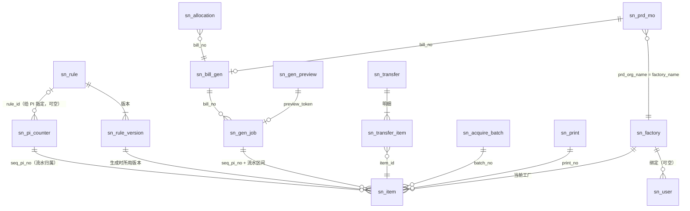

# 多工厂 SN 防重管控 · 数据库表设计

> **读者**：开发、DBA　**对应代码**：`app/db/migration/V1__init.sql`、`app/services/partitions.py`　**更新**：2026-10-12
> **相关**：[技术文档](技术文档.md)　[运维手册](运维手册.md)　[文档导航](README.md)
>
> 数据库：**MySQL 8.0**（InnoDB，`utf8mb4`）。建表脚本：`app/db/migration/V1__init.sql`，由应用启动时执行并按 Flyway 格式记录在 `flyway_schema_history`。
> 演示阶段所有表结构合并在 `V1__init.sql` 一个脚本里，改表直接改它（已有的演示库按《运维手册》8.1 清本系统的表或 8.2 清空整个库后重建）。正式上线后改为只新增 `V2__xxx.sql`、`V3__xxx.sql`，不再修改已执行过的脚本。

## 1. 设计要点

| 要点 | 做法 |
| --- | --- |
| 同一 PI 下完整 SN 不重复 | `sn_item` 唯一键 `(pi_no, sn)`；转厂确认时号改挂转入 PI，同串冲突即拒绝 |
| PI 自己生成的十进制流水不重复 | `sn_item` 唯一键 `(seq_pi_no, seq_dec)`；流水归属 PI 转厂不变 |
| 不同 PI 可以出现相同 SN | 唯一性只在 `pi_no` 维度，不设全局唯一 |
| 号的状态记在每一枚 SN 上 | `sn_item.status`，不在 PI / 批次上记状态 |
| 容量（约 400 万枚 / 月，3 年约 1.5 亿） | `sn_item` 单表不分区（理由见下）；`sn_audit` 按月 RANGE 分区；查询 / 导出 / 批次明细全部分页或游标读取 |
| 痕迹至少 3 年、可永久 | `SN_AUDIT_RETENTION_DAYS`（默认 1095，0 = 永久）；过期整月分区拷入 `sn_audit_archive` 后 `DROP PARTITION` |
| 编码类字段精确比较 | SN、PI、物料、工厂等所在表统一 `utf8mb4_bin`（区分大小写，自定义字符表里大小写不同的字符不会被判重） |
| 不用外键 | 号池写入量大、痕迹表分区不支持外键；引用完整性由服务层在事务中保证 |

### 为什么 `sn_item` 不分区

分区的两个好处是：按整月 `DROP PARTITION` 删数据；查询条件带分区列时只扫相关分区（分区裁剪）。`sn_audit` 两样都用得上，`sn_item` 都用不上：

- 号是业务主数据，已打印的号仍要查重、转厂、回调和追溯，不删不归档，没有整月可删；
- 查询都按 SN、PI、批次、打印单、订单号，从不按生成月份，裁剪不起作用，每次查找都要逐个分区探一次。

反过来，MySQL 要求**分区表上的每个唯一键都必须包含分区列**。早期按生成月份分区时，两条查重约束只能放到另一张不分区的表 `sn_key`：每枚号写两张表，转厂确认还要在 `sn_key` 上先删后插；分区维护的 `REORGANIZE PARTITION` 还会在生成进行中短暂挡住 `sn_item` 的语句（POC 测到 7.1 秒）。现在两条唯一键直接建在 `sn_item` 上，`sn_key` 已删除：

- 生成：批量插入 `sn_item`，任一唯一键冲突即整批回滚；
- 转厂确认：同一事务里把这批号的 `pi_no` 改成转入 PI，转入 PI 已有同串时整次拒绝（先查重给出明细，唯一键兜底）。

代价：单表 3 年约 100–130 GB，以后改表要用 online DDL 或 gh-ost；不能再用 `EXCHANGE PARTITION` 按月迁出冷数据（目前也没有这个需求）。

## 2. ER 图



## 3. 表清单

| 表 | 说明 | 量级 | 分区 |
| --- | --- | --- | --- |
| `sn_factory` | 工厂（金蝶生产组织） | 几十 | — |
| `sn_user` | 账户 | 几百 | — |
| `sn_rule` / `sn_rule_version` | 规则 / 规则版本 | 几百 | — |
| `sn_prd_mo` | 金蝶生产订单快照（每条物料一行） | 数万 | — |
| `sn_order_sync_schedule` | 定时全量同步设置（一行） | 1 | — |
| `sn_pi_counter` | PI 流水计数器 | 与 PI 数相同 | — |
| `sn_bill_gen` | 订单已生成 / 已分配数 | 与订单数相同 | — |
| `sn_gen_preview` | 生成预演 | 7 天后清理 | — |
| `sn_gen_job` | 生成任务 | 每次生成一行 | — |
| **`sn_item`** | **SN 明细（号池），含两条查重唯一键** | **约 400 万 / 月** | — |
| `sn_allocation` | 分配记录 | 每次分配一行 | — |
| `sn_acquire_batch` | 领取批次 | 每次领取一行 | — |
| `sn_print` | 页面打印单 | 每次打印一行 | — |
| `sn_transfer` / `sn_transfer_item` | 转厂申请 / 明细 | 按需 | — |
| **`sn_audit`** | **操作痕迹** | 每次操作一行 | **按月** |
| `sn_audit_archive` | 过期痕迹归档 | 累积 | —（压缩行格式） |

## 4. 表结构

以下「PK」= 主键，「UK」= 唯一键，「IX」= 普通索引。时间字段均为业务时区（`TZ`，默认 Asia/Shanghai）。

### 4.1 `sn_factory` 工厂

| 字段 | 类型 | 说明 |
| --- | --- | --- |
| factory_code | VARCHAR(64) PK | 工厂编码 = 金蝶组织 `FNumber`；手工建档时自定 |
| factory_name | VARCHAR(128) UK | 工厂名称 = 快照中的 `生产组织`（`FPrdOrgId.FName`），按名称对应 |
| enabled | TINYINT(1) | 1 启用 / 0 停用（只停用不删除）。停用的工厂不能作为生成、分配、转厂转入的目标，也不能再绑定给账户；已分到该厂的号照常领取、打印、回调、转出。来源为 `K3` 的随金蝶组织 `FForbidStatus` 同步启停 |
| source | VARCHAR(16) | `K3` 金蝶同步 / `MANUAL` 手工 |
| created_at / updated_at | DATETIME | |

### 4.2 `sn_user` 账户

| 字段 | 类型 | 说明 |
| --- | --- | --- |
| id | BIGINT PK AI | |
| emp_no | VARCHAR(32) UK | 公司工号，唯一 |
| name | VARCHAR(64) | 姓名 |
| role | VARCHAR(32) | `admin` 系统管理员（总部）/ `factory_operator` 厂区操作员 / `query` 查询员 |
| factory_code | VARCHAR(64) IX | 厂区操作员必填；查询员可空（空 = 跨厂只读）；管理员必须为空 |
| status | VARCHAR(16) | `ACTIVE` / `DISABLED`。只停用、不删除 |
| password_hash | VARCHAR(128) | PBKDF2-SHA256（12 万轮）：salt(32 hex) + dk(64 hex) |
| must_change_pwd | TINYINT(1) | 1 = 被管理员重置后必须改密（新建账户写 0）；期间只能访问 `/api/auth/me|password|lang` |
| lang | VARCHAR(8) | 界面语言偏好 |
| last_login_at, pwd_changed_at | DATETIME | `pwd_changed_at` 同时是令牌版本：改密 / 重置后旧令牌失效 |
| created_by, created_at, updated_at, disabled_by, disabled_at | | 留痕字段 |

### 4.3 `sn_rule` 规则 / `sn_rule_version` 规则版本

`sn_rule`：

| 字段 | 类型 | 说明 |
| --- | --- | --- |
| id | BIGINT PK AI | |
| rule_code | VARCHAR(64) UK | 规则编码 |
| rule_name | VARCHAR(128) | 名称；只改名称不另出一版 |
| bind_scope | VARCHAR(16) | `GENERAL` 通用 / `CUSTOMER` 按客户 / `PI` 按单张 PI |
| bind_value | VARCHAR(64) | 客户编码或 PI；通用为空串 |
| bind_key | VARCHAR(64) | 虚拟列：通用为 NULL，其余同 `bind_value`。UK `(bind_scope, bind_key)`：一个客户 / 一张 PI 只有一条规则，通用规则可以有多条 |
| current_version | INT | 当前版本号 |
| created_by, created_at, updated_by, updated_at | | |

`sn_rule_version`：

| 字段 | 类型 | 说明 |
| --- | --- | --- |
| id | BIGINT PK AI | `sn_item.rule_version_id` 引用它 |
| rule_id, version | BIGINT, INT | UK `(rule_id, version)` |
| prefix / suffix | VARCHAR(64) | 前缀 / 后缀 |
| base | INT | 进制：10 / 16 / 32 / 36 |
| seq_len | INT | 流水位数 1–12；最大流水 = base^seq_len − 1，用尽即停止并提示 |
| charset | VARCHAR(64) | 完整字符表，长度 = 进制、不重复（留空时存系统默认表） |
| used | TINYINT(1) | 1 = 已生成过号。此后改编码参数必须另出一版；0 时可就地修改 |
| claimed_pi | VARCHAR(64) | 最先用这一版生成的 PI；别的 PI 再用这条规则时另出派生版 |
| derived_from | BIGINT | 沿用派生版：派生自的版本 id；后缀 = 原后缀 + `_v版本号`。IX `(derived_from, claimed_pi)` |

生效顺序：按 PI ＞ 给该 PI 指定的规则（`sn_pi_counter.rule_id`）＞ 按客户。都没有时，生成前由用户从规则库选一条模板（通用规则或别的 PI 的规则），或手动设置一条新规则（生成成功后插入一条按 PI 绑定的规则，编码 `PI-PI号`、名称 `PI号_v1`）。选模板时可手动绑定给 PI，或首次生成成功后自动记入 `sn_pi_counter.rule_id`。解绑：指定的清空 `rule_id`；按 PI 绑定的改成通用。

本 PI 用规则的哪一版：`sn_pi_counter.rule_version_id` 已是这条规则当前版本（或由当前版本派生的版本）时直接用；否则当前版本 `claimed_pi` 为空或为本 PI 时用当前版本；否则用（或在生成时新建）由当前版本派生给本 PI 的版本。前缀不能与别的规则的任何版本的前缀互为开头（创建、改参数、手动设置时校验）。

### 4.4 `sn_prd_mo` 生产订单快照

一张生产订单的每条物料一行；不存单据头，不存金蝶单据内码 / 分录内码。

| 字段 | 类型 | 说明 |
| --- | --- | --- |
| id | BIGINT PK AI | |
| bill_no | VARCHAR(64) | 单据编号 |
| line_seq | INT | 单内物料行顺序（金蝶 `FID, FTreeEntity_FEntryId` 顺序）。UK `(bill_no, line_seq)`；号段按此顺序切分 |
| customer_number | VARCHAR(64) IX | 客户编码（表头，写在每一行）；为空的行留在快照，订单列表不显示、不能生成 |
| po / pi | VARCHAR | 表头，写在每一行；IX `(pi)` |
| material_number / material_name | VARCHAR | 物料；编码可为空 |
| qty | DECIMAL(18,4) | 该物料行数量；SN 枚数取整数部分 |
| status | VARCHAR(8) | 只保留 `1` 计划、`2` 计划确认 |
| demand_bill_no | VARCHAR(64) | 需求单据号（销售订单号），可空 |
| prd_org_name | VARCHAR(128) | 生产组织 = 工厂名称。IX `(prd_org_name, pi)` |
| synced_at | DATETIME | 本次同步时间 |

同步：全量 = 完整拉取后在**一个事务**里 `DELETE` + 批量 `INSERT`（失败整体回滚，不出现空快照）；按单据 = 只替换该单的行；金蝶失败时快照不动。

### 4.4.1 `sn_order_sync_schedule` 定时全量同步设置

只有一行（`id = 1`，迁移时插入，默认关闭、间隔 1440 分钟）。后台线程每 30 秒检查一次，到期时用条件更新抢这一次（`WHERE enabled = 1 AND next_run_at <= now`，同时把 `next_run_at` 推后一个间隔），多实例只有一个执行。

| 字段 | 类型 | 说明 |
| --- | --- | --- |
| id | TINYINT PK | 固定 1 |
| enabled | TINYINT(1) | 是否开启 |
| interval_minutes | INT | 间隔分钟，10–10080（7 天） |
| next_run_at | DATETIME | 下次执行；开启或改间隔时 = 保存时刻 + 间隔，关闭时为空 |
| last_run_at | DATETIME | 最近一次定时执行开始时间 |
| last_ok | TINYINT(1) | 最近一次是否成功；从未执行为空 |
| last_bills / last_rows | INT | 最近一次**成功**同步的单据数 / 物料行数（失败时保留上次成功的值） |
| last_message | VARCHAR(500) | 最近一次失败原因；成功为空 |
| updated_by / updated_at | | 最近修改设置的工号与时间 |

### 4.5 `sn_pi_counter` PI 流水计数器

| 字段 | 类型 | 说明 |
| --- | --- | --- |
| pi_no | VARCHAR(64) PK | |
| last_seq_dec | BIGINT | 本 PI 已占用的最大十进制流水。生成时 `SELECT … FOR UPDATE` |
| generated_qty | BIGINT | 本 PI 自己生成的枚数（不设 99999 上限） |
| rule_id | BIGINT | 给该 PI 指定的规则模板（手动绑定，或首次生成时所选）；为空表示未指定（解绑后也为空） |
| rule_version_id | BIGINT | 本 PI 固定使用的规则版本：每次生成成功后写入实际所用的版本 |
| start_locked | TINYINT(1) | 1 = 已生成过（撤销到一枚不剩时归 0） |
| locked_by, locked_at, updated_at | | 首次生成的账户与时间 |

转入号不抬高转入 PI 的计数器；原 PI 之后从自己的最大号 + 1 接着排。转入 PI 生成的起点另取「`last_seq_dec` 与本 PI 下流水不归属本 PI 的 `sn_item` 行按当前规则解析出的最大流水」两者较大者 + 1，所以不会与转入号重复（不改表结构）。

### 4.6 `sn_bill_gen` 订单生成统计

| 字段 | 类型 | 说明 |
| --- | --- | --- |
| bill_no | VARCHAR(64) PK | 生产订单单据编号 |
| pi_no, factory_code, customer_code | VARCHAR | 生成时的 PI、目标工厂（订单生产组织）、客户。IX `(pi_no, factory_code)` |
| generated_qty | BIGINT | 已生成数（转走的号仍计入） |
| allocated_qty | BIGINT | 已分配数 |

可生成额度 = 快照中该单各物料行数量之和 − `generated_qty`。订单离开快照后此表仍在，用于「工厂 + PI」汇总与分配。

### 4.7 `sn_gen_preview` 生成预演

| 字段 | 类型 | 说明 |
| --- | --- | --- |
| token | CHAR(32) PK | 预演令牌（随机 128 位） |
| bill_no, pi_no, factory_code | | 预演条件 |
| qty | BIGINT | 数量 |
| start_seq_dec, end_seq_dec, start_sn, end_sn | | 起止号 |
| rule_version_id | BIGINT | 预演时的规则版本；沿用时要新派生的版本、手动设置的规则还没落库，为空 |
| rule_id | BIGINT | 预演所用规则；手动设置时为空 |
| manual_json | VARCHAR(500) | 生成页手动设置的参数（前缀、位数、后缀）；生成时按它新建规则 |
| base_last_seq | BIGINT | **预演时这张 PI 的最大号**；生成时不等即失效 |
| segments_json | TEXT | 按物料行切出的号段；生成时重算比对，不一致即失效 |
| created_by, created_at, expires_at, used_at | | 仅本人、未过期、未使用的预演可用于生成 |

### 4.8 `sn_gen_job` 生成任务

| 字段 | 类型 | 说明 |
| --- | --- | --- |
| id | BIGINT PK AI | |
| bill_no, pi_no, factory_code, customer_code | | |
| rule_version_id | BIGINT | 实际所用版本；生成成功时写入（派生版、手动规则在生成事务里才落库），失败的任务可为空 |
| gen_batch | VARCHAR(40) | 生成批次：同一次生成（整张 PI 的各订单）的任务共用；进度、取消、撤销都按它整体进行。IX `(gen_batch)` |
| qty, start_seq_dec, end_seq_dec, start_sn, end_sn | | |
| status | VARCHAR(16) | `RUNNING` / `SUCCESS` / `FAILED` / `CANCELED`（生成中被取消，整批已回滚）/ `REVOKED`（整次撤销后） |
| done_qty | BIGINT | 进度（独立事务按块更新，页面轮询；失败、取消后归 0） |
| cancel_by, cancel_at | VARCHAR(32), DATETIME | 请求取消的账户与时间；生成线程每写完一块在独立连接里检查，看到后整批回滚 |
| error_code, error_msg | | 失败原因（整批已回滚）；`INTERRUPTED` = 服务重启时未完成，启动回收时标记 |
| running_pi | VARCHAR(64) **UK** | 运行中 = `pi_no`，结束置 NULL → **同一 PI 同一时刻只允许一个生成**，并发提交得到 `GEN_BUSY`；成功时与号同一事务置空，进程中断留下的由启动回收置空 |
| preview_token | CHAR(32) **UK** | 一个预演只能生成一次 |
| segments_json, created_by, created_at, finished_at | | |

### 4.9 `sn_item` SN 明细（不分区）

| 字段 | 类型 | 说明 |
| --- | --- | --- |
| id | BIGINT PK AI | |
| sn | VARCHAR(64) | 完整 SN，写出后不再修改。IX `(sn)` |
| pi_no | VARCHAR(64) | 当前挂靠 PI（转厂后为转入 PI） |
| customer_code, material_code | VARCHAR(64) | 当前客户、物料（物料可为空串） |
| factory_code | VARCHAR(64) | 当前工厂；待分配时为 NULL |
| bill_no | VARCHAR(64) | 来源生产订单单据编号（转厂不变；订单离开快照后仍可按它查） |
| rule_version_id | BIGINT | 生成时的规则版本（新版本不影响已发出的号） |
| seq_pi_no | VARCHAR(64) | **流水归属 PI**（转厂不变）。**UK `(seq_pi_no, seq_dec)`**：同一流水归属 PI 的十进制流水唯一 |
| seq_dec | BIGINT NOT NULL | 十进制流水 |
| status | VARCHAR(16) | `PENDING_ALLOC` 待分配 → `TO_ACQUIRE` 待领取 → `TO_PRINT` 待打印 → `PRINTED` 已打印；`APPLYING` 申请中 |
| prev_status | VARCHAR(16) | 申请前状态，驳回 / 撤回时恢复 |
| batch_no, print_no, transfer_id | | 领取批次 / 打印单 / 未完成的转厂申请。属于哪次生成由 `seq_pi_no` + 流水落在 `sn_gen_job` 的起止区间确定，不另存任务 ID |
| created_at, allocated_at, acquired_at, printed_at, updated_at | DATETIME | |

接口对外仍给出 `gen_month`（生成月份 yyyymm），由 `created_at` 推出，不落库。

索引：

| 索引 | 列 | 用途 |
| --- | --- | --- |
| ux_item_sn | sn（唯一） | 完整 SN 全局唯一：生成时直接靠它挡重号（撞号时再查出是哪个号、属于哪张 PI），也用于按 SN 查询 |
| ux_item_seq | seq_pi_no, seq_dec（唯一） | 流水唯一；撤销生成、任务待分配数按流水区间定位 |
| ix_item_fac | factory_code, status, pi_no, material_code, seq_pi_no, seq_dec | 领取页、按 PI 整批领取 / 打印（`factory+pi+status`）、号段拼接 |
| ix_item_status | status, factory_code | 首页在途统计、总部看全部工厂 |
| ix_item_pi | pi_no, status, factory_code | 按 PI 查询、转厂范围 |
| ix_item_bill | bill_no, status, seq_dec | 分配（按订单取待分配号、按流水排序）、按来源订单查 |
| ix_item_batch / ix_item_print | batch_no / print_no | 批次明细、回调、打印文件 |

领取页的号段由窗口函数现拼（不另存状态）：

```sql
seq_dec - ROW_NUMBER() OVER (PARTITION BY factory_code, pi_no, material_code, status, seq_pi_no ORDER BY seq_dec)
```

相同差值即同一连续号段。

### 4.10 `sn_allocation` 分配记录

bill_no、pi_no、factory_code、qty、start_sn、end_sn、created_by、created_at。

### 4.11 `sn_acquire_batch` 领取批次

| 字段 | 类型 | 说明 |
| --- | --- | --- |
| batch_no | VARCHAR(40) PK | `B` + 时间 + 随机数 |
| factory_code, pi_no | | 领取只按「工厂 + PI」整批 |
| request_no | VARCHAR(64) | 调用方请求号。**UK `(factory_code, request_no)`**：同一请求号重复调用返回同一批次、不再改动任何号 |
| source | VARCHAR(8) | `PAGE` / `API` |
| qty | BIGINT | 本批数量 |
| created_by, created_at | | |

### 4.12 `sn_print` 页面打印单

print_no（PK）、factory_code、pi_no、request_no（UK 与工厂组合，页面打印同样幂等）、qty、created_by、created_at。打印文件可按打印单号反复下载。

### 4.13 `sn_transfer` 转厂 / `sn_transfer_item` 转厂明细

`sn_transfer`：

| 字段 | 类型 | 说明 |
| --- | --- | --- |
| id | BIGINT PK AI | |
| transfer_no | VARCHAR(40) UK | `T` + 时间 + 随机数 |
| mode | VARCHAR(8) | `APPLY` 工厂申请 / `DIRECT` 总部直接转移 |
| status | VARCHAR(16) | `PENDING` / `APPROVED` / `REJECTED` / `WITHDRAWN` |
| scope | VARCHAR(16) | `PI` 整张 PI / `MATERIAL` PI + 物料 / `SINGLE` 单枚 SN |
| from_factory, from_customer, from_pi, from_material, from_sn | | 来源（限同一张 PI） |
| qty | BIGINT | |
| to_factory, to_pi | | 转入目标；工厂必须已建档，PI 必填 |
| to_customer, to_material | | 空串 = 沿用原值 |
| target_source | VARCHAR(16) | `SNAPSHOT` 快照选择 / `MANUAL` 手工填写（不与金蝶核对） |
| reason | VARCHAR(500) | 原因（必填） |
| applied_by/at, decided_by/at, decide_note | | |

`sn_transfer_item`（PK `(transfer_id, item_id)`）：item_id、sn、seq_pi_no、seq_dec、from_status（申请前状态）、from_customer、from_material、**from_batch_no**（原领取批次：回调时据此识别「已转走」的号）。转出厂通过它查到已转出的号。

### 4.14 `sn_audit` 操作痕迹（按月分区）/ `sn_audit_archive` 归档

| 字段 | 类型 | 说明 |
| --- | --- | --- |
| id | BIGINT AI | PK `(id, created_at)` |
| created_at | DATETIME(3) | **分区键**（RANGE COLUMNS） |
| operator, operator_name, role | | 操作人 |
| source | VARCHAR(8) | `PAGE` 页面 / `API` 对外接口 / `SYSTEM` 定时任务 |
| action | VARCHAR(32) | 见下表 |
| result | VARCHAR(8) | `OK` / `FAIL`（被业务拒绝的写操作也记，独立事务，不随业务回滚） |
| factory_code, pi_no, customer_code, material_code, bill_no | | |
| start_sn, end_sn, qty | | 号段或数量 |
| before_status, after_status | | 操作前后状态 |
| batch_no, request_no, transfer_no, reason | | 有则记 |
| error_msg, trace_id, detail | | 失败原因、请求 ID、补充信息 |

索引：`(created_at)`、`(action, created_at)`、`(factory_code, created_at)`、`(pi_no, created_at)`、`(operator, created_at)`、`(batch_no)`。

`action` 取值：

| 类别 | 动作 |
| --- | --- |
| 账户 | LOGIN（成功、失败都记，含来源地址）、USER_CREATE、USER_DISABLE、USER_ENABLE、USER_UPDATE、USER_RESET_PWD、PASSWORD_CHANGE |
| 规则 | RULE_CREATE、RULE_UPDATE（就地修改）、RULE_VERSION（另出一版）、RULE_RENAME、RULE_REBIND（修改绑定，改成通用即解绑）、RULE_PI_BIND（给 PI 指定通用规则）、RULE_PI_UNBIND（解除给 PI 指定的规则） |
| SN | SN_GENERATE、SN_GEN_CANCEL（取消生成）、SN_REVOKE（整次撤销生成）、SN_ALLOCATE、SN_ACQUIRE、SN_PRINT、SN_CALLBACK |
| 转厂 | TRANSFER_APPLY、TRANSFER_WITHDRAW、TRANSFER_APPROVE、TRANSFER_REJECT、TRANSFER_DIRECT |
| 其他 | ORDER_SYNC（定时执行的操作人为 system，失败 detail 为 `mode=scheduled`）、ORDER_SYNC_SCHEDULE（修改定时同步设置）、FACTORY_SYNC、FACTORY_CREATE、FACTORY_UPDATE（改名称）、FACTORY_DISABLE、FACTORY_ENABLE、AUDIT_ARCHIVE、AUDIT_ARCHIVE_PURGE（归档清理）、OTHER（未归类的失败写请求） |

`sn_audit_archive`：同结构 + `archived_at`，不分区，`ROW_FORMAT=COMPRESSED`。保留原 `id`（与在线表同一序列）。痕迹页、导出的时间范围覆盖到归档时，同条件 `UNION ALL` 在线表与归档表，结果标 `archived`。

## 5. 分区维护

由 `app/services/partitions.py` 在**应用启动时**与**每天 02:10**（`SN_PARTITION_CRON`）执行，用 `GET_LOCK('sn_partition')` 保证多实例只有一个在做 DDL：

1. 为 `sn_audit` 建好「当月 + 未来 `SN_PARTITION_AHEAD_MONTHS`（默认 3）个月」的分区：`REORGANIZE PARTITION pmax INTO (pYYYYMM …, pmax)`。兜底分区 `pmax` 始终为空，拆分几乎零成本。
2. 痕迹归档：上界早于「今天 − 保存天数」的整月分区，`INSERT IGNORE INTO sn_audit_archive SELECT … FROM sn_audit PARTITION (pYYYYMM)` 后 `ALTER TABLE sn_audit DROP PARTITION pYYYYMM`，并记一条 `AUDIT_ARCHIVE` 痕迹。保存天数为 0 时不归档。
3. 归档清理：痕迹总保存期 `SN_AUDIT_ARCHIVE_RETENTION_DAYS`（默认 1825 天 = 5 年，按发生时间算，含在线期；0 = 归档永久保留；设得比在线保存天数短时按在线保存天数算）。发生时间早于「今天 − 总保存天数」的归档痕迹每批 1 万条删除，删除后记一条 `AUDIT_ARCHIVE_PURGE` 痕迹。在线保存天数为 0（永久）时不清理。
4. 清理 7 天前的预演记录。

`sn_item` 不分区、不做删除 / 归档（号是业务主数据，见 §1）。

## 6. 容量估算（约 400 万枚 / 月，3 年约 1.5 亿枚）

| 对象 | 单行（含索引）估算 | 3 年 |
| --- | --- | --- |
| `sn_item` | ≈ 650–850 B（含两条唯一键） | ≈ 100–130 GB，单表 |
| `sn_audit` | 每次操作一行（不是每枚 SN 一行） | 很小 |

性能约束：

- 生成：1000 枚一块，PyMySQL `executemany` 合并成多值 INSERT 批量写 `sn_item`（不需要也不读取 JDBC 的 `rewriteBatchedStatements` 等参数）；超过 `SN_GEN_SYNC_THRESHOLD`（默认 5000）转后台任务。
- 查询列表：计数封顶 10 万（`total_capped`），避免大表全量 COUNT；导出按 `id` 游标 5000 行一块流式写 CSV / XLSX（xlsx 用 openpyxl 只写模式）。
- 批次明细、转厂明细、打印文件：均分页 / 游标读取，不在 100 条处截断。

## 7. 事务与并发

| 场景 | 保证 |
| --- | --- |
| 生成 | 按 PI 生成时整张 PI 一个事务，各订单（每张一个任务）依次执行下面的步骤，任何一张失败全部回滚、各任务置 `FAILED`。每张订单：锁 `sn_pi_counter` 行 → 核对预演时最大号 → 锁 `sn_bill_gen` 行核对额度 → 锁规则版本并标记已使用 → 逐块查重 + 写入 → 推进计数器（首次生成时写入所选 `rule_id`）；全部完成后各任务置 `SUCCESS`。另有 `sn_gen_job.running_pi` 唯一键（由第一张订单的任务占用）拦截同 PI 并发；计数器、订单统计行用 `INSERT … ON DUPLICATE KEY UPDATE` 预建（不用 `INSERT IGNORE`，避免超长值被静默截断） |
| 中断任务回收 | 启动时对 `RUNNING` 任务用 `FOR UPDATE NOWAIT` 锁任务行与计数器行，拿到才标记 `FAILED / INTERRUPTED`；拿不到说明仍在生成，跳过 |
| 分配 | 锁 `sn_bill_gen` 行；`UPDATE … WHERE bill_no=? AND status='PENDING_ALLOC' ORDER BY seq_dec LIMIT n`，影响行数不等即回滚。整张 PI 分配时各订单在同一事务里依次执行 |
| 撤销生成 | 先查 `running_pi`，有任务在跑直接拒绝；再按生成的顺序锁 `sn_pi_counter`、任务行、`sn_bill_gen`；核对任务终点等于 `last_seq_dec`、号全部仍 `PENDING_ALLOC`；按 `seq_pi_no` + 任务流水区间删除 `sn_item`，行数须等于任务数量，否则 `CONFLICT_RETRY` 回滚 |
| 领取 / 页面打印 | 先插批次（请求号唯一键），再整批 `UPDATE … WHERE factory_code=? AND pi_no=? AND status='TO_ACQUIRE'`；0 行即回滚（不留空批次）；同请求号并发时后到者读已有批次返回 |
| 回调 | `SELECT … FOR UPDATE` 锁住该批这些号，再只把 `TO_PRINT` 改为 `PRINTED` |
| 转厂 | `INSERT INTO sn_transfer_item SELECT … FOR UPDATE` 锁定范围；状态更新影响行数必须等于锁定行数，否则 `TR_CONCURRENT` 回滚 |
| 死锁 / 锁超时 / 连接池耗尽 | 统一转为 409 `CONFLICT_RETRY`，由调用方重试。死锁、锁等待超时、`NOWAIT` 冲突后连接回滚即回池复用；只有断线、读写超时（客户端错误号 2000–2999）才丢弃连接 |
| 字段超长 / 格式不符 | `DataError` 转为 422 `VALIDATION`，不重试 |

## 8. 性能测试与设计决定

### 8.1 号池写入 POC

在 MySQL 8.0.46 上，用当时的窄表方案插入 100 万枚（单事务、批量、含全部索引）：约 34 秒，数据 117 MB + 索引 199 MB，约 330 字节 / 枚。同时验证了：同 PI 重复 SN / 重复流水会被拒绝；痕迹按月 `DROP PARTITION` 可用；深分页和 `COUNT(*)` 扫号池不能当额度算法。

修订版把 3 年口径放到约 1.5 亿枚，且现在的 `sn_item` 列和二级索引比 POC 窄表多（单行按 600–800 字节估，见 §6），POC 的「单表可以支撑」不再直接套用，由此得出三条决定：

1. **只分痕迹表**：最初 `sn_item`、`sn_audit` 都按月分区，查重另放不分区的 `sn_key`。之后 POC 确认号池查询都不带月份、分区裁剪不起作用，分区维护的 DDL 还会短暂挡住号池写入，于是 `sn_item` 改为不分区，唯一键并回 `sn_item`，删除 `sn_key`（§1）。
2. **只归档痕迹，号不进历史表**：已打印的号仍要查重、转厂、回调和按 SN 追溯，号是主数据；痕迹才是可归档的流水（§5）。当前没有 `sn_item_hist`。
3. **额度和最大号不扫号池**：记在 `sn_bill_gen`、`sn_pi_counter`，行锁后增减；列表计数封顶、导出按主键游标，不用深 `OFFSET`（§6）。

### 8.2 查询性能测试（订单表）

测的是库 `sndb` 里 `poc_*` 订单表的点查、列表和聚合（2026-09-23、09-24），不是号池的生成、领取、打印。

| | 缓冲池 128MB | 缓冲池 8GB |
| --- | --- | --- |
| 测到哪 | 1 万、10 万通过；30 万停止 | 50 万到 500 万五档都跑完 |
| 停止原因 | 30 万档数据加索引约 242MB，大于缓冲池；两条聚合 p95 为 25 秒、38 秒 | 未触发停止，读测试缓冲池读盘为 0 |
| 点查 | 30 万档 p95 仍小于 2 毫秒 | 500 万档 p95 约 1 毫秒 |

500 万订单、热缓存、单连接的 p95：点查主键 / 订单号约 1 毫秒；先按时间限制再关联（返回 50 行）6 毫秒；键集分页 43 毫秒；全量按类目、省份、月份聚合 184 秒。同样返回 50 行，先关联全量再聚合要 103 秒。深分页 `OFFSET` 在 500 万档的数字异常，不作结论。

结论：缓冲池能装下数据时，点查和「先限制再关联」到 500 万行仍很快；全表聚合随行数变慢，不能做页面接口。因此列表先按条件限制再取行，按 SN、批次查询走索引。

未覆盖：多厂同时领取（只测了单连接）、冷缓存、`sn_item` 的生成 / 领取 / 打印。这份结果不能用来判断号池能否上线，上线前应在生产同规格环境复测。
