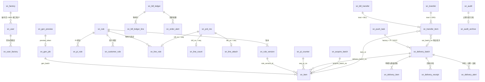

# 多生产组织 SN 防重管控 · 数据库表设计

> **读者**：开发、DBA　**对应代码**：`app/db/migration/V1__init.sql`、`app/services/partitions.py`、`app/services/locks.py`　**更新**：2026-10-19
> **相关**：[需求文档（PRD）](需求文档（PRD）.md) 附录 D（字段映射、表结构与写入方式）　[技术文档](技术文档.md)　[运维手册](运维手册.md)　[文档导航](README.md)
>
> 数据库：**MySQL 8.0**（InnoDB，`utf8mb4`）。建表脚本：`app/db/migration/V1__init.sql`，由应用启动时执行并按 Flyway 格式记录在 `flyway_schema_history`。
> 演示阶段所有表结构合并在 `V1__init.sql` 一个脚本里。**该脚本已按 PRD V30 重写**，与之前的版本不兼容、没有就地升级脚本：已有的演示 / 测试库须按《运维手册》8.1 删掉本系统的表（或 8.2 清空整库、8.3 删库重建）后重新启动建表。正式上线后改为只新增 `V2__xxx.sql`、`V3__xxx.sql`，不再修改已执行过的脚本。

## 1. 设计要点

| 要点 | 做法 |
| --- | --- |
| 完整 SN 全局不重复（PRD 5.2.4） | `sn_item` 唯一键 `ux_item_sn (sn)`。规则层面先避开：规则版本前缀全局唯一 `ux_rule_prefix (prefix)`，且应用层校验前缀不能互为开头；同一规则版本只归属一张 PI（`claimed_pi`），别的 PI 用须换前缀另出版本。唯一键兜底，撞上即整次生成回滚、不自动跳号 |
| PI 自己生成的十进制流水不重复 | `sn_item` 唯一键 `ux_item_seq (seq_pi_no, seq_dec)`；流水归属 PI 在转单、转组织后不变 |
| 转移不会造成重复 | 转单、转组织不改 `sn`，只改挂靠（PI、单据、物料行、生产组织）并 `rev + 1`；同一枚号只有一行 |
| 交付防重（5.2.5） | 交付批次内容建立后不改（`body_gz` 逐字节固定）；号入批时写 `delivery_batch_no`，领取时写 `acquire_batch_no`，认领条件互斥（见 §6） |
| 号的状态记在每一枚 SN 上 | `sn_item.status`（PENDING_ALLOC / TO_PUSH / PUSHED / TO_ACQUIRE / ACQUIRED / APPLYING），另有暂停标记 `suspend`、MES 持有组织 `mes_holder` |
| 计数口径（5.2.7）不扫号池 | 物料行计数 `sn_line_count`（本单生成、已生成、已分配）、PI 流水 `sn_pi_counter`，在同一事务里行锁后增减 |
| 订单快照与出号台账分开 | `sn_prd_mo` 只是金蝶已审核单据的快照，随同步整单替换；出过号的单据另记 `sn_bill_ledger(_line)`，单据离开快照后计数、台账、补填的附件项次都不丢 |
| 时间 | 一律 UTC 存储（`DATETIME` 不带时区），接口输出 ISO 8601 带 `Z`，页面按生产组织 `tz_offset_min` 显示 |
| 容量（约 400 万枚 / 月，3 年约 1.5 亿） | `sn_item` 单表不分区；`sn_audit` 按月 RANGE 分区；查询 / 导出 / 批次明细全部分页或游标读取 |
| 痕迹至少 3 年、可永久 | `SN_AUDIT_RETENTION_DAYS`（默认 1095，0 = 永久）；过期整月分区拷入 `sn_audit_archive` 后 `DROP PARTITION` |
| 编码类字段精确比较 | 全部表 `utf8mb4_bin`（区分大小写，自定义字符表里大小写不同的字符不会被判重） |
| 敏感数据 | MES 凭证 `sn_factory.mes_credential` 用 AES-GCM 加密保存（密钥由 `SN_SECRET` 派生），不回显；密码、MES 密钥只存哈希 |
| 不用外键 | 号池写入量大、痕迹表分区不支持外键；引用完整性由服务层在事务中保证 |

### 为什么 `sn_item` 不分区

分区的两个好处是：按整月 `DROP PARTITION` 删数据；查询条件带分区列时只扫相关分区（分区裁剪）。`sn_audit` 两样都用得上，`sn_item` 都用不上：

- 号是业务主数据，已交付的号仍要查重、转移、核对和追溯，不删不归档，没有整月可删；
- 查询都按 SN、PI、单据、批次，从不按生成月份，裁剪不起作用，每次查找都要逐个分区探一次。

另外 MySQL 要求**分区表上的每个唯一键都必须包含分区列**，分区后两条查重唯一键就不能建在 `sn_item` 上。因此号池不分区，唯一键直接建在它上面（PRD 附录 D.3 写入方式第 5 条）。

## 2. ER 图

只画主要关系（字段见 §4）；虚线关系由服务层维护，没有外键。

## 3. 表清单

| 分组 | 表 | 说明 |
| --- | --- | --- |
| 主数据 | `sn_factory` | 生产组织（金蝶同步）+ MES 对接配置 |
| | `sn_user`、`sn_user_factory` | 账户（页面账户与 MES 接口账户）、查询员绑定的生产组织 |
| 规则 | `sn_rule`、`sn_rule_version` | 规则库、规则版本（编码参数、归属 PI） |
| | `sn_pi_rule`、`sn_customer_rule`、`sn_line_rule` | PI 绑定、客户绑定（F-22）、物料行选定 |
| 订单 | `sn_prd_mo` | 金蝶生产订单快照（每条物料行一行） |
| | `sn_sync_state` | 订单同步状态（一行） |
| | `sn_line_attach` | 附件项次补填 |
| | `sn_line_count` | 物料行计数 |
| | `sn_bill_ledger`、`sn_bill_ledger_line` | 已出号单据台账 |
| | `sn_order_alert` | 订单变更提醒 |
| 生成 | `sn_pi_counter` | PI 流水 |
| | `sn_gen_preview`、`sn_gen_job` | 生成预演、生成任务（= 生成批次） |
| 号池 | `sn_item` | SN 号池（不分区） |
| 交付 | `sn_delivery_batch`、`sn_delivery_item` | 交付批次（推送 / 拉取 / 转出）、批次明细与逐枚回执 |
| | `sn_delivery_receipt` | 回执存档 |
| | `sn_delivery_alert` | 交付告警 |
| | `sn_push_task` | 推送任务 |
| | `sn_acquire_batch` | 页面领取批次 |
| 转移 | `sn_bill_transfer`、`sn_transfer`、`sn_transfer_item` | 转单单、转组织单、转移明细 |
| 辅助 | `sn_daily_counter`、`sn_rate_counter`、`sn_seq` | 按天计数、限流计数、批次号序列 |
| 痕迹 | `sn_audit`（按月分区）、`sn_audit_archive` | 操作痕迹、归档 |

共 34 条建表 / 初始化语句（33 张表 + `sn_sync_state` 的初始行），另有迁移记录表 `flyway_schema_history`。

## 4. 表结构

字段类型、默认值以 `V1__init.sql` 为准；下表列出含义。`created_at / updated_at` 等通用时间字段不再逐一说明（UTC）。

### 4.1 `sn_factory` 生产组织与 MES 对接配置

金蝶组织机构同步而来（F-03），本系统只维护 MES 对接配置（F-04）。主键 `factory_code`。

| 字段 | 类型 | 说明 |
| --- | --- | --- |
| factory_code | VARCHAR(64) PK | 生产组织编码（金蝶 FNumber） |
| factory_name | VARCHAR(128) | 名称（只显示，随金蝶更新） |
| enabled | TINYINT(1) | 金蝶启用状态；禁用的不能作为分配、转入、账户绑定目标 |
| mes_enabled | TINYINT(1) | 对接 MES；开启须连接测试通过 |
| mes_url | VARCHAR(500) | MES 接收推送的地址 |
| mes_auth_type | VARCHAR(8) | `TOKEN` 固定令牌 + 白名单 / `HMAC` 签名 |
| mes_credential | VARCHAR(1024) | 凭证，AES-GCM 加密（`SN_SECRET` 派生密钥），不回显 |
| batch_size | INT | 单批推送枚数（默认 5000，也是 MES 拉取建批上限） |
| push_timeout_sec | INT | 推送超时（默认 60 秒） |
| push_concurrency | INT | 同组织同时运行的推送任务数（默认 2） |
| tz_offset_min | INT | 显示时区，相对 UTC 的分钟数（默认 480 = UTC+8） |
| cfg_status | VARCHAR(16) | `UNCONFIGURED` / `OK` / `FAILED` |
| cfg_tested | VARCHAR(64) | 最近一次连接测试通过时的配置摘要；当前配置摘要与它相同才允许开启对接 |
| cfg_message, cfg_checked_at | | 最近一次测试或推送失败的原因、时间 |

### 4.2 `sn_user` 账户 / `sn_user_factory` 查询员绑定

`sn_user`：页面账户（`admin` / `factory_operator` / `query`）与 MES 接口账户（`mes`）；只停用不删除。唯一键 `ux_user_emp_no (emp_no)`，索引 `ix_user_factory (factory_code)`。

| 字段 | 说明 |
| --- | --- |
| emp_no | 工号，4–32 位字母数字，唯一，创建后不能改 |
| name | 姓名 |
| role | `admin` / `factory_operator` / `query` / `mes` |
| factory_code | 操作员、MES 接口账户的生产组织（MES 账户须绑「对接 MES = 是」的组织）；查询员的见 `sn_user_factory` |
| status | `ACTIVE` / `DISABLED` |
| password_hash | 密码哈希；MES 接口账户为密钥哈希（明文只在创建 / 重置时显示一次） |
| must_change_pwd | 管理员重置后下次登录须改密 |
| lang | 界面语言偏好 |
| last_login_at | 最近登录 |
| pwd_changed_at | 改密 / 重置密钥时间，作令牌版本：之前签发的令牌失效 |
| auth_failures, locked_until | MES 接口账户连续换令牌失败次数、锁定到（`SN_MES_AUTH_MAX_FAILURES` 次锁 `SN_MES_AUTH_LOCK_MINUTES` 分钟） |
| ip_whitelist | MES 接口账户来源地址白名单（IP / CIDR，逗号分隔，空 = 不限） |
| created_by, disabled_by, disabled_at | |

`sn_user_factory (user_id, factory_code)`：查询员可绑一个或多个生产组织；没有记录 = 全部。PK `(user_id, factory_code)`，索引 `(factory_code)`。

### 4.3 `sn_rule` 规则 / `sn_rule_version` 规则版本

`sn_rule`：唯一键 `ux_rule_code (rule_code)`，索引 `ix_rule_category (category_scope, category_value)`。

| 字段 | 说明 |
| --- | --- |
| rule_code, rule_name | 编码（1–64 位字母数字 `_` `-`）、名称；生成页自定义规则生成成功后存入规则库，编码 `PI-<PI>-n`、名称 `PI号_物料` |
| category_scope, category_value | 分类 `NONE` / `CUSTOMER` / `PI` 及对象，只用于筛选和推荐 |
| current_version | 当前版本号 |

`sn_rule_version`：唯一键 `ux_rule_version (rule_id, version)`、**`ux_rule_prefix (prefix)`**，索引 `ix_rule_version_pi (claimed_pi)`。

| 字段 | 说明 |
| --- | --- |
| rule_id, version | 所属规则、版本号 |
| prefix | 前缀，字母数字，全局唯一（且应用层校验不能与其他版本前缀互为开头） |
| suffix | 后缀，字母数字 `_` |
| base, seq_len, charset | 进制 10 / 16 / 32 / 36，流水位数 1–12，字符表（长度 = 进制） |
| with_length | 是否带长度（SN = 前缀 + 规范化长度 + 流水 + 后缀） |
| used | 生成过号（含之后撤销的）：再改格式必须另出一版 |
| claimed_pi | 归属 PI：首次用它生成的 PI，或换前缀另出时的 PI。别的 PI 用该版本须填新前缀另出版本 |
| derived_from | 由哪一版换前缀而来 |

### 4.4 `sn_pi_rule` / `sn_customer_rule` / `sn_line_rule` 规则选取

物料行实际使用的规则按「物料行选定 ＞ PI 绑定 ＞ 客户绑定」取（F-08，`rules.effective`）；本 PI 用规则的哪一版按版本的 `claimed_pi` 解析（`rules.resolve`）。

| 表 | 主键 | 字段 | 说明 |
| --- | --- | --- | --- |
| `sn_pi_rule` | `pi_no` | rule_id, bound_by, bound_at | PI 绑定的规则，作各物料行默认；索引 `(rule_id)` |
| `sn_customer_rule` | `customer_code` | rule_id, bound_by, bound_at | 按客户绑定（只能经接口设置，F-22），作该客户各 PI 的模板，每张 PI 首次使用须换前缀；索引 `(rule_id)` |
| `sn_line_rule` | `(bill_no, seq)` | pi_no, rule_id, custom_json, set_by, set_at | 物料行选定的规则库规则（`rule_id`）或自定义规则参数（`custom_json`，生成成功后存入规则库并改记 `rule_id`）；索引 `(pi_no)`、`(rule_id)` |

### 4.5 `sn_prd_mo` 生产订单快照

金蝶已审核生产订单的每条物料行一行，表头字段写在每一行上，不存单据内码、分录内码（PRD 附录 D.1、D.2）。唯一键 `ux_prd_mo_line (bill_no, seq)`；索引 `ix_prd_mo_pi (pi)`、`ix_prd_mo_customer (customer_code)`、`ix_prd_mo_org (org_code, pi)`。

| 字段 | 说明 |
| --- | --- |
| bill_no, seq | 单据编号、序号（= 金蝶明细行号）；物料行 = 单据编号 + 序号 |
| doc_status | 单据状态（快照中均为 `C` 已审核） |
| customer_code, pi, po | 客户编码、PI、PO（客户编码可为空，与有客户编码的单据流程一致） |
| org_code, org_name | 生产组织（号的归属按它） |
| attach_no | 附件项次（金蝶值；空时在订单页补填，见 `sn_line_attach`） |
| material_code, material_name | 物料 |
| length_raw | 长度原值（去首尾空格）；生成时规范化 |
| qty | 数量 DECIMAL(18,4)；SN 数量按整数取 |
| modify_time | 金蝶修改时间（比对同步按它增量拉取） |
| synced_at | 本行写入时间 |

同步方式：按单据同步、比对同步、进页同步按单据整单替换；全量重建写入新表后 `RENAME TABLE` 原子切换（`orders.rebuild`）。

### 4.6 `sn_sync_state` 订单同步状态

固定一行（`id = 1`，建表时插入）：`last_run_at`、`last_ok`、`last_message`、`last_bills`、`last_rows`（最近一次比对同步）、`last_full_at`（最近一次全量重建）。

### 4.7 `sn_line_attach` 附件项次补填

PK `(bill_no, seq)`。`manual_value` 手工值；`material_code` 填写时的物料编码（之后同序号物料变了视为对不上，不再生效）；`k3_value` 金蝶后来返回的值（与手工值不同时页面提示）；`filled_by`、`filled_at`。补填值不写回金蝶，也不进推送报文和领取文件。

### 4.8 `sn_line_count` 物料行计数

PK `(bill_no, seq)`；在快照之外，快照覆盖或单据离开快照都不丢（口径见 PRD 5.2.7）。

| 字段 | 说明 |
| --- | --- |
| material_code | 物料编码 |
| own_generated | 本单生成数（按号上的生成单据、生成序号；额度 = 数量 − 本单生成） |
| gen_count | 已生成数（当前挂在本行下的号，含转入） |
| alloc_count | 已分配数（按当前挂靠） |

### 4.9 `sn_pi_counter` PI 流水

PK `pi_no`。`last_seq_dec` 本 PI 自己生成的最大十进制流水（含已转出的，不含转入号）；`generated_qty` 本 PI 自己生成的枚数。生成时对该行 `SELECT … FOR UPDATE`，同一 PI 串行（附录 D.3）。

### 4.10 `sn_bill_ledger` 已出号单据台账 / `sn_bill_ledger_line`

单据第一次生成号时建立，记最近一次在快照中的表头与各物料行，用于比对变更（F-06）和暂停交付（5.2.10）。

`sn_bill_ledger`：PK `bill_no`，索引 `ix_ledger_leave (leave_state)`。

| 字段 | 说明 |
| --- | --- |
| pi, customer_code, org_code, org_name | 最近一次在快照中的表头 |
| in_snapshot | 是否在快照中 |
| leave_state, left_at | 离开快照：`REVERSAL` 反审核中 / `VOID_CONFIRMED` 已确认作废 / `DELETED` 已删除 |
| suspend | 暂停交付：`REVERSAL` / `CHANGE` |
| pi_frozen | PI 变更未确认：冻结生成和分配 |

`sn_bill_ledger_line`：PK `(bill_no, seq)`，`material_code`、`qty`。

### 4.11 `sn_order_alert` 订单变更提醒

索引 `ix_alert_status (status, created_at)`、`ix_alert_bill (bill_no, status)`。

| 字段 | 说明 |
| --- | --- |
| bill_no, seq | 单据；物料行级提醒（数量、物料、附件项次）带序号 |
| alert_type | `PI` / `ORG` / `CUSTOMER` / `QTY` / `MATERIAL` / `ATTACH` / `REVERSAL` / `DELETED` |
| before_value, after_value | 变化前后 |
| status | `OPEN` / `CLOSED` |
| close_action, closed_by, closed_at, note | `CONFIRM` 确认变更 / `MAP` 确认对应 / `UNRELATED` 确认无关 / `VOID` 确认已作废 / `ACK` 知道了 / `AUTO` 自动关闭 |

### 4.12 `sn_gen_preview` 生成预演 / `sn_gen_job` 生成任务

`sn_gen_preview`：PK `token`（32 位）；`pi_no`、`qty`、`base_last_seq`（预演时该 PI 的最大号，生成时不一致即失效）、`plan_json`（范围、各物料行数量、号段、所用规则）、`expires_at`（`SN_PREVIEW_TTL_MINUTES`）。不落 SN。索引 `(created_at)`，7 天前的由每日维护删除。

`sn_gen_job`：一次生成一行（= 生成批次）。唯一键 `ux_job_batch (gen_batch)`、**`ux_job_running_pi (running_pi)`**、`ux_job_preview (preview_token)`；索引 `ix_job_pi (pi_no, id)`。

| 字段 | 说明 |
| --- | --- |
| gen_batch | 生成批次号 |
| pi_no, scope | PI；`BILLS` 整单 / `LINES` 按物料行 |
| qty, start_seq_dec, end_seq_dec, start_sn, end_sn | 数量与起止号 |
| status | `RUNNING` / `SUCCESS` / `FAILED` / `CANCELED` / `REVOKED` |
| done_qty, current_sn | 进度（独立连接写，页面轮询） |
| error_code, error_msg | 失败原因 |
| running_pi | 运行中 = `pi_no`，结束置 NULL：唯一键保证同一 PI 同一时刻只有一个生成 |
| preview_token | 所用预演：唯一键保证一个预演只能生成一次 |
| plan_json | 生成计划（各物料行号段与规则） |
| cancel_by, cancel_at, revoke_reason | 取消、撤销信息 |

### 4.13 `sn_item` SN 号池（不分区）

| 字段 | 说明 |
| --- | --- |
| id | 自增主键 |
| sn | 完整 SN，写出后不再修改 |
| **当前挂靠** | |
| factory_code | 生产组织（分配后才有） |
| pi_no, customer_code | 当前 PI、客户 |
| bill_no, bill_seq, material_code | 当前来源单据、序号、物料 |
| rev | 挂靠版本号：每次改挂 / 转移 `+1`，MES 按它判断新旧 |
| **生成信息（之后不改）** | |
| gen_org_code, gen_bill_no, gen_bill_seq, gen_material_code | 生成时的订单生产组织、单据、序号、物料（本单生成数按它算） |
| seq_pi_no, seq_dec | 流水归属 PI、十进制流水 |
| length_text | 长度（规则不带长度时为空） |
| rule_version_id, gen_batch | 所用规则版本、生成批次 |
| **交付信息** | |
| status | `PENDING_ALLOC` / `TO_PUSH` / `PUSHED` / `TO_ACQUIRE` / `ACQUIRED` / `APPLYING` |
| delivery_mode | `PUSH` 推送 / `PULL` 拉取 / `PAGE` 页面领取 |
| push_type | 下次推送类型 `NEW` / `REASSIGN` |
| delivery_batch_no | 交付批次（推送或拉取建立；入批即写，未入批为 NULL） |
| acquire_batch_no | 领取批次 |
| suspend | 暂停交付：`REVERSAL` 单据反审核中 / `CHANGE` 订单变更待确认 |
| mes_holder | MES 持有组织（交付批次确认时写入；转出批次确认时按条件清除） |
| transfer_id, applying_from | 未完成的转组织申请、申请前状态 |
| transfer_kind, transfer_doc_no, transfer_from_org | 最近一次转移（`BILL_TRANSFER` / `ORG_TRANSFER`），推送报文追溯用 |
| created_at, allocated_at, delivered_at | 生成、分配、交付时间 |

索引：

| 索引 | 用途 |
| --- | --- |
| `ux_item_sn (sn)` UNIQUE | 完整 SN 全局唯一（utf8mb4_bin，区分大小写） |
| `ux_item_seq (seq_pi_no, seq_dec)` UNIQUE | 流水归属 PI 内十进制流水唯一 |
| `ix_item_claim (pi_no, factory_code, status, suspend, delivery_batch_no, seq_pi_no, seq_dec)` | 取号：推送建批、拉取建批、页面领取认领「待推送 / 待领取、未暂停、未入批」的号，过滤和排序都在索引内（附录 D.3、Q55） |
| `ix_item_status (status, factory_code, pi_no)` | 首页、领取页按状态统计 |
| `ix_item_bill (bill_no, bill_seq, status)` | 按来源单据：分配、暂停交付、转单 |
| `ix_item_gen_bill (gen_bill_no, gen_bill_seq)` | 按生成单据：本单生成数、撤销生成 |
| `ix_item_delivery (delivery_batch_no)`、`ix_item_acquire (acquire_batch_no)` | 批次明细 |
| `ix_item_holder (mes_holder, pi_no)` | 转出判断、MES 只读查询 |

### 4.14 `sn_delivery_batch` 交付批次

推送批次、拉取批次、转出批次共用一张表；批次内容建立后不改，推送与拉取都按 `body_gz` 送达，保证同一批次每次内容逐字节相同（5.2.5）。批次号：推送 `PS-`、拉取 `PL-`、转出 `XO-` + 组织 + 日期 + 当日序号（`sn_seq`）。

| 字段 | 说明 |
| --- | --- |
| batch_no | 批次号，唯一 `ux_delivery_batch_no` |
| source | `PUSH` 推送任务建立 / `PULL` MES 拉取建立 |
| batch_type | `DELIVERY` 交付 / `TRANSFER_OUT` 转出 |
| factory_code | 接收方组织：交付为号所属组织，转出为来源组织 |
| pi_no | 交付批次只属一张 PI；转出批次涉及多张 PI 时为空 |
| qty | 枚数 |
| items_digest | 内容摘要 `sha256:` + 64 位小写十六进制 |
| body_gz | 请求体（gzip，mtime = 0，逐字节固定） |
| result | `UNCONFIRMED` / `SUCCESS` / `SUCCESS_CONFLICT` / `FAILED` / `VOIDED` |
| confirm_method, confirmed_at | `PUSH_RESPONSE` 推送应答 / `PULL_RECEIPT` 拉取回执 / `MANUAL` 人工确认 |
| fail_code, fail_reason | 失败或拒收原因 |
| voidable | 失败原因允许作废（整批拒绝、报文过大、认证或地址错误）；回执不符、内容不符的不能作废 |
| accepted_qty, duplicate_qty, conflict_qty, stale_qty | 逐枚回执汇总 |
| push_state | `IDLE` / `WAIT_RETRY` / `EXHAUSTED` |
| retry_count, next_retry_at | 本轮自动重试次数与下次时间（`SN_PUSH_RETRY_INTERVALS_MINUTES`） |
| push_count, repush_count, last_push_at | 累计发送次数、续推次数、最近发送 |
| pulled_at | MES 最近一次取走 |
| transfer_kind, transfer_doc_no | 因转移建立：`BILL_TRANSFER` / `ORG_TRANSFER` 及单号 |
| rebuilt_from, rebuilt_to | 转出批次作废后重建的原 / 新批次号 |
| manual_reason, manual_basis, manual_by, manual_at | 人工确认 / 作废的原因、依据、操作人 |
| alerted_unconfirmed | 已就「超时未回执」告警（`SN_BATCH_UNCONFIRMED_ALERT_MINUTES`） |

索引：`ix_delivery_pick (factory_code, pi_no, result, created_at)`（取批先给最早的未确认批次）、`ix_delivery_type (factory_code, batch_type, result, created_at)`、`ix_delivery_result (result, created_at)`、`ix_delivery_doc (transfer_doc_no)`、`ix_delivery_created (created_at)`。

### 4.15 `sn_delivery_item` 批次明细与逐枚回执

PK `(batch_id, line_no)`；索引 `ix_delivery_item_sn (sn)`（5.2.8 第 7 条「转出未完成不能再转」校验）、`ix_delivery_item_item (item_id)`、`ix_delivery_item_bill (batch_id, bill_no)`。

| 字段 | 说明 |
| --- | --- |
| item_id, sn, rev | 号与建批时的版本 |
| push_type | `NEW` / `REASSIGN` / `TRANSFER_OUT` |
| pi_no, bill_no, bill_seq, material_code, customer_code | 交付：当前挂靠；转出：转出前挂靠（号上不记） |
| seq_pi_no, seq_dec | 流水 |
| to_factory | 转出：转入组织 |
| receipt_result | 逐枚回执 `ACCEPTED` / `DUPLICATE` / `CONFLICT` / `STALE` |
| existing_rev, existing_batch_no | 冲突、过期时 MES 已存的版本号与批次号 |

### 4.16 `sn_delivery_receipt` 回执存档

推送应答、拉取回执全部存档（含被拒收的、确认后再交的）。索引 `ix_receipt_batch (batch_id, id)`。字段：`method`（`PUSH_RESPONSE` / `PULL_RECEIPT`）、`outcome`（`PROCESSED` / `REJECTED`）、`verdict`（`CONFIRMED` 生效 / `REJECTED` 整批拒绝 / `MISMATCH` 不符 / `ARCHIVED` 只存档）、`detail`、`body_gz`。

### 4.17 `sn_delivery_alert` 交付告警

疑似重复交付（冲突）、版本过期、每日自检问题。索引 `ix_dalert_status (status, created_at)`、`ix_dalert_item (item_id)`。字段：`alert_type`（`CONFLICT` / `STALE` / `CHECK`）、`factory_code`、`batch_no`、`item_id`、`sn`、`rev`、`existing_rev`、`existing_batch_no`、`detail`、`status`（`OPEN` / `CLOSED`）、`close_action`（`RESEND` 以本系统为准重推 / `CLOSE` 关闭）、`closed_by`、`closed_at`、`note`（核查结论，必填）。

### 4.18 `sn_push_task` 推送任务

同组织 + 同一 PI 一个任务（转出批次用 `#XO`）。PK `(factory_code, task_key)`，索引 `ix_push_task_state (state, run_after)`。

| 字段 | 说明 |
| --- | --- |
| state | `QUEUED` / `RUNNING` / `WAITING`（等自动重试）/ `STOPPED`（中断，待续推）/ `DONE` |
| run_after | WAITING：到这个时间再跑 |
| lease_until, runner | RUNNING：执行实例与租约（300 秒，每批续租）；租约过期的任务可被其他实例接手 |
| current_batch | 正在推送的批次 |
| resend | 续推：未确认、失败的批次（含拉取建立的）也重推 |
| requeue | 运行中又有新号可推：结束后再排队一次 |
| pushed_batches, pushed_qty, message | 本轮进度与说明 |
| started_by, started_at | |

同一生产组织 RUNNING 的任务数不超过 `sn_factory.push_concurrency`（5.2.9 第 2 条）。

### 4.19 `sn_acquire_batch` 页面领取批次

PK `batch_no`（`AQ` + 时间）；唯一键 **`ux_acquire_request (factory_code, request_no)`**（同组织同请求号幂等）；索引 `ix_acquire_fac_pi (factory_code, pi_no, created_at)`、`ix_acquire_created (created_at)`。字段：`pi_no`、`request_no`、`mes_org`（领取时该组织是否对接 MES）、`status`（`INCOMPLETE` 未完成 / `DONE` 已完成）、`qty`、`created_by`、`finished_at`。

### 4.20 `sn_bill_transfer` 转单单 / `sn_transfer` 转组织单 / `sn_transfer_item` 转移明细

`sn_bill_transfer`：唯一键 `ux_bill_transfer_no (transfer_no)`；索引 `(from_bill)`、`(to_bill)`、`(from_pi, to_pi)`。字段：`mode`（`VOID` 整单作废 / `SPLIT` 拆单）、`from_bill`、`to_bill`、`from_pi`、`to_pi`、`scope_text`（拆单：生产组织 + PI + 物料行 + 起止号）、`qty`、`reason`。

`sn_transfer`：唯一键 `ux_transfer_no (transfer_no)`；索引 `(status, applied_at)`、`(from_factory, applied_at)`、`(to_factory, applied_at)`、`(from_pi)`、`(to_pi)`。

| 字段 | 说明 |
| --- | --- |
| mode | `APPLY` 申请 / `DIRECT` 总部直接 |
| status | `PENDING` / `APPROVED` / `REJECTED` / `WITHDRAWN` |
| scope | `PI` / `MATERIAL` / `SINGLE` |
| from_factory, from_pi, from_material, from_sn | 来源范围 |
| qty | 枚数 |
| to_factory, to_pi, to_customer, to_material | 转入目标（客户、物料空 = 沿用原值） |
| manual_fields | 手工填写的目标字段：`pi,customer,material` |
| reason, applied_by, applied_at, decided_by, decided_at, decide_note | |

`sn_transfer_item`（转单、转组织共用）：PK `(kind, transfer_id, item_id)`，索引 `ix_transfer_item_sn (sn)`。字段：`kind`（`BILL` / `ORG`）、`sn`、`seq_pi_no`、`seq_dec`、转移前 `from_status / from_factory / from_pi / from_customer / from_bill / from_seq / from_material / from_delivery_batch / from_acquire_batch / from_rev`、转移后 `to_status / to_factory / to_pi / to_customer / to_bill / to_seq / to_material / to_rev`、`out_batch_no`（向来源 MES 推送的转出批次）。转组织单的「转出号清单」由它导出。

### 4.21 辅助表

| 表 | 主键 | 说明 |
| --- | --- | --- |
| `sn_daily_counter` | `(day, kind, factory_code)` | 按天汇总的计数：无变动的比对同步次数、MES 无批次可给的取批次数（不逐次留痕） |
| `sn_rate_counter` | `(rkey, win)` | 限流计数（按组织 + 分钟，`SN_MES_PULL_RATE_PER_MINUTE`）；1 天前的由每日维护删除 |
| `sn_seq` | `name` | 单号序列（批次号的每日序号）：`INSERT … ON DUPLICATE KEY` 预建后 `UPDATE val = val + 1` 行锁取号 |

### 4.22 `sn_audit` 操作痕迹（按月分区）/ `sn_audit_archive` 归档

| 字段 | 类型 | 说明 |
| --- | --- | --- |
| id | BIGINT AI | PK `(id, created_at)` |
| created_at | DATETIME(3) | **分区键**（RANGE COLUMNS），UTC |
| operator, operator_name, role | | 操作人（定时任务为 `system`） |
| source | VARCHAR(8) | `PAGE` 页面 / `API` MES 接口（`/api/mes/v1`）/ `SYSTEM` 定时任务 |
| action | VARCHAR(32) | 见下表 |
| result | VARCHAR(8) | `OK` / `FAIL`（被业务拒绝的写操作也记，独立事务，不随业务回滚） |
| factory_code, pi_no, customer_code, material_code, bill_no | | |
| start_sn, end_sn, qty | | 号段或数量 |
| before_status, after_status | | 操作前后状态 |
| batch_no, request_no, transfer_no, reason | | 有则记 |
| error_msg, trace_id, detail | | 失败原因、请求 ID、补充信息 |

索引：`(created_at)`、`(action, created_at)`、`(factory_code, created_at)`、`(pi_no, created_at)`、`(operator, created_at)`、`(bill_no, created_at)`、`(batch_no)`。

`action` 取值（`app/services/audit.py`）：

| 类别 | 动作 |
| --- | --- |
| 账户 | LOGIN（成功、失败都记，含来源地址）、PASSWORD_CHANGE、USER_CREATE、USER_UPDATE、USER_DISABLE、USER_ENABLE、USER_RESET_PWD、USER_RESET_SECRET（重置 MES 密钥） |
| MES 认证 | MES_AUTH（换令牌，失败也记）、MES_AUTH_LOCK（连续失败锁定）、MES_AUTH_UNLOCK |
| 生产组织 | FACTORY_SYNC、FACTORY_MES_CONFIG（改对接配置）、FACTORY_MES_TEST（连接测试）、FACTORY_MES_TOGGLE（开启 / 关闭对接 MES） |
| 订单 | ORDER_SYNC（按单据、比对、进页、全量重建；定时执行的操作人为 system）、ORDER_ATTACH_FILL、ORDER_ALERT（产生变更提醒）、ORDER_ALERT_HANDLE、ORDER_SUSPEND（暂停交付）、ORDER_RESUME（解除暂停） |
| 规则 | RULE_CREATE、RULE_UPDATE（就地修改）、RULE_VERSION（另出一版）、RULE_RENAME、RULE_CATEGORY、RULE_PI_BIND、RULE_PI_UNBIND、RULE_LINE_SELECT（物料行选定 / 改回默认）、RULE_PREFIX_VERSION（为本 PI 换前缀另出版本）、RULE_CUSTOMER_BIND、RULE_CUSTOMER_UNBIND、RULE_DELETE |
| 生成 / 分配 | SN_GENERATE、SN_GEN_CANCEL、SN_REVOKE、SN_ALLOCATE |
| 交付 | SN_BATCH_CREATE（建交付批次）、SN_PUSH（推送，含自动重试）、SN_PUSH_RESUME（继续推送）、SN_PULL（MES 取批）、SN_RECEIPT（MES 回执）、SN_BATCH_MANUAL（人工确认）、SN_BATCH_VOID（作废）、SN_ALERT_HANDLE（处理交付告警）、SN_ACQUIRE（页面领取）、SN_READ（MES 只读查询） |
| 转移 | TRANSFER_BILL（转单）、TRANSFER_APPLY、TRANSFER_WITHDRAW、TRANSFER_APPROVE、TRANSFER_REJECT、TRANSFER_DIRECT（总部直接转组织） |
| 其他 | SELF_CHECK（每日交付自检）、AUDIT_ARCHIVE、AUDIT_ARCHIVE_PURGE、OTHER（未归类的失败写请求） |

失败痕迹（`result = FAIL`）的动作按请求方法与路径归类（`audit.action_for`，如 `POST /api/delivery/resume` → `SN_PUSH_RESUME`，`POST /api/transfers/org/{id}/approve` → `TRANSFER_APPROVE`，`DELETE /api/rules/pi-binding` → `RULE_PI_UNBIND`，`/api/mes/v1/batches/next` → `SN_PULL`）；对不上任何动作的记 `OTHER`。MES 接口的失败（含 429 限流、认证失败）按 MES 错误结构返回并留痕，回执不符（`RECEIPT_MISMATCH`）记在批次回执存档里。

`sn_audit_archive`：同结构 + `archived_at`，不分区，`ROW_FORMAT=COMPRESSED`。保留原 `id`。痕迹页、导出的时间范围覆盖到归档时，同条件 `UNION ALL` 在线表与归档表，结果标 `archived`。

## 5. 分区维护与每日任务

由 `app/services/partitions.py` 在**应用启动时**与**每天 02:10**（`SN_PARTITION_CRON`，按服务器 `TZ`）执行，用 `GET_LOCK('sn_partition')` 保证多实例只有一个在做：

1. 为 `sn_audit` 建好「当月 + 未来 `SN_PARTITION_AHEAD_MONTHS`（默认 3）个月」的分区：`REORGANIZE PARTITION pmax INTO (pYYYYMM …, pmax)`。兜底分区 `pmax` 始终为空，拆分几乎零成本。
2. 痕迹归档：上界早于「今天 − 保存天数」的整月分区，`INSERT IGNORE INTO sn_audit_archive SELECT … FROM sn_audit PARTITION (pYYYYMM)` 后 `ALTER TABLE sn_audit DROP PARTITION pYYYYMM`，并记一条 `AUDIT_ARCHIVE` 痕迹。保存天数为 0 时不归档。
3. 归档清理：痕迹总保存期 `SN_AUDIT_ARCHIVE_RETENTION_DAYS`（默认 1825 天，含在线期；0 = 归档永久保留；短于在线保存天数时按在线保存天数算）。超期的归档痕迹每批 1 万条删除，删除后记 `AUDIT_ARCHIVE_PURGE`。在线保存天数为 0 时不清理。
4. 删除 7 天前的预演记录、1 天前的限流计数。
5. 从金蝶同步生产组织（F-03）、每日交付自检（5.2.5 第 5 条，结果记 `SELF_CHECK`，问题写入 `sn_delivery_alert`，`alert_type = CHECK`）。两项各自失败互不影响。

`sn_item` 不分区、不做删除 / 归档（§1）。

## 6. 事务与并发

### 6.1 命名锁（`app/services/locks.py`）

MySQL `GET_LOCK`，每组锁占一条独立连接，持锁连接断开时服务端自动释放；多把锁按键排序依次加锁（避免死锁），任一把拿不到即全部释放。锁名 `sn_<kind>_<md5(键)>`（命名锁最长 64 字符）。

| 锁 | 范围 | 用途 |
| --- | --- | --- |
| PI 操作锁 `pi` | 一张 PI（转移涉及多张 PI 时同时锁） | 生成（含取消）、撤销生成、分配、转单、转组织确认（含直接转移）同一时刻只执行一个，后到的立即返回 409 `PI_BUSY`，不排队（5.2.9 第 1 条）。后台生成把锁交给后台线程，结束时释放 |
| 组织建批锁 `org` | 一个生产组织 | MES 取批时「查范围内未确认批次」与「建新批」在同一把锁内完成，并发取批不会为同一范围各建一批（F-12 第 6 条） |
| 订单同步锁 `sync` | 全局 | 各种订单同步共用；按单据同步排队等待，比对同步和进页同步拿不到直接跳过（`ORDER_SYNC_BUSY` / skipped） |
| `sn_partition` | 全局 | 分区维护、每日任务（§5） |

拉取与领取不占 PI 操作锁，不受推送并发上限限制（5.2.9 第 3 条）。

### 6.2 号的认领（SKIP LOCKED）

推送任务建批、MES 拉取建批、页面领取认领号时，按 `ix_item_claim` 取范围内「状态为待推送 / 待领取、`suspend IS NULL`、`delivery_batch_no IS NULL`（领取另要求 `acquire_batch_no IS NULL`）」的号，按流水排序，`SELECT … FOR UPDATE SKIP LOCKED` 加锁后在同一短事务内写入批次号（附录 D.3 写入方式第 4 条）。三条通道互不阻塞、互不重复：同一枚号只会进一个交付批次或一个领取批次。页面领取一次超过 5000 枚时按 5000 枚一段连续认领，中途失败批次记为 `INCOMPLETE`，用原请求号重试接着认领。

### 6.3 各场景

| 场景 | 保证 |
| --- | --- |
| 生成 | PI 操作锁 + `sn_gen_job.ux_job_running_pi` 双重拦截同 PI 并发；一个预演只能生成一次（`ux_job_preview`）。一次生成一个事务：锁 `sn_pi_counter` 行 → 核对预演时最大号 → 逐物料行锁 `sn_line_count` 核对额度 → 锁 `sn_rule` 行，认领版本（`used`、`claimed_pi`）或落库自定义规则 / 换前缀版本 → 每 2000 枚一条多行 `INSERT` → 推进计数。撞唯一键（`GEN_DUPLICATE_SN`）或任一步失败整次回滚 |
| 中断任务回收 | 启动时对 `RUNNING` 任务用 `FOR UPDATE NOWAIT` 锁任务行与计数器行，拿到才标记失败；拿不到说明仍在生成，跳过 |
| 分配 | PI 操作锁；按单据（可再限物料行）`UPDATE … WHERE pi_no = ? AND bill_no = ? AND status = 'PENDING_ALLOC' … ORDER BY seq_dec LIMIT 5000` 分段改为待推送 / 待领取，同一事务增加各物料行 `alloc_count`；暂停交付、PI 冻结的单据整单跳过并在结果中列出（`skipped`） |
| 撤销生成 | PI 操作锁；核对是 PI 流水排在最后的一次、号全部仍待分配且未转移；按流水区间删除号，行数须等于任务数量，否则回滚 |
| 交付批次确认 | 回执核对通过后，同一事务内把批次内仍属该批的号改为已推送、写 `mes_holder`、逐枚回执与汇总；转出批次确认只在 `mes_holder` 等于来源组织时清除（附录 D.3 第 9 条） |
| 回执幂等 | 按批次号：已确认的再收回执只存档（`verdict = ARCHIVED`，`firstConfirmation = false`） |
| 转单 / 转组织 | PI 操作锁 + 范围内的号逐行 `FOR UPDATE`，与认领互斥；在未确认 / 失败批次中的号、转出未完成的号列为不可转（`TR_FROZEN`）；状态更新影响行数须等于锁定行数，否则 `TR_CONCURRENT` 回滚。改挂、转出批次与转移在同一事务内建立 |
| 暂停交付 | 按 `(bill_no, bill_seq)` 分段（5000）更新暂停标记，已入批的号跳过；解除时清除 |
| 订单全量重建 | 写入 `sn_prd_mo_new` 后 `RENAME TABLE` 原子切换，失败不影响原快照 |
| 死锁 / 锁超时 / 连接池耗尽 | 统一转为 409 `CONFLICT_RETRY`，由调用方重试。死锁、锁等待超时、`NOWAIT` 冲突后连接回滚即回池复用；只有断线、读写超时（客户端错误号 2000–2999）才丢弃连接 |
| 字段超长 / 格式不符 | `DataError` 转为 422 `VALIDATION`，不重试 |

## 7. 容量估算（约 400 万枚 / 月，3 年约 1.5 亿枚）

| 对象 | 单行（含索引）估算 | 3 年 |
| --- | --- | --- |
| `sn_item` | ≈ 700–900 B（两条唯一键 + 取号组合索引） | ≈ 110–140 GB，单表 |
| `sn_delivery_item` | ≈ 200–250 B；每枚号每次入批一行（含改挂、转出） | ≈ 30–40 GB（按每枚平均入批 1 次估） |
| `sn_delivery_batch` | `body_gz` 每批（5000 枚）约 100–200 KB | 约 3 万批 / 3 年，数 GB |
| `sn_audit` | 每次操作一行（不是每枚 SN 一行） | 很小 |

性能约束：

- 生成：每 2000 枚一条多行 `INSERT`（PyMySQL `executemany`）；超过 `SN_GEN_SYNC_THRESHOLD`（默认 5000）转后台任务，页面轮询进度；单次硬上限 `SN_GEN_MAX_PER_RUN`（默认 50 万，控制单个事务回滚日志体积）。
- 推送 / 拉取建批：每批不超过组织的 `batch_size`（默认 5000），认领与组包在短事务内完成。
- 查询列表：计数封顶（`total_capped`），避免大表全量 COUNT；导出按 `id` 游标 5000 行一块流式写 CSV / XLSX。
- 批次明细、转移明细、领取文件、MES 只读查询：均分页 / 游标读取。

## 8. 性能测试与设计决定

### 8.1 号池写入 POC（历史）

在 MySQL 8.0.46 上，用早期窄表方案插入 100 万枚（单事务、批量、含全部索引）：约 34 秒，数据 117 MB + 索引 199 MB，约 330 字节 / 枚。验证了：重复 SN / 重复流水会被唯一键拒绝；痕迹按月 `DROP PARTITION` 可用；深分页和 `COUNT(*)` 扫号池不能当额度算法。由此得出的决定仍然有效：

1. **只分痕迹表**：号池查询都不带月份、分区裁剪不起作用，分区维护的 DDL 还会短暂挡住号池写入，`sn_item` 不分区，唯一键直接建在号池上（§1）。
2. **只归档痕迹，号不进历史表**：号是主数据，要长期查重、转移和追溯。
3. **额度和最大号不扫号池**：记在 `sn_line_count`、`sn_pi_counter`，行锁后增减；列表计数封顶、导出按主键游标，不用深 `OFFSET`。

POC 报告与方案见 `docs/db_poc/`。

### 8.2 查询性能测试（订单表，历史）

测的是 `poc_*` 订单表的点查、列表和聚合（2026-09-23、09-24）。缓冲池能装下数据时，点查和「先限制再关联」到 500 万行仍很快（点查 p95 约 1 毫秒，先按时间限制再关联返回 50 行 6 毫秒，键集分页 43 毫秒）；全表聚合随行数变慢（500 万档 184 秒），不能做页面接口。因此列表先按条件限制再取行，按 SN、批次查询走索引。

### 8.3 待复测

PRD V30 引入的交付批次、推送任务、SKIP LOCKED 认领、暂停交付分段更新尚未做专项压测。上线前须在生产同规格环境按 PRD 6「性能」建议值复测：10 万枚单次生成 ≤ 60 秒；10 万枚分配 ≤ 30 秒；单批 5000 枚推送认领与组包 ≤ 2 秒；MES 取批（新建 5000 枚一批）≤ 3 秒；5 万枚页面领取并出文件 ≤ 60 秒；号池 1.5 亿行时列表与查询首屏 ≤ 2 秒。
