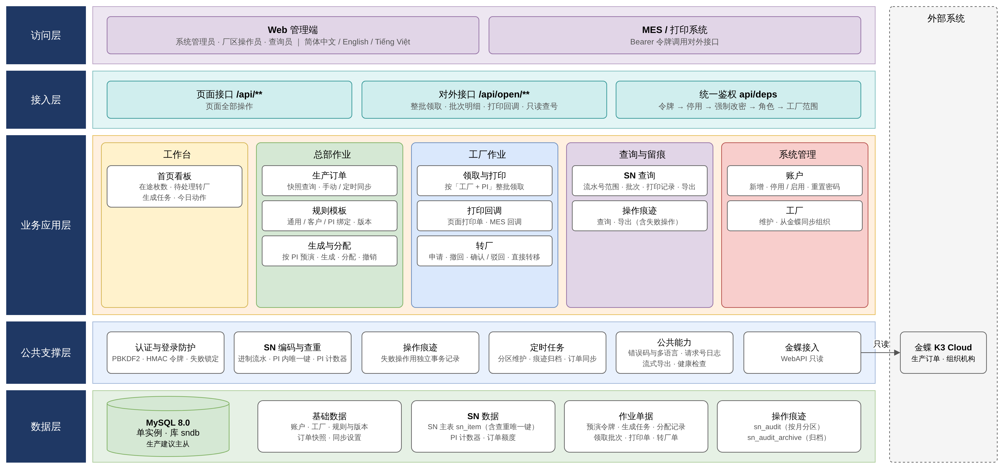
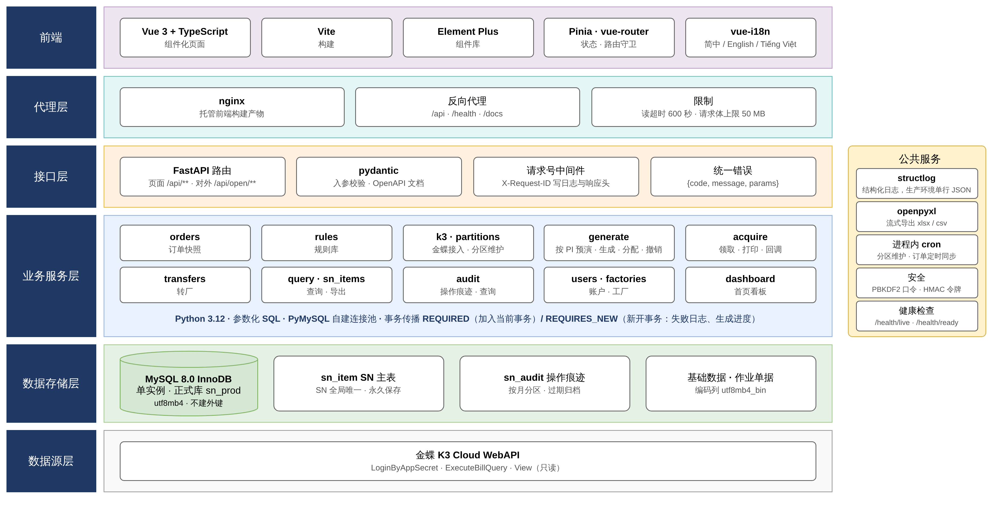
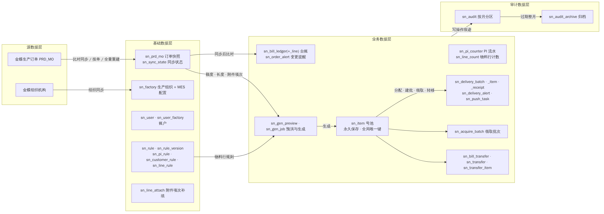
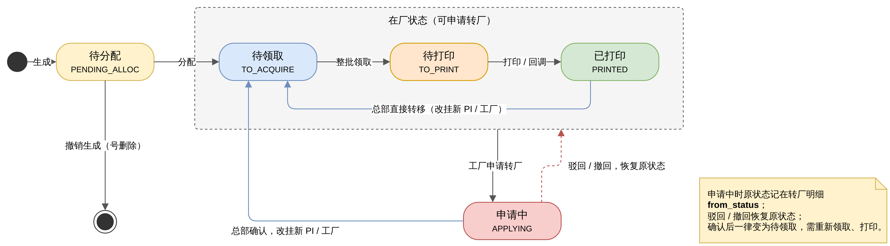
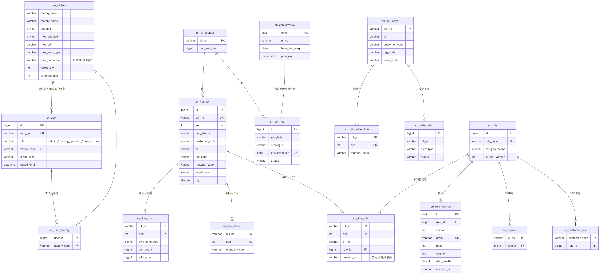
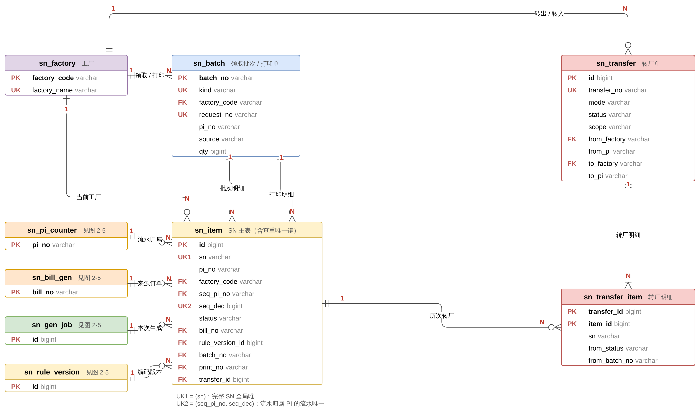
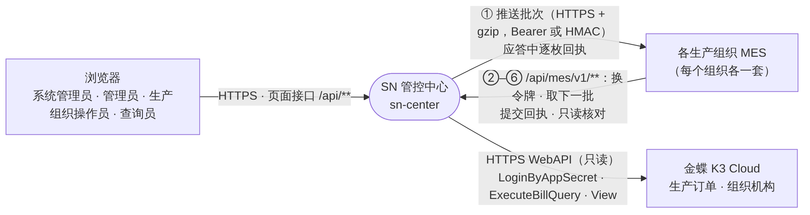
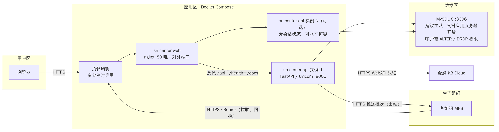
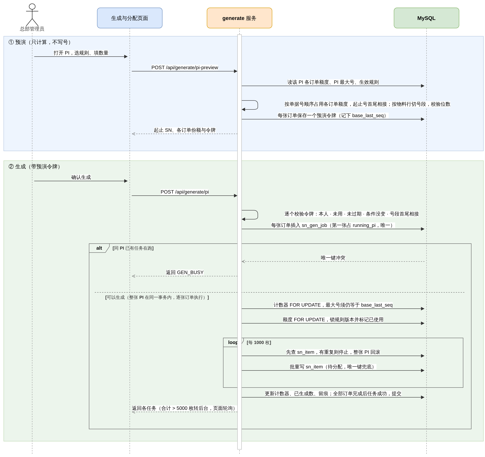
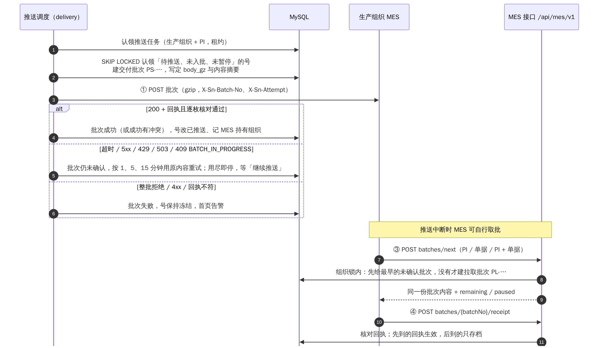

# 多生产组织 SN 防重管控系统 · 技术方案

| 项目 | 内容 |
| --- | --- |
| 文档名称 | 多生产组织 SN 防重管控系统技术方案 |
| 版本 | V2.3 |
| 状态 | 评审稿 |
| 日期 | 2026-10-26 |
| 依据 | 《多生产组织 SN 防重管控需求文档（PRD）》V30、《业务流程说明》、《MES 对接接口文档》《MES 对接说明》 |
| 编写 / 审核 / 批准 | （待填） |

**修订记录**

| 版本 | 日期 | 修订内容 |
| --- | --- | --- |
| V1.0 | 2026-09-30 | 初稿 |
| V1.1 – V1.8 | 2026-09-30 – 2026-10-14 | 按「多工厂」版本逐项对照代码校对（规则库分类、SN 全局唯一、撤销生成、表结构精简等），详见 Git 历史 |
| V2.0 | 2026-10-19 | 按 PRD V30 全面改写：「工厂」改称「生产组织」，组织只从金蝶同步、只维护 MES 对接配置；订单只同步已审核单据，比对同步 + 订单变更提醒 + 单据暂停交付；规则按物料行选取，SN 带规范化长度；额度、计数按物料行；交付改为「分配 → 分批推送 MES（为主）/ MES 拉取 / 页面领取」，统一交付批次、逐枚回执与挂靠版本号 `rev`，批次人工确认与作废、交付告警、每日交付自检；取消页面打印与打印回调；「转厂」拆为转单与转组织，含改挂与转出推送；新增 MES 接口账户与 `/api/mes/v1` 接口；时间按 UTC 存储、按组织时区显示。全部图改为 Mermaid 源文件重绘 |
| V2.1 | 2026-10-20 | 长度改为字符串原样写入（`000`、`001` 等不再规范化）；附件项次必填、长度选填（默认 `000`），在生成详情直接填写，物料行有号后锁定（撤销生成后可改，分配后不能改）；前缀只拦完全相同的（`SD` 与 `SDD` 可并存） |
| V2.2 | 2026-10-20 | 功能划分调整（业务规则不变）：分配从生成中拆出为 `services/allocation` 与 `/api/allocation/*`；`services/delivery` 按职责拆为包；每日交付自检从首页看板移到 `delivery.self_check`；前端批次详情、人工确认 / 作废抽成共用组件 |
| V2.3 | 2026-10-26 | 对照代码复核：页面领取已下线（改为 SN 导出，只读），清理各处残留；MES 协议改为整批回执（`OK` / `NG`）、批次类型 `batchType`、转移与改挂当场建批、交付与转出批次明细同一结构、附件项次写到号上；SN 导出页只提示申请中、暂停枚数；③ 整批退回时 `firstConfirmation = true`；错误码附录去掉已删除的领取错误码 |

> Word 版由本文执行 `docs/build_tech_docx.py` 生成（命令见[文档导航](README.md)第 5 节）。各图的源文件为 Mermaid（`.mmd`），与导出的 PNG、SVG 一起位于 `docs/images/系统技术方案/`。

## 目录

- [第一章 概述](#第一章-概述)
  - [1.1 编写目的](#11-编写目的)
  - [1.2 适用范围与读者](#12-适用范围与读者)
  - [1.3 术语与缩略语](#13-术语与缩略语)
  - [1.4 建设背景](#14-建设背景)
  - [1.5 建设目标](#15-建设目标)
  - [1.6 建设范围](#16-建设范围)
  - [1.7 约束与假设](#17-约束与假设)
  - [1.8 设计原则](#18-设计原则)
- [第二章 总体设计](#第二章-总体设计)
  - [2.1 功能架构](#21-功能架构)
  - [2.2 技术架构](#22-技术架构)
  - [2.3 数据架构](#23-数据架构)
  - [2.4 系统间关系](#24-系统间关系)
  - [2.5 部署与网络架构](#25-部署与网络架构)
  - [2.6 软硬件配置](#26-软硬件配置)
- [第三章 功能设计](#第三章-功能设计)
  - [3.1 角色与权限](#31-角色与权限)
  - [3.2 生产组织与 MES 对接配置](#32-生产组织与-mes-对接配置)
  - [3.3 订单同步与订单变更](#33-订单同步与订单变更)
  - [3.4 SN 规则与编码](#34-sn-规则与编码)
  - [3.5 SN 生成](#35-sn-生成)
  - [3.6 分配与交付](#36-分配与交付)
  - [3.7 SN 导出](#37-sn-导出)
  - [3.8 转单与转组织](#38-转单与转组织)
  - [3.9 账户与认证](#39-账户与认证)
  - [3.10 查询、看板、导出与操作痕迹](#310-查询看板导出与操作痕迹)
- [第四章 非功能设计](#第四章-非功能设计)
  - [4.1 安全设计](#41-安全设计)
  - [4.2 性能与容量](#42-性能与容量)
  - [4.3 并发与事务](#43-并发与事务)
  - [4.4 可靠性与异常处理](#44-可靠性与异常处理)
  - [4.5 可用性与备份恢复](#45-可用性与备份恢复)
  - [4.6 外部集成](#46-外部集成)
  - [4.7 可维护性](#47-可维护性)
  - [4.8 监控与日志](#48-监控与日志)
- [第五章 风险与应对](#第五章-风险与应对)
- [附录 A 配置项](#附录-a-配置项)
- [附录 B 主要错误码](#附录-b-主要错误码)

## 第一章 概述

### 1.1 编写目的

本文描述多生产组织 SN 防重管控系统（下称「本系统」或「SN 管控中心」）的总体架构、数据设计、功能设计和非功能设计，作为开发、测试、部署、运维及后续变更评审的依据。业务规则以 PRD V30 为准，本文只写实现方式并在必要处引用 PRD 条目（如「PRD 5.2.5」「F-11」）；表结构、状态、参数和错误码以当前代码为准。

### 1.2 适用范围与读者

| 读者 | 关注内容 |
| --- | --- |
| 项目负责人、业务方 | 第一章、2.1、第三章 |
| 开发人员 | 第二章、第三章、4.3、4.4 |
| 测试人员 | 第三章、第四章、附录 B |
| 运维人员 | 2.5、2.6、4.5、4.7、4.8、附录 A |
| MES 对接方 | 2.4、3.6、4.6；接口契约另见《MES 对接接口文档》，处理规则见《MES 对接说明》 |

### 1.3 术语与缩略语

| 术语 | 说明 |
| --- | --- |
| SN | 产品序列号。完整 SN = 前缀 + 定长流水 + 米数前分隔符 + 米数（可补 0）+ 米数后分隔符 + 单位 + 固定后缀（规则可设为不带米数、不带单位），不限制字符，总长 ≤ 64，写出后不再修改 |
| PI | 形式发票号。一张 PI 对应一张或多张生产订单；一张 PI 一套流水，PI 下所有物料行的号都排在这套流水上 |
| 生产组织 | 金蝶组织机构中的生产组织（原「工厂」）。号的归属一律按订单上的生产组织编码；组织列表只从金蝶同步，本系统只维护其 MES 对接配置 |
| 生产订单 / 物料行 | 金蝶 `PRD_MO`。物料行以「单据编号 + 序号」识别，额度、计数、规则都按物料行 |
| 订单快照 | 同步到本地的已审核（`DocumentStatus = C`）生产订单（`sn_prd_mo`），每条物料行一行 |
| 米数 | 物料行「长度」字段（Flength），按字符串原样写入 SN（PRD 5.2.2，去首尾空格，`0100`、`10.50`、`001` 都原样写，按规则左侧补 0）；为空时可在生成页填写，不填写默认 `000`；含中文时须在生成页改成不含中文的值才能生成 |
| 产品单位 | 物料行字段 FProductUnit（`sn_prd_mo.unit`），规则带单位时原样写入 SN |
| 附件项次 | 物料行字段，金蝶为空时须由总部在生成页填写后才能生成；填写值不写回金蝶；生成时写到号上（`sn_item.attach_no`，之后转单、转组织、金蝶改值都不变），随 MES 报文逐枚下发（`attachNo`，交付、转出批次都带）；页面与导出中凡列出物料编码处都紧跟附件项次、米数 |
| 规则 / 规则版本 | 前缀、进制（10 / 16 / 32 / 36）、流水位数、字符表、是否带米数（及米数补 0 位数、前后分隔符）、是否带单位、后缀。一个前缀只用于一张 PI、只对应一种格式；别的 PI 沿用须换前缀另出版本 |
| 本单生成数 / 已生成数 / 额度 / 已分配数 | 物料行计数口径（PRD 5.2.7），存于 `sn_line_count`，额度 = 数量 − 本单生成数 |
| 流水归属 PI | 生成该号时所在的 PI（`seq_pi_no`），转移不变；挂靠 PI（`pi_no`）可因转组织改变 |
| 挂靠版本号 `rev` | 每枚号的挂靠版本。生成为 1，推给 MES 的挂靠内容每改变一次加 1；MES 按 `rev` 逐枚新增、覆盖或跳过（不小于本侧才处理） |
| 交付批次 | 本系统建立的一批号：推送任务建立（`PS-`，含转移、确认对应、告警重推时当场建立的批次）、MES 取批时建立（`PL-`）或转出批次（`XO-`）。建立后内容不变，推送与拉取送达同一份内容 |
| 回执 | MES 对批次的整批结果：`OK` 已处理 / `NG` 整批退回（附原因）；不含逐枚结果 |
| 未入批 | 状态为待推送、尚未进入任何交付批次的号；推送、拉取两个通道都只从这里认领 |
| MES 持有组织 | 号上记录的、已收到该号的 MES 所属组织（`mes_holder`），决定转移后推「改挂」还是「新增」、是否推「转出」 |
| 暂停交付 | 单据反审核中或订单变更待确认时，该单未交付的号不能分配和交付（`suspend`） |
| 转单 / 转组织 | 转单：订单作废、拆单时把号改挂到另一张单据的物料行；转组织：把号改挂到别的生产组织（可同时换 PI、单据、物料） |
| MES 接口账户 | 角色 `mes` 的账户，每次请求带工号 + 密钥调用 `/api/mes/v1`，不能登录页面 |
| 操作痕迹 | `sn_audit`，记录每次写操作和关键事件（含被拒绝的操作），页面菜单同名 |
| K3 / MES | 金蝶 K3 Cloud / 制造执行系统 |

### 1.4 建设背景

公司多个生产组织（含越南等海外组织）按金蝶已审核的生产订单生产，产品须贴含米数信息的 SN 标签；对接 MES 的组织由 MES 打标，未对接的由现场按号单打标。SN 由各处分别发放时会出现两类重复：生成时编出相同的号；交付时同一枚号交给两处现场。生产中订单还会作废、拆单、反审核修改，号也会在组织之间调拨，挂靠与 MES 数据容易失真。详见 PRD 第 2 章。

### 1.5 建设目标

| 编号 | 目标 | 衡量标准 |
| --- | --- | --- |
| G1 | 生成不撞号 | 号池中完整 SN 相同的记录数为 0（全局唯一键保证）；同一 PI 内流水连续、不跳号 |
| G2 | 交付不重复 | 每枚号同一时刻只在一个批次中；推送与拉取送达同一批次，重试一律幂等；未经转移，同一 SN 不出现在两个成功交付批次中 |
| G3 | 按订单受控发放 | 额度按物料行计算；订单变更、转单、转组织后挂靠和计数清楚可查 |
| G4 | 全程可追溯 | 生成、分配、每一批推送、取批、回执、转移、账户、规则等全部留痕，可追溯到批次和操作人 |
| G5 | 容量 | 约 400 万枚 / 月、3 年约 1.5 亿枚；操作痕迹在线 3 年、总共 5 年 |

### 1.6 建设范围

**范围内**（PRD F-01 至 F-23，F-13 除外）

- 账户与权限（含 MES 接口账户）；生产组织同步与 MES 对接配置；
- 订单比对同步、附件项次与米数的页面填写、订单变更提醒与单据暂停交付；
- 规则库与按物料行选取规则；SN 预演、生成、取消、撤销；
- 分配、分批推送、MES 拉取与回执、批次人工处理、交付告警、每日交付自检；SN 导出（只读）；
- 转单、转组织（申请、确认、驳回、撤回、直接转移）及转移后的改挂、转出推送；
- SN 导出；SN / 交付批次 / 历史领取批次查询与导出、对外只读接口、首页看板、操作痕迹、三语界面。

**范围外**（PRD 3.2）

- 维护生产组织主数据；向金蝶写回订单或 SN；旧系统迁移与旧号查重；
- 标签打印（本系统只交付号，打标由 MES 或现场完成）；MES 回调已领取（F-13，本期不做）；
- 向 MES 发撤回通知（统一用推送类型新增、改挂、转出）；现场旧标签作废的线下流程；
- 单点登录、基础设施监控。

### 1.7 约束与假设

| 类型 | 内容 |
| --- | --- |
| 约束 | 数据库为 MySQL 8.0 及以上（取号依赖 `SELECT … FOR UPDATE SKIP LOCKED`）；后端 Python 3.12；部署方式为 Docker Compose 或单机进程 |
| 约束 | 金蝶只读访问；生成、分配、交付只读本地快照与计数表，不依赖金蝶实时在线 |
| 约束 | 每个对接 MES 的生产组织各自一套 MES，须提供接收推送的接口并按《MES 对接说明》3.2 节实现 `process(batch)`，书面确认后才能联调 |
| 假设 | 业务量约 400 万枚 / 月；单个物料可能超过 5 万枚，按大批量设计 |
| 假设 | 附件项次、PO、米数的字段位置按[生产订单查询接口](k3/k3cloud_query.md)：附件项次 `FTERM`、PO `F_HX_PO`、长度 `Flength`，写在代码里（PRD 附录 D.1） |
| 假设 | 生产环境在负载均衡或 nginx 上配置 HTTPS 证书 |

### 1.8 设计原则

| 原则 | 本系统的做法 |
| --- | --- |
| 分层 | 路由（`api/routes`）→ 鉴权依赖（`api/deps`）→ 业务服务（`services`）→ 数据访问（`db`）；前后端分离 |
| 单一号池 | 推送、拉取从同一「未入批」号池认领；推送与拉取共用同一张交付批次表和同一份批次内容 |
| 以回执为准 | 批次只以 MES 回执（推送响应或拉取回执）或总部人工处理确认，逐枚核对；本系统不猜测 MES 是否收到 |
| 幂等 | 推送、拉取按批次号；回执按批次号；MES 侧按 SN + `rev` |
| 一致性 | 单体应用 + 单库，本地事务；唯一约束与条件更新兜底，不引入分布式事务和消息队列 |
| 可追溯 | 每个请求带 `X-Request-ID`；写操作与业务同事务留痕，失败在独立事务中留痕 |
| 时间 | 一律按 UTC 存储，页面接口按 ISO 8601（带 `Z`）输出，页面按组织时区显示；MES 接口（报文、`X-Sn-Timestamp`、批次号日期）统一用 UTC+8，格式 `2026-10-26 11:47:05.303`（`utils.mes_fmt`） |

## 第二章 总体设计

### 2.1 功能架构

系统自上而下分为访问层、接入层、业务应用层、公共支撑层和数据层。访问方除浏览器外还有各生产组织的 MES：MES 用 MES 接口账户调用 `/api/mes/v1`，本系统也向 MES 推送批次。

**图 2-1 功能架构图**

| 分组 | 模块 | 职责 | 使用角色 |
| --- | --- | --- | --- |
| 工作台 | 首页看板 | 在途（待推送、已分配、申请中、暂停交付；待分配只给总部）、推送中断批次、拉取超时未回执批次、待处理转组织申请、交付告警、订单变更提醒；今日生成 / 分配 / 推送与拉取（按确认方式）/ MES 取批 / 转单枚数；总部另看生成中任务、最近生成任务和最近推送失败 | 全部（按可看范围） |
| 总部作业 | 生产订单 | 快照查询；进页同步、按单据同步、全量重建；附件项次与米数在生成详情填写；订单变更提醒列表与处理 | 管理员；查询员只读 |
| | 规则库 | 规则编辑与示例号；前缀互斥校验；版本历史（归属 PI、由哪版换前缀而来）；删除；生效绑定（只读） | 管理员 |
| | SN 生成 | 以 PI 为单位的生成工作台（右侧抽屉）：物料行表（勾选单据或物料行即为范围，填写附件项次与米数；「SN 范围」列显示已生成与本次预演的号段；行末改规则、撤销）；底部操作栏（范围、批量改规则 / 撤销、自动预演结果、生成）；PI 绑定、客户模板；整行预演、生成、取消；按物料行从流水最末往前撤销，可撤到所选行为止（流水在其后的行一并撤，一个事务内完成）；生成记录 | 管理员 |
| | SN 分配 | 左侧 PI 列表、右侧详情：待分配的号按物料行列出（号段、分到的生产组织、交付方式），勾选物料行或整张 PI 分配；推送进度与「继续推送（剩余 N 次）」；分配记录（批次详情、人工确认、作废） | 管理员 |
| 生产组织作业 | SN 导出 | 已分配的号按「生产组织 + PI + 单据」列出，看号段明细或直接下载 xlsx（PI、单据、物料编码、SN）；只读 | 全部账户（按可看的生产组织） |
| | SN 转移 | 来源按 PI → 单据 → 物料 → 单枚或号段选号，目标 PI、单据、生产组织、物料必填；转单；转组织申请、撤回、确认、驳回、直接转移；转单单、转组织单记录，转出号清单，改挂与转出批次的续推和人工处理 | 转单仅总部；转组织申请为操作员，处理为总部 |
| 查询与留痕 | SN 查询 | SN 明细（含流水范围）；交付批次（明细、逐枚接收情况、导出、人工确认 / 作废）；历史领取批次（重新下载）；交付告警处理 | 全部（按可看范围；处理仅总部） |
| | 操作痕迹 | 查询、导出，覆盖归档月份 | 全部（按可看范围） |
| 系统管理 | 账户 | 页面账户与 MES 接口账户；新建、修改、停用 / 启用、重置密码、查看 / 重置 MES 密钥 | 仅系统管理员 |
| | 生产组织 | 从金蝶同步；MES 对接配置、连接测试、开启 / 关闭「对接 MES」 | 管理员 |

公共支撑层由各业务模块调用：

| 支撑能力 | 说明 |
| --- | --- |
| 交付批次与推送调度 | 认领、建批、组包（gzip 请求体写定）、推送与重试、回执核对、续推、人工处理（`services/delivery` 包：`batches` 建批与认领、`receipts` 回执、`push` 推送任务、`manual` 人工处理与告警、`pull` MES 拉取与只读核对、`views` 页面查询、`self_check` 每日自检；`mes_client`） |
| SN 编码与查重 | 米数原样写入、进制编解码、PI 流水、前缀不重复、全局唯一键（`core/encoding`、`services/rules`） |
| 订单变更与暂停交付 | 已出号单据台账比对、提醒、暂停 / 解除（`services/changes`） |
| 认证与密钥 | PBKDF2 口令、HMAC 令牌、单页面会话；MES 凭证 AES-GCM 加密（`core/security`、`core/secretbox`） |
| 定时任务 | 比对同步（默认 10 分钟）、推送调度轮询（默认 5 秒）、每日 2:10 维护（分区、归档、组织同步、交付自检） |
| 公共能力 | 错误码与三语文案、MES 错误结构、请求 ID 与结构化日志、流式导出、健康检查 |

### 2.2 技术架构

**图 2-2 技术架构图**

| 层 | 选型 | 说明 |
| --- | --- | --- |
| 前端 | Vue 3、TypeScript、Vite、Element Plus、Pinia、vue-router、vue-i18n | 简体中文 / English / Tiếng Việt；按错误码显示当前语言；时间按账户时区显示 |
| 代理层 | nginx | 托管前端，反向代理 `/api`、`/health`、`/docs`；读超时 600 秒，请求体上限 50 MB |
| 接口层 | FastAPI、pydantic | 页面接口 JSON（snake_case），错误为 `{code, message, params}`；MES 接口按《MES 对接接口文档》（camelCase，错误为 MES 结构），请求体可 gzip，响应超过 1 KB 时 gzip |
| 业务服务层 | Python 3.12、PyMySQL、httpx | 参数化 SQL；自建连接池；事务传播 `tx()`（加入当前事务）/ `new_tx()`（新开事务，用于失败痕迹、生成进度）；调用 MES 用 httpx |
| 数据存储层 | MySQL 8.0 InnoDB 单实例；库名开发 `sn_dev`、测试 `sn_test`、正式 `sn_prod` | utf8mb4，编码类列 `utf8mb4_bin`；时间按 UTC；`sn_audit` 按月分区；不建外键 |
| 数据源 | 金蝶 K3 Cloud WebAPI | `LoginByAppSecret`、`ExecuteBillQuery`、`View`；只读 |
| 公共服务 | structlog、openpyxl、cryptography、进程内调度 | 生产环境单行 JSON 日志；流式导出；凭证加密；cron 与固定间隔调度 |

**架构选型说明**：单体应用 + 单库，不拆微服务，不引入网关、注册中心、消息队列和缓存。推送调度在应用进程内运行，任务状态存在 `sn_push_task` 表并带租约，多实例下任一实例都可接手；多实例协调依靠行锁、`SKIP LOCKED`、唯一约束和 MySQL 命名锁（`GET_LOCK`）。

### 2.3 数据架构

#### 2.3.1 数据分层

**图 2-3 数据分层图**

| 数据层 | 内容 | 保存策略 |
| --- | --- | --- |
| 基础数据 | 订单快照、同步状态、生产组织与 MES 配置、账户、规则与版本、PI / 客户 / 物料行规则、附件项次与米数的页面填写 | 快照按单据替换或移出（全量重建时换表）；其余长期保存；账户只停用不删除 |
| 业务数据 | 号池、PI 流水、物料行计数、已出号单据台账、订单变更提醒、预演与生成任务、交付批次（明细、回执、告警）、推送任务、领取批次、转单单、转组织单与明细 | 号池永久保存，不分区、不归档、不删除；批次与转移单长期保存 |
| 审计数据 | 操作痕迹 | 在线 1095 天（`SN_AUDIT_RETENTION_DAYS`），到期整月归档；总保存 1825 天（`SN_AUDIT_ARCHIVE_RETENTION_DAYS`） |
| 临时数据 | 预演令牌、限流计数、按天汇总计数 | 预演 30 分钟有效，7 天前删除；限流计数 1 天前删除 |

**SN 的数据流转**：金蝶已审核订单 → 订单快照 → 预演（只计算）→ 生成（写号池，更新 PI 流水、物料行计数、台账）→ 分配（挂到订单的生产组织：对接 MES 为待推送，未对接为已分配）→ 交付（推送建批 / MES 拉取建批 → 回执确认为已推送；或页面领取为已领取）→ 必要时转单、转组织（改挂、`rev` + 1、改挂推送 / 转出推送）。每一步留痕。

#### 2.3.2 SN 状态模型

**图 2-4 SN 状态流转图**

状态记在每一枚号上（`sn_item.status`），「未入批 / 批次未确认 / 批次失败」是待推送的细分，由 `delivery_batch_no` 和所在批次的结果决定。

| 状态 | 编码 | 含义 | 适用组织 |
| --- | --- | --- | --- |
| 待分配 | `PENDING_ALLOC` | 已生成，未分到生产组织 | — |
| 待推送 | `TO_PUSH` | 已分到组织、未交付：未入批，或所在交付批次未确认、失败；含转移后等待改挂或新增推送的号 | 对接 MES |
| 已推送 | `PUSHED` | 所在批次经推送响应、拉取回执或人工确认 | 对接 MES |
| 已分配 | `ALLOCATED` | 已分到组织（未对接 MES）；可在 SN 导出页下载，导出不改状态 | 未对接 MES |
| 已领取 | `ACQUIRED` | 原页面领取的号（页面领取已下线，只存在于历史数据） | 全部 |
| 申请中 | `APPLYING` | 已提交转组织申请（申请前状态记在 `applying_from`） | 全部 |

号上另有：交付方式 `delivery_mode`（PUSH / PULL / PAGE）、下次推送类型 `push_type`（NEW / REASSIGN）、暂停标记 `suspend`（REVERSAL 单据反审核中 / CHANGE 订单变更待确认）、MES 持有组织 `mes_holder`。暂停的号状态不变，只是不能分配、不被任何通道认领（PRD 5.2.10）。

#### 2.3.3 ER 图

基数用 ER 符号表示（两道竖线 = 恰好一个，竖线加圆圈 = 零或一个，鸦脚加圆圈 = 零或多个，鸦脚加竖线 = 一或多个）。分为两张图：图 2-5 为基础数据、规则、计数、生成与订单变更；图 2-6 为号池、交付、领取与转移。

**图 2-5 ER 图（一）：基础数据、规则与生成**

**图 2-6 ER 图（二）：号池、交付与转移**

**主要关联关系**

| 一方 | 多方 | 关联字段 | 说明 |
| --- | --- | --- | --- |
| `sn_factory` | `sn_user` | `factory_code` | 生产组织操作员、MES 接口账户各绑一个组织 |
| `sn_user` / `sn_factory` | `sn_user_factory` | `user_id` / `factory_code` | 查询员可绑多个组织，不绑为全部 |
| `sn_prd_mo` | `sn_line_count` / `sn_line_attach` / `sn_line_rule` | `(bill_no, seq)` | 计数、页面填写的附件项次与米数、物料行规则都存在快照之外，快照替换、移出不丢 |
| `sn_rule` | `sn_rule_version` | `rule_id` | 每个版本的前缀全局唯一（`ux_rule_prefix`），记归属 PI `claimed_pi` 与来源版本 `derived_from` |
| `sn_rule` | `sn_pi_rule` / `sn_customer_rule` / `sn_line_rule` | `rule_id` | PI 绑定、客户绑定（模板）、物料行选定；物料行自定义规则先存 `custom_json`，生成成功后落库 |
| `sn_pi_counter` | `sn_item` | `pi_no` = `seq_pi_no` | PI 最大流水；转入号不占本 PI 流水 |
| `sn_gen_preview` | `sn_gen_job` | `preview_token` | 预演令牌只能用一次；`running_pi` 唯一 |
| `sn_bill_ledger` | `sn_bill_ledger_line`、`sn_order_alert` | `bill_no` | 已出号单据台账与变更提醒 |
| `sn_delivery_batch` | `sn_delivery_item` | `batch_id` | 批次明细（建批时写定）与逐枚接收情况；转出批次另记转出前挂靠和去向 |
| `sn_delivery_batch` | `sn_delivery_receipt` | `batch_id` | 每次回执存档（生效 / 整批拒绝 / 不符 / 只存档） |
| `sn_delivery_batch` / `sn_acquire_batch` | `sn_item` | `delivery_batch_no` / `acquire_batch_no` | 号当前所在的交付批次或领取批次（二者互斥） |
| `sn_push_task` | `sn_delivery_batch` | `(factory_code, task_key)` | 每个「组织 + PI」一个推送任务，转出批次用 `#XO` |
| `sn_bill_transfer` / `sn_transfer` | `sn_transfer_item` | `(kind, transfer_id)` | 转单（`BILL`）、转组织（`ORG`）明细，记转移前后挂靠、`rev` 与转出批次号 |

`sn_audit`、`sn_audit_archive`、`sn_sync_state`、`sn_daily_counter`、`sn_rate_counter`、`sn_seq` 与其他表无引用关系，图中未画出。表之间不建外键（号池写入量大，痕迹表分区不支持外键），关联由业务服务在事务内保证。

#### 2.3.4 存储设计

**存储约定**：MySQL 8.0 InnoDB，utf8mb4；SN、PI、物料、组织、单据等编码列用 `utf8mb4_bin`（区分大小写、按字节比较）；时间列为 `DATETIME`，由应用按 UTC 取值写入（SQL 中用 `UTC_TIMESTAMP()`，不依赖数据库会话时区）。

| 表 | 职责 | 关键约束 |
| --- | --- | --- |
| `sn_factory` | 生产组织（金蝶同步）+ MES 对接配置（地址、认证方式、加密凭证、单批枚数、超时、并发、时区、配置状态、最近测试通过的配置摘要） | 主键 `factory_code` |
| `sn_user` / `sn_user_factory` | 账户（含 MES 接口账户的白名单、失败次数、锁定时间）/ 查询员绑定的组织 | `emp_no` 唯一 |
| `sn_rule` / `sn_rule_version` | 规则 / 版本 | `rule_code` 唯一；`(rule_id, version)` 唯一；`prefix` 唯一 |
| `sn_pi_rule` / `sn_customer_rule` / `sn_line_rule` | PI 绑定 / 客户绑定 / 物料行规则 | 主键分别为 PI、客户、`(bill_no, seq)` |
| `sn_prd_mo` / `sn_sync_state` | 订单快照（含单据状态、金蝶修改时间）/ 同步状态 | `(bill_no, seq)` 唯一 |
| `sn_line_attach` / `sn_line_count` | 页面填写的附件项次 / 物料行计数（本单生成、已生成、已分配） | 主键 `(bill_no, seq)` |
| `sn_pi_counter` | PI 最大流水 | 生成时 `FOR UPDATE` |
| `sn_bill_ledger(_line)` / `sn_order_alert` | 已出号单据台账（含离开快照原因、暂停、PI 冻结）/ 订单变更提醒 | — |
| `sn_gen_preview` / `sn_gen_job` | 预演令牌（计划 JSON）/ 生成任务（一次生成一行） | `gen_batch`、`running_pi`、`preview_token` 唯一 |
| `sn_item` | 号池 | 唯一键 `(sn)`、`(seq_pi_no, seq_dec)` |
| `sn_delivery_batch` / `sn_delivery_item` / `sn_delivery_receipt` | 交付批次（gzip 请求体 `body_gz`、内容摘要、结果、确认方式、重试状态、人工处理、重建关系）/ 明细与逐枚接收情况 / 回执存档 | `batch_no` 唯一 |
| `sn_delivery_alert` | 交付告警：自检（冲突、过期只来自旧协议的历史回执） | — |
| `sn_push_task` | 推送任务（状态、租约、续推标记） | 主键 `(factory_code, task_key)` |
| `sn_acquire_batch` | 领取批次（未完成 / 已完成） | `(factory_code, request_no)` 唯一 |
| `sn_bill_transfer` / `sn_transfer` / `sn_transfer_item` | 转单单 / 转组织单 / 转移明细 | 单号唯一 |
| `sn_audit` / `sn_audit_archive` | 操作痕迹 / 归档 | 主键 `(id, created_at)`；按月分区 / 压缩行格式 |
| `sn_daily_counter` / `sn_rate_counter` / `sn_seq` | 按天汇总计数 / MES 拉取限流计数 / 批次号日序列 | — |

**`sn_item` 主要索引**：

| 索引 | 列 | 支撑的操作 |
| --- | --- | --- |
| `ux_item_sn` | sn（唯一） | 完整 SN 全局唯一；按 SN 查询 |
| `ux_item_seq` | seq_pi_no, seq_dec（唯一） | 流水唯一；流水范围查询；撤销生成 |
| `ix_item_claim` | pi_no, factory_code, status, suspend, delivery_batch_no, seq_pi_no, seq_dec | 三通道认领「待推送、未入批、未暂停」的号，过滤和按流水排序都在索引内完成 |
| `ix_item_status` | status, factory_code, pi_no | 在途统计、关闭对接时的状态转换 |
| `ix_item_bill` | bill_no, bill_seq, status | 分配、转单、暂停标记（撤销生成按 `ux_item_seq` 的流水范围定位） |
| `ix_item_delivery` / `ix_item_acquire` | 单列 | 批次明细、领取文件 |
| `ix_item_holder` | mes_holder, pi_no | MES 只读查询（只返回已交付给本组织的号） |

**`sn_item` 不分区的原因**：号是业务主数据，不删除、不归档；查询按 SN、PI、批次、单据，不按月份，分区裁剪不起作用；而分区要求每个唯一键都含分区列，会使全局唯一键无法建在号池上。

**容量估算**（400 万枚 / 月，3 年约 1.44 亿枚）：`sn_item` 单行含索引约 0.8–1 KB，3 年约 120–150 GB；`sn_delivery_item` 每枚每次交付一行（含改挂、转出），量级与号池相当或略多；操作痕迹每次操作一行（不是每枚一行），数 GB 以内。实际占用以上线后的监控为准。

#### 2.3.5 分区与归档

| 数据 | 策略 |
| --- | --- |
| `sn_item` 及批次、转移表 | 不分区、不归档、不删除 |
| `sn_audit` | 按 `created_at` RANGE 分区。上界早于「当天 − 保存天数」的整月：`INSERT IGNORE INTO sn_audit_archive SELECT … PARTITION (pYYYYMM)` 后 `DROP PARTITION`，记 `AUDIT_ARCHIVE` 痕迹 |
| `sn_audit_archive` | 结构同 `sn_audit`，另加 `archived_at`，`ROW_FORMAT=COMPRESSED`；查询覆盖归档月份时一并查出、标「已归档」；超过总保存期的分批删除，记 `AUDIT_ARCHIVE_PURGE` |
| `sn_gen_preview` / `sn_rate_counter` | 删除 7 天 / 1 天前的记录 |

每日维护（`services/partitions.maintain`）在启动时和每天 2:10（`SN_PARTITION_CRON`，按 `TZ` 时区，默认 Asia/Shanghai）执行，以 `GET_LOCK('sn_partition', 0)` 保证只有一个实例执行：预建 `sn_audit` 当月至未来 3 个月分区 → 归档到期分区 → 清理超期归档痕迹 → 清理过期预演与限流计数 → 从金蝶同步生产组织 → 每日交付自检（3.6.7）。各步失败互不影响。数据库账户需 `ALTER`、`DROP` 权限。

#### 2.3.6 数据迁移

| 要点 | 做法 |
| --- | --- |
| 脚本 | `app/db/migration/V{版本}__{说明}.sql`，启动时按版本执行，记入 `flyway_schema_history`（与 Flyway 兼容） |
| 多实例 | `GET_LOCK('sn_center_migrate', 120)` |
| 校验 | 已执行脚本校验和变化时告警；有失败记录时拒绝启动 |
| 接入已有库 | 库中已有其他表而无迁移记录时默认拒绝启动；`DB_BASELINE_ON_MIGRATE=true`（配合 `DB_BASELINE_VERSION`）写入基线 |
| 版本约定 | 当前全部表结构在 `V1__init.sql`（按 PRD V30 重写，与「多工厂」版本不兼容，测试库须清空重建）；正式上线后只新增 `V2__…`，不修改已执行的脚本 |

本系统为新建系统，没有旧号迁移和查重（PRD 3.2）。

### 2.4 系统间关系

**图 2-7 系统间关系图**

| 方向 | 对端 | 协议 | 交互内容 | 约束 |
| --- | --- | --- | --- | --- |
| 出站 | 金蝶 K3 Cloud | HTTPS WebAPI | 登录；分页查询已审核单据编号与修改时间；按单据查看；全量拉取；查询组织机构 | 只读；失败时快照不变 |
| 出站 | 各组织 MES | HTTPS + JSON（可选 gzip）；Bearer 令牌或 HMAC 签名 | ① 推送交付批次、转出批次、连接测试批次；MES 在响应中回执整批结果（`OK` / `NG`） | 地址、凭证按组织配置；一批成功再发下一批 |
| 入站 | 各组织 MES | HTTPS + `Bearer <工号>:<密钥>`（MES 接口账户） | ② 取下一批 ③ 提交回执 ④⑤ 只读核对（`/api/mes/v1/**`） | 只限所绑组织；IP 白名单；失败锁定；拉取限流 |
| 入站 | 浏览器 | HTTPS | 页面全部功能（`/api/**`） | MES 接口账户不能调用页面接口 |
| 入站 | 外部系统 | HTTPS | 按客户绑定规则（F-22，`POST /api/rules/customer-binding`） | 调用方与鉴权方式待定（PRD F-22） |

本系统不向金蝶写入数据；接口规格见《MES 对接接口文档》，须 MES 方书面确认。

### 2.5 部署与网络架构

**图 2-8 部署与网络架构图**

- **网络分区**：nginx 是唯一对外入口；API 容器端口不映射到宿主机；数据库只对应用服务器开放。
- **出站访问**：API 须能访问金蝶和各组织 MES 的接收地址；采用固定令牌认证时，MES 侧按本系统出口 IP 设白名单。
- **传输安全**：生产环境在负载均衡或 nginx 上配置 HTTPS。
- **多实例**：应用无会话状态，可水平扩容。比对同步、每日维护、表结构迁移用命名锁保证只执行一次；推送任务以 `sn_push_task` 的状态与租约（300 秒）在实例间分配，实例宕机后租约过期由其他实例接手；也可只在一个实例开启 `SN_PUSH_ENABLED`。

| 方式 | 命令 | 适用场景 |
| --- | --- | --- |
| 单机 | `python start.py` / `start.bat` | 演示、小规模；Uvicorn 8000 端口同时提供页面和 API |
| Docker | `docker compose up -d --build` | 服务器部署；连接 `.env` 中 `DB_*` 指向的 MySQL |
| 开发 | `uv run uvicorn --reload` + `npm run dev` | 前端 5173 端口将 `/api` 代理到 8000 |

### 2.6 软硬件配置

**软件**

| 软件 | 版本 | 说明 |
| --- | --- | --- |
| 操作系统 | Linux（CentOS / Ubuntu）或 Windows | Windows 仅用于单机方式 |
| Python | 3.12 及以上 | 依赖版本由 `uv.lock` 锁定 |
| FastAPI / Uvicorn、PyMySQL、httpx、structlog、openpyxl、cryptography | 以 `uv.lock` 为准 | Web 框架、数据库驱动、外部调用、日志、导出、凭证加密 |
| Node.js | 20 及以上 | 仅用于构建前端 |
| nginx | alpine 镜像 | 前端托管与反向代理 |
| MySQL | 8.0 及以上 | InnoDB；须支持 `SKIP LOCKED` |
| Docker / Docker Compose | Compose v2 | 服务器部署 |

**硬件**（建议值）

| 服务器 | 数量 | CPU | 内存 | 磁盘 | 说明 |
| --- | --- | --- | --- | --- | --- |
| 应用服务器（nginx + API） | 1–2 | 4 核 | 8 GB | 100 GB | 两台时前置负载均衡 |
| 数据库服务器 | 1（建议一主一从） | 8 核 | 16–32 GB | SSD 1 TB | 号池与批次明细 3 年约 250–350 GB，另需索引增长、痕迹和备份空间 |

## 第三章 功能设计

### 3.1 角色与权限

| 功能 | 系统管理员 / 管理员 | 生产组织操作员 | 查询员 | MES 接口账户 |
| --- | --- | --- | --- | --- |
| 账户管理 | 仅系统管理员 | — | — | — |
| 生产组织同步、MES 对接配置、订单同步、规则、生成、分配、续推、批次人工处理、交付告警处理、转单 | ✓ | — | — | — |
| 生产订单页 | ✓ | — | 只读（按所绑组织） | — |
| SN 导出 | 全部 | 本组织 | 只读（按所绑组织） | — |
| 转组织 | 确认、驳回、直接转移 | 本组织申请、撤回 | 只读 | — |
| SN 查询、操作痕迹、首页 | 全部 | 本组织（可只读看同 PI 各组织的号） | 不绑看全部，绑了看所绑组织 | — |
| 取批、回执 | — | — | — | 所绑组织 |
| 只读接口 ④⑤ | ✓ | 本组织 | 按可看范围 | 只返回已交付给本组织 MES 的号 |

页面接口在 `api/deps` 统一校验：令牌有效（口令版本一致：改密或重置后返回 `PASSWORD_CHANGED`）→ 账户未停用 → 页面令牌未被别处登录替换 → 角色满足 → 生产组织范围（`write_factory` / `read_factories`）；MES 接口账户调用页面接口一律 403。MES 接口由 `mes_user` 依赖校验（令牌、停用、白名单、所绑组织），错误按 MES 错误结构返回。越权一律拒绝并留失败痕迹。

### 3.2 生产组织与 MES 对接配置

**组织同步**（F-03）：打开生产组织页签时先显示、再自动同步；可手动同步；每日 2:10 与全量重建时顺带同步。本地没有的编码新增（金蝶已禁用的不新增），名称、启用状态随金蝶更新；调用失败时列表不动。号的归属一律按订单上的生产组织编码，不与列表校验。金蝶已禁用的组织不能再绑定账户、不能作转组织转入方，已分到它的号照常交付。

**MES 对接配置**（F-04）：本系统对组织唯一可维护的内容，仅总部可改。

| 配置项 | 实现 |
| --- | --- |
| 接口地址、认证方式（`TOKEN` 固定令牌 / `HMAC` 签名）、凭证 | 凭证用 `SN_SECRET` 派生的 AES-GCM 密钥加密保存，不回显；页面留空表示沿用已存的。更换 `SN_SECRET` 后须重新填写凭证 |
| 单批推送枚数、推送超时、推送并发上限、时区 | 默认 5000 枚、60 秒、2、480 分钟（UTC+8） |
| 连接测试 | 用页面上的配置发送一个 `batchType = PING`、`items = []` 的批次（认证、压缩与正式推送相同），只提示结果；通过时记下配置摘要 `cfg_tested` |
| 配置状态 | `UNCONFIGURED` / `OK` / `FAILED`；推送遇到认证失败、地址错误时标为失败 |

- **开启**：须地址、凭证已填且「当前配置摘要 = 最近一次测试通过的摘要」；开启时该组织已分配的号改为待推送（未入批），不自动推送。
- **关闭**：须没有进行中的推送任务、没有未确认或失败的交付批次（含拉取批次、转出批次）、没有等待改挂重推的号，否则拒绝并列出阻塞项（`MES_DISABLE_BLOCKED`）；关闭时待推送（未入批）的号改为已分配，已推送、已领取不变；地址和凭证保留，转出照常推送。
- 切换前 `GET /api/factories/{code}/mes-toggle` 返回受影响枚数和阻塞项供确认；修改配置、切换、测试都留痕。

### 3.3 订单同步与订单变更

**快照**（F-05）：只同步单据状态为已审核的单据；每条物料行一行，表头字段写在每行上；不存单据内码。文本去首尾空格后为空即视为空；数量按整数部分计。客户编码为空的单据与其他单据流程一致（照常显示、生成与流转）；PI 为空的单据不进生成页。附件项次取明细 `FTERM`、PO 取表头 `F_HX_PO`、米数取明细 `Flength`（见[生产订单查询接口](k3/k3cloud_query.md)），字段名写在代码里，不做成配置项。

| 同步方式 | 实现 |
| --- | --- |
| 比对同步 | 默认每 10 分钟（`SN_SYNC_INTERVAL_MINUTES`），操作人 system。分页拉取已审核单据的编号与修改时间，与快照比对：新增或修改时间不同的按单据拉明细整单替换（同一事务内先删后插）；快照有、金蝶没有的移出。每张变动单据随即做订单变更比对；同一周期对反审核中的已出号单据按单号复查。某页失败间隔 10 秒重试 3 次（`K3_PAGE_RETRIES` / `K3_PAGE_RETRY_SECONDS`），仍失败本周期不改快照 |
| 进页同步 | 首次进入订单页时后台触发一次比对同步，正有同步在运行时跳过 |
| 按单据同步 | 不带状态条件按单号 `View`：已审核则替换；否则移出并提示当前状态（`NOT_APPROVED` / `NOT_APPROVED_NEW`）；查无此单移出（`NOT_FOUND`） |
| 全量重建 | 按已审核条件完整拉取写入新表，再 `RENAME TABLE` 原子换表；失败整体回滚；完成后对全部已出号单据做变更比对，并顺带同步组织 |
| 互斥 | 各种同步共用命名锁 `sync`：按单据同步最多排队 10 分钟，比对同步和进页同步拿不到锁直接跳过 |

**附件项次与米数的填写**：金蝶为空时总部在生成详情的物料行里直接填写（`PUT /api/orders/attach`、`PUT /api/orders/length`；订单页只显示），附件项次必填，米数选填（留空即删掉填写值、用默认 `000`），分别存 `sn_line_attach`、`sn_line_length` 并记填写时的物料编码；同序号物料编码变了视为对不上；金蝶有值时不能在页面改（`ATTACH_FILL_K3`、`LENGTH_FILL_K3`）；金蝶后来有附件项次时以金蝶值为准，标「金蝶已有值」并列入提醒。物料行有号（`sn_line_count` 已生成数或本单生成数 > 0）后锁定：已分配数 > 0 时 `LINE_EDIT_ALLOCATED`，否则 `LINE_EDIT_GENERATED`（撤销该行全部生成后恢复可改）；行视图返回 `edit_lock`，页面据此置灰。填写占 PI 操作锁，与生成、撤销、分配互斥。

**订单变更**（F-06）：单据第一次出号时建立台账（PI、客户、生产组织、各物料行物料和数量）。每次同步后对变动的已出号单据比对：

| 变化 | 处理 |
| --- | --- |
| PI、生产组织、客户改了 | 提醒；该单未交付的号暂停（`CHANGE`）；PI 改了另冻结该单生成和分配；总部「确认变更」解除 |
| 物料行失去对应（序号不在或物料改了） | 提醒；暂停；总部「确认对应」（把计数并入指定新行，号改挂新行，已交付给 MES 的 `rev` + 1 以改挂重推）或「确认无关」 |
| 数量下调到本单生成数以下 | 只提示 |
| 页面填写过的附件项次金蝶后来有值 | 只提示，「知道了」关闭 |
| 单据离开快照 | 不带状态条件按单号查：状态不是已审核 → 反审核中（`REVERSAL`）暂停，之后每周期复查；查无此单 → 已删除，不暂停；查询失败按反审核中。重新审核回来没有变化或只有数量变化自动解除；单据实际已作废时总部「确认已作废」（须填原因）解除 |

暂停标记按（来源单据，序号）分段写到未交付的号上（待分配、待推送未入批、已分配），已入批的跳过；解除后涉及的 PI 有可推送的号时自动启动推送。提醒处理接口为 `POST /api/orders/alerts/{id}/handle`（`CONFIRM` / `MAP` / `UNRELATED` / `VOID` / `ACK`）。

### 3.4 SN 规则与编码

- **组成**（`app/core/encoding.py`）：完整 SN = 前缀 + 定长流水（左侧用字符表首字符补齐，默认即 `0`）+ 米数前分隔符 + 米数（左侧补 0 到 `length_pad` 位，超过不截断）+ 米数后分隔符 + 单位 + 后缀；规则不带米数时米数与前后分隔符都不写，不带单位时不写单位；总长 ≤ 64（保存时按补 0 位数计，生成时按实际米数、单位再校验）。规则不限制字符：前缀必填，前缀、后缀、分隔符（各 ≤ 16）只去首尾空格；字符表不能含空格；进制 10 / 16 / 32 / 36，默认字符表 32 进制去掉 I、L、O、U；流水位数 1–12。流水紧跟前缀、定长，`encoding.parse` 按版本反解出十进制流水（流水范围查询用）。米数按字符串原样写入（PRD 5.2.2，只去首尾空格，不判断是否为数字、不规范化），为空时写默认 `000`；金蝶米数含中文（`encoding.has_chinese`，含中文标点、全角字符）时来源为 `K3_CHINESE`，规则带米数时生成条件报 `LENGTH_CHINESE`，须在生成页手动填写不含中文的值（`LENGTH_FILL_CHINESE` 拒绝含中文的填写）；单位取 `sn_prd_mo.unit`，规则带单位而为空时报 `UNIT_EMPTY`。号上 `length_text` 记未补 0 的米数。规则版本表新增 `length_pad`、`length_sep_before`、`length_sep_after`、`with_unit`。
- **全局不撞号**（PRD 5.2.4）：任何两个版本的前缀不能相同（区分大小写；只是开头相同如 `SD` 与 `SDD` 允许），保存、换前缀、自定义时都校验（`RULE_PREFIX_CONFLICT`，另有 `ux_rule_prefix` 唯一键）；一个前缀只用于一张 PI（版本 `claimed_pi`）；用过的版本改格式须另出一版并换新前缀（`RULE_USED_FORMAT`）；号池唯一键兜底（前缀互为开头时不同版本可能拼出相同 SN，由 `ux_item_sn` 拦下、整次回滚）。
- **规则选取**（F-08）：生效顺序为物料行已选 ＞ PI 绑定 ＞ 客户绑定（作模板，须为本 PI 换前缀另出版本）。选规则库规则时若该版本已归属别的 PI，须填新前缀（`RULE_PREFIX_CHANGE_REQUIRED`），系统按原格式另出归属本 PI 的版本；自定义规则（前缀默认取单据号后 7 位、进制默认 10、位数默认 4、默认不带米数、后缀）先存在物料行上，生成成功后落库为规则库规则（编码 `PI-<PI>-n`、名称 `<PI>_vn`，n 相同）并指定给本 PI，失败或取消不留。
- **接口**：`GET /api/rules/options`（推荐排前，给出本 PI 的使用方式 USE / CLAIM / NEW / PREFIX 和本 PI 将用的版本号；生成页规则选择精简为只列「规则编码 v版本」）、`POST /api/rules/line-select`、`line-clear`、`PUT|DELETE /api/rules/pi-binding`、`POST /api/rules/customer-template`、`POST|DELETE /api/rules/customer-binding`。
- **删除**：只能删从没生成过号、也没指定给任何 PI 的规则。

### 3.5 SN 生成

**图 3-1 预演与生成时序图**

| 步骤 | 实现 |
| --- | --- |
| 范围 | 同一 PI 内：整单（按勾选顺序，单据内按序号）或按物料行（按点选顺序）；排号按物料行，同一单据物料编码相同的多行各占一段 |
| 条件 | 范围内有额度的物料行须全部满足：单据在快照、有 PI（客户编码可为空）；规则已定且前缀已就绪；附件项次不为空；米数选填（金蝶为空且未填写取默认 `000`）；无 PI 冻结或失去对应。不满足时预演返回 `generatable = false` 并逐行列出原因代码（`PI_FROZEN`、`MATERIAL_LOST`、`NO_RULE`、`RULE_PREFIX`、`ATTACH_EMPTY`）；生成页按原因归并显示 |
| 数量 | 最小单位物料行：不传数量，范围内每个还有额度的物料行整行生成（数量 = 各行额度之和）；超过 `SN_GEN_DEFAULT_LIMIT` 时页面须勾选「解除限制」；硬上限 `SN_GEN_MAX_PER_RUN`（`GEN_QTY_OVER_MAX`）；排到的流水超过规则位数时提示 `GEN_RULE_EXHAUSTED` |
| 预演 | `POST /api/generate/preview`：起点 = 本 PI 最大流水 + 1（不含转入号），按顺序切号段，每行按自己的规则写出起止号；保存一次性令牌（本人、30 分钟、记 `base_last_seq` 与计划），不写号 |
| 生成 | `POST /api/generate/run`：校验令牌；拿 PI 操作锁；插入 `sn_gen_job`（`running_pi` 唯一）；一个事务内锁 PI 流水并核对最大流水仍等于 `base_last_seq`（否则 `GEN_PREVIEW_STALE`），锁物料行计数并按最新快照复核额度和条件（变化则 `GEN_PREVIEW_CHANGED`），确定规则版本归属；每 2000 枚一条多行 `INSERT`；更新 PI 流水、物料行本单生成数与已生成数、台账；留痕 |
| 后台 | 超过 5000 枚（`SN_GEN_SYNC_THRESHOLD`）转后台线程，PI 锁随之移交；进度用独立事务写，页面轮询 `GET /api/generate/batches/{batch}`（百分比、已写到的号、速度、预计剩余） |
| 取消 | 写取消标记，生成线程每块检查，看到后整次回滚（号、计数、规则使用标记、自定义规则都不保留），任务记为已取消 |
| 撤销 | `POST /api/generate/batches/{batch}/revoke`，最小单位物料行：带 `bill_no` + `seq` 只撤这一行，不带则撤这次生成剩下的全部物料行；要撤的号段须从 PI 流水末尾起依次相接（只能从后往前撤，否则 `GEN_REVOKE_NOT_LAST`），号全部仍为待分配且未转过单（`GEN_REVOKE_ALLOCATED`）；须填原因；删除号，PI 流水退回到所撤号段起点 − 1，退回各物料行计数；撤过的行在 `plan_json` 中标记，全部撤完任务记为 `REVOKED`。`POST /api/generate/revoke`（`pi_no`、`lines`、原因）撤到所选物料行为止：从 PI 流水末尾往前，一直撤到所选行中流水最靠前的那一段，流水排在其后的号段（可跨多次生成）一并撤销，同样核对相接与可撤，一个事务内完成，涉及的每个任务按单据留痕；生成中返回 `GEN_BUSY`。生成上下文 `segments` 列出未撤销的号段（从流水最末往前，`ok` 标出撤到该段是否可行，`bad` 为该段自己不可撤的枚数），`revocable` 给出当前流水最末可撤的那一行 |
| 撞号 | 唯一键冲突时查出撞上的 SN 与所在 PI，整次回滚（`GEN_DUPLICATE_SN`），不自动跳号 |
| 重启 | 启动时把遗留的 `RUNNING` 任务标为失败（其事务已随进程回滚）并释放 `running_pi` |

### 3.6 分配与交付

**图 3-2 推送、拉取与回执时序图**

#### 3.6.1 分配

SN 分配页的接口在 `/api/allocation`（与生成的 `/api/generate` 分开；PI 列表 `GET /api/allocation/pis` 与生成页共用同一份工作台数据，按分配页签筛选）。`GET /api/allocation/context` 给 SN 分配页：待分配的号按物料行列出（枚数、起止 SN、分到的生产组织、是否对接 MES、不能分配的原因）、PI 汇总、各组织推送进度与分配记录。`POST /api/allocation/preview` 按组织汇总枚数、单据、物料、是否对接 MES、推送次数；`POST /api/allocation/allocate` 按整张 PI、单据或物料行把待分配号挂到订单的生产组织（订单在快照中取快照的组织，否则取号上「生成时订单生产组织」；反审核中、PI 冻结的单据跳过并列出原因）。占用 PI 操作锁；对接 MES 的改为待推送（未入批）并启动推送任务，未对接的改为已分配；按主键区间分段更新；增加物料行已分配数；留痕 `SN_ALLOCATE`。

#### 3.6.2 认领与建批（PRD 5.2.5 第 2、6 条）

- 推送任务建批、MES 拉取建批，都按 `ix_item_claim` 取「本组织本 PI、待推送、`delivery_batch_no IS NULL`、未暂停、未在（历史）领取批次中」的号，按流水顺序 `SELECT … FOR UPDATE SKIP LOCKED` 认领并写入批次号，短事务内完成，互不阻塞、互不重复。
- 建批时写定批次明细（`sn_delivery_item`：每枚的 SN、`rev`、推送类型、挂靠；转出批次另记转入组织 `to_factory`）和 gzip 请求体 `body_gz`（库中压缩保存；推送时按组织「gzip 压缩」原样发出，或解压后发原始 JSON）、内容摘要 `items_digest`（对明细的 SHA-256）；之后每次推送、被拉取送达的都是这份内容，推送的请求体逐字节相同。
- 批次号：`PS-`（推送）/ `PL-`（拉取）/ `XO-`（转出）+ 组织 + 日期 + 当天序号，序号取自 `sn_seq`。
- 批次类型（`batch_type`，即报文 `batchType`）一批只有一种：交付类 `NEW` / `SAME_ORG_TRANSFER` / `TRANSFER_IN` / `REMAP`（按号上的 `transfer_from_org`、`push_type` 计算，见 `batches.item_type` / `TYPE_SQL`），转出 `TRANSFER_OUT`。报文明细交付批次与转出批次同一结构（12 个字段，`batches._item_payload`）：交付批次为号的当前挂靠；转出批次为转出前的挂靠（取自转移时的号），按转出前 PI、转入组织分批。转入组织写在批次头 `toOrgCode`（只有转出批次有值，其他批次及连接测试为 `null`）。附件项次取号上生成时写定的 `attach_no`。号池认领先按类型统计（`pool_types`，按各类型最早的号排序），再只认领一种类型；「剩余 N 次」按类型分别折算。转移、确认对应、告警重推时 MES 已持有的号在同一事务内当场建批（`build_delivery_now`），不进号池。代码里判断交付类一律用 `batch_type <> 'TRANSFER_OUT'`（连接测试批次不入库）。

#### 3.6.3 推送

| 要点 | 实现 |
| --- | --- |
| 任务 | 每个「组织 + PI」一个任务（转出批次 `#XO`），存 `sn_push_task`；调度器每 5 秒（`SN_PUSH_POLL_SECONDS`）取到期任务，带 300 秒租约执行；同一 PI 同时只运行一个，同组织运行数不超过推送并发上限 |
| 顺序 | 一批成功再发下一批；先发本任务未确认或失败的批次（续推时），再认领新号建批 |
| 请求 | `POST {MES 地址}`，默认原始 JSON，组织开启「gzip 压缩」时请求体 gzip 并带 `Content-Encoding: gzip`；请求头 `X-Sn-Attempt`、`X-Request-Id`（仅供日志）；认证为 `Authorization: Bearer <令牌>` 或 HMAC（`X-Sn-Timestamp`（UTC+8）、`X-Sn-Signature` = HMAC-SHA256(timestamp + "\n" + hex(SHA256(原始请求体)))）；批次头为 `schemaVersion`、`batchNo`、`batchType`、`orgCode`、`toOrgCode`（仅转出批次有值）、`pi`（连接测试除外；交付批次 MES 校验本组织有这张 PI）、`count`（明细条数，MES 核对）、`createdAt`、`itemsDigest`、`items` |
| 响应 | HTTP 200 + 回执 `{batchNo, code, message, processedAt}`（`processedAt` 随回执存档，不参与判定）：批次号一致且 `code = OK` 即批次成功，明细逐枚记为接收，号改为已推送、记 MES 持有组织；`NG` 为整批退回（原因取 `message`）；批次号不符或 `code` 无法识别为失败 |
| 自动重试 | 超时、5xx、断连、429、503、409 `BATCH_IN_PROGRESS`：批次仍为未确认，按 `SN_PUSH_RETRY_INTERVALS_MINUTES`（默认 1、5、15 分钟，MES 给 `Retry-After` 时取较大者）用原内容重试，下次时间记在批次上，重启后照常；用尽仍未确认则任务停止（`STOPPED`），批次推送状态 `EXHAUSTED` |
| 不重试 | 401 / 403（认证）、404（地址）、413（过大）、400（无法解析）、整批退回（`NG`）、409 `BATCH_CONTENT_MISMATCH`、HTTP 200 但不是回执（`RESPONSE_INVALID`）、其他 4xx：批次失败，任务停止；前五类为「可作废」（`mes_client.VOIDABLE_CODES`） |
| 续推 | `POST /api/delivery/resume`：先用原批次号、原内容重推本组织本 PI 未确认或失败的批次（含拉取建立的），再认领后续号；`GET /api/delivery/remaining` 实时计算「剩余 N 次」= ⌈未入批未暂停枚数 / 单批枚数⌉ + 未确认或失败批次数 |

#### 3.6.4 MES 拉取（F-12，`/api/mes/v1`）

| 接口 | 实现 |
| --- | --- |
| 认证（②～⑤ 共用） | 不换令牌：每次请求带 `Authorization: Bearer <工号>:<密钥>`（`api/deps.mes_user` → `users.mes_authenticate`）；密钥 PBKDF2 校验，验过一次后按摘要比对，重置密钥后失效；连续失败 10 次锁定 15 分钟（423 `ACCOUNT_LOCKED`），锁定与解锁留痕；白名单按 `X-Real-IP` 或连接地址校验；「最近认证」时间每分钟最多写一次 |
| ② `POST /batches/next` | 范围：不填 / PI / 单据 / PI + 单据。在组织命名锁内先返回范围内最早的未确认批次（推送建立的、拉取后未回执的、本组织的转出批次；转出批次按每枚的转出前 PI、单据判断范围），没有才从未入批未暂停的号中建拉取批次（≤ 单批枚数，只属一张 PI）；失败、已作废的批次跳过。带 `batchNo` 时只读取回本组织未确认或失败的批次。响应信封统一为 `{schemaVersion, code, message, batchNo, timestamp}`（`exceptions.mes_body`，出错另带 `details`），② 另返回 `batch`、`remaining`、`paused`。组织已关闭对接时只返回转出批次。每组织每分钟限 60 次（`SN_MES_PULL_RATE_PER_MINUTE`，429 `RATE_LIMITED`） |
| ③ `POST /batches/{batchNo}/receipt` | 核对（3.6.5）后确认批次，响应回传 `batchResult`、`firstConfirmation`；已确认的只存档（`firstConfirmation = false`）；整批拒绝记为失败（`batchResult = FAILED`、`firstConfirmation = true`）；不符返回 422 `RECEIPT_MISMATCH` 并把批次记为失败；已作废返回 409 `BATCH_VOIDED` |
| ④ `GET /sn/delivered`、⑤ `GET /batches/{batchNo}/items` | 只读，游标分页（默认 1000，最多 5000）；MES 接口账户只返回 MES 持有组织为本组织的号；已转走的号不再返回；明细带 `deliveredAt` |

取到批次、回执、被拒绝的请求都留痕；没有批次可给的取批按天汇总次数（`sn_daily_counter`）。

#### 3.6.5 回执核对与确认

- 核对：批次号一致；`code` 为 `OK` 或 `NG`。任一不符视为回执与批次不符（`RECEIPT_MISMATCH`），批次记为失败。
- 结果：成功、失败（`SUCCESS_CONFLICT` 只出现在旧协议的历史批次）；先到的回执生效，后到的只存入 `sn_delivery_receipt`（`verdict = ARCHIVED`）。回执 `OK` 时 `sn_delivery_item.receipt_result` 整批记为接收；MES 逐枚的新增、覆盖、跳过不回传。
- 确认（推送响应、拉取回执、人工确认）时交付批次的号改为已推送并写 MES 持有组织；转出批次确认时只在号的 MES 持有组织仍等于来源组织时清除（条件更新）。

#### 3.6.6 批次人工处理与交付告警（PRD 5.2.5 第 7、8 条）

| 操作 | 接口 | 实现 |
| --- | --- | --- |
| 人工确认 | `POST /api/delivery/batches/{no}/confirm` | 未确认或失败的批次；原因、依据必填；批次记为成功、确认方式 `MANUAL`，号按回执确认同样处理，推送不再重试 |
| 作废 | `POST /api/delivery/batches/{no}/void` | 仅「可作废」的失败批次或经 MES 书面确认的未确认批次；回执不符、内容不符的批次不能作废（`BATCH_NOT_VOIDABLE`）。交付批次的号清除批次号回到未入批（`rev` 不变）；`NEW` 以外的交付类批次（当场建立的）按原号重建同类型的新批次（暂停交付的号留在号池），转出批次按原明细重建新的转出批次，两者都记 `rebuilt_from` / `rebuilt_to` 并自动推送 |
| 交付告警 | `POST /api/delivery/alerts/{id}/handle` | `RESEND`：号的 `rev` 调为 max(本系统, MES 已存) + 1，以改挂推送给 MES 持有组织（仅持有组织仍为号当前组织、且不在未确认或失败批次中的号）；`CLOSE`：填结论关闭 |

#### 3.6.7 每日交付自检（PRD 5.2.5 第 5 条）

每天 2:10 维护任务执行 `delivery.self_check`：成功批次的明细是否都已记为接收（人工确认的单列）；未经转移、同一 SN（同一 `rev`）是否出现在两个成功交付批次中，或既在成功交付批次中又是已领取（历史数据）；当天的冲突、过期告警（旧协议遗留）；未确认超过 `SN_BATCH_UNCONFIRMED_ALERT_MINUTES` 的批次。问题写入 `sn_delivery_alert`（`CHECK`）列入首页，并留痕 `SELF_CHECK`。

### 3.7 SN 导出

| 要点 | 实现 |
| --- | --- |
| 范围 | 已分配到生产组织的号（`TO_PUSH`、`PUSHED`、`ALLOCATED`、`ACQUIRED`、`APPLYING`），不论是否对接 MES；按账户可看的生产组织过滤 |
| 列表 | `GET /api/export/bills`：每个「生产组织 + PI + 单据」一行，枚数，只另给申请中、暂停枚数（不显示推送进度）；`q` 按 PI 或单据编号前缀，`mes` 按是否对接 MES |
| 明细 | `GET /api/export/lines`：每个单据序号 + 物料一行，米数、枚数、申请中枚数、暂停枚数；`GET /api/export/segments`：单据序号 + 物料 + 连续号段（同一物料行内连续的流水为一段，不按推送状态拆段），附申请中、暂停枚数 |
| 文件 | `GET /api/export/file?pi=&bill_no=&factory_code=`：每枚一行，列为 PI、单据、物料编码、SN；按单据序号、流水排序，键集翻页流式写出；只出 xlsx（文本按字符串写入，防公式注入） |
| 只读 | 不改状态、不建批次、不认领号池，可反复下载；推送、拉取不受影响 |
| 历史领取批次 | 原页面领取（`/api/acquire/take`）已下线；`GET /api/acquire/batches`、`…/items`、`…/file` 保留供 SN 查询查看。启动时 `acquire.release_incomplete()` 把未完成的领取批次的号清回号池并删除该批次 |

### 3.8 转单与转组织

两者都不改 SN 字符串、只在本系统改挂，并占用所涉 PI 的操作锁；所涉号逐行加锁，与推送、拉取的认领互斥。

| 项 | 转单（F-15） | 转组织（F-16） |
| --- | --- | --- |
| 操作 | 总部直接执行（整张单据记为整单作废 `VOID`，其余记为拆单 `SPLIT`） | 操作员申请 → 总部确认 / 驳回、申请方撤回；总部可直接转移 |
| 范围 | PI → 单据，`scope` 三选一：`BILL` 整张单据 / `MATERIAL` 单据 + 物料编码下全部号 / `RANGE` 单据 + 物料编码下单枚或连续号段（起止 SN 须同一流水归属 PI，只填起始 = 单枚，按 `seq_dec` 闭区间取）；`GET /api/transfers/sources` 给出 PI 下各单据、各物料的号数 | 同左，另限来源生产组织；起止号存 `sn_transfer.from_sn` / `from_end_sn`，来源单据存 `from_bill` |
| 目标（都必填） | `to_pi` + `to_bill`（快照中，属于该 PI，不能是来源单据）+ `to_factory`（= 目标单据的生产组织）+ `to_material`（同物料多行时另给 `to_seq`）；米数不同拒绝 | 同左，但 `to_factory` 可任选金蝶启用的组织、`to_bill` 可与来源相同；客户取目标单据的；目标存 `sn_transfer.to_bill` / `to_seq` / `to_material` |
| 可转 | 待分配、待推送（未入批）、已推送、已分配、已领取 | 同左，不含待分配 |
| 不可转 | 申请中；所在交付批次未确认或失败；所在转出批次未确认或失败；领取未完成（`TR_FROZEN` 列出原因） | 同左 |
| 计数 | 已生成数、已分配数随号移动，额度不变 | 同左；目标物料行与来源相同时不变 |

**转移后的 MES 处理**（PRD 5.2.8，`transfers._move`）：每枚号清掉原批次、`rev` + 1。

1. 仍在同一组织：MES 持有组织为本组织的号改为待推送、推送类型改挂，随即自动推送；其余状态不变。
2. 转到别的组织：转入方对接 MES 时改为待推送，持有组织为来源组织的记改挂、其余记新增；未对接时改为已分配。
3. 持有组织为来源组织且转入组织不同时，在同一事务内建立「转出」批次（`XO-` 前缀，按转出前 PI、转入组织分批、按来源组织单批枚数拆分；明细为转出前挂靠，批次头 `toOrgCode` 为转入组织，批次上记转移单号），推送给来源 MES（来源已关闭对接也照常推送）。
4. 转移前 MES 已持有（持有组织为来源组织）、改挂后待推送的号不回号池：先按目标单据重算暂停标记，再在同一事务内给转入方当场建批（`delivery.build_delivery_now`，`PS-` 前缀，`batch_type` 为 `SAME_ORG_TRANSFER` 或 `TRANSFER_IN`，批次上记 `transfer_kind` / `transfer_doc_no`），按转入组织单批枚数拆分，由「组织 + PI」推送任务推送，MES 也可拉取。暂停交付的号不建批，留在号池；MES 还没收到的号回号池按流水认领（`NEW`）。确认物料对应（`transfers.map_material`）、交付告警重推（`delivery.handle_alert`）同样当场建 `REMAP` 批次。所在批次未确认前这些号不能再转（「所在交付批次未确认或失败」）。
5. 转组织单可导出转出号清单（完整 SN、流水、原批次），供来源现场作废旧标签；历史页面领取的号同样列入。

转移单号：转单 `TB…`、转组织 `TO…`；明细存 `sn_transfer_item`（转移前后的组织、PI、客户、单据、序号、物料、状态、`rev` 与转出批次号）。

### 3.9 账户与认证

- **账户**：只有系统管理员（`SN_INIT_ADMIN_EMP_NO`）能管理账户；工号 4–32 位字母数字、创建后不改；姓名 ≤ 64 字；只停用不删除，不能停用自己，至少保留一名启用的管理员。
- **密码**：8–64 位，同时含字母和数字，只能用字母、数字和 `!@#$&*`；PBKDF2-HMAC-SHA256 12 万次迭代、随机盐；新账户直接可用，任何时候都不强制改密；本人改密或系统管理员重置后，该账户全部令牌失效（令牌带口令版本），改密接口不发新令牌，须用新密码重新登录。
- **令牌**：HMAC-SHA256 签名，默认 12 小时（`ACCESS_TOKEN_TTL_SECONDS`）。
- **单页面会话**：页面登录带 `X-SN-Client: web`，令牌带登录版本 `sv`，别处再登录后原页面令牌返回 401 `SESSION_REPLACED`；浏览器内另以 BroadcastChannel 通知同账户的其他标签页退出。
- **登录失败**：页面账户不锁定、不限速，统一提示「工号或密码错误」，失败留痕（含来源地址）；工号不存在时同样计算一次哈希。
- **MES 接口账户**（F-01 第 13 条）：角色 `mes`，须绑一个对接 MES 的组织；创建或重置时生成密钥并只返回一次（`POST /api/users/{id}/reset-secret`），重置后旧密钥立即失效；不能登录页面（`MES_NO_PAGE_LOGIN`）；每次请求带工号 + 密钥，不换令牌；来源地址白名单（IP 或 CIDR）；密钥认证连续失败锁定（见 3.6.4）。
- **语言与时区**：每个账户记住语言；绑定一个组织的账户按该组织 `tz_offset_min` 显示时间和统计「今日」，不绑或绑多个的按 UTC+8。
- **系统管理员**：空库首次启动时创建，生产环境不允许默认密码；忘记密码时以 `SN_RESET_ADMIN=true` 启动一次恢复并留痕。

### 3.10 查询、看板、导出与操作痕迹

- **SN 明细**：按客户、PI、单据、物料、米数、状态（另可 `SUSPENDED`）、交付方式、SN、批次筛选；只有总部有组织筛选；可只读查看同 PI 各组织的号（操作员只限本组织也有号的 PI）。流水范围查询须带 PI，起止可填流水或完整 SN，只查本 PI 自己生成的流水，附小计（查到、应有、缺少、各状态）。单据 PI 与号 PI 不同的标「已改 PI」。总数最多统计到 10 万。
- **交付批次 / 历史领取批次**：推送、拉取、转出批次合并显示，可查明细与逐枚接收情况、导出；历史领取批次可重新下载文件。
- **首页看板**：见 2.1；「今日」取自当天成功的操作痕迹，按账户显示时区。
- **导出**：按主键游标每次 5000 行流式写出；SN 明细上限 100 万行，操作痕迹上限 20 万条，超出只导出前 N 行（导出前 `export-check` 提示）；导出文件只提供 XLSX，文本一律按字符串写入（以 `=`、`+`、`-`、`@` 等开头也不当作公式、不加前缀）。
- **操作痕迹**：记录操作人、角色、来源（页面 / 接口 / 系统）、动作、结果、组织、PI、客户、物料、单据、起止 SN、数量、前后状态、批次号、请求号、转移单号、原因、错误信息、请求 ID。成功的与业务同事务写入；被拒绝或失败的写操作在独立事务中记 `FAIL`，按请求路径归类动作。默认查询最近 30 天（按账户时区的自然日）。

## 第四章 非功能设计

### 4.1 安全设计

| 方面 | 措施 |
| --- | --- |
| 身份认证 | 页面：Bearer 令牌（HMAC-SHA256）、PBKDF2 口令、单页面会话、改密或重置后须重新登录；MES：每次请求带工号 + 密钥，失败锁定，白名单 |
| 访问控制 | 角色 + 生产组织范围两级控制；MES 接口账户只能调 `/api/mes/v1` 且只限所绑组织 |
| 密钥管理 | 令牌签名与 MES 凭证加密密钥都由 `SN_SECRET` 派生；生产环境为空、为示例值或不足 32 位时拒绝启动；MES 凭证不回显 |
| 调用 MES | HTTPS；固定令牌或 HMAC 签名（带时间戳）；不跟随重定向 |
| 注入防护 | 全部参数化 SQL；导出防公式注入 |
| 传输安全 | 生产环境 HTTPS；API 端口不对外 |
| 跨域 / 文档 | `CORS_ORIGINS` 白名单；生产环境建议 `DOCS_ENABLED=false` |
| 容器 | 应用镜像以非 root 运行；`.env` 不入库 |
| 审计 | 全部写操作和 MES 调用（含失败）留痕，在线 3 年、总共 5 年 |

### 4.2 性能与容量

| 项目 | 设计（对应 PRD 第 6 章建议值） |
| --- | --- |
| 生成 | 每 2000 枚一条多行 INSERT，单事务；10 万枚目标 ≤ 60 秒，超 5000 枚转后台 |
| 分配 / 状态变更 | 按主键区间分段 UPDATE，每段不超过推送批次大小，避免长时间大范围锁 |
| 认领与组包 | `ix_item_claim` 覆盖过滤与排序 + `SKIP LOCKED`，单批 5000 枚认领与组包目标 ≤ 2 秒；请求体建批时一次 gzip 写定 |
| SN 导出 | 按单据键集翻页流式生成文件，只读，不加锁 |
| 计数 | 额度、已生成、已分配读 `sn_line_count`，PI 最大流水读 `sn_pi_counter`，不对号池计数 |
| 查询 | 条件走组合索引并分页（每页最多 5000）；总数封顶 10 万 |
| 连接池 | 默认 20（`DB_POOL_SIZE`），命名锁各占一条独立连接 |
| 长请求 | nginx 读超时 600 秒；请求体上限 50 MB |

上线前须在生产同规格环境压测（PRD Q52）。

### 4.3 并发与事务

| 场景 | 控制手段 |
| --- | --- |
| PI 操作锁 | 生成（含取消）、撤销、分配、转单、转组织确认 / 直接转移共用命名锁 `sn_pi_<md5(PI)>`，拿不到返回 `PI_BUSY`（PRD 5.2.9） |
| 同一 PI 并发生成 | 另有 `sn_gen_job.running_pi` 唯一约束；PI 流水 `FOR UPDATE` 并核对 `base_last_seq` |
| 防重复生成 | 前缀互斥 + 号池唯一键 `(sn)`、`(seq_pi_no, seq_dec)` |
| 防超发 | 物料行计数行锁后复核额度 |
| 三通道认领 | `SELECT … FOR UPDATE SKIP LOCKED` + 条件写批次号，互不阻塞、互不重复 |
| MES 拉取建批 | 组织命名锁内先查未确认批次再建批，并发取批返回同一批 |
| 推送任务 | 任务行状态 + 租约；同 PI 一个任务、同组织不超过并发上限 |
| 转移与认领 | 转移对所涉号逐行加锁 |
| 订单同步 | 命名锁 `sync`；全量重建换表 |
| 幂等 | 批次号唯一；推送与拉取按批次号送达同一内容；回执按批次号，先到的生效（历史领取批次 `(factory_code, request_no)` 唯一） |
| 定时任务与迁移 | `GET_LOCK('sn_partition')`、`GET_LOCK('sn_center_migrate')` |

死锁、锁等待超时、连接池耗尽统一返回 409 `CONFLICT_RETRY`，调用方按原请求号或批次号重试即可；锁冲突回滚后连接仍可复用。

### 4.4 可靠性与异常处理

| 方面 | 处理 |
| --- | --- |
| 统一错误码 | `ErrorCode` 集中定义 HTTP 状态和中文模板，前端按 `code` 显示三语；MES 接口错误为 MES 结构（`code`、`message`、`batchNo`、`details`，限流带 `Retry-After`） |
| 异常映射 | 参数校验 → 422 `VALIDATION`；死锁 / 锁等待 / 约束冲突 / 连接池耗尽 → 409 `CONFLICT_RETRY`；未知异常 → 500，日志带请求 ID |
| 失败留痕 | 写请求失败时在独立事务中记一条 `FAIL` 痕迹 |
| 生成中断 | 启动时回收遗留的 `RUNNING` 任务（事务已回滚） |
| 推送中断 | 批次与重试时间都在库中，重启后照常重试；租约过期由其他实例接手；用尽即停，可续推，MES 也可拉取 |
| 批次兜底 | 每个批次都会走到成功或已作废：续推、MES 回执或总部人工处理 |
| 金蝶不可用 | 快照不变，下周期重试；生成、交付不受影响 |
| MES 不可用 | 只影响该组织推送；可续推，SN 导出页照常下载 |

### 4.5 可用性与备份恢复

| 方面 | 设计 |
| --- | --- |
| 应用层 | 无状态多实例；容器 `restart: unless-stopped`；健康检查供负载均衡摘除 |
| 数据库 | 建议一主一从；号池纳入公司灾备，建议 RPO ≤ 5 分钟、RTO ≤ 4 小时（PRD Q53） |
| 恢复 | 从备份恢复后先关闭推送调度（`SN_PUSH_ENABLED=false`）并暂停生成、拉取，按 MES 已接收的号、历史领取文件和操作痕迹核对号池，确认各 PI 最大流水不小于已交付的最大号再恢复，否则会把已交付的号再生成一次 |
| 外部依赖 | 金蝶不可用只影响订单同步；某个 MES 不可用只影响该组织的推送 |

### 4.6 外部集成

| 对象 | 方式 | 超时与容错 |
| --- | --- | --- |
| 金蝶 K3 Cloud | 每次调用先 `LoginByAppSecret`；httpx 直连 | 登录 30 秒、查询 120 秒、`View` 60 秒；分页失败重试 3 次；失败返回 502（`K3_LOGIN_FAILED`、`K3_QUERY_FAILED`），配置缺失 503 `K3_CONFIG_MISSING` |
| MES 推送 | 见 3.6.3；契约见《MES 对接接口文档》① | 超时取组织配置（默认 60 秒）；可重试的情况按 1、5、15 分钟重试 |
| MES 调本系统 | 见 3.6.4；契约见《MES 对接接口文档》②–⑤ | 取批、回执幂等，超时或 5xx 直接重试 |

上线准入：按 PRD 9.2 完成 MES 异常场景联调（重复送达、乱序、整批退回、回执不符、宕机后再取等）。

### 4.7 可维护性

- **部署**：API 镜像基于 `python:3.12-slim` 多阶段构建、非 root；web 镜像为 nginx，待 API 健康后启动。
- **启动流程**：校验密钥 → 执行表结构迁移 → 回收中断的生成任务 → 创建或重置系统管理员 → 每日维护任务执行一次 →（演示环境）写入演示数据 → 启动定时任务（每日维护、比对同步、推送调度）。
- **配置**：全部来自环境变量或 `.env`，模板 `.env.example`（附录 A）。
- **自动化测试**：`uv run pytest` 启动完整应用，连接真实 MySQL、模拟金蝶和模拟 MES（实现《MES 对接说明》的 `process(batch)`、Bearer 与 HMAC 校验），覆盖账户与 MES 账户、组织与对接配置、订单同步与变更、规则、生成、分配与推送、拉取与回执、人工处理、SN 导出、转单、转组织、查询与痕迹；前端用 `node --test` 检查工具函数与三语词条。
- **代码检查**：`ruff check`、`ruff format`。

### 4.8 监控与日志

| 类型 | 内容 |
| --- | --- |
| 健康检查 | `/health/live`、`/health/ready`（含数据库） |
| 应用日志 | structlog，每行带 `request_id`；生产环境单行 JSON；推送、取批、回执、自检有专门事件 |
| 业务监控 | 首页：在途、推送中断、拉取超时未回执、交付告警、订单变更提醒、今日统计；生产组织页：MES 配置状态与最近失败原因；订单页：比对同步最近结果 |
| 基础设施 | 由现有运维监控平台采集 |

## 第五章 风险与应对

| 编号 | 风险 | 影响 | 应对措施 |
| --- | --- | --- | --- |
| R1 | 本系统出错把同一枚号交出两次 | 现场打出两张相同标签 | 单一未入批号池 + `SKIP LOCKED`；推送与拉取送达同一批次、按批次号去重并以回执确认；MES 按 `rev` 逐枚覆盖或跳过，迟到的旧版本不会覆盖新数据；每日交付自检；联调重点验证 |
| R2 | MES 长期不回执或某批一直处理不了 | 号停在冻结 | 超时告警；续推；整批拒绝、回执不符的批次取批跳过；人工确认或作废 |
| R3 | 作废未确认批次时 MES 其实已处理，号之后又转到别的组织 | 原 MES 收不到转出（MES 持有组织未记录），两处可用且无从发现 | 作废未确认批次须 MES 书面确认（依据必填）；重新组批送达同一 MES 时 `rev` 不变、覆盖结果相同 |
| R4 | 跨组织转移后来源现场未作废旧标签 | 两张相同标签 | 转出推送 + 转出号清单；业务方给出作废流程（PRD Q65） |
| R5 | 数据库单实例故障或从备份恢复 | 不可用；恢复后可能重复生成已交付的号 | 主从 + 备份；恢复后按 4.5 核对后再放开 |
| R6 | 金蝶字段（附件项次、PO、米数）位置未定或大量为空 | 无法生成 | 字段名可配置；预演逐行列出原因；附件项次、米数可在生成页填写 |
| R7 | MES 方未按期书面确认接口或联调未通过 | 上线延期 | 联调前取得确认；按 PRD 9.2 全部通过才上线 |
| R8 | 页面登录不做失败锁定 | 可反复尝试密码 | 仅内网部署；密码强度要求；失败全部留痕 |
| R9 | 生产环境未配置 HTTPS 或未关闭接口文档 | 令牌、凭证泄露 | 部署检查清单列入 HTTPS 与 `DOCS_ENABLED=false` |

## 附录 A 配置项

完整模板见 `.env.example`；本表为配置项的唯一完整清单。按组织的配置（单批推送枚数、推送超时、推送并发上限、时区）在生产组织页维护，不在环境变量中。

| 变量 | 默认值 | 说明 |
| --- | --- | --- |
| `APP_NAME` | `多生产组织 SN 防重管控` | 应用名称 |
| `ENVIRONMENT` | `local` | `production` 时启用生产校验，日志为单行 JSON |
| `TZ` | `Asia/Shanghai` | 服务器时区：只用于分区与每日维护的执行时间；业务时间一律 UTC 存储 |
| `DOCS_ENABLED` | `true` | 是否开放 `/docs`、`/openapi.json` |
| `SN_SECRET` | — | 令牌签名与 MES 凭证加密密钥，生产 ≥ 32 位；更换后所有人重新登录、MES 凭证须重填 |
| `ACCESS_TOKEN_TTL_SECONDS` | 43200 | 登录令牌有效期（MES 接口账户不用令牌） |
| `SN_INIT_ADMIN_EMP_NO` / `SN_INIT_ADMIN_PASSWORD` | `admin` / `Admin@123` | 系统管理员；生产不允许默认密码 |
| `SN_RESET_ADMIN` | `false` | 应急恢复系统管理员，用完删除 |
| `SN_DEMO_SEED` / `SN_DEMO_PASSWORD` | `false` / `Demo@1234` | 演示数据；连正式库必须 `false` |
| `DB_HOST` / `DB_PORT` / `DB_NAME` / `DB_USER` / `DB_PASSWORD` | — / 3306 / `sn_dev` / `appuser` / — | 数据库；开发 `sn_dev`、测试 `sn_test`、正式 `sn_prod` |
| `DB_URL` | — | 可选，兼容一行写法；单项优先 |
| `DB_POOL_SIZE` | 20 | 连接池大小 |
| `DB_BASELINE_ON_MIGRATE` / `DB_BASELINE_VERSION` | `false` / 1 | 已有库接入时写入迁移基线 |
| `SN_AUDIT_RETENTION_DAYS` | 1095 | 痕迹在线保存天数；0 = 永久 |
| `SN_AUDIT_ARCHIVE_RETENTION_DAYS` | 1825 | 痕迹总保存天数；0 = 归档永久保留 |
| `SN_PARTITION_AHEAD_MONTHS` / `SN_PARTITION_CRON` | 3 / `0 10 2 * * *` | 预建分区月数 / 每日维护时间（秒 分 时 日 月 周） |
| `SN_GEN_SYNC_THRESHOLD` | 5000 | 超过该枚数的生成转后台 |
| `SN_GEN_DEFAULT_LIMIT` / `SN_GEN_MAX_PER_RUN` | 10000 / 500000 | 单次生成默认上限 / 硬上限 |
| `SN_PREVIEW_TTL_MINUTES` | 30 | 预演有效期 |
| `SN_EXPORT_LIMIT` / `AUDIT_EXPORT_LIMIT` | 1000000 / 200000 | SN 明细 / 操作痕迹导出上限 |
| `SN_SYNC_ENABLED` / `SN_SYNC_INTERVAL_MINUTES` | `true` / 10 | 比对同步开关 / 间隔 |
| `SN_PUSH_ENABLED` / `SN_PUSH_POLL_SECONDS` | `true` / 5 | 推送调度开关 / 轮询间隔 |
| `SN_PUSH_RETRY_INTERVALS_MINUTES` | `1,5,15` | 推送未确认时的自动重试间隔，个数即次数 |
| `SN_BATCH_UNCONFIRMED_ALERT_MINUTES` | 30 | 批次未确认告警时长 |
| `SN_MES_AUTH_MAX_FAILURES` / `SN_MES_AUTH_LOCK_MINUTES` | 10 / 15 | MES 接口账户密钥认证失败锁定阈值 / 时长 |
| `SN_MES_PULL_RATE_PER_MINUTE` | 60 | 每个组织每分钟取批次数上限 |
| `SN_HOST` / `SN_PORT` | `0.0.0.0` / 8000 | 监听地址与端口 |
| `WEB_PORT` | 80 | Docker 方式 nginx 映射端口 |
| `CORS_ORIGINS` / `CORS_ALLOW_ANY_ORIGIN` | 本机开发地址 / `false` | 跨域 |
| `VITE_API_BASE_URL` / `VITE_HTTP_TIMEOUT` | `/api` / 120000 | 前端接口前缀 / 超时（毫秒），构建时打入 |
| `VITE_DEV_HOST` / `VITE_DEV_PORT` | `127.0.0.1` / 5173 | 前端开发服务器 |
| `K3_SERVER_URL`、`K3_ACCT_ID`、`K3_APP_ID`、`K3_APP_SECRET`、`K3_USERNAME` | — | 金蝶连接参数（必填） |
| `K3_LCID` | 2052 | 金蝶语言 |
| `K3_LOGIN_TIMEOUT` / `K3_QUERY_TIMEOUT` / `K3_VIEW_TIMEOUT` | 30 / 120 / 60 | 金蝶调用超时（秒） |
| `K3_PAGE_RETRIES` / `K3_PAGE_RETRY_SECONDS` | 3 / 10 | 分页查询失败重试次数 / 间隔（秒） |
| `PIP_INDEX_URL` / `NPM_REGISTRY` | — | 可选，Docker 构建镜像源 |
| `SN_ROOT` | 仓库根 | 读取 `.env` 与 `frontend/dist` 的根目录 |

## 附录 B 主要错误码

页面接口的完整错误码见 `app/core/errors.py`（三语文案见 `frontend/scripts/error_messages.py`）；MES 接口的错误码见《MES 对接接口文档》附录 B。

**页面接口**

| 错误码 | HTTP | 含义 |
| --- | --- | --- |
| `UNAUTHENTICATED` / `TOKEN_INVALID` / `SESSION_REPLACED` / `PASSWORD_CHANGED` | 401 | 未登录 / 令牌失效 / 已在其他页面登录 / 密码已修改或被重置，须重新登录 |
| `MES_NO_PAGE_LOGIN` | 403 | MES 接口账户不能登录页面 |
| `FORBIDDEN` / `FACTORY_FORBIDDEN` / `USER_MANAGE_FORBIDDEN` | 403 | 角色无权限 / 超出生产组织范围 / 只有系统管理员能管理账户 |
| `VALIDATION` / `REASON_REQUIRED` | 422 / 400 | 参数不合法 / 原因必填 |
| `CONFLICT_RETRY` / `PI_BUSY` | 409 | 数据被占用可重试 / PI 正在进行其他操作 |
| `USER_MES_FACTORY_REQUIRED` / `USER_IP_LIST_INVALID` | 400 | MES 接口账户须绑对接 MES 的组织 / 白名单格式错误 |
| `MES_TEST_REQUIRED` / `MES_TEST_FAILED` / `MES_DISABLE_BLOCKED` | 400 / 502 / 409 | 开启对接须先测试通过 / 连接测试未通过 / 关闭对接被未完成的推送阻塞 |
| `ORDER_NOT_FOUND` / `ORDER_SYNC_BUSY` / `ATTACH_INVALID` | 404 / 409 / 400 | 单据不在快照 / 同步正在进行 / 附件项次不合法 |
| `ALERT_ACTION_INVALID` / `ALERT_MAP_FROZEN` | 400 / 409 | 提醒不能这样处理 / 失去对应的号在未确认批次中 |
| `RULE_PREFIX_CONFLICT` / `RULE_USED_FORMAT` / `RULE_PREFIX_CHANGE_REQUIRED` / `RULE_CUSTOMER_BOUND` | 409 | 前缀冲突 / 用过的版本改格式须换前缀 / 须为本 PI 换前缀 / 客户已绑规则 |
| `RULE_IN_USE` / `RULE_ASSIGNED` | 409 | 规则已生成过号 / 已指定给 PI，不能删除 |
| `GEN_NOT_GENERATABLE` / `GEN_RULE_EXHAUSTED` / `GEN_QTY_OVER_MAX` | 400 | 范围不能生成 / 位数用尽 / 所选物料行合计超硬上限 |
| `GEN_PREVIEW_EXPIRED` / `GEN_PREVIEW_CHANGED` / `GEN_PREVIEW_STALE` / `GEN_PREVIEW_USED` | 400 / 409 | 预演过期 / 条件改变 / 最大流水已变 / 已用过 |
| `GEN_BUSY` / `GEN_DUPLICATE_SN` / `GEN_CANCELED` | 409 | 正在生成 / 撞号整次回滚 / 已取消 |
| `GEN_REVOKE_NOT_LAST` / `GEN_REVOKE_LINE_INVALID` / `GEN_REVOKE_ALLOCATED` | 409 | 只能从流水最末的物料行往前撤 / 该行不在这次生成或已撤销 / 已有号分配或转单 |
| `ALLOC_NOTHING` / `PUSH_NOTHING` | 400 | 没有可分配的号 / 没有需要推送的号或批次 |
| `BATCH_NOT_PENDING` / `BATCH_NOT_VOIDABLE` / `BATCH_BASIS_REQUIRED` | 409 / 409 / 400 | 批次已终结 / MES 已处理过不能作废 / 依据必填 |
| `DALERT_RESEND_BLOCKED` | 409 | 号不能以本系统为准重推 |
| `EXPORT_NOTHING` / `EXPORT_TOO_LARGE` | 404 / 400 | 该单据没有已分配的号 / 导出超过上限 |
| `ACQ_BATCH_NOT_FOUND` / `ACQ_BATCH_INCOMPLETE` | 404 / 409 | 历史领取批次不存在 / 领取批次未完成，不能下载 |
| `TR_FROZEN` / `TR_LENGTH_MISMATCH` / `TR_TARGET_LINE_REQUIRED` / `TR_TARGET_BILL_INVALID` | 409 / 400 | 有号不能转移 / 米数不同 / 目标单据中该物料有多行、须选序号 / 目标单据不合法 |
| `TR_TO_PI_REQUIRED` / `TR_TO_BILL_REQUIRED` / `TR_TO_FACTORY_REQUIRED` / `TR_TO_MATERIAL_REQUIRED` | 400 | 目标 PI、单据、生产组织、物料编码必填 |
| `TR_TARGET_PI_MISMATCH` / `TR_TARGET_ORG_MISMATCH` / `TR_TARGET_MATERIAL_INVALID` / `TR_RANGE_INVALID` | 400 | 目标单据不属于该 PI / 转单的生产组织须为目标单据的 / 目标单据中没有该物料 / 起止号不在所选单据和物料下 |
| `TR_TARGET_DISABLED` / `TR_NOT_PENDING` / `TR_CONCURRENT` | 409 | 转入组织已禁用 / 申请已处理 / 状态刚变化 |
| `QUERY_RANGE_PI_REQUIRED` / `QUERY_RANGE_INVALID` / `QUERY_RANGE_REVERSED` | 400 | 流水范围查询须带 PI / 起止不是该 PI 的流水 / 起大于止 |
| `K3_CONFIG_MISSING` / `K3_LOGIN_FAILED` / `K3_QUERY_FAILED` | 503 / 502 / 502 | 金蝶配置缺失 / 登录失败 / 查询失败 |

**MES 接口（`/api/mes/v1`）**

| 错误码 | HTTP | 含义 |
| --- | --- | --- |
| `INVALID_CREDENTIALS` | 401 | 工号或密钥错误 |
| `TOKEN_EXPIRED` / `TOKEN_INVALID` | 401 | 查询员等页面账户调 ④⑤ 时登录令牌过期 / 无效 |
| `ACCOUNT_LOCKED` | 423 | 连续失败锁定中 |
| `IP_NOT_ALLOWED` / `ACCOUNT_DISABLED` / `FORBIDDEN` | 403 | 来源地址不在白名单 / 账户停用 / 账户无权调用该接口 |
| `ORG_NOT_ALLOWED` | 403 | 该 PI 下既没有号分到本组织，也没有本组织的转出批次 |
| `BATCH_NOT_FOUND` | 404 | 批次不存在或不属于本组织 |
| `BATCH_CONFIRMED` / `BATCH_VOIDED` | 409 | 按批次号取回时批次已确认 / 批次已作废（取回、回执都拒绝） |
| `RECEIPT_MISMATCH` | 422 | 回执与批次不符，`details` 列出差异，批次记为失败 |
| `RATE_LIMITED` | 429 | 取批过于频繁，按 `Retry-After` 等待 |
| `INVALID_REQUEST` | 400 | 请求体无法解析或字段不合法 |

**MES 推送响应（MES → 本系统）** 中本系统识别的错误：409 `BATCH_IN_PROGRESS`（可重试）、409 `BATCH_CONTENT_MISMATCH`（不重试、批次失败）、401 / 403 / 404 / 413 / 400（不重试、可作废），以及 429、503、5xx、超时（可重试）。
